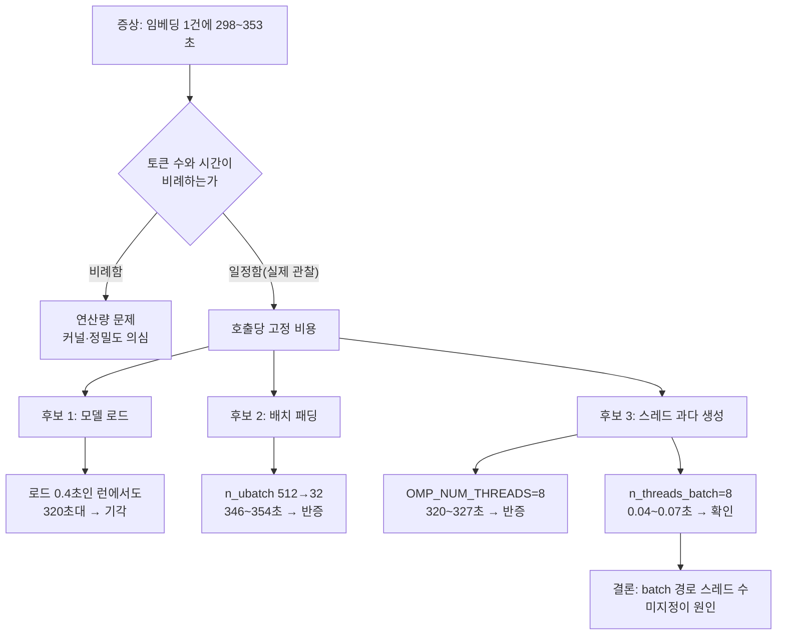

## 왜 읽어야 하나

쿠버네티스 파드에서 CPU 추론이나 배치 임베딩을 돌리는 엔지니어가 "이 모델은 왜 이렇게 느린가"를 판단해야 할 때 읽으면 됩니다. 결론부터 적겠습니다. 저희가 만난 7000배 지연은 모델도 양자화도 아니고 **스레드 수를 명시하지 않아 생긴 과다 생성**이었고, 컨테이너 안에서 라이브러리가 자동 감지한 코어 수는 cgroup이 실제로 허락한 코어 수와 달랐습니다. 토큰 수를 늘려도 시간이 늘지 않는다는 한 가지 관찰이 그 진단의 입구였습니다.


*여덟 칸만 열린 통로 앞에서 수백 개의 실이 서로를 막고 있는 상태를 형상화했습니다.*

## 개요

저희는 0.6B 임베딩 모델을 저비트로 양자화한 뒤, 그것을 표준 로더로 돌릴 수 있게 GGUF Q4_1 파일(378,522,208바이트)로 다시 부호화했습니다. 변환이 값을 보존했는지는 별도의 게이트로 확인했고, 그 이야기는 다른 글에서 다룹니다. 이 글은 그 검증 과정에서 **부수적으로 드러난 운영 결함** 하나만 다룹니다.

검증 잡은 CPU 전용입니다. CUDA를 끄고(`GGML_CUDA=OFF`) llama-cpp-python 0.3.36을 설치해, `embedding=True`, `n_ctx=512`, `n_batch=512`, `n_ubatch=512`, `n_threads=8`로 모델을 올렸습니다. 임베딩 한 건에 **298초에서 353초**가 걸렸습니다. 0.6B 모델에 문장은 열 단어 남짓입니다. 이 숫자는 설명되지 않습니다.

오진하기 쉬운 자리입니다. 방금 양자화와 포맷 변환을 한 직후였으니 "저비트 커널이 느리다" 또는 "Q4_1 역양자화 비용이 크다"는 설명이 손에 잡힐 듯 가까웠습니다. 그러나 그 설명은 관찰 하나와 어긋납니다.

## 단서는 "시간이 늘지 않는다"였습니다

측정 로그에는 문장마다 토큰 수와 소요 시간이 같이 찍혀 있었습니다. 한국어 문장은 9토큰, 다른 문장은 16토큰, 영어 문장은 8토큰입니다. 그런데 시간은 세 경우 모두 320초대로 같았습니다.

이 비례 관계의 부재가 중요합니다. 연산량이 원인이라면 토큰이 두 배일 때 시간도 대체로 두 배 방향으로 움직입니다. 토큰 수와 무관하게 거의 일정한 시간은 **호출당 고정 비용**을 가리킵니다. 고정 비용의 후보는 많지 않습니다. 모델 로드, 그래프 할당, 메모리 복사, 그리고 스레드 생성과 동기화입니다.

모델 로드는 후보에서 빠졌습니다. 첫 측정에서 로드는 51.1초였고, 같은 파일을 다시 읽은 다음 런에서는 페이지 캐시가 더워져 0.4초였습니다. 로드가 0.4초인 런에서도 임베딩은 여전히 320초대였습니다. 로드와 추론은 분리되어 있었습니다.

## 로그에서 이 증상을 알아보는 방법

llama.cpp는 컨텍스트를 해제할 때 성능 요약을 찍습니다. 저희 첫 런의 요약은 이렇게 생겼습니다.

```text
llama_perf_context_print:        load time =  322563.85 ms
llama_perf_context_print: prompt eval time =  322540.01 ms /     8 tokens
                          (40317.50 ms per token,     0.02 tokens per second)
llama_perf_context_print:        eval time =       0.00 ms /     1 runs
llama_perf_context_print:       total time =  322563.94 ms /     9 tokens
```

읽는 법은 세 가지입니다. 첫째, `prompt eval time`이 `total time`의 거의 전부입니다. 생성이 없는 임베딩이니 당연하고, 동시에 **느린 구간이 프롬프트 평가 경로**라는 뜻입니다. 이 한 줄이 배치 경로의 스레드 설정을 보라고 가리킵니다. 둘째, 토큰당 40초라는 값은 0.6B 모델에서 물리적으로 설명되지 않습니다. 메모리 대역폭이나 정밀도 문제로는 이런 크기의 간격이 나오지 않습니다. 셋째, `load time`과 `prompt eval time`이 거의 같은 값으로 찍혀 있습니다. 이 구현에서 로드 타이머는 컨텍스트 생성 이후의 첫 평가까지를 포함하므로, 두 값이 붙어 있는 것을 "로드가 느리다"로 읽으면 엉뚱한 곳을 파게 됩니다. 저희가 로드를 후보에서 지운 근거는 다른 곳에 있었습니다. 페이지 캐시가 더워져 로드가 0.4초로 떨어진 런에서도 임베딩은 320초대를 유지했습니다.

같은 요약에 `graphs reused = 0`도 찍혀 있었습니다. 호출마다 그래프를 다시 만든다는 뜻으로 읽히는 줄이라 고정 비용의 후보처럼 보였지만, 저희는 이것을 원인으로 **귀속하지 않았습니다**. A팔에서 스레드 인자만 바꿨을 때 지연이 사라졌고 그래프 재사용 여부는 손대지 않았기 때문입니다. 그럴듯한 줄을 원인으로 적어 두면 다음 사람이 같은 자리를 다시 팝니다.



## 먼저 틀린 가설: OpenMP 과다 생성

파드 안의 사실 두 가지를 먼저 읽었습니다. `os.cpu_count()`는 **256**을 돌려줬고, `/sys/fs/cgroup/cpu.max`는 `800000 100000`이었습니다. 뒤의 값은 주기 100밀리초 동안 800밀리초의 CPU 시간을 쓸 수 있다는 뜻이니 **8코어**입니다. 즉 라이브러리가 자동으로 코어 수를 세면 실제 허용량의 32배를 봅니다.

그리고 llama.cpp 빌드 로그에 `OPENMP = 1`이 찍혀 있었습니다. 그래서 가설을 세웠습니다. ggml이 OpenMP로 병렬 구간을 돌리고, OpenMP 런타임이 호스트 코어 수만큼 스레드를 띄워 8코어 안에서 경합한다는 그림입니다. 설명이 깔끔했고 환경 사실과도 맞았습니다.

`OMP_NUM_THREADS=8`과 `OPENBLAS_NUM_THREADS=8`을 고정하고 같은 문장을 다시 쟀습니다. **320.77초, 325.9초, 326.7초**였습니다. 변하지 않았습니다. 가설은 반증됐습니다.

여기서 멈추지 않은 것이 이 추적의 전부입니다. 그럴듯한 가설이 환경 사실과 맞아떨어지는데도 숫자가 움직이지 않았다면, 믿어야 할 것은 **움직이지 않은 숫자** 쪽입니다.

## 팔을 나눠 한 번에 재기

남은 후보는 둘이었습니다. 하나는 배치가 `n_ubatch`만큼 패딩되어 항상 512개 위치를 계산한다는 설명이고, 다른 하나는 llama.cpp가 프롬프트 평가 경로에 쓰는 스레드 수를 따로 둔다는 설명입니다. 후자는 API를 다시 읽다가 나온 가능성이었습니다. 모델을 올릴 때 저희는 `n_threads`만 넘겼고, 배치 경로용 인자는 비워 뒀습니다.

둘을 같은 잡 안에서 팔로 나눠 쟀습니다. 같은 파일, 같은 빌드, 같은 장비, 같은 문장 세 건입니다. 한 번에 재는 것이 중요합니다. 따로 재면 노드 상태나 페이지 캐시 차이가 섞여 들어옵니다.

| 팔 | 설정 | 임베딩 소요 시간(문장 3건) |
|---|---|---|
| 기준선 | `n_threads=8` | 298.53초 / 327.69초 / 353.4초 |
| A | `n_threads=8`, `n_threads_batch=8` | **0.05초 / 0.04초 / 0.07초** |
| B | `n_threads=8`, `n_batch=32`, `n_ubatch=32` | 346.2초 / 349.51초 / 354.09초 |

두 가지가 동시에 확정됐습니다. A팔은 기준선보다 **약 7000배** 빠릅니다. 그리고 B팔은 느린 그대로이므로 **배치 패딩 가설은 반증됐습니다**. 패딩이 원인이었다면 계산 위치를 512개에서 32개로 줄인 B팔이 눈에 띄게 빨라졌어야 합니다.

원인은 이렇게 정리됩니다. llama.cpp는 토큰을 하나씩 생성하는 경로와 프롬프트를 한꺼번에 처리하는 배치 경로에 **서로 다른 스레드 수**를 씁니다. 임베딩은 전부 프롬프트 평가이므로 배치 경로만 탑니다. 그 값을 지정하지 않으면 라이브러리가 호스트 코어 수를 보고 풀을 잡고, cgroup이 8코어만 허락한 컨테이너에서 수백 개의 스레드가 같은 여덟 칸을 두고 싸웁니다. 스레드가 늘어난 만큼 동기화 비용과 컨텍스트 전환이 늘고, 정작 계산은 8코어 분량밖에 진행되지 않습니다. 그래서 토큰 수와 무관한 고정 비용으로 보였던 것입니다.

## 그래서 파드에서는 코어 수를 읽어 명시합니다

교훈은 "8을 쓰라"가 아닙니다. 8은 그 컨테이너의 cgroup 할당량이었을 뿐입니다. 쓸 수 있는 코어 수를 **런타임에 읽어서** 스레드 수에 그대로 넘기는 것이 답입니다. 공개한 모델 카드에도 그렇게 적었습니다.

컨테이너에서 가용 코어를 읽는 코드는 세 곳을 봅니다. cgroup v2의 `cpu.max`, cgroup v1의 `cpu.cfs_quota_us`와 `cpu.cfs_period_us`, 그리고 CPU 어피니티입니다. 셋 중 가장 작은 값이 실제로 쓸 수 있는 수입니다.

```python
import os
from pathlib import Path


def usable_cores(default: int = 4) -> int:
    """컨테이너가 실제로 쓸 수 있는 코어 수. cgroup v2 → v1 → 어피니티 순으로 본다."""
    candidates = []

    # cgroup v2: "<quota> <period>" 또는 "max <period>"
    v2 = Path("/sys/fs/cgroup/cpu.max")
    if v2.is_file():
        parts = v2.read_text().split()
        if len(parts) == 2 and parts[0] != "max":
            quota, period = int(parts[0]), int(parts[1])
            if quota > 0 and period > 0:
                candidates.append(quota / period)

    # cgroup v1: quota 가 -1 이면 무제한
    v1q = Path("/sys/fs/cgroup/cpu/cpu.cfs_quota_us")
    v1p = Path("/sys/fs/cgroup/cpu/cpu.cfs_period_us")
    if v1q.is_file() and v1p.is_file():
        quota, period = int(v1q.read_text()), int(v1p.read_text())
        if quota > 0 and period > 0:
            candidates.append(quota / period)

    # 어피니티는 cpuset 제한을 반영한다. os.cpu_count() 는 호스트 전체를 센다.
    try:
        candidates.append(len(os.sched_getaffinity(0)))
    except AttributeError:
        pass

    if not candidates:
        return default
    return max(1, int(min(candidates)))


if __name__ == "__main__":
    print("os.cpu_count()      =", os.cpu_count())
    print("usable_cores()      =", usable_cores())
```

저희 파드에서 이 코드는 `os.cpu_count() = 256`과 `usable_cores() = 8`을 나란히 출력합니다. 두 값이 다르면 그 차이만큼 스레드가 과다 생성될 여지가 있다는 신호입니다.

읽은 값을 **두 인자 모두에** 넘깁니다. 하나만 넘기면 이 글의 증상이 그대로 재현됩니다.

```python
import numpy as np
import llama_cpp

NT = usable_cores()

llm = llama_cpp.Llama(
    model_path="model-q4_1.gguf",
    embedding=True,
    n_ctx=512,
    n_batch=512,
    n_ubatch=512,
    n_threads=NT,
    n_threads_batch=NT,   # ⛔ 이 줄이 없으면 호스트 코어 수로 풀이 잡힌다
    verbose=False,
)


def embed(text: str) -> np.ndarray:
    v = np.asarray(llm.embed(text), dtype=np.float32).reshape(-1)
    return v / np.linalg.norm(v)      # 출력은 미정규화 상태로 나온다


docs = ["한국의 수도는 서울이다.", "The capital of France is Paris."]
query = embed("대한민국의 수도는 어디인가?")
print(np.stack([embed(d) for d in docs]) @ query)
```

CLI로 돌릴 때도 같습니다. `llama-embedding`에는 두 플래그가 따로 있습니다.

```bash
./llama-embedding -m model-q4_1.gguf --pooling last \
    -p "The capital of France is Paris." \
    --threads 8 --threads-batch 8 --embd-normalize 2
```

쿠버네티스 매니페스트에서는 요청과 한도를 정수로 두고, 같은 값을 환경변수로 내려 코드가 읽게 하는 방법도 씁니다. 다만 `limits.cpu`를 소수로 주면(예: `500m`) 코드가 계산한 값이 0이 되어 1로 바닥을 쳐야 하므로, 추론 잡에는 정수 코어를 주는 편이 디버깅하기 쉽습니다.

## 실제 결과: 같은 파일에서 다시 재기

고친 설정으로 공개할 그 파일에서 다시 쟀습니다. 문장 9건에 대해 임베딩 호출이 **0.039초에서 0.097초** 사이였고, 모든 벡터가 1024차원이고 전부 유한하며 노름이 0보다 컸습니다. 작은 검색 집합(문서 6개, 질의 3개)에서 top-1은 3건 모두 의도한 정답과 일치했습니다.

이 대목에서 과장하지 않는 것이 중요합니다. **이것은 모델 성능 향상이 아닙니다.** 스레드 과다 생성이라는 운영 결함을 고친 결과입니다. 느린 경로와 빠른 경로는 같은 연산을 했고, 그래서 임베딩 값도 같았습니다. 느린 기준선에서 쟀던 품질 수치, 즉 fp32 기준본 대비 최소 코사인 0.999020과 top-1 3/3은 설정을 고친 뒤에도 그대로 유효했습니다. 양자화나 변환이 정확도에 미친 영향과 이 스레드 이야기는 서로 무관한 축입니다.

## ThakiCloud 제품 적용 시사점

ThakiCloud의 ai-platform은 쿠버네티스 위에서 GPU와 CPU 워크로드를 Kueue 큐로 받아 멀티테넌트로 돌립니다. 이 사고는 그 환경에서 반복되기 쉬운 모양을 하고 있습니다. 테넌트마다 cgroup 할당량이 다르고, 같은 이미지가 코어 수가 전혀 다른 노드에 스케줄되며, 라이브러리는 그 차이를 모른 채 호스트 기준으로 자원을 잡습니다. 노드가 클수록 증상이 심해지는 구조라서, 좋은 하드웨어로 옮기는 것이 오히려 느려지는 방향으로 나타날 수 있습니다.

그래서 저희는 추론·배치 잡의 스레드 수를 라이브러리 자동 감지에 맡기지 않고 런타임에 읽어 명시하는 쪽으로 정리했습니다. CPU 임베딩은 특히 이득이 큽니다. 0.6B급 임베딩 모델을 GPU 없이 CPU 파드에서 돌릴 수 있으면 온프렘 환경에서 GPU를 질의 처리에 양보할 수 있고, 검색 색인 같은 배치성 작업을 값싼 노드로 밀어낼 수 있습니다. 다만 그 경제성은 스레드 설정이 맞아야 성립합니다. 같은 파일이 320초와 0.04초 사이를 오가는 환경에서는 비용 계산 자체가 의미를 잃습니다.

소버린 클라우드나 폐쇄망 구축에서도 같은 점검이 필요합니다. 고객 노드의 코어 수와 할당량은 저희 개발 환경과 다르고, 그 차이가 성능 보고서의 숫자를 바꿉니다. 측정값을 전달할 때 스레드 설정과 cgroup 할당량을 함께 적는 것이 그래서 형식적인 요구가 아닙니다.

## 한계 및 반론

이 글의 측정은 **한 환경, 한 모델, 한 라이브러리 버전**에서 나왔습니다. llama-cpp-python 0.3.36, CPU 전용 빌드, 0.6B 임베딩 모델의 Q4_1 파일, cgroup 8코어에 호스트 256코어인 파드입니다. 다른 버전이나 다른 빌드 옵션에서 기본값 처리가 달라질 수 있습니다.

7000배라는 비율도 그 환경의 값입니다. 호스트와 할당량의 비가 32배였기 때문에 경합이 그만큼 심했습니다. 노드가 작거나 할당량이 넉넉하면 차이는 훨씬 작게 나타날 것입니다. 이 숫자를 일반적인 기대치로 인용하면 안 됩니다.

원인 규명의 범위도 분명히 해 둡니다. 저희가 확인한 것은 "배치 경로 스레드 수를 명시하면 증상이 사라진다"는 인과입니다. 라이브러리 내부에서 기본값이 정확히 어떤 경로로 결정되는지, 그리고 동기화 비용과 컨텍스트 전환 중 어느 쪽이 지배적인지는 코드 레벨로 더 파지 않았습니다. 운영 결함을 제거하는 데 필요한 깊이까지만 간 것이고, 그 이상은 이번 작업의 목표가 아니었습니다.

마지막으로 반론 하나를 적어 둡니다. "처음부터 두 인자를 모두 넘기면 될 일을 길게 썼다"고 볼 수 있습니다. 맞습니다. 다만 저희가 잃은 것은 설정 한 줄이 아니라 **잘못된 결론**에 가까웠습니다. 양자화 직후였으니 "저비트 추론이 CPU에서 느리다"로 적고 넘어갈 수 있었고, 그러면 공개 카드에 틀린 성능 서술이 남았을 것입니다.

## 정리

토큰 수를 늘려도 시간이 늘지 않으면 연산이 아니라 **고정 비용**을 의심해야 합니다. 저희는 그 단서를 따라가 OpenMP 가설과 배치 패딩 가설을 각각 숫자로 반증하고, 프롬프트 평가 경로의 스레드 수가 호스트 코어 기준으로 잡힌다는 원인에 도달했습니다. 같은 파일이 298초에서 0.04초로 돌아왔고, 임베딩 값과 품질 수치는 그대로였습니다. 결함이 없어진 것이고, 이것을 성능 향상으로 적으면 과장이 됩니다.

지금 파드에서 CPU 추론을 돌리고 있다면 네 가지를 순서대로 확인하시면 됩니다.

1. 입력 길이를 두 배로 늘려 시간이 비례해 늘어나는지 봅니다. 늘지 않으면 고정 비용 쪽을 봅니다.
2. 파드 안에서 `os.cpu_count()`와 cgroup 할당량을 같이 출력합니다. 두 값이 다르면 자동 감지가 틀린 상태입니다.
3. 쓰는 라이브러리가 배치 경로용 스레드 인자를 따로 받는지 확인하고, 받으면 두 인자 모두에 가용 코어 수를 넘깁니다.
4. 설정을 바꾼 뒤 출력 벡터가 이전과 같은지 확인합니다. 스레드 수는 결과를 바꾸지 않아야 하고, 바뀌었다면 다른 문제가 섞여 있습니다.

이 작업에서 나온 모델은 공개해 두었습니다. [ThakiCloud/Qwen3-Embedding-0.6B-MultiCal-M1a-GPTQ](https://huggingface.co/ThakiCloud/Qwen3-Embedding-0.6B-MultiCal-M1a-GPTQ)의 GGUF Q4_1 파일로 위 코드를 그대로 돌려보실 수 있고, 카드에 스레드 설정에 관한 같은 주의를 적어 두었습니다.
