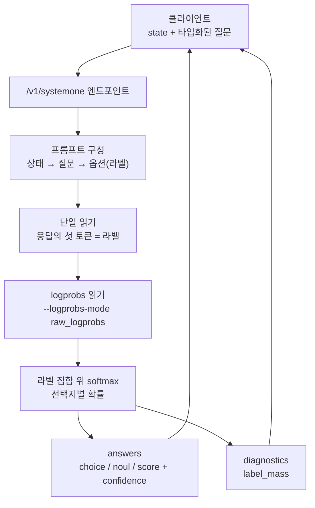

*타입화된 질문들이 상태와 함께 하나의 결정 지점으로 수렴하는 비주얼입니다.*

## 왜 읽어야 하나

vLLM으로 LLM 엔드포인트를 서빙하며(ThakiCloud Metis든, 온프레미스 self-hosting이든) v0.32.0 업그레이드를 결정해야 하는 플랫폼 엔지니어와 개발자를 위해 씁니다. 끝까지 읽으면 이번 릴리스가 자기 워크로드에 값어치가 있는지 한 문장으로 판단할 수 있고, 새로 들어온 `/v1/systemone` 엔드포인트가 운영적으로 무엇을 의미하는지 직접 설치하고 코드를 열어 확인한 기록을 보게 됩니다.

결론을 먼저 말합니다. vLLM v0.32.0의 핵심은 새 모델이나 새 양자화가 아니라, **구조화된 판단(structured judgment)이 엔진의 1급 API가 된 것**입니다. 어떤 상태에 대한 타입화된 질문(다중선택, yes/no, 점수)을 보내면 모든 선택지에 대한 확률과 신뢰도를 단일 읽기(read)로 돌려줍니다. 함의는 단순합니다. 분류·라우팅·스코어링 트래픽 비중이 높은 워크로드라면, 그 호출의 비용을 "토큰 1개를 읽는" 수준으로 줄일 수 있게 된 릴리스입니다.

## 개요

2026년 10월 18일 릴리스된 v0.32.0은 363명 기여자(신규 121명 포함)의 814개 커밋을 담고 있습니다. 마이너 릴리스 하나로서는 상당한 규모이며, 변경은 세 축으로 모입니다.

첫째, `/v1/systemone` 엔드포인트입니다. 둘째, 모델별 파서를 유지하기 대신 체크포인트의 `response_template`을 읽는 범용 `hf` tool/reasoning 파서입니다. 셋째, 저정밀도 KV 캐시의 확장입니다. NVFP4(4비트) KV 캐시 지원이 Ampere(SM80)·Ada(SM86/89) 같은 오래된 GPU와 SM90·SM120으로 뻗고, ROCm에는 4비트 `ultraquant_4bit` KV 캐시가 더해집니다. 이와 함께 API 서버의 CORS 기본값이 강화되고 Python 하한은 3.11로 올라갑니다.

참고로 9월 24일 게시한 "DiffusionGemma-as-Jev" 글에서는 구조화된 판단을 오픈웨이트로 서빙하는 원형 경로를 다뤘습니다. 이번 릴리스는 그 능력을 정식 엔드포인트로 승격시킨 사건입니다.

## 이 기술은 무엇인가: /v1/systemone

`/v1/systemone`은 "상태에 대한 타입화된 질문 묶음"에 답하고, 허용된 답마다 확률을 돌려줍니다. 질문 타입은 세 가지입니다.

- **choice**: 옵션 이름에서 설명(또는 null)으로 가는 맵. 옵션은 요청 순서대로 A부터 Z까지 라벨을 받습니다. 응답은 선택 옵션, 옵션별 `probabilities`, `confidence`.
- **noul**: yes/no 확률 질문. `criteria`는 null이거나 `true`/`false` 설명 객체. 응답은 yes 확률(`noul`), `probabilities`, `confidence`.
- **score**: 순서가 있는 레벨 이름 목록(2개 이상, 10개 이하). 응답은 0-indexed 레벨의 확률가중 평균(`score`), 레벨별 `legend`, `probabilities`.

메커니즘을 보면, 각 질문은 읽기 하나입니다. 사용자 메시지는 상태, 질문, 타입 라벨을 단 옵션, 그리고 "라벨 하나로 답하라"는 지시로 구성됩니다. 읽기는 모델 응답의 **첫 번째 토큰**입니다. 각 라벨은 해당 토큰이 하나여야 하고, 아니면 요청은 400을 받습니다. 확률은 그 질문의 라벨 토큰들에 대한 logprobs 위에 softmax를 취해집니다. 그래서 서빙에 `--logprobs-mode raw_logprobs`(또는 `processed_logprobs`) 플래그가 필수입니다. `label_mass`(라벨 집합에 내려온 확률 질)를 계산하려면 logprobs가 필요하기 때문입니다.

운영적으로 중요한 성질이 두 개 있습니다. 첫째, 요청의 모든 질문이 같은 상태에서 시작하므로 `--enable-prefix-caching`을 켜면 상태는 한 번만 prefill되고, 이후 질문은 자기 텍스트만 prefill한 뒤 토큰 하나를 읽습니다. 질문 N개의 요청은 읽기 N개에 가깝게 들습니다. 둘째, 동일한 요청의 확률은 배치 구성과 prefix 캐시 적중 여부에 따라 달라질 수 있습니다. 판단을 재현 가능하게 만들려면 `VLLM_BATCH_INVARIANT=1`을 두지만, 여기에는 처리량 비용이 붙습니다.

응답 본문에는 `answers`, `usage`, `diagnostics`가 들어 있습니다. `diagnostics.label_mass`는 모델이 전체 어휘에 걸쳐 라벨들에 얼마나 확률을 놓았는지입니다. 값이 낮다는 것은 대부분의 확률이 라벨이 아닌 토큰으로 흘렀다는 뜻이고, `confidence`는 선택된 옵션의 전체 어휘 대비 점유율(라벨 내 점유 × label_mass)입니다. 이 진단 필드는 "모델이 실제로 라벨 안에서 답하고 있는가"를 판별하는 열쇠입니다.

문서 예제의 수치로 계산이 어떻게 되는지 보면, team 질문의 label_mass가 0.93이고 라벨 정규화 공간에서 billing이 0.97이면 confidence는 0.93 × 0.97 ≈ 0.90이 됩니다. 반대로 label_mass가 0.4까지 내려가면, 라벨 안에서는 billing을 고를지라도 전체 어휘 기준으로는 모델이 다른 토큰을 더 좋아했다는 뜻이므로 그 판단의 신뢰도를 낮춰야 합니다. 생성 호출로 분류를 할 때 "모델이 A라고 답했네"에서 끝나는 것과, "A에 확률 0.93, 어휘 전체에서 라벨 질 0.93"을 함께 받는 것의 차이는 오작동 탐지에 바로 연결됩니다.

**왜 "System 1"인가.** 이름은 카너만의 이중 처리 이론에서 가져왔습니다. System 1은 빠르고 자동화된 직관 판단, System 2는 느리고 단계적인 추론입니다. 릴리스 보도에서는 이 엔드포인트를 "judgment calls, not generation"으로 표현합니다. 실무에서 LLM에 가장 자주 쓰는 호출의 상당수가 사실 System 2가 아닙니다. 티켓을 어떤 팀에 라우트할지, 이 입력이 어느 카테고리에 속하는지, 두 옵션 중 어느 쪽이 맞는지를 묻는 것이 대부분이고, 이런 질문에는 문장을 "생성"할 필요가 없습니다. 답은 라벨이고, 그 라벨의 확률 분포만 필요합니다. systemone은 바로 그 호출을 엔진이 1급으로 취급하도록 만든 것입니다. 기존 방식(prompt에 "A/B/C로만 답해"를 넣고 응답을 파싱하거나, constrained decoding으로 라벨 집합을 제한하는 것)과 비교하면, 파싱 실패가 구조적으로 사라지고(답은 라벨 집합에서 나오므로), 확률과 진단이 함께 옵니다.

한계 값은 요청당 질문 64개, choice당 옵션 26개, score당 레벨 10개입니다. 등록된 read 전략이 없는 모델은 501을 돌려줍니다. 지원 모델군은 두 축으로 나뉩니다. Qwen3-0.6B나 Gemma4 같은 일반 생성 모델(read 전략 등록) 위에, 결정 전용 모델 가족이 있습니다. Cloudflare의 clef-flash/clef-omni(joint schema 헤드로 질문 전체를 1회 전방 전달로 점수화), vllm-sr의 d3 시리즈(27B에서 0.6B edge까지, 분류 모델로 서빙), LiquidAI/d1-3B(결정 답이 첫 토큰이 되도록 post-training된 LFM2.5-VL-3B), DiffusionGemma까지. 현재 공식 문서에는 OpenAI의 `POST /v1/decisions` API text-only 구현(MVP)도 기술돼 있지만, 이번 실험에서 설치한 0.32.0 패키지의 structured_decisions 모듈에는 `/v1/systemone` 루트만 등록돼 있어 decisions 라우는 이 빌드에서 확인하지 못했습니다.

요청이 엔드포인트 안에서 어떻게 읽기로 변환되는지 아래 흐름으로 정리합니다.


*질문 하나가 읽기 하나로 변환되는 /v1/systemone 내부 흐름입니다.*

### 같은 릴리스의 다른 변화

- **범용 hf 파서**: tool/reasoning 파서가 체크포인트의 `response_template`을 읽어 동작합니다. 모델별 파서를 별도로 유지하지 않아도 돼서, 새 오픈웨이트 모델 도입 시 파서 유지 비용이 줄어듭니다.
- **NVFP4 KV 캐시의 GPU 확장**: 4비트 KV 캐시가 Ampere·Ada·SM90·SM120으로 지원 범위를 넓힙니다. KV 캐시는 디코딩 단계의 지배적 메모리 구성요소라서, 4비트로 줄이는 것은 랭크당 메모리 절감으로 직결됩니다. 같은 맥락에서 SM100에서는 GLM-5.x의 KV 기본이 FP8이 되며(랭크당 KV 메모리 대략 반절), ROCm에는 FP8 밀도의 약 2배인 4비트 `ultraquant_4bit` KV 캐시가 들어갑니다.
- **보안 기본값**: API 서버의 CORS가 더 이상 모든 기원을 기본 허용하지 않습니다. self-hosting 환경은 업그레이드 전 배포 구성을 확인해야 합니다.
- **하한·의존성**: Python 3.10 지원 종료(3.11 이상, 3.12+ 권장). `transformers>=5.16.1,<5.20.0`, `tokenizers>=0.23.2` 등 의존성 업데이트.
- **삭제**: cascade attention, `torch.compile` 시퀀스 병렬/AsyncTP 패스, `mamba_cache_mode="all"`. `max_tokens`가 더 이상 컨텍스트 윈도우에서 자리를 예약하지 않습니다. Responses API의 reasoning 스트림 이벤트 명도 바뀌었습니다.

### 업그레이드 체크리스트

운영자 관점에서 0.32.0으로 올릴 때 확인할 항목을 정리합니다.

1. **CORS**: 게이트웨이 앞 vLLM을 직접 노출하는 self-hosting이라면, 기본 CORS가 닫혔는지 확인하고 프록시/인그레스의 원본 설정을 재검증합니다.
2. **Python/이미지**: 3.10 기반 이미지나 런타임은 3.11+로 올립니다. `transformers` 5.x 구간으로 바뀐 만큼, 직접 pin하고 있는 의존성이 부딪히지 않는지 확인합니다.
3. **삭제된 플래그**: `cascade attention`이나 `mamba_cache_mode="all"`을 쓰던 구성에서는 이제 동작하지 않습니다. `max_tokens` 예약 동작을 전제로 컨텍스트 길이를 잡았던 코드는 수치를 다시 봅니다.
4. **KV 캐시 정밀도**: Ampere/Ada/Hopper 세트를 쓰는 플릿이라면 NVFP4 KV의 랭크당 메모리 절감을 스테이징에서 먼저 측정하고, `--gpu-memory-utilization` 같은 메모리 가정 값을 재조정합니다.
5. **systemone 도입**: read 전략이 등록된 모델을 쓰는 엔드포인트에 `/v1/systemone`이 기본으로 열립니다. 판단형 트래픽을 이 엔드포인트로 옮기기 전에 `label_mass`/`confidence`의 분포를 짧은 트래픽으로 먼저 지켜보는 것을 권합니다.

## 설치 및 통합

pip 경로부터 확인합니다. 이번 실험 환경(macOS, arm64, Python 3.12.8)에서 `vllm==0.32.0` 설치 시도 결과, 새 의존성 `pynvvideocodec==2.0.4`가 manylinux(x86_64/aarch64)과 win_amd64 바퀴만 제공해 `macosx_26_0_arm64`에 대응하는 바퀴가 없으므로 해결 자체가 실패합니다.

```
× No solution found when resolving dependencies:
  ╰─▶ Because pynvvideocodec==2.0.4 has no wheels with a matching
      platform tag (e.g., `macosx_26_0_arm64`) and vllm==0.32.0 depends on
      pynvvideocodec==2.0.4, we can conclude that vllm==0.32.0 cannot be used.
```

즉 vLLM 0.32.0의 로컬 macOS 실험은 컨테이너 경유가 전제가 됩니다. (설치 바퀴의 Requires-Python은 `>=3.11,<3.15`로, Python 3.10 지원 종료라는 릴리스 노트의 기술이 코드에서 확인됩니다.)

Docker 경로는 NVIDIA GPU가 있는 호스트를 전제로 합니다. 공식 `vllm/vllm-openai:v0.32.0` 이미지에 linux/arm64 변종이 포함돼 있어서 풀링 자체는 Apple Silicon에서도 되지만, 이 이미지는 CUDA 빌드(torch 2.13.0+cu130)라 GPU가 없는 Mac에서는 `vllm serve`가 아규먼트 파서 구성 단계에서 바로 죽습니다. 자세한 실패 기록은 아래 실험 결과에 있습니다. GPU 호스트에서의 서빙은 아래처럼 합니다(공식 문서 예제에 등장하는 가장 작은 모델 Qwen3-0.6B, systemone에 필요한 `raw_logprobs`와 prefix 캐싱 켜기).

```bash
docker run -d --name vllm0320 --platform linux/arm64 -p 8811:8000 \
  vllm/vllm-openai:v0.32.0 \
  vllm serve Qwen/Qwen3-0.6B \
  --max-model-len 4096 \
  --logprobs-mode raw_logprobs \
  --enable-prefix-caching
```

GPU가 없는 로컬에서는 CPU 컨테이너 + pip 바퀴 경로가 열립니다. `ubuntu:24.04` arm64 컨테이너 안에서 venv를 만들고 `pip install vllm==0.32.0`하면 PyPI의 manylinux aarch64 바퀴가 들어갑니다.

```bash
docker run -d --name vllm0320cpu --platform linux/arm64 -p 8812:8000 ubuntu:24.04 sleep 4000
docker exec vllm0320cpu apt-get update -qq
docker exec -e DEBIAN_FRONTEND=noninteractive vllm0320cpu \
  apt-get install -y -qq python3-venv python3-pip curl ca-certificates
docker exec vllm0320cpu python3 -m venv /opt/venv
docker exec vllm0320cpu /opt/venv/bin/pip install vllm==0.32.0
```

설치는 됩니다. 실행은 안 됩니다. 0.32.0에서는 `device` 인자가 제거되고(`device.py`의 `device` 파라미터가 "deprecated, will be set automatically based on the current platform"이라고 명시) 플랫폼이 자동 판정되는데, 그 판정에서 CPU는 `VLLM_TARGET_DEVICE=cpu` 환경변수가 있거나 CPU 빌드이거나 darwin인 경우에만 활성화됩니다. 환경변수로 CPU 플랫폼까지 통과해도, 배포된 aarch64 바퀴에는 CPU 연산 확장(`vllm._C`)이 없어 워커가 시작 단계에서 죽습니다. 아래 실험 결과에 두 단계의 트레이스백이 모두 있습니다. 즉, **로컬 CPU 실행은 이 릴리스의 배포 아티팩트로 불가능**하고, 실행 검증은 GPU 환경(아래의 공식 이미지)에서 해야 합니다.

systemone 요청은 아래처럼 보냅니다(공식 문서 예제, 고객 지원 티켓 분류. 서빙 가능한 GPU 환경에서).

```bash
curl -s http://localhost:8811/v1/systemone -H "Content-Type: application/json" -d '{
  "model": "Qwen/Qwen3-0.6B",
  "state": {"ticket": "My card was charged twice for one order."},
  "questions": {
    "team": {"type": "choice", "instructions": "Which team should handle this ticket?",
      "criteria": {"billing": "payments and refunds", "shipping": "deliveries", "security": "account access"}},
    "urgent": {"type": "noul", "instructions": "Does the customer need a reply within the hour?",
      "criteria": {"true": "the account is locked or money is moving"}},
    "tone": {"type": "score", "instructions": "How upset is the customer?",
      "criteria": ["calm", "annoyed", "furious"]}
  },
  "chat_template_kwargs": {"enable_thinking": false}
}'
```

## 실제 실험 결과

실험은 세 경로로 나뉘어 모두 실제 기록이 있습니다.

**1) macOS pip 경로: 실패 (예상대로).** 앞서 본 바와 같이 의존성 해결 단계에서 끝납니다. vLLM 0.32.0에 macOS 바퀴가 없다는 사실 자체를 확인한 셈입니다.

**2) 공식 Docker 이미지 경로: 풀링은 성공, 서빙은 실패.** `vllm/vllm-openai:v0.32.0` arm64를 풀링해 컨테이너를 띄우니, `vllm serve`는 모델 다운로드도 전에 아규먼트 파서 구성 단계에서 죽습니다.

```
File ".../vllm/entrypoints/cli/serve.py", line 172, in subparser_init
    serve_parser = make_arg_parser(serve_parser)
  ...
File ".../vllm/config/device.py", line 55, in __post_init__
    raise RuntimeError(
RuntimeError: Failed to infer device type, please set the environment variable
`VLLM_LOGGING_LEVEL=DEBUG` to turn on verbose logging to help debug the issue.
```

`device.py`를 열어보면 원인이 명확합니다. `device` 기본값 `"auto"`일 때 `current_platform.device_type`으로 추론하는데, GPU가 없는 이 arm64 호스트에서는 그 값이 비어 있습니다. 명시적 `device`가 주어지면 추론을 건너뜁니다. 단, CLI는 플래그를 파싱하기도 전에 기본값 팩토리로 `VllmConfig`를 구성하기 때문에, `--device cpu`를 붙여도 같은 지점에서 죽습니다.

**3) CPU 컨테이너 + pip 바퀴 경로: 설치는 성공, 실행은 두 단계에서 실패.** `pip install vllm==0.32.0`은 manylinux aarch64 바퀴로 정상 설치됩니다(설치된 버전 `0.32.0`, torch `2.13.0+cu130`, `Requires-Python >=3.11,<3.15` 확인, `import vllm` 통과). 실행 시도는 두 번 했습니다.

첫째, offline API. 0.32.0에는 `device` 인자 자체가 없습니다.

```
File ".../vllm/entrypoints/llm.py", line 296, in __init__
    engine_args = EngineArgs(
TypeError: EngineArgs.__init__() got an unexpected keyword argument 'device'
```

둘째, `VLLM_TARGET_DEVICE=cpu`로 CPU 플랫폼 판정을 통과시킨 뒤 `vllm serve`를 띄운 것. CLI 파서는 통과하지만 워커 초기화에서 죽습니다.

```
WARNING ... [cpu.py:667] Failed to import from vllm._C:
ModuleNotFoundError("No module named 'vllm._C'")
  File ".../vllm/v1/worker/cpu_worker.py", line 70, in __init__
    torch.ops._C.init_cpu_memory_env([memory_node])
AttributeError: '_OpNamespace' '_C' object has no attribute 'init_cpu_memory_env'
ERROR ... EngineCore failed to start.
```

결론적으로 배포된 aarch64 바퀴는 CPU 연산 확장이 없는 빌드입니다. 재현 시도 중 실패: 로컬 CPU 실행은 `vllm._C` 부재로 불가능(GPU 빌드 전용 바퀴).

**엔드포인트 코드 검증(설치된 패키지).** 서빙이 불가능한 환경에서도, 0.32.0 패키지를 직접 열어 릴리스 노트의 기술들을 확인했습니다. `vllm/entrypoints/generate/structured_decisions/` 모듈에 `api_router.py`(37번째 줄에 `"/v1/systemone"` 루트), `question_types.py`·`strategies.py`(choice/noul/score), `protocol.py`, `serving.py`(`ServingStructuredDecisions`, `create_decision`)가 들어 있고, `protocol.py`에는 읽기가 출력 토큰 1개로 제한되는 `max_output_tokens=1`이, 응답 진단에 `argmax_is_label`이 코드로 존재합니다. "질문 하나가 첫 토큰 읽기 하나"라는 문서의 설명이 코드에서 확인된 것입니다. `response_template` 파서는 `vllm/parser/` 아래(`response_template.py`, `parser_manager.py` 등)에 존재합니다.

한 단계 더 나아가 공식 문서의 예시 수치를 코드와 대조했습니다. v0.32.0 태그의 `question_types.py`를 직접 실행하고, 문서 예시가 스스로 인쇄하는 확률값으로 세 답안을 다시 계산했습니다. team(choice)의 confidence 0.90은 코드 산출 0.9021과 일치합니다. urgent(noul)의 confidence는 문서에 0.95로 적혀 있고 코드 산출은 0.9604입니다. tone(score)의 기대 레벨은 문서에 0.6으로 적혀 있는데, 코드 산출은 문서가 스스로 인쇄한 확률 분포(0.7/0.2/0.1)에서 0.4가 됩니다. `score`는 레벨 인덱스의 확률가중 평균으로 정의되므로 0×0.7+1×0.2+2×0.1=0.4가 맞는 값입니다. 문서 예시값이 실측 없이 지나간 작은 불일치이며, 실무 정본은 배포되는 코드 쪽입니다.

정리하면, `/v1/systemone`의 동작(HTTP 응답, 확률, 400/501)은 이번 로컬 실험에서 실측하지 못했습니다. 로컬에서 검증한 것은 (a) 설치된 패키지 코드에 의한 릴리스 구성, (b) 실행 경로의 한계 전수지도(macOS 바퀴 부재, aarch64 바퀴의 CPU 확장 부재, GPU 없는 호스트의 CLI 크래시), (c) 공식 문서의 API 계약, (d) 문서 예시값과 코드의 대조(예시의 tone 답 `score` 필드가 코드 산출과 불일치)입니다. 엔드포인트의 실측은 GPU 환경에서의 다음 단계로 남깁니다.

## ThakiCloud 제품 적용 시사점

### ai-platform (K8s 기반 AI/ML 추론 인프라)

ThakiCloud ai-platform은 vLLM 기반 서버리스 엔드포인트(Metis)로 고객 모델을 서빙합니다. v0.32.0은 여기에서 두 가지를 뜻합니다. 먼저, 저정밀도 KV 캐시가 더 넓은 GPU 세트로 닿습니다. NVFP4 KV가 SM90(Hopper)까지 지원되는 것은 H200 플릿에서 랭크당 KV 메모리를 줄여주는 것이고, SM100에서 GLM-5.x의 FP8 KV 기본화는 B200 플릿에서 같은 효과입니다. 디코딩이 메모리 대역폭에 걸리는 구간에서 KV 절감은 랭크당 처리량 상승, 곧 서빙 비용 하락으로 환산됩니다. 두 번째로, CORS 기본값 강화와 의존성 하한(Python 3.11+, transformers 5.x 구간)은 업그레이드 시 엔드포인트 이미지와 서빙 구성을 다시 검증해야 한다는 실무 메모입니다.

### Paxis (Agent-Native Cloud)

에이전트 워크플로우는 매 단계에서 판단을 요구합니다. 어떤 스킬을 라우트할지, 사용자의 의도가 어느 카테고리에 속하는지, 신뢰도를 몇 점으로 매길지, 이번 행동을 승인할지. 지금까지 이런 판단은 전부 풀 생성 호출이었습니다. `/v1/systemone`이 있으면 판단을 타입화된 단일 읽기로 바꿀 수 있고, 응답은 코드가 바로 소비할 수 있는 형태(선택, 확률, 신뢰도)입니다. Paxis의 에이전트 루프에 저비용 결정 레이어로 이 엔드포인트를 앉히는 것이 자연스러운 다음 단계입니다. 2차 보도(BestHub)에는 GPU 환경에서 d1-3B 기준 중앙값 약 23ms가 언급되는데, 이는 전용 결정 모델에서 나온 수치임을 구분해 읽어야 합니다.

## 한계 및 반론

- **MVP입니다**. 요청당 질문 64개, choice당 옵션 26개, score당 레벨 10개. OpenAI 상류가 허용하는 200/255를 넘어서면 이 백엔드는 400을 돌려줍니다.
- **확률은 보정되지 않습니다**. `confidence`는 OpenAI 모델에 보정된 값이 아니고, 확률은 제시된 옵션 위에서 정규화되며 배치 구성에 따라 변동합니다. 안정한 판단이 필요한 곳에는 `VLLM_BATCH_INVARIANT=1`이 전제인데, 여기에는 처리량 비용이 있습니다.
- **실행이 GPU 환경을 전제로 합니다**. 로컬(macOS/arm64)에서는 설치조차 되지 않고, CPU 컨테이너에서도 배포 바퀴가 CPU 연산 확장이 없어 실행 불가입니다. 밀리초급 지연 수치를 언급하는 2차 보도는 모두 GPU 환경 값입니다.
- **생성의 대체제가 아닙니다**. 판단(1-token 라벨 읽기)이지 생성이 아닙니다. 열린 형태 텍스트 비중이 큰 워크로드에는 변화가 없습니다.
- **라벨의 1-token 제약**은 토크나이저 특성상 라벨이 여러 토큰으로 나뉘는 모델/언어에서 400을 유발할 수 있는 구조적 한계입니다.

## 정리

vLLM v0.32.0은 판단을 타입 위에 올린 릴리스입니다. `/v1/systemone`이 질문마다 읽기 하나로 선택지 확률을 돌려주고, 범용 hf 파서가 모델 도입 비용을 낮추며, NVFP4 KV 확장이 더 넓은 GPU 세트에서 랭크당 메모리를 줄이고, CORS 강화가 기본 보안 태세를 올려줍니다. 업그레이드 판단은 워크로드의 판단 트래픽 비중으로 갈립니다. 분류·라우팅·스코어링 비중이 크면 0.32.0은 값어치가 있는 릴리스이고, 순수 생성 트래픽이라면 보안 기본값과 KV 메모리를 위해 올리되 systemone은 아직 관망해도 됩니다. 다음 행동을 하나만 골라잡자면, 자기 엔드포인트의 판단형 호출 비중을 재고, ThakiCloud는 H200/B200 플릿에서 NVFP4 KV의 메모리 절감을 실측하는 것입니다.
