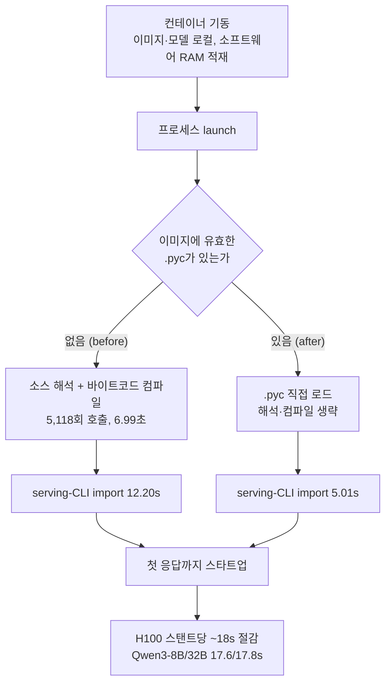

*빌드 시점에 미리 만들어 둔 바이트코드 덕분에 재컴파일을 생략하고 곧바로 첫 응답을 내는 개념을 형상화했습니다.*

## 왜 읽어야 하나

vLLM으로 서버리스나 스케일아웃 인퍼런스를 운영하며 새 컨테이너가 첫 요청을 처리하기까지 드는 콜드 스타트 지연을 줄이고 싶은 플랫폼 엔지니어와 개발자를 위해 씁니다. 끝까지 읽으면 `UV_COMPILE_BYTECODE=1`이라는 빌드 시 한 줄이 스타트업의 어느 구간을, 얼마나 줄이는지 실제로 재현한 기록을 보게 됩니다.

결론을 먼저 말합니다. vLLM이 이미지에 미리 컴파일된 Python 바이트코드(`.pyc`)를 번들링하자, 프로세스 기동부터 첫 응답까지의 스타트업이 H100 기준 **스타트업당 약 18초**, Qwen3-8B·32B 기준 **중앙값 17.6~17.8초(17.6%, 13.9%)** 줄었습니다. 이 절감은 `torch.compile`이나 GPU 커널 컴파일 캐시와는 **별개 경로**의 비용(소스→바이트코드 컴파일)을 줄이는 것이라, 기존 캐시와 효과가 겹치지 않고 더해집니다.

## 개요

vLLM 공식 블로그는 2026년 9월 22일 "Reducing vLLM startup time with one uv flag"를 게시했습니다. 문제의 출발은 단순합니다. 새 컨테이너가 첫 요청을 다루기 전에, Python 런타임이 이미지에 담긴 Python 소스를 `.pyc` 바이트코드로 컴파일하는 데 수 초를 쓰던 것입니다. 이미지와 모델 파일이 이미 로컬에 있고 소스 파일도 RAM에 올라와 있어서 순수하게 "소스를 읽어 바이트코드로 만들 때" 드는 시간이 스타트업의 큰 부분을 차지했습니다.

해법은 빌드 시점에 이 작업을 한 번 해두고 그 결과물(`.pyc`)을 이미지에 넣는 것입니다. `uv`는 `UV_COMPILE_BYTECODE=1`이라는 환경변수 하나로 패키지를 설치할 때 바이트코드까지 컴파일합니다. 릴리스는 `v0.32.0` 공식 이미지부터 적용되며 PR #55422가 CUDA nightly에 이미 들어가 있습니다.

## 이 기술은 무엇인가: 빌드 시 바이트코드, 런처 시 재컴파일 0

Python 모듈이 import될 때 런타임은 두 가지를 합니다. 소스 `.py` 파일을 읽어서 구문 해석하고 바이트코드로 컴파일하는 단계, 그리고 그 바이트코드를 실행하는 단계. 첫 단계가 매번 반복되면 import가 느려집니다. `__pycache__`에 유효한 `.pyc`가 있으면 런타임은 소스 해석·컴파일을 건너뛰고 바로 바이트코드를 읽습니다.

vLLM이 한 일은 이 `.pyc`를 컨테이너가 기동하며 만들게 두지 않고 **이미지 빌드 시점에 만들어서 번들**하는 것입니다. 공식 블로그의 모듈 로드 진단을 보면 유효한 바이트코드가 있는 `serving-CLI import`는 12.20초에서 5.01초로 줄었습니다. 바이트코드가 없으면 5,118번의 소스 컴파일러 호출에 6.99초가 들었습니다. 스타트업 전체(프로세스 기동부터 첫 정상 응답까지)로는 H100 기준 스타트업마다 약 18초가 줄었습니다.

여기서 중요한 구분이 하나 있습니다. 이 최적화는 `torch.compile`과 GPU 커널 컴파일 캐시와 **별개의 컴파일·캐시 경로**를 겁니다. `torch.compile`은 모델 그래프의 커널을, GPU 커널 캐시는 컴파일된 CUDA/ROCm 커널을 다룹니다. Python 바이트코드는 그보다 앞 단계, 즉 "Python 코드 자체가 실행 가능한 형태로 준비되는" 비용을 다룹니다. 그래서 이미 `torch.compile` 캐시나 커널 캐시를 켜 둔 환경에서도 이 절감은 겹치지 않고 추가로 더해집니다.

콜드 스타트에서 바이트코드가 어디를 줄이는지 흐름을 정리합니다.


*유효 바이트코드가 있으면 소스 해석·컴파일을 건너뛰고 바로 로드하는 cold start 흐름입니다. `torch.compile`/GPU 커널 캐시와는 다른 경로입니다.*

## 설치 및 통합

빌드 시점에 `uv`가 바이트코드를 만들어내도록 하는 방법은 환경변수 하나입니다. Dockerfile에서 `uv`로 패키지를 설치하는 단계 앞에 둡니다.

```dockerfile
# 빌드 시 바이트코드 컴파일, 런처 시 재컴파일 0
ENV UV_COMPILE_BYTECODE=1
RUN uv venv /opt/venv
RUN uv pip install --python /opt/venv/bin/python vllm==0.32.0
```

공식 이미지의 경우 v0.32.0부터 기본 적용이므로, `vllm/vllm-openai:v0.32.0` 이상 이미지를 쓰는 것만으로도 효과를 얻습니다. 자사 이미지를 직접 빌드한다면 위 `ENV` 한 줄이 전부입니다.

두 가지를 짚습니다. 첫째, 이미지가 커집니다. 공식 블로그에 따르면 압축 후 이미지 크기가 **약 153MB(1.8%)** 늘어납니다. raw 크기로는 `.pyc`가 원본 `.py`보다 크지만 이미지 레이어에서 압축되므로 실제 증가폭은 1.8% 수준입니다. 둘째, 이 비용은 **빌드 시점에 한 번** 치릅니다. 이후 컨테이너가 아무리 많이 기동해도, 스타트업에서 이 컴파일은 다시 일어나지 않습니다.

## 실제 실험 결과

GPU가 없는 macOS/arm64 환경이라 `vllm serve` 자체는 돌리지 않았습니다(0.32.0은 macOS/CPU 런타임이 없습니다). 대신 이 최적화의 **메커니즘을 격리해 재현**했습니다. 순수 Python 모듈 1500개를 `__init__`가 전부 직접 import하는 합성 패키지(모듈당 140줄의 실제 코드, 전체 소스 3,422KB)를 만들어, 바이트코드 없는 import와 미리 컴파일한 import를 신선한 인터프리터마다 반복 측정했습니다.

```
Arm A (no .pyc, recompile): median 0.8554s  [0.8582, 0.8554, 0.8518]
Arm B (precompiled .pyc):   median 0.2736s  [0.2743, 0.2711, 0.2736]
build-time compileall:       0.367s (one-time, at image build)
raw .pyc size:              8,321KB vs .py 3,422KB (~2.4x)
reduction:                   0.5818s (68.0%)
```


*왼쪽은 이 글에서 재현한 합성 1500개 모듈 flat import, 오른쪽은 vLLM 공식 블로그의 serving-CLI import 수치입니다. 같은 메커니즘(해석·컴파일 생략)이 같은 오더로 나옵니다.*

재현값(68% 절감)과 vLLM 공식값(59% 절감)이 같은 메커니즘에서 같은 자릿수의 절감을 냅니다. 차이가 나는 이유는, vLLM import에는 순수 Python 바이트코드 컴파일 외에 C 확장 모듈 로드도 섞여 있어서 바이트코드 최적화가 줄이는 비용이 전체에서 차지하는 비율이 합성 패키지보다 작기 때문으로 보입니다. 핵심은 **`.pyc`가 있으면 소스 해석·컴파일 단계를 통째로 건너뛴다**는 것이고 그 건너뛰기의 크기는 모듈 수(여기서 5,118회)에 비례합니다.

빌드 시점 비용은 0.367초로, 스타트업마다 반복되지 않는 일회분입니다. 100번 기동하면 스타트업에서 0.58초 × 100 = 58초를 아끼고 빌드에서는 0.367초를 한 번 냅니다.

## ThakiCloud 제품 적용 시사점

### ai-platform (K8s 기반 AI/ML 추론 인프라)

ThakiCloud ai-platform은 vLLM 기반 서버리스 엔드포인트(Metis)로 고객 모델을 서빙합니다. 서버리스와 스케일아웃은 구조적으로 콜드 스타트를 반복합니다. 노드가 비었을 때 새 파드가 뜨고 트래픽이 밀려들 때 레플리카가 늘어나는 시점마다 "첫 응답까지의 시간"이 고객이 체감하는 지연입니다. `UV_COMPILE_BYTECODE=1`은 이 지연에서 GPU 커널 컴파일·`torch.compile` 캐시가 다룰 수 없는 앞 단계(소스→바이트코드)를 줄입니다. 이미 커널 캐시를 운영하는 환경이라도 효과가 겹치지 않고 더해지므로, 서빙 이미지 한 줄로 스타트업 시간을 약 18초 줄일 수 있습니다(H100, vLLM 공식 실측 기준).

온프레미스·self-hosting 환경에서도 같은 이치가 성립합니다. 노드 풀이 잦게 회전하거나, 배포가 잦은 환경일수록 "매 배포마다 바이트코드를 다시 컴파일한다"는 비용이 반복됩니다. 이미지 빌드 시점에 한 번 해두면 배포와 스케일아웃에서 그 비용이 사라집니다. 153MB(1.8%)의 이미지 증가는 스타트업 지연 절감에 비해 작습니다.

## 한계 및 반론

- **이 최적화는 Python 바이트코드 단계입니다.** 모델 로딩, 웨이트 메모리 적재, GPU 커널 컴파일, `torch.compile` 캐시는 그대로입니다. 스타트업을 지배하는 구간이 모델 로딩이라면 이 한 줄의 효과는 작습니다. 공식 수치가 스타트업의 14~18%인 것도, 나머지 80여 퍼센트는 다른 구간이 차지하기 때문입니다.
- **모델 크기에 무관하게 절대 절감이 비슷합니다.** Qwen3-8B가 17.6초, 32B가 17.8초로 거의 같은데 비율로는 8B(17.6%)가 32B(13.9%)보다 큽니다. 큰 모델일수록 모델 로딩이 스타트업에서 차지하는 비중이 커져 바이트코드 절감의 비율은 줄어듭니다.
- **이미지가 커집니다.** 153MB(1.8%) 증가는 대부분의 플릿에서 무시할 수준이지만 이미지 전송·캐시 비용에 민감한 환경에서는 따져 볼 값입니다.
- **로컬 재현은 메커니즘 검증입니다.** GPU `vllm serve`의 end-to-end 스타트업은 이 환경에서 재현하지 못했고 ~18초 수치는 공식 블로그 인용입니다.

## 정리

`UV_COMPILE_BYTECODE=1`은 빌드 시점에 Python 바이트코드를 만들어 이미지에 담아, 기동 시의 소스→바이트코드 컴파일을 통째로 없애는 한 줄입니다. 효과는 H100에서 스타트업당 약 18초(Qwen3-8B·32B 중앙값 17.6~17.8초)이며 `torch.compile`/GPU 커널 캐시와 다른 경로라 기존 최적화와 효과가 겹치지 않고 더해집니다. 다음 단계로 하나만 고른다면 자사 서빙 이미지에 이 한 줄을 넣고 스타트업을 재측정하는 것입니다. 모델 로딩이 스타트업을 지배하는 워크로드라면 이 효과는 작을 테니, 스타트업을 구간별로 쪼개서 어디가 순수 Python import인지 먼저 확인하는 것이 우선입니다.

## 출처

- vLLM Blog (Nils Matteson), [Reducing vLLM startup time with one uv flag (2026-09-22)](https://vllm.ai/blog/2026-09-22-python-bytecode-startup)
- vLLM Project, [PR #55422: Compile Python bytecode at image build time](https://github.com/vllm-project/vllm/pull/55422)
- uv (Astral), [Environment variables, UV_COMPILE_BYTECODE (added in 0.3.3)](https://docs.astral.sh/uv/reference/environment/)
- Python Software Foundation, [Tutorial 6.1.3, "Compiled" Python files (bytecode cache)](https://docs.python.org/3/tutorial/modules.html)
- vLLM Project, [v0.32.0 release (2026-10-18)](https://github.com/vllm-project/vllm/releases/tag/v0.32.0)
