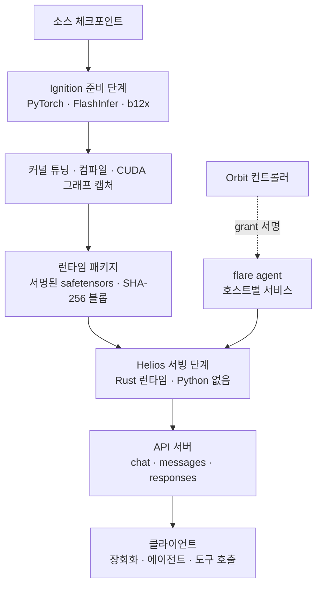

## 왜 읽어야 하나

DGX Spark나 RTX PRO 6000 Blackwell에서 로컬 추론을 돌리거나, vLLM 위에서 장시간 에이전트 세션을 운영하는 플랫폼 엔지니어라면 이 글을 읽어야 합니다. 핵심 결론을 먼저 씁니다. NVIDIA Flare는 "vLLM의 Rust 대체재"가 아니라, 빌드 때는 Python으로 컴파일하고 서빙 때는 Python 없이 Rust로 돌리는 두 단계 설계에 대한 레퍼런스 구현이며, README가 스스로 "production inference engine의 대체재가 될 수 없다"고 적어둔 연구 프로토타입입니다. 그럼에도 장시간 에이전트 워크로드의 서빙 계약(런타임 패키지, 명시적 메모리 계획, 서명된 분배)을 가장 구체적으로 보여주는 문서가 바로 이 저장소입니다.

## 개요

NVIDIA는 10월 20일경 GitHub `NVIDIA` 조직에 `flare-local-inference` 저장소를 공개했습니다. 런치 포스트도 공식 발표도 없이 올라온 것이었으며, 공개 직후 NVIDIA 개발 포럼과 커뮤니티에서 화제가 되었습니다. 라이선스는 Apache 2.0이고, 핵심은 Rust로 작성된 CLI(현재 v0.1.0)입니다.

대상 하드웨어는 좁습니다. SM120과 SM121, 즉 RTX PRO 6000 Blackwell 워크스테이션 GPU와 DGX Spark의 GB10 칩입니다. H100·H200·B200 같은 데이터센터 GPU도, 5090 같은 소비자 GPU도 아닙니다. 커뮤니티 분석들은 이 공개를 NVIDIA가 GTC Berlin에서 발표한 로컬 AI 풀스택(RTX Spark, DGX Spark, DGX Station 하드웨어 라인)의 소프트웨어 보강으로 읽었습니다. 하드웨어를 구매한 뒤 무엇으로 서빙할지에 대한 답을 NVIDIA가 직접 내놓은 셈입니다. Flare는 이 칩들의 메모리·대역폭·연산을 "장시간 대화, 코딩 에이전트, 반복 도구 호출"이라는 워크로드에 맞게 활용하도록 설계한 서버입니다.


*데이터센터 GPU와 소비자용 GPU는 지원 대상 밖. GB10이 CPU와 물리 DRAM을 공유하는 구조가 명시적 메모리 계획의 물리적 원인이 됩니다.* README의 설명을 옮기면, vLLM이 모델·하드웨어·배포 패턴의 폭을 다루는 반면 Flare는 그 폭을 버리고 선택된 모델과 로컬 워크로드에 집중된 서빙 계약을 갖는다고 합니다.


*범용 엔진(vLLM)과 특수 목적 프로토타입(Flare)의 경계. 폭을 버리고 집중을 사는 트레이드오프, 그리고 빌드(Python)와 서빙(Rust)의 분리.*

## 이 기술은 무엇인가

Flare는 Ignition과 Helios 두 부분으로 나뉩니다.

Ignition은 Python 쪽의 준비 단계입니다. PyTorch, Transformers, FlashInfer와 NVIDIA의 b12x 커널 스택을 사용해 소스 체크포인트를 로드하고, 커널을 튜닝하고, torch.compile로 완전한 포워드를 컴파일한 뒤 워밍업과 CUDA 그래프 캡처를 거쳐 **런타임 패키지**를 만듭니다. 런타임 패키지는 메타데이터만 담는 1차 `.safetensors` 파일과 SHA-256 이름의 불변 페이로드 블롭으로 구성되며, 서명된 Protobuf 포맷(4세대, 암호화된 cubin과 그래프 기록 포함)으로 묶입니다. 페이로드 파일의 문서상 상한은 64GB입니다.

Helios는 Rust 쪽의 서빙 단계입니다. 이 패키지를 Python 없이 로드하고, 캡처된 CUDA 그래프를 재생하며 요청을 처리합니다. 준비와 서빙 사이에 CPython 확장 `heliopause`가 있지만, 그것은 Ignition 쪽에서 Helios를 호출하기 위한 연결 용도이며 서빙 경로에는 Python이 없습니다.


*Phase 1 Ignition(Python)이 소스를 로드하고 커널을 튜닝해 CUDA 그래프를 캡처하면, 서명된 런타임 패키지가 Phase 2 Helios(Rust)로 넘어갑니다.*

왜 이런 구조인가에 대한 답은 저장소의 core-design 문서가 직접 줍니다. "vLLM을 통째로 Rust로 다시 쓰는 것"은 Python 모델·커널 생태계와 단절되는 비용을 치를 만큼 가치 있는 거래가 아니라는 것입니다. 모델 구조, 수치 의미, 컴파일 최적화, 커널 준비는 PyTorch 생태계의 축적된 작업 위에 두되, 서빙 루프(스케줄링, 캐시 저장, 요청 처리)만 작은 공용 Rust 런타임으로 분리한 것입니다.

모델 레시피(모델별 준비 설정)는 8개로 시작합니다. Nemotron 3.5 Bolt 74B-A9B 24GB(Mamba-2 혼합 MoE, C-RADIO 비전 인코더, LiLiCorr 학습 드래프트 모델), Qwen3.8 27B(NVFP4 양자화, Gated DeltaNet), Qwen3.8 Flash(MTP 5 드래프트 토큰, TP1/TP2), DeepSeek V4 Flash와 V4.1 Flash, MiMo V2.6 Pro MOPD, Step-5 Preview, Kimi K3입니다. 모든 레시피는 FP8 E4M3 KV 저장을 기본으로 하며, 학습 드래프트 모델 캐시까지 포함합니다.

런타임 패키지의 분배 설계도 문서가 구체적으로 풀어놓습니다. 최종 패키지는 format-4 서명 포맷을 사용하며, 내부의 cubin과 CUDA 그래프 기록은 암호화됩니다. 텐서 병렬 패키지는 rank별로 하나의 리소스 번들을 갖고, 인접한 rank가 같은 파일 크기 제한 안에서 웨이트 샤드를 공유합니다. 그래프·커널·보조 리소스는 별도 샤드에 실리므로, 커널만 바뀌어도 변경되지 않은 웨이트 샤드를 다시 쓰지 않습니다. 내보내기 시 변경되지 않은 블롭은 패키지 캐시에서 하드링크로 재사용됩니다. 분배되는 것이 "모델 파일"이 아니라 "서명된 실행 번들"이라는 점이, 이 설계가 서빙 환경 전체를 배포 단위로 다룬다는 것을 보여 줍니다.


*Format-4 서명, 암호화된 cubin/CUDA 그래프 기록, SHA-256 불변 블롭. 커널만 바뀌어도 변하지 않는 웨이트 블롭은 하드링크로 재사용됩니다.*

메모리와 상태 관리가 이 서버의 또 다른 축입니다. 버퍼와 실행 용량을 실행 전에 계획하고, 대화 상태(KV 캐시와 재귀 상태를 함께)를 단일 대상으로 다루므로, 접두어 재사용·분기·재개 시 상태가 올바르게 보존된다고 문서가 설명합니다. API는 한 서버에 네 가지 프로토콜을 담고 있습니다. OpenAI의 chat/completions와 completions, Anthropic의 messages와 count_tokens, OpenAI의 Responses. 모델 카드는 vLLM 호환 필드를 갖추고, `flare` 객체로 준비된 메타데이터(어휘 크기, 최대 동시성, prefill 청크 크기, 샘플링 기본값과 상하한, 이미지 제한)를 광고합니다.

API 구성은 이 서버가 겨냥하는 용도를 보여 줍니다. 한 서버에 네 가지 프로토콜(OpenAI chat/completions·completions, Anthropic messages·count_tokens, OpenAI Responses)을 동시에 담는다는 것은, 클라이언트가 OpenAI 호환 라이브러리든 Anthropic 호환 클라이언트든 그대로 붙여 쓸 수 있다는 뜻입니다. 특히 count_tokens 엔드포인트는 생성 없이 준비된 입력의 정확한 토큰 수를 알려주어, 에이전트 클라이언트가 프롬프트 예산을 계획할 때 서버가 보고한 값을 그대로 쓸 수 있게 합니다. 도구 호출은 서버가 대신하는 것이 아니라 클라이언트가 도구를 실행해 다음 요청으로 결과를 가져오는 형태로, 세션 상태는 서버의 캐시(접두어 재사용·분기·재개)에 남습니다.


*멀티 프로토콜, count_tokens의 프롬프트 예산 계획, 클라이언트가 주도하는 도구 루프에 최적화된 상태 캐싱.*

하드웨어가 여러 대가 되면 Orbit이라는 플릿(장비 묶음) 제어 계층이 등장합니다. 컨트롤러가 `flare orbit`을 실행하고, 각 서빙 호스트에 `flare agent`라는 사용자 서비스가 설치됩니다. Orbit은 준비된 모델을 GPU에 배치하고 패키지 데이터를 분배하며 서빙 그룹을 시작하고 감독합니다. 2~4개의 DGX Spark를 RoCE(b12x RoCEnante, ConnectX-7 포트)로 이어 텐서 병렬로 큰 모델을 서빙하는 경로가 여기에 속합니다.


*컨트롤러(flare orbit)가 패키지와 서명된 grant를 호스트 서비스(flare agent)에 부여하고, RoCE로 2~4대의 DGX Spark를 텐서 병렬 서빙 클러스터로 묶습니다.*



*Ignition과 Helios의 두 단계, Orbit 플릿 제어 계층을 보여줍니다.*

## 설치 및 통합

저장소 문서(model-preparation.md)에 있는 실제 명령입니다. 준비 환경과 네이티브 CLI 빌드:

```sh
uv sync --locked --extra prepare --extra test
cargo build --release --manifest-path flare/Cargo.toml
```

빌드 의존성은 C/C++ 컴파일러, CMake, Ninja, pkg-config, Protobuf의 protoc, OpenSSL 헤더, Python 헤더, liburing 헤더입니다. Ubuntu 기준:

```sh
sudo apt-get install build-essential cmake ninja-build pkg-config protobuf-compiler libssl-dev python3-dev liburing-dev
```

준비 단계에는 CUDA 툴킷(nvcc, CUPTI)이 필요합니다. FlashInfer는 pyproject.toml에서 특정 git 리비전에 고정됩니다.

패키지 내보내기(Qwen3.8 27B, 단일 GPU 예시):

```sh
.venv/bin/ignition export qwen3.8-27b --gpus 0 --max-concurrency 4 \
  --output /data/flare-runtime/qwen38-27b-tp1-c4.safetensors --verbose
```

서빙:

```sh
./flare/target/release/flare run \
  /data/flare-runtime/qwen38-27b-tp1-c4.safetensors \
  --gpus 0 --bind 127.0.0.1:8001
```

MTP(다중 토큰 예측)를 쓰는 Nemotron 레시피는 드래프트 토큰 수를 명시합니다:

```sh
.venv/bin/python -m ignition export nemotron-bolt-24gb --gpus 0 \
  --max-concurrency 8 --prefill-chunk-size 4096 --mtp-draft-tokens 7 \
  --speculative-token-capacity 64 \
  --output /data/flare-runtime/nemotron-bolt-images-lilicorr-c8.safetensors
```

세부 주의사항은 세 가지입니다. 하나, 텐서 병렬 크기에 따라 패키지를 각각 준비해야 합니다(TP2 패키지를 TP1로 로드할 수 없습니다). 둘, DGX Spark의 GB10은 CPU와 물리 DRAM을 공유하므로 `[memory] reserve`(예: "4G")로 호스트 활동 여분을 빼주고, NVML이 VRAM 용량을 보고하지 않으므로 Ignition은 Linux의 MemAvailable로 계획을 잡습니다. 셋, SM120 패키지로 SM121 기기를 서빙할 수 없습니다(아키텍처 검사 실패).

## 실제 실험 결과

ThakiCloud 환경에서 재현을 시도했습니다. 실행 환경은 macOS ARM(MacBook)이며, ThakiCloud의 GPU 플릿(H100·H200·B200·5070 Ti)에는 SM120/SM121 칩이 없습니다.

1. 저장소 클론: `NVIDIA/flare-local-inference` 샤로우 클론 성공(약 23MB). 구조는 flare(CLI), helios(Rust 런타임), heliopause(CPython 확장), ignition(Python 준비), packaging, qualify, scripts, docs(약 12,000줄)로 구성됩니다. 참고로 `NVIDIA-AI` 조직 경로는 404이고, 실제 조직은 `NVIDIA`입니다. 커뮤니티 글에서 두 조직을 혼동한 경우가 있었습니다.
2. 릴리스 빌드 시도(macOS arm64): 의존성 수집 단계에서 `deepseek-recipe`라는 외부 git 의존성(특정 리비전 고정)을 내부 git으로 가져오지 못해 실패했고, cargo가 제안하는 시스템 git CLI 페치로 재시도해 수집은 성공했습니다. 이어 `flare-helios`(Rust 런타임) 컴파일 단계에서 24개 에러(타입 불일치, 정수 폭 관련 등)로 빌드가 실패했습니다. 문서화된 빌드 대상은 Ubuntu/Debian(apt 의존 목록 명시)과 Windows이며, macOS는 지원 범위 밖으로 보입니다.
3. 추론 실행: 빌드가 실패했고, SM120/SM121 GPU가 없는 환경에서는 CUDA 그래프 캡처와 서빙도 수행할 수 없습니다.

따라서 이 글에는 벤치마크 수치가 하나도 없습니다. Flare의 성능은 공개 문서와 커뮤니티 분석(장시간 대화·에이전트 워크로드 최적화, vLLM 대비 폭의 트레이드오프)으로만 확인된 상태이며, 수치 비교는 SM120/SM121 하드웨어가 준비된 환경에서 측정해야 합니다.

## ThakiCloud 제품 적용 시사점

ai-platform 렌즈에서 보면, SM120/SM121은 현재 플릿에 없으므로 직접 도입은 먼 일입니다. 하지만 패턴 자체는 지금 서빙하는 vLLM 스택과 같은 문제 공간에 있습니다. 첫째, "빌드 시 컴파일, 서빙 시 재생"이라는 런타임 패키지 개념은 Metis 서버리스 엔드포인트의 tuned defaults(compile 모드, max_num_seqs)와 같은 맥락의 문제이며, Flare는 그 결과를 서명된 분배 단위(64GB 블롭, 형식 검증, rank별 선택적 분배)로 확장한 사례입니다. 둘째, KV와 재귀 상태를 하나의 대화 상태로 계획하는 명시적 메모리 모델은, 장시간 에이전트 세션에서 컨텍스트가 계속 늘어나는 워크로드의 비용 구조를 이해하는 참고점입니다. 셋째, FP8 KV 기본값은 메모리당 토큰을 늘리는 방향에서 vLLM의 양자화 옵션들과 비교할 실마리를 줍니다.

Paxis 렌즈에서 보면, Flare가 정면으로 겨냥한 워크로드가 바로 Paxis가 다루는 에이전트 실행의 형태입니다. 반복되는 도구 결과 첨부, 접두어 분기, 세션 재개. Orbit의 grant 기반 컨트롤러/에이전트 설계는 "로컬 GPU에 에이전트 추론을 배치하고 감독하는" 미니 제어 평면이며, Paxis가 고객 환경의 엣지나 로컬 GPU 위에 에이전트 추론을 펼칠 때 그 계약의 형태를 미리 보여 줍니다.

여기서 의도적으로 구분이 필요한 지점이 하나 있습니다. Flare의 신뢰 모델은 단일 조직 내부의 것입니다. 서명된 패키지와 grant는 "우리 컨트롤러가 우리 기기에 우리의 모델을 놓는다"를 전제하며, 멀티테넌트나 외부 고객 격리는 설계에 없습니다. Paxis가 같은 문제를 풀 때는 고객 사이 격리, 정책 게이트, 감사 로그가 추가로 필요합니다. Flare의 계약이 에이전트 추론의 최소 핵(core)이라면, Paxis는 그 핵을 기업 경계까지 확장하는 문제입니다. 둘은 경쟁 관계가 아니라 계층 관계에 가깝습니다.


*단일 조직 내부 통제 전제인 Flare의 계약 핵 위에, 고객 간 멀티테넌트 격리와 정책 게이트, 감사 로그가 추가되는 Paxis의 엔터프라이즈 경계.*

## 한계 및 반론

첫째, 저장소가 스스로를 연구 프로토타입이라고 적어둡니다. Qwen TP4 패키지는 아직 모델 검증이 필요하다는 문구가 문서에 그대로 남아 있습니다.

둘째, 커버리지가 좁습니다. 8개 모델 레시피, 2개 GPU 아키텍처. vLLM이 수천 개의 모델과 모든 데이터센터 GPU를 다루는 것과 같은 평면에서 비교할 수 없습니다. Flare의 README가 "vLLM의 대체재가 될 수 없다"고 쓴 것은 겸양이 아니라 설계 선언에 가깝습니다.

셋째, 이름 충돌에 주의해야 합니다. NVIDIA에는 수년 전부터 FLARE(Federated Learning Application Runtime Environment)라는 연합 학습(federated learning) SDK가 존재합니다. 검색에서 두 개를 혼동하기 쉬우며, 이번 로컬 추론 서버는 `flare-local-inference` 저장소와 SM120/SM121 컨텍스트로 구분해야 합니다.

넷째, "서빙에 Python이 없다"는 점만으로 신기술을 논하기는 어렵습니다. vLLM 역시 CUDA 그래프를 캡처해 재사용하며, 호스트 언어 자체가 성능의 전부는 아닙니다. Flare의 새로움은 서빙 루프의 언어가 아니라, 서명된 런타임 패키지라는 분배 단위와, 그것을 전제로 한 명시적 메모리 계획, 그리고 에이전트 워크로드에 맞춘 API 계약에 있습니다.

다섯째, 복제 가능성의 비용입니다. FlashInfer 포크의 git 리비전 고정, 외부 레시피 저장소 의존, CUDA 툴킷과 liburing 같은 시스템 의존성은 "클론해서 바로 돌린다"의 문턱을 높입니다. 연구 프로토타입이 프로덕션 인프라로 넘어갈 때 이 의존 그래프의 유지보수 비용이 중요한 변수가 될 것입니다.


*하드웨어 및 빌드 장벽(macOS 재현 실패, 높은 외부 의존성), 커버리지 협소(단 8개 모델, Qwen TP4 미검증), 네이밍 충돌 주의(FLARE federated learning SDK).*

## 정리

NVIDIA Flare는 로컬 워크스테이션 GPU에서 에이전트 워크로드를 서빙한다는 문제를, "Python으로 준비하고 Rust로 서빙하며, 서명된 패키지로 분배한다"는 계약 하나로 압축한 레퍼런스 구현입니다. DGX Spark나 RTX PRO 6000을 돌리는 분에게는 8개 모델 레시피 목록으로 도입 대상 여부를 바로 판단할 수 있고, 플랫폼 엔지니어에게는 Ignition과 Helios의 경계 설계가 읽을 가치가 있는 문서입니다.

다음 단계는 SM120/SM121 하드웨어에서 벤치마크 수치를 측정하고, 같은 워크로드에서 vLLM과 비교하는 것입니다. 이 글은 그 수치가 없는 상태의 분석이며, 수치가 확보되면 다시 써야 합니다.

## 출처

- GitHub 저장소: [NVIDIA/flare-local-inference](https://github.com/NVIDIA/flare-local-inference) (Apache 2.0, docs·레시피·Orbit 문서 포함)
- NVIDIA 개발 포럼: [Flare - NVIDIA's new inference server in Rust](https://forums.developer.nvidia.com/t/flare-nvidias-new-inference-server-in-rust/386436)
- 아키텍처 분석: [veduis.com, NVIDIA Flare architecture](https://veduis.com/blog/nvidia-flare-architecture-local-inference/)
- vLLM 비교: [explainx.ai, NVIDIA Flare vs vLLM](https://www.explainx.ai/blog/nvidia-flare-local-inference-rust-server-sm120-dgx-spark-agents-2026)
- 도구 개요: [singularitybyte.com, NVIDIA Flare](https://singularitybyte.com/tools/nvidia-flare-local-inference-server-dgx-spark.html)
- 원본 트윗: [x.com/hjguyhan/status/2113088158032433360](https://x.com/hjguyhan/status/2113088158032433360)
