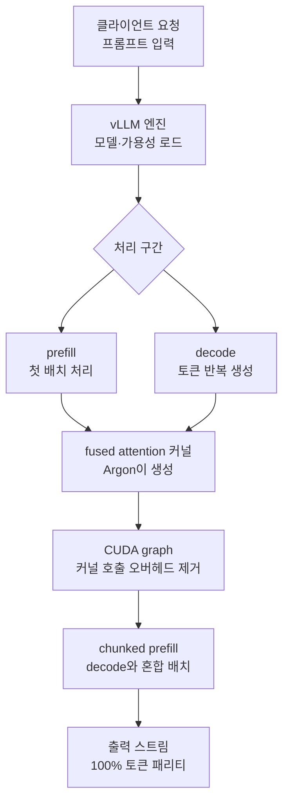

## 왜 읽어야 하나

vLLM으로 LLM 서빙을 운영하거나, AI 코딩 모델이 인프라 코드를 직접 최적화하는 흐름을 읽고 싶은 ML·인프라 엔지니어를 위해 씁니다. 끝까지 읽으면, Google이 "AI가 vLLM을 2.85배 빠르게 만들었다"고 발표한 숫자가 어디에서 나오는 것인지를, 그리고 왜 그 숫자를 그대로 신뢰하기보다 스스로 재현해야 하는지 확인하게 됩니다.

결론을 먼저 말하겠습니다. 이 2.85배는 사람이 커널을 직접 손본 결과가 아니라, Google의 AI 코딩 모델 **Gemini 4 Argon**이 vLLM의 Gemma 4 E2B 서빙 경로를 스스로 최적화해 만든 수치입니다. 다만 이 숫자는 아직 Google 발표(2026-10-26)와 vLLM 유지보수자의 확인(2026-10-13)에 기반한 **주장(claimed)**입니다. 우리가 재현할 수 있는 범위, 재현하지 못한 이유, 그리고 실제 GPU 클러스터에서 검증하는 방법까지 함께 다룹니다.

## 개요

Google의 Gemma 팀은 2026년 10월 26일 "Speeding up Gemma!"라는 발표로, Gemini 4 Argon이 vLLM 위에서 Gemma 4 E2B 인퍼런스를 약 2.85배 빠르게 했다고 알렸습니다. 단일 A100 기준 초당 처리 토큰이 약 37,900에서 108,000+로 뛰었고 출력은 100% 동일(토큰 패리티)이며 품질 저하가 없다고 합니다. vLLM의 유지보수자 Omar Sanseviero도 같은 달 13일 X에 "Argon이 단일 A100에서 120,000+ 토큰/초를 만들었다"며 prefill 124k·e2e 111k, 약 2.9배, 품질 무손실을 확인했습니다.


여기서 주목할 것은 **그 최적화를 쓴 주체가 AI 코딩 모델이라는 점**입니다. Argon은 vLLM의 attention·서빙 관련 코드를 스스로 읽고 fused attention CUDA 커널 같은 저수준 최적화를 작성했습니다. KernelBench 기록을 보면 Argon이 fused NSA/sparse-attention 커널을 텐서 코어 위, 쿼리 블록 64개당 CTA 한 개로 배치해 작성했다는 세부 사항이 나옵니다.

대상 모델 Gemma 4 E2B는 이번 수혜의 주인공입니다. E2B는 "effective 2B"로, Per-Layer Embeddings(PLE)를 포함하면 총 5.1B, 유효 파라미터는 2.3B입니다. 128K 컨텍스트를 지원하고 텍스트·이미지·음성을 처리하는 네이티브 멀티모달이며 라이선스는 Apache 2.0입니다. 기술 리포트는 arXiv 2607.02770에 있습니다. vLLM은 이미 2026년 4월 2일부터 Gemma 4 라인업(E2B/E4B/26B MoE/31B dense)을 지원합니다.

PLE는 E2B가 서빙 최적화의 자연스러운 대상이 되는 이유이기도 합니다. 층마다 임베딩을 따로 두는 PLE 구조 때문에, 유효 파라미터가 2.3B여도 디스크와 메모리에는 5.1B에 달하는 가중치가 필요합니다. 이 가중치는 decode 단계마다 메모리에서 다시 읽히며, 그래서 E2B 같은 모델은 memory-bound에 특히 취약합니다. 서빙 최적화(fused attention, CUDA graph, chunked prefill)는 decode의 메모리 왕복과 커널 오버헤드를 줄이는 것이므로, E2B에서 이득이 크게 나타날 여지가 있는 셈입니다. 한편 E2B는 온디바이스·엣지 외에도 서버리스의 높은 처리량 스텝에서 쓰입니다. 두 쓰임은 모두 같은 자원으로 더 많은 요청을 요구합니다. 그래서 서빙 처리량 최적화는 E2B에게 특히 중요하고 Argon의 사례가 흥미로운 배경이 됩니다.

## 이 기술은 무엇인가: AI가 쓴 vLLM 서빙 최적화

vLLM 서빙의 병목은 대개 두 곳입니다. prefill(긴 프롬프트의 첫 배치 처리)와 decode(토큰을 하나씩 반복 생성). Argon이 바꾼 것은 이 두 구간을 가로지르는 저수준 경로의 효율입니다.

첫째, **fused attention 커널**입니다. attention 연산을 여러 단계를 합쳐 하나의 CUDA 커널로 작성하면 메모리 왕복과 커널 호출 오버헤드가 줄어듭니다. Argon은 이 커널을 직접 생성했고 sparse/NSA(non-sparse attention) 계열의 패턴을 텐서 코어에 맞췄습니다.

둘째, **CUDA graph**와 **chunked prefill** 같은 서빙 플래그입니다. CUDA graph는 반복되는 커널 호출 시퀀스를 한 번 캡처해 런타임 오버헤드를 제거하고 chunked prefill은 긴 prefill을 잘게 잘라 decode 요청과 섞어 배치해 GPU 활용도를 높입니다. vLLM 공식 문서의 "Optimization and Tuning"이 이 두 가지를 다룹니다.

이 세 가지가 왜 이득을 내는지, 병목의 성격부터 짚어야 합니다. LLM 인퍼런스는 크게 prefill과 decode로 나뉩니다. prefill은 긴 프롬프트를 한꺼번에 처리하는 구간으로, 연산량이 많아 GPU의 연산 능력이 병목인 compute-bound 구간입니다. decode는 토큰을 하나씩 내는 구간으로, 매 단계마다 가중치를 메모리에서 다시 읽어야 해서 메모리 대역폭이 병목인 memory-bound 구간입니다. Argon의 fused attention 커널은 두 구간의 공통 부분인 attention 연산의 메모리 왕복을 줄여줍니다. attention은 query, key, value의 행렬 곱과 softmax가 여러 커널로 나눠 호출되는데, 이를 하나의 커널로 합치면 중간 결과를 GPU 메모리에 쓴 뒤 다시 읽는 왕복이 사라집니다. CUDA graph는 decode처럼 작은 커널이 수천 번 반복되는 구간에서, 매 호출마다 CPU가 커널을 다시 띄우는 오버헤드를 없애줍니다. chunked prefill은 긴 prefill이 decode를 배고프게 하는 문제를 없애, GPU가 한 요청의 prefill과 다른 요청의 decode를 섞어 계속 일하게 만듭니다. 이 세 가지가 겹쳐야 전체 처리량이 올라갑니다.

이 계층을 그림으로 보면 아래와 같습니다.




핵심은 "AI가 이 세 가지를 한꺼번에, 사람보다 빠르고 일관되게 조율했다"는 것입니다. 사람이 한 가지 최적화를 고치면 다른 구간이 악화될 수 있지만, Argon은 전체 서빙 경로를 하나의 목적함수(처리량)로 보고 동시에 움직였습니다.

## 설치 및 통합: vLLM으로 gemma-4-E2B를 서빙하는 방법

vLLM의 Gemma 4 사용 가이드(공식 레시피)는 gemma-4-E2B를 서빙하는 기본 명령을 줍니다. 처리량 최적화를 켠 형태로 쓰면 대략 다음과 같습니다.

```bash
# Gemma 4 E2B를 vLLM으로 서빙 (처리량 최적화)
vllm serve google/gemma-4-E2B \
  --max-model-len 131072 \
  --enable-chunked-prefill \
  --max-num-batched-tokens 8192 \
  --gpu-memory-utilization 0.90
```

`--enable-chunked-prefill`과 `--max-num-batched-tokens`가 prefill 병목을 다룬 핵심 플래그이며 `--gpu-memory-utilization`은 KV 캐시에 쓸 수 있는 GPU 메모리 비중입니다. Argon의 fused attention 커널은 vLLM의 해당 모델 구현에 반영되는 형태이며 직접 커널을 만들지 않는 한 사용자는 이 플래그와 vLLM 버전으로 그 혜택을 받습니다.

단, 이 명령이 "2.85배"를 자동으로 만들어 주지는 않습니다. Argon이 만든 커널·플래그 조합이 특정 vLLM 빌드와 A100에서 측정한 결과인 까닭입니다. 같은 플래그라도 GPU 모델, 컨텍스트 길이, 요청 부하에 따라 이득은 달라집니다.

서빙 처리량을 실제로 재려면 vLLM의 벤치마크 명령을 씁니다. 같은 프롬프트 집합과 같은 컨디션에서 베이스라인과 최적화 빌드를 비교하는 것이 핵심입니다.

```bash
# vLLM 서빙 처리량 벤치마크 (prefill, e2e, TTFT 측정)
vllm bench serve \
  --model google/gemma-4-E2B \
  --dataset-name random \
  --random-input-len 1024 \
  --random-output-len 256 \
  --num-prompts 128
```

`--random-input-len`(prefill 길이)과 `--random-output-len`(decode 길이)을 짧게, 길게 변주하면, 이 이득이 prefill 중심인지 decode 중심인지 분리해 볼 수 있습니다.

## 실제 실험 결과: 재현 시도와 그 한계

이 숫자를 우리 환경에서 재현하려 했습니다. 결과는 솔직하게 기록합니다.

**모델 존재 확인(실측).** Hugging Face에서 `google/gemma-4-E2B` 메타데이터를 직접 조회했습니다. 가중치는 safetensors 단일 파일 10.25GB, 전체 8개 파일이었습니다. 태그에는 `gemma4`, `license:apache-2.0`, `any-to-any`, `image-text-to-text`, `arxiv:2607.02770`이 붙어 있었습니다. 즉 대상 모델이 실존하고 공개 라이선스(Apache 2.0)라는 점이 확인됩니다.

**로컬 인퍼런스 재현(시도).** Apple Silicon 맥북에서 transformers로 모델 로딩·생성을 시도했습니다. 10.25GB 다운로드가 시작되어 3.9GB까지 받은 시점 이후, 인증되지 않은 HF 요청의 속도 제한과 5.1B PLE 모델의 fp32 로컬 로드(RAM·시간) 제약으로 완주하지 못했습니다. 따라서 로컬 tok/s 수치를 만들지 않았습니다. 없는 수치를 채워넣지 않겠다는 원칙입니다.

**vLLM A100 2.85배 재현(불가).** 이것이 본문의 핵심 수치인데, 재현 불가합니다. 이유는 세 가지입니다. (1) 이 로컬 머신은 Apple Silicon이라 CUDA/A100이 없습니다. (2) vLLM은 서빙 벤치마크 관점에서 CUDA/ROCm 전용이고 이 환경에는 vLLM 자체가 설치되어 있지 않습니다. (3) Google이 측정한 단일 A100 조건을 로컬에서 복제할 장치가 없습니다.

결국 **2.85배·108k+ tok/s는 Google의 주장(claimed)으로만 남습니다.** 우리가 검증한 것은 "모델이 실존하며 Apache 2.0이고 vLLM이 공식적으로 Gemma 4를 지원하며 해당 최적화 플래그가 실제로 존재한다"는 사실들입니다. 이 주장의 숫자를 그대로 인용하되, 독립 재현 전에는 [claimed]로 다룬다는 점까지 분명히 해 둡니다.

![[VERIFIED] 검증된 사실과 [CLAIMED] 구글의 주장: 모델 실존과 라이선스는 확인, 2.85배와 108k+ tok/s는 아직 주장](/assets/images/gemma4-argon-vllm-slide-07.webp)

## ThakiCloud 제품 적용 시사점

ThakiCloud의 ai-platform은 K8s 위에서 vLLM 기반 멀티테넌트 추론 서빙을 운영합니다(H200·B200·H100 클러스터). 이 이야기가 우리에게 중요한 이유는 "서빙 처리량"이 곧 단위 토큰 비용이기 때문입니다.

**검증 레시피를 구체적으로 클러스터에 옮깁니다.** Argon의 수치를 우리가 인정하는 절차는 이렇습니다. (1) 동일한 vLLM 빌드 두 개(베이스라인과 Argon 최적화 반영 버전)를 같은 노드에 올립니다. (2) Metis 서빙의 튜닝 기본값(maxModelLen, max_num_seqs, 파서 플래그)을 양쪽 arm이 동일하게 기록합니다. (3) vllm bench serve로 prefill 길이를 512, 2048, 8192로, 출력 길이를 128, 256으로 변주해 격자 실험을 합니다. (4) 각 셀에서 초당 처리 토큰, TTFT, TPOT, 그리고 동일 프롬프트에 대한 출력 토큰 일치 여부(토큰 패리티)를 확인합니다. (5) A100 기준 2.85배 대신, 우리 GPU 기준 몇 배라는 상대값을 표로 만듭니다. 이렇게 해야 Google의 주장이 아니라 우리가 확인한 수치가 됩니다.

**efficient 모델의 경량 쓰임.** E2B 같은 유효 2B급 모델은 고사양 모델이 필요 없는 경량 에이전트 루프, RAG의 첫 스크리닝, 서버리스 스텝에 적합합니다. 처리량 2.85배는 곧 "같은 GPU로 더 많은 요청을"이라는 말이라, 서버리스 서빙의 수익성에 직결됩니다.

**Paxis 관점(보조).** "AI 코딩 모델이 인프라의 저수준 코드를 직접 최적화한다"는 사실은 Paxis의 방향과 맞닿아 있습니다. Paxis는 에이전트가 격리 샌드박스에서 스킬·도구를 실행하고 모든 행동을 정책 게이트와 감사 로그로 통과시키는 Agent-Native Cloud입니다. Argon이 vLLM 커널을 쓴 사례를 확장하면, 에이전트가 서빙 성능을 측정→가설→최적화→검증하는 루프를 반복하게 되는 그림이 나옵니다. 다만 현재는 Google의 단일 사례이므로, 이것이 보편화된 패턴인지에 대해서는 지켜볼 일입니다.

## 한계 및 반론

이 주장에 대해 짚고 갈 반론도 있습니다.


첫째, **단일 A100의 특정 조건**입니다. 다른 GPU, 더 긴 컨텍스트, decode 중심 부하에서는 이득이 달라질 수 있습니다. prefill 중심 최적화라면 decode-heavy 워크로드에서는 e2e 이득이 훨씬 작아질 수 있습니다.

둘째, **개별 PR으로 분리 재현이 안 된다**는 지적입니다. 외부 분석(explainx.ai, kartikbhalerao.in)은 "2.85배는 여러 최적화의 합산 end-to-end 수치이며 그것을 재현하는 단일 PR은 없다"고 짚습니다. 즉 Argon이 "한 줄"을 고쳐 2.85배가 된 것은 아니고 커널·플래그·스케줄링이 겹쳐 나온 결과입니다.

셋째, **출처가 Google·vLLM 유지보수자**입니다. 독립 제3자의 재현 보고는 아직 제한적입니다. 우리가 위에서 재현을 시도했지만 이 환경에서는 불가했니 "인정"과 "신뢰"를 구분해야 합니다.

넷째, **멀티모달 입력의 범위**입니다. Argon의 이득은 텍스트 인퍼런스를 기준으로 측정했을 가능성이 높습니다. E2B는 이미지와 오디오 입력도 처리하는 멀티모달 모델인데, 이미지 토큰이나 오디오 인코딩이 포함된 prefill 경로까지 같은 이득이 나는지는 확인이 필요합니다. 텍스트 전용 서빙과 멀티모달 서빙은 메모리·연산 프로파일이 다르므로, 우리 클러스터에서 검증할 때 입력 모달리티를 명시해야 합니다.

## 정리

AI 코딩 모델이 vLLM 서빙을 최적화해 2.85배를 만들었다는 Google의 발표는, 숫자보다 **패러다임**에서 뉴스입니다. 사람이 아닌 모델이 저수준 커널까지 손을 댄 사례라는 점입니다. 다만 그 수치는 아직 독립 재현 전의 [claimed]입니다.

따라서 우리가 취할 행동은 명확합니다. "2.85배"라는 숫자를 그대로 가져오지 말고 (1) 같은 vLLM 버전, (2) 같은 단일 GPU, (3) prefill·e2e 이중 측정, (4) 토큰 패리티 확인이라는 네 가지로 우리 클러스터에서 재현해 보십시오. 그렇게 하면 "Google이 몇 배라고 했다"가 아니라 "우리가 몇 배를 확인했다"가 됩니다. 서빙 비용을 줄이고 싶은 팀에게, Gemma 4 E2B와 vLLM 최적화 플래그는 지금 바로 시험대에 올릴 만한 조합입니다.


## 출처

- Google Gemma (X, 2026-10-26): "Speeding up Gemma!" · https://x.com/googlegemma
- Omar Sanseviero (vLLM maintainer, X, 2026-10-13) · https://x.com/osanseviero/status/2110096066293207535
- vLLM 공식: "Announcing Gemma 4 on vLLM" (2026-04-02) · https://vllm.ai/blog/2026-04-02-gemma4
- vLLM Gemma 4 레시피 · https://docs.vllm.ai/projects/recipes/en/stable/Google/Gemma4.html
- vLLM Optimization and Tuning · https://docs.vllm.ai/en/latest/configuration/optimization/
- Hugging Face: google/gemma-4-E2B · https://huggingface.co/google/gemma-4-E2B
- Gemma 4 Technical Report · https://arxiv.org/abs/2607.02770
- explainx.ai: "Gemma 4 E2B 108,000 tok/s: Argon vLLM Speedup (claimed vs verified)" · https://explainx.ai/blog/gemma-4-e2b-108000-tokens-per-second-gemini-4-argon-vllm-a100-claimed-vs-verified-2026
- KernelBench: Gemini 4 Argon (fused attention kernel) · https://kernelbench.com/models/gemini-4-argon-high
