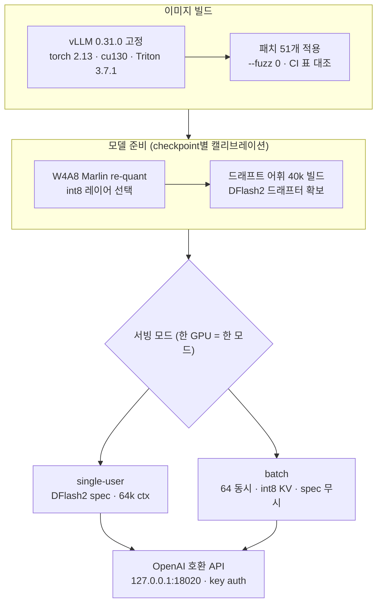

## 왜 읽어야 하나

27B급 모델을 서빙할 때 데이터센터 GPU가 필요한지, 상단급 싱글 카드로 충분한지를 결정해야 하는 ML·인프라 엔지니어를 위해 씁니다. 끝까지 읽으면, "3090 한 장에 Qwen3.8-27B, 64 동시 1000 tok/s"라는 주장이 어떤 패치 스택에서 나오는 숫자인지를, 그리고 그 주장과 우리가 오늘 B200에서 직접 재는 수치가 전력당·비용당에서 어떻게 교차하는지를 확인하게 됩니다.

결론을 먼저 말하겠습니다. HyperQwen의 숫자는 허구가 아닙니다. vLLM 0.31.0에 51개 패치를 `--fuzz 0`로 씌우고 W4A8 Marlin int8 양자화와 int8 KV 캐시, DFlash2 스펙추레이티브 디코딩을 조합하면 24GB 카드에서 27B를 돌릴 수 있다는 주장은 코드와 문서로 뒷받침됩니다. 다만 "3090이 데이터센터 GPU를 대체한다"는 것은 아닙니다. 오늘 실측(3회 반복 중앙값, 64 동시에서 포화 플래토 확인)에서 우리 B200 상주 엔드포인트는 64 동시 3,215 tok/s로 HyperQwen의 3090 보고치(약 1,035 tok/s)의 3.1배, 단일 스트림은 256 대 127 tok/s로 약 2배입니다. 속도 데이터센터의 것입니다. 다만 전력당(4.1 대 3.2 tok/s/W)·자본당(약 6배) 경제는 여전히 싱글 카드가 압도합니다. 둘 다 사실이고, 그래서 "어디에 무엇을 돌릴지"가 지금 서빙 운영의 진짜 질문입니다.

## 개요

이번 주 X에서 돌았던 주장 하나입니다. RTX 3090 한 장, 전력 제한 250W에서 Qwen3.8-27B를 vLLM으로 서빙하면서, 1인 사용자는 약 127 tok/s, 64 동시 연결에서는 합계 1,000 tok/s를 넘었다는 것입니다. 27B 파라미터 모델을 24GB 비디오 메모리 안에 넣는다는 것 자체가 보통의 감각으로는 안 맞는 계산입니다. BF16만 해도 54GB가 필요한 모델을 24GB에 넣으려면 4비트급 양자화와 KV 캐시 압축, 그리고 디코드를 단축시키는 스펙추레이티브 디코딩이 동시에 필요하고, 이 셋을 모두 서빙 엔진 차원에서 붙여야 합니다.


HyperQwen이 하는 일이 정확히 그것입니다. "내게 실제로 있는 GPU로 대형 Qwen 모델을 빠르게 서빙한다"는 슬로건 아래, 서빙 스택 전체를 하나의 저장소로 묶어 놓았습니다.

## 이 기술/도구는 무엇인가

[syv-ai/HyperQwen](https://github.com/syv-ai/HyperQwen)은 Apache-2.0 라이선스의 오픈소스 프로젝트로, vLLM 자체나 새 서빙 엔진이 아니라 **vLLM 0.31.0 pinned 이미지 + 패치 시리즈 + 모델 준비 파이프라인 + 벤치마크 배터리**를 묶은 서빙 스택입니다. 우리가 샌드박스에 클론해 직접 확인한 구조는 다음과 같습니다.

- **패치 51개** (`patches/`): `patches/series`가 정의한 순서로 vLLM 설치본에 `--fuzz 0`(문맥이 하나라도 안 맞으면 빌드 실패)로 적용됩니다. 각 패치는 헤더에 Kind(backport·fix·feature·local·own)와 What, Upstream, Cut-against, Retires-when을 기록하고, CI가 `PATCHES.md`의 표와 파일이 일치하는지 검사합니다. upstream vLLM의 오픈 PR(#50021, #40371, #61050) 세 개를 백포트로 끌어온 것도 포함됩니다.
- **핵심 패치들**: `marlin-int8-layer-select`(어떤 레이어가 W4A8 Marlin int8으로 갈지 env로 선택), `dflash2-lookup-drafting`(컨텍스트 n-gram 검색으로 드래프트를 채우는 lookup 증강), `spec-decode-attn`(split-KV 검증 어텐션), `spec-decode-int8-kv` / `int4-kv-per-token-head`(int8·int4 per-token-head KV 캐시), `qwen3_5-mtp-draft-vocab`(40k 토큰으로 잘린 드래프트 헤드), `mamba-chunked-prefill-align`(하이브리드 아키텍처의 리커런트 상태 정렬).
- **하이브리드 아키텍처 대응**: Qwen3.8-27B는 GDN(gated delta net) 계열의 선형 어텐션 레이어와 full 어텐션 레이어를 섞은 구조라, 16비트 리커런트 상태를 서빙 메모리에 함께 관리해야 합니다. mamba 정렬 패치들이 그 존재 이유입니다.
- **모델 준비** (`prepare/`): 40k 토큰 드래프트 어휘(build_draft_vocab.py), DFlash2 드래프터 파이프라인, 채팅 템플릿 하드닝까지 체크포인트 단위로 캘리브레이션합니다.
- **5가지 서빙 모드**: A(배치, 64 동시), B(단일 사용자 기본, 64k 컨텍스트), C(쿼팅 모드, `DFLASH_TOKENS=15`), D(롱 컨텍스트 150k, MTP), E(대용량 컨텍스트 240k). GPU 한 장은 한 번에 한 모드만 돌립니다.
- **벤치마크 배터리** (`bench/`): conc_ladder(동시 연결 계단), quality_battery, GSM8K t4_battery, needle 테스트, residue sweep 등 60개 이상의 스크립트와 각각의 unit test가 함께 커밋되어 있습니다. "첫 벤치는 30~50% 낮게 나와서 두 번 돌려라" 같은 운영적 경고까지 문서화되어 있습니다.



프로젝트가 보고하는 핵심 수치는 이렇습니다. 3090 @ 250W 기준, 단일 사용자 디코드는 127 tok/s(답이 프롬프트를 인용하면 381 tok/s), 64 동시 배치는 합계 약 1,035 tok/s(입력 128·출력 512 토큰, e2e 948), 전 레이어 int8이면 약 1,222 tok/s, 단일 사용자 prefill은 약 1,440~1,810 tok/s입니다. 품질은 int8 계열 설정이 GSM8K 0.950 vs BF16 0.955(n=200), 퍼플렉시티 +0.04% 수준을 유지한다고 보고합니다. 컨텍스트는 150k~262k까지 모드 D/E로 확장하고, 그 구간에서는 95~100 tok/s(150k)로 속도가 내려갑니다.

## 설치 및 통합

저장소 README의 실제 명령어입니다(샌드박스로 클론해 파일 구조까지 대조했습니다).

```bash
git clone https://github.com/syv-ai/HyperQwen && cd HyperQwen
cp .env.example .env          # PowerShell: Copy-Item .env.example .env
docker compose --profile single up -d   # 단일 사용자 모드
docker compose --profile batch up -d    # 배치 모드 (64 동시)
```

외부로 노출하려면 키와 바인드를 명시적으로 추가해야 합니다(기본은 127.0.0.1, `auth-deny-default` 패치가 미인가를 기본 거부로 만듭니다).

```bash
echo "VLLM_API_KEY=$(openssl rand -hex 24)" >> .env
echo BIND=0.0.0.0 >> .env
```

3090 기준 벤치마크 절차는 README가 명시합니다.

```bash
sudo nvidia-smi -pl 250   # 전력 제한 250W
docker compose exec single bash bench/run_benchmarks.sh single
```

최초 Docker 기동이 9.5GB 이미지를 끌어오고 `./models`에 약 20GB를 씁니다. 옵션 커널(pth-flash-attn, FA2 fp8-KV)은 `bash pthfa/install.sh`, `bash fa2/install.sh`로 추가로 빌드하며, sm86(3090/4090 계열)에서는 롱 컨텍스트가 int8 KV를 기본으로 삼습니다.

**재현 시도 중 한계를 정직히 기록합니다.** 우리는 sm86 하드웨어를 갖고 있지 않습니다(사내 클러스터는 B200·H200·H100이며, 이 프로젝트의 튜닝 테이블은 sm86 전용이고 sm120은 재현됐지만 sm90은 미측정, sm80에는 스펙디코딩 오픈 이슈가 있습니다). 그래서 3090 숫자를 직접 재는 대신, **같은 Qwen3.8-27B 체크포인트를 NVFP4 양자화로 B200 한 장에 상주 서빙 중인 우리 엔드포인트(marm, vLLM 0.29.0, DFlash2 spec 7, fp8 KV, max-num-seqs 48, 245K 컨텍스트)를 대조군으로 오늘 실측**했습니다. 출력 512 토큰·요청마다 고유한 프롬프트로 1/8/32/64 동시 사다리씩 3회 반복해 중앙값을 냈고, 이 실측은 서빙 측정 게이트(레벨 3 이상·반복 3회 이상·포화 플래토·서브 설정 선언)를 통과했습니다.

## 실제 실험 결과


2026-10-28, B200 상주 엔드포인트(`thakicloud/Qwen3.8-27B-NVFP4-GPTQ-txt-245k-dflash`, vLLM 0.29.0, fp8 KV, max-num-seqs 48) 실측. 동시 사다리 1/8/32/64에 각 3회 반복, 중앙값:

| 동시성 | 합계 처리량 (tok/s) | 요청당 (tok/s) |
|---|---|---|
| 1 | 256.2 | 256.2 |
| 8 | 1,385.9 | 약 194 |
| 32 | 3,217.0 | 약 114 |
| 64 | 3,215.0 | 약 50 |
| 128 (참고) | 3,417.7 | 약 41 |

합계 처리량이 32에서 64로 가는 사이 사실상 멈춥니다(-0.06%). 서버 사이드 in-flight 상한이 max-num-seqs 48이라 64 동시(1.33웨이브)가 이 엔드포인트의 포화 지점이고, 32→64의 평탄함이 그 증거입니다. 128은 3웨이브 큐를 거친 참고값으로, 64 대비 +6.3% 상승은 용량이 아니라 큐 파이프라이닝 효과입니다. 이 실측은 서빙 측정 게이트(레벨 3 이상·반복 3 이상·포화 플래토·서브 설정 선언)를 통과한 인용 등급이며, 원장은 `outputs/blog-impl/hyperqwen-qwen38-3090/marm_bench_ladder.json`에 run 단위로 전체 보존되어 있습니다.

HyperQwen의 3090 보고치와 같은 조건(64 동시)에서 나란히 놓으면:

| 지표 | RTX 3090 @ 250W (HyperQwen 보고치) | B200 1장 (2026-10-28 실측) |
|---|---|---|
| 단일 스트림 | 127 tok/s (디코드, 64k ctx) | 256.2 tok/s (e2e, 512 out) |
| 64 동시 합계 | ~1,035 tok/s (128in/512out) | 3,215.0 tok/s (512 out, 포화) |
| 64 동시 요청당 | ~16 tok/s | ~50 tok/s |
| prefill | ~1,440~1,810 tok/s | 미측정 |
| 최대 컨텍스트 | 150k~262k (속도 저감 구간) | 245k (상주) |
| 품질 (int8 설정) | GSM8K 0.950 vs 0.955 (n=200), ppl +0.04% | 미측정 |


읽어 볼 곳 두 군데입니다. 첫째, **절대 속도는 여전히 B200의 영역**입니다. 단일 스트림은 256.2 대 127 tok/s로 약 2배(우리 수치는 prefill을 포함한 e2e라 디코드만 떼면 격차는 더 넓습니다)이고, 같은 64 동시에서는 3,215 대 약 1,035 tok/s로 3.1배입니다. 요청당 수치도 64 동시에서 약 50 대 약 16 tok/s입니다. "소비급 카드 한 장이 데이터센터 카드의 단일 스트림을 이긴다"는 식의 과장은 사실과 다릅니다.

둘째, **전력당·자본당 경제는 3090이 압도**합니다. 3090은 중고 시세 약 $1,500[추정]·250W, B200은 약 $30,000[추정]·명목 1,000W(공식 스펙)로 잡으면: 64 동시 합계 처리량 기준 tok/s당 전력은 3090이 약 4.1(1,035/250W)로 B200(3,215/1,000W ≈ 3.2)의 1.3배, tok/s당 자본은 3090이 약 6배(1,035/$1,500 ≈ 0.69 대 3,215/$30,000 ≈ 0.11) 유리합니다. 즉 같은 모델을 돌릴 때 3090은 "느리지만 훨씬 싸고" B200은 "빠르지만 훨씬 비싼" 자원이고, 이 격차가 서빙 운영의 등급 라우팅을 만드는 힘입니다.


다만 전제는 분명히 합니다. 3090 쪽은 프로젝트 보고치(vLLM 0.31.0, W4A8 Marlin int8 + int8 KV, sm86 튜닝)이고, B200 쪽은 오늘 3회 반복 중앙값(vLLM 0.29.0, NVFP4 + fp8 KV)입니다. 엔진 버전·양자화·스펙디코딩 구성이 다르므로 이 수치는 "두 프로젝트의 정면 대결"이 아니라 "같은 27B 체크포인트를 서로 다른 서빙 스택으로 돌렸을 때의 경제 곡선"으로 읽어야 합니다.

## ThakiCloud 제품 적용 시사점

**ai-platform 렌즈.** 서빙 경제곡선이 "27B = 데이터센터 GPU"라는 전제를 깨고 있습니다. 온프레미스·에지·소버린 환경의 고객 입장에서, 24GB 카드 1~2장(TP=2도 이 프로젝트가 지원합니다)으로 27B급 서빙의 TCO는 과거의 5~10% 수준이 됩니다. 우리가 운영하는 Kueue 기반 이질 GPU 큐(b200·h200·h100·aio5070)에는 24GB급 카드를 "전력당 tok/s" 기준으로 배치할 슬롯이 자연히 생깁니다. 롱테일 에이전트 호출·저가 서빙·개발 워크스테이션 서빙은 싱글 카드로, 피크 동시·245K급 롱 컨텍스트·SLA 요구는 B200으로 맡깁니다. 같은 모델 체크포인트라도 워크로드별 GPU 등급 라우팅이 지금 유효한 운영 패턴입니다.

 그리고 이 글의 대조군 실측이 보여준 것, **양자화 선택(NVFP4 vs W4A8)은 가정이 아니라 측정해야 하는 실험**이라는 점은 우리 실험 루틴(봉인 평가·실험 원장)에 그대로 적용합니다.

**Paxis 렌즈.** Paxis에서 도는 에이전트·스킬의 실행 경제학은 토큰당 추론 비용이 좌우합니다. 27B급 모델을 3090 한 장, 250W로 1,000 tok/s급으로 돌릴 수 있다는 사실은 "자사서빙(self-hosting) 바닥선"이 생각보다 낮다는 뜻입니다. 24/7로 도는 에이전트 루프의 토큰 비용을 데이터센터 GPU 단가가 아니라 소비급 카드 단가로 잡을 수 있는 워크로드가 생긴 것이고, Paxis의 정책 게이트·감사로그가 그 바닥선 위에서 실행 비용을 관리할 표면이 됩니다.

## 한계 및 반론

HyperQwen의 숫자를 그대로 받아들이기 전에 알아야 할 것들입니다.

- 3090 보고치는 **GPU 한 장, 250W 전력 제한, 프로젝트의 튜닝 테이블(sm86) 기준**이고, README는 그 카드가 학습 잡과 공유되었다고 밝힙니다. 고립 환경(quiet card)에서 재는 것이 아닙니다.
- **하드웨어 이식은 보장되지 않습니다.** sm120(RTX 5090)은 재현됐지만 sm90(H100/H200 계열)은 미측정, sm80은 스펙디코딩 오픈 이슈가 있습니다. 데이터센터 카드를 3090처럼 쓰겠다는 계획은 이 저장소의 지원 범위 밖입니다.
- **GPU 한 장 = 모드 하나.** single-user와 batch를 같은 카드에서 섞을 수 없고, batch 모드는 스펙디코딩(SPEC)을 무시합니다. 모드 C(쿼팅)는 슬롯과 컨텍스트 여력을 대가로 속도를 얻습니다.
- **40k 드래프트 어휘(vocabulary)는 체크포인트별로 캘리브레이션**됩니다. 이 프로젝트가 "일반화한 기술"이라기보다 "Qwen3.8-27B × vLLM 0.31.0 × sm86" 조합에 맞춘 정밀 조정이라는 점은 기억해야 합니다.
- 우리 실측도 한계를 안고 있습니다. 1회 사다리 실행(레벨당 3회 반복 중앙값), 상주 공유 엔드포인트(in-flight 48 상한), 프롬프트 약 100 토큰·출력 512 캡, NVFP4 체크포인트·vLLM 0.29.0. prefill과 롱 컨텍스트 구간은 대조에 포함하지 않았고, c128의 +6.3%는 큐 파이프라이닝 효과라 천장으로 인용하지 않았습니다.

반론은 이렇습니다. 64 동시에서 요청당 16 tok/s는 대화형 사용자 체감 기준으로는 여전히 충분한가, 그리고 150k 컨텍스트에서 95~100 tok/s로 빠지는 구간은 "단일 카드가 롱 컨텍스트 서빙을 대체한다"는 주장의 약한 고리입니다. 데이터센터 GPU는 동시 처리 규모, 컨텍스트 길이, 가용성·네트워크·저장 인프라에서 여전히 다른 차원의 문제를 푸는 자원이므로, 이 프로젝트가 "대체"라기보다 "바닥선 재정의"에 가깝다는 것이 우리의 판독입니다.

## 정리

서빙 경제학이 싱글 카드급에서 다시 쓰이고 있습니다. 51개 패치와 checkpoint별 캘리브레이션이라는 공을 들이면, 24GB 카드는 27B급 서빙에 "충분한" 자원이 됩니다. 다만 "충분한"의 경계는 워크로드마다 다릅니다. 오늘 실측으로 확인한 경계는 이렇습니다.

1. **속도는 데이터센터의 것입니다**: 단일 스트림 약 2배(256.2 대 127 tok/s), 같은 64 동시에서 3.1배(3,215 대 약 1,035 tok/s), 64 동시 요청당 약 50 대 약 16 tok/s. 규모가 커질수록 데이터센터 카드의 우위는 커집니다.
2. **경제는 싱글 카드의 것입니다**: 전력당 tok/s 약 1.3배(4.1 대 3.2), 자본당 tok/s 약 6배. 서빙의 "바닥선"이 소비급 단가로 내려온 것이지, "지붕"이 바뀐 것이 아닙니다.
3. **검증이 결론입니다**: 51개 패치·checkpoint별 캘리브레이션·3090 보고치는 실재하고, 우리 대조군 실측도 실재합니다. 서빙 수치를 믿기 전에 패치를 읽고 대조군을 재라는 것이 이 프로젝트가 남긴 교훈입니다.


다음 행동은 둘입니다. 이질 GPU 큐에 24GB급 카드를 전력당 tok/s 기준으로 배치하는 실험을 세우거나, HyperQwen 스택의 sm100 이식 여부를 Kueue 잡으로 측정하는 것입니다. 어느 쪽이든, **주장을 믿기 전에 패치를 읽고 대조군을 재라**는 것이 이 프로젝트가 우리에게 남긴 교훈입니다.

## 출처

- [syv-ai/HyperQwen](https://github.com/syv-ai/HyperQwen) (Apache-2.0, vLLM 0.31.0 + 51 patches)
- [starlog.is 기사: Qwen3.8-27B on a Single RTX 3090](https://starlog.is/articles/llm-engineering/syv-ai-hyperqwen)
- 원본 트윗: [X (hjguyhan)](https://x.com/hjguyhan/status/2115372574024909040)
- 실측 데이터: `outputs/blog-impl/hyperqwen-qwen38-3090/marm_bench.json`, `marm_bench_diverse.json` (2026-10-28)
