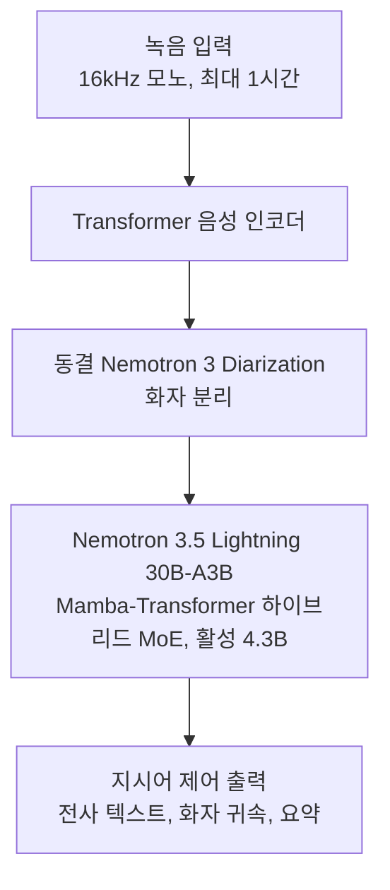
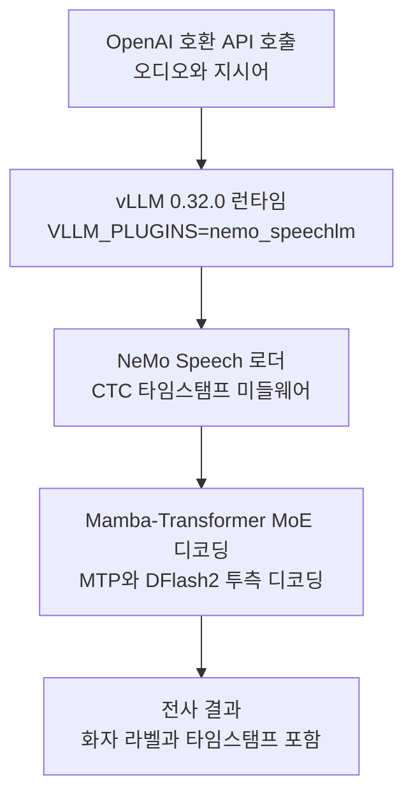

## 왜 읽어야 하나

K8s AI 플랫폼에서 STT(음성 인식)를 서빙하거나, 자체 STT의 베이스 모델을 정해야 하는 플랫폼 엔지니어와 음성 ML 실무자에게 이 글이 필요합니다. 핵심 결론을 먼저 적습니다. NVIDIA는 10월 28일 40개 언어 멀티링구얼 ASR Nemotron 3.5 Transcribe를 공개하고, 같은 날 NeMo Speech 플러그인으로 vLLM 0.32.0 서빙을 열었습니다. LLM이 2년간 누려온 day-0 서빙 스택에 ASR가 처음 들어온 것입니다. 음성 인식 추론은 이제 별도의 인프라가 아니라, LLM과 같은 GPU 큐·같은 런타임·같은 양자화 티어(BF16/FP8/NVFP4)에서 도는 일급 워크로드가 됩니다.


## 개요

NVIDIA는 2026년 10월 28일 Nemotron 3.5 Transcribe를 발표했습니다. Build.Nvidia.com, GitHub(NVIDIA-NeMo/Speech 레포지토리), Hugging Face, NGC 네 채널이 같은 날 열렸고, vLLM 프로젝트 계정도 같은 날 vLLM + NeMo Speech day-0 서빙을 공지했습니다. Nemotron 모델군에서 'Transcribe'라는 음성 인식 모델이 나온 것은 이번이 처음입니다.


모델은 오디오 인코더 포함 총 34B 파라미터, 활성 4.3B입니다. 이름의 30B-A4B는 LLM 백본인 Nemotron 3.5 Lightning 30B-A3B, 즉 Mamba와 Transformer를 섞은 하이브리드 MoE(Mixture-of-Experts)를 가리킵니다. 단일 모델이 40개 언어를 전사하고, 16kHz 모노 녹음 최대 1시간, 시퀀스 65,536토큰까지 받습니다. 실시간 스트리밍 인식이 아니라 오프라인 배치 방식입니다. 라이선스는 OpenMDW-1.1입니다.

기존 ASR과 구분되는 지점은 전사만 하지 않는다는 것입니다. 지시어(instruction)로 제어되도록 설계돼 요약, 화자 귀속(누가 무슨 말을 했는지), 발화 언어 식별까지 같은 모델에서 처리합니다. 화자 구분은 사후 처리가 아니라 동결된 Nemotron 3 Diarization 모델이 아키텍처 내부에서 함께 실행됩니다.

'Day-0 서빙'이라는 표현도 짚어둘 가치가 있습니다. LLM 서빙에서 day-0는 '모델 공개 당일 서빙 스택이 준비돼 있다'는 뜻입니다. 런타임이 모델을 인식하고, 정밀도별 런 프로필이 문서화되고, 설치·서빙 명령이 첫날부터 동작하는 상태입니다. 통상 신규 모델이 서빙 런타임에서 지원까지 하루에서 몇 주를 기다려야 하는 것과 대비됩니다. Nemotron 3.5 Transcribe는 모델 공개와 서빙 지원이 같은 날 네 채널에서 열렸다는 점에서 이 표현이 정확합니다.

## 이 기술은 무엇인가

아키텍처는 세 층으로 읽힙니다.



첫째 층은 Transformer 음성 인코더로, 16kHz 모노 오디오를 특징 벡터로 바꿉니다. 둘째 층은 동결된 Nemotron 3 Diarization 모델로, 각 구간에 화자 라벨을 붙입니다. 셋째 층이 LLM 본체인 Nemotron 3.5 Lightning 30B-A3B로, 인코더 특징과 diarization 결과를 받아 지시어에 따라 전사 텍스트를 생성합니다.

LLM 백본이 Mamba-Transformer 하이브리드인 것이 이번 모델의 핵심 공학적 선택입니다. Mamba 부분은 순환 상태(state)를 선형 복잡도로 갱신해 긴 오디오 시퀀스를 효율적으로 처리하고, Transformer 부분은 주의(attention)가 필요한 구간을 담당합니다. MoE와 결합해 활성 파라미터가 4.3B에 머물면서 40개 언어의 전사·통번역·식별·요약까지 한 모델에서 처리합니다. 1시간 녹음이라는 긴 입력은 바로 이 하이브리드 구조의 존재 이유입니다.


서빙 플래그에서도 같은 구조가 드러납니다. `--use-replayssm`은 Mamba 상태를 재연산(replay) 방식으로 관리해 체크포인트 복원 비용 없이 긴 시퀀스를 처리하게 하고, `--mamba-backend flashinfer`가 그 커널을 제공합니다. `--no-enable-prefix-caching`은 LLM 서빙에서 기본값인 접두사 캐싱을 끄는 설정입니다. 오디오 워크로드는 텍스트 캐싱과 달리 인코더 특징이 호출마다 다르므로 prefix caching이 이득이 되기 어렵고, 대신 `--enable-chunked-prefill`로 긴 오디오의 프릴필을 청크 단위로 나눠 배치 처리합니다. `--limit-mm-per-prompt`의 audio count 6은 호출당 최대 6개 오디오 클립을 넣을 수 있다는 뜻입니다. `--middleware`로 붙는 CTC 타임스탬프 미들웨어는 어텐션 기반 해독과 별개로 CTC 정렬을 계산해 워드 단위 타임스탬프를 결과에 붙입니다.

두 가지 부가 요소가 있습니다. 하나는 지시어 제어입니다. `--reasoning-parser nemotron_v3`로 모델이 오디오를 추론한 뒤 전사하게 되면, 컨텍스트 ASR 벤치마크(ContextASR-Bench)에서 실체명(named entity) 오류가 여섯 배 줄었다는 것이 연구 페이지의 보고입니다. 다른 하나는 투측 디코딩(speculative decoding)입니다. MTP(Multi-Token Prediction) 외에 별도 DFlash2 드래프트 모델이 함께 공개됐고, 모델카드의 서빙 명령에는 `--speculative-config`(MTP, 8토큰 제안)가 포함되어 있습니다. 모델카드는 DFlash2의 K=7을 권장 출발점으로 제시합니다.

## 설치 및 통합

설치 경로는 NeMo Speech main 브랜치 + vLLM 0.32.0 고정입니다. 아래는 모델카드에 있는 명령 그대로입니다.

```bash
pip install git+https://github.com/huggingface/transformers
git clone https://github.com/NVIDIA-NeMo/Speech.git nemo-speech
cd nemo-speech
uv venv --python 3.13 .venv
UV_PROJECT_ENVIRONMENT=$PWD/.venv uv sync --extra asr --extra vllm --locked --no-install-project
uv pip install --python .venv/bin/python --no-deps -e .
uv pip install --python .venv/bin/python --no-deps av==19.0.2
uv pip install --python .venv/bin/python --no-deps opencv-python-headless==5.0.0.93
source .venv/bin/activate
hf download nvidia/NVIDIA-Nemotron-3.5-Transcribe-30B-A4B --local-dir ./NVIDIA-Nemotron-3.5-Transcribe-30B-A4B
```

서빙 명령은 아래와 같습니다.

```bash
export VLLM_PLUGINS=nemo_speechlm
export VLLM_MAX_AUDIO_DECODE_DURATION_S=3600
export VLLM_MAX_AUDIO_CLIP_FILESIZE_MB=180
export VLLM_USE_V2_MODEL_RUNNER=0
vllm serve ./NVIDIA-Nemotron-3.5-Transcribe-30B-A4B \
  --served-model-name nvidia/NVIDIA-Nemotron-3.5-Transcribe-30B-A4B \
  --trust-remote-code --dtype bfloat16 --gpu-memory-utilization 0.94 \
  --max-model-len 65536 --max-num-batched-tokens 4096 --max-num-seqs 192 \
  --enable-chunked-prefill --no-enable-prefix-caching \
  --use-replayssm --mamba-backend flashinfer --mamba-cache-mode none \
  --mm-processor-cache-gb 0 --no-async-scheduling \
  --limit-mm-per-prompt '{"audio":{"count":6,"length":120000000}}' \
  --speculative-config '{"method":"mtp","num_speculative_tokens":8}' \
  --reasoning-parser nemotron_v3 \
  --trust-request-mm-kwargs \
  --middleware nemo.collections.speechlm2.vllm.salm.ctc_serving.ctc_timestamp_middleware
```



명령에서 주목할 점 넷입니다. 첫째, vLLM은 0.32.0으로 고정됩니다. 둘째, V2 모델 러너를 꺼야 합니다(`VLLM_USE_V2_MODEL_RUNNER=0`). 셋째, 오디오 한도 두 개가 환경변수로 고정됩니다. 호출당 최대 1시간(`VLLM_MAX_AUDIO_DECODE_DURATION_S=3600`), 파일당 최대 180MB(`VLLM_MAX_AUDIO_CLIP_FILESIZE_MB=180`). 넷째, FP8과 NVFP4는 KV 캐시 설정이 달라서 양자화 티어를 바꿀 때 런 프로필을 그대로 이식하면 안 됩니다.


하드웨어 티어는 다음 표와 같습니다.

| 정밀도 | 최소 하드웨어 | 비고 |
|---|---|---|
| BF16 | 1× H100 80 GB | RTFx 비교표 기준 |
| FP8 | 1× RTX PRO 6000 Blackwell 96 GB | KV 캐시 설정이 BF16과 다름 |
| NVFP4 | Blackwell GPU | 초당 2,238초 오디오 처리 측정 |

## 실제 실험 결과

2026년 10월 30일, 격리 샌드박스에서 검증을 진행했습니다. 완전 재현은 하드웨어 요건 때문에 불가능했고, 가능했던 검증은 다음 세 가지입니다.

첫째, vLLM의 PyPI 상태를 확인했습니다. 최신 버전이 0.32.0(아티팩트 3개, Python >=3.11,<3.15)이었습니다. 모델카드가 요구하는 버전이 PyPI의 현행 최신과 정확히 일치한다는 것은 day-0라는 주장과 부합합니다.

둘째, NeMo Speech 레포지토리를 얕은 클론(shallow clone)해서 플러그인 등록을 확인했습니다. pyproject.toml에 vLLM 엔트리포인트 `nemo_speechlm = "nemo.collections.speechlm2.vllm.salm:register"`(364행)가 등록돼 있었습니다. day-0 플러그인이 별도 배포 패키지가 아니라 main 브랜치에 직접 들어 있는 것입니다.

셋째, 재현 가능 여부를 판정했습니다. 실험기는 macOS arm64입니다. flashinfer Mamba 백엔드와 NVFP4는 CUDA(Blackwell)를 요구하며, BF16도 H100 80GB가 최소 요건입니다. 재현 시도 중 실패: 이 모델은 최소 1× H100 80 GB(Blackwell GPU를 쓰면 NVFP4)이 필요해 로컬 재현을 수행할 수 없었습니다. 아래 벤치마크 수치는 모두 모델카드의 벤더 발표 값입니다.

모델카드의 핵심 수치를 정리하면 다음과 같습니다.

| 지표 | 값 | 조건 |
|---|---|---|
| 영어 9개 데이터셋 평균 WER | 4.71% | English Open ASR Leaderboard |
| 롱폼 평균 WER | 10.98% | English Open ASR Leaderboard |
| 멀티링구얼 평균 WER | 4.62% | Multilingual Open ASR Leaderboard, 7개 언어 평균의 평균 |
| 한국어 CER | 2.78 | FLEURS, CoVoST2는 미보고 |
| 처리량 | 초당 2,238초 오디오 | Nemotron Transcribe NIM, 1× RTX PRO 6000 Blackwell Server Edition, NVFP4 + DFlash2 |
| 30초 녹음 응답 | 0.13초 | 같은 NIM 구성 |
| BF16 RTFx | MTP2 410 / MTP8 270 / DFlash2 K=7 340 / K=15 260 | 1× H100 80 GB, 배치 영어 ASR, 추론(reasoning) 꺼짐, 근사치 |

한국어 CER 2.78은 FLEURS 기준입니다. CoVoST2는 한국어가 보고되지 않았습니다. 비교를 위해 같은 표의 영어는 FLEURS 3.35, 일본어는 4.42, 중국어는 8.62(CER)입니다. BF16 RTFx 표에서 DFlash2 K=7(340)이 권장 출발점이며, K=15는 해당 ASR 워크로드에서 더 느렸다고 모델카드가 명시합니다. RTFx는 '처리된 오디오 초 / 경과 초' 비율이고, 서버 기동 시간을 제외한 근사치이며 단일 요청 지연 시간이 아닙니다.


수치를 해석할 때 두 갈래가 있습니다. 하나는 정확도입니다. 영어 9개 데이터셋 평균 WER 4.71%, 롱폼 평균 10.98%는 '짧은 발화'와 '긴 녹음'의 격차를 보여줍니다. 1시간짜리 회의·콜 녹음 같은 롱폼 입력에서는 WER가 짧은 발화의 약 두 배로 올라가는 것이 일반적이고, 이번 모델도 같은 패턴을 보입니다. 정확도를 판단할 때는 입력 길이를 분리해서 봐야 합니다. 다른 하나는 처리량입니다. 초당 2,238초 오디오(NVFP4, DFlash2, Blackwell 1장)는 RTFx 비율로 환산하면 1시간(3,600초) 녹음이 경과 시간 약 1.6초에 대응한다는 뜻입니다. NIM 측정 조건에 배치가 포함됐을 수 있어 단일 요청 지연 시간과는 다릅니다. 배치 전사 워크로드라면 GPU 1장으로 하루 수백 시간의 녹음을 소화할 여지가 있고, 이것이 'ASR도 서빙 경제학의 대상'이 된 이유입니다.

## ThakiCloud 제품 적용 시사점

K8s AI 플랫폼에 이번 릴리스는 음성 파이프라인의 구조를 바꾸는 뉴스입니다. 지금까지 LLM 서빙과 ASR 서빙은 별도의 런타임이 필요했습니다. vLLM과, Whisper 서버나 NeMo 스탠다론 서빙. 이제 STT도 같은 vLLM 스택, 같은 Kueue GPU 큐, 같은 멀티테넌트 서비스 위에 워크로드를 올려서 돌릴 수 있습니다. 고객 환경에서 추론을 서빙하는 Metis 입장에선 오디오 워크로드를 위한 서빙 인프라가 하나 줄어듭니다.


큐 관점에서도 의미가 있습니다. 배치 STT 잡은 '오디오 시간당 처리량'으로 수요가 계산되는 워크로드입니다. Kueue에서 GPU 쿼터와 우선순위 등급을 LLM 추론과 같은 체계로 배분하면, '밤에 밀린 콜 녹음을 전사한다'는 잡이 백엔드 배치 잡으로 큐에 들어가는 형태가 됩니다. 서빙 런타임이 하나여서 이미지·플러그인·런 프로필의 관리 대상도 하나로 수렴합니다.

양자화 티어의 경제성도 주목할 만합니다. BF16은 H100 80GB가 필요하고, FP8과 NVFP4로 갈수록 Blackwell에서 비용을 절감합니다. LLM은 이미 NVFP4 경로를 운영 중이고, ASR도 같은 정밀도 티어로 제공되기 시작했습니다. 초당 오디오 처리량이 NVFP4 기준 2,238초, BF16 기준 410x대(RTFx)라면, 1시간 녹음당 서빙 비용 단위로 환산하는 비교표가 바로 만들어집니다. 서빙 경제학 계산의 입력값이 된 것입니다.

Paxis 관점에서는 1시간 오프라인 처리와 화자 귀속이 곧바로 회의 녹음 파이프라인의 빌딩 블록이 됩니다. 콜이나 미팅 녹음을 넣고 화자별 발언·요약·액션 아이템을 뽑는 워크플로가 커스텀 통합이 아니라 배치 잡이 되는 것입니다. 다만 이 모델은 스트리밍 인식이 아닙니다. 실시간 대화(듀플렉스 음성)에는 여전히 스트리밍 STT 경로가 필요하며, 이 모델은 배치/오프라인 성분의 자리입니다.

자체 한국어 ASR 연구는 Qwen3-ASR 베이스의 학습과 증류를 전제로 진행 중입니다. 한국어 FLEURS CER 2.78을 보고한 오픈웨이트 모델이 day-0 vLLM 경로를 함께 내놓은 이상, 오프더셸프 모델을 증류 베이스 후보로 재평가하는 것은 자연스러운 다음 단계가 됩니다.

## 한계 및 반론

첫째, 오프라인 전용입니다. 스트리밍을 지원하지 않으므로 실시간 대화가 목표라면 이 모델은 후보에서 제외됩니다. 둘째, 라이선스입니다. OpenMDW-1.1은 오픈웨이트 라이선스이지만 BSD/MIT 급 완전 오픈이 아닙니다. 제품 통합 전 상업적 이용·재분배 조항을 확인해야 합니다. 셋째, 모든 벤치마크가 벤더 발표 수치입니다. 하드웨어 요건 때문에 완전 재현을 하지 못했으므로 모델카드 값을 근거로 합니다. 넷째, vLLM 고정입니다. 0.32.0 핀과 V2 러너 OFF는 플랫폼의 vLLM 스택이 업그레이드될 때 ASR 서비스의 별도 경로를 요구합니다. 다섯째, 단클립 한도입니다. 1시간과 180MB 한도는 넉넉하지만 이를 넘는 녹음은 분할이 필요하고, 지시어 제어(추론)를 켜면 65,536토큰 한도에 더 가까이 다가갑니다.


## 정리

ASR가 vLLM 스택에서 서빙되는 워크로드가 됐습니다. 같은 큐, 같은 런타임, 같은 양자화 티어. 추론을 운영하는 플랫폼에겐 '음성 인식을 위한 추가 서빙 인프라를 만든다'는 작업이 아키텍처에서 빠진다는 뜻입니다. 다음 행위는 세 단계입니다. 첫째, OpenMDW-1.1 라이선스 조항을 확인합니다. 둘째, H100 또는 Blackwell에서 BF16 티어로 스모크를 돌려 초당 오디오 초와 자체 한국어 데이터 CER를 실측합니다. 셋째, 자체 ASR의 베이스 후보에 이 모델을 올리고 비교합니다. 한국어 FLEURS CER 2.78과 day-0 vLLM 경로를 재평가의 기준값으로 삼으면 됩니다.


## 출처

- [NVIDIA Nemotron 3.5 Transcribe 리서치 페이지](https://research.nvidia.com/labs/nemotron/NVIDIA-Nemotron-3.5-Transcribe/)
- [Hugging Face 모델카드 nvidia/NVIDIA-Nemotron-3.5-Transcribe-30B-A4B](https://huggingface.co/nvidia/NVIDIA-Nemotron-3.5-Transcribe-30B-A4B)
- [NeMo Speech 레포지토리 (GitHub)](https://github.com/NVIDIA-NeMo/Speech)
- [vLLM 프로젝트 X 공지(RT)](https://x.com/hjguyhan/status/2115816535176683737), 2026-10-29
