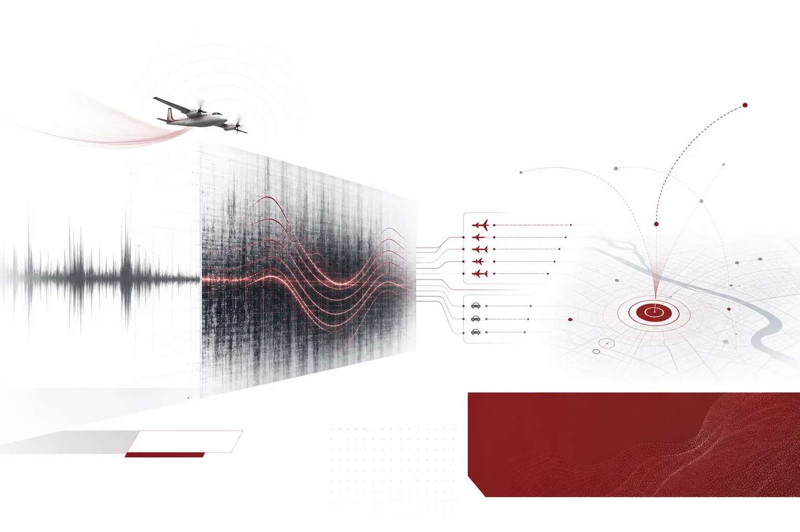
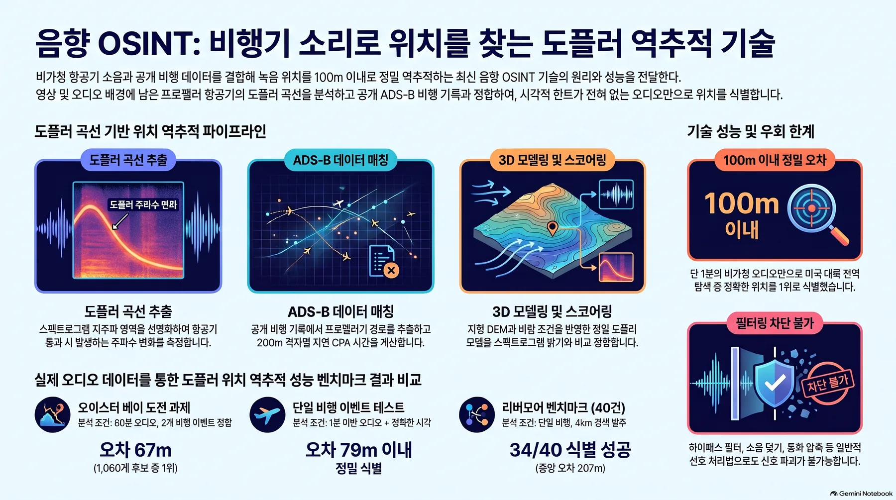
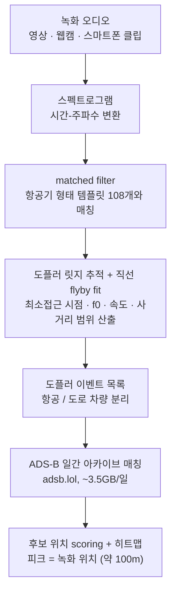
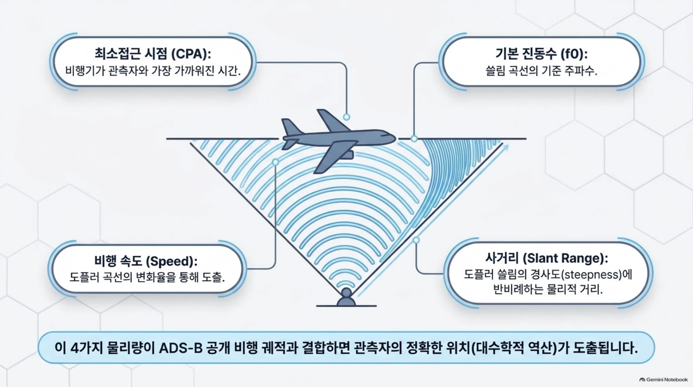
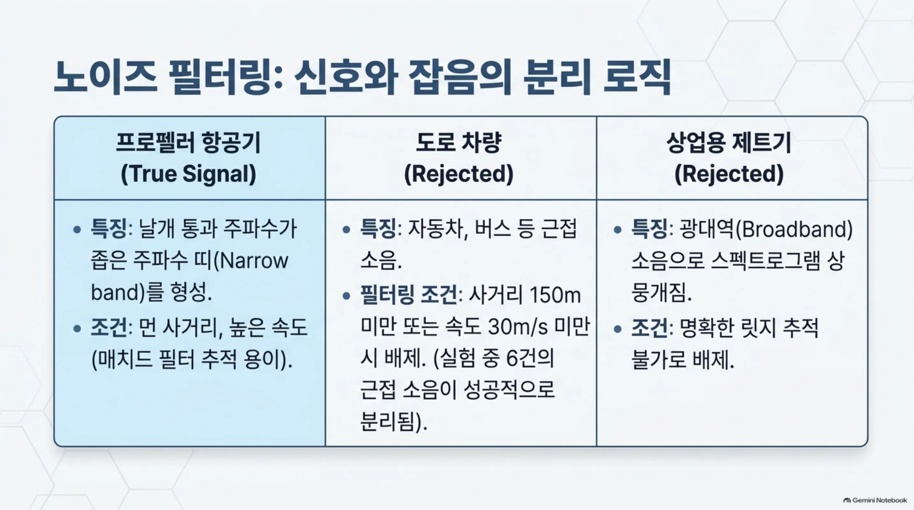
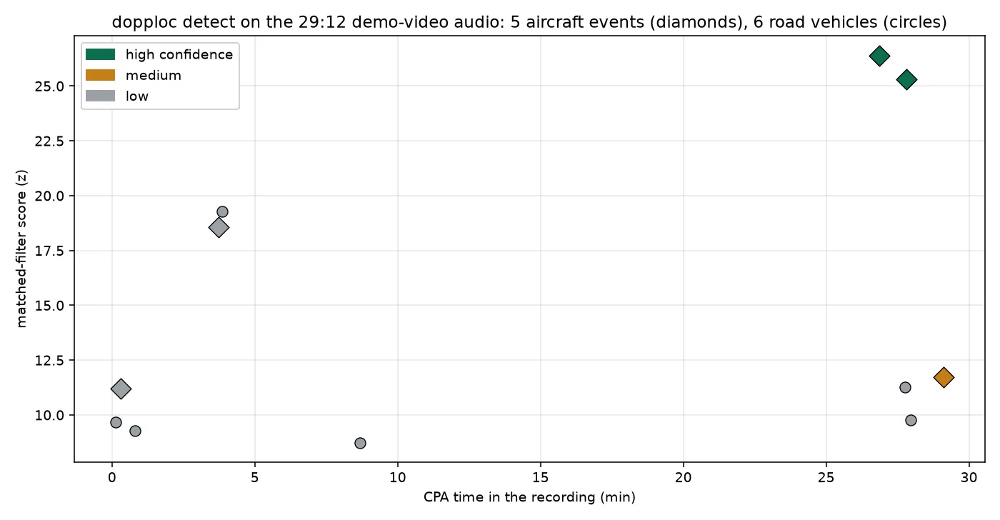
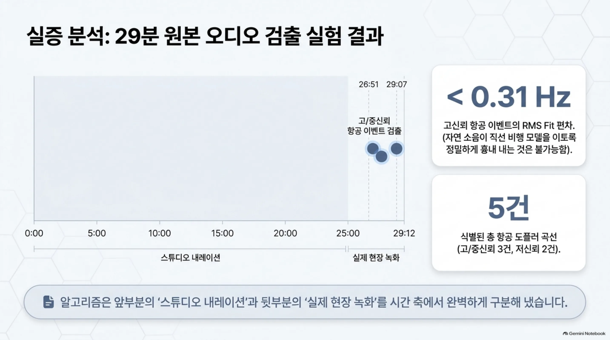
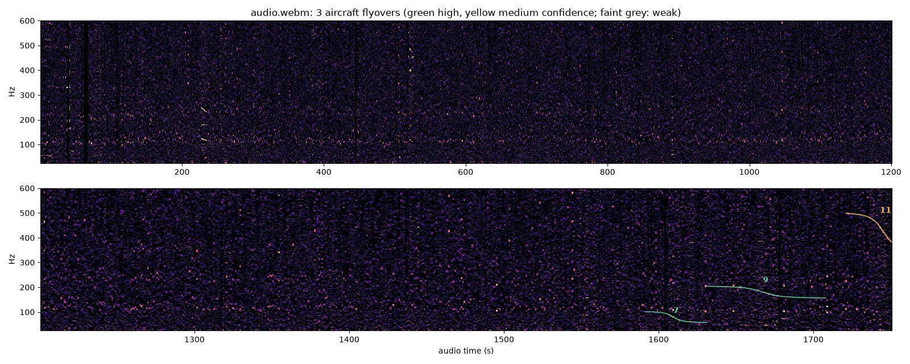
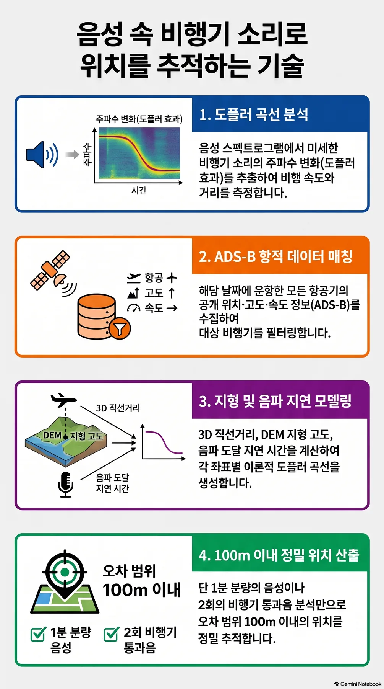

*글의 핵심 개념을 형상화했습니다.*

## 왜 읽어야 하나

녹화한 영상·음원을 공개하는 크리에이터, 그리고 그 영상의 출처를 밝히려는 OSINT 분석가라면 이 글이 대상입니다. 결론부터 말하면, 영상 오디오에 섞인 들리지 않는 프로펠러 비행기 소리가 녹화 위치를 흘립니다. 이 기법을 재현한 오픈소스 도구를 원본 데모 영상에 실제로 돌렸고, 29분짜리 오디오에서 항공 5건의 도플러 이벤트를 36초 만에 잡아냈습니다.


*이 기법의 세 가지 숫자. ~100m는 소스 데모의 기록, 36초는 이번 실측입니다.*


*Colsto의 원본 데모 영상. "위치를 흘리는 소리"를 처음 공개한 OSINT 작품입니다.*


*글의 핵심 개념을 형상화했습니다.*

<!-- nlm-visual -->

*NotebookLM이 소스를 종합해 생성한 인포그래픽입니다.*

## 쉽게 말하면

비행기 소리라는 **휘파람**을 생각해 보겠습니다. 프로펠러 비행기가 머리 위에서 지나갈 때 "윙~" 하고 피치가 낮아지는 소리를 누구나들어 봤습니다. 물리적으로는 단순합니다. 비행기가 가까워지는 동안은 소리의 파장이 압축돼 고하게 들리고, 지나간 뒤에는 늘어나 낮게 들립니다. 이 쓸림의 모양(최소접근 시점, 기본 진동수, 쓸림 속도)은 비행기의 속도와 내가 서 있는 곳의 사거리로 결정됩니다.

여기에 공개 데이터가 더해집니다. ADS-B는 비행기가 스스로 방송하는 위치·속도 정보이고, 전 세계 수신기가 이걸 1초 단위로 축적해 공개합니다. "2026년 9월 8일 오후 3시, 이 지역에서 프로펠러 비행기가 윙~ 하고 지나갔다"는 스펙트로그램의 곡선과 "같은 시각 같은 지역에서 그런 비행기가 실제로 날았다"는 ADS-B 기록을 대조하면, 그 곡선이 성립하려면 내가 어디에 서 있어야 하는지가 남습니다. 히트맵의 피크가 녹화 위치입니다. 조건이 좋으면 ~100m까지 좁혀집니다.

휘파람 하나에 위치가 실려 있다는 것, 그것이 이 기법의 전부입니다.

## 개요

2026년 11월 초, YouTuber Colsto가 ["위치를 흘리는 소리를 발견했다 (and it's everywhere)"](https://www.youtube.com/watch?v=UytYrhYLOKI)라는 영상을 올렸습니다. 소음 속에 섞인 프로펠러 비행기의 도플러 곡선을 ADS-B 데이터와 매칭시켜 녹화 위치를 추정하는 OSINT 기법인데, 60초짜리 오디오로 ~100m 정밀도를 보이는 데모가 반나절 만에 바이럴했고, [0x45의 트윗](https://x.com/0x45o/status/2117332304880169152)을 계기로 더 확산됐으며 [TechRadar](https://www.techradar.com/computing/cyber-security/youtuber-discovers-aircraft-noise-trick-that-can-geolocate-your-videos-to-within-100m-doppler-effect-pinpoints-locations-from-just-60-seconds-of-audio) 등 언론이 뒤를 이었습니다.

흥미로운 두 번의 재현이 이 글의 출발점입니다. Paras Chopra는 [Claude Code로 몇 시간 안에 전체 파이프라인을 재현](https://x.com/paraschopra/status/2117561731065274562)했다고 보고했고, 재현은 영상 분석이 아니라 독립적 현장 검증이었습니다. 영국 Southampton 남쪽 7km 지점에 실제 웹캠을 두고 돌렸는데, 예측 위치 히트맵이 웹캠의 실제 위치에서 피크를 냈다고 합니다. ~100m라는 수치는 원본 데모가 아니라 이 새 현장 케이스에서 나온 것입니다. 독립적 재구현도 같은 주에 두 개나 출현했습니다. [digitalis-p/doppler-locate](https://github.com/digitalis-p/doppler-locate)(GitHub, MIT)와 [dopplerprint](https://pypi.org/project/dopplerprint/)(PyPI, 2026-11-03 릴리스). 이 글은 그중 doppler-locate를 실제로 설치·실행한 실측 기록입니다. 같은 영상 방법을 몇 일 만에 독립적으로 재구현한 도구가 두 개 출현했다는 것 자체가, 기법이 "영상 하나만의 마술"이 아니라 재현 가능한 표준 파이프라인임을 보여줍니다.

## 이 기술은 무엇인가

파이프라인은 5단계입니다.



핵심 물리량은 flyby fit이 뽑아내는 네 값입니다. 최소접근(CPA) 시점, 기본 진동수 f0, 비행 속도, 사거리(슬랜트 레인지). 이 네 값은 "그 순간 그 높이로 그 속도로 비행기가 지나갔다면, 관측자는 어디에 있어야 하는가"를 결정합니다. ADS-B 데이터가 같은 시각·지역의 실제 비행 궤적을 주면, 관측자 위치 후보가 남고, 후보마다 "이 위치라면 이런 곡선이 나와야 한다"를 역산해 점수를 매깁니다. 히트맵의 피크가 답입니다.

왜 프로펠러 비행기가 좋은 신호인가? 제트기 소음은 광대역이라 스펙트로그램에 뭉개져 보이지만, 프로펠러의 날개 통과 주파수(blade-passing frequency)와 그 고조파는 좁은 주파수 띠로 쓸리며 matched filter가 잡기 쉬운 깨끗한 릿지를 남깁니다. 그리고 도플러 쓸림의 steepness가 사거리와 반비례합니다. 비행기가 300m 위에서 지나가면 f0가 천천히 쓸리고, 30m 아래로 지나가면 급하게 쓸립니다. 쓸림 모양 하나에서 비행기가 얼마나 가깝게, 얼마나 빠르게 지나갔는지가 결정됩니다. 이 두 값(사거리·속도)과 ADS-B의 궤적(고도·속도·경로)을 결합하면 관측자 위치의 대수학이 남습니다.


*4가지 물리량이 ADS-B 공개 데이터와 결합되면 관측자 위치가 도출됩니다.* 도구 내부적으로는 지형 DEM(Copernicus GLO-90)과 바람·기온(NOAA GFS 0.25도 분석)까지 입력해 음파 전파 속도와 지형 차폐를 보정합니다.

도구의 분리 로직도 실용적입니다. 도로 차량(자동차, 버스)도 도플러 곡선을 만들지만, 사거리가 150m 이내이고 속도가 30 m/s 미만이라는 범위로 항공과 분리합니다.


*신호와 잡음을 구분하는 필터 기준. 이 분리가 없으면 자동차 소음이 비행기로 잡힙니다.*

## 설치 및 통합

실험은 격리 샌드박스(git worktree)에서 했습니다. macOS 환경, Python 3.12.8, 공유 .venv에 Rust 네이티브 코어는 없어서(리포지토리는 CUDA 빌드를 우선시, macOS에서 빌드 실패 예상) 샌드박스 전용 `.expenv`에 설치했습니다.

```bash
# 1) 클론 (digitalis-p/doppler-locate, MIT)
git clone --depth 1 https://github.com/digitalis-p/doppler-locate
cd doppler-locate

# 2) venv + 설치 (uv)
uv venv --python 3.12 .expenv
VIRTUAL_ENV="$PWD/.expenv" uv pip install -e '.'
VIRTUAL_ENV="$PWD/.expenv" uv pip install yt-dlp   # 웹 오디오 다운로드용

# 3) (선택) 네이티브 빌드 (macOS에서는 CUDA가 없어 실패, numba CPU 폴백이 동작)
make -C native   # 실패해도 무관, 폴백 경로로 실행됨

# 4) detect: 오디오 파일 또는 웹 링크를 준다
.expenv/bin/dopploc detect /path/to/recording.webm
# 또는 직접 URL: .expenv/bin/dopploc detect "https://www.youtube.com/watch?v=UytYrhYLOKI"
# (URL 입력은 yt-dlp 경유, 출력 디렉터리가 존재해야 함)
```

detect의 산출물은 `out/detect/<이름>/` 아래 네 개입니다. `report.md`(인쇄 리포트), `detections.json`(전체 검출), `events.toml`(fit 통과한 항공 이벤트), `detections.png`(스펙트로그램+검출 오버레이).

matching까지 쓰려면 도구가 받는 데이터 소스가 네 개입니다. adsb.lol의 일간 히스토리(약 3.5GB/일, ODbL), ICAO 항공기 type table(기종별 프로펠러/제트 구분), Copernicus GLO-90 DEM(지형), NOAA GFS 0.25도 분석(바람·기온). 이 중 detect 단계는 오디오 하나만 쓰지만, matching은 전부 필요합니다.

위치 추정까지(heatmap)가 필요하면 ADS-B 단계가 이어집니다.

```bash
.expenv/bin/dopploc fetch-adsb 2026-09-08   # adsb.lol 일간 아카이브, ~3.5GB
.expenv/bin/dopploc ingest 2026-09-08       # bbox 필터링해서 parquet
.expenv/bin/dopploc run CASE.toml           # search + score
.expenv/bin/dopploc heatmap CASE.toml --rank 1   # 1순위 후보 주변 고밀도 맵
```

## 실제 실험 결과

원본 데모 영상(Colsto, 29분 12초)의 오디오를 yt-dlp로 추출해 detect로 돌렸습니다. MacBook CPU(numba 폴백, GPU 미사용)에서 **전체 분석 36초**(10:55:03 → 10:55:39, 스펙트로그램 + 108개 템플릿 matched filter + 검출 18건 fit까지)가 걸렸습니다.

결과는 리포트 그대로입니다.

```
source: /tmp/dopploc-audio/Youtube-UytYrhYLOKI/audio.webm  (0:00-29:12)
aircraft Doppler curves found: YES -- 3 high/medium, 2 low-confidence;
6 close-range sources (road vehicles etc., < 150 m or < 30 m/s) listed separately

Aircraft
| # | CPA       | f0 Hz | speed m/s (kt) | CPA dist m | score | fit rms Hz | confidence |
|---|-----------|-------|----------------|------------|-------|------------|------------|
| 7 | 26:51     | 73.6  | 97 (188)       | 614        | 26.4  | 0.31       | high       |
| 9 | 27:49     | 177.1 | 47 (92)        | 611        | 25.3  | 0.20       | high       |
| 11| 29:07     | 411.2 | 62 (121)       | 534        | 11.7  | 0.85       | medium     |
| 2 | 0:18      | 30.6  | 160 (311)      | 400        | 11.2  | -          | low        |
| 4 | 3:44      | 135.9 | 73 (143)       | 528        | 18.6  | -          | low        |
```


*run-1 캡처(detections.json)로 그린 차트. 고신뢰 항공 2건(D1 f0 73.6 Hz, D2 f0 177.1 Hz)은 영상 후반 26:51~27:49에 집중됩니다.*


*고·중신뢰 검출이 영상 후반에 집중되고, 고신뢰 2건의 fit rms는 0.31 Hz 미만입니다.*

도구 자체의 스펙트로그램 오버레이가 아래입니다. 분홍 노이즈 숲 위로 항공 도플러 곡선(녹색 고신뢰, 주황 중신뢰)이 릿지처럼 올라오는 것이 보입니다.


*도구가 직접 쓴 detections.png. 0~1200초(상단)와 1200~1752초(하단) 패널.*

세 가지를 짚겠습니다.

첫째, **검출의 시간 분포가 영상의 구조와 일치합니다**. 고·중신뢰 항공 3건은 전부 영상 후반(26:51~29:07)에 몰려 있습니다. Colsto가 실제 필드 녹화를 틀어 주는 구간이 후반이라, 앞 26분의 내레이션 위로는 저신뢰 검출만 남습니다. 도구가 "영상 속의 녹화"와 "화자가 말하는 소리"를 시간 축에서 구분해 검출한 셈입니다.

셋째, **fit 품질이 직선 flyby 모델의 적합성을 보여줍니다**. 고신뢰 2건의 fit rms가 0.20 Hz와 0.31 Hz입니다. 1Hz도 안 되는 편차는, 추적된 주파수 곡선이 '일정한 속도로 직선 비행하는 비행기' 모델과 거의 정확히 겹친다는 뜻입니다. 자연 소음이 이 정도 정밀도로 비행기 모양을 흉내 내는 것은 우연이라 보기 어렵습니다. 반대로 events.toml의 파라미터 범위는 보수적으로 나옵니다. D1의 속도 범위가 73.7~141.7 m/s, 사거리가 300~1739m까지 wide한데, 이는 "이 fit만으로는 위치를 못 정한다, ADS-B 궤적과의 교차 검증이 필요하다"는 설계 의도가 숫자로 드러난 것입니다.

둘째, **도로 차량 6건이 항공과 분리됐습니다**. `< 150 m or < 30 m/s`라는 범위로, CPA 50~144m·속도 20~52 m/s의 근접 소음이 항공 테이블에 섞이지 않았습니다. 이 분리 없이는 "자동차 소음이 비행기로 잡혀 위치를 엉키게 한다"는 오동작이 생깁니다.

**이 실행에서 하지 않은 것**: ADS-B 매칭 단계(fetch-adsb ~3.5GB → search → score → heatmap)입니다. 그래서 "여기 위치를 추정했다"는 문장은 쓰지 않습니다. 위치 추정 그 자체는 소스 리포지토리의 기록으로 인용합니다. 문서화된 데모는 미국 Oyster Bay(NY) 녹화로, 카메라 실제 위치에서 **약 67m**였습니다.

## ThakiCloud 제품 적용 시사점

두 가지 각도에서 이 기법을 보면 좋습니다.

**Paxis의 관점**: "바이럴 영상을 보고 몇 시간 안에 재현한다"는 작업 자체가 Paxis가 하는 일입니다. Paras Chopra는 Claude Code로 이 파이프라인을 재현했고, 이 글의 샌드박스(격리 worktree → 설치 → 실행 → 산출물 캡처 → 문서화)는 그 패턴의 프로덕션 버전입니다. 스킬·도구를 일급 리소스로 다루는 Agent-Native Cloud에서, "OSINT 기법 하나"는 스펙 하나(입력: 오디오+시각+지역 힌트, 출력: 이벤트 목록+위치 후보)로 패키징되는 단위의 작업입니다. 몇 시간 단위의 재현이 반복되면 스킬이 되고, 스킬은 정책 게이트와 감사 로그를 지나 다른 세션에서 재사용됩니다. 바이럴 기법이 스킬로 바뀌는 속도가, 곧 에이전트 플랫폼의 경쟁력입니다.

**보안의 관점**: 오디오가 위치 채널이 됐다는 것은 콘텐츠 운영자에게 새로운 포렌식 축입니다. "이 영상의 촬영 위치가 어디인가"를 메타데이터 없이 추정할 수 있다면, 유출 사건의 기원 추적, 가짜 영상의 지역 정합성 검증, 개인이 올린 스트림의 위치 노출 평가에 쓰입니다. 동시에 크리에이터의 프라이버시도 같은 코인의 양면입니다. 영상 오디오에 비행기가 들리면, 공개되는 순간 위치 추정 후보가 됩니다.


*바이럴 OSINT의 스킬 프로덕션화(Paxis)와 연산/데이터 단계 분리(플랫폼)라는 두 관점.*

**운영 각도**로 보면 파이프라인의 중량 분포가 눈에 띕니다. detect 단계는 노트북 CPU에서 36초이지만, 그 다음 ADS-B 단계는 하루 ~3.5GB 아카이브를 받아 bbox 필터링으로 parquet에 인제스트하고, 후보 위치마다 역산 scoring을 돌립니다. 연산이 병목인 detect와 데이터량이 병목인 matching이 나뉘는 구조는 ThakiCloud의 ai-platform이 다루는 일의 전형적 형태입니다. 일간 배치 데이터 인제스트, CPU/GPU 잡의 혼합, 산출물의 S3 sinking. OSINT 기법을 프로덕션으로 옮긴다면 detect는 샌드박스 스킬로, matching은 Kueue 큐 잡으로 분리되는 배선이 자연스럽습니다.

## 한계 및 반론

정밀도는 조건에 의존합니다. ~100m(소스 데모는 67m)는 "깨끗한 오디오 + 식별 가능한 프로펠러 비행기 + 그 지역 ADS-B 커버리지"가 다 갖춰진 상한이고, 언론에서도 같은 한계를 명시했습니다. 영상 초반 26분에서 고신뢰 검출이 하나도 안 나온 이번 실행이 그 상한의 실체입니다.

YouTube 압축은 스펙트로그램 품질을 떨어뜨리고, 도플러가 아닌 소음(엔진, 공구, 음악)이 항공 형태 템플릿에 매칭될 수 있습니다. 이번 실행의 저신뢰 2건(f0 30.6 Hz, 135.9 Hz)이 어떤 것인지는 ADS-B 매칭 단계 없이는 확인하지 못합니다.

프라이버시 문제는 기법의 성질입니다. 녹화자의 동의 없이 위치를 추정하는 것이므로, "나의 영상을 분석하는 용도"가 아닌 적용은 신중해야 합니다. OSINT 도구가 갖는 통상적 양면성인데, 이 기법은 특히 소음이 대상이라 "의식하고 지울 수 있다"는 전제 자체가 약합니다.


*같은 코인의 양면: 유출 추적에는 강력한 포렌식이고, 크리에이터에는 새로운 프라이버시 노출 채널입니다.*

우연이 아닐 근거도 정리하면, matched filter가 108개 항공기 형태 템플릿으로 스펙트로그램 전체를 훑고, 통과한 검출은 straight-line flyby fit으로 2차 검증받는 이중 구조입니다. 다만 이 논증도 detect 단계의 것이지 최종 위치 추정까지의 논증은 아닙니다. 위치의 신뢰도는 ADS-B 궤적의 밀도, 즉 그 시각 그 하늘에 비행기가 몇 대 있었는가에 좌우됩니다. 비행기가 없는 하늘에서는 소리가 아무리 깨끗해도 답을 못 줍니다.

마지막으로 범위: 이번 실험은 detect 단계까지입니다. 3.5GB ADS-B 아카이브 매칭까지 돌리면 이 영상(또는 다른 클립)의 실제 위치 추정도 가능하지만, 이번 산출물에는 포함하지 않았습니다. 재현을 원하면 리포지토리의 `cases/`와 `dopploc fetch-adsb` 문서가 정본입니다.

## 정리

비행기 소리는 더 이상 배경이 아닙니다. 영상에 섞인 프로펠러의 휘파람이 최소접근 시점·기본 진동수·속도·사거리를 남기고, 그것들이 공개 ADS-B 데이터와 매칭되면 녹화 위치가 히트맵의 피크로 좁혀집니다.

개발자에게는 2개 명령으로 재현 가능한 파이프라인입니다. `pip install`과 `dopploc detect`. 29분 오디오를 노트북 CPU에서 36초에 분석하고, 항공과 도로 차량을 분리한 것이 이번 실험의 실체입니다. 위치 추정까지는 ADS-B 매칭 단계가 남고, 그 단계의 기록된 정밀도는 ~67m(소스 데모)입니다.

크리에이터와 플랫폼 운영자에게는 다른 의미가 남습니다. 오디오가 위치 채널이라면, 공개 전에 "이 오디오에 비행기가 들리는가"를 점검하는 것이 메타데이터 제거와 같은 레벨의 위생이 됩니다. 그리고 Paxis 관점에서는, 바이럴 기법이 몇 시간 안에 스킬이 되는 이 사례가 에이전트 플랫폼이 반복해야 하는 동작 그 자체입니다.

<!-- nlm-visual -->

*NotebookLM이 소스를 종합해 생성한 인포그래픽입니다.*

## 출처

- Colsto, "I discovered a sound that leaks your exact location (and it's everywhere)" · [YouTube](https://www.youtube.com/watch?v=UytYrhYLOKI) · [archive.org 미러](https://archive.org/details/youtube-UytYrhYLOKI)
- 0x45의 원 트윗: [x.com/0x45o](https://x.com/0x45o/status/2117332304880169152)
- Paras Chopra의 Claude Code 재현 트윗: [x.com/paraschopra](https://x.com/paraschopra/status/2117561731065274562)
- 도구: [digitalis-p/doppler-locate](https://github.com/digitalis-p/doppler-locate) (MIT) · [dopplerprint](https://pypi.org/project/dopplerprint/) (PyPI, 2026-11-03)
- 보도: [TechRadar](https://www.techradar.com/computing/cyber-security/youtuber-discovers-aircraft-noise-trick-that-can-geolocate-your-videos-to-within-100m-doppler-effect-pinpoints-locations-from-just-60-seconds-of-audio)
