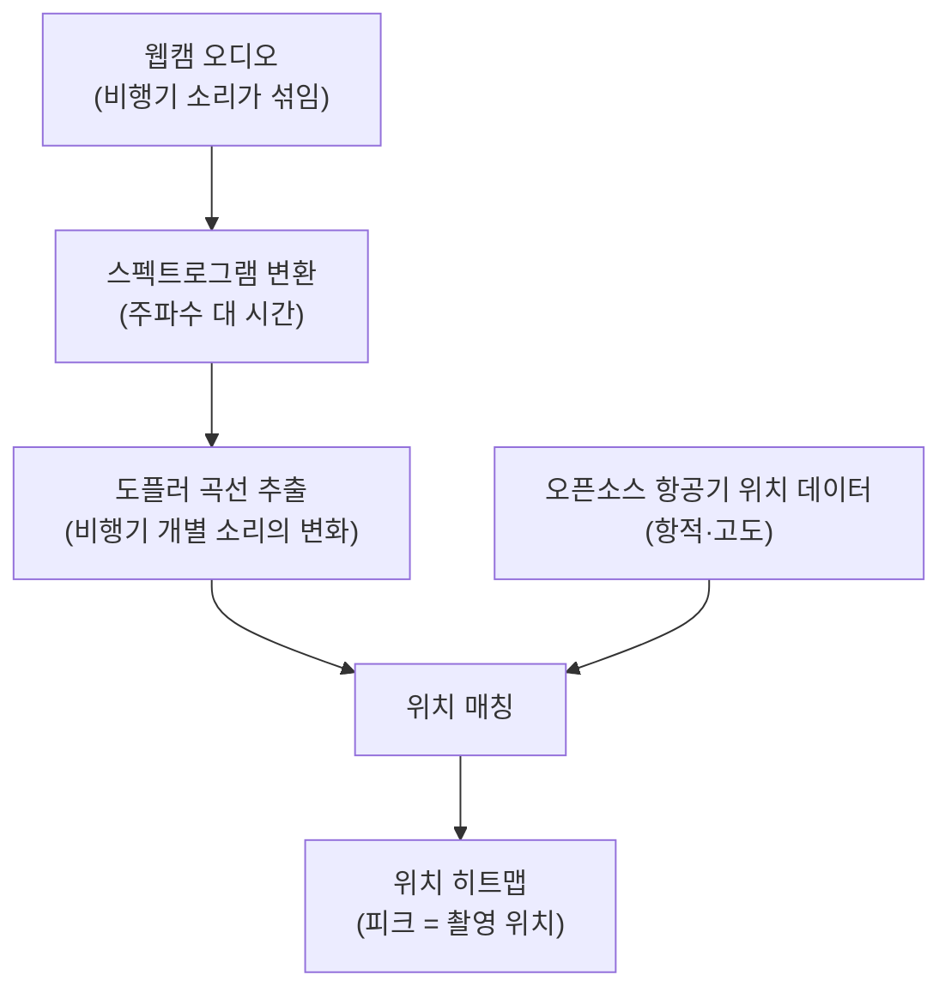

## 왜 읽어야 하나

영상과 오디오를 다루는 개발자, 그리고 AI 에이전트 환경을 운영하는 사람에게 한 줄의 경고입니다. 소리에는 생각보다 많은 위치 정보가 섞여 있습니다. 이번 데모는 비행기 소리의 도플러 효과만으로 촬영 기기의 물리적 위치를 특정해 낸 사례입니다. 흥미로운 부분은 방법이 아니라 속도입니다. Claude Code가 이 재현을 몇 시간 만에 끝냈습니다. 재현 비용이 몇 시간이라면, 공격 표면은 훨씬 넓어집니다.

## 쉽게 말하면

구급차가 다가올 때는 비명이 높고, 지나가면 낮아집니다. 도플러 효과는 바로 그 현상입니다. 소리의 파장이 발신자와 수신자의 운동에 따라 늘어나거나 줄어든다고 배웠습니다. 이 데모는 구급차 대신 비행기를 씁니다. 하늘을 나는 비행기마다 고유한 소리가 있고, 그 소리의 높낮이가 변하는 곡선은 비행기가 내 머리 위에서 지나가는 각도에 따라 정해집니다. 어느 위치에서 들었는지, 그 곡선에 이미 찍혀 있습니다.

## 개요

2026년 11월 2일, 0x45o가 한 사용자의 기법을 소개했습니다. "이 사람은 주변 비행기의 도플러 곡선을 이용해, 소리가 있는 어떤 영상에서든 정확한 위치를 새기게 만드는 법을 알아냈다"는 말입니다. 하루 뒤 paraschopra가 Claude Code로 이를 재현했다고 게시했습니다. 게시물은 26만 뷰를 넘겼습니다.

재현의 요지는 단순합니다. 웹캠 오디오를 스펙트로그램으로 바꿔 비행기 소리의 도플러 곡선을 추출하고, 오픈소스 항공기 위치 데이터와 맞춥니다. 매칭 결과가 위치 히트맵이 되고, 그 피크가 웹캠이 실제로 있던 지점에 옵니다. paraschopra의 웹캠은 영국 사우스햄턴 남쪽 7km에 있었습니다.

## 이 기술은 무엇인가

원리는 세 단계입니다. 첫째, 오디오를 스펙트로그램으로 표현합니다. 주파수가 시간에 따라 어떻게 변하는지 보는 표입니다. 비행기가 접근하면 해당 소리의 주파수가 서서히 올라가고, 지나가면 내려옵니다. 이 곡선이 도플러 곡선입니다.

둘째, 그 곡선과 항공기 위치 데이터를 맞춥니다. 어느 비행기가, 언제, 어떤 경로로 날았는지는 오픈소스 데이터로 공개되어 있습니다. 내가 본 도플러 곡선이 "그 비행기를 그 거리에서 그 각도로 본 사람"의 곡선과 일치하면, 나는 그 비행기 궤적의 특정한 위치에 있었습니다. 비행기가 여러 대라면, 매칭이 가능한 위치가 좁혀집니다.

셋째, 남은 후보 위치에 점수를 매겨 히트맵을 만듭니다. 피크가 촬영 위치가 됩니다. GPS는 아닙니다. 그러나 데모에서는 피크가 웹캠의 실제 위치를 가리켰습니다.

## Claude Code 재현 각도

paraschopra의 말대로 이 재현을 한 것은 Claude Code입니다. "Claude Code로 재현했다. 몇 시간 만에 끝냈다"가 이번 사건의 두 번째 핵심입니다.

이 파이프라인의 부품을 하나씩 떠올리면, 하루 만에 끝내기 어려운 작업들입니다. 오디오를 읽어 스펙트로그램을 만들고, 비행기 소리에 해당하는 주파수 대역을 찾아내고, 그 대역의 시간별 주파수 변화를 추적해 곡선으로 뽑아내는 DSP 코드를 씁니다. 항공기 위치 데이터를 가져오고, 내 곡선과 궤적을 비교하는 매칭 모델을 만듭니다. 후보 위치를 격자화해 점수를 매기는 히트맵 코드도 필요합니다. 각 부품은 따로따로 인터넷에 예시가 있지만, 이 순서로 이어붙여 하나의 파이프라인을 만드는 것은 사람의 작업 시간 기준 며칠이 걸리는 일입니다.

Claude Code는 그 "이어붙이기"를 몇 시간 만에 했습니다. 재현 대상의 설명만 듣고, 필요한 라이브러리를 찾아, 단계를 설계하고, 코드를 짜고, 실행해, 결과가 예상과 다르면 고치며 나아간 것입니다. 에이전트에게 "이 데모를 재현해 줘"라고 한 것이 실제로 파이프라인 개발로 끝난 사례입니다.

여기서 중요한 것은 두 가지입니다. 첫째, 비자명한 과학·공학 파이프라인의 재현 비용이 몇 시간 단위로 내려왔습니다. 둘째, 그 재현은 에이전트 스스로의 판단 체인으로 이루어졌다는 뜻입니다. 사람이 매 단기를 점검한 것이 아니라, 에이전트가 단계별로 판단하고 진행했습니다.

## 프라이버시와 보안 시사점

paraschopra의 후속 게시물에 이번 사건의 일반화가 한 줄로 있습니다. "사이드채널은 어디에나 있고, 그런 사이드채널은 전부 재미와 이익을 위해 발견되고 악용될 것이다."

이 데모의 기술적 요건은 높지 않습니다. 소리가 있는 영상, 하늘에 비행기가 지나가는 환경, 오픈소스 항공기 위치 데이터. 공항 주변, 비행 경로가 있는 도시, 군사시설 근처, 연구시설 외부. 소리가 나는 모든 환경에 이 요건이 성립할 수 있습니다.

가장 직관적인 위협은 위치 메타데이터가 없는 것으로 여겼던 소스의 위치 노출입니다. 웹캠 녹화, CCTV, 폰 녹음, 라이브 스트리밍. "시간은 달아도 위치는 없다"고 여겼던 자료에서 위치가 새는 것입니다. 반대로, 위치가 이미 찍혀 있는 자료에서는 그 위치의 정확도를 높이는 도구로 쓰일 수 있습니다.

방어 측면에서도 한 가지가 달라집니다. 소리를 끄는 것이 유일한 대책이 아닙니다. 비행기 소리가 섞인 환경에서는 소음 자체가 신호가 됩니다. 어떤 환경에서 어떤 주파수 대역이 노출되는지, 그 노출이 어떤 매칭으로 이어지는지를 아는 것이 이제 기본 위생이 됩니다.

## 한계 및 반론

이 데모의 한계를 짚습니다. 첫째, 정확도입니다. 히트맵의 피크가 실제 위치와 일치했다지만, 그 일치의 해상도는 게시된 자료로 확인된 바가 없습니다. "7km 남쪽"이라는 서술이 데모의 대상 위치이고, 피크가 그 부근에 왔다는 뜻일 수 있습니다. 미터 단위 위치 특정의 증거는 게시되지 않았습니다.

둘째, 조건입니다. 비행기 소리가 들릴 정도로 선명해야 하고, 항공기 위치 데이터가 최신이어야 합니다. 야간이나 비행 활동이 없는 시간, 비행 경로에서 멀리 떨어진 지역에서는 성립하지 않습니다.

셋째, 범위입니다. 이 글은 paraschopra의 Claude Code 재현 게시물을 기반으로 씁니다. 0x45o가 언급한 원본 사용자의 기법은 별도로 검증하지 않았습니다. 원본이 어떤 해상도와 어떤 데이터원을 썼는지는 이 글의 범위를 벗어납니다.

반론도 가능합니다. 위치 정보를 요구하는 서비스는 이미 사용자의 정확한 위치를 받고 있습니다. 이 사이드채널이 "새로운" 정보를 주는 것은 아니라는 것입니다. 그러나 반론은 반대로 성립합니다. 위치를 요구하지 않는 맥락에서 위치가 나오는 것이 이번 데모의 내용입니다. 위치를 요구하지 않은 자료에서 위치 정보가 새는 것입니다.

## ThakiCloud 제품 적용 시사점

Paxis 관점에서 이번 사건의 의미는 에이전트의 재현 비용입니다. Paxis는 Skills, Tools, Policies, Audit Logs를 일급 리소스로 다루는 Agent-Native Cloud입니다. "몇 시간 만에 비자명한 파이프라인을 재현하는" 에이전트를 운영하는 환경에서, 그 재현이 남긴 감사 기록과 정책 경계가 일급 리소스여야 한다는 것은 이번 데모가 보여 줍니다. 에이전트가 자율적으로 데이터를 찾고, 코드를 짜고, 실행한 과정이 Audit Logs에 남지 않으면, 재현 비용이 싸지는 대가로 감사 비용이 올라갑니다.

Metis 관점에서는 고객 워크로드의 보안 위생이 한 계층 넓어집니다. 영상·오디오를 다루는 워크로드는 위치 메타데이터가 없을 때에도 위치가 섞여 있을 수 있습니다. 고객이 "소스에는 위치가 없다"고 전제하는 경우, 그 전제 자체를 점검하는 것이 플랫폼이 줄 수 있는 서비스입니다.

## 정리

소리에는 위치가 섞여 있습니다. 비행기의 도플러 곡선은 그 위치의 흔적이고, 오픈소스 항공기 데이터는 그 흔적을 읽는 표입니다. 이번 데모가 보여 준 것은 두 가지입니다. 하나는 이 매칭이 실제로 동작한다는 것. 다른 하나는 Claude Code가 그 파이프라인을 몇 시간 만에 재현했다는 것.

개발자에게는 두 가지 질문이 남습니다. 내 자료에서 어떤 소리가 노출되고 있는가. 에이전트가 재현하는 시간이 몇 시간이라면, 내 공격 표면은 어디까지인가. 사이드채널은 발견되는 대로 악용됩니다. 노출을 줄이는 것만이 아니라, 노출이 어떤 매칭으로 이어지는지 아는 쪽이 방어에 유리합니다.

## 출처

- [0x45o의 소개 게시물](https://x.com/0x45o/status/2117332304880169152): 도플러 곡선으로 위치를 새기는 기법 소개
- [paraschopra의 재현 게시물](https://x.com/paraschopra/status/2117561731065274562): Claude Code로 사우스햄턴 웹캠 데모 재현
- [paraschopra의 후속 게시물](https://x.com/paraschopra/status/2117589464054894924): "사이드채널은 어디에나 있다"
