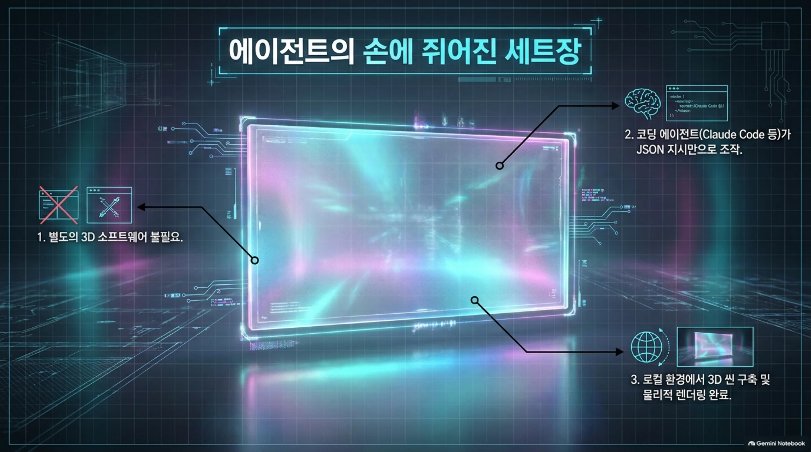
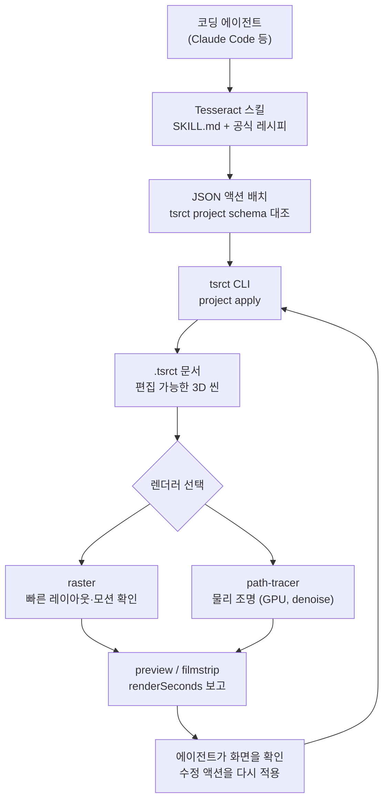
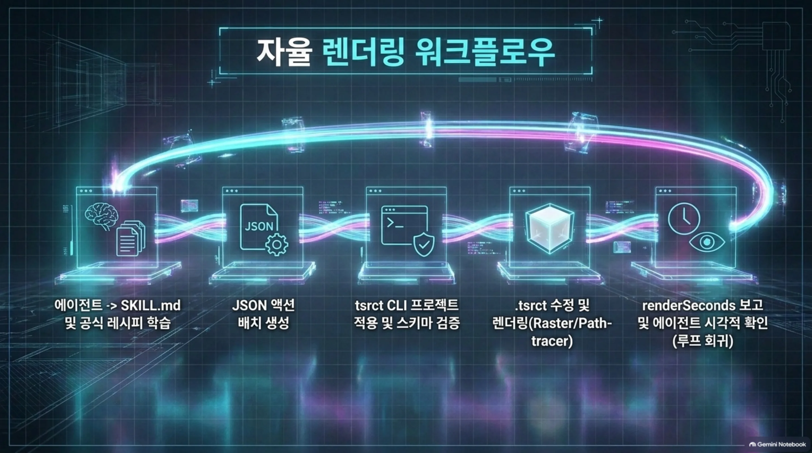
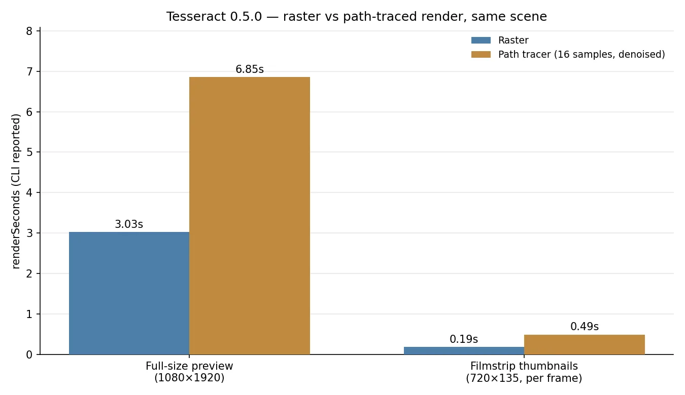
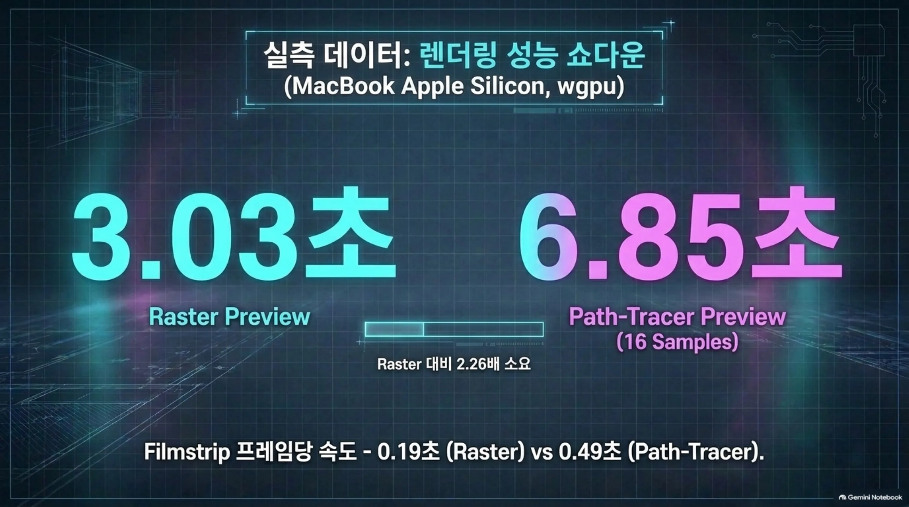
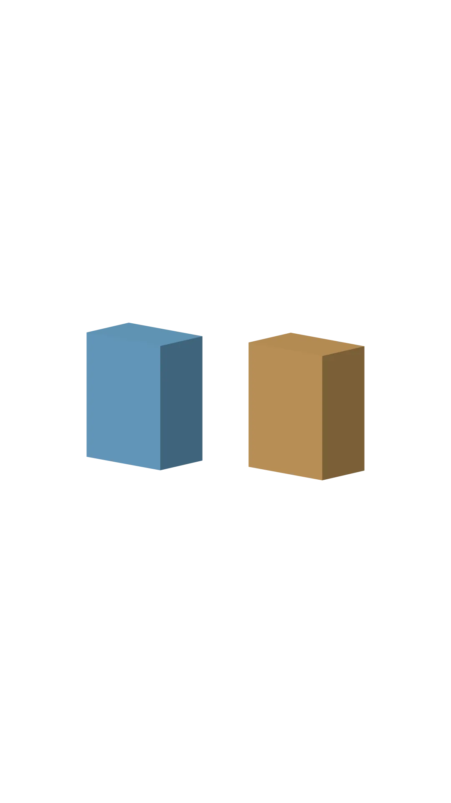
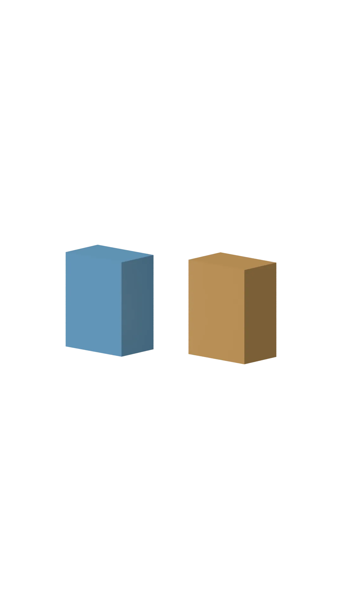
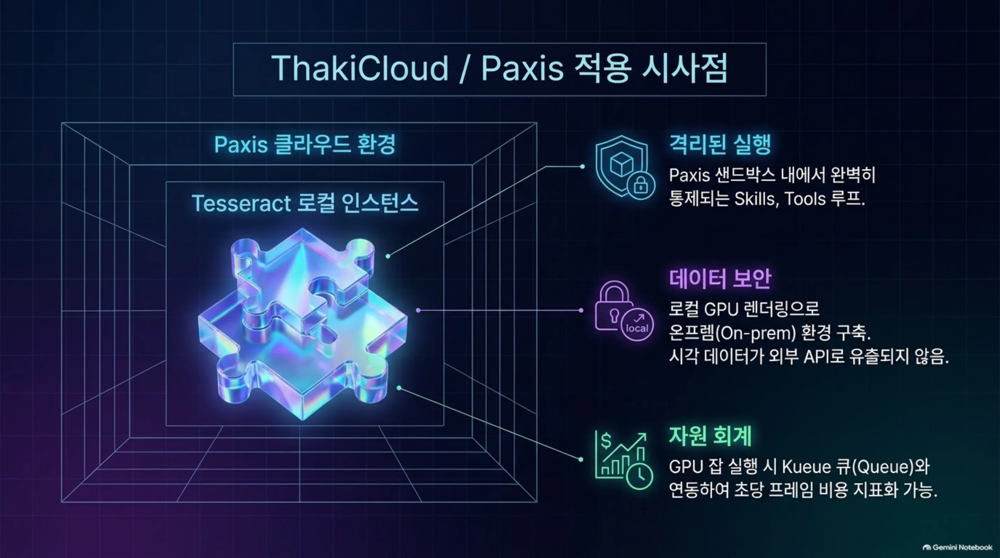
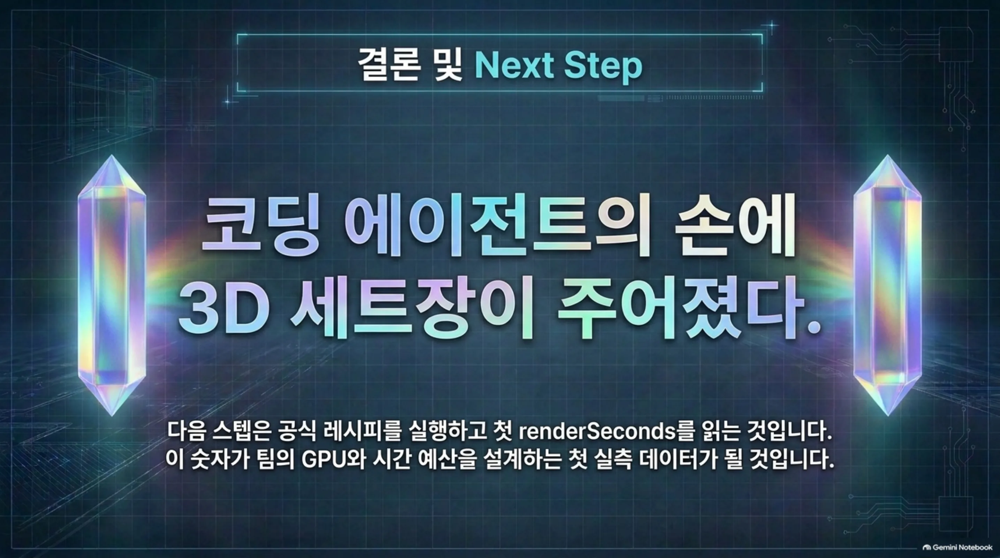

*글의 핵심 개념을 형상화했습니다.*

## 왜 읽어야 하나

코딩 에이전트로 프로토타입을 만들고, 그 결과물을 고객이나 팀에게 보여줄 단계를 밟는 개발자가 대상입니다. 결론부터 말합니다. 3D 씬 하나를 만들려고 별도의 렌더링 서비스나 3D 소프트웨어를 거칠 필요가 없게 됐고, MacBook 한 대에서 전경 렌더는 라스터 3.03초, GPU 패스 트레이싱 6.85초로 측정됐습니다. 이 글은 Mirage가 내 놓은 Tesseract CLI 0.5.0을 실제로 설치하고, 공식 레시피의 씬을 재구성해 두 렌더러의 실측 시간을 남긴 기록입니다.

## 쉽게 말하면

영화 세트장을 상상해 보겠습니다. 감독이 조명을 직접 다루지 않고 스태프에게 지시한다면, Tesseract는 에이전트가 지시할 수 있는 세트장입니다. 세트 설계도는 `.tsrct`라는 편집 가능한 문서로 남아 있고, 카메라 위치나 빛의 방향을 바꾸는 지시는 JSON 배치로 내려갑니다. 스태프(CLI)가 지시를 받아 무대를 세우고 모니터(preview)에 영상을 띄웁니다. 감독은 모니터를 확인하고, 빛이 물리적으로 맞아 보이면 정광(패스 트레이서)으로 최종 촬영을 지시합니다. 중요한 것은 감독이 손으로 조명을 다루지 않는다는 점입니다. 지시하고, 화면을 보고, 고치는 것만 반복합니다.


*글의 세 가지 축. 에이전트는 조종하지 않고 지시합니다. MacBook에서 나온 실측 수치가 남습니다. 도입 전에 한계를 먼저 확인합니다.*

## 개요

2026년 11월 4일, X에서 [trymirage](https://x.com/trymirage/status/2118054387209925032)의 트윗이 돌기 시작했습니다. "Opus 5.5나 Astra가 이제 패스 트레이스 렌더링으로 프로급 3D 출력을 만든다"는 내용인데, 아래 영상이 3D 소프트웨어 없이 만들어졌다는 점이 화제였습니다. [igus_ai](https://x.com/igus_ai/status/2118212218999472574)는 이를 스페인어로 다시 전했고, Tesseract가 전액 무료라는 점이 함께 퍼졌습니다.

트윗만 보면 도구가 무엇인지 불분명합니다. 실체를 짚으면, [Mirage](https://mirage.app)의 Tesseract입니다. [mirage-hq/Tesseract](https://github.com/mirage-hq/Tesseract) 저장소(204 star)의 README 첫 줄은 "The creative suite built for your AI agent"입니다. 영상 편집, 모션 그래픽, 사운드, 그리고 3D 씬을 하나의 로컬 프로젝트에서 다루게 하는 CLI와, 그 CLI를 에이전트가 쓸 수 있게 안내하는 스킬(SKILL.md) 묶음입니다. 3D 페이지에서는 [네이티브 GPU 패스 트레이싱으로 렌더된 반사구와 회전 링 데모](https://mirage.app/tesseract/3d)를 공개하고, geometry, material, lighting, camera가 모두 에이전트가 다시 고칠 수 있는 편집 대상임을 강조합니다. 최신 릴리스 v0.5.0은 2026년 11월 3일 나왔습니다.

Mirage는 뉴욕에 있는 크리에이티브 도구 회사이고, 자기 소개는 "one person to direct an entire creative production", 한 사람이 전체 크리에이티브 프로덕션을 지휘하게 한다는 문장입니다. 2억 5천만 개의 영상이 만들어진 Captions가 영상 워크스페이스라면, Tesseract는 그 프로덕션을 에이전트 자체에게 도구를 주어 수행하게 하는 전문 툴로 포지셔닝됩니다. 영상, 모션 그래픽, 사운드, 3D가 모두 하나의 편집 가능한 프로젝트로 들어가고, 결과물은 다시 고칠 수 있는 문서로 남습니다. 주목할 점은 이것이 렌더 프레임만 돌려주는 클라우드 API 서비스가 아니라는 것입니다. CLI가 로컬에서 돌고, 프로젝트 파일은 로컬 디스크에 있으며, 에이전트는 명령과 파일 접근으로 편집합니다. ChatGPT/Codex 플러그인은 이미 공개돼 있고, Claude Code 플러그인은 "coming soon"으로 적혀 있습니다.

## 이 도구는 무엇인가

Tesseract의 구조는 세 층으로 읽힙니다. 첫째는 문서 층. 모든 프로젝트는 `.tsrct`라는 이동 가능한 문서로 존재합니다. 카메라, 조명, 메시, 애니메이션, 사운드가 하나의 문서 안에 들어 있고, 이 문서를 에이전트에게 넘기면 특정 변경만 요구할 수 있습니다. 둘째는 액션 층. 문서를 고치는 방법은 JSON 액션 배치입니다. `createFxScene3DLayer`, `addFxScene3DFragment`, `setFxScene3DActiveCamera` 같은 액션을 배열로 묶어 `tsrct project apply`에 넘기면, CLI가 스키마를 대조하고 받아들이거나 거부합니다. 셋째는 렌더 층. `preview`와 `filmstrip`, `export`가 씬을 이미지나 영상으로 뽑아냅니다. 이 때 렌더러를 골라야 합니다.




*루프 전체. 스키마 대조에서 멈추는 것도 루프의 일부입니다. 거절된 액션은 렌더 전에 잡힙니다.*

두 렌더러의 차이는 빛이 들어오는 방식입니다. 라스터는 그림자나 반사 같은 효과를 렌더러의 보조 기법으로 보충합니다. 빠르고, 스타일 그래픽이나 레이아웃 확인에 적당합니다. 패스 트레이서는 광선이 씬에서 반사·굴절·산란하는 경로를 실제로 추적합니다. 부드러운 그림자, 바운스 라이트, 유리나 금속의 반사가 물리에서 나옵니다. 공식 문서의 표현 그대로, "훨씬 느리고 하드웨어 GPU가 없으면 훨씬 더 느립니다". 패스 트레이서 프리뷰는 데노이저 가중치를 첫 렌더 때 내려받습니다. 렌더러는 문서가 아니라 명령어 플래그입니다. `--renderer path-tracer`를 붙이는지 안 붙이는지가 전부입니다.

| 렌더러 | 용도 | 특징 |
|---|---|---|
| raster | 레이아웃, 모션 확인, 스타일 그래픽 | 빠름, 보조 기법으로 빛 표현 |
| path-tracer | 리얼리즘, 반사·굴절, 제품 촬영 | GPU 광선 추적, 샘플 수에 비례해 느려짐 |

브라우저와 iOS 재생은 패스 트레이서로 내보냈어도 라스터로 본다는 점을 기억해 두십시오. 렌더 시간과 화면의 물리 정밀도는 별개의 문제입니다.

스킬 문서(tesseract-3d SKILL.md)는 에이전트에게 또 다른 규율을 줍니다. 액션을 쓰기 전에 `project schema`에서 정확한 필드를 확인하고, 속성 이름이나 enum 철자를 혼자 짐작하지 말 것. 작은 배치로 적용하고, 거절된 배치에서는 렌더 전에 멈출 것. 애니메이션은 저장된 키프레임으로 증거하지 않고, filmstrip의 샘플 프레임이 눈에 보이는 차이를 내야만 확인된 것으로 친다는 것. 그리고 마지막에 "critic review"가 있습니다. 아트 디렉터와 씬 목적에 맞는 전문가, 두 명의 독립된 비평가가 렌더된 프리뷰를 채점하고, 둘 다 8.5/10 이상을 줄 때까지 고칩니다. 최대 3라운드. 품질 게이트가 사람이 아니라, 렌더하고 채점하고 반복하는 에이전트 프로세스인 셈입니다. CLI가 renderSeconds를 JSON으로 보고하기 때문에, 이 반복에 시간 예산이 함께 계산됩니다.

## 설치 및 통합

macOS(Apple Silicon) 기준, 공식 설치 가이드를 그대로 따랐습니다. 릴리스 페이지에서 CLI ZIP과 SHA-256 파일 두 개를 받습니다.

```sh
curl -fLO https://github.com/mirage-hq/Tesseract/releases/download/v0.5.0/tesseract-0.5.0-darwin-arm64.zip
curl -fLO https://github.com/mirage-hq/Tesseract/releases/download/v0.5.0/tesseract-0.5.0-darwin-arm64.zip.sha256
shasum -a 256 -c tesseract-0.5.0-darwin-arm64.zip.sha256
ditto -x -k tesseract-0.5.0-darwin-arm64.zip extracted
bash extracted/tesseract-0.5.0-darwin-arm64/install.sh
"$HOME/Library/Application Support/Tesseract/bin/tsrct" --version
```

실측 결과입니다. ZIP은 116,615,086 바이트였고 SHA-256은 릴리스 파일과 일치했습니다(`151754b43aad17…`). 번들 내부 CHECKSUMS.sha256에 등록된 파일 450개도 전부 통과했고, `--version`은 `tsrct 0.5.0 (ac63ae146d90fad317cfc36ca39cf70797314da2)`를 찍었습니다. 설치는 sudo를 쓰지 않고 `~/Library/Application Support/Tesseract` 아래 버전별 디렉터리를 만들고 심볼릭 링크를 놓는 구조입니다.

에이전트용 스킬은 따로 있습니다. Node가 있으면 한 줄로 넣습니다.

```sh
npx skills add mirage-hq/Tesseract
```

스킬이 CLI를 설치하는 것이 아니라, 설치 방법을 안내하는 문서입니다. CLI 버전은 스킬 옆의 `cli-version.txt`가 고정합니다.

공식 사이트의 Tesseract 3D 페이지에는 에이전트에게 그대로 붙여넣을 셋업 프롬프트가 실려 있습니다. "Mirage의 Tesseract를 설정해, 이 에이전트 환경에서 편집 가능한 디자인과 3D 씬을 만들고, 영상을 편집하고, 모션 그래픽을 만들게 하시오. https://github.com/mirage-hq/Tesseract를 읽고 이 로컬 또는 호스트된 환경의 요구사항을 확인하라. 지원되는 경우 공식 플러그인 또는 스킬 설치 가이드를 따르고, 요구되는 런타임 버전을 사용하고, 다운로드 체크섬을 검증하고, 짧은 프리뷰가 제대로 렌더되는지 확인하라. 그리고 내가 무엇을 만들고 싶은지, 어떤 브랜드 참조나 소스 자산이 있는지 물어보라. 편집 가능한 프로젝트와 소스 자산을 완성된 렌더와 함께 보관하라." 프롬프트 안에는 "체크섬을 검증하라"와 "짧은 프리뷰가 렌더되는지 확인하라"가 들어가 있습니다. 설치 게이트와 첫 렌더 확인이 프롬프트에 쓰여 있다는 뜻이고, 에이전트의 재량에 맡기지 않는다는 뜻입니다. 3D 기능이 포함된 빌드인지 확인하려면 스키마를 파일로 저장하고 마커를 검색합니다.

```sh
tsrct project schema > schema.json
# 스키마에서 createFxScene3DLayer 를 찾으면 3D 빌드
```

이번 환경의 스키마는 1,453,539 바이트였고 `createFxScene3DLayer`가 존재했습니다.

## 실제 실험 결과

공식 Scene3D 레시피의 첫 예제(두 개의 상자)를 재구성했습니다. 씬은 네 개 액션으로 세웁니다. 직사각형 투영(orthographic, scale 640) 카메라가 aim 제약으로 월드 중앙을 바라보고, 상단 전방에서 비추는 평행광(irradiance 3, rotationX -45) 하나. 이어지는 레시피 배치에는 상자가 두 개 들어갑니다. 왼쪽 상자는 Euler 각도(rotationY 25°)로, 오른쪽 상자는 동일한 각을 퀘테르니언 `[0, 0.2164, 0, 0.9763]`로 회전시킵니다. 두 회전이 같은 방향인지 렌더로 확인하는 게 레시피의 의도입니다.

```sh
tsrct project create --project scene.tsrct
tsrct project apply --project scene.tsrct --actions base.json
tsrct project apply --project scene.tsrct --actions recipe.json
tsrct preview --project scene.tsrct --time 2 --output raster.png
tsrct preview --project scene.tsrct --time 2 --output path.png --renderer path-tracer --samples 16
tsrct filmstrip --project scene.tsrct --timestamps-ms 0,1250,2500 --frame-rate 30 --output check.png
```

두 apply 모두 경고를 0건으로 받아들였습니다. preview는 문서 원본 크기(1080×1920, 세로)로 렌더합니다. CLI가 JSON으로 렌더 시간을 보고합니다.

| 렌더 | 해상도 | 설정 | renderSeconds |
|---|---|---|---|
| preview | 1080×1920 | raster | 3.03초 |
| preview | 1080×1920 | path-tracer, 16샘플, denoise | 6.85초 |
| filmstrip (3프레임) | 720×135 | raster | 0.19초/프레임 |
| filmstrip (3프레임) | 720×135 | path-tracer, 16샘플, denoise | 0.49초/프레임 |


*같은 씬, 두 렌더러. 전경 프리뷰는 2.26배, filmstrip 썸네일은 2.63배 차이. CLI가 보고한 renderSeconds 실측치입니다.*


*MacBook(Apple Silicon, wgpu) 전경 프리뷰 실측. 패스 트레이서는 16샘플·denoise 조건입니다.*


*라스터 렌더. 두 상자의 회전이 동일하게 보이면 Euler와 퀘테르니언 배치의 동치를 확인한 것입니다.*


*패스 트레이서(16샘플, denoise) 렌더. 위쪽 면의 간접광이 라스터보다 부드럽게 퍼집니다.*

이 씬의 카메라는 직사각형 투영(orthographic, scale 640)입니다. 줌 없이 물체를 고정된 크기로 보며, aim 제약 덕분에 카메라 위치를 바꿔도 시선은 항상 월드 중앙을 향합니다. 평행광(irradiance 3)은 rotationX -45로, 상단 전방에서 빛을 넣습니다. 그래서 위에서 앞을 향해 비추는 면은 밝고, 반대쪽 면은 어둡습니다. 공식 레시피가 "숫자가 맞는지"가 아니라 "빛이 맞는 면이 맞는지"를 확인하게 만드는 이유입니다.

두 렌더를 나란히 보면 차이가 빛에서 나옵니다. 라스터는 면별로 균일한 음영을 주고, 패스 트레이서는 위 면에 부드러운 확산을 더합니다. 16샘플은 프리뷰·초안 단계의 권장 값이고, 최종 전달 전에는 기본 128샘플을 권합니다. 노이즈를 반으로 줄이려면 샘플이 4배 필요하다는 공식 안내도 함께 봤습니다. 렌더 시간과 샘플 수는 비례하므로, 에이전트가 최종 렌더 전에 예상 시간을 계산해 드리는 일이 실제로 일어납니다.

여기서 구조를 한 번 더 짚겠습니다. 에이전트가 하는 일은 세 가지뿐입니다. JSON 액션을 쓰거나 고치고, 렌더 결과(이미지)를 보고, 다음 액션을 정하는 것. 렌더는 CLI가 하고, 시간은 CLI가 JSON으로 보고하고, 화면은 파일로 남습니다. 사람이 3D 소프트웨어를 열 필요도, 렌더 팜을 돌릴 필요도 없습니다. 세트장을 세운 뒤 모니터만 보는 감독입니다.

## ThakiCloud 제품 적용 시사점

Paxis 관점에서 이 도구는 "에이전트의 손이 한 칸 더 길어졌다"는 신호입니다. Paxis는 Skills, Tools, Policies, Audit Logs를 일급 리소스로 다루는 에이전트 네이티브 클라우드이고, Tesseract 스킬은 그 범주에 정확히 들어옵니다. 코딩 에이전트가 SKILL.md를 읽고, 공식 레시피의 JSON을 참조하고, 렌더 결과로 자기 출력을 검증하는 루프. 이 루프는 Paxis가 격리 샌드박스로 실행하고 정책 게이트와 감사 로그에 남기는 동작 그 자체입니다. 3D 씬을 만들지 않는 팀에도, "도구가 스킬로 제공되고, 결과가 파일로 남아, 에이전트가 그 파일을 다시 읽는다"는 이 세 단락이 반복 가능한 패턴입니다. "비평가 둘, 8.5점 이상" 구조는 Paxis의 정책 게이트 축소판으로도 볼 수 있습니다. 한 에이전트의 출력을 다른 판단이 점수 매기고, 점에 미달이면 다음 라운드로 보내는 방식이 도구의 스킬 문서 안에 이미 설계돼 있는 것입니다.

ai-platform 관점에서는 로컬 GPU 렌더링의 실용성이 눈에 띱니다. 패스 트레이서는 하드웨어 GPU가 전제이고, 이번 실측은 MacBook 내장 GPU(wgpu) 위에서 전경 6.85초였습니다. 외부 렌더링 API를 오가지 않는 한, 데이터가 머신을 떠나지 않는다는 점은 온프렘 환경의 크리에이티브 워크플로에 그대로 적용됩니다. ThakiCloud의 ai-platform이 온프렘·소버린 인프라를 전제로 하는 이유도 같습니다. 렌더링이 GPU 잡으로 들어가는 순간, Kueue 큐와 같은 자원 회계가 붙고, "몇 초에 몇 프레임"이 운영 지표가 됩니다.


*Paxis 샌드박스에서 통제되는 스킬 루프, 로컬 GPU 렌더로 외부 API를 오가지 않는 온프렘 구성, Kueue 큐와 연동되는 초당 프레임 비용 지표.*

## 한계 및 반론

몇 가지를 떼어 놓겠습니다. 첫째, Tesseract CLI는 무료이지만 오픈소스가 아닙니다. 저장소의 라이선스 필드는 NOASSERTION이고, 각 ZIP 안 TERMS.md가 번들용 약관입니다. 스킬(README·SKILL.md·레시피)이 공개돼 있어 동작을 읽을 수 있는 것은 사실이지만, 렌더러 코드는 폐쇄입니다. 둘째, 플랫폼 지원은 macOS, Windows, Linux x86_64(glibc 2.35+)입니다. Apple Silicon Linux나 ARM 서버는 지원 목록에 없고, Linux는 Vulkan 드라이버가 전제이며 번들에 H.264 인코더가 없어 별도 FFmpeg를 붙여 줘야 합니다. 셋째, 패스 트레이서의 느림은 문서가 인정하는 한계입니다. 샘플 16이 전경 기준 6.85초라면, 기본 128샘플은 단순 계산으로도 30초를 넘습니다. 씬이 복잡해지면 그 이상으로 벌어질 겁니다. 넷째, 브라우저와 iOS 재생은 라스터 고정입니다. 패스 트레이서로 내보낸 영상이 모바일에서 그대로 보이는 것이 아닙니다. 다섯째, 기본 기능 중 일부 명령에서 텔레메트리를 보낼 수 있다는 점을 스킬 문서가 밝힙니다. 옵트아웃 설정을 CLI가 존중한다는 안내와 함께, 에이전트가 사용자 대신 켜지 않도록 금지한다는 문구가 있습니다.

트윗의 "+10K$/월" 같은 수익 주장은 이번 검증 범위에서 확인하지 않았습니다. 도구가 만드는 영상이 곧 수익이 되는 건 아닙니다. 도구가 주는 것은 "에이전트가 3D를 손대고, 렌더 시간을 보고, 결과를 파일로 검증한다"는 루프일 뿐입니다.

## 정리

코딩 에이전트의 손에 세트장이 하나 더 생겼습니다. Tesseract 0.5.0은 설치부터 렌더까지 CLI로 끝나는 구조이고, 3D 씬은 JSON 액션으로 세워지며, 빛이 물리적으로 맞아야 하는 장면에는 패스 트레이서가 2.2~2.6배의 시간으로 답했습니다. 다음에 에이전트에게 3D를 시킬 때, 먼저 공식 레시피의 첫 씬을 돌리고 `renderSeconds`를 읽으십시오. 그 숫자가 팀의 GPU와 시간 예산을 위한 첫 실측이 됩니다. 두 가지를 기억해 두십시오. 하나는 데노이저 가중치입니다. 첫 패스 트레이스 렌더 때 내려받기 때문에, 첫 번은 항상 더 느립니다. 또 하나는 샘플 수입니다. 16은 초안, 128은 최종. 최종 설정의 예상 시간을 에이전트에게 계산해 달라고 하십시오. CLI가 시간을 JSON으로 돌려주기 때문에, 에이전트가 할 수 있는 계산입니다.


*다음 스텝. 공식 레시피의 첫 씬을 돌려 그 renderSeconds를 팀의 GPU와 시간 예산을 설계하는 첫 실측 데이터로 삼습니다.*

*이 글의 실험은 2026-11-05, MacBook(Apple Silicon)에서 Tesseract 0.5.0(ac63ae1)으로 수행했습니다. 수치는 CLI가 보고한 값 그대로입니다.*

## 출처

- [mirage-hq/Tesseract (GitHub)](https://github.com/mirage-hq/Tesseract)
- [Tesseract 3D (Mirage 공식)](https://mirage.app/tesseract/3d)
- [trymirage 트윗 (2026-11-04)](https://x.com/trymirage/status/2118054387209925032)
- [igus_ai 트윗 (2026-11-04)](https://x.com/igus_ai/status/2118212218999472574)
- [Tesseract-Projects (공식 예제)](https://github.com/mirage-hq/Tesseract-Projects)
