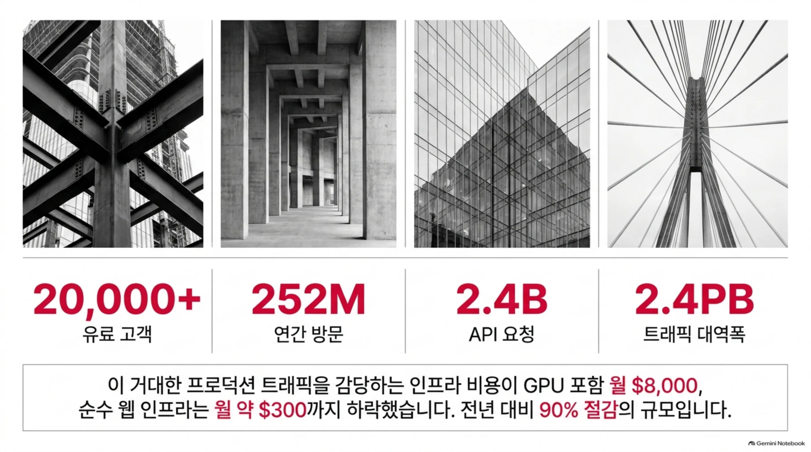
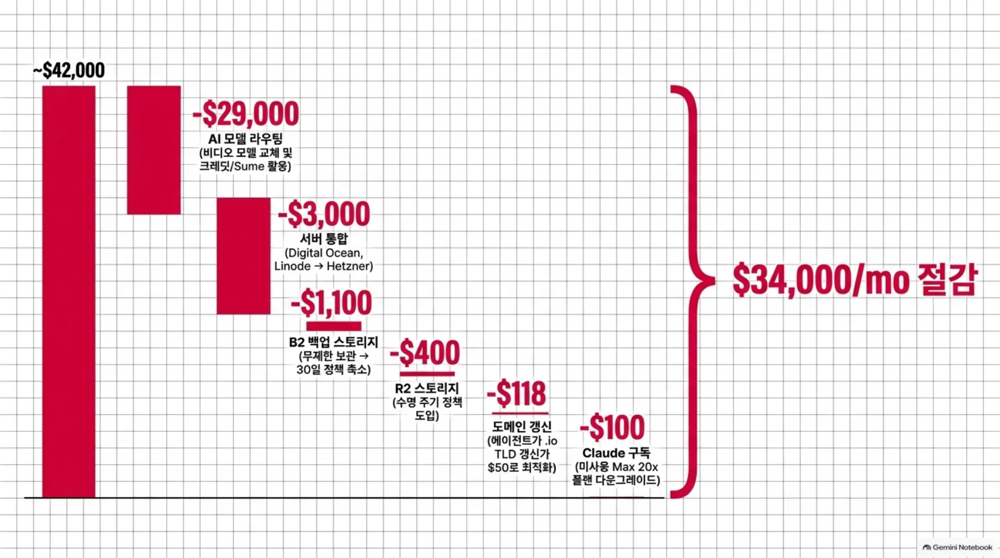
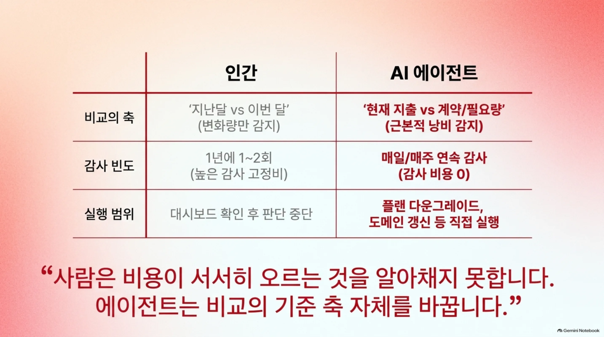
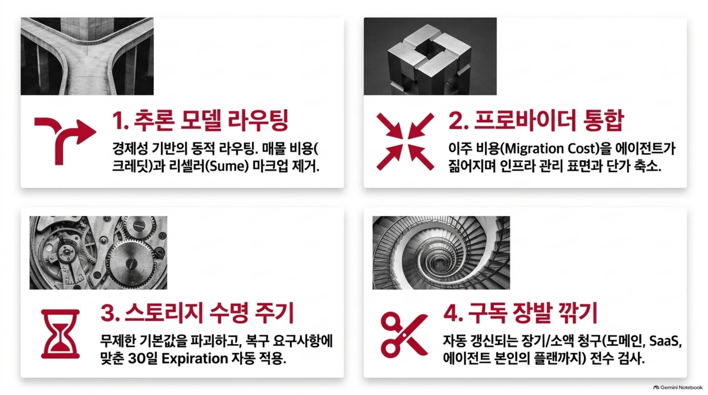
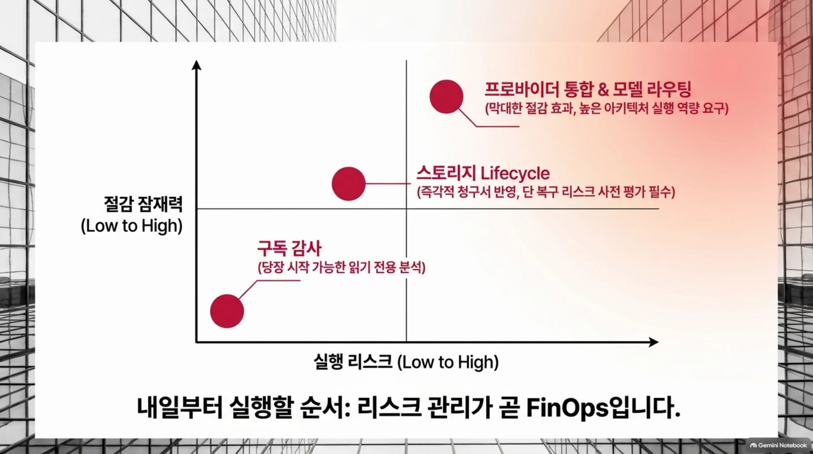
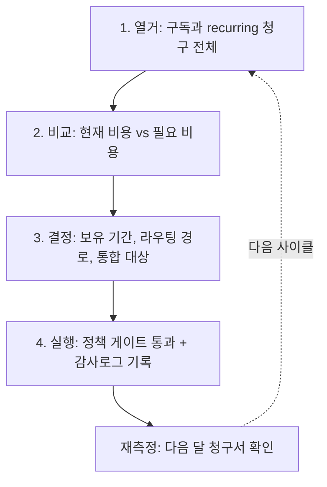
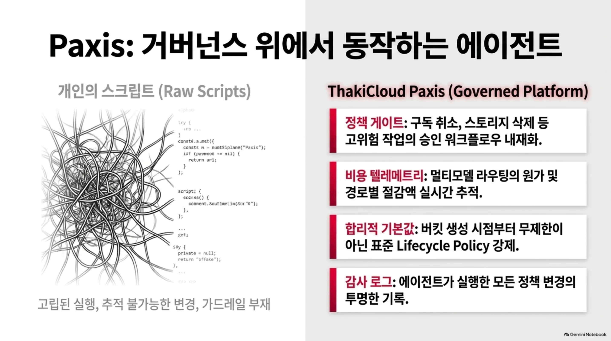
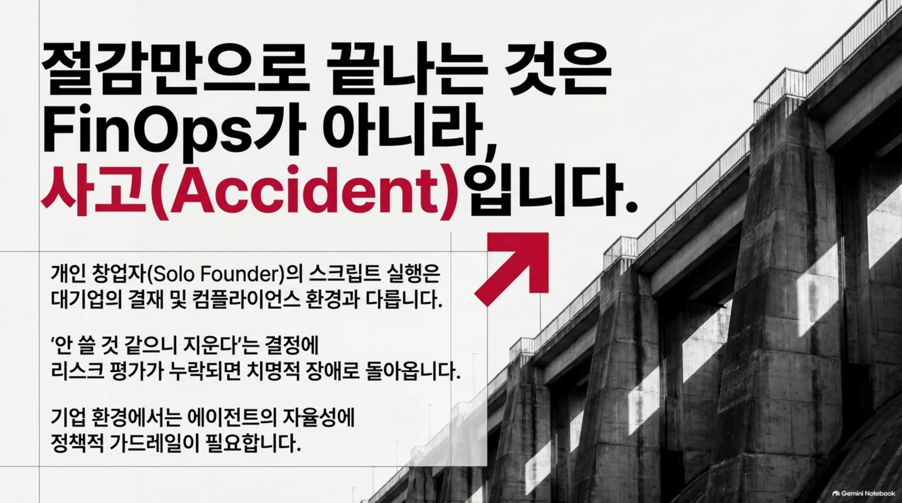

*산재한 청구서와 작은 조각들이 하나의 스택으로 모이는 장면. 에이전트가 나열하고 비교하는 비용 감사의 개념을 형상화했습니다.*

## 왜 읽어야 하나

프로덕션 클라우드를 돌리며 '비용 정리'를 몇 년에 한 번 회계 보고로 하는 팀의 엔지니어, SRE, 그리고 운영자라면 이 글을 읽어야 합니다. 읽어야 하는 이유는 하나입니다. AI FinOps가 대시보드 위의 권장 사안으로 머물던 시기가 끝났습니다. 에이전트가 청구서와 정책과 구독을 직접 넘겨본 뒤 실제로 줄여낸 실증 사례가 나왔습니다.

핵결은 한 문장으로 선단정합니다. 11월 3일 levels.io에 올라온 Pieter Levels의 비용 업데이트에 따르면, 20,000명의 유료 고객과 연간 252M 방문, 2.4B 요청, 2.4PB 밴드width를 감당하는 사업의 전체 웹 인프라 비용이 월 약 $300까지 떨어졌고 에이전트가 찾아내서 정리한 항목 6개만 합해도 월 약 $34,000의 절감입니다. 이 사례에서 주목할 지점은 절감액이 아닙니다. 사람은 못 보고 에이전트가 본 것이 무엇인지를 보여주기 때문입니다.

## 쉽게 말하면

아파트 전기요금 고지서를 떠올려 보세요. 매달 비슷비슷한 금액이 오는데, 정확히 어디서 얼마나 오르는지는 모릅니다. 고지서가 '단계'로 뛰지는 않기 때문입니다. 서서히, 여기 한 줄, 저기 한 줄으로 올라갑니다.

에이전트는 그 고지서를 한 장 한 장 펼쳐보는 가족입니다. '이 구독은 반 년 동안 안 쓰는데 갱신되고 있다', '이 저장소는 무제한 보관 정책으로 50배 비싸다', '이 도메인 갱신은 시세보다 비싸다'라고 말하지요. 에이전트가 하는 일은 나열입니다. 모든 구독, 모든 버킷 정책, 모든 갱신을 열거한 뒤, '지금 내는 돈'과 '내야 할 돈'의 차이를 보여줍니다. 이 글의 모든 내용이 이 한 비유 위에 서 있습니다.

## 개요

Pieter Levels는 PhotoAI(월 매출 $68K), InteriorAI, VibeJam의 창업자입니다. 989K 팔로워를 가진, 일인 사업자일 때부터 프로덕션 인프라를 직접 돌려온 대표 케이스입니다. 11월 3일 levels.io에 올린 'I dropped my total biz expenses to just $300 per month'라는 글은, 그 인프라의 비용을 어떻게 줄였는지에 대한 업데이트입니다.

전체 웹 사이트와 앱의 운영 비용은 월 약 $300까지 떨어졌습니다. GPU가 큰 비중을 차지하는 PhotoAI까지 포함하면 월 약 $8,000입니다. 전년도 대비 90% 절감이라는 표현이 원문에 있습니다. 이 절감을 이끈 도구는 Claude Code, 즉 에이전트입니다. 원문에서는 'Claude analyzed...'라는 표현이 여러 번 등장하며 항목별로 어떤 에이전트가 어떤 것을 보고 뭘 바꿨는지 기록되어 있습니다.

규모를 먼저 짚어 두겠습니다. 연간 기준으로 20,000명 유료 고객, 2억 5,200만 방문, 24억 요청, 2.4PB의 밴드width입니다. 실제로 트래픽이 크고 요청이 많은 프로덕션입니다. 그래서 절감액의 절대값이 큰 것입니다.


*GPU 포함 인프라 비용이 월 $8,000, 순수 웹 인프라는 월 약 $300까지 하락했습니다. 전년 대비 90% 절감의 규모입니다.*

## 에이전트가 줄여낸 6가지

원문에 기록된 절감 항목은 6개입니다. 금액은 원문 그대로 인용하며 항목별 수치가 원문의 '절감액' 기준인지 '현재 비용' 기준인지 표로 정리했습니다.

| 항목 | 메커니즘 | 원문 수치 |
|---|---|---|
| PhotoAI 비디오 모델 + 이미지 라우팅 | 더 좋고 싼 비디오 모델로 교체, 일부 이미지 잡을 GCP 크레딧과 Sume(시세로 AI 모델을 파는 플랫폼)으로 라우팅 | $29,000/mo 절감 (GPU 청구 $36,000/mo → $7,000/mo 포함) |
| 서버 통합 | Digital Ocean과 Linode 취소, 전부 Hetzner로 통합 | 약 $3,000/mo 절감 |
| Backblaze B2 백업 | 무제한 versioning과 lifecycle policy를 30일로 축소 | $1,200/mo → $26/mo, 약 50배 저렴 ($1,100/mo 절감) |
| Cloudflare R2 (PhotoAI) | lifecycle policy 추가 | $1,200/mo → $800/mo ($400/mo 절감) |
| Cloudflare 도메인 | 에이전트가 전체 도메인 등록을 분석, .io TLD 갱신을 $50/year로 낮춤 | $118/mo 절감 |
| 본인이 쓰는 Claude 구독 | Max 20x 플랜 한도를 안 쓴다는 걸 발견, $200/mo → $100/mo로 다운그레이드 | $100/mo 절감 |

합계는 원문이 '거의 $34,000/mo'라고 쓴 수치입니다.


*여섯 가지 항목이 합쳐 월 $34,000 절감으로 수렴하는 흐름. 가장 큰 항목은 모델 라우팅, 그 나머지는 통합과 정책, 구독입니다.*

여섯 가지 항목을 훑으면 눈에 띄는 것이 있습니다. 가장 큰 항목($29,000)은 '모델을 바꿨다'이고 다음으로 큰 항목($3,000)은 '클라우드를 합쳤다'이며 그 나머지는 '저장 정책'과 '구독'입니다. 큰돈과 작은돈이 같은 원리(현재 비용과 필요 비용의 차이)로 나뉘어 있습니다.

그중 첫 번째 항목은 한 번 더 봐야 합니다. 이미지 잡 라우팅에 두 경로가 들어 있습니다. 하나는 GCP 크레딧입니다. 크레딧은 이미 회사가 지불한 비용이므로, 크레딧으로 잡을 돌리면 한계비용이 0입니다. 한계비용 0인 용량으로 작업을 라우팅하는 것은 순수한 절감입니다. 다른 하나는 Sume입니다. 원문의 표현대로 '시세로 AI 모델을 파는 플랫폼'인데, 시세 판매란 전매 마진에 마크업이 없다는 뜻입니다. '프로바이더 → 리셀러 → 사용자' 가격 곡선에서 마크업 레이어를 제거한 비교입니다. 추론 작업에는 늘 두 가지 선택지가 있습니다. 쓰는 용량이 한 프로바이더의 한 가격만은 아니라는 것, 그리고 같은 품질의 다른 경로가 더 비싸지 않다는 것. $29,000 절감은 잡을 줄이는 것이 아니라, 이 비교에서 나왔습니다.

## 왜 사람 대신 에이전트가 찾았는가

Levels 본인의 표현을 인용하겠습니다. 비용은 '수년에 걸쳐 서서히 올라가고 무엇을 얼마나 쓰고 있는지 알아채지 못한다'고 합니다. 그 뒤에 'AI는 그것을 알아내는데 도움이 된다'고 덧붙입니다.

여기서 핵심은 비교의 축입니다. 사람은 '지난달과 이번 달'을 비교할 뿐, '지금과 계약한 때'를 비교하지 않습니다. 무제한 versioning이 언제, 왜 켜졌는지 기억하는 사람은 없습니다. 도메인 갱신 단가가 몇 년 전에 올랐는지도 마찬가지입니다. 에이전트의 강점이 바로 이 축을 바꿀 수 있다는 점입니다.


*사람은 '지난달 vs 이번 달'의 변화량만 감지하고 1년에 1~2회 감사에 그칩니다. 에이전트는 '현재 지출 vs 계약/필요량'을 매일/매주 감지하고 플랜 다운그레이드와 도메인 갱신까지 직접 실행합니다.*

다음으로 주목할 것은 마지막 항목입니다. 에이전트가 찾은 낭비 속에 '본인이 쓰는 Claude 구독'이 들어 있습니다. 감사하는 쪽과 감사받는 쪽이 같은 에이전트입니다. 'Max 20x 플랜의 한도를 못 쓰고 있다'는 판단은, 구독 사용량 데이터가 있는 에이전트만 내릴 수 있습니다. 사람이라면 '내 구독을 줄인다'는 판단에서 멈추는 경우가 많으니까요.

그리고 $118/mo의 도메인 항목입니다. 크기가 작습니다. 그런데 'Claude analyzed all my Cloudflare Domain registrations'라고 원문이 쓰듯, 에이전트는 하나하나를 넘겨봤습니다. 작은 돈이 오랜 기간 쌓이면 큰 돈이 되며 에이전트는 그 '오랜 기간'을 계산할 수 있습니다.

마지막으로, 왜 '에이전트가' 이 일을 하는지의 구조를 보겠습니다. 전통적인 비용 감사는 고정비가 있습니다. 사람이 하루를 잡고 각 프로바이더의 콘솔을 열어 청구서를 비교해야 합니다. 감사 비용이 높으면 합리적 빈도는 1년에 한두 번으로 내려갑니다. 그렇게 하면 청구서와 사용 사이의 표류는 감사 사이의 공백에서 계속 누적됩니다. 에이전트는 이 감사 비용 자체를 거의 0으로 만듭니다. 열거하고 정책을 읽고 단가를 비교하는 것은 전부 스크립트 일입니다. 감사의 비용이 내려가면 합리적 빈도는 '1년에 한 번'에서 '매월', '매주'로 올라갑니다. 이 사례의 절감은 6개 항목에, 그 사이에 계속 표류했을 차이의 합이 더해진 것입니다. 대시보드 FinOps로는 만들 수 없었던 구조입니다.

## 일반화할 수 있는 4가지 패턴

6개 항목을 원리의 층위로 올리면 4가지 패턴이 나옵니다. 이 패턴이 이 글의 본론입니다.

첫째, 추론 모델 라우팅입니다. 가장 비싼 모델을 계속 쓰는 팀은 대부분 관성에 끌려갑니다. 비디오 생성과 이미지 생성은 다른 가격 곡선을 가지고 있고 GCP 크레딧과 시세 전매 플랫폼(Sume)은 같은 추론을 더 싼 경로로 실행할 수 있습니다. 원문의 $29,000 절감이 여기에서 나옵니다. '어떤 모델'이 아니라 '어떤 경로'를 선택하는 문제가 곧 비용 문제입니다.

둘째, 프로바이더 통합입니다. Digital Ocean과 Linode를 Hetzner 하나로 합쳐 $3,000/mo를 아꼈습니다. 이 절감의 본질은 관리 표면의 축소입니다. 단가 경쟁은 그 다음 이야기입니다. 계정 두 개에서 하나, 대시보드 두 개에서 하나, 청구서 두 장에서 한 장. 통합이 실행 가능한 이유는 에이전트가 마이그레이션의 반복 작업을 짊어졌기 때문입니다. 사람이 직접 합치면 '이주 비용' 때문에 포기하는 통합이, 에이전트에게는 노동이 아니라 스크립트입니다.

셋째, 스토리지 lifecycle입니다. Backblaze B2의 무제한 versioning을 30일로 줄여 50배(원문 표현)를 아꼈고 R2 버킷에 lifecycle policy를 넣어 $400/mo를 아꼈습니다. 스토리지는 데이터가 쌓일수록, 정책이 잊힐수록 비싸집니다. '무제한 보관'도 결국 누군가의 결정입니다. 보관 기간을 정하는 순간 비용 곡선이 달라지는데, 그 '정하는 행위'가 에이전트가 청구서에서 발견한 항목입니다.

넷째, 구독 감사입니다. 도메인 갱신, SaaS, 그리고 자기 자신의 에이전트 구독까지. recurring 청구의 장발(長髮)입니다. 단위 가격은 작고 기간은 길고 갱신은 자동입니다. 세 가지가 겹치는 지대가 감사의 최대 수확 지대이며 에이전트는 이 지대를 '장기 × 단가'로 정렬할 수 있습니다.

이 4가지 패턴은 전부 '현재 비용과 필요 비용의 차이'를 찾는 동일한 동작의 변형입니다. 모델은 경로를 바꾸고 프로바이더는 표면을 줄이고 스토리지는 기간을 정하고 구독은 장발을 깎습니다.


*여섯 개 항목을 원리의 층위로 올린 네 패턴. 라우팅은 마크업을 제거하고 통합은 관리 표면을 줄이고 수명 주기는 무제한 기본값을 깨고 구독 감사는 recurring 청구의 장발을 전수 점검합니다.*

## 내일부터 첫 단계

시작은 스토리지 lifecycle입니다. 큰 항목(모델 라우팅, 프로바이더 통합)은 뒤에 갑니다. 가역적이고 효과가 즉시 청구서로 나타나기 때문입니다.

S3 호환 lifecycle policy는 Backblaze B2와 Cloudflare R2 항목이 실제로 사용한 메커니즘입니다. 형태는 이렇습니다.

```json
[
  {
    "id": "expire-30d",
    "filter": { "prefix": "backups/" },
    "status": "Enabled",
    "rules": [
      { "id": "1", "expiration": { "days": 30 } }
    ]
  }
]
```

백업 프리픽스에 대한 만료 기간을 30일로 정한 policy입니다. '무제한 보관'이 기본값이던 버킷에 이 한 줄을 적용하는 순간, 비용 곡선이 바뀝니다. 단, 기간을 정하기 전에 먼저 답해야 하는 질문이 있습니다. '복구에 며칠 치 보유가 필요한가'입니다. 30일이라는 숫자는 복구 요구사항에서 도출된 값이어야 합니다. 이 질문 없이 줄이면 절감 대신 리스크를 만듭니다.

4단계 순서도 같습니다. 1) 구독과 recurring 청구 전체를 열거합니다. 2) 스토리지 보유 기간을 하나하나 확인합니다. 3) 프로바이더 통합 후보를 봅니다. 4) 추론 모델 라우팅을 바꿉니다. 순서가 곧 리스크 관리입니다. 앞단(열거, 확인)은 읽기 전용이고 뒷단(통합, 라우팅)은 실행의 역량이 필요합니다. 각 단계의 모양은 전부 '열거 → 비교 → 결정 → 실행'이며 이 루프가 바로 에이전트가 돌릴 수 있는 단위입니다.


*내일부터 실행할 순서를 리스크 축 위에 배치한 것입니다. 절감 잠재력이 큰 항목일수록 실행 역량이 필요하고 그래서 뒤로 갑니다.*


*에이전트가 돌리는 비용 감사 루프. 열거에서 재측정까지 5단계를 한 사이클로, 재측정이 다음 사이클의 열거를 다시 시작합니다.*

## ThakiCloud 제품 적용 시사점

Paxis 렌즈에서 보면, 이 사례의 에이전트는 절감 '기회'를 보고하는 수준을 넘어서 다운그레이드와 정책 변경을 직접 실행했습니다. 도메인 단가를 낮추고 versioning 기간을 30일로 바꾸고 구독 플랜을 바꾸는 것은 전부 '실행'입니다. Paxis가 다리는 지점과 정확히 겹칩니다. 위험도가 높은 운영(구독 취소, 스토리지 정책 변경, 서버 이주)은 정책 게이트를 통과한 뒤 실행되고 그 실행 전체가 감사로그에 남습니다. 4가지 패턴은 전부 Paxis의 스킬로 자동화 가능한 형태입니다. 비용 이상 분석 스킬(cost-anomaly-explainer 계열)이 이 패턴을 하네스 위에서 돌리는 구조입니다.


*같은 에이전트 실행이라도 Paxis 위에서는 고위험 작업이 승인 워크플로우로 내재화되고 경로별 절감액이 실시간 추적되며 모든 정책 변경이 감사로그에 투명하게 기록됩니다.*

ai-platform 렌즈에서 보면, 이 사례는 4가지 패턴을 사용자 쪽 노력에서 플랫폼 기능으로 옮길 수 있는지 묻게 합니다. 추론 라우팅은 다키클라우드의 ai-platform이 이미 다뤄온 영역(멀티모델 라우팅의 경제성)이고 스토리지 lifecycle의 합리적 기본값과 프로바이더 추상화는 플랫폼이 제시할 수 있는 표준입니다. 구체적으로는 셋입니다. 첫째, 추론 라우트의 비용 텔레메트리입니다. 경로(모델, 프로바이더, 크레딧, 리셀)별 원가 집계 없이 절감이 실제로 일어났는지 확인할 수 없습니다. 둘째, 스토리지 보유 기간의 정책 기본값입니다. 절약이 아니라 버킷 생성 시점에 lifecycle policy를 확정하는 것입니다. 셋째, 프로바이더 추상입니다. 통합의 비용은 마이그레이션이고 워크로드 이동을 일상적 연산으로 만드는 추상 레이어가 있을 때 그 비용이 낮아집니다. 셋 다 기능보다 텔레메트리와 기본값의 문제이며 이 부분은 플랫폼이 사용자 대신 짊어질 수 있는 지점입니다. 동시에 위협 한 가지도 있습니다. 고객의 에이전트가 낭비를 스스로 찾으면, 클라우드의 가치는 '용량 판매'에서 '비용 가시성 + 최적화 속도'로 이동합니다. 이 사례가 보여 주는 것은 바로 그 이동의 시작입니다.

## 한계 및 반론

이 사례의 한계도 분명히 짚어야 합니다.

첫째, 한 개인의 사례입니다. solo founder의 비용 구조는, 여러 팀과 여러 계층의 승인 절차를 가진 대기업의 구조와 다릅니다. '에이전트가 바로 실행했다'는 점이 이 사례의 핵심이면서 바로 이 사례의 전제이기도 합니다.

둘째, 수치는 자체 보고(self-reported)입니다. $36,000 → $7,000, $1,200 → $26과 같은 금액은 Levels 본인의 게시글에서 인용한 것이며 제3자 검증은 없습니다. 항목이 구체적이고 내적 일관성이 있어 신뢰할 수 있으나, '공시된 수치'가 아닙니다.

셋째, 90% 절감이라는 수치는 시간 성분이 큽니다. 전년도 청구서에는 GPU 교체 이전의 비용이 포함되어 있어, '첫 정리의 효과'와 '구조적 절감'이 섞여 있습니다. 6개 항목의 합(약 $34,000/mo)이 첫 정리의 규모이고 90%는 그 이전의 누적과 합산된 결과입니다.

넷째, 일부 절감은 일회성이거나 주기적입니다. 도메인 $118/mo는 갱신 주기 변경의 효과이며 매월 반복되는 절감과는 성격이 다릅니다.

다섯째, 감사의 천장은 '에이전트가 닿을 수 있는 표면'입니다. CLI/API가 있는 청구서, 정책, 구독만 감사 대상입니다. 전화와 오프라인으로 관리되는 구독은 이 프레임워크 밖입니다.

여섯째, 그리고 가장 중요한 반론입니다. 30일로 줄인 versioning은, 만약 복구나 컴플라이언스에 필요했다면 리스크로 돌아옵니다. '안 쓸 것 같으니 줄인다'는 판단에는 리스크 평가가 수반되어야 하는데, 원문에는 리스크 평가가 없습니다. 절감만으로 끝나는 것은 FinOps가 아니라, 불운한 경우엔 사고입니다.


*'안 쓸 것 같으니 줄인다'는 결정에 리스크 평가가 누락되면 기업 환경에서는 치명적 장애로 돌아옵니다. 에이전트 실행에는 정책 게이트라는 가드레일이 필요합니다.*

## 정리

서론의 결론을 회수합니다. AI FinOps의 다음 형태는 대시보드가 아니라, 에이전트의 실행입니다. levels.io의 사례는 그 실행이 실제로 월 약 $34,000(6개 항목)를 만들어냈고 전체 웹 인프라를 월 약 $300으로 줄였다는 것을 보여줍니다.

내일부터 돌릴 수 있는 순서는, 단가와 리스크가 작은 것부터입니다. 구독 감사, 스토리지 lifecycle, 프로바이더 통합, 모델 라우팅. 네 번째(모델 라우팅)로 갈수록 절감의 규모가 커지고 실행의 리스크도 커집니다. 순서가 곧 리스크 관리입니다.

Levels는 절감의 목적을 '모든 살을 빼서 더 좋은 투자 지출을 여는 것'이라고 썼습니다. 절감의 목적은 재투자입니다. 클라우드 비용 정리를 에이전트가 돌리는 루프로 보는 관점이, 이 사례가 남기는 것입니다.

한 줄로 마무리합니다. 청구서를 에이전트에게 넘기세요. 사람이 보지 못한 6개 항목이, 월 약 $34,000으로 돌아옵니다.

## 출처

- Pieter Levels, "I dropped my total biz expenses to just $300 per month", levels.io (2026-11-03): https://levels.io/biz-expenses-dropped-to-300
- 원 트윗 (levelsio, 2026-11-03): https://x.com/levelsio/status/2117694259558293692
- 인용된 모든 수치는 levels.io 게시글 원문에 근거합니다. 제3자 검증이 없는 self-reported 수치임을 명시합니다.
