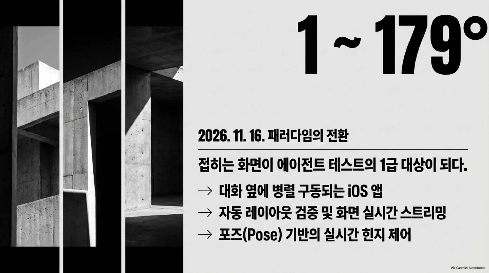
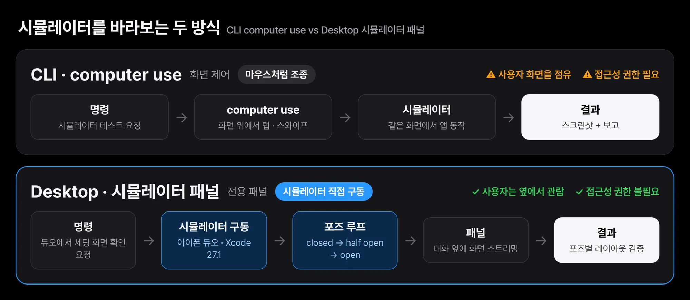
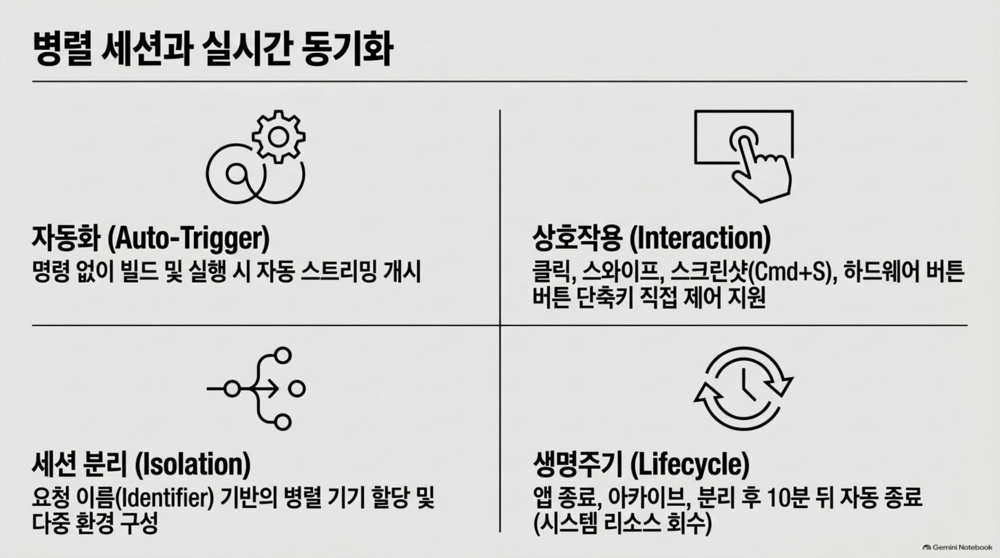
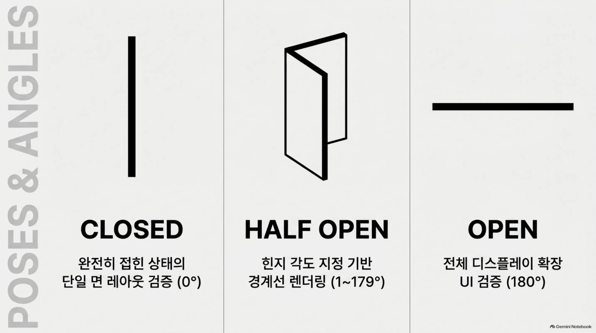
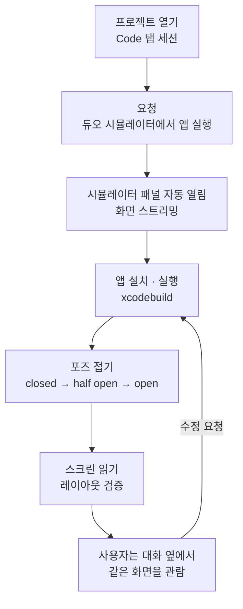
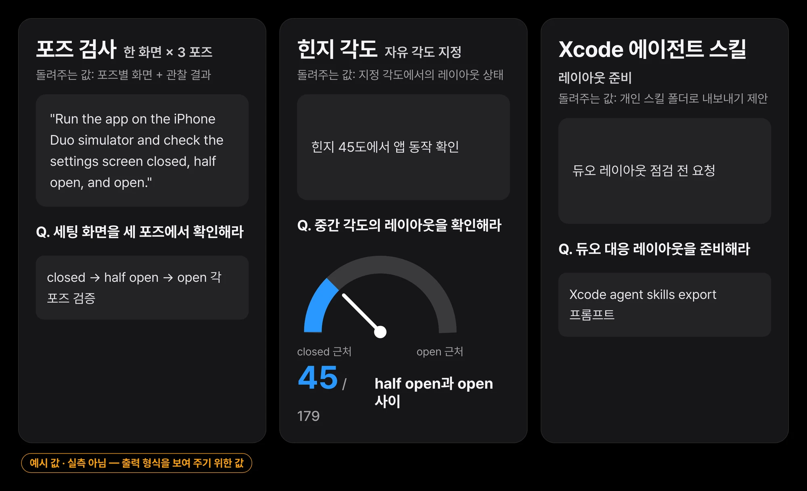
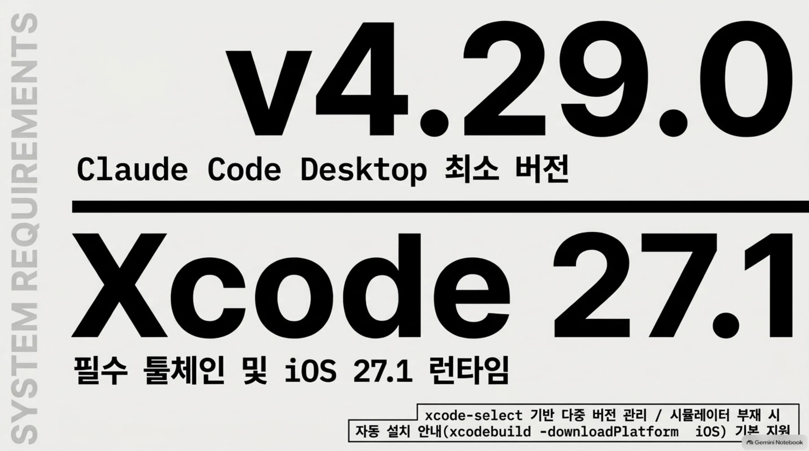
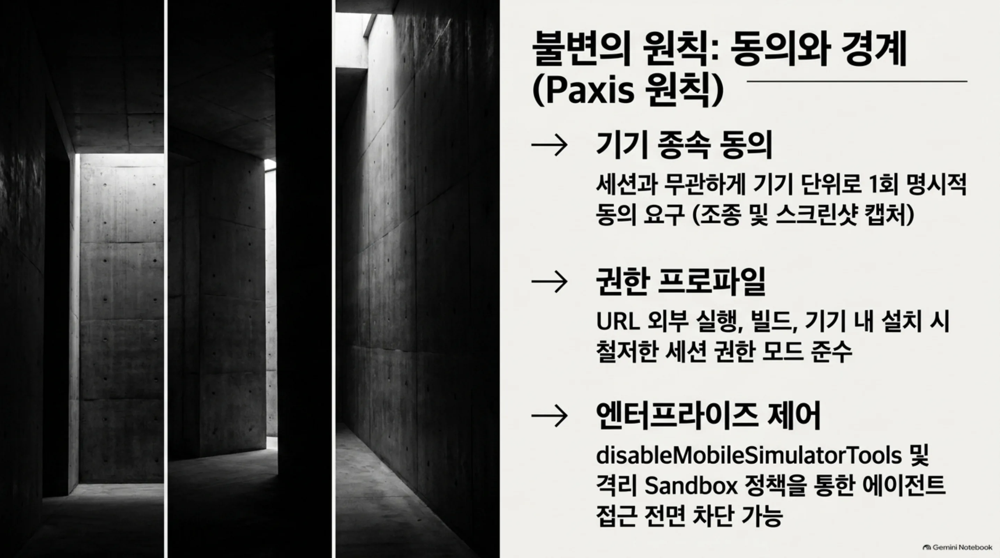
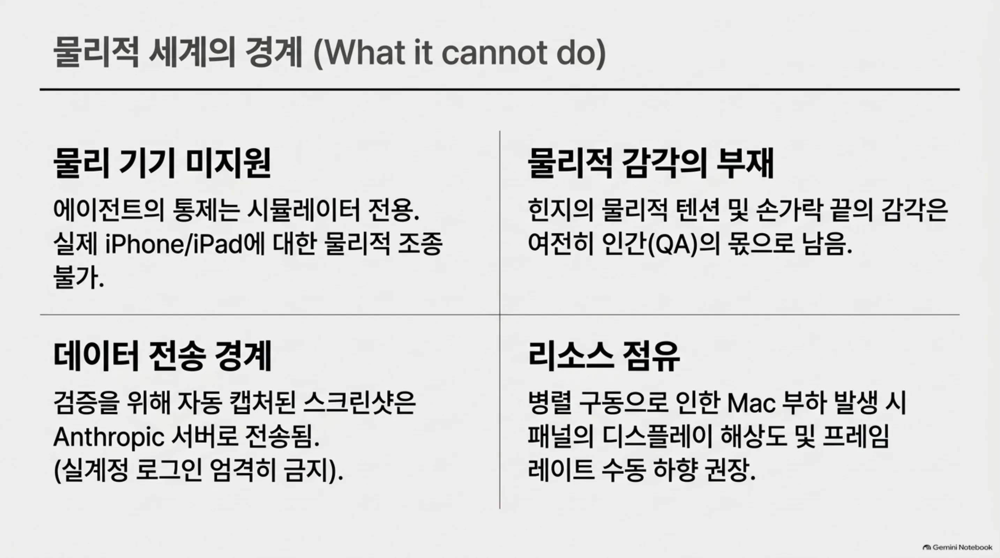

iOS 앱을 AI 코딩 에이전트로 만들고, 시뮬레이터에서 테스트까지 시키는 개발자라면 이런 장면이 있습니다. 에이전트가 "앱을 실행해서 확인했다"고 보고하면, 보고를 믿을지 아니면 직접 시뮬레이터 창을 열어 볼지를 고릅니다. 화면을 직접 보고 싶은데, 에이전트가 화면을 조종하는 동안에는 제가 손대면 안 되는 경우도 있습니다. 이 글은 "접히는 화면까지 에이전트 테스트 대상으로 만들 것인가"를 고르는 데 쓰는 글입니다.

결론을 먼저 둡니다. 2026년 11월 16일, 앤트로픽은 Claude Code Desktop이 iOS 시뮬레이터에서 아이폰 듀오를 지원한다고 발표했습니다. 공개 베타 단계이고, 핵심은 두 가지입니다. 앱이 대화 옆에 켜진다는 것, 그리고 에이전트가 기기를 접고 펴서 포즈마다 레이아웃을 확인한다는 것입니다.


*발표의 세 가지 기둥. 대화 옆에 병렬 구동되는 iOS 앱, 화면 실시간 스트리밍과 자동 레이아웃 검증, 포즈 기반의 실시간 힌지 제어 1~179도입니다.*

이 글에서 다루는 것은 공식 문서의 전체 구조입니다. 시뮬레이터 패널이 화면을 점유하지 않는 방식으로 동작하는 이유, 듀오의 세 포즈와 1~179도 힌지 각도, 기기에 대한 동의와 권한, 그리고 물리 기기에는 닿지 않는다는 한계까지.


*Claude Code Desktop, 아이폰 듀오 시뮬레이터 지원 (공개 베타). 힌지 각도 1~179도, 포즈는 closed / half open / open.*

## 쉽게 말하면

이 구조는 오픈 키친입니다.

요리사가 주방에서 요리하면, 손님 자리에서는 냄새만 따라옵니다. 결과가 맞는지 확인하려면 문을 열고 들어가야 합니다. 시뮬레이터 패널은 주방을 유리벽으로 엎어 놓은 겁니다. Claude가 주방(시뮬레이터)에서 앱을 빌드하고 실행하고 확인하는 동안, 저는 유리벽 바로 옆에서 같은 장면을 봅니다.

여기서 아이폰 듀오는 접는 메뉴판입니다. 접어 두면 한 면, 반쯤 열면 두 면의 경계, 완전히 펼치면 한 장의 큰 면. 메뉴판이 어떤 각도로 접혀 있느냐에 따라 같은 텍스트의 읽기는 전부 달라집니다. 접히는 화면의 앱 테스트는, 이 메뉴판을 세 각도에서 다 확인해야 하는 일입니다.

이 글에서는 시뮬레이터를 "주방", 패널을 "유리벽", 포즈를 "메뉴판"이라 부릅니다.

## 대화 옆의 유리벽

패널은 별도 명령이나 설정 없이 열립니다. Claude가 앱을 빌드하거나 설치하거나 실행하거나 확인하러 갈 때, 자동으로 열립니다. 그리고 기기의 화면을 실시간으로 스트리밍합니다. "새 화면이 제대로 보이는지?"처럼 보는 일이라면, Claude는 작업을 시작하기 전에 먼저 시뮬레이터를 켭니다.

중요한 구분이 하나 있습니다. 패널은 시뮬레이터를 직접 구동합니다. 그래서 computer use를 거치지 않고, 제 화면을 점유하지도 않고 다른 창을 숨기지도 않습니다. CLI에서 Claude가 시뮬레이터에 닿는 방식은 여전히 computer use, 즉 화면 위에서 마우스처럼 조종하는 방식입니다. 같은 대상도 Desktop에서는 유리벽이고, CLI에서는 화면 점유입니다.


*CLI는 화면 위에서 시뮬레이터를 마우스처럼 조종합니다. Desktop 패널은 시뮬레이터를 직접 구동해 대화 옆에 스트리밍하므로, 사용자는 같은 장면을 옆에서 봅니다.*

유리벽은 관찰용이 아닙니다. 제가 같은 주방에 손을 뻗을 수 있습니다. 화면 위에서 클릭·드래그로 탭과 스와이프를 하고, Cmd+S로 스크린샷, Cmd+R로 화면 녹화를 저장합니다. 파일은 데스크톱에 떨어집니다. 기기를 90도 돌리는 회전 버튼, Home·잠금·볼륨 하드 버튼 단축키도 Apple 시뮬레이터와 같습니다.

그리고 우리는 같은 기기를 씁니다. 제가 탭을 하면 Claude가 보는 앱 상태가 바뀝니다. 특정 화면을 확인시키고 싶으면, 제가 그 화면까지 탭으로 이동시킨 뒤 요청하는 겁니다. 반대로 Claude가 기기를 조종하는 동안에는 "Claude is using this device" 배지가 화면 위에 뜨는데, 배지가 사라질 때까지 손대지 않는 것이 정석입니다.

세션과 기기의 관계도 규칙이 있습니다. 요청에서 시뮬레이터 이름을 지정하지 않으면, 이미 켜져 있는 기기를 Claude가 씁니다. 병렬 세션이 각자 자기 기기를 쓰려면, 각 요청에 다른 이름을 쓰면 됩니다.

기기는 Claude 전용이 아닙니다. Claude가 켠 기기는 Apple의 시뮬레이터 앱, Xcode 27의 Device Hub에도 보입니다. 제가 먼저 켜 둔 기기에 Claude가 앱을 설치해서 쓰기도 합니다. 패널의 기기 메뉴는 각 시뮬레이터의 OS 버전과 켜져 있는지를 함께 보이기 때문에, 어느 기기를 보고 있는지 언제나 확인할 수 있습니다. Claude가 켠 기기는 더 이상 필요 없으면 꺼집니다. 앱을 종료할 때, 세션을 아카이브할 때, 기기를 패널에서 분리한 뒤 10분이 지났을 때. 제가 Apple 시뮬레이터에서 따로 켠 기기는 절대 자동으로 꺼지지 않습니다.


*패널의 네 운영 규칙. Claude가 빌드·설치·실행·확인할 때 스트리밍이 자동으로 열리고, 탭·스크린샷·하드웨어 버튼은 제가 직접 제어하며, 기기 이름으로 세션을 분리하고, 필요 없는 기기는 종료·아카이브·분리 후 10분에 꺼집니다.*

## 접는 메뉴판의 세 각도

아이폰 듀오 지원에서 핵심은 포즈입니다. closed, half open, open. 이 세 각도에서 기기를 접거나 펼 수 있고, 그 사이를 힌지 각도로 1~179도까지 지정할 수 있습니다.


*아이폰 듀오의 세 포즈. closed는 접힌 상태의 단일 면 레이아웃을, half open은 힌지 각도 1~179도의 경계를, open은 펼쳐진 디스플레이의 UI를 각각 검증 대상으로 만듭니다.*



접는 일은 제가 하면 버튼입니다. 회전 버튼 옆에 포즈 버튼 세 개가 있고, 마우스를 올리면 closed, half open, open 이름이 보입니다. 세 포즈 사이의 각도가 필요하면, 포즈 버튼 위에 마우스를 올리면 나타나는 슬라이더를 당깁니다.

Claude에게 시키면 언어입니다. 세 포즈 중 하나를 지정하거나, half open 기준 힌지 각도 1~179도를 지정합니다. 공식 문서의 예시 요청을 그대로 쓰면 됩니다.

```
Run the app on the iPhone Duo simulator and check the settings screen closed, half open, and open.
```

세팅 화면을 closed, half open, open 세 포즈에서 확인하라는 한 줄입니다. 한 화면에 대해 세 장의 관찰 결과가 돌아옵니다.


*아이폰 듀오 테스트의 입력·출력 형태. 공식 문서의 예를 바탕으로 하며, 이 글에서는 실제 실행하지 않았습니다.*

요구 사항을 짚습니다. 듀오를 테스트하려면 Desktop v4.29.0 이상이 필요합니다. 시뮬레이터 패널 자체는 v1.24012.0부터인데, 듀오는 그보다 새 버전이라는 뜻입니다. Xcode 27.1 이상과, 듀오 시뮬레이터를 담는 iOS 27.1 런타임이 필요합니다. 런타임이 없으면 Xcode Components 설정에서 받습니다. 기기 메뉴에 듀오가 아직 없으면, 목록 끝의 Add simulator에서 iPhone Duo 기기를 추가합니다.


*요구 사항 세 가지. Desktop v4.29.0 이상, Xcode 27.1, 그리고 듀오 시뮬레이터를 담는 iOS 27.1 런타임입니다. 여러 Xcode가 있으면 xcode-select가 가리키는 쪽을 씁니다.*

그리고 문서가 미리 알리는 프롬프트가 하나 있습니다. 레이아웃 점검 전에, Xcode가 함께 주는 에이전트 스킬을 개인 스킬 폴더로 내보낼지 물어볼 수 있습니다. 이 스킬은 코딩 에이전트를 위한 가이드이고, 한 번 내보내면 다른 프로젝트에서도 로드됩니다. 앱의 레이아웃을 아이폰 듀오에 맞게 준비하는 스킬이 여기에 들어 있습니다.

## 바뀌지 않는 것: 동의와 권한

패널이 편해질수록, 기기에 대한 동의 구조는 그대로입니다.

Claude가 기기를 조종하려면 동의가 필요합니다. 하나의 기기에 한 번입니다. 세션이 아니라 기기 기준으로, 조종과 스크린샷을 함께 허락하는 것입니다. 그리고 Claude가 기기에서 찍는 스크린샷은 Anthropic으로 전송되어, 일반적인 대화 보관 설정 아래 남습니다. 그래서 문서의 경고는 명확합니다. Claude가 쓰는 기기에 실 계정으로는 로그인하지 말라는 것.

허락 이후에도 세 가지는 세션의 권한 모드대로 프롬프트가 뜹니다. 기기에서 URL을 여는 일(URL은 기기 밖으로 데이터를 나르게 할 수 있어서), 빌드(xcodebuild가 프로젝트의 빌드 스크립트를 제 Mac에서 돌리기 때문에), 그리고 설치와 실행(Claude가 이름만 있으면 어떤 앱이든 실행할 수 있기 때문에).

조직 단위로도 끄 수 있습니다. disableMobileSimulatorTools 관리 설정은 Claude의 시뮬레이터 도구를 막아 유리벽은 제 탭 용도로만 남습니다. requireCoworkFullVmSandbox 정책은 도구를 격리 VM에서 돌리도록 해서, 패널과 시뮬레이터 도구를 통째로 비활성화합니다. HIPAA 구성이 켜진 Enterprise 조직과 서드파티 프로바이더 사용자에게는 패널 자체가 제공되지 않습니다. 클라우드나 SSH 세션도 대상이 아니라, 로컬 세션에서만 열립니다.


*바뀌지 않는 동의의 경계. 세션과 무관하게 기기 단위로 한 번의 명시적 동의, URL·빌드·설치 세 동작이 세션 권한 모드를 따르고, disableMobileSimulatorTools와 격리 VM 정책으로 조직이 통째로 끄는 것입니다.*

## 쓰기 전에 알아둘 것들

**물리 기기는 이 구조의 밖입니다.** Claude가 조종하는 것은 시뮬레이터일 뿐이고, 실제 아이폰이나 아이패드는 못 뻗칩니다. 물리 기기에서 확인해야 한다면, Xcode에서 직접 돌린 뒤 제가 본 것을 설명하거나 스크린샷을 대화가 붙이는 방식입니다. 접히는 화면은 시뮬레이터에서 각도까지 검증되지만, 실제 손의 감각과 물리 힌지는 여전히 사람의 몫입니다.

**Xcode가 여러 개면 xcode-select가 정답입니다.** 패널은 xcode-select가 가리키는 Xcode를 씁니다. 26.x와 27.1이 공존하면, 듀오 테스트를 위해 27.1을 지정하고 Desktop을 재시작해야 합니다.

**시뮬레이터가 없으면 패널이 설치 안내를 보여줍니다.** 체크박스 형태로, Xcode 설정에서 iOS 런타임을 받거나 `xcodebuild -downloadPlatform iOS`를 직접 돌리면 됩니다. 이 명령 하나로 부족했던 한 조각을 채웁니다.

**유리벽도 자원이 들어갑니다.** 패널의 Display 메뉴에서 프레임 레이트와 해상도를 내리면 Mac 부담이 줄어듭니다. 이건 패널이 기기를 보여주는 방식만 바꾸고, 앱 동작에는 영향을 주지 않습니다.


*에이전트가 닿지 않는 경계. 물리 기기와 힌지의 물리적 감각은 사람의 몫이고, 검증용 스크린샷은 Anthropic으로 전송돼 실 계정 로그인 금지가 붙으며, 병렬 구동 부담은 Display 메뉴에서 해상도와 프레임 레이트를 수동으로 조정합니다.*

## Paxis, 그리고 에이전트의 모바일 테스트

이 구조에서 눈에 붙은 부분은, 테스트 증거가 파일이 된다는 것입니다. Claude가 포즈마다 찍는 스크린샷, 제가 Cmd+S로 내리는 스크린샷, 녹화 파일. "레이아웃이 맞다"는 주장 뒤에 확인 가능한 산출물이 따라옵니다.

이 형은 Paxis가 에이전트 행동에 요구하는 것과 같습니다. 행동마다 정책 게이트를 통과하고, 감사 로그에 남고, 증거는 산출물이 되는 것입니다. 기기에 대한 동의는 세션이 아니라 기기 기준으로 한 번이고, 세 가지 동작은 항상 권한 모드를 따라갑니다. 조직 설정은 이 모든 것을 통째로 끕니다. "어떤 기기를, 누구의 허락으로, 어느 범위까지"라는 질문이 시스템 안에 이미 답을 갖고 있는 구조입니다. 에이전트가 화면을 볼 수 있게 되는 시대에, 화면 자체보다 먼저 정해지는 것이 이 동의의 경계입니다.

## 끝으로

접히는 화면은 이제 에이전트 테스트의 1급 대상이 되었습니다. 앱이 대화 옆에 켜지고, Claude가 closed·half open·open을 스스로 접고 펴며, 힌지 1~179도 사이의 각도까지 확인합니다. 저는 유리벽 옆에서 같은 장면을 보며, 필요할 때 같은 기기를 탭합니다.

오늘 할 수 있는 첫 실험입니다.

1. Desktop을 v4.29.0 이상으로 업데이트하고 재시작
2. Xcode 27.1과 iOS 27.1 런타임 확인
3. 기기 메뉴에서 Add simulator → iPhone Duo
4. "Run the app on the iPhone Duo simulator and check the settings screen closed, half open, and open."

세팅 화면의 세 포즈가 돌아오면, 이 글이 말한 주방과 유리벽이 제 데스크톱 위에 서 있습니다. 물리 기기는 여전히 사람의 몫이라는 한계를 기억하면서, 시뮬레이터 안에서는 에이전트가 먼저 확인하는 세계가 열립니다. 그것이 이 공개 베타가 여는 자리입니다.

## 참고 자료

- 발표 트윗: [@ClaudeDevs, 2026-11-16](https://x.com/ClaudeDevs/status/2122439098740674839)
- 공식 문서: [Test iOS apps in the simulator](https://code.claude.com/docs/en/desktop-ios-simulator) (Claude Code Docs)
- 최초 발표 기록: [Week 30 (July 20~24, 2026)](https://code.claude.com/docs/en/whats-new/2026-w30)
- 모든 수치는 2026-11-18 공식 문서 기준입니다.
