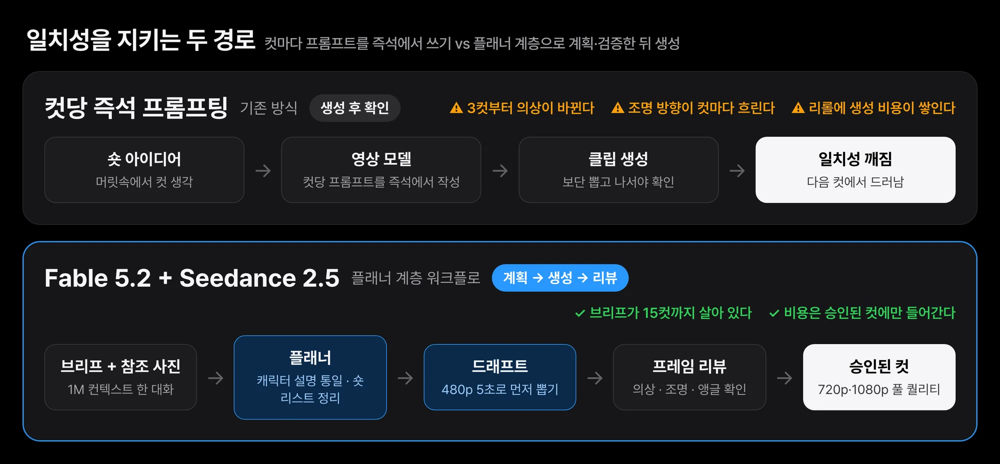
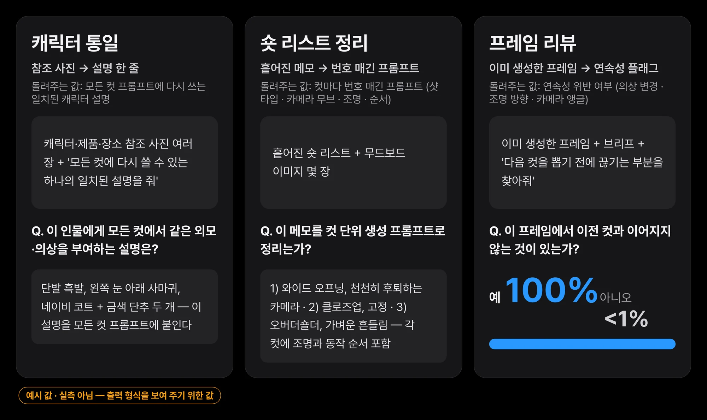
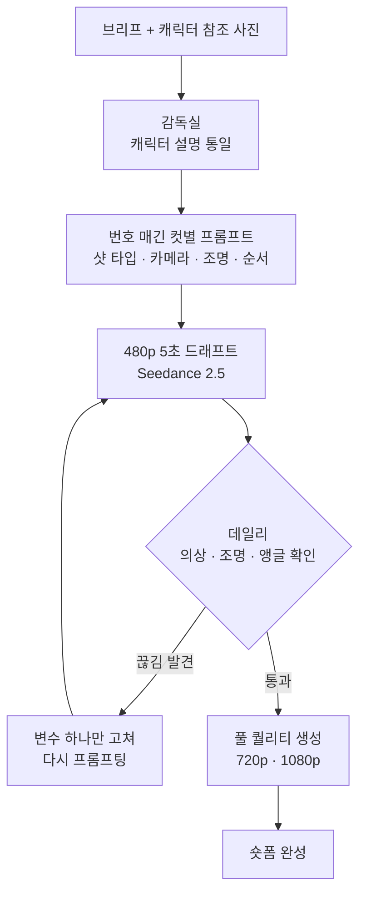

AI 숏폼은 컷을 하나씩 찍다 보면 5컷쯤에서 깨진다. 주인공 재킷 색이 달라지고, 조명이 한 컷은 왼쪽에서 다른 컷은 오른쪽에서 들어온다. 끝이 처음과 안 이어졌다는 걸 깨달았을 때 생성 크레딧은 이미 소진되어 있다. 문제는 영상 모델이 아니라, 대본을 누가 쥐고 있느냐였다.

이 글은 영상 모델로 멀티컷 AI 숏폼을 찍거나 그런 워크플로를 만들려는 개발자를 위한 것입니다. 2026년 11월 25일, 크리에이터 Social With Aayan이 클로드 Fable 5.2와 Seedance 2.5 조합으로 만든 숏폼과 그 워크플로, 프롬프트를 공개했고, 이 글은 그 내용을 두 모델의 공식 문서와 원본 영상으로 검증해 정리합니다.

핵심 결론을 먼저 둡니다. 이 워크플로는 실패 비용을 생성 단계에서 계획 단계로 옮깁니다. 플래너 컨텍스트가 1M 토큰이라 브리프와 캐릭터 설명, 모든 컷 프롬프트가 한 대화에 살고, 캐시 읽기는 $0.20/MTok이라 같은 브리프를 재독하는 값이 싸집니다. 그래서 실패는 풀 퀄리티 생성 전에, 드래프트의 데일리에서 잡힙니다.

## 쉽게 말하면

이 구조는 영화 세트장입니다. 영상 모델은 카메라맨입니다. 한 컷은 영화 같은데, 카메라맨은 대본을 안 들고 있습니다. 15번째 컷에서는 첫 컷에 주인공이 무슨 옷을 입었는지 기억이 안 나고, 빛은 다른 방향에서 들어옵니다.

Fable 5.2는 감독입니다. 감독은 대본, 곧 브리프를 들고 있습니다. 참조 사진에서 주인공 외형을 한 줄로 쓰고, 그 설명을 모든 컷 프롬프트에 붙입니다. 다음 컷을 찍기 전에 이미 찍은 데일리, 즉 생성된 프레임을 보고 한 가지만 고쳐 찍으라고 합니다.

이 글에서는 플래너 대화를 "감독실"이라고 부릅니다. 통일된 캐릭터 설명을 "대본", 생성 전 확인을 "데일리"라고 부릅니다. 세 단어가 이 글의 전부입니다.

## 원본: 11월의 숏폼

11월 25일, 크리에이터 Social With Aayan이 Fable 5.2와 Seedance 2.5로 만든 숏폼을 올렸습니다. "디즈니급 숏폼이고 끝이 황홀하다"는 크리에이터의 주장이고, 측정이 아닙니다. 이 글이 확산된 이유는 주장을 뒷받침하는 워크플로와 프롬프트를 아래에 다 붙였기 때문입니다.


*원본 영상 "How I Make Short Movies with Fable 5.2 + Seedance 2.5 in 4K". 두 모델로 숏폼을 찍는 과정을 담고 있습니다.*

영상에서 눈에 띄는 사실은 두 가지입니다. 첫째, 숏폼은 한 번의 생성이 아니라 여러 클립의 합입니다. 둘째, 인물과 장소, 소품의 일치성이 컷을 가로지르며 유지됩니다. 크리에이터가 강조하는 것은, Fable 5.2의 긴 컨텍스트가 브리프와 참조 설명, 이미 쓴 모든 컷을 한 대화에 담고 있어서 일관성이 "15컷쯤에서 빠지는" 일이 없다는 것입니다.

참고로 영상 제목은 4K입니다만, Seedance 2.5 공식 문서의 출력 해상도는 480p·720p·1080p입니다. 어떤 플랫폼을 거치느냐에 따라 해상도가 달라지는 것이므로, "4K"는 플랫폼 기준으로 보는 것이 정확합니다.

## 플래너는 왜 Fable 5.2인가

이 워크플로에서 Fable 5.2가 쓰는 자리는 "플래너"입니다. 앤트로픽은 2026년 11월 9일, 이 모델을 "긴 시간 동안 이어지는 에이전트 작업"에 쓰라고 발표했습니다. 공식 문서 기준으로, 이 자리에 맞는 특징이 세 가지입니다.

첫째, 컨텍스트가 1M 토큰입니다. 최대 출력은 128K 토큰이고, 멀티컷 숏폼 하나의 브리프와 참조 사진, 쓴 모든 컷 프롬프트가 이 범위에 들어옵니다. 크리에이터가 말한 "15컷에서 빠지는" 일관성 문제는, 정확히 컨텍스트가 짧은 곳에서 생깁니다.

둘째, 입력에 이미지가 들어옵니다. 공식 스펙은 "텍스트와 이미지 입력, 텍스트 출력"입니다. 참조 사진으로 캐릭터 설명을 쓰고, 생성된 프레임으로 데일리를 보는 일, 둘 다 이 입력 형식 위에서 일어납니다.

셋째, 추론이 기본으로 켜져 있습니다. 적응형 사고가 항상 동작하고, 깊이는 effort 파라미터로 조절됩니다. "14컷까지와 맞는가"를 판단하는 데일리 리뷰는 빠른 요약이 아니라, 브리프 전체를 대조하는 판단입니다.

모델은 Claude API와 Amazon Bedrock, Google Cloud, Microsoft Foundry에서 동일 ID(claude-fable-5-2)로 열립니다. 플래너 자리는 특정 플랫폼에 묶이지 않고, 영상 모델 쪽이 플랫폼에 묶인다는 점에서 이 비대칭이 이 워크플로의 형태를 정합니다.

## 영상 모델은 한 컷만 기억한다

Seedance 2.5는 이미지를 받아 영상을 만드는 모델입니다. 공식 문서 기준으로 주요 스펙을 정리합니다. 클립은 4~30초이고, 480p 드래프트 모드와 720p·1080p 출력이 있으며, 1080p는 프리미엄 티어가 필요합니다. 동기화 오디오는 켤 수도 꺼둘 수도 있습니다.

API는 입력 이미지 수로 모드를 정합니다. 1장은 시작 프레임, 2장은 첫/끝 프레임 전환, 3장 이상은 레퍼런스 모드입니다. 이미지 한 변은 300~6000px, 종횡비 0.4~2.5, 파일은 30MB 이하가 조건입니다.


*일치성을 지키는 두 경로. 컷당 프롬프팅은 생성 후 확인하고, 플래너 계층 워크플로는 승인된 컷에만 생성 비용을 씁니다.*

레퍼런스 모드가 이 워크플로의 승부처입니다. 참조 이미지는 타이어, 스타일, 소품의 디테일을 가이드하되, 타임라인의 리터럴 프레임으로 등장시키지 않습니다. "주인공은 이런 얼굴입니다"를 프레임 밖에서 알려주는 방식입니다. 다만 가이드는 로크가 아닙니다. 모델은 이전 클립을 기억하지 않고, 그 기억은 플래너가 대신 제공합니다.

| | 컷당 프롬프팅 | 플래너 계층 워크플로 |
|---|---|---|
| 캐릭터 설명 | 컷마다 새로 씀 | ✅ 하나로 고정, 전부 재사용 |
| 일치성 깨짐 시점 | 3컷쯤 이후, 생성 후에야 발견 | ✅ 생성 전 데일리에서 발견 |
| 비용 위치 | 실패한 생성에 들어감 | ✅ 계획과 리뷰에 들어감 |
| 보장 수준 | ⚠️ 보장 없음 | ⚠️ 보장 없음. 다만 발견이 빠름 |

## 플래너는 세 가지 일만 한다

감독실은 정확히 세 가지 일만 합니다. 각각은 단순하지만, 컷마다 하는 것과 한 대화에서 하는 것은 결과가 다릅니다.


*플래너 계층이 받는 입력과 돌려주는 값의 모양. 세 가지 용도를 한 대화에서 쓰며, 값은 형식 예시입니다.*

첫째, 캐릭터 통일입니다. 캐릭터나 제품, 장소의 참조 사진 여러 장을 한 번에 넣고 "모든 컷 프롬프트에 다시 쓸 수 있는 하나의 일치된 설명"을 요구합니다. 돌아오는 값은 컷별 설명이 아니라 설명 하나입니다. 주인공의 머리, 사마귀, 코트, 단추까지 한 번에 적히며, 그 설명이 모든 컷에 붙습니다. 설명이 하나면 고쳐야 할 곳이 하나입니다.

```text
주인공의 참조 사진 4장이 있다.
모든 컷 프롬프트에 다시 쓸 수 있는 하나의 일치된 설명을 써라.
머리카락, 얼굴 특징, 의상, 액세서리를 포함하고
컷을 넘어 변하지 않게 서술해라.
```

둘째, 숏 리스트 정리입니다. 어질러진 숏 리스트와 무드보드 이미지 몇 장을 주면, 번호 매긴 컷별 프롬프트로 돌아옵니다. 각 프롬프트는 샷 타입, 카메라 무브, 조명, 동작 순서를 담고, 주인공 외형은 위에서 정한 설명을 따라갑니다. 숏 리스트가 곧바로 생성 가능한 프롬프트가 됩니다.

```text
아래는 20초 숏폼의 어질러진 숏 리스트와 무드보드다.
컷마다 번호 매긴 프롬프트로 정리해라.
각 프롬프트에는 샷 타입, 카메라 무브, 조명,
동작의 순서를 포함하고, 주인공 외형은 앞 설명을 따르라.
```

셋째, 프레임 리뷰입니다. 다음 컷을 생성하기 전에, 이미 생성한 프레임을 플래너에게 보여주고 끊기는 부분을 찾게 합니다. 바뀐 의상, 반대 방향으로 들어온 조명, 연속성을 깨는 앵글. 리뷰는 생성 비용을 내기 전에, 같은 대화 안에서 일어납니다. 브리프와 대본, 이전 모든 컷이 이미 컨텍스트에 있으므로 리뷰 기준은 "이 프레임이 예쁜가"가 아니라 "14컷까지와 맞는가"입니다.

```text
지금까지 생성한 프레임과 브리프가 여기 있다.
다음 컷을 생성하기 전에 연속성이 끊기는 부분을 찾아라.
의상 변화, 조명 방향, 카메라 앵글만 확인해라.
```

이 세 가지의 비용은 공식 가격표로 환산할 수 있습니다. Fable 5.2는 입력 $8/MTok, 캐시 읽기는 $0.20/MTok입니다. 브리프는 대화에 머물고, 다시 읽을 때마다 캐시 읽기 가격으로 들어갑니다. 계획과 리뷰는 싸고, 생성 크레딧은 보고 넘긴 컷에만 쓰입니다. 이 워크플로의 경제학은 바로 이 비대칭에서 나옵니다.

같은 방향을 가리키는 관찰이 하나 더 있습니다. 플래너 계층 워크플로를 정리한 Karya Studio의 글은, 생성 버튼을 누르기 전에 다음 생성에 드는 비용을 보여주는 인터페이스가 이 구조를 강화한다고 썼습니다. 비용이 먼저 보이면, 그 앞의 리뷰 단계의 값이 자연스럽게 올라갑니다. 감독실이 싸고 데일리가 빠를수록, 생성에 쓰는 크레딧은 승인된 컷에만 남습니다.

## 첫 컷은 480p 5초

생성 쪽 규율은 Seedance 공식 문서가 명시합니다. 처음은 480p 5초 드래프트로 찍어 모션을 확인하고, 그 다음에 큰 카메라 무브를 결정하라는 것입니다. 프롬프트 구조는 "서브젝트 록 + 서브젝트 모션 + 카메라 모션 + 환경 모션 + 마지막 프레임"으로 고정됩니다. 프레임에 누가 뭘로 남아 있는가, 무엇이 움직이는가, 카메라는 어떻게 움직이는가, 배경은 어떻게 바뀌는가, 마지막 프레임은 어떤 모습인가를 한 줄씩 씁니다.


*플래너 계층 워크플로의 흐름. 데일리에서 끊김을 찾으면 변수 하나만 고쳐 드래프트를 다시 찍고, 통과한 컷만 풀 퀄리티로 생성합니다.*

드래프트가 먼저인 이유는 실패 비용이 해상도와 비례하기 때문입니다. 1080p 30초 클립에서 조명이 틀렸다면, 그 실패는 풀 가격으로 치렀습니다. 480p 5초 드래프트에서는 같은 실수의 값이 작습니다. 플래너가 데일리에서 변수 하나를 고치고, 드래프트가 통과해야 풀 퀄리티로 갑니다.

한 가지 더, 프롬프트는 소스 이미지를 다시 설명하는 데 쓰지 않는 것이 규정입니다. 이미지는 이미 프레임에 있고, 프롬프트가 쓸 자리는 시간입니다. 무엇이 어떻게 움직이고, 카메라는 어디로 가고, 배경은 어떻게 바뀌며, 마지막 프레임은 어떤 모습인지. 그래서 공식 문서가 권하는 구조가 "서브젝트 록 + 서브젝트 모션 + 카메라 모션 + 환경 모션 + 마지막 프레임"인 것입니다. 소스 이미지의 묘사를 다시 쓰면, 모델은 새로 읽고 다시 추측합니다.

카메라 지시가 모순되지 않도록 하고, 리비전은 변수를 하나씩만 바꾸라는 규정도 이 때문입니다. 조명이 틀렸다면 조명을 고치고, 그 다음에야 카메라 무브를 만집니다. 두 가지를 한 번에 바꾸면, 데일리에서 발견된 끊김이 고쳐진 것인지 새로운 것인지 판단할 수 없기 때문입니다. 크리에이터가 말한 "끝이 황홀하다"는 주장이 이 지점에서 힘을 갖습니다. 마지막 컷도 즉흥이 아니라, 같은 데일리를 통과한 컷이기 때문입니다.

## Paxis에서는 플래너 자리가 검증 게이트를 가진다

이 워크플로의 구조는 Paxis가 이미 다루는 형입니다. 감독실은 DAG를 계획하는 에이전트이고, 데일리는 비용 앞의 검증 단계입니다. Paxis는 에이전트의 모든 행동을 정책 게이트를 통과시키고 감사 로그에 남깁니다. "리뷰를 통과하기 전에는 다음 컷을 생성하지 않는다"는 규칙은 정확히 그 형, 즉 유료 행위 앞에 값싼 검증을 두고 그 결과를 기록하는 구조입니다.

서빙 쪽으로 보면 드래프트/풀 퀄리티 티어가 됩니다. 다키클라우드의 Metis는 K8s 위에서 모델 서빙을 다루는 플랫폼이고, "480p 5초로 먼저 찍고 통과하면 1080p"라는 비용 구조는 특정 크리에이터만의 습관이 아니라 영상 모델 서빙 인터페이스의 일반 패턴입니다. 드래프트 모드와 레퍼런스 모드를 API 파라미터로 드러내면, 플래너 계층의 경제성은 플랫폼이 챙길 일이 됩니다.

감사 로그 관점에서도 이 형태가 맞습니다. 이 워크플로에서 "어떤 컷이 왜 승인됐고, 어떤 변수가 고쳐졌는지"는 전부 감독실 대화 안에 기록됩니다. 생성 비용이 난 컷마다 그 근거를 뒤쫓을 수 있고, 데일리에서 떨어진 컷은 비용으로 남지 않습니다. 에이전트가 돈을 쓰는 행위에 감사 로그가 붙어야 한다는 Paxis의 원칙이, 여기서는 "승인된 컷만 생성한다"는 한 문장으로 구현됩니다.

## 쓰기 전에 알아둘 네 가지

첫째, "디즈니급"은 주장입니다. 영상 품질의 공개 벤치마크는 없고, 이 숏폼의 일치성은 크리에이터와 시청자의 판단입니다. 워크플로의 방향은 공식 문서로 검증되지만, 결과의 수준은 수치가 아닙니다.

둘째, Seedance 2.5는 외부 유료 API입니다. 1080p는 프리미엄 티어이고, 드래프트는 480p입니다. 이 워크플로는 생성 비용이 0이 아닌 전제에서 효과적입니다. 생성이 무료라면 리뷰 루프의 가치는 줄어듭니다.

셋째, 리뷰 루프 자체도 비용입니다. 프레임 리뷰는 플래너 토큰을 쓰며, 컷이 많을수록 컨텍스트가 길어집니다. 캐시 읽기가 싸서 같은 브리프의 재독은 부담이 작지만, 새 프레임과 새 리뷰 라운드는 새 토큰으로 들어옵니다.

넷째, 레퍼런스 모드는 가이드입니다. 공식 문서는 참조 이미지가 디테일을 "가이드"한다고 쓰고, 아이덴티티를 "보장"한다고는 쓰지 않습니다. 데일리가 레퍼런스 모드 뒤에 오는 이유가 이것입니다. 가이드를 마지막까지 믿지 않는다는 뜻입니다.

## 끝으로

이 워크플로는 AI 숏폼의 병목을 옮깁니다. 생성에서, 계획과 리뷰로. 영상 모델은 여전히 한 컷씩 찍고, 대본을 쥐고 데일리를 보고 비용을 쓸 시점을 정하는 것이 플래너입니다. 플래너 컨텍스트는 1M 토큰이고, 재독은 $0.20/MTok입니다. 실패 비용은 풀 퀄리티 생성 단계에서 드래프트의 데일리 단계로 옮겼습니다.

오늘 할 수 있는 첫 실험입니다.

1. 캐릭터 한 명을 정하고 참조 사진 3~5장을 준비합니다
2. 롱 컨텍스트 모델과의 한 대화에서 "하나의 일치된 설명"을 요구합니다
3. 5컷 숏폼의 숏 리스트를 번호 매긴 프롬프트로 정리합니다
4. 첫 컷을 480p 5초로 생성하고, 같은 대화에서 "다음 컷에서 끊기는 부분"을 묻습니다
5. 통과하면 두 번째 컷, 실패하면 변수 하나만 고쳐 다시 찍습니다

5컷까지 가면 대본이 플래너 손에 있는지 알 수 있습니다. 이 워크플로가 답하는 유일한 질문은 그것입니다.

## 참고 자료

- 원본 게시: [Social With Aayan, 2026-11-25](https://x.com/socialwithaayan/status/2125633124004667412)
- 원본 영상: [How I Make Short Movies with Fable 5.2 + Seedance 2.5 in 4K (YouTube)](https://www.youtube.com/watch?v=DhcSNj0tdPs)
- Seedance 2.5 공식 문서: [Seedance 2.5 Image-to-Video](https://www.seeddance.io/blog/seedance-2-5-image-to-video)
- 플래너 계층 워크플로: [Claude Fable 5.2 Storyboard Review Workflow](https://www.karyastudio.io/blog/claude-fable-5-2-storyboard-review-workflow)
- Fable 5.2 공식 모델 문서: [Claude Fable 5.2 Overview](https://platform.claude.com/docs/en/models/fable-5-2/overview)
- 모든 수치는 2026-11-27 기준 각 모델 공식 문서입니다.
