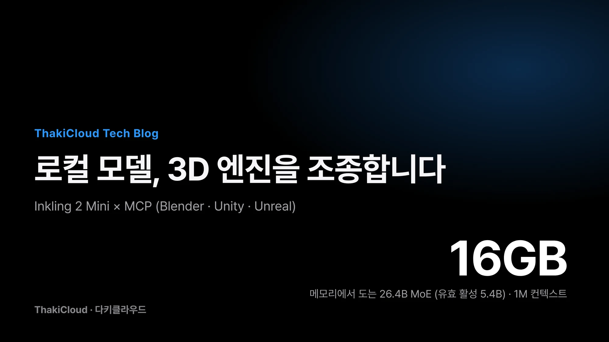
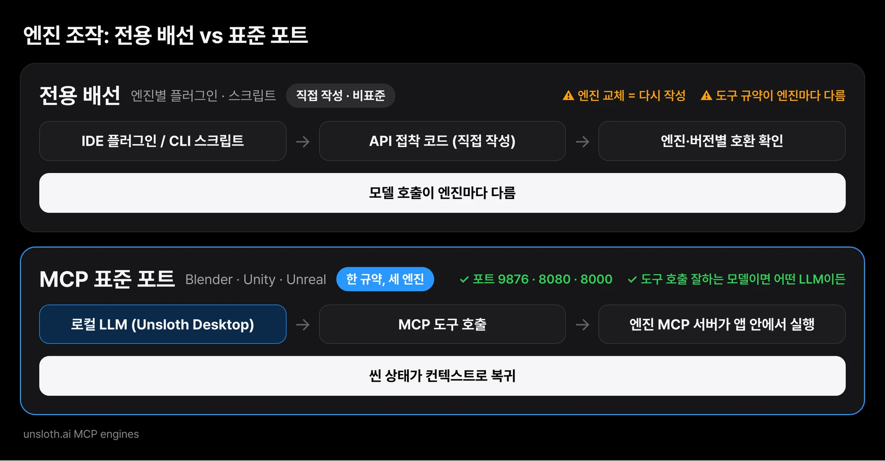
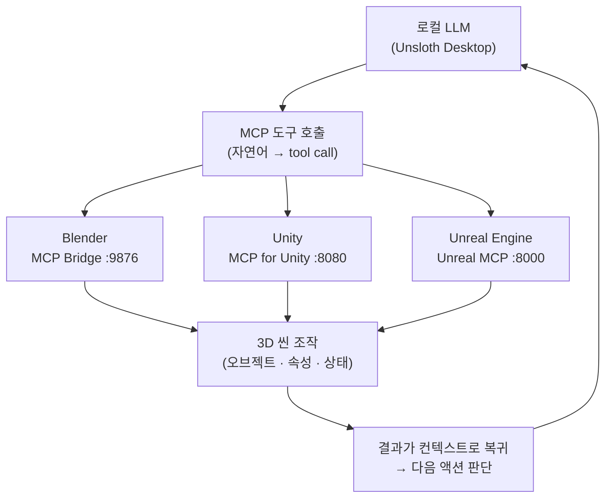
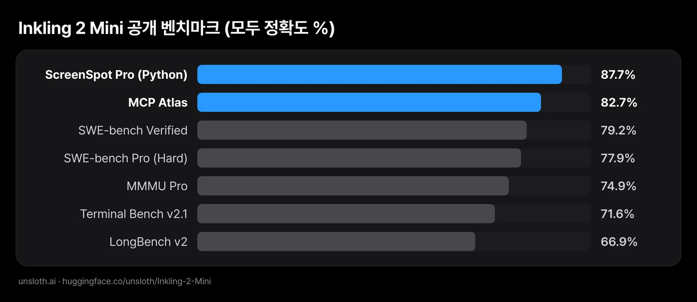
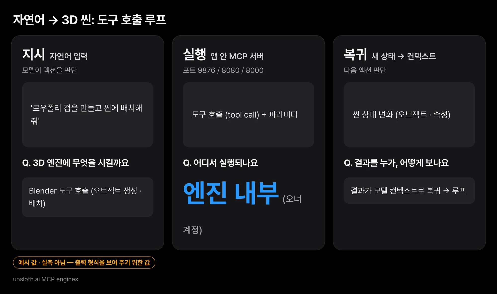

노트북에 로컬 모델을 돌려 Blender나 Unity, Unreal Engine 같은 크리에이티브 도구를 직접 조종해 보고 싶은 개발자, 혹은 에이전트와 데스크톱 도구 사이의 다리를 만드는 플랫폼 엔지니어를 위한 글입니다.

핵심 결론을 먼저 씁니다. Unsloth가 세 3D 엔진을 로컬 모델에 MCP(Model Context Protocol) 포트 하나로 연결했고, 추천 모델 Inkling 2 Mini는 26.4B 파라미터 MoE(유효 활성 5.4B)로 16GB 메모리에서 구동됩니다. 로컬 에이전트가 3D 엔진을 직접 다룰 수 있는 장벽은 모델 크기가 아니라, 도구 포트 표준이었습니다. 이 글은 그 포트가 어떻게 열리는지 세 엔진별로 씁니다.

출처를 밝힙니다. 이 글은 Unsloth 공식 MCP 엔진 문서와 Inkling 2 Mini 모델 페이지(unsloth.ai, Hugging Face unsloth/Inkling-2-Mini)에 근거합니다. 세팅 절차와 모델 수치는 문서상 값이며, 세 엔진의 실주행은 수행하지 않았습니다.

## 쉽게 말하면

이전 방식은 각 엔진이 자기 전용 배선을 가졌습니다. IDE 플러그인은 하나, CLI 스크립트는 또 하나, API 접착 코드는 직접 작성. 엔진을 바꾸면 다시 씁니다.

새 방식은 모든 엔진이 같은 표준 콘센트(MCP 서버)를 꽂는 것입니다. Blender는 포트 9876, Unity는 8080, Unreal Engine은 8000. 도구 호출 플러그(모델)가 있으면 어떤 콘센트든 꽂을 수 있습니다.

이 글은 3D 엔진이 표준 콘센트 세계에 들어온 이야기이고, 그 엔진을 조종하는 로컬 모델이 노트북에 들어오는 이야기를 함께 씁니다.

## 3D 엔진이 MCP 세계에 들어옵니다

MCP는 도구와 리소스를 표준 형태로 모델에 노출하는 프로토콜입니다. 그동안 검색, 파일, 데이터베이스 쪽 도구가 주류였습니다. 이번에는 도구 호출의 대상이 3D 엔진 그 자체입니다. 씬 조작, 오브젝트 생성, 속성 변경이 전부 도구 호출이 됩니다.

지원 엔진과 하한 버전은 Blender 5.1 이상, Unity 2021.3 이상, Unreal Engine 5.8 이상입니다. 공식 문서에는 Godot, Figma, Roblox Studio도 함께 실려 있습니다.

연결 모델은 로컬 퍼스트입니다. 엔진이 모델과 같은 머신에서 돌아가야 하며, 도구는 앱 안에서 실행됩니다. 그래서 오너 계정만 쓸 수 있고, Remote 또는 LAN 액세스가 켜져 있으면 MCP 도구가 자동으로 꺼집니다. 모델이 손을 뻗을 수 있는 것은 바로 앞에 있는 것뿐이라는 보안 입장입니다.

*왼쪽은 엔진마다 직접 작성하던 전용 플러그인과 스크립트 접합 구조입니다. 오른쪽은 엔진이 MCP 표준 도구 서버를 열고, 같은 포트 규약의 로컬 모델이 어떤 엔진이든 호출하는 구조입니다.*

## 세 엔진, 세 포트: 세팅 절차

Blender입니다. 공식 MCP 애드온을 설치하는데, 문서 페이지의 설치 버튼을 Blender에 두 번 드래그합니다. Blender Lab과 애드온 각각입니다. Edit, Preferences, System에서 Online Access를 켜고, MCP Bridge Server는 Auto Start로 올라옵니다. 꺼져 있으면 Add-ons, MCP에서 Start MCP Bridge Server를 누릅니다. 포트는 9876. Unsloth 채팅에서 Blender를 골라 권한 박스를 체크하고 Test connection을 누르면 끝입니다.

Unity입니다. Unity Hub에서 에디터를 설치한 뒤, uv를 설치해야 합니다. 패키지가 uv로 엔드포인트를 시작하기 때문입니다. Package Manager에서 Add package from git URL로 CoplayDev/unity-mcp를 추가합니다. 경로 /MCPForUnity, 브랜치 main. Window, MCP for Unity에서 HTTP를 고르고 8080에서 시작합니다. 표시등이 호박색이면 엔드포인트는 돌지만 에디터가 아직 참가하지 않은 상태이고, 초록색이 준비 완료입니다.

Unreal Engine입니다. Edit, Plugins에서 Unreal MCP와 All Toolsets를 활성화하고 재시작합니다. Editor Preferences, General, Model Context Protocol에서 Auto Start Server를 켭니다. 포트는 8000. 커뮤니티 EngineWire 플러그인은 3000 포트로 별도입니다.

헤드리스 구동도 문서화되어 있습니다. 디스플레이 없는 서버에서 Blender는 xvfb-run으로 돌리고, Unreal은 -RenderOffscreen과 -ModelContextProtocolStartServer 플래그로 올립니다. 주의할 점도 있습니다. Blender의 백그라운드 모드(-b)에서는 브리지가 시작되지 않습니다.

## Inkling 2 Mini: 16GB 메모리의 에이전트

Inkling 2 Mini는 Thinking Machines Lab이 만든 모델입니다. 총 26.4B 파라미터의 스파스 MoE로, 네이티브 활성은 3.4B, 중간 12개 레이어를 3번 돌리는 루프 구조로 토큰당 유효 활성 5.4B입니다. 컨텍스트는 최대 1M 토큰, 라이선스는 Apache 2.0, 공개는 2026년 11월 20일입니다. 멀티모달 자율 회귀 루프 트랜스포머 구조이고, 전문가 128개 중 8개를 활성화합니다.

양자화 사다리는 UD-Q4_K_XL 17.6GB가 권장치입니다. 낮은 비트로 가면 UD-IQ1_S에서 7.76GB, 풀 프리시전 UD-Q8_K_XL은 22.87GB. 16GB 메모리는 저비트에서, 24GB는 풀 프리시전에서 돌아, 3D 엔진 조종용 로컬 에이전트의 현실적인 하한을 그어 줍니다. 비전 파일(mmproj)은 639MB를 더합니다.

모델 페이지의 공개 벤치마크는 SWE-bench Verified 79.2%, SWE-bench Pro (Hard) 77.9%, Terminal Bench v2.1 71.6%, MMMU Pro 74.9%, ScreenSpot Pro (Python) 87.7%, MCP Atlas 82.7%, LongBench v2 66.9%입니다. 공식 페이지는 같은 크기대 최강, Qwen3.8-27B보다 앞선다고 위치 잡고 있습니다. 그중 ScreenSpot은 화면을 보고 요소를 찾아내는 벤치이고, MCP Atlas는 도구 호출 자체를 잰 벤치입니다. 엔진을 화면으로 조종하는 루프에 바로 필요한 능력 둘입니다.

여기까지의 수치는 Unsloth 공개 값이며, 저희 측 실측이 아닙니다.

*모두 정확도 계열(%) 벤치마크입니다. SWE-bench Verified 79.2%, SWE-bench Pro (Hard) 77.9%, MMMU Pro 74.9%, Terminal Bench v2.1 71.6%, LongBench v2 66.9%, ScreenSpot Pro (Python) 87.7%, MCP Atlas 82.7%. Unsloth 모델 페이지 공개 수치.*

## 모델은 도구 호출을 잘해야 합니다

공식 문서의 모델 조건은 한 문장입니다. 도구 호출을 잘하는 모델을 쓰라는 것. 예시로 Qwen3.8-27B(UD-Q4_K_XL)와 Qwen3.8-Flash-Next를 들고, Inkling 2 Mini의 추천 양자화도 함께 내놓습니다.

루프는 단순합니다. 모델이 도구 호출을 내보내고, 엔진의 MCP 서버가 앱 안에서 실행하고, 결과가 컨텍스트로 돌아오고, 모델이 새 상태를 보고 다음 액션을 정합니다. 이 루프가 서느냐 못 서느냐는 엔진 쪽이 아니라 모델의 도구 호출 품질이 결정합니다. MCP Atlas 82.7% 같은 수치가 이 판단의 기준선이 됩니다.

*모เดล이 받는 입력은 자연어 지시, 돌려받는 출력은 엔진 상태의 변화입니다. 예시 값이며 실측이 아닙니다.*

## 쓰기 전에 볼 네 가지

첫째, 같은 머신 조건입니다. 엔진과 모델이 같은 머신에 있어야 하고, 원격은 안 됩니다. 멀티유저·멀티머신 환경은 이 글의 형태가 아닙니다.

둘째, 엔진 버전 하한입니다. Blender 5.1, Unity 2021.3, Unreal 5.8. 이전 버전은 문서 지원 범위 밖입니다.

셋째, 헤드리스 구동입니다. 서버에서는 xvfb(Blender)나 offscreen 플래그(Unreal)가 필요하고, 모든 환경에서 올라가는 것은 아닙니다.

넷째, 권한 표면입니다. 도구가 앱 안에서 실행된다는 것은 모델이 씬을 직접 조작할 수 있다는 뜻입니다. 파괴적 작업도 가능합니다. 언두 규율과 프로젝트 격리는 하네스 쪽 책임입니다.

## Paxis의 MCP 커넥터는 여기서 시작합니다

이 글의 데스크톱 MCP는 같은 머신, 오너만 쓰는 형태입니다. ThakiCloud의 Paxis(Agent-Native Cloud)는 MCP를 관리형 커넥터로 다룹니다. OAuth 자동 재연결, 도구 호출마다 정책 게이트와 감사 로그, 격리 샌드박스 실행.

3D 엔진 포트는 일급 Tool 리소스 후보입니다. Blender 씬 편집을, 권한과 감사가 붙은 도구로 Paxis의 어떤 에이전트든 호출하게 만드는 것입니다. 이 글의 로컬 MCP는 그 도구 표면의 프로토타입이고, Paxis는 같은 도구 표면을 멀티테넌트 플랫폼으로 가져가는 형태입니다.

| | 로컬 MCP (이 글) | Paxis 관리형 커넥터 |
|---|---|---|
| 전송 | 같은 머신, 로컬 포트 | 원격 관리, 커넥터 중개 |
| 인증 | 오너 계정, 앱 안 권한 | OAuth 자동 재연결, 정책 게이트 |
| 실행 | 엔진 프로세스 안 | 격리 샌드박스 |
| 감사 | 앱 로그 | 도구 호출별 감사 로그 |
| 멀티테넌트 | 불가(동시 꺼짐) | 에이전트별 권한 분리 |

## 끝으로

노트북에서 Blender를 돌리는 분이라면, 오늘 할 수 있는 첫 실험은 MCP Bridge를 올리고 Test connection을 누르는 것입니다. 포트가 열리느냐, 열렸는데 조종이 되느냐를 구분하는 5분짜리 검증입니다. 연결이 안 되면 포트 문제, 연결됐는데 조종이 안 되면 모델의 도구 호출 문제입니다.

플랫폼 쪽 독자라면, 에이전트와 도구의 다리를 평가할 때 하나의 축을 더 두면 좋겠습니다. 그 도구의 표면이 얼마나 이미 MCP로 표준화되어 있는지. 이 글의 3D 엔진은 표준 포트의 범위가 크리에이티브 도구까지 닿아 왔다는 하나의 사례입니다.

장벽은 포트 표준이었고, 모델 크기가 아니었습니다. 이 글은 그 결론을 회수합니다.

## 출처

- Unsloth, "MCP engines" 문서: https://unsloth.ai/docs/basics/mcp/mcp-engines
- Unsloth, "Inkling 2 Mini" 모델 페이지: https://unsloth.ai/docs/models/inkling-2-mini
- Hugging Face, unsloth/Inkling-2-Mini 모델 카드: https://huggingface.co/unsloth/Inkling-2-Mini
- 발견 경로(트윗): https://x.com/hjguyhan/status/2126560987038027965
