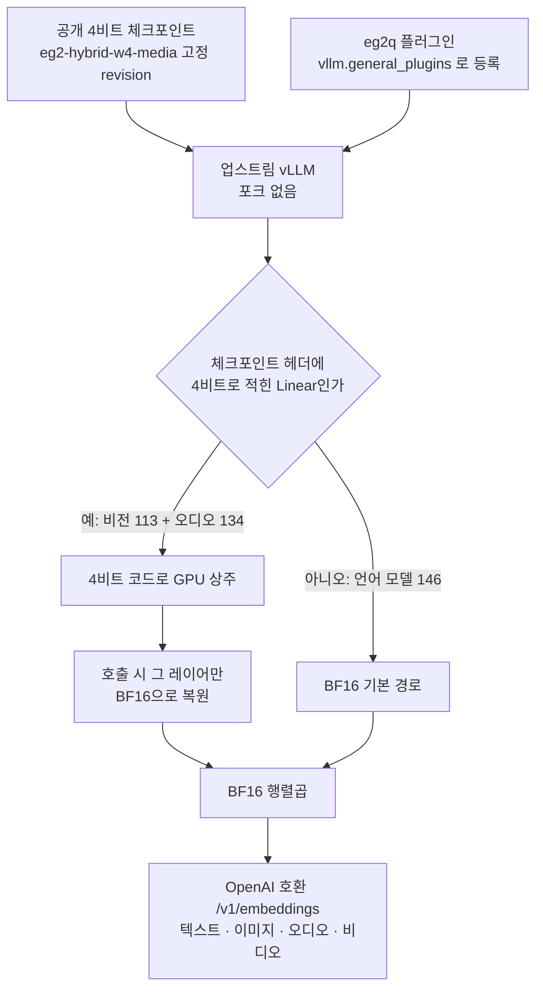

텍스트, 이미지, 오디오, 비디오 임베딩을 API로 서빙해야 하는데 GPU 메모리를 언어 모델에 더 주고 싶은 엔지니어라면 이 글이 맞습니다. 공개된 4비트 EmbeddingGemma 2를 수정하지 않은 업스트림 vLLM에 플러그인 하나로 올렸고, 가중치가 차지하는 GPU 메모리가 BF16 참조보다 43.7% 줄었습니다. 대신 빨라지지는 않으며, 검증한 GPU는 B200 한 종류뿐입니다. 먼저 EmbeddingGemma 2가 어떤 모델이고 어디에 쓰면 좋은지, 강점과 약점을 정리합니다. 그다음 이번 플러그인이 무엇을 바꿨고 어디까지 확인했는지 숫자로 보여 드립니다.

## EmbeddingGemma 2는 어떤 모델인가

[EmbeddingGemma 2](https://ai.google.dev/gemma/docs/embeddinggemma/model_card_2)는 Google이 2026년 10월 6일 Apache 2.0으로 공개한 멀티모달 임베딩 모델입니다. 텍스트(코드 포함), 이미지, 비디오, 오디오를 받아 모두 같은 768차원 공간의 벡터로 바꿉니다. 그래서 텍스트 질의로 슬라이드 캡처를 찾거나, 회의 녹음으로 관련 문서를 찾는 검색을 모델 하나로 할 수 있습니다.

크기는 740M 파라미터입니다. 텍스트 본체가 270M이고, 비전 인코더 170M과 오디오 인코더 300M이 더해집니다. 필요한 인코더만 불러 텍스트 전용 270M이나 텍스트와 이미지 440M처럼 가볍게 쓸 수도 있습니다. 100개가 넘는 언어를 지원하고, 입력 길이는 모달리티 공통으로 8,192 토큰입니다. 출력 벡터는 768차원에서 512, 256, 128차원으로 잘라 저장 비용을 줄일 수 있습니다. 모델 자체를 자세히 다룬 [소개 글](/tech-blog/ko/owm/embeddinggemma-2-multimodal-embedding/)과 4비트 런타임을 다룬 [앞선 글](/tech-blog/ko/llmops/eg2-l2v1-low-memory-runtime/)도 함께 보시면 좋습니다.

## 어떻게 활용하면 좋은가

가장 잘 맞는 곳은 **미디어 종류가 섞인 사내 검색**입니다. 문서, 화면 캡처, 회의 녹음, 짧은 영상을 한 인덱스에 넣고 텍스트 질의로 찾으면 됩니다. 예전에는 이미지를 캡션으로, 음성을 자막으로 먼저 바꾼 뒤 텍스트 임베딩에 넣었습니다. 이렇게 두 단계를 거치면 모델이 둘 필요하고, 전처리에서 빠진 의미는 검색에서 되찾을 수 없습니다. 이 모델은 그 첫 단계를 없앱니다.

두 번째는 **업무 에이전트의 기억 검색**입니다. 에이전트가 과거 문서와 화면, 음성 기록에서 근거를 찾아야 할 때 이 임베딩이 바닥에 깔립니다. 에이전트 플랫폼(Paxis)에서 언어 모델과 임베딩 모델이 같은 GPU를 나눠 쓴다면, 임베딩 쪽이 덜 차지할수록 언어 모델에 자리가 더 돌아갑니다.

세 번째는 **데이터 주권이 걸린 온프레미스 환경**입니다. 라이선스가 Apache 2.0이고 모델이 작아서, 고객 문서를 외부 API로 보내지 않고 사내 서버 한 대에서 멀티모달 검색을 돌릴 수 있습니다.

텍스트만 검색한다면 740M 전체를 올릴 이유가 없습니다. 텍스트 전용 270M 구성이 더 가볍고, 이 글에서 다루는 4비트 미디어 가중치 이야기도 해당하지 않습니다.

## 강점

첫째, **한 공간에서 네 모달리티를 비교합니다.** 텍스트 질의 벡터와 이미지 벡터를 같은 코사인 유사도로 바로 비교할 수 있어, 검색 파이프라인 구성이 단순해집니다.

둘째, **작고 라이선스가 자유롭습니다.** 740M은 GPU 한 장의 아주 작은 일부만 차지합니다. 상용과 사내 배포, 파생 모두에 제약이 적은 표준 라이선스라 도입 검토 단계가 짧아집니다.

셋째, **저장 비용을 차원으로 조절합니다.** Matryoshka 방식이라 768차원 벡터의 앞부분만 잘라 써도 순위가 상당 부분 유지됩니다. 모델 카드에 실린 멀티모달 벤치마크(MMEB-v2) 종합 점수는 768차원 59.01, 512차원 58.38, 256차원 56.24입니다. 256차원으로 줄이면 저장량은 3분의 1이 되고 점수는 약 2.8점 내려갑니다.

넷째, **필요한 인코더만 켤 수 있습니다.** 이미지가 없는 서비스라면 비전 인코더를 아예 올리지 않아도 됩니다.

## 약점

첫째, **128차원까지 줄이면 멀티모달 품질이 크게 떨어집니다.** 같은 벤치마크에서 128차원은 45.65로 768차원보다 13점 이상 낮습니다. 모델 카드도 128차원은 텍스트 전용에 더 맞는다고 적고 있습니다. 멀티모달 인덱스라면 256차원 아래로는 직접 재 보고 정해야 합니다.

둘째, **FP16으로 돌리면 안 됩니다.** 모델 카드는 bfloat16이나 float32를 쓰라고 권하고, FP16에서는 활성값 범위 때문에 NaN이 나거나 오류 없이 품질이 떨어질 수 있다고 경고합니다. 오류가 나지 않는 쪽이 더 위험합니다.

셋째, **긴 입력은 잘립니다.** 텍스트는 8,192 토큰이 상한이라 긴 계약서나 논문은 여전히 잘게 나눠야 합니다. 오디오는 30초를 넘으면 모델 처리기가 30초로 자릅니다.

넷째, **공개 벤치마크는 Google 자체 측정입니다.** 한국어 문서나 우리 업무 데이터에서 품질이 어떤지는 직접 확인해야 합니다. 특히 중복 제거처럼 이웃 순서가 정확해야 하는 용도에는 꼭 재 보시기 바랍니다.

다섯째, **서빙 경로마다 벡터가 같다는 보장이 아직 없습니다.** 이번 작업에서 확인한 사실인데, 이미지와 오디오 입력에서 vLLM과 sentence-transformers가 내는 임베딩이 같다는 것은 BF16 모델에서도 아직 입증되지 않았습니다. 두 스택으로 만든 벡터를 확인 없이 한 인덱스에 섞으면 안 됩니다.

## 쉽게 말하면

도서관 서고를 떠올리면 됩니다. 공식 로더는 진공 포장된 책 꾸러미를 서고에 들이자마자 전부 풀어 책장에 꽂습니다. 책장(GPU 메모리)은 원래 부피대로 가득 찹니다.

이번 플러그인은 꾸러미를 포장된 채로 꽂아 둡니다. 누가 그 책을 찾으면 그 권만 꺼내 펼치고, 다 읽으면 다시 접어 둡니다. 책장 자리는 훨씬 덜 차지만, 펼치는 손이 한 번 더 들어 대출이 조금 늦어질 수 있습니다. 그리고 이번에는 이 방식을 개인 서고가 아니라 많은 사람이 동시에 빌려 가는 공공 대출 창구, 즉 vLLM 서버에 그대로 붙였습니다.

## 무엇을 만들었나

공개 체크포인트 [`ThakiCloud/eg2-hybrid-w4-media`](https://huggingface.co/ThakiCloud/eg2-hybrid-w4-media)는 텍스트 가중치를 BF16 그대로 두고 비전과 오디오 가중치만 4비트로 줄인 모델입니다. 앞선 v0.1.0은 이 체크포인트를 sentence-transformers 안에서 4비트로 유지하는 로더였습니다. 이번 [`eg2-l2v1` v0.2.0](https://github.com/ThakiCloud/eg2-l2v1/releases/tag/v0.2.0)은 같은 일을 vLLM에서 합니다.

플러그인 `eg2q`는 vLLM의 표준 확장 지점(`vllm.general_plugins` 엔트리 포인트)으로 양자화 설정 하나를 등록합니다. 레이어 종류로 짐작하지 않고 체크포인트 헤더를 읽어, 4비트로 저장된 Linear 247개(비전 113, 오디오 134)를 정확히 골라냅니다. 이 레이어들은 4비트 코드 상태로 GPU에 남고, 호출될 때만 BF16으로 풀려 평범한 BF16 행렬곱에 들어갑니다. 언어 모델 쪽 Linear 146개는 vLLM의 기본 경로를 그대로 탑니다.



바뀌지 않은 것도 분명히 적어 둡니다. 새로 양자화하지 않았고, 새 체크포인트를 만들지도, vLLM을 고치지도 않았습니다. 네이티브 INT4 행렬곱도 아닙니다. 행렬곱은 똑같은 BF16이고, 바뀐 것은 가중치를 GPU에 보관하는 방식뿐입니다.

## 나온 결과

NVIDIA B200 한 장에서 쟀습니다. 참조는 같은 체크포인트를 공식 로더로 한 번 BF16으로 풀어, 같은 vLLM 빌드와 같은 엔진 설정으로 띄운 것입니다. 이렇게 하면 차이가 서빙 스택이 아니라 가중치 보관 방식에서만 생깁니다. 합격 기준은 측정 전에 정해 두었고, 결과를 본 뒤 바꾸지 않았습니다.

### 메모리

vLLM이 로드 직후 보고하는 가중치 메모리가 0.80GiB로, 참조 1.42GiB의 0.563배입니다. 기준은 0.70배 이하였습니다.


*그림 1. vLLM이 보고한 가중치 상주 메모리(B200). 로딩 직후 프로세스 전체 GPU 메모리는 플러그인 1,842MiB, 참조 2,412MiB였습니다.*

이 숫자를 서버 전체 VRAM 절감으로 읽으시면 안 됩니다. vLLM은 `--gpu-memory-utilization` 한도까지 활성값과 캐시용 메모리를 미리 잡기 때문에, 서버가 GPU를 얼마나 차지하는지는 가중치가 아니라 그 설정이 정합니다. 줄어든 0.62GiB는 그 설정값을 낮춰 다른 프로세스에 돌려줄 때 비로소 쓸모가 생깁니다.

### 처리량

같은 회차에 BF16끼리 비교한 대조 비율이 모든 셀에서 0.90~1.10 안에 든 회차만 유효로 봤습니다. 5회 중 3회가 유효했고, 나머지 2회는 사전에 정한 규칙대로 버렸습니다.


*그림 2. 유효 3회 중 셀별 최저 처리량(참조 = 1.0). 중앙값은 텍스트 0.993~0.998, 이미지 0.932~0.992, 오디오 1.040~1.082, 비디오 0.989~1.007입니다.*

가장 낮은 셀은 오디오 batch 64의 0.826배로, 사전 기준 0.80배를 넘었습니다. 오디오 중앙값이 1.0을 넘은 것은 대조군 잡음 범위 안의 값이라 빨라졌다는 뜻이 아닙니다. 복원 단계가 하나 더 붙는 구조이니, 메모리가 제약이 아니라면 BF16이 같거나 더 빠릅니다.

### 정확도

모달리티마다 32개, 모두 128개 항목을 플러그인 3회와 참조 3회로 임베딩해 9쌍을 비교했습니다. 네 모달리티 모두 코사인 유사도 최솟값이 표시 정밀도에서 1.0이었고, 기준은 0.99999였습니다. 엔진이 복원한 247개 가중치는 체크포인트의 공식 로더 결과와 sha256까지 같았습니다.

검사가 정말 차이를 잡을 수 있는지도 확인했습니다. 4비트 레이어에만 일부러 작은 오차를 넣자 이미지, 오디오, 비디오에서 바로 잡혔습니다. 텍스트가 움직이지 않은 것은 예상대로입니다. 언어 모델은 양자화하지 않아 넣은 오차가 텍스트 경로에 닿지 않습니다.

숨기지 않을 부분도 있습니다. 128개 중 4개(텍스트 2, 비디오 2)는 플러그인과 참조의 차이가 참조끼리 6번 돌렸을 때의 최대 변동보다 조금 컸습니다. 크기는 float32 마지막 자릿수 수준입니다. 앞선 진단에서는 3.85초짜리 오디오 한 항목이 참조끼리도 간헐적으로 흔들렸는데, 이번에는 재현되지 않았습니다. 관측되지 않았을 뿐 해결된 것은 아닙니다.

즉, 사람 말로는 "같은 vLLM 위에서는 BF16과 구별되지 않지만, 모든 조건에서 비트까지 같다고 약속하지는 않습니다."

### 서빙

`serve.sh`로 띄운 OpenAI 호환 서버가 텍스트, 이미지, 오디오, 비디오 단건 요청을 모두 처리했고, 동시 요청 32개도 전부 성공했습니다. 서버 프로세스 역시 247개 레이어를 전부 플러그인으로 적재했습니다.

## 외부에서 그대로 재현되는가

사내 레지스트리, 오브젝트 스토리지, 공유 디렉터리, 자격 증명이 전혀 없는 깨끗한 B200 컨테이너에서 README의 설치 절차를 그대로 실행했습니다. 베이스는 공개 이미지 `python:3.12-slim-bookworm`이고, 패키지와 모델은 모두 공개 인덱스와 Hugging Face에서 받았습니다.

두 번 돌렸습니다. 첫 번째는 의존성을 공개 인덱스에서 새로 해석해 잠금 파일(199개 패키지)을 만든 실행이고, 두 번째는 최종 릴리스 트리에 커밋된 잠금 파일을 그대로 설치한 실행입니다. 두 번째 실행에서 설치된 버전은 199개 모두 잠금과 일치했습니다. 두 실행 모두 247개 적재, 공식 로더와 비트 동일, 네 모달리티 임베딩, 70초 만의 서버 기동, 동시 요청 32/32, 가중치 메모리 0.80GiB로 통과했습니다.

## 써 보려면

Linux x86_64, Python 3.12, CUDA 13.0을 지원하는 드라이버가 필요합니다. vLLM 경로는 PyTorch 2.13.0을 쓰므로 새 환경에 설치하십시오.

```bash
git clone https://github.com/ThakiCloud/eg2-l2v1.git && cd eg2-l2v1
sudo apt-get install -y gcc g++ libgl1 libglib2.0-0 ffmpeg
bash vllm/install.sh                               # 잠금 의존성, eg2q 플러그인, pip check
python vllm/selftest_vllm.py --out vllm_result.json   # exit 0 이면 통과
bash vllm/serve.sh                                 # :8000 에서 /v1/embeddings
```

`serve.sh`는 고정 revision 체크포인트를 받고, 플러그인이 같은 디렉터리를 보도록 `EG2Q_CKPT`를 설정한 뒤 검증 때와 같은 인자로 서버를 띄웁니다. 요청은 일반 OpenAI 임베딩 API 형식입니다.

```bash
curl -s http://127.0.0.1:8000/v1/embeddings \
  -H 'Content-Type: application/json' \
  -d '{"model": "eg2", "input": ["a dog barking in the distance"]}'
```

이미지, 오디오, 비디오를 보내는 형식은 저장소의 `vllm/client_example.py`에 있습니다. 오디오는 16kHz 모노로 넣고, `model` 값은 `serve.sh` 기본 이름인 `eg2`입니다.

## 이 결과가 바꾸는 것

가장 큰 변화는 운영 방식입니다. 4비트 체크포인트를 쓰려고 별도 서빙 코드를 유지하거나 vLLM을 포크할 필요가 없습니다. 언어 모델을 이미 vLLM으로 서빙하는 팀이라면 같은 엔진, 같은 API 규약 위에 임베딩 엔드포인트를 하나 더 얹으면 됩니다. 추론 서빙 플랫폼(Metis)처럼 vLLM 위에 엔드포인트를 쌓는 구조에서는, 업스트림 vLLM을 올릴 때 플러그인만 다시 맞추면 되므로 유지 비용이 작습니다. 다만 Metis 엔드포인트로 직접 띄워 검증하지는 않았습니다.

메모리 0.62GiB 자체는 큰 숫자가 아닙니다. 의미가 생기는 곳은 같은 GPU에 언어 모델, 재정렬 모델, 임베딩 모델을 함께 올리는 구성입니다. 거기서는 임베딩 쪽 `--gpu-memory-utilization`을 줄인 만큼 언어 모델의 KV 캐시로 돌아갑니다.

## 못 믿을 부분

- 검증한 GPU는 NVIDIA B200(SM 10.0) 하나뿐입니다. 다른 GPU 지원은 주장하지 않습니다.
- 43.7%는 가중치 상주 메모리 기준이며 서버 전체 VRAM 절감과 다릅니다.
- 속도를 올리는 도구가 아닙니다. 네이티브 INT4 커널이 없습니다.
- 정확도 비교 기준은 같은 vLLM 경로에서 4비트를 BF16으로 복원한 참조입니다. 다른 서빙 스택과 비교한 결과가 아닙니다.
- vLLM과 sentence-transformers 사이 이미지, 오디오 임베딩 동등성은 별도 과제로 남아 있습니다.
- 모델 가중치와 평가 데이터는 저장소에서 다시 배포하지 않습니다. 체크포인트는 실행할 때 Hugging Face에서 고정 revision으로 받습니다.

이 수치는 시뮬레이션이 아니라 B200 한 장에서 잰 값이고, 코드와 모델은 모두 Apache-2.0으로 공개되어 있습니다.
