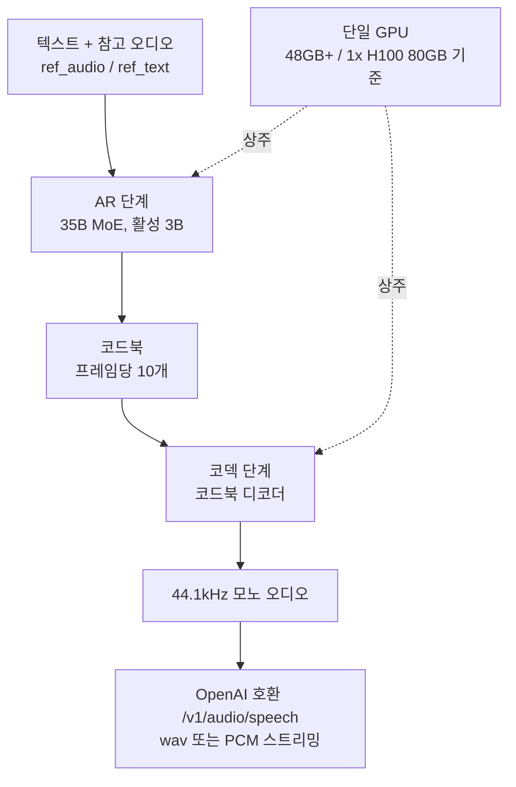

## 왜 읽어야 하나


ThakiCloud ai-platform에서 vLLM 기반 추론 엔드포인트를 운영하고, 스택에 TTS(텍스트-스피치) 엔드포인트를 얹을지 판단해야 하는 분을 위한 글입니다. vLLM-Omni가 Fish Audio의 멀티스피커 TTS 모델 Drama 3을 단일 H100 위에서 서빙하며, 공개 실측 첫 오디오 지연(TTFA)은 동시성 1에서 126ms입니다. 서빙 계약 자체는 지금 바로 스택에 넣을 수 있을 만큼 안정적이며, 다만 수치는 모델 쪽 측정이므로 운영 주의점까지 함께 확인해야 합니다.

## 쉽게 말하면

라디오 드라마 녹음 스튜디오를 생각해 보십시오. 마이크 스탠드에 배우가 16명까지 앉아 있고 음향 감독이 번호를 부르면 그 배우가 말합니다. 대본 안에는 [sighs], [whisper] 같은 괄호 표기가 줄거리처럼 쓰여 있으며, 짧은 참고 테이프를 건네면 배우가 그 목소리를 그대로 따라 합니다. 

Drama 3은 그 스튜디오이고, vLLM-Omni는 스튜디오를 송신탑으로 바꾸는 작업입니다. OpenAI 호환 /v1/audio/speech 문을 통해 누구든 스튜디오를 예약할 수 있고, 오디오는 44.1kHz 스트림으로 나옵니다. 이 글에서는 마이크 스탠드를 화자로, 줄거리를 이벤트 태그로, 참고 테이프를 목소리 클로닝으로, 녹음 부스 장비를 GPU로 부르며 이야기를 이어갑니다.

## 개요

vLLM이 Drama 3 지원을 [공식 X 공지](https://x.com/vllm_project/status/2110651698847093121)로 발표한 것은 2026년 10월 16일입니다. Drama 3은 Fish Audio가 제공하는 멀티스피커 텍스트-스피치 모델입니다. vLLM 지원이 의미 있는 이유는 두 가지입니다. 첫째, API 계약이 OpenAI 호환이라 기존 TTS 클라이언트가 코드 수정 없이 이 엔드포인트를 호출할 수 있습니다. 둘째, LLM 엔드포인트와 같은 엔진 위에서 돌므로 GPU 플랫폼에 별도의 서빙 인프라를 추가하지 않아도 됩니다.


모델 구조는 35B MoE(Mixture of Experts)로, 활성 파라미터는 3B입니다. 텍스트 백본이 코드북을 생성하고 코드북 디코더가 이를 오디오로 바꿉니다. 프레임당 코드북 10개를 사용하고 출력은 44.1kHz 모노입니다. 핵심 기능은 제로샷 목소리 클로닝, 16개 화자의 스피커 태그, 인라인 이벤트 태그 세 가지입니다.

## Drama 3과 vLLM-Omni가 무엇인가

### 모델

제로샷 목소리 클로닝은 참고 오디오(ref_audio)와 그 텍스트(ref_text)만 주면, 파인튜닝 없이 해당 목소리로 말하게 하는 기능입니다. 매 요청 두 파라미터를 넘기는 방식이며, 한 번 등록해 두고 재사용하는 세션 개념은 현재 API에 없습니다.

스피커 태그는 하나의 요청에 여러 화자를 넣는 방법입니다. <\|speaker:0\|>부터 <\|speaker:15\|>까지 16개 마이크 스탠드에 번호가 매겨져 있으며, 태그가 없는 발화는 스피커 0이 담당합니다. 요청 하나가 장면 전체를 합성하므로, 턴 순서가 정해진 대화에 특히 잘 맞습니다.

이벤트 태그는 텍스트 안에 괄호로 쓴 줄거리입니다. [sighs], [laughs], [laughing], [whisper], [angry], [excited], [pause]를 지원하며, 문 중간에 넣을수록 문두보다 잘 반영된다고 레시피가 안내합니다. 참고로 Fish Audio 플랫폼 자체 API도 이벤트 태그를 제공하지만 <whisper>, <emphasis>, <soft> 같은 각괄호 태그 형식의 별도 태그집합이라, vLLM으로 서빙할 때는 레시피의 괄호 표기를 따르는 것이 맞습니다.

### 서빙 구조

vLLM-Omni는 Drama 3을 단일 GPU에서 두 단계로 실행합니다. AR 단계가 오토레그레시브하게 코드북을 생성하고 코덱 단계가 코드북을 오디오로 디코딩합니다. 두 단계가 같은 GPU에 올라서 다중 GPU 텐서 병렬은 사용하지 않으며 하드웨어 요건은 CUDA GPU 1장 48GB 이상입니다. 기준 테스트는 1x H100 80GB이고, stage-0 가중치는 36.9 GiB입니다.



API 계약은 /v1/audio/speech 엔드포인트입니다. OpenAI TTS API와 동일한 필드 구조로 요청을 보내고 response_format을 wav로 주면 파일이, stream: true에 response_format: pcm을 주면 Server-Sent Events 스트림이 나옵니다. 스트림에서는 speech.audio.delta가 44.1kHz 16비트 PCM을 base64로 싣습니다. 클라이언트는 이 delta를 재생 버퍼에 쓰는 것만으로 실시간 재생이 가능합니다.

### 어떤 용도에 맞나

**실시간 음성 에이전트**가 첫 후보입니다. SSE로 44.1kHz PCM을 스트림해 재생 버퍼로 바로 내보내는 음성 루프를 말합니다. TTFA 126ms와 RTF 0.28(동시성 1, vLLM 실측)이면 단일 스트림에서도 대화에 뒤처지지 않습니다. 16인 화자 구조 없이 목소리 클로닝과 이벤트 태그만으로 충분한 용도입니다.

**멀티스피커 대화 콘텐츠**가 두 번째입니다. 게임 NPC 대사, 라디오 드라마, 오디오북 연기가 그 범위이고 턴 순서가 정해져 있으면 요청 하나가 장면을 끝까지 합성합니다. 스피커 태그 프로토콜은 세션당 목소리 관리가 필요 없으며, 캐릭터에 번호를 배정해 대본에 적기만 하면 됩니다.

**원샷 목소리 클로닝**이 세 번째입니다. ref_audio와 ref_text를 매 요청 넘기는 구조라, 특정 목소리로 한 문장만 내는 용도에 맞습니다. 반대로 고정 캐릭터 목소리를 장기간 쓰는 서비스라면, 매번 참고 오디오를 넘기는 오버헤드를 네트워크 부하와 함께 계산해야 합니다.

## 설치 및 통합

아래 명령은 [공식 vLLM 레시피](https://recipes.vllm.ai/fishaudio/drama-3)에서 가져온 것입니다. 환경 요건은 CUDA GPU 1장 48GB 이상, vLLM 0.31 이상, vLLM-Omni입니다.

```bash
uv venv && source .venv/bin/activate
uv pip install vllm==0.31.0 --torch-backend=auto
uv pip install git+https://github.com/vllm-project/vllm-omni.git
vllm serve fishaudio/drama-3 --omni --port 8000
```

--omni 플래그가 두 단계 구조로 서버를 띄우며 모델은 model_type=fish_omni 설정(vllm_omni/deploy/fish_omni.yaml)으로 자동 선택됩니다. 첫 요청은 커널 컴파일을 일으켜 약 10초가 걸리므로, 서버 시작 후 웜업 요청을 몇 번 보내 두는 것을 권합니다. 그렇지 않으면 첫 오디오 지연이 실제보다 느리게 측정됩니다.

기본 목소리 클로닝 요청:

```bash
curl -X POST http://localhost:8000/v1/audio/speech \
  -H "Content-Type: application/json" \
  -d '{
    "model": "fishaudio/drama-3",
    "input": "The quarterly report is due on Thursday, so please finish it by noon",
    "voice": "default",
    "ref_audio": "https://huggingface.co/datasets/zhaochenyang20/seed-tts-eval-mini/resolve/main/en/prompt-wavs/common_voice_en_10119832.wav",
    "ref_text": "We asked over twenty different people, and they all said it was his",
    "response_format": "wav"
  }' --output cloned.wav
```

두 화자 대화는 각 발화 앞에 스피커 태그를 붙입니다.

```bash
"<|speaker:0|> Hi. <|speaker:1|> Hello."
```

스트리밍은 stream: true와 response_format: pcm의 조합입니다.

```bash
curl -N -X POST http://localhost:8000/v1/audio/speech \
  -H "Content-Type: application/json" \
  -d '{
    "model": "fishaudio/drama-3",
    "input": "[sighs] Fine. If we miss it, it's on you. [laughs]",
    "response_format": "pcm",
    "stream": true
  }'
```

응답은 Server-Sent Events이며 speech.audio.delta가 44.1kHz 16비트 PCM을 base64로 싣습니다. 이벤트 태그 예문도 레시피의 것으로, 문두에 [sighs]가 있는 문장과 문중간에 [laughs]가 있는 문장을 보여 줍니다.

## 실측 결과

vLLM 레시피에 실린 공개 실측 표를 먼저 담습니다. 조건은 1x H100 80GB에 두 단계를 한 GPU에서, 목소리 클로닝 참고 1개, 샘플링 temperature 1.0 / top_p 0.9 / top_k 30, 웜 상태 서버입니다.

| 동시성 | 첫 오디오 p50 (TTFA) | RTF |
|---|---|---|
| 1 | 126 ms | 0.28 |
| 4 | 246 ms | 0.40 |
| 8 | 360 ms | 0.51 |

RTF 0.28은 오디오 1초를 벽시계 0.28초에 생성한다는 뜻입니다. 실시간의 3.5배가 남는 속도라, 단일 스트림으로도 스트리밍 음성 에이전트 루프가 가능합니다. 동시성 8에서조차 RTF는 0.51로 1.0을 넘지 않아, 스트리밍에서 오디오가 생성을 뒤쫓다 늦어지는 리스크가 없습니다. TTFA는 동시성 1에서 126ms, 8에서 360ms로, 8배 동시성에서 약 2.9배 늘어나는 모양입니다. 레시피에는 Whisper-large-v3 전사 비교 기준 WER 0.000도 실려 있으나, 제한된 평가 세트 수치이므로 우리 콘텐츠로 재확인할 필요가 있습니다.

서빙 비용 관점에서 이 두 수치를 읽는 방법은, GPU 장수로 "동시에 몇 개의 음성 대화를 지탱할지"를 산정하는 것입니다. RTF 0.51(8 스트림)은 한 장으로 8개 대화가 동시에 진행돼도 오디오가 생성을 따라온다는 뜻이고, TTFA 360ms는 사용자가 체감하는 첫 말 지연이 사람 대화의 휴지 범위에 머문다는 뜻입니다. GPU 1장이 담는 동시 대화 수를 결정하는 계산 자료가 되는 값입니다. 물론 H100 실측 기준이며, 다른 카드에서는 재측정이 필요합니다.


*그림. vLLM 공식 레시피 실측 기준의 동시성별 TTFA와 RTF. 실시간 임계선인 RTF 1.0을 동시성 8에서도 넘지 않습니다.*

지원 언어 범위도 확인이 필요한 지점입니다. Fish Audio 플랫폼 자체 API는 <korean> 같은 언어 태그를 실험적 기능으로 나열하지만, vLLM 레시피는 언어 커버리지에 대해 언급하지 않습니다. 오픈 가중치 경로에서 품질이 확보된 언어 범위는 직접 실험으로 확인해야 하며, 특히 한국어 합성은 재현 계획에 포함해 볼 가치가 있습니다.

저희 클러스터 재현 상태는 따로 기록합니다. 2026년 10월 16일 오전 기준 H100(2/2), B200(8/8), H200(4/4) 클러스터의 물리 GPU 전부가 상주 서빙 엔드포인트와 진행 중 잡에 점유된 상태였습니다. Kueue 큐는 쿼터로 admission을 해서 물리 여유가 없는 파드는 10분 후 PodsReadyTimeout으로 축출되므로, 제출 자체가 사인만 남는 경로였습니다. 본문 수치는 vLLM 공개 실측이며 저희 측 측정값이 아닙니다. GPU 자리가 확보되면 같은 레시피로 H100에서 TTFA와 RTF를 동시성별로 재측정해 갱신합니다.

## ThakiCloud 제품 적용 시사점


### ai-platform (Metis 서빙)

TTS 엔드포인트 추가 시 먼저 볼 것은 GPU 사이즈업입니다. Drama 3은 가중치 36.9 GiB에 두 단계의 활성 메모리가 더해지며, 요건은 48GB 이상입니다. 저희 클러스터에서는 H100 계열 이상 카드가 대상이고, 48GB 카드로도 가동 가능할지는 두 단계 상주 실측으로 확인해야 합니다.

둘째는 시작 시퀀스의 웜업 처리입니다. 첫 요청의 10초 커널 컴파일은 1회성 비용이지만, 헬스 체크와 첫 오디오 지연 측정 모두 시작 후 바로 하면 첫 요청이 잘못 읽힙니다. 엔드포인트 등록이 성공으로 잡히기 전에 웜업을 몇 번 보내 두는 게 정직한 시작 시퀀스입니다.

셋째는 가중치 분배 경로입니다. 36.9 GiB는 단일 PUT 업로드가 실패하는 규모라, 멀티파트 업로드나 모델 레지스트리 경유로 클러스터 안으로 들여와야 합니다. 등록까지 마친 엔드포인트는 서빙 설정 변경 하나로 가동이므로, 모델 등록 절차를 건너뛰지 않는 것이 중요합니다.

넷째는 오디오 엔드포인트와 LLM 엔드포인트의 계약입니다. 둘 다 OpenAI 호환 경로에 있지만 콘텐츠 타입이 다릅니다. 텍스트 토큰과 PCM 오디오는 클라이언트 라이브러리가 다르게 다루지만, 플랫폼 쪽에서는 같은 엔진 위에 엔드포인트가 공존하고 운영 부담도 텍스트 추론과 같습니다. 전용 TTS 서비스 스택을 따로 세우는 방식보다 이점이 큰 부분입니다.

### Paxis (Agent-Native Cloud)

16인 화자 구조는 단순 TTS보다 음성 에이전트 용도로 더 흥미롭습니다. 요청 하나가 대화 전체를 내주므로, 에이전트 간 대화나 그룹 공지, 역할극 콘텐츠가 하나의 API 호출로 만들어집니다. 스피커 태그는 세션마다 목소리를 관리하지 않고 에이전트가 역할을 배정하는 프로토콜이 됩니다.

이벤트 태그는 에이전트 파라미터로 노출할 수 있는 표현 제어입니다. 에이전트가 발화의 톤을 결정하면 [whisper]나 [angry]를 텍스트에 쓰는 형태로 전달되며, 텍스트 인밴드라 별도의 제어 채널을 정의할 필요가 없습니다.

실시간 음성 에이전트 관점에서는 스트리밍 계약이 단순합니다. 44.1kHz PCM delta가 SSE로 오면 재생 버퍼에 붙이는 것만으로 루프가 완성되고, TTFA 126ms(동시성 1, vLLM 실측)는 사람이 체감하는 대화 휴지 수준입니다.

## 한계 및 반론

첫째, 목소리 클로닝은 매 요청 계약입니다. ref_audio와 ref_text를 매번 넘겨야 하며, 목소리를 한 번 등록해 두고 재사용하는 세션 API는 없습니다. 참고 오디오를 서버 측에서 관리해 URL로 넘기는 구성은 가능해 보이나, 재현 시 확인이 필요합니다.

둘째, 일부 생성은 무음을 낼 수 있습니다. 레시피도 텍스트가 채우기 말이나 태그로 시작할 때 max_new_tokens로 무음이 나올 수 있다고 경고합니다. 프로덕션에서는 무음 감지 후 재시도하는 가드가 필요합니다.

셋째, 긴 텍스트 처리가 API에 노출되지 않았습니다. previous_takes와 long-text chunking은 아직 파라미터가 없으므로, 긴 대본은 클라이언트 쪽에서 쪼개야 합니다. 문장 단위 분리 자체는 쉽지만, 억양 연속성이 중요한 장면에서는 품질 문제가 될 수 있습니다.

넷째, 가중치 라이선스가 확인되지 않았습니다. Fish Audio 문서에도 vLLM 레시피에도 라이선스가 명시되지 않아, 상용 서비스로 쓰기 전 Hugging Face 모델 카드에서 확인하는 것을 권합니다.

다섯째, 실측 수치는 제공자 측 것입니다. TTFA와 RTF는 H100 80GB에서 vLLM이 공개한 값이며, 엔진 버전은 vLLM 0.31.0에 고정되어 있습니다. vLLM-Omni는 git 설치라 업스트림 업데이트와 함께 동작이 바뀔 수 있으므로, 프로덕션에서는 버전을 고정하는 것이 안전합니다.


## 정리

멀티스피커 TTS가 표준 vLLM 서빙 경로에 들어왔습니다. Drama 3은 48GB 이상 GPU 1장에서 가동되고 API는 OpenAI 호환이며 첫 오디오 지연은 동시성 1에서 126ms(vLLM 공개 실측)입니다. 플랫폼에 붙일 때 체크할 세 가지, GPU 사이즈업과 시작 시퀀스 웜업, 가중치 분배 경로를 확인해 두면 됩니다. ThakiCloud ai-platform에는 기존 vLLM 엔드포인트에 오디오를 얹는 후보이고, Paxis에는 멀티스피커 대화에 에이전트 네이티브 프로토콜을 주는 구성요소입니다. 수치는 공개 실측 기준이며, 저희 클러스터 재현이 완료되면 공개 값과의 차이를 보고합니다.
