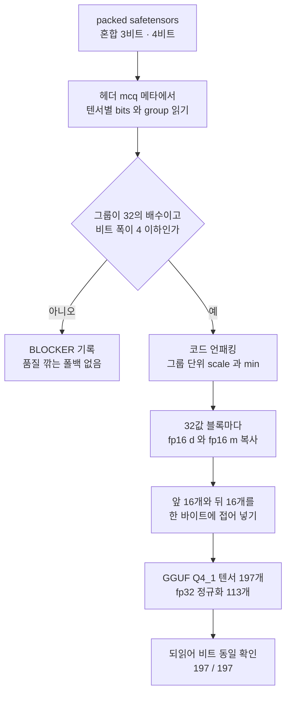

사내에서 만든 양자화 포맷을 외부에 공개해야 하는데 그 포맷을 읽는 코드가 비공개라 막혀 있는 분이라면 이 글이 맞습니다. 결론부터 말씀드리면, 복원되는 가중치 값을 하나도 바꾸지 않고 GGUF Q4_1로 다시 부호화해 표준 llama.cpp에서 그대로 돌립니다. 양자화 텐서 197개 전부가 되읽기에서 비트까지 같았고 최대 절대 오차는 0.0이었습니다. 공짜는 아닙니다. 파일은 295,391,600바이트에서 378,522,208바이트로 커집니다. 무엇을 주고 무엇을 받았는지, 그리고 중간에 어디서 막혔는지를 순서대로 적겠습니다.


## 우리가 풀어야 했던 문제

ThakiCloud에는 Qwen3-Embedding-0.6B를 층마다 다른 비트 폭으로 양자화한 체크포인트가 하나 있었습니다. 0번부터 6번 층은 4비트에 그룹 크기 64, 7번부터 27번 층은 3비트에 그룹 크기 32, 임베딩 테이블은 3비트에 그룹 크기 64입니다. 그룹마다 fp16 scale과 fp16 min을 따로 두는 비대칭 방식이고, 정규화 가중치는 fp32 그대로 남겼습니다.

문제는 이 배치를 담을 표준 컨테이너가 없다는 점이었습니다. 저희는 자체 packed 레이아웃에 코드를 비트 단위로 눌러 담았고, 그것을 푸는 코드는 양자화 엔진과 함께 비공개로 둡니다. 모델을 공개하기로 했을 때 조건이 하나 붙었습니다. 외부 사용자가 우리 비공개 코드 없이 모델을 실제로 실행할 수 있어야 한다는 조건입니다. 품질을 깎아서 맞추거나 엔진 코드를 공개해서 맞추는 것은 선택지가 아니었습니다.

그래서 질문을 좁혔습니다. 복원되는 값을 그대로 둔 채로 저장 형식만 표준 포맷으로 바꿀 수 있는가. 바꿀 수 있다면 외부 사용자는 llama.cpp 하나만 있으면 되고, 저희는 알고리즘을 공개하지 않아도 됩니다.

## 쉽게 말하면

창고에 물건을 넣는 방식이 두 가지 있다고 생각하시면 됩니다. 저희 방식은 물건 크기에 맞춰 칸을 깎아 쓰는 맞춤 선반입니다. 공간은 적게 먹지만 그 선반을 읽는 도면이 따로 있어야 합니다. GGUF Q4_1은 규격 상자 하나로 통일하는 방식입니다. 작은 물건을 넣어도 상자 크기는 같아서 전체 부피는 늘지만, 아무 창고 직원이나 와서 꺼낼 수 있습니다.

이번에 한 일은 물건을 바꾸지 않고 선반에서 규격 상자로 옮긴 것입니다. 상자를 열면 들어 있는 물건은 하나도 다르지 않습니다. 부피만 28% 늘고, 대신 도면이 필요 없어집니다.

## Q4_1 블록이 어떻게 생겼나

ggml의 Q4_1 블록은 구조체 하나로 정의됩니다. fp16 스케일 `d`, fp16 최솟값 `m`, 그리고 4비트 코드 32개를 담은 `uint8 qs[16]`입니다. 합이 정확히 20바이트이고 값 32개를 담습니다.

니블 배치에 규칙이 있습니다. `qs[j]`의 하위 4비트에는 `j`번째 값이, 상위 4비트에는 `j+16`번째 값이 들어갑니다. 복원은 `y[j] = d * (qs[j] & 0xF) + m`입니다. 앞쪽 16개와 뒤쪽 16개를 한 바이트에 접어 넣는 구조라, 순서를 잘못 잡으면 값이 섞이면서도 크기 검사는 통과하기 때문에 조용히 틀립니다.

저희 포맷의 복원 규칙은 `값 = code * scale + min`이라 식이 같습니다. 그러면 남는 질문은 둘입니다. 그룹 하나의 scale과 min을 블록 여러 개에 나눠 줘도 되는지, 그리고 우리 코드가 4비트 니블에 들어가는지입니다.

## 무손실이 성립하는 조건 두 개

두 조건이면 충분합니다.

**그룹 크기가 32의 배수여야 합니다.** 그래야 그룹 하나가 블록 경계를 가로지르지 않고 정확히 `group / 32`개의 블록으로 쪼개집니다. 그 블록들에는 같은 `(scale, min)`을 그대로 복사해 넣으면 됩니다. 저희 그룹은 32와 64뿐이라 조건을 만족합니다.

**비트 폭이 4 이하여야 합니다.** 3비트 코드는 0부터 7까지이고 4비트 니블은 0부터 15까지를 담습니다. 3비트 값을 4비트 자리에 넣으면 자리만 넓어지고 숫자는 그대로입니다. 복원식에 곱해지는 scale과 더해지는 min이 그대로이므로 결과도 그대로입니다.

이 두 조건 중 하나라도 어긋나는 텐서가 있으면 저희는 거기서 멈추고 BLOCKER로 기록하게 했습니다. 그룹을 다시 쪼개거나 코드를 클리핑해서 억지로 맞추는 폴백은 넣지 않았습니다. 그런 폴백은 "변환은 됐는데 품질은 모르겠다"는 상태를 만들고, 그건 공개할 수 있는 상태가 아닙니다.



## 실제로 돌린 코드

블록을 만드는 부분이 핵심입니다. 그룹의 scale과 min을 블록 수만큼 복제하고, 코드를 니블로 접습니다.

```python
import numpy as np

def q41_blocks(codes, scale, mins, group):
    """packed 코드를 ggml Q4_1 블록 바이트로 옮깁니다.
    블록 하나 = fp16 d + fp16 m + uint8 qs[16] = 20바이트, 값 32개."""
    per = group // 32            # 그룹 하나가 블록 몇 개로 쪼개지는지
    nb = codes.size // 32        # 전체 블록 수
    q = codes.reshape(nb, 32).astype(np.uint8)
    if q.max(initial=0) > 15:
        raise ValueError("4비트 니블에 담기지 않는 코드가 있습니다")

    d = np.repeat(scale.reshape(-1).astype(np.float16), per)
    m = np.repeat(mins.reshape(-1).astype(np.float16), per)

    out = np.empty((nb, 20), dtype=np.uint8)
    out[:, 0:2] = d.view(np.uint8).reshape(nb, 2)
    out[:, 2:4] = m.view(np.uint8).reshape(nb, 2)
    out[:, 4:] = q[:, :16] | (q[:, 16:] << 4)
    return out.reshape(-1)
```

여기서 `np.repeat`가 하는 일이 전부입니다. 그룹 크기 64이면 `per`가 2이므로 같은 scale이 블록 두 개에 들어가고, 그룹 크기 32이면 블록 하나에 들어갑니다. 값을 다시 계산하는 곳이 한 군데도 없다는 점이 중요합니다. 재양자화가 아니라 자리 옮기기입니다.

## 비트 폭과 그룹 크기는 메타데이터에서만 읽습니다

함정이 하나 있었습니다. 패킹된 바이트 수에서 비트 폭을 역산하고 싶은 유혹입니다. 관계식은 `n_groups * group * bits == packed_bytes * 8`인데, 이 식은 `group * bits`의 곱만 결정합니다. 그래서 `(bits=4, group=64)`와 `(bits=2, group=128)`이 똑같이 256으로 나오고 구별되지 않습니다.

저희는 실제로 이 역산에 한 번 당했습니다. 4비트로 보호해 둔 앞쪽 층 텐서 49개를 2비트로 읽었고, 더 나쁜 것은 같은 잘못된 해석으로 기준값과 재부호화본을 둘 다 만들었다는 점입니다. 그러니 둘이 당연히 같게 나왔고 "비트 동일"이라는 결론은 순환논증이 됩니다. 검사가 통과했는데 아무것도 검사하지 않은 상태였습니다.

지금은 정본이 하나입니다. safetensors 헤더의 `__metadata__["mcq"]`에 적힌 JSON입니다. 텐서별로 `bits`, `group`, 레이아웃, 모양이 들어 있고, 그 메타와 실제 패킹 바이트 수가 어긋나면 추측으로 메우지 않고 BLOCKER로 세웁니다. 코드가 선언된 비트 범위를 넘는지도 따로 확인합니다.

## gguf 라이브러리의 raw_shape 함정

파이썬 `gguf` 패키지의 `add_tensor(name, tensor, raw_shape, raw_dtype)`에서 한참 막혔습니다. `raw_dtype`을 함께 주면 `raw_shape`는 원소 모양이 아니라 **바이트 모양**으로 해석됩니다. 내부에서 `quant_shape_from_byte_shape`가 블록 크기 20으로 나눠 원소 모양을 되돌리기 때문입니다.

원소 모양을 그대로 넘기면 이런 오류로 죽습니다.

```
ValueError: Quantized tensor bytes per row (96) is not a multiple of Q4_1 type size (20)
```

올바른 값은 행 길이를 32로 나눠 블록 수를 구하고 거기에 20을 곱한 모양입니다.

```python
# 원소 모양이 아니라 바이트 모양을 넘깁니다.
byte_shape = [shape[0], shape[1] // 32 * 20]
writer.add_tensor(
    gguf_name,
    buf.reshape(byte_shape),
    raw_shape=byte_shape,
    raw_dtype=gguf.GGMLQuantizationType.Q4_1,
)
```

저희는 이 문제를 클러스터에 잡을 던지기 전에 맥 로컬 유닛테스트로 잡았습니다. `(3비트, 32)`, `(4비트, 64)`, `(3비트, 64)`, 그리고 큰 행렬 조합까지 네 가지를 파일로 쓰고 다시 읽어 비트가 같은지 확인한 뒤에 본 잡을 넣었습니다.

## 텐서 이름과 KV 메타데이터

값을 옮기는 것만으로는 모델이 돌지 않습니다. llama.cpp가 아는 이름으로 바꿔야 합니다. HF의 `self_attn.q_proj.weight`는 `blk.N.attn_q.weight`가 되고, `embed_tokens.weight`는 `token_embd.weight`, 마지막 `norm.weight`는 `output_norm.weight`가 됩니다. 저희는 매핑에 없는 이름이 나오면 `None`을 돌려 BLOCKER가 되게 했습니다. 조용히 건너뛰면 텐서 하나가 빠진 채로 파일이 만들어지기 때문입니다.

배치 순서는 다행히 그대로 맞았습니다. GGUF의 `ne[0]`은 입력 차원이고, HF의 `[out, in]` 행 우선 평탄화 순서가 llama.cpp의 블록 배치 순서와 같습니다. 이 모델의 행 길이는 1024, 2048, 3072이고 전부 32와 64의 배수라 블록 경계도 깔끔하게 떨어집니다.

KV 메타데이터에는 외부 사용자가 플래그를 몰라도 같은 결과를 얻도록 필요한 것을 모두 적었습니다. 아키텍처는 `qwen3`, 풀링은 `pooling_type = LAST`, 그리고 `add_eos_token = true`와 `add_bos_token = false`입니다. 로프 차원은 128, 로프 베이스는 1e6, 파일 타입은 MOSTLY_Q4_1입니다. 토크나이저는 모델 `gpt2`에 pre 설정 `qwen2`로 적고, 어휘 151,669개와 병합 규칙도 파일 안에 전부 넣었습니다. 그래서 외부 사용자에게는 저희 토크나이저 코드마저 필요 없어집니다.

## 되읽기로 확인한 것

쓰는 경로와 독립적으로, 완성된 파일을 `GGUFReader`로 다시 열어 검증했습니다. 각 텐서의 타입이 Q4_1인지 확인한 뒤, 역양자화한 값과 원본에서 계산한 `code * scale + min`을 부동소수점 비트 패턴 단위로 비교합니다.

| 항목 | 값 |
|---|---|
| 파일 안 텐서 수 | 310개 (양자화 Q4_1 197 + fp32 정규화 113) |
| 되읽기 비트 동일 | 197 / 197 |
| 최대 절대 오차 | 0.0 |
| 내장 어휘 | 151,669개, 빈 자리 0 |
| 파일 크기 | 378,522,208 바이트 |
| sha256 | `1b95b9cbf157a7b6e5d08b0afa7a30342105681dbfb913b182d3680ef3a52a95` |

비트 동일이라는 말은 반올림 오차 수준으로 비슷하다는 뜻이 아니라, 복원된 fp32 값의 비트 패턴이 같다는 뜻입니다. 정밀도 손실이 발생할 여지 자체가 없는 변환입니다.

## 커진 파일을 어떻게 볼 것인가

여기가 정직하게 적어야 하는 부분입니다. 단일 Q4_1 타입으로 가면 3비트 그룹도 4비트 자리를 쓰고, 값 32개마다 fp16 scale과 fp16 min이 붙습니다. 그래서 packed 파일 295,391,600바이트가 GGUF에서는 378,522,208바이트가 됩니다. 약 28% 증가입니다.

저희 내부 비교에서 이 혼합 배치가 균일 3비트 그룹 32 기준선보다 payload 회계로 약 0.95% 작았는데, **그 크기 이점은 GGUF로 이어지지 않습니다.** GGUF는 4비트 파일이고, 복원되는 값이 혼합 3비트와 4비트 양자화에서 나왔을 뿐입니다. 이 파일을 3비트 크기 이점의 근거로 인용하면 틀립니다.

받은 것은 실행 가능성입니다. 전용 커널도, 비공개 로더도, 저희 토크나이저도 필요 없이 표준 도구 하나로 돌아갑니다. 저비트 연구 산출물을 외부에 내놓을 때 결국 남는 질문은 크기가 아닙니다. 남이 돌릴 수 있느냐입니다.

## 써 보려면

모델은 [Hugging Face](https://huggingface.co/ThakiCloud/Qwen3-Embedding-0.6B-MultiCal-M1a-GPTQ)에 올려 두었습니다. 풀링 방식이 파일에 들어 있으므로 별도 플래그 없이 같은 벡터가 나옵니다.

```bash
./llama-embedding -m model-q4_1.gguf --pooling last \
    -p "The capital of France is Paris." \
    --threads 8 --threads-batch 8 --embd-normalize 2
```

파이썬에서는 이렇게 쓰시면 됩니다. 출력 벡터는 정규화되지 않은 1024차원이라 코사인 유사도를 계산하기 전에 L2 정규화를 해 주셔야 합니다.

```python
import numpy as np, llama_cpp

llm = llama_cpp.Llama(
    model_path="model-q4_1.gguf",
    embedding=True,
    n_ctx=512, n_batch=512, n_ubatch=512,
    n_threads=8,
    n_threads_batch=8,   # 컨테이너에서는 비워 두지 마십시오
)

def embed(text):
    v = np.asarray(llm.embed(text), dtype=np.float32).reshape(-1)
    return v / np.linalg.norm(v)

docs = ["한국의 수도는 서울이다.", "The capital of France is Paris."]
q = embed("대한민국의 수도는 어디인가?")
print(np.stack([embed(d) for d in docs]) @ q)
```

`n_threads_batch`를 왜 따로 적어야 하는지는 별도 글에서 다루겠습니다. 비워 두면 컨테이너 안에서 심각하게 느려집니다.

## ThakiCloud 제품 적용 시사점

ThakiCloud의 ai-platform은 고객 환경마다 다른 하드웨어에 모델을 올립니다. 온프렘 환경에서는 GPU가 아예 없는 노드에 임베딩 검색만 띄워야 하는 경우도 드물지 않습니다. 이번 변환은 그 경우에 바로 쓸 수 있는 선택지를 하나 늘려 줍니다. 양자화 연구 산출물이 사내 포맷에 갇혀 있으면 실험실 밖으로 못 나가는데, 표준 컨테이너로 옮기는 경로가 확인되면 같은 체크포인트를 K8s 위의 서빙 경로와 CPU 전용 에지 노드 양쪽에 보낼 수 있습니다.

운영 관점에서 더 중요한 것은 검증을 코드가 소유하게 만든 부분입니다. 저희는 변환 잡을 Kueue 큐에 넣고, 산출물을 파드 밖으로 내보내고, 되읽기 검증의 판정을 사람 판단이 아니라 종료 코드로 받았습니다. 변환이 실패하면 변환본이 만들어지지 않고, 성공하면 비트 동일 숫자가 로그에 남습니다. 모델 공개처럼 되돌리기 어려운 작업일수록 이렇게 판정을 코드에 맡겨 두는 편이 안전합니다.

## 한계 및 반론

이 변환이 증명한 것은 범위가 분명합니다. **복원값이 같다는 것이지 검색 품질을 다시 쟀다는 뜻이 아닙니다.** 저희가 공개한 품질 수치는 packed 산출물을 사내 fp32 로더로 재서 얻은 값이고, GGUF 쪽에서는 임베딩 동등성과 작은 스모크 검사만 했습니다. 두 가지를 섞어서 읽으면 안 됩니다.

조건은 좁은 편입니다. 그룹 크기가 32의 배수가 아니거나 비트 폭이 5 이상이면 이 경로는 성립하지 않습니다. 2비트 그룹 128 같은 배치를 쓰는 분이라면 같은 방법이 그대로 적용되지 않습니다.

파일이 커지는 것도 상황에 따라 치명적일 수 있습니다. 디스크나 네트워크가 제약인 배포 환경에서는 28% 증가가 변환의 이점을 상쇄할 수 있습니다. 그리고 Q4_1은 ggml 생태계의 오래된 타입이라, 더 최근 타입에 맞춰진 커널 최적화의 혜택을 전부 받지는 못합니다.

마지막으로 이 모델은 Research Preview입니다. 처리량이나 메모리 절감 수치는 공개하지 않았고, 이 글에서도 주장하지 않습니다.

## 정리

자체 양자화 포맷을 쓰는데 외부에서 돌릴 방법이 없다면, 알고리즘을 공개하거나 품질을 깎기 전에 **저장 형식만 바꾸는 경로**를 먼저 확인해 보시기 바랍니다. 복원식이 `code * scale + min` 형태이고 그룹이 32의 배수이며 비트 폭이 4 이하라면, Q4_1로 값을 하나도 바꾸지 않고 옮길 수 있습니다. 저희 경우 텐서 197개 전부가 비트까지 같았습니다.

확인하실 순서는 세 가지입니다. 비트 폭과 그룹 크기를 바이트에서 역산하지 말고 메타데이터에서 읽으실 것, `add_tensor`에 넘기는 모양이 바이트 모양인지 확인하실 것, 그리고 쓰는 경로와 독립적으로 파일을 되읽어 검증하실 것입니다. 세 번째를 건너뛰면 자기가 만든 버그로 자기를 검증하는 순환논증에 빠지기 쉽습니다. 저희가 한 번 빠져 봤습니다. 되읽기 검증 한 줄이 그 고리를 끊어 줍니다.
