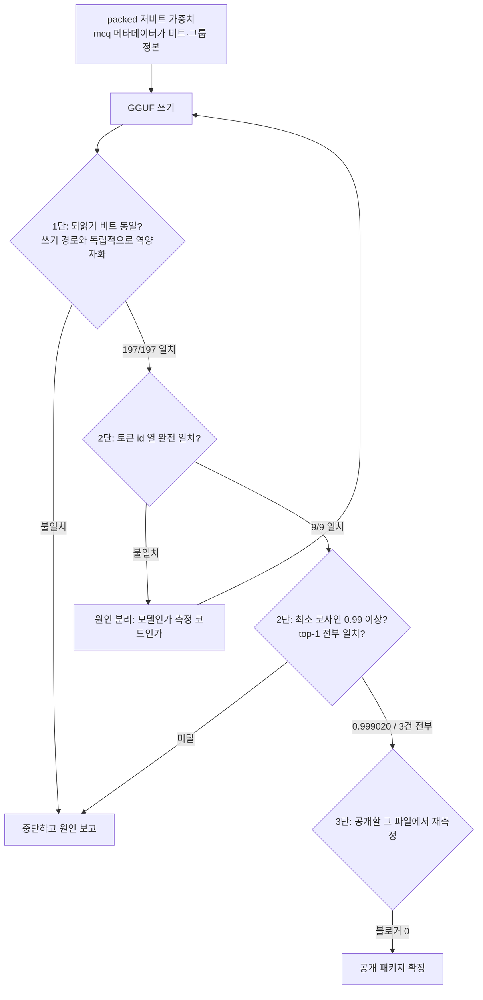

{: .align-center}

자체 양자화 포맷으로 만든 모델을 외부에 공개하려면 넘어야 하는 문턱이 하나 있습니다. 우리 코드 없이도 그 모델이 돌아가야 한다는 것입니다. 저희는 Qwen3-Embedding-0.6B를 층마다 다른 비트로 양자화한 D50 M1a를 [GGUF로 옮겨](/tech-blog/ko/llmops/packed-lowbit-to-gguf-q41-lossless-reencode/) 그 문턱을 넘었고, 모델은 [Hugging Face](https://huggingface.co/ThakiCloud/Qwen3-Embedding-0.6B-MultiCal-M1a-GPTQ)에 올라가 있습니다. 이 글의 주제는 **그 변환을 믿을 수 있게 만든 검증 설계**입니다. 변환하는 방법은 앞선 글에서 다뤘습니다.

결론부터 적겠습니다. 저희는 3단 게이트를 세우고 두 번 NO-GO를 받았습니다. 그리고 두 번 다 범인은 양자화도, 변환 코드도 아니라 **검증하는 쪽의 코드**였습니다. 변환은 처음부터 맞았는데 자를 잘못 들었던 셈입니다. 이게 운이 좋았던 이야기로 들리면 안 됩니다. 임계값을 미리 적어 두고 결과를 본 뒤에 그 값을 건드리지 않았기 때문에 드러난 결함입니다.

## 검증이 답해야 하는 질문은 하나였습니다

변환 작업의 성패는 "파일이 만들어졌는가"가 아닙니다. 외부 사용자가 llama.cpp만 가지고 **우리가 쟀던 것과 같은 벡터**를 얻을 수 있는지입니다. 임베딩 모델은 특히 조심해야 합니다. 생성 모델이라면 출력이 조금 달라도 사람이 읽어 판단할 여지가 있지만, 임베딩은 숫자 1024개가 전부라서 어긋나도 눈에 보이지 않습니다. 검색 품질이 조용히 깎인 채로 공개될 수 있습니다.

그래서 질문을 세 층으로 나눴습니다. 저장된 비트가 같은가, 같은 입력이 같은 토큰 열이 되는가, 그 결과 벡터가 같은가입니다. 아래가 실제로 돈 흐름입니다.



## 임계값은 결과를 보기 전에 적었습니다

측정 전에 세 가지를 못 박았습니다. 토큰 id 열은 **완전히 같아야 한다**, 임베딩 **최소 코사인이 0.99 이상**이어야 한다, 작은 검색 집합에서 top-1이 **전부 같아야 한다**입니다.

0.99라는 숫자를 고른 이유도 적어 둘 필요가 있습니다. 비트가 같아도 코사인 1.0은 기대하지 않았습니다. 같은 가중치라도 llama.cpp의 CPU 커널과 PyTorch의 누적 순서가 달라서 부동소수점 결과가 마지막 자리에서 갈립니다. 반대로 0.99는 "조금 다르다"를 허용하는 값이 아닙니다. 양자화가 어긋나면 코사인은 0.8대로 떨어지기 때문에, 0.99는 커널 차이와 실제 결함 사이를 가르기에 충분히 넓은 간격이었습니다.

이 숫자를 먼저 적는 행위 자체가 장치입니다. 결과를 본 뒤에 기준을 정하면 사람은 거의 항상 통과하는 쪽으로 선을 긋습니다. 0.98이면 어떨까 하는 생각은 0.989를 본 다음에만 떠오릅니다.

판정도 사람이 읽고 결정하지 않게 했습니다. 검사 스크립트가 마지막 줄에 GO 또는 NO-GO를 찍고, 그 조건은 코드에 상수로 박혀 있습니다. 통과 조건은 차단 사항이 0건이고 최소 코사인이 선언값 이상이며 top-1이 전부 일치하는 것입니다. 이렇게 두면 "대체로 괜찮아 보인다"라는 문장이 판정에 끼어들 자리가 없어집니다.

## 1단: 쓰기 경로와 독립적으로 되읽기

첫 게이트는 간단합니다. GGUF를 쓴 다음 **다시 읽어** 역양자화하고, 원래 값과 비트 단위로 같은지 봅니다. 양자화 텐서 197개 전부가 일치했고 최대 절대 오차는 0.0이었습니다.

중요한 것은 비교 대상을 만드는 방법입니다. 저희는 전에 같은 작업에서 순환논증에 빠진 적이 있습니다. 텐서별 비트 폭을 메타데이터에서 읽지 않고 패킹된 바이트 수로 역산했는데, 그 역산은 비트 폭과 그룹 크기의 **곱만** 결정합니다. 4비트 그룹 64와 2비트 그룹 128이 똑같이 256으로 나오기 때문에 구별되지 않습니다. 그 잘못된 추정으로 기준값과 재부호화 결과를 **둘 다** 만들었더니 "비트 동일"이 보기 좋게 통과했습니다. 두 숫자가 같은 오류를 공유하고 있었을 뿐입니다.

그래서 지금은 비트와 그룹의 정본을 safetensors 헤더의 메타데이터 한 곳으로 고정하고, 메타데이터가 파일과 어긋나면 추측으로 메우지 않고 차단 사항으로 세웁니다.

```python
with safe_open(path, framework="np") as f:
    hdr = f.metadata() or {}
if "mcq" not in hdr:
    blockers.append({"why": '__metadata__["mcq"] 없음, 비트·그룹 정본을 읽을 수 없다'})

# 메타가 파일과 어긋나면 둘 중 하나가 거짓이다. 추측하지 않고 멈춘다.
if n_groups * group * bits != packed_bytes * 8:
    blockers.append({"why": "메타의 비트·그룹이 패킹 바이트와 불일치", "tensor": name})

# 되읽기는 쓰기 경로를 재사용하지 않는다. 파일에서 읽은 블록을 직접 푼다.
ref = (codes.reshape(-1, group).astype(np.float32) * scale[:, None] + mins[:, None]).reshape(-1)
back = dequant_from_file(gguf_path, name)
identical = np.array_equal(ref.view(np.uint32), back.view(np.uint32))
```

마지막 줄의 `view(np.uint32)` 비교는 의도적입니다. 부동소수점을 `==`로 비교하면 0.0과 -0.0이 같다고 나오고 NaN은 영원히 다르다고 나옵니다. 비트 패턴을 정수로 보면 "같은 값"이 아니라 "같은 비트"를 묻게 됩니다.

## 2단: 1차 런은 NO-GO였고, 원인은 변환이 아니었습니다

런타임 동등성 측정의 첫 결과는 미달이었습니다. 코사인이 0.811831, 0.713135, 0.820722로 나왔습니다. 0.99는커녕 양자화가 망가졌을 때 나오는 모양이었습니다.

그런데 같은 로그에 더 선명한 단서가 있었습니다. 모든 문장에서 HF 토크나이저가 llama.cpp보다 토큰이 **정확히 하나** 많았습니다. 9개 대 8개, 16개 대 15개처럼 일정하게 하나 차이였습니다. 양자화가 깨지면 벡터가 틀리지 양이 틀리지는 않습니다. 길이 차이는 토크나이저 쪽을 가리킵니다.

차이의 **모양**이 단서였다는 점을 강조하고 싶습니다. 문장마다 2개나 3개씩 들쭉날쭉 달랐다면 어휘나 merge 규칙을 의심했을 것입니다. 한국어와 영어를 섞은 9개 문장에서 전부 똑같이 하나씩 차이가 났습니다. 특수 토큰 하나가 붙거나 안 붙는 문제라는 뜻입니다. 실패를 세는 것과 실패의 모양을 보는 것은 다른 일이고, 원인을 좁혀 주는 쪽은 후자입니다.

원인은 저희가 쓴 GGUF 작성 코드였습니다. `tokenizer.json`의 `post_processor`가 TemplateProcessing으로 문장 끝에 `<|endoftext|>`(151643)를 붙이는데, GGUF 헤더의 `add_eos_token`을 false로 써 버렸습니다. 이 모델의 풀링은 마지막 토큰을 읽는 방식이라서, 읽어야 할 토큰이 바로 그 EOS였습니다. 플래그 하나가 꺼진 탓에 풀링이 엉뚱한 토큰을 집고 벡터가 통째로 어긋난 것입니다.

고친 방법은 템플릿에서 읽어 자동으로 정하게 하는 것이었습니다. 값을 손으로 적어 넣으면 다음 모델에서 같은 실수를 반복합니다. 그리고 템플릿이 붙이는 토큰이 설정의 EOS와 다르면 차단 사항으로 세웁니다. GGUF는 토큰 하나만 자동으로 추가할 수 있어서, 둘이 어긋나는 모델은 애초에 이 경로로 보내면 안 됩니다.

## 2단: 2차 런은 통과했는데 판정은 또 NO-GO였습니다

재작성한 파일로 다시 재니 임베딩은 통과했습니다. 9개 문장의 코사인이 **최소 0.999020, 최대 0.999679**였고, 질의 3건의 top-1이 모두 기준본과 같았습니다. 그런데 토큰 열 비교만 9문장 전부 불일치로 찍혀서 전체 판정은 또 NO-GO였습니다.

이 두 결과는 동시에 성립할 수 없습니다. 토큰 열이 다르면 벡터가 0.999에 붙을 수 없습니다. 모순이 보이면 둘 중 하나는 측정이 틀린 것입니다.

범인은 비교 코드였습니다. `llama-cpp-python`의 `Llama.tokenize(text, add_bos=, special=)`는 첫 인자를 llama.cpp의 `add_special`로 넘깁니다. 즉 `add_bos=False`는 BOS와 **EOS 자동 추가를 함께 끕니다**. 애써 켜 둔 `add_eos_token=true`가 그 호출 경로에서는 무시됐습니다. 반면 `llm.embed()`는 내부에서 `add_special`을 켜고 토크나이즈하기 때문에 임베딩 쪽은 정상이었습니다. 같은 파일을 두 가지 방식으로 읽었던 것입니다.

여기서 할 수 있는 선택이 둘 있었습니다. 임계값을 조정하거나 "임베딩이 통과했으니 사실상 GO"라고 적는 것, 아니면 측정 코드만 고쳐 다시 재는 것입니다. 저희는 뒤를 택했고, 주장을 말로 메우지 않도록 조합을 전수로 찍었습니다.

```python
for s in TEXTS:
    hf = list(hf_tok(s, add_special_tokens=True)["input_ids"])
    got = {}
    for add_special in (True, False):
        for parse_special in (True, False):
            got[f"add_special={add_special},parse_special={parse_special}"] = \
                list(llm.tokenize(s.encode("utf-8"), add_bos=add_special, special=parse_special))
    rows.append({"text": s[:40], "matched_modes": [k for k, v in got.items() if v == hf]})

# 전 문장에서 **같은** 조합 하나가 일치해야 "같은 토크나이저"라고 말할 수 있다.
common = set.intersection(*[set(r["matched_modes"]) for r in rows])
```

결과는 `add_special=True`인 두 조합이 9문장 전부에서 HF 토큰 id 열과 일치했습니다. `parse_special`은 결과에 영향이 없었습니다. 전 문장 공통 조합이 존재했고 차단 사항은 0이었습니다. 마지막 두 줄이 이 검사의 핵심입니다. 문장마다 다른 조합이 우연히 맞는 것은 잡음입니다. 그래서 교집합이 비어 있으면 그것도 차단 사항으로 셉니다.

## 3단: 공개할 그 파일에서 다시 재기

마지막 게이트는 대상이 다릅니다. 앞의 두 게이트는 작업 중인 파일을 봤지만, 공개되는 것은 업로드되는 그 파일입니다. 그래서 공개 패키지를 그대로 내려받아 다시 쟀습니다. GGUF는 **378,522,208 바이트**, sha256은 `1b95b9cbf157a7b6e5d08b0afa7a30342105681dbfb913b182d3680ef3a52a95`입니다. 모델 카드에 적힌 숫자는 전부 이 측정에서 나온 값입니다.

같은 잡에서 임베딩이 유효한지도 함께 확인했습니다. 차원이 1024인지, 전부 유한한 값인지, L2 노름이 0보다 큰지, 그리고 top-1이 앞선 측정과 같은지입니다. 9건의 호출이 0.039초에서 0.097초 사이였고 차단 사항은 0이었습니다. 파일 12개의 다이제스트를 모두 기록해 두었기 때문에, 받는 쪽에서도 같은 해시를 확인할 수 있습니다.

## 무엇을 검증하지 않았는지가 더 중요합니다

통과한 항목만 적으면 카드는 거짓말이 됩니다. 이번에 **재지 않은** 것을 분명히 해 두겠습니다.

top-1 3건은 문서 6개와 질의 3개로 만든 **스모크 검사**입니다. 벡터가 쓸 수 있는 상태라는 것까지만 보여 주고, 검색 점수로 읽기에는 너무 작습니다. 코사인 비교의 상대도 공정하게 밝혀야 합니다. 비교군은 같은 packed 가중치를 fp32로 되살린 저희 기준본이라서, 이 숫자는 **변환**이 값을 보존했는지를 재는 것이고 검색 품질을 재는 것이 아닙니다. nDCG로 측정한 원본 packed 모델의 검색 품질과 이번 변환 검증은 서로 다른 측정이며, 검색 벤치마크를 llama.cpp로 다시 돌리지는 않았습니다.

제약 하나도 같이 공개했습니다. `tokenizer.json`의 normalizer는 NFC인데 llama.cpp의 gpt2 토크나이저는 NFC 정규화를 적용하지 않습니다. 입력이 NFC가 아니면 토큰 열이 갈립니다. 그래서 검사 문장이 NFC임을 코드로 못 박고, 모델 카드에도 임베딩 전에 NFC로 정규화하라고 적었습니다. 이런 항목은 숨기면 사용자가 자기 데이터에서 혼자 발견하게 됩니다.

## ThakiCloud 제품 적용 시사점

ThakiCloud의 ai-platform은 고객 환경에서 모델을 서빙하고 학습시키는 일을 합니다. 온프렘과 소버린 요구가 있는 고객이 많아서 양자화 체크포인트를 자주 만들고, 그 체크포인트가 고객 쪽 표준 런타임에 올라가야 합니다. 이번 검증 설계가 그 지점에 그대로 들어갑니다.

실무적으로 효과가 큰 것은 두 가지입니다. 첫째, 변환 작업의 완료 조건을 "독립 경로로 되읽어 비트가 같고, 표준 로더에서 같은 벡터가 나온다"로 정의하면, 품질 저하가 고객 인덱스에 들어가기 전에 잡힙니다. 둘째, 검증 잡을 Kueue 큐에 올리는 CPU 배치로 짜면 GPU 자리를 쓰지 않고도 게이트를 돌릴 수 있습니다. 이번 검증은 전부 GPU 0장으로 돌았습니다. 게이트가 싸면 매 변환마다 돌리게 되고, 비싸면 건너뛰게 됩니다.

하나 덧붙이면, 이번에 두 번 걸린 것이 모델이 아니라 측정 코드였다는 사실 자체가 운영에 주는 교훈입니다. 검증 코드도 코드라서 버그가 있습니다. 그래서 판정은 결정론 검사가 소유해야 합니다. 모델의 자기 보고는 판정이 될 수 없습니다. 그리고 검사끼리 모순되는 신호를 내놓으면 둘 중 하나가 틀렸다고 보고 원인을 분리해야 합니다.

## 정리

공개한 것은 모델입니다. 양자화 엔진과 calibration 생성, 비트 배분 구현은 비공개로 두었고, 가중치와 설정, 토크나이저, 카드, 라이선스만 올렸습니다. 외부 사용자가 저희 코드 없이 모델을 돌릴 수 있는지가 이번 작업의 조건이었고, 그 조건이 충족됐는지를 판단한 근거가 위의 3단 게이트입니다.

Research Preview입니다. 지연이나 처리량, 최대 메모리를 주장하지 않으며, 모델 하나와 예산 하나에서 나온 결과라 다른 임베딩 모델로 일반화하지 않습니다. 쓰실 때는 [모델 카드](https://huggingface.co/ThakiCloud/Qwen3-Embedding-0.6B-MultiCal-M1a-GPTQ)의 한계 절을 먼저 읽어 주시기를 권합니다. 통과한 숫자보다 그쪽이 더 많은 것을 알려 줍니다.
