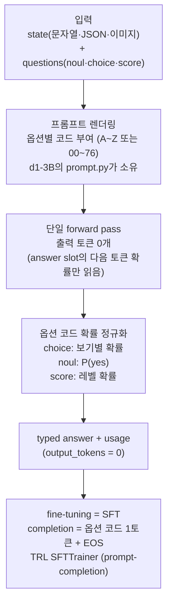

*출력 토큰 없이 한 번의 forward pass로 판단을 내리는 decision model. 옵션 코드 하나에 확률을 올리는 구조를 형상화한 이미지입니다.*

## 왜 읽어야 하나

분류·라우팅·모더레이션 태스크에 자기 레이블을 붙이되, 생성 모델 추론 비용을 그대로 내고 싶지 않은 ML 엔지니어·데이터 사이언티스트라면 이 글이 레시피입니다. 결론을 먼저 씁니다. **decision model(d1-3B)의 fine-tuning은 'completion이 토큰 1개인 SFT'이고, 결과의 품질을 가르는 것은 학습 프레임워크(TRL인지 Unsloth인지)가 아니라 데이터 위생 세 가지입니다. Liquid AI의 두 노트북은 이 파이프라인 전체를 free-tier T4에서 30분 안쪽에 완주하는 것을 보여줍니다.**

## 쉽게 말하면

일반 LLM은 서술형 시험입니다. 답을 토큰 하나씩 써 내려가야 합니다. 답의 길이는 사전에 알 수 없습니다. decision model은 객관식입니다. 보기(옵션)에 동그라미를 치면 끝입니다. d1-3B는 후자입니다. 상태(state, 예: 고객 메시지)와 질문(예: '이 의도는 무엇인가?')을 받아, 한 번의 forward pass로 각 보기에 확률을 부여합니다. 이 구조 위에서 fine-tuning은 '답이 채워진 기출문제'를 모델에게 주는 일입니다. 배워야 할 답이 '동그라미 친 번호'(옵션 코드 토큰) 하나라 loss 계산이 가벼운 대신, 기출문제 자체(데이터)가 성패를 가릅니다.

## 개요

Liquid AI의 Leonie Monigatti는 10월 18일 X에 decision model fine-tuning 노트북 두 개를 공개했습니다. [TRL 버전](https://github.com/Liquid4All/cookbook/blob/main/finetuning/notebooks/sft_for_decision_models_with_trl.ipynb)과 [Unsloth 버전](https://github.com/Liquid4All/cookbook/blob/main/finetuning/notebooks/sft_for_decision_models_with_unsloth.ipynb)으로, 둘 다 d1-3B를 Banking77(77개 intent의 고객지원 메시지 분류) 예제로 SFT+LoRA를 수행합니다. 노트북의 공식 주장은 free Colab T4에서 약 30~35분 학습입니다.

이 글은 TRL 버전 파이프라인을 Apple Silicon(MPS)에서 실제로 재현한 측정 결과를 담고 있습니다. Unsloth 버전은 노트북 코드 수준에서 비교 분석했습니다. 재현에 사용한 스크립트와 로그는 `outputs/blog-impl/sft-decision-model-d1-3b/`에 있습니다.

## 이 기술은 무엇인가

d1-3B는 3B 파라미터(실측 3,123,483,888) decision model로, LFM2.5-VL-3B 기반입니다. 텍스트가 아니라 판단을 출력한다는 점이 핵심입니다. 질문은 세 가지 primitive 중 하나로 정의됩니다.

- `noul`: 예/아니오, P(yes)를 출력
- `choice`: 명명된 옵션 각각에 확률
- `score`: 2~10단계 순서 척도에서 레벨

외부 인터페이스는 System One API입니다. `system_one(state, questions)`로 상태와 명명된 질문 묶음을 한 번에 넣으면, typed answer(확률 포함)과 usage가 나옵니다. `system_one_batch`는 여러 요청을 no-padding으로 packing합니다. 상태는 문자열·JSON·이미지 모두 가능합니다(베이스가 LFM2.5-VL이라 비전을 가짐). usage의 output_tokens는 항상 0입니다. 생성 토큰이 없다는 뜻입니다.

동작 방식의 핵심은 'answer slot'입니다. 프롬프트는 각 옵션에 짧은 코드(A, B, C, ... 또는 두 자리 00~76)를 부여해 렌더됩니다. 프롬프트 끝에서 모델은 한 번의 forward pass로 다음 토큰 확률을 읽습니다. 옵션 코드 토큰의 확률만 골라 정규화하면 그것이 답이 됩니다. 그래서 fine-tuning 데이터는 completion이 옵션 코드 1토큰에 end-of-turn 토큰을 붙인 형태, 즉 전형적인 prompt-completion SFT 형태가 됩니다.



## 설치 및 통합

TRL 노트북의 설치 명령은 고정 pin을 사용합니다.

```bash
pip install -qqq "transformers==5.19.0" "trl==1.15.0" "peft==0.21.2" "torchao>0.16.0" datasets
```

모델은 두 가지 모드로 로드합니다. 추론(System One API)은 `AutoModel` + `trust_remote_code=True`입니다. 학습은 표준 LM head 클래스 `AutoModelForImageTextToText`를 씁니다. d1-3B의 체크포인트가 표준 LFM2-VL 모듈 이름을 쓰기 때문에 학습 쪽에는 커스텀 코드가 필요 없습니다.

모델 저장소에는 `prompt.py`(프롬프트 빌더)가 동봉됩니다. 학습 데이터를 만들 때 이것을 재사용해야 학습과 추론에서 모델이 보는 프롬프트가 완전히 같아집니다.

```python
from huggingface_hub import snapshot_download
from transformers import AutoModel, AutoTokenizer
import sys

local_dir = snapshot_download("LiquidAI/d1-3B")
sys.path.insert(0, local_dir)

tokenizer = AutoTokenizer.from_pretrained("LiquidAI/d1-3B")
model = AutoModel.from_pretrained("LiquidAI/d1-3B", trust_remote_code=True, dtype=dtype).to(device)
```

Colab에서 바로 여는 배지도 노트북 상단에 있습니다(TRL 약 35분, Unsloth 약 30분).

## 데이터 준비 (핵심)

Banking77은 약 13k개의 온라인 뱅킹 고객 메시지로, 각 메시지가 77개 intent 중 하나를 가집니다. 노트북은 학습 3,000개, 평가 100개를 씁니다. 데이터 작업은 세 가지이고, 모두 '정답'이 아니라 '공정한 평가'를 위한 것입니다.

**1) case 단위 dedup.** Banking77에는 같은 요청의 재변형이 섞여 있습니다. "can you tell me why my transfer failed?"와 "Can you please tell me why my transfer failed?" 같은 쌍입니다. 하나가 학습에, 나머지가 평가에 들어가면 평가가 암기를 보상하게 됩니다. 노트북은 단어 겹이 80% 이상이면 같은 case로 보고, test 메시지의 재변형인 학습 메시지는 제거합니다.

**2) case 단위 10% 홀드아웃.** 학습집의 10%를 loss 추적용 eval로 빼되, 메시지 단위가 아니라 case 단위로 뺍니다. 같은 case가 양쪽에 걸쳐 있으면 1)과 같은 문제가 되기 때문입니다.

**3) 예제별 옵션 리스트 랜덤화.** 옵션 코드는 위치순으로 부여됩니다. 1번 옵션에 1번 코드, 2번에 2번. 만약 항상 같은 순서로 학습하면 모델은 옵션 리스트를 읽지 않고 '코드 = intent' 대응을 외우게 됩니다. 나중에 intent를 추가하거나 순서를 바꾸면 코드가 전부 밀리고, fine-tuned 모델도 함께 깨집니다. 그래서 각 학습 예제마다 '정답 intent + 다른 intent 중 무작위 26~76개'를 무작위 순서로 새 리스트를 만들어 줍니다. 26개 이하면 코드가 A~Z 글자, 27개 이상이면 두 자리 숫자 코드로 바뀌는 규칙을 이용합니다. 서브셋은 항상 27개 이상이므로 코드가 두 자리(전체 77개 질문 때와 같은 체계)로 고정됩니다.

실측(이 글의 재현): 제거된 학습 메시지 6건(test 재변형), sft_train 2,694, sft_eval 300, label 77개.

## 실제 실험 결과

Apple Silicon(M 시리즈, 51GB, MPS)에서 TRL 버전 파이프라인을 돌렸습니다. 한 가지 Mac 특화 적응이 있습니다. TRL 1.15.0의 SFTTrainer는 fused logprob 커널을 강제합니다. 이 커널은 triton 기반이고, macOS용 triton 배포판이 없습니다(실측 `pip install triton` → No matching distribution). 그래서 학습 런만 TRL 1.14.0(표준 logits 경로)으로 돌렸고, 나머지는(LoRA 타깃·SFT config·데이터 파이프라인) 노트북과 동일하게 유지했습니다.

| 항목 | 실측 |
|---|---|
| 모델 파라미터 | 3,123,483,888 (bf16 약 6.2GB) |
| 로딩 시간 | 4.2초 (MPS) |
| 베이스라인 정확도 | 83.0% (100 test 메시지, system_one_batch, batch 16, 48.1초) |
| LoRA 학습 파라미터 | 24,461,312 / 3,147,945,200 (0.78%) |
| 학습 | 150 steps, batch 2 × GA 2 (실효 4), lr 2e-4 cosine, warmup 5%, grad ckpt, max_length 4096 |
| 스텝 시간 | 약 5.3~6.1초 (causal_conv1d 미설치 → reference 구현) |
| wall time | 863초 (약 14.4분, 150 steps) |
| loss | 0.283 (step 10) → 0.152 (step 150), 전체 train_loss 0.2657, mean_token_accuracy 0.91~0.98 |
| fine-tuned 정확도 | 87.0% (동일 100 test 메시지. baseline 83.0% 대비 +4.0pp, 즉 4건) |

베이스라인 83.0%에서 150 스텝 SFT 후 87.0%로 올랐습니다. completion이 1토큰이라 loss는 스텝마다 크게 흔들리고(0.08~0.41), 그 대신 mean_token_accuracy(0.91~0.98)가 학습 신호를 더 안정적으로 보여줍니다. n=100이라 4.0pp는 정확히 4건의 차이입니다. 방향(향상)의 신호일 뿐, 크기를 과대 해석하면 안 되는 구간입니다.


*실측 결과 차트입니다. 왼쪽은 150 스텝 SFT의 loss 곡선(completion이 옵션 코드 1토큰이라 스텝당 분산이 큼), 오른쪽은 동일 100개 test 메시지에 대한 baseline 83.0%와 fine-tuned 87.0% 비교입니다.*

LoRA 타깃은 노트북과 동일하게 언어 모델만 적응시킵니다. 어텐션(q_proj·k_proj·v_proj·out_proj), 짧은 컨볼루션(in_proj·out_proj), MLP(w1·w2·w3)로, vision_tower는 명시적으로 제외합니다. 텍스트 전용 태스크라 비전 인코더를 건드리지 않는 것입니다.

공식 모델카드의 지연 시간 참고 값입니다. Apple M5 Pro에서 1개 질문 30ms, RTX 4090에서 8ms, packing 64개 상태당 M5 Pro 78/s, 4090 475/s, MI325X 1,106/s입니다. 모델카드는 Decision Index 0.2.1에서 10B 미만 decision model 최고(48.57)를 주장합니다.

## 두 노트북의 차이 (TRL vs Unsloth)

둘은 같은 데이터를 같은 목적에 쓰지만, 학습 래퍼가 다릅니다.

- **TRL 버전**: `AutoModelForImageTextToText` + PEFT `LoraConfig`(target_modules 리스트) + `SFTTrainer`(prompt-completion 포맷). loss는 completion(옵션 코드 1토큰)에서만 계산됩니다.
- **Unsloth 버전**: `FastVisionModel.from_pretrained(model_name, auto_model=AutoModelForImageTextToText, max_seq_length=2048)` + regex `target_modules`(`.*language_model.*\.(q_proj|...)`). `train_on_responses_only`로 instruction 부분의 loss를 mask하고, `adamw_8bit`와 `use_gradient_checkpointing="unsloth"`를 씁니다.

Unsloth 노트북에 있는 가장 중요한 경고는, 왜 `FastDecisionModel`/`DecisionTrainer`를 쓰지 않는가에 대한 설명입니다. Unsloth에는 decision model 학습용 클래스가 있는데, d1-3B에 그것을 쓰면 모델 위에 새로 무작위 초기화된 decision head를 얹고 Unsloth 고유 포맷으로 저장하게 됩니다. 그러면 d1-3B가 학습해 둔 readout(옵션 확률을 읽어 내는 부분)과 System One API를 잃습니다. 그래서 Unsloth 노트북도 d1-3B의 readout을 LM head SFT로 fine-tune해, fine-tuned 모델이 `system_one`으로 원본과 동일하게 동작하게 합니다.

둘 다 학습 후 merge를 하고, d1-3B의 코드 파일들(api.py, hybrid.py, lfm2_vl.py, modeling_d1.py, prompt.py, runner.py, processor_config.json, LICENSE)을 같은 폴더로 복사해 System One API가 유지되는 'normal' 체크포인트를 만듭니다.

## ThakiCloud 제품 적용 시사점

**ai-platform 렌즈(서빙·비용).** decision model의 '출력 토큰 0개' 구조는 분류·라우팅 서비스의 비용 구조를 바꿉니다. decode 루프가 없습니다. `system_one_batch`가 no-padding packing이라, 고처리량 배치 triage에 적합합니다. 3B + LoRA 24.46M 파라미터는 free-tier T4에서 30분 만에 fine-tuning되는 규모이고, 이는 '고객이 자기 데이터로 라우팅 모델을 fine-tune해 멀티테넌트 서빙에 올린다'는 구성을 실제로 실행 가능한 단위로 만듭니다. 생성 모델 앞에 decision model을 값싼 라우터로 두면 파이프라인 경제가 바뀝니다. triage는 4090에서 8ms(모델카드 참고값)이고, 어려운 건만 큰 모델에 넘기는 구조입니다. ThakiCloud의 ai-platform이 NVFP4급 서빙 스택으로 운용하는 환경에서, 이 3B decision model은 사이드카(메인 모델 옆의 경량 분류기) 배치를 넘어 '라우팅 계층'에 둘 후보입니다.

**Paxis 렌즈(에이전트·감사).** Paxis 에이전트의 가드레일 체크('이 동작을 허용할까?', '이 응답이 정책을 위반하는가?')는 `noul`형 판단이고, LLM-as-a-judge 채점은 `score`형 판단입니다. 모든 에이전트 동작마다 27B급 judge를 호출하는 대신, 3B decision model을 inline으로 돌리면 감사 체크의 비용을 한 등급 낮출 수 있습니다. 확률 출력은 정책 게이트의 임계값에 그대로 쓸 수 있습니다. '모든 행동을 정책 게이트+감사 로그로 통과시킨다'는 Paxis의 구조에서, 그 게이트 자체를 값싸게 만드는 구성입니다.

## 한계 및 반론

첫째, 라이선스입니다. d1-3B는 LFM Open License v1.0입니다. 상업 사용은 사용자·법인의 연매출이 $10M 미만일 때(또는 Qualified Non-Profit)에만 이 라이선스로 허용되고, 그 이상은 '이 계약으로 라이선스되지 않습니다'. 규모 있는 상업 서비스로 도입하려면 Liquid AI와의 별도 라이선스 협상이 필요합니다. 모델카드의 'lfm1.0' 표기가 이 라이선스를 가리킵니다.

둘째, fine-tuning 수치는 데모 규모입니다. 이 글의 재현은 2,694개 서브셋의 150 steps(Mac 스모크)입니다. 노트북의 전체 런(3,000개, 1 epoch, T4 약 35분)과는 별개입니다. 테스트 100개 메시지는 작은 샘플이라 단 1건의 비중이 크고, 베이스라인 83.0%와 fine-tuned 87.0%의 +4.0pp(4건) 차이를 'trend'의 크기로 읽으면 안 됩니다.

셋째, chat 모델이 아닙니다. 텍스트를 써 내려가지 않는 것이 분류·라우팅에서는 강점이지만, 자유 응답·설명 생성·fallback 텍스트를 기대하면 안 됩니다.

넷째, 옵션 리스트는 epoch당 한 번 생성됩니다. 노트북은 각 예제에 새 리스트를 주기 위해 '1 epoch 기준' 설계입니다. 여러 epoch로 학습하려면 epoch마다 dataset을 다시 map해(서브셋 값 변경) 새 리스트를 만들어 붙여야 합니다.

다섯째, fine-tune은 텍스트 전용입니다. LoRA 타깃에서 vision_tower를 제외했기에, 베이스의 이미지 입력 능력은 사전 학습 그대로입니다. 비전 상태(이미지) 판단에 fine-tune하려면 별도 설계가 필요합니다.

## 정리

decision model fine-tuning은 'completion이 토큰 1개인 SFT'입니다. 프레임워크 선택(TRL 또는 Unsloth)은 2차 문제이고, 1차 문제는 데이터 위생 세 가지입니다. case 단위 dedup, case 단위 홀드아웃, 예제별 옵션 리스트 랜덤화. 셋 다 '모델이 암기하지 않고 읽게 만드는' 장치입니다. 그리고 결과물은 'System One API가 유지되는 merged 체크포인트'로 저장해야, 추론 코드가 학습 전과 동일하게 동작합니다.

실무에서 기억할 것은 세 가지입니다. 자기 레이블의 decision model이 필요하다면 TRL 노트북에서 시작해 choice criteria를 자기 태스크의 옵션으로 바꾸면 됩니다. fine-tuned 모델을 배포한다면 merge 후 d1-3B 코드 파일들을 같이 복사해 System One API가 유지되는 체크포인트로 만들어야 합니다. 상업적으로 쓸 계획이라면 LFM Open License의 연매출 $10M 조건을 먼저 확인해야 합니다.

한 줄 결론: **판단 모델의 fine-tuning은 프레임워크 문제가 아니라 '공정한 기출문제 만들기'이며, 그 문제의 질이 accuracy를 결정합니다.**

## 출처

- Leonie Monigatti X post (2026-10-18): [x.com/helloiamleonie/status/2110994738811715943](https://x.com/helloiamleonie/status/2110994738811715943)
- 관련 RT (2026-10-18): [x.com/hjguyhan/status/2111793021306200510](https://x.com/hjguyhan/status/2111793021306200510)
- GitHub 노트북: [TRL](https://github.com/Liquid4All/cookbook/blob/main/finetuning/notebooks/sft_for_decision_models_with_trl.ipynb) · [Unsloth](https://github.com/Liquid4All/cookbook/blob/main/finetuning/notebooks/sft_for_decision_models_with_unsloth.ipynb)
- Hugging Face 모델: [LiquidAI/d1-3B](https://huggingface.co/LiquidAI/d1-3B)
- Liquid 문서: [d1-3B](https://docs.liquid.ai/lfm/models/d1-3b) · [TRL fine-tuning](https://docs.liquid.ai/lfm/fine-tuning/trl)
- 데이터셋: [mteb/banking77](https://huggingface.co/datasets/mteb/banking77)
