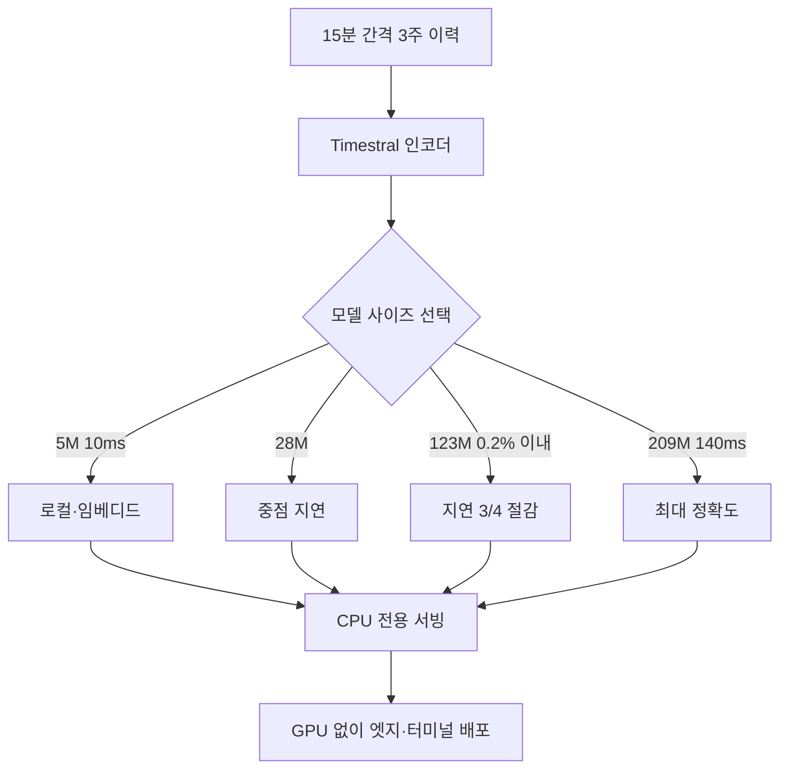

시간계열 예측을 프로덕션에 붙이는 데이터 과학자나 ML 엔지니어라면, 이번 발표가 서빙 비용의 기준을 바꿉니다. 결론부터 말하면, Timestral은 시간계열 예측의 병목이던 GPU를 빼면서 지연을 140밀리초 안으로 가져온다는 점입니다.

*모델 규모가 작아지며 예측이 GPU 풀에서 CPU로 이동하는 개념을 형상화했습니다.*

## 왜 읽어야 하나

서버에 모델을 올리기 전에 GPU가 필요한지를 먼저 따지는 사람이라면 이 글이 단가 비교 자료로 쓰일 만합니다. Mistral이 15일 공개한 Timestral은 5M, 28M, 123M, 209M 네 가지 크기의 시간계열 파운데이션 모델입니다. 공통점이 하나 있는데, 전부 CPU에서 돌아 GPU 인프라가 필요 없다는 점입니다. 하루 앞을 예측하는 데 209M 기준 140밀리초, 5M 기준 10밀리초면 충분하다고 Mistral은 밝혔습니다. 핵심 결론은 이것입니다. 예측이라는 작업이 데이터센터의 GPU 풀에서 터미널과 엣지 노드로 이동하기 시작했다는 것입니다.

## 개요

시간계열 파운데이션 모델은 한 번의 대규모 사전학습으로 여러 도메인의 시계열 패턴을 배운 뒤, 학습 없이 바로 예측하는 zero-shot 모델입니다. 수요 예측, 이상 감지, 에너지 부하, 교통량 같은 작업에 쓰입니다. 기존에는 이런 모델도 수십억 파라미터 규모로 크고 GPU 추론이 전제였습니다. Timestral은 이 전제를 뒤집습니다. 크기를 209M 아래로 낮추면서 CPU에서 실시간에 가까운 지연을 냅니다.

모델 규모가 작아지는 것은 단순히 비용 문제를 넘습니다. GPU가 필요 없으면 배포 환경이 바뀝니다. 클러스터의 GPU 풀 대신 일반 CPU 노드, 컨테이너, 로컬 머신에서도 돌릴 수 있습니다. 서빙 대상이 넓어지고, 예측을 호출하는 빈도와 장소의 제약이 풀립니다.

## Timestral이 무엇인가

Timestral은 Mistral의 첫 시간계열 파운데이션 모델군입니다. 네 크기로 나뉘며, 각각이 트레이드오프의 다른 지점을 잡습니다.

| 사이즈 | CPU 지연(1일 앞 예측) | 특징 |
|---|---|---|
| 5M | 10 ms | 가장 빠르며 로컬·임베디드 적합 |
| 28M | 209M보다 약 5배 빠름 | 지연과 정확도의 중점 |
| 123M | 209M의 3/4 지연 | 209M 점수의 0.2% 이내 |
| 209M | 140 ms | 최대 정확도 |

Mistral에 따르면 8스레드 서버 CPU 기준, 15분 간격으로 3주간의 이력을 바탕으로 하루 앞을 예측하는 데 위 지연이 된다고 합니다. 123M은 209M 점수의 0.2% 이내를 3/4 지연으로 뽑아, 정확도를 거의 유지하면서 지연을 크게 줄이는 지점입니다. 벤치마크에서는 GIFT-Eval, TIME, fev-bench에서 사전학습 zero-shot 모델 중 1위를 기록했고, TimesFM-3와 Falcon-2.0 같은 기존 시간계열 모델보다 적은 파라미터로 앞섰다고 보도됩니다.

모델은 Modified MIT 라이선스로 공개되었습니다. 일부 보도는 매출 기준 사용 제한이 있다고 전하지만, 공식 발표에서는 수치와 조건이 명시되지 않아 [추정]으로 다룹니다.

## CPU 추론이 서빙 구조를 바꿉니다

GPU 추론에서 CPU 추론으로 넘어가는 순간, 서빙 비용의 구조가 바뀝니다. GPU는 카드당 병목이 크고 예약과 정비가 필요하며, 클러스터에서 고가로 돌아갑니다. CPU는 노드마다 이미 붙어 있어 추가 확보 비용이 거의 없습니다.

Timestral의 140밀리초는 단일 예측의 지연입니다. 이 지연이면 초당 수십 번, 한 노드에서 수백 개 시계열을 동시에 돌릴 수 있습니다. 수요 예측처럼 수천 개의 상품·점포·지역에 대해 주기적으로 돌리는 작업에서, 이것이 어떤 규모로 확장되는지는 CPU 코어 수와 배치 크기에 달립니다.

서빙 관점에서 중요한 점은 Timestral이 경량이라 서빙 컨테이너 자체가 작아진다는 것입니다. GPU 메모리를 잡아먹지 않으므로 기존 CPU 워크로드와 같은 노드에 함께 돌아갈 수 있고, 스케일아웃 단위가 세분화됩니다. K8s에서는 리소스 요청이 nvidia.com/gpu가 아닌 cpu·memory만으로 잡혀 GPU 큐와 별도로 스케줄됩니다.

## ThakiCloud 제품 적용 시사점

다키클라우드의 ai-platform은 K8s 위에서 모델을 서빙하는 인프라입니다. Timestral 같은 경량 CPU 모델은 이 플랫폼에 두 가지 질문을 제기합니다. 첫째, GPU가 아닌 CPU 워크로드도 하나의 서빙 대상으로 다룰 수 있는가. 둘째, 경량 모델의 고빈도 호출을 어째서 서빙 경제성으로 연결하는가.

첫 질문에 대한 답은, 서빙 단위가 GPU 중심으로만 설계되면 CPU 모델이 오히려 관리 부담이 된다는 점입니다. Timestral은 CPU 노드에서 돌아가므로, ai-platform이 CPU 워크로드를 GPU와 동일한 서빙 계약(모델 등록, 버전, 관측, 비용 회계)으로 다루면 경량 모델도 플랫폼 자산이 됩니다.

두 번째 질문은 Paxis 렌즈와 만난습니다. 에이전트가 시계열 데이터를 읽고 예측을 호출하면, 그 호출의 단가는 140밀리초 CPU 추론 수준이 됩니다. GPU 추론이 전제였던 시절에는 에이전트의 예측 호출이 고비용이어서 제한했습니다. Timestral이 이를 풀면, 에이전트가 루프 안에서 자주 예측을 물을 수 있습니다. 저비용 CPU 서빙이 에이전트 동작의 빈도를 높이고, 그것이 다시 예측 품질을 올려 에이전트 루프를 만듭니다.

## 한계 및 반론

Timestral의 수치는 Mistral이 밝힌 조건, 즉 8스레드 서버 CPU, 15분 간격, 3주 이력, 1일 앞 예측에 묶여 있습니다. 조건이 바뀌면 지연과 정확도는 달라집니다. 더 짧은 이력, 더 긴 예측 지평, 더 고해상도 간격에서는 이 수치가 그대로 성립한다고 보기 어렵습니다.

zero-shot은 학습 없이 바로 돌린다는 강점이지만, 도메인 특화 예측에서는 그 도메인에 fine-tune한 작은 모델보다 정확도가 낮을 수 있습니다. 140밀리초라는 지연이 단일 호출 기준인지, 병렬 배치 시 유지되는지 공식 발표에는 없습니다. [추정]으로, 병렬이 늘면 단위 지연이 오를 수 있습니다.

또한 Timestral은 시간계열 특화 모델입니다. 자연어 이해나 생성을 겸하는 것이 아니라, 시계열 입력·출력만 처리합니다. LLM과 섞어 서빙할 때 컨텍스트와 토큰 경제가 다른 층이므로, 단일 서빙 스택으로 취급하면 비용 산정에서 벗어납니다.

## 정리

Timestral이 중요한 이유는 모델 하나를 더 내놓았기 때문이 아닙니다. 시간계열 예측의 서빙 단위가 GPU에서 CPU로 넘어오면서, 예측을 호출하는 장소와 빈도의 제약이 풀렸기 때문입니다. 데이터 과학자는 123M이나 28M을 고르면 209M의 정확도를 거의 유지하면서 지연을 줄일 수 있습니다. ML 엔지니어는 GPU 없이 스케줄되는 서빙 단위를 얻습니다. 에이전트 플랫폼 관점에서는, 예측 호출의 단가가 낮아져 루프 안에서의 예측이 일상화됩니다. 오늘부터 시간계열 예측을 계획할 때, 먼저 물을 것은 GPU가 아니라 CPU 코어 수입니다.

## 참고 자료

- Mistral 공식, [Timestral: Mistral's time-series foundation models](https://mistral.ai/news/timestral/)
