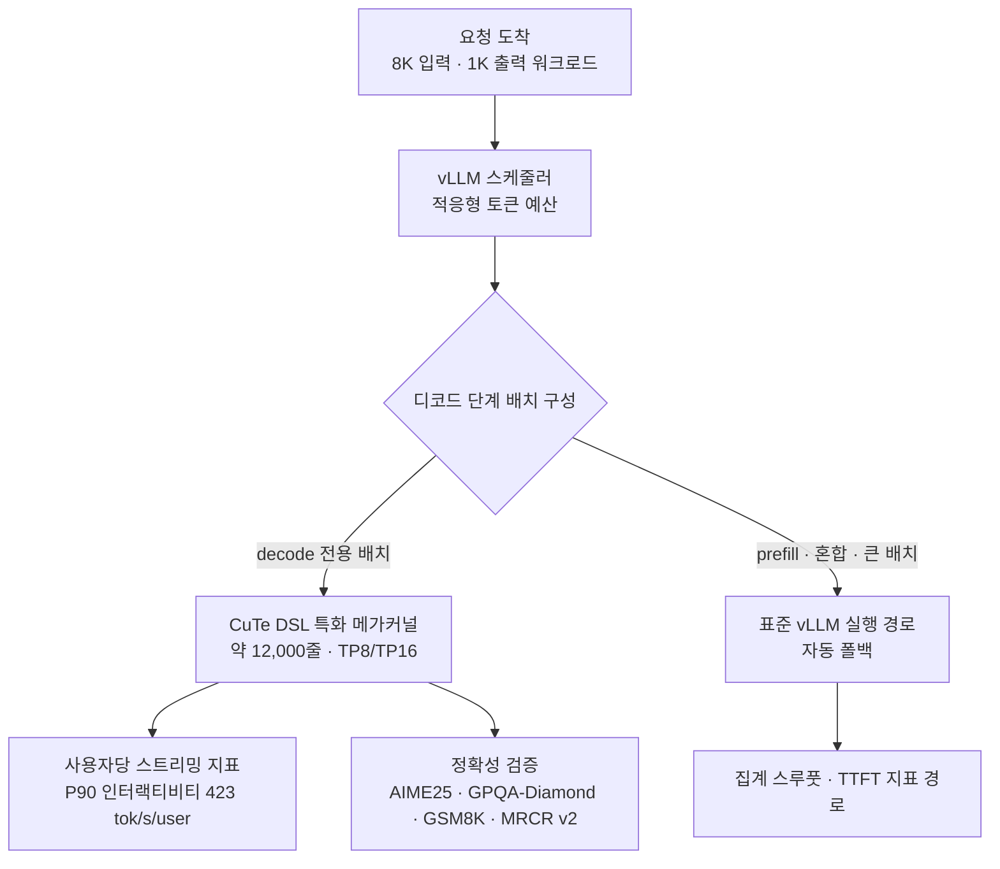

*하드웨어는 그대로인데 경로만 바꿨습니다. 이번 글의 주인공인 특화 디코드 커널을 형상화한 이미지입니다.*

## 왜 읽어야 하나

vLLM 기반 추론 서빙을 운용하면서 벤치마크 숫자를 보고 튜닝 방향을 정해야 한다면, 이 글은 그 판단 자료입니다. 결론부터 씁니다. **NVIDIA가 Kimi K3 특화 디코드 커널(CuTe DSL 기반 약 12,000줄 메가커널)을 vLLM에 업스트림 기여했고(PR #61867, 10월 16일 머지), SemiAnalysis는 같은 GB300 NVL72 하드웨어에서 423 tok/s/user, 1.68x를 측정해 10월 18일에 발표했습니다. 이번 뉴스의 핵심은 몇 배 빨라졌는가가 아니라, 그 수치의 축이 'P90 인터랙티비티'라는 점입니다. 사용자당 스트리밍 지표이지 시스템 전체 스루풋이 아닙니다.** 축을 잘못 읽으면 튜닝 목표 자체가 어긋납니다.

## 쉽게 말하면

고속도로 비유로 시작합시다. vLLM 커뮤니티의 9월 "Road to 2.8×" 최적화는 도로의 모든 구간을 개량한 일입니다. 차선 수(스케줄링 토큰 예산), 교차로(KDA 체크포인트), 합류 구간(제로코피 믹스드 배치)까지 손을 봤고 그 결과 B300 노드에서 스루풋이 2.2배에서 2.8배로 늘었습니다.

10월에 NVIDIA가 올린 PR은 다른 성격입니다. 디코드 구간, 즉 사용자가 토큰을 하나씩 받아 보는 마지막 구간에서 'Kimi K3 전용 차선'을 깎아낸 것입니다. 같은 도로, 같은 차, 전용 차선이 이전보다 1.68배 빠릅니다. 423 tok/s/user라는 숫자는 그 전용 차선의 유량이지, 도로 전체의 총 교통량이 아닙니다. 두 개선은 서로를 대체하지 않고 각자 다른 축의 수치를 낳습니다.

## 배경: Kimi K3와 vLLM 스택

Kimi K3는 Moonshot AI의 2.8T 파라미터 MoE 모델입니다. 활성 파라미터 104B, 네이티브 멀티모달, 1M 토큰 컨텍스트를 지원합니다. 구조적으로 KDA(Kimi Delta Attention, Mamba 계열 SSM)와 어텐션이 혼재하고 전문가 가중치는 MXFP4 형식을 씁니다. 이 모델은 하이브리드 어텐션 구조라 서빙 경로가 순수 트랜스포머와 다릅니다. MLA KV 캐시뿐 아니라 KDA 재귀 상태도 캐싱, 전송, 롤백 대상이 되기 때문입니다.

vLLM의 대응은 두 단계로 이뤄졌습니다. 먼저 공개일 Day-0 지원(7월 27일 블로그)을 마치고 9월 13일에 "Kimi K3 Performance Optimizations in vLLM: The Road to 2.8× Throughput"을 발표했습니다. 측정 조건은 8K 입력·1K 출력 워크로드, TP8, DSpark speculative 디코딩 8 토큰, B300 노드(CUDA 13.3), 비교 대상은 v0.27.1과 9월 13일 커밋(82a85dc1)입니다.

| 병렬도 | 평균 지연(s) | 스루풋(tok/s) | 평균 TTFT(ms) |
| --- | --- | --- | --- |
| 1 | 12.37 → 5.30 (−57.2%) | 83.3 → 183.3 (+120.0%) | 2262.9 → 376.3 (−83.4%) |
| 4 | 23.67 → 10.50 (−55.6%) | 166.7 → 416.7 (+150.0%) | 2314.9 → 640.5 (−72.3%) |
| 16 | 55.90 → 22.17 (−60.3%) | 258.3 → 725.0 (+180.6%) | 7601.1 → 1121.0 (−85.3%) |

*출처: vLLM 공식 블로그 "Kimi K3 Performance Optimizations in vLLM" (2026-09-13). 각 칸은 v0.27.1 → main 커밋 82a85dc1 비교입니다.*

이 모델이 서빙 스택에 부담을 주는 이유는 구조에 있습니다. KDA 상태는 MLA KV와 다르게 head·dimension 단위로 샤딩됩니다. speculative 디코딩은 기각 토큰을 롤백하기 위해 draft 위치마다 KDA 재귀 상태를 추가로 기록해야 하고 이것이 바로 ReplaySSM이 대상으로 삼는 낭비입니다. 순수 어텐션 모델을 전제로 쌓아 올린 가정들이 여기에서 하나씩 무너집니다.

이 경로에서 대변되는 변경들은 이미 머지된 PR들입니다. 적응형 스케줄링 토큰 예산(PR #51725, 8K/1K에서 TTFT 55~65% 감소)과 고메모리 GPU 티어 기본 한도 상향(#51726). KDA prefix 체크포인트를 단일 prefill 패스 안에서 내보내는 변경(#52789, 8K 입력의 prefill이 모델 포워드 2회→1회로 줄고 TTFT 9~25% 감소). speculative·비speculative 배치 혼합 때의 인덱스 복사 6회·2회를 연속 제로코피 슬라이스로 대체하는 변경(#56159, 병렬도 4·16에서 스루풋 5.2~7.7% 증가). MXFP4 top-k finalization을 latent-tail 커널 안으로 옮기는 지연 확정(#53152, 엔드투엔드 지연 약 5% 감소). 그리고 ReplaySSM(#51855, 같은 46.48GiB 캐시 예산에서 TP8 기준으로 유효 용량 10.97% 증가)까지. 전체 작업은 이슈 #50587에서 추적됩니다.

## 이 기술은 무엇인가: CuTe DSL 특화 디코드 커널

10월 뉴스는 위 스택 최적화와 다른 축입니다. NVIDIA CentML 팀의 엔지니어 Benjamin이 PR #61867 "Kimi K3 Specialized Decode: CuTeDSL Optimized GB300 (1.5~2x)"로 Kimi K3 특화 디코드 구현을 기여했고 10월 16일에 머지됐습니다.

CuTe DSL은 NVIDIA CUTLASS 프로젝트의 파이썬 네이티브 GPU 커널 작성 언어입니다. CuTe의 layout·tensor·하드웨어 추상 위에 커널을 직접 기술하는 방식이고 이번 구현은 약 12,000줄에 달하는 메가커널로 Kimi K3 디코드 단계의 연산들을 GB300 하드웨어에 맞춰 하나의 큰 커널로 통합했습니다. 모델 가중치를 바꾸는 것이 아니라, 특정 모델·특정 하드웨어 조합에 맞춘 전문 런타임입니다. 이 공학 사상의 범위는 '모든 가속기에서 모든 모델 단계'를 빠르게 하는 것보다 좁고 디코딩 단계의 연산과 실행 패턴을 한 조합에 맞춰 최적화하는 것입니다.

지원 경로는 TP8 또는 TP16의 선별된 speculative·비speculative 디코드 구성입니다. 활성화는 옵트인 인자 `--additional-config '{"decode_backend": "latency_specialized"}'`입니다. 여기에서 중요한 의미론은 폴백입니다. prefill, 혼합 배치, 큰 배치에는 표준 vLLM 실행 경로가 그대로 쓰입니다. 특화 커널은 decode 전용 배치만 담당합니다. 그래서 "디코드가 1.68배 빠르다"는 "파이프라인 전체가 1.68배 빠르다"로 읽을 수 없습니다.

정확성 검증은 AIME25, GPQA-Diamond, GSM8K, MRCR v2 작업과 수치 체크로, 공개된 조건에서 두 구현을 비교했습니다. PR이 공개한 마이크로벤치마크의 조건은 명확합니다. TP16 GB300, 입력 1 토큰, 출력 1,024 토큰, greedy 디코딩, FP8 KV 캐시·FP32 SSM 캐시, 모델 제공자 가중치. 디코드 단계 타이밍은 prefill을 뺀 중간값 inter-token latency입니다. speculative 디코딩 테스트(32K 입력, DSpark DL7, 합성 수용률 3.78, 디코드 컨텍스트 병렬 활성화)에서는 decode 전용 개선이 다른 요청의 prefill 작업을 포함하는 출력 스루풋 개선보다 컸고 TTFT는 동급이었습니다. 이 합성 수용률은 실제 워크로드에서 자연스럽게 달성되는 수용률과 혼동해서는 안 됩니다.



*특화 디코드 경로의 삽입 지점입니다. decode 전용 배치만 CuTe DSL 메가커널로, 나머지는 표준 경로로 자동 넘어갑니다. 423 tok/s/user는 F 노드의 축, 즉 사용자당 스트리밍 지표입니다.*

## 활성화 방법: 인자 한 줄

특화 경로는 옵트인입니다. 서버 기동에 다음 인자를 붙여 활성화합니다.

```bash
--additional-config '{"decode_backend": "latency_specialized"}'
```

여기서 정직하게 짚어야 할 점 두 가지가 있습니다. 첫째, 이 인자 하나만으로 서버가 기동하는 것이 아니라, 머지된 변경(#61867)을 포함하는 빌드를 써야 경로가 존재합니다. 둘째, 지원 경로는 GB300의 TP8 또는 TP16입니다. 다른 하드웨어나 다른 병렬도에서는 특화 경로가 적용된다고 장담할 수 없고 prefill·혼합·큰 배치에는 표준 경로가 그대로 쓰입니다.

## 세 숫자, 세 축

이번 뉴스가 혼란스러운 이유는 축이 다른 세 숫자가 뒤섞여 전달되기 때문입니다.

첫째, 2.2~2.8배. vLLM 블로그의 스택 전반 최적화 결과로, B300 노드·8K/1K·TP8 조건에서 집계 스루풋 축입니다. 동시에 TTFT가 72~85% 줄었고 적응형 스케줄링만으로 TTFT 55~65%·스루풋 최대 41.5% 개선이 분리되어 보고됩니다.

둘째, 1.68x와 423 tok/s/user. SemiAnalysis가 10월 18일에 발표한 수치로, 같은 GB300 NVL72 하드웨어를 전제로 한 P90 인터랙티비티 축입니다. P90 인터랙티비티는 사용자당 스트리밍 지표입니다. SemiAnalysis 차트의 가로축은 이 표기로 명시되어 있습니다. 집계 토큰 출력량도, 모든 요청에 대한 보장도, 파이프라인 전체의 68% 개선도 아닙니다. InferenceX 라이브 대시보드의 10월 18일 실행(Kimi K3 2.8T, Agentic, FP4)에서는 최상위 GB300 NVL72의 P90 인터랙티비티가 424 tok/s/user로 표시됐습니다. 이는 원문의 423 수치를 조용히 바꿀 근거가 아니라 나중의 라이브 표시입니다. 대시보드는 칩당 스루풋도 별도 열로 보고합니다. 이 열들은 서로 합산하거나 대용해서는 안 됩니다. 빠른 개별 스트림에 최적화된 구성은 집계 스루풋을 희생할 수 있고, 그 반대도 성립합니다.

셋째, PR 마이크로벤치마크. 입력 1·출력 1024·greedy·TP16이라는 명확한 조건에서의 decode 전용 중간 ITL 축입니다. 세 수치는 각자의 조건 안에서 성립합니다. 어느 것도 서로의 대용이 될 수 없습니다. 빠른 개별 스트림을 최적화한 구성은 집계 스루풋을 희생할 수 있고, 높은 스루풋 구성은 사용자당 스트리밍이 느려질 수 있습니다. 423 포인트의 정확한 병렬도나 프롬프트·출력 길이는 확인된 자료가 없으므로, 이 수치는 워크로드 스펙 미확인 조건에서 읽어야 합니다.

실전에서 축을 고르는 방법은 워크로드에서 출발합니다. 대화형 채팅이나 에이전트처럼 사용자가 토큰을 실시간으로 받아 보는 서비스라면, 체감 속도는 P90 인터랙티비티에 가깝고, 이번 NVIDIA 경로가 겨냥하는 지표입니다. 배치 처리나 오프라인 생성처럼 총 처리량이 목적이면, vLLM 스택 최적화의 2.2~2.8배 집계 스루풋이 기준이 됩니다. 첫 토큰까지의 대기(TTFT)가 문제인 롱컨텍스트 prefill 중심 워크로드라면, 적응형 스케줄링이나 KDA 체크포인트, DCP 쪽이 더 직접적인 레버입니다. 같은 하드웨어라도, 어떤 축을 KPI로 세우느냐에 따라 '이득이 큰 최적화'가 달라지는 것입니다.

## ThakiCloud 제품 적용 시사점

ThakiCloud의 ai-platform은 Kubernetes 기반에서 vLLM 서빙을 운용합니다. 이번 사례는 세 가지 시사점을 줍니다.

첫째, 지표의 축이 서빙 튜닝 목표의 1등 변수입니다. 저희 서버리스 엔드포인트는 workload_config의 tuned default(max_num_seqs, tool-call·reasoning parser, 컴파일 모드)를 두고 비교 실험(arm)은 동일한 축과 동일한 설정에서 재측정해야 비교가 유효합니다. 이번 사례가 보여주는 것은, 같은 하드웨어 위에서 축을 바꾼 숫자가 얼마나 크게 달라지는가입니다. Kimi K3 클래스 모델에서 `decode_backend: latency_specialized`는 모델별 커널 투자입니다. 서빙 토큰당 비용이 KPI라면, decode 전용 배치 비율이 높고 출력이 짧은 에이전트 워크로드에서 디코드 특화 경로의 수익이 가장 큽니다. 반대로 prefill이 지배적인 워크로드라면 그 이익은 제한적입니다.

둘째, 상태 인식이 있는 disaggregation이 하이브리드 어텐션 모델의 필수 요건이 되고 있습니다. Kimi K3의 PD disaggregation과 캐시 오프로드는 MLA KV와 KDA 상태 양쪽을 전송해야 합니다. MLA KV는 TP rank마다 복제되고, KDA 상태는 head·dimension 단위로 샤딩되며, Mamba align 블록 테이블은 희소하고 가변입니다. 순수 어텐션 전송의 가정이 성립하지 않는 영역입니다. 1M 컨텍스트 에이전트 워크로드가 주류가 되면, disaggregation 설계는 '어떤 상태를 어떤 단위로 옮기는가'를 먼저 결정해야 합니다.

셋째, DCP(decode context parallelism)는 멀티테넌트 롱컨텍스트 서빙의 용량 축입니다. 120k 토큰 워크로드(공유 프리픽스 114k + 서픽스 6k, 출력 400)에서 KV 캐시 용량이 1.93M에서 19.75M 토큰으로 늘고 병렬도 1에서 TPOT p50이 13.8ms에서 10.5ms로 개선됐습니다. 이건 일반 속도 개선이 아니라, 긴 프리픽스가 공유되는 상황에서만 나타나는 용량·지연 개선입니다. 시스템 프롬프트와 스킬 컨텍스트가 겹치는 멀티테넌트 에이전트 서빙의 모양과 정확히 일치합니다.

## 한계 및 반론

첫째, 423 tok/s/user는 특정 하드웨어(GB300 NVL72)·특정 축(P90 인터랙티비티)·미확인 워크로드 스펙의 수치입니다. 이 숫자를 다른 하드웨어나 다른 지표에 그대로 이장하는 순간, 숫자는 거짓이 됩니다.

둘째, 모델 특화 커널은 유지보수 비용입니다. 약 12,000줄의 메가커널이 한 모델·한 칩 조합을 위해 쓰인 것입니다. 다음 플래그십 모델이 오면 누군가 다시 12,000줄을 써야 하고 그사이 하드웨어가 바뀌면 처음부터 다시 시작해야 합니다. 이것이 일반적 serving 전략과의 긴장입니다.

셋째, 폴백 의미론 때문에 '1.68x'는 파이프라인 전체의 개선이 아닙니다. prefill·혼합·큰 배치에는 표준 경로가 쓰이므로, 실제 트래픽 믹스에서의 체감 개선은 decode 전용 배치 점유율에 따라 달라집니다.

넷째, speculative 디코딩 테스트의 일부는 합성 수용률(synthetic acceptance)을 씁니다. 실제 워크로드에서 자연히 달성되는 수용률과 다른 조건이므로, 이 수치로 현장 속도를 외삽하면 안 됩니다.

반론으로 가장 강한 한 가지를 꺼내면, 특화 디코드 경로의 가치는 '모든 요청을 더 빠르게'가 아니라 '지체 민감한 사용자 스트리밍을, 같은 비용의 하드웨어 위에서'에 있습니다. P90 인터랙티비티를 KPI로 둔 서빙(대화형·에이전트형)에서는 이 경로가 정당화되고 배치 처리나 집계 스루풋을 KPI로 둔 서빙에서는 적응형 스케줄링이나 DCP 같은 스택 전반 최적화가 더 효율적일 수 있습니다. 둘은 대안 관계가 아니라, 지표에 따라 우선순위가 바뀌는 선택지들입니다.

## 정리

축을 먼저 읽는 습관이 이번 뉴스의 전부입니다. NVIDIA는 Kimi K3라는 한 모델과 GB300이라는 한 하드웨어 조합을 위해 디코드 경로를 소프트웨어로 새로 깎아냈고 그 대가로 같은 하드웨어 위에서 1.68배의 사용자당 스트리밍 속도를 얻었습니다. vLLM 커뮤니티는 그보다 앞서 스택 전반을 개량해 B300에서 2.2~2.8배의 집계 스루풋을 만들어 냈습니다. 두 작업 모두 '서빙 최적화가 설정 문제가 아니라 커널 문제'라는 신호입니다.

다음 행동 하나. GB300 클래스 하드웨어에서 vLLM 클러스터를 돌리고 있다면, `decode_backend: latency_specialized`를 켜고 decode 전용 배치 점유율을 먼저 확인하세요. 그 점유율이 높고 출력이 짧은 에이전트 워크로드라면, 같은 축(P90 인터랙티비티)에서 전후를 재어 보세요. 하드웨어는 그대로인데 경로만 바꿨다는 이번 사례가, 튜닝 예산을 어디에 쓸지 정하는 기준이 됩니다.

이 블로그가 7월부터 Kimi K3를 쫓아 온 것도 같은 맥락입니다. 오픈웨이트 공개일(7월)의 Day-0 서빙, 로컬 서빙 실험, DSpark 디코드 실험에 이어, 10월의 특화 커널은 '데이터센터 하드웨어 위에서의 전용 경로'라는 네 번째 단계를 채웁니다. 서빙 스토리가 설정 조정을 넘어 커널 수준까지 내려온 지금, 다음 질문은 명확합니다. 같은 투자를 내 모델·내 워크로드에 어떻게 할당할 것인가.

## 출처

- vLLM 공식 블로그, "Kimi K3 Performance Optimizations in vLLM: The Road to 2.8× Throughput" (2026-09-13): https://vllm.ai/blog/2026-09-13-kimi-k3-performance-optimization
- vLLM PR #61867 "Kimi K3 Specialized Decode: CuTeDSL Optimized GB300 (1.5~2x)" (2026-10-16 머지): https://github.com/vllm-project/vllm/pull/61867
- SemiAnalysis, Kimi K3 InferenceX 대시보드: https://inferencex.semianalysis.com/inference/kimi-k3
- we0.ai, "Kimi K3 vLLM Optimization: NVIDIA's 1.68× Decode Speedup" (2026-10-19): https://we0.ai/articles/kimi-k3-vllm-optimization-nvidia-s-1-68-d-139bcc7e
- NVIDIA CUTLASS CuTe DSL 문서: https://docs.nvidia.com/cutlass/latest/media/docs/pythonDSL/quick_start.html
