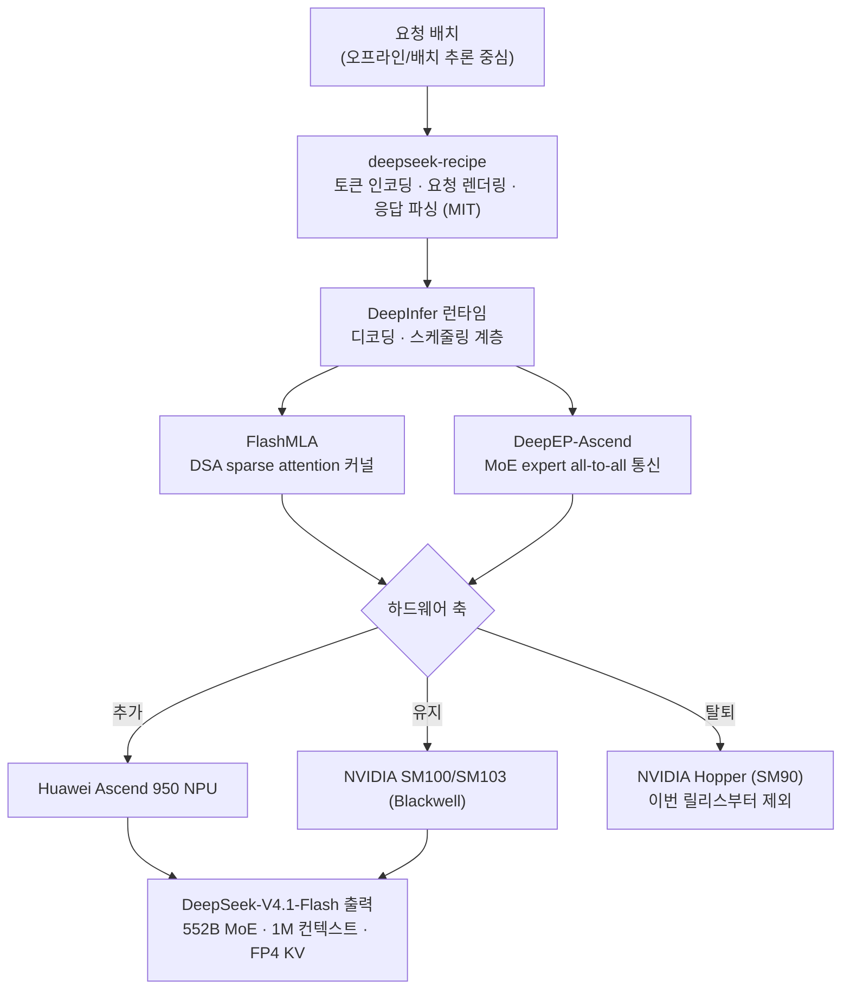

*하드웨어는 바꿨고 경로를 남겼습니다. 이번 글의 주인공 DeepInfer의 설계 사상을 형상화한 이미지입니다.*

## 왜 읽어야 하나

vLLM 기반 추론 서빙을 운용하면서 "모델을 쓴 회사가 만든 전용 엔진"이 나왔을 때 그 선택지를 어떻게 읽을지, 그리고 멀티 하드웨어(NVIDIA + Huawei) 서빙 전략을 세울 기준을 갖고 싶다면 이 글은 그 판단 자료입니다. 결론부터 씁니다. **DeepSeek이 10월 20일 인하우스 추론 프레임워크 DeepInfer를 Apache 2.0으로 오픈소스했는데 이번 릴리스의 핵심은 스루풋 숫자가 아니라 설계 방향입니다. 오프라인 배치 추론을 중심으로, 모델 특화 커널(FlashMLA)과 MoE 통신(DeepEP-Ascend)을 열고 온라인 서빙에서 가장 어려운 구성(KV cache 고급 관리, prefill/decode disaggregation)은 의도적으로 뺐습니다. 동시에 하드웨어 축을 NVIDIA Hopper에서 탈퇴하고 Huawei Ascend 950을 추가했습니다.** 이 네 가지를 하나의 흐름으로 읽어야, 우리가 이 릴리스에서 무엇을 얻을 수 있는지 답할 수 있습니다.

## 쉽게 말하면

고속도로 비유를 씁시다. vLLM은 모든 차(모든 모델)가 다닐 수 있는 공용 도로망입니다. 차종마다 차선은 같고 교통량과 체감 속도를 균형 있게 조절하는 스케줄링이 핵심입니다.

DeepInfer는 다른 성격입니다. DeepSeek이 자사 모델(V4.1-Flash)을 몰고 다니기 위해 깎아낸 전용 도로입니다. 이 모델의 어텐션(FlashMLA)과 전문가 병렬 통신(DeepEP-Ascend)에 맞춰 커널 하나하나를 재조립했고 실시간으로 차를 태워야 하는 시내 구간(온라인 서빙)은 일부만 놓고, 장거리 화물 위주인 외곽 순환(오프라인 배치)에 힘을 실었습니다. 그래서 "DeepInfer가 vLLM보다 빠르다"는 물음 자체가 축을 잘못 세운 것입니다. 같은 차(모델)로 같은 도로(하드웨어) 위에서, 어떤 구간(온라인/오프라인)을 어디까지 깎았는지를 비교해야 합니다.

## 배경: DeepSeek-V4.1-Flash가 어떤 모델인가

DeepInfer를 이해하려면 이 엔진이 구동하는 모델을 먼저 봐야 합니다. DeepSeek-V4.1-Flash는 약 552B 파라미터의 sparse MoE 멀티모달 모델입니다. 컨텍스트가 1M 토큰이고 40층의 Causal Encoder-Decoder 구조로 되어 있습니다. 어텐션은 DSA(DeepSeek Sparse Attention)를 쓰고 잔차 경로에는 mHC(hyper-connection)를 넣는 등, 순수 트랜스포머가 아닌 하이브리드 구조입니다. 가중치는 MIT 라이선스로 Hugging Face에 공개되어 있고 FP8이 가장 무거운 정밀도로 총 48개 샤드에 약 510GB 수준입니다. KV 캐시는 FP4 압축을 지원합니다.

이 모델이 서빙 스택에 부담을 주는 이유는 구조에 있습니다. sparse MoE라 어텐션 계산보다 전문가 선택과 전문가 간 통신이 병목이 되고 1M 컨텍스트에 FP4 KV라 캐시 관리가 단순하지 않습니다. 그리고 멀티모달 + 하이브리드 어텐션이라 서빙 경로가 순수 트랜스포머 모델과 다릅니다. DeepInfer는 바로 이 모델의 이런 부담을 전용 커널로 분산하기 위해 만들어진 엔진입니다.

## DeepInfer는 무엇인가: 모델 특화 엔진의 세 계층

DeepInfer는 "추론 프레임워크"라는 단어로 요약하기는 어렵습니다. 공개된 자료(`doc/inference_deployment_qa.md` 등)를 종합하면, 크게 세 계층으로 나뉩니다.

**첫째, 토큰 인코딩과 요청 렌더링 계층.** 이번 릴리스와 함께 `deepseek-recipe`라는 MIT 라이선스 패키지가 함께 공개됐습니다. 이건 모델 가중치와 달리 요청을 토큰으로 인코딩하고 응답을 파싱하는 가장 바깥쪽 계층입니다. 프롬프트가 모델에 들어가기 전의 포맷팅과, 모델이 토큰을 뱉은 뒤의 렌더링을 담당합니다. 서버 사이에서 모델 특유의 chat template과 토큰 ID 매핑이 어떻게 이뤄지는지, 그 "레시피"를 공개한 셈입니다.

**둘째, 어텐션과 통신 커널 계층.** 이번 릴리스의 진짜 기술적 핵심입니다.

- **FlashMLA**: DeepSeek의 최적화 어텐션 커널 라이브러리. V4.1-Flash의 DSA(sparse attention)를 하드웨어에 맞춰 구현합니다. 이번 업데이트에서 특히 주목할 점은 하드웨어 표입니다. FlashMLA는 **Huawei Ascend 950 NPU와 NVIDIA SM100/SM103(Blackwell 계열)에서** 동작하고 **NVIDIA Hopper(SM90)는 탈퇴**했습니다. 즉 DeepSeek은 최신 추론 워크로드를 "가장 빠른 NVIDIA 칩"이 아니라 "자사 모델에 가장 잘 맞는 칩 세트"로 재선택했고 그 세트 안에 Hopper는 빠졌습니다.
- **DeepEP-Ascend**: Ascend NPU용 고성능 통신 라이브러리. sparse MoE의 핵심 병목인 전문가 병렬(expert parallel)의 all-to-all 연산을 담당합니다. MoE 모델에서 "어떤 토큰이 어떤 전문가에게 가는지"를 결정하고 데이터를 오가게 하는 이 계층을 전용으로 만든 것입니다.

**셋째, 스케줄링과 디코딩 계층.** DeepInfer는 디코딩(decode)과 스케줄링(scheduling) 기법을 공개합니다. 요청 배치가 어떻게 나눠지고, prefill과 decode가 어떻게 조율되는지에 대한 로직입니다. 이 계층을 "완전한 온라인 서비스"로 만들기에는 아직 구성이 모자랍니다(아래 절).

세 계층을 한 그림으로 보면, 바깥의 recipe가 요청을 정리해 안으로 넘기고, 중간의 엔진이 FlashMLA와 DeepEP-Ascend라는 두 전용 커널 위에서 스케줄링을 수행하며 그 아래에 Ascend 950 또는 NVIDIA Blackwell 하드웨어가 있습니다.

*DeepInfer의 세 계층과 하드웨어 축입니다. recipe(바깥)가 요청을 정리하고, 엔진(가운데)이 FlashMLA와 DeepEP-Ascend 두 전용 커널 위에 스케줄링을 얹으며, 아래가 Ascend 950 또는 NVIDIA Blackwell입니다. Hopper는 이번 릴리스에서 탈퇴했습니다.*

## 뭘 열었고, 뭘 의도적으로 뺀 것인가

이번 릴리스를 읽는 가장 중요한 렌즈는 "누락"입니다. 오픈소스라고 해서 DeepSeek의 생산 서비스 전체가 공개된 것은 아닙니다.

**열린 것.** 오프라인 배치 추론의 핵심 경로. FlashMLA와 DeepEP-Ascend 두 커널 라이브러리, 디코딩과 스케줄링 기법, 그리고 deepseek-recipe. 이 조합이면 V4.1-Flash를 오프라인/배치로 돌리는 엔진은 재현 가능합니다.

**의도적으로 뺀 것.** 온라인 서빙에서 가장 어려운 두 구성.

- **KV cache의 고급 관리.** 오프라인 배치에서는 KV 캐시를 요청마다 새로 만들고 버리면 되지만, 온라인 서비스에서는 캐시 재사용(prefix sharing), 오프로딩, 회수 전략이 성능의 핵심입니다. 이번 공개 버전에는 이 수준의 KV cache 관리가 포함되어 있지 않습니다.
- **Prefill/decode disaggregation(PD 분리).** 실시간 서비스에서는 prefill(초기 병렬)과 decode(순차 스트리밍)를 다른 노드에 나눠 돌리는 disaggregation이 용량과 지연의 기준입니다. 이것도 이번 공개 버전에는 없습니다.

즉 DeepInfer 공개 버전은 "V4.1-Flash를 오프라인/배치로 빠르게 돌리는 엔진"이지 "실시간 API를 서빙하는 완전체"가 아닙니다. 실시간 온라인 서빙을 하려면 이 엔진 위에 서빙 계층을 스스로 쌓아야 합니다. 커뮤니티에서도 이 점을 "online service로 불완전하다"고 짚고 있습니다.

이 설계 선택은 의도적입니다. DeepSeek은 자사 생산 서비스의 "모든 것"을 공개하는 것이 아니라, 재현 가능하면서 경쟁 분석에 쓸 수 있는 "오프라인 추론 엔진"을 남기고 온라인 서빙의 정밀한 부분은 공개하지 않은 것입니다. 뺀 구성이 DeepSeek 온라인 서비스의 차별점이었기 때문으로 보입니다.

## 스루풋 주장, 어떻게 읽어야 하는가

이번 릴리스와 함께 두 가지 스루풋 숫자가 돌고 있습니다. 하나는 "하루 155조 토큰(155T tokens/day)"이고, 다른 하나는 "decode 25,000+ 토큰/초"입니다.

두 숫자 모두 주의해서 읽어야 합니다. 먼저 155T tokens/day는 DeepSeek의 주장은 있으나 독립적으로 검증되지 않은 수치입니다. "하루 몇 조 토큰"은 전체 서비스의 집계 처리량이고, 어떤 하드웨어·어떤 모델·어떤 워크로드 믹스로 나눈 값인지가 밝혀져 있지 않으면 다른 시스템의 단일 스루풋 지표와 비교할 수 없습니다.

둘째, 25,000+ decode tokens/초는 decode 단계의 집계 스루풋입니다. "decode"라는 말이 붙는 순간, 이건 prefill을 제외한 수치이며 사용자당 체감 스트리밍 속도(P90 인터랙티비티)도, 첫 토큰까지의 대기(TTFT)도 아닙니다. kimi-k3 글에서 본 423 tok/s/user가 "사용자당 스트리밍 축"이었다면, 이 25K는 "집계 decode 처리량 축"입니다. 같은 하드웨어라도 축이 달라 숫자의 의미는 완전히 달라집니다.

ThakiCloud의 관점에서 중요한 교훈은 **출처와 축의 분리**입니다. 벤더가 내놓은 스루풋은 "어떤 조건에서, 어떤 축의" 숫자인지 명시되지 않으면 인용할 수 없고 반복만 됩니다. 저희 서버리스 엔드포인트의 측정도 동일하게, `SERVE_CONFIG`(max_num_seqs, max_model_len, gpu_memory_utilization, 컴파일 모드)를 로그로 남기고 동일 축·동일 설정의 측정군끼리만 비교하는 검증 규칙을 둡니다. DeepInfer의 숫자를 "우리도 재보자"고 할 때는 이 축부터 확인해야 합니다.

## ThakiCloud 제품 적용 시사점

ThakiCloud의 ai-platform은 Kubernetes 위에서 vLLM 서빙을 운용합니다. 이번 DeepInfer 릴리스는 세 가지 시사점을 줍니다.

**첫째, 멀티 하드웨어 추론이 제품 차별점이고, DeepInfer가 그 방향을 확인해 줬습니다.** FlashMLA가 Hopper를 탈퇴하고 Ascend 950을 추가한 사실은, "최신 NVIDIA 칩이 빠르다"가 아니라 "자사 모델에 맞는 칩 세트를 고른다"는 신호입니다. ThakiCloud의 *One Paxis. Many Workflows. Any Cloud.* 포지셔닝에서 "Any Cloud"는 하드웨어의 다양성까지 포함합니다. NVIDIA H200/B200만 다루는 서빙과, NVIDIA + Huawei Ascend를 함께 다루는 서빙은 온프렘·소버린 클라이언트의 요구에 대한 답이 다릅니다. DeepInfer가 Ascend 경로를 1급으로 공개한 것은, 추론 엔진이 "칩 선택"을 제품 기능으로 삼아도 되는 시점임을 보여줍니다. 저희가 Kueue로 GPU를 배정하고 멀티클러스터를 돌리는 이유가 바로 이것입니다.

**둘째, 오프라인 배치와 온라인 서빙은 다른 엔진입니다.** DeepInfer가 의도적으로 온라인 구성(KV cache 고급, PD disaggregation)을 빼고 오프라인에 힘을 실었다는 것은, "하나의 엔진으로 모든 워크로드"가 아니라 워크로드별 최적화가 표준이 되고 있다는 뜻입니다. ThakiCloud에서는 이게 이미 분리되어 있습니다. 실시간 API는 vLLM의 tuned default(max_num_seqs, tool-call/reasoning parser, 컴파일)로, 배치 처리는 별도 경로로. DeepInfer의 선택은 이 분리를 옳은 설계로 뒷받침합니다. 오프라인 배치 추론(대규모 데이터 증강, 오프라인 평가, 배치 생성)을 자주 돌린다면 DeepInfer를 배치 전용 엔진으로 검토할 가치가 있고 실시간 서빙은 vLLM을 유지하면 됩니다.

**셋째, Paxis 렌즈에서 본 에이전트 경제성.** V4.1-Flash가 "롱 에이전트 루프와 코딩 워크로드에 최적화된 저비용 추론"을 목표로 한 모델이라는 점이 눈에 띕니다. 1M 컨텍스트 + FP4 KV + sparse MoE는 "긴 에이전트 세션을 싸게 돌리는" 설계입니다. Paxis는 ai-platform 위에서 도는 Agent-Native Cloud로, 에이전트의 각 단계가 저비용 추론에 의존할 때 전체 워크플로 경제성이 결정됩니다. DeepSeek이 모델과 엔진을 함께 "에이전트용 저비용 추론"으로 최적화한 것은, Paxis가 960+ 스킬을 격리 샌드박스에서 실행하고 정책 게이트와 감사 로그로 통제하는 것과 같은 방향입니다. 추론 비용이 낮아야 에이전트를 많이 돌릴 수 있고 에이전트가 많이 돌아야 플랫폼의 가치도 커집니다.

## 한계 및 반론

**첫째, 검증의 벽.** 155T tokens/day와 25K decode tok/s 모두 독립 검증이 없는 벤더 주장입니다. 하드웨어·워크로드 스펙이 불명확하면 이 숫자를 반복할 수 있을 뿐 인용할 수는 없습니다.

**둘째, 재현의 비용.** DeepInfer를 실제로 V4.1-Flash에 올리려면 MIT 가중치(약 510GB)와 Ascend 950 또는 NVIDIA Blackwell 하드웨어, 그리고 온라인 서빙 계층을 스스로 쌓아야 합니다. "오픈소스"이지만 "바로 쓰는 오픈소스"는 아닙니다.

**셋째, Hopper 탈퇴의 함의.** FlashMLA가 Hopper를 빼면 Hopper를 주력으로 쓰는 환경은 이번 릴리스의 이점을 그대로 누릴 수 없습니다. DeepSeek의 "칩 세트 재선택"은 사용자의 하드웨어 투자에도 영향을 줍니다. 이는 "최신 칩이 좋다"는 단순한 이야기가 아니라, "모델과 칩의 페어링"이 성능의 1등 변수가 되고 있다는 뜻입니다.

**넷째, 오프라인 집중의 역풍.** 온라인 구성을 빼놓은 것은 "안 빼놓은 것"이기도 합니다. 실시간 서빙에 DeepInfer를 쓰려면 빠진 부분을 직접 구현해야 하고 그 구현이 곧 DeepSeek이 공개하지 않은 부분입니다.

가장 강한 반론은 하나입니다. "DeepInfer가 vLLM의 대안이다"라는 프레임 자체가 잘못되었습니다. vLLM은 일반 모델의 온라인 서빙, DeepInfer(공개 버전)는 특정 모델의 오프라인 배치. 둘은 경쟁 관계라기보다, 같은 추론 스택의 다른 층을 담당합니다. DeepInfer의 공개는 vLLM을 무너뜨리지 않고 "모델 특화 + 멀티 하드웨어"라는 축을 커뮤니티에 남겼다는 점에서 더 중요합니다.

## 정리

이번 릴리스가 말해주는 것은 방향, 즉 설계 결정입니다. DeepSeek은 자사 추론 엔진을 열고 그 안에 "모델 특화 커널(FlashMLA/DeepEP-Ascend) + 멀티 하드웨어(Ascend 950 + Blackwell, Hopper 탈퇴) + 오프라인 배치 집중"이라는 세 선택을 공개했습니다. 그리고 온라인 서빙의 정밀한 부분은 의도적으로 남겼습니다.

ThakiCloud에서 이 릴리스를 활용하려면 먼저 **두 가지 질문**을 확인해야 합니다. 첫째, 저희가 다루는 온프렘·소버린 클라이언트 중에 NVIDIA와 Huawei Ascend를 함께 요구하는 케이스가 있는가. 둘째, 대규모 오프라인 배치 추론(데이터 증강, 오프라인 평가) 워크로드가 쌓이고 있는가, 있다면 DeepInfer를 배치 전용 엔진으로 PoC할 가치가 있는가. 이 두 질문에 "있다"가 답이면, 이번 공개는 ThakiCloud의 하드웨어 축과 워크로드 축에 실질적인 재료를 줍니다.

이 블로그가 7월부터 Kimi K3 추론 스토리를 쫓아 온 것도 같은 맥락입니다. Day-0 서빙, 로컬 실험, 특화 커널에 이어, DeepInfer는 "모델을 만든 회사가 엔진까지 공개한다"는 새로운 단계를 채웁니다. 추론 경쟁이 서빙 설정에서 커널과 하드웨어 페어링까지 내려온 지금, 다음 질문은 명확합니다. 같은 투자를, 어느 칩 위에서, 어느 워크로드로 할당할 것인가.

## 출처

- DeepSeek DeepInfer 공식 저장소 (Apache 2.0, 2026-10-20): https://github.com/deepseek-ai/DeepInfer
- DeepSeek 공식 발표 (X @deepseek_ai): https://x.com/deepseek_ai
- MarkTechPost, DeepInfer 오픈소스 보도 (decode 25,000+ tok/s): https://www.marktechpost.com
- explainx.ai, "DeepSeek DeepInfer: Open Engine, 155T Tokens/Day Claim" (155T/day 주장 및 미검증 범위): https://explainx.ai
- vLLM Ascend 문서, DeepSeek-V4.1-Flash 사양 (552B MoE, 1M 컨텍스트, 40층 Causal Encoder-Decoder): https://docs.vllm.ai (Ascend)
- narracomm.com, "DeepSeek ships Ascend 950 attention kernels and drops Hopper from FlashMLA": https://narracomm.com
