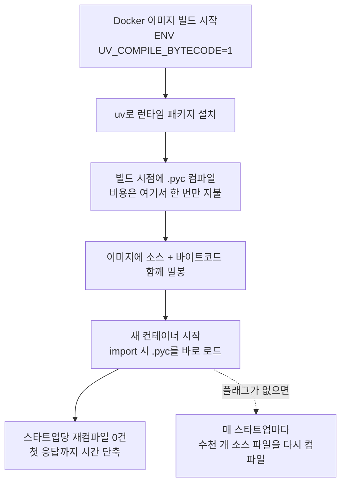

*수천 번의 컴파일을 빌드 시점에 미리 끝낸 이미지로 서빙을 시작하는 모습을 형상화했습니다.*

## 왜 읽어야 하나

이 글은 vLLM 기반 서빙 이미지를 직접 빌드하는 엔지니어와, scale-from-zero로 확장되는 inference 엔드포인트의 콜드스타트 시간을 줄이려는 플랫폼 운영자를 위한 것입니다. 핵심 결론은 이렇습니다. 새 컨테이너마다 Python 소스를 다시 컴파일하는 비용을 이미지 빌드타임으로 옮기면 vLLM 스타트업 시간이 H100 기준 14~18%, 즉 약 18초 줄어듭니다. 방법은 빌드 스크립트 한 줄, `UV_COMPILE_BYTECODE=1`입니다.

## 개요

vLLM 프로젝트가 2026년 9월 22일 공식 블로그에 "Reducing vLLM startup time with one uv flag"를 게시했습니다. 저자 Nils Matteson의 실측에 따르면, H100 SXM 80GB 서버에서 Qwen3-8B와 Qwen3-32B의 페어 스타트업 시간을 측정한 결과, 미리 컴파일된 바이트코드가 포함된 이미지가 각각 중앙값 17.6초(17.6%)와 17.8초(13.9%) 더 빠르게 첫 응답을 반환했습니다.

이 변화는 이미 배포 경로에 올라와 있습니다. vLLM PR #55422가 CUDA nightly 이미지(`vllm/vllm-openai:nightly-8cbd5d03006c33185f402249ff2b448efd594986`)에 포함됐고 공식 릴리스 이미지는 v0.32.0부터 이 설정을 기본적으로 반영합니다. 즉, 공식 이미지를 쓰는 팀은 빌드 플래그를 직접 설정할 필요가 없습니다.

이것이 서빙 인프라의 주제인 이유는 간단합니다. 콜드스타트는 scale-from-zero 워크로드에서 매번 지불되는 비용입니다. 서버리스 inference 엔드포인트가 요청이 도착할 때마다 컨테이너를 새로 띄운다면 그 수 초는 전부 사용자 대기 시간, 즉 TTFT입니다. 이번 글은 그 비용의 정체가 Python 컴파일이라는 사실을, vLLM의 공식 실측과 우리의 로컬 재현 실험으로 함께 보여드립니다.

## 이 기술은 무엇인가

CPython은 소스 코드를 실행하기 전에 code object로 컴파일합니다. 이 컴파일 산출물이 `.pyc` 파일이고 유효한 `.pyc`가 있으면 Python은 소스를 다시 읽지 않고 바로 로드합니다. 문제는 패키지 설치 도구가 이 파일을 만드느냐 마느냐에 따라, 컴파일 비용이 "빌드 시 한 번"이 될지 "스타트업마다 반복"이 될지가 갈린다는 점입니다.

pip은 설치 시점에 바이트코드를 컴파일하는 것이 기본 동작입니다. 그런데 vLLM 이미지의 패키지 설치는 uv를 사용하는데, uv는 바이트코드 컴파일을 건너뜁니다. 설치 속도를 높이는 uv의 특성 중 하나가 바로 이것이라, uv 기반 이미지에서는 컴파일이 기본값에서 빠집니다. 그래서 vLLM의 대조 Docker 이미지 실험에서 기본 빌드 이미지는 26,734개 소스 파일 중 유효한 바이트코드가 407개에 불과했고 사전컴파일 빌드 이미지는 26,734개 전부였습니다. 그 차이가 스타트업마다 반복되는 컴파일 작업량으로 직결됩니다. 같은 실험에서 서빙 CLI import(`import vllm.entrypoints.cli.serve`) 단계에서 기본 빌드는 5,257개 소스 파일을 컴파일한 반면, 사전컴파일 빌드는 0개였습니다.

여기에 writable layer 구조가 영향을 줍니다. 컨테이너 실행 중에 Python이 없는 캐시를 새로 써도, 그 파일은 해당 컨테이너의 writable layer에만 남고 다음 컨테이너로 전달되지 않습니다. 다음 컨테이너는 같은 이미지에서 다시 시작하므로 같은 컴파일을 처음부터 반복합니다. fresh 컨테이너가 매 스타트업마다 "수천 개 Python 파일 컴파일"을 반복하는 원인이 이 구조입니다. uv의 자체 Docker 가이드도 프로덕션 이미지에 대해서는 컴파일을 켜 두는 것을 권합니다.

torch.compile이나 GPU 커널 컴파일은 별개의 캐시 경로입니다. 이번 변화가 다루는 것은 순수 Python import 경로, 즉 모듈을 로딩할 때 벌어지는 소스 컴파일입니다. 흐름은 아래 그림과 같습니다.



## 설치 및 통합

직접 빌드하는 이미지의 경우, 런타임 패키지를 uv로 설치하기 전에 환경 변수를 켜면 됩니다.

```dockerfile
# uv가 설치하는 모든 패키지의 Python 소스를 빌드 시점에 컴파일
ENV UV_COMPILE_BYTECODE=1

RUN uv pip install --system vllm==0.32.0
```

공식 릴리스 이미지(v0.32.0 이후)를 쓰는 팀은 이 설정을 할 필요가 없습니다. 이미지에 바이트코드가 포함돼 나옵니다.

블로그가 지적한 함정은 기존 베이스 이미지입니다. `FROM`으로 이어받은 이미지에 이미 패키지가 들어 있을 때, 그 뒤의 uv 명령이 상속된 패키지의 바이트코드까지 컴파일해 주느냐는 uv 버전과 명령의 형태에 따라 달라집니다. 그래서 최종 이미지를 열어 확인해야 하고 누락된 캐시는 런타임 Python의 `compileall`로 채우는 것이 안전합니다. 패키지 디렉토리를 다른 이미지에 복사할 때도 소스와 바이트코드를 함께 복사해야 합니다.

검증은 간단합니다. 빌드 후 최종 이미지에서 `*.pyc` 파일 개수와 소스 `.py` 개수가 일치하는지, 그리고 서빙 CLI import 단계에서 source compilation이 0건인지 두 가지를 확인하면 적용 여부를 판정할 수 있습니다.

## 실제 실험 결과

vLLM 공식 블로그의 H100 실측부터 정리합니다. Xeon Platinum 8480+와 H100 SXM 80GB 서버에서, 이미지와 모델 파일이 모두 로컬에 있는 상태에서 프로세스 시작부터 첫 정상 응답까지를 4페어(각 방향 2회씩)로 측정했습니다. 8페어 모두에서 사전컴파일 이미지가 더 빨랐습니다.

| 연구 | 하드웨어 | 모델 | 중앙값 절감 |
|---|---|---|---|
| H100 서버 | Xeon 8480+ / H100 SXM 80GB | Qwen3-8B | 17.6초 (17.6%) |
| H100 서버 | 동일 | Qwen3-32B | 17.8초 (13.9%) |
| 노트북 | i9-13900HX / RTX 4090 Laptop | Qwen3-0.6B, 1.7B, SmolLM2-1.7B (모델당 6페어) | 12.8~13.5초 |
| 이미지 전달 | loopback registry + 빈 Docker store | Qwen3-0.6B (3페어, pull 포함) | 15.4초 |

두 가지 부연이 필요합니다. 첫째, 절감량은 모델 크기에 비례하지 않습니다. 8B와 32B의 절대 절감은 비슷(17.6초 vs 17.8초)했고 비율은 오히려 8B가 높았습니다. 두 모델이 공유하는 Python import 작업 때문이라는 것이 블로그의 설명입니다. 둘째, 소스 파일이 이미 RAM의 페이지 캐시에 상주한 상태(8.85GB)에서도 스타트업당 9~12초 절감이 남아 있었습니다. 파일 I/O가 아니라 컴파일 자체의 비용이라는 방증입니다.

대가는 이미지 크기입니다. 이미지 전달 연구에서 사전컴파일 이미지는 압축 기준 153MB, 1.8% 더 컸습니다. 첫 pull이 느린 환경에서는 이 트레이드오프를 의식해서 봐야 합니다.

우리는 같은 메커니즘을 로컬에서 재현했습니다. Apple Silicon 맥북, CPython 3.12.8 환경에서 공유 venv의 `transformers`(2,556개 .py, 46.81MB)와 `sympy`(1,532개 .py, 26.17MB) 패키지 트리를 복사한 뒤, `.pyc`가 없는 상태와 `compileall`로 전체를 컴파일한 상태에서 fresh 프로세스의 import 시간을 3회씩 측정해 중앙값을 비교했습니다.


*좌: 바이트코드 유무에 따른 import 시간 중앙값(3회 fresh 프로세스). 우: 패키지 전체 트리의 `compile()` 비용. 로컬 실험 실측.*

패키지에 따라 결과가 크게 달랐습니다.

| 패키지 | cold import 중앙값 | precompiled import 중앙값 | 절감 |
|---|---|---|---|
| sympy | 1.030초 | 0.135초 | 0.895초 (86.9%) |
| transformers | 1.069초 | 1.040초 | 0.029초 (2.7%) |

차이가 나는 이유를 보기 위해 audit hook으로 import 중 실제로 읽히는 .py 파일을 세어 봤습니다. `import sympy`는 1,532개 파일 중 419개를 import 시점에 바로 로드합니다. 이 419개 모듈의 컴파일을 피할 수 있습니다. 반면 `import transformers`의 top-level import는 230개 모듈만 로드하고 나머지 서브모듈은 속성에 접근할 때 비로소 로딩되는 lazy 구조입니다. 그래서 top-level import 기준으로는 절감이 2.7%에 머무릅니다.

측정 반복성도 확인했습니다. sympy의 precompiled 3회 관측이 0.135, 0.136, 0.128초로 몰려 있는 반면, transformers는 cold 3회(1.003, 1.069, 1.278초)에 분산이 커 중앙값으로 읽어야 합니다. warm run 첫 관측에서 1.51초로 튀었던 값은 고립된 이상치였고 중앙값은 1.040초로 수렴해 이 영향을 받지 않았습니다.

여기서 얻을 교훈은 다음과 같습니다. 절감 크기는 "패키지가 큰가"가 아니라 "서버 스타트업 경로가 실제로 얼마나 많은 파일을 컴파일해야 하는가"에 달려 있습니다. vLLM의 서빙 CLI import는 5,257개 파일을 한 번에 컴파일해야 했기 때문에 H100에서 17초가 넘게 줄었고 lazy하게 import되는 패키지만 있는 환경에서는 체감도가 훨씬 낮아집니다.

빌드타임 비용은 얼마인지도 재었습니다. 패키지 전체 트리의 소스를 메모리에 읽은 뒤 `compile()`만 돌리는 컴파일러 단독 실험에서, transformers 2,556개 파일은 4.32초(파일당 1.69ms), sympy 1,532개 파일은 3.03초(1.98ms)였습니다. vLLM 공식 블로그의 Xeon 실측(5,118개, 78.6MB가 6.30초)과 같은 스케일입니다. 수천 번의 스타트업에서 반복될 비용을 빌드에서 한 번, 몇 초만 치르면 된다는 뜻입니다.

## ThakiCloud 제품 적용 시사점

ThakiCloud의 ai-platform은 K8s 위에서 모델 서빙을 맡는 인프라입니다. 이 변화가 특히 의미 있는 곳은 Metis의 scale-from-zero inference 엔드포인트입니다. 엔드포인트가 트래픽에 따라 Pod을 새로 올리는 패턴이라면 vLLM 스타트업에 포함된 Python 컴파일 비용은 매 scale-up마다 반복 부과됩니다. 이번 결과를 그대로 대입하면 스타트업당 10초 안팎의 절감이 scale-from-zero 워크로드의 TTFT 분포에 직접 반영됩니다. 같은 응답 품질을 더 짧은 대기 시간으로 제공하는 것이므로, 결국 서빙 비용 경쟁력 문제입니다.

구체적 적용은 두 갈래로 나뉩니다. 공식 vLLM 이미지를 베이스로 쓰는 엔드포인트는 v0.32.0 이상으로 베이스를 올리는 것만으로 이득을 얻게 됩니다. 직접 빌드하는 커스텀 이미지는 Dockerfile의 uv 설치 단계 이전에 `ENV UV_COMPILE_BYTECODE=1`을 넣고 최종 이미지에서 `*.pyc` 개수가 기대만큼인지 read-back으로 확인해야 합니다. 확인하지 않으면 "플래그를 넣었는데 베이스 이미지 상속 패키지는 여전히 컴파일 안 됐다"는 함정에 걸립니다.

Paxis 관점에서도 짚어 둘 점이 있습니다. 에이전트 워크플로가 격리 샌드박스를 빈번하게 띄우는 구조라면 그 샌드박스의 Python 시작 비용에도 같은 원리가 적용됩니다. 에이전트당 수 초의 시작 지연이 워크플로 전체 지연에 누적되므로, 빌드타임 사전컴파일은 에이전트 플랫폼의 응답성을 높이는 수단이 될 수 있습니다.

## 한계 및 반론

첫째, vLLM의 H100 수치는 단일 배포 환경의 페어 중앙값입니다. 블로그 스스로 "fleet-wide 추정치가 아니다"라고 명시합니다. 하드웨어, Python 빌드, vLLM 커밋, CPU 주파수 상태에 따라 절감량은 달라집니다. 우리 로컬 재현도 마찬가지입니다. Apple Silicon에서 수천 파일의 컴파일을 4초 선에서 재었지만 이것이 특정 서버의 스타트업 절감 17초를 그대로 재현한 것은 아닙니다. 메커니즘의 방향은 확인했지만 절대 수치는 각자의 배포 환경에서 페어 측정으로 확정해야 합니다.

둘째, 절감은 import 경로에만 적용됩니다. torch.compile의 그래프 컴파일, Triton 커널 캐시, 모델 가중치 로딩, CUDA 초기화는 이 범위를 벗어나며 이들은 각자의 캐시 경로와 최적화 수단이 따로 있습니다. 이번 한 줄이 "콜드스타트 전체"를 해결하는 것은 아닙니다.

셋째, 이미지 용량 증가(압축 기준 1.8%)는 registry 대역폭이 좁은 환경에서 첫 pull 시간을 다시 늘릴 수 있습니다. scale-from-zero가 빈번하고 클러스터 내부 pull이 빠른 환경에서는 이 대가가 미미하지만 클러스터 밖에서 이미지를 끌어들이는 환경에서는 계산을 다시 해야 합니다.

넷째, lazy import 패키지 중심의 워크로드는 체감도가 낮습니다. 이번 실험에서 transformers가 2.7%에 그친 것처럼, 스타트업 경로가 실제로 eager하게 컴파일해야 하는 파일 수가 적으면 절감도 적습니다. "이미지를 빌드하면 무조건 빨라진다"가 아니라 "스타트업마다 컴파일하는 파일 수를 줄이는 것"이 정확한 설명입니다.

## 정리

vLLM 스타트업의 숨은 비용은 Python 컴파일이고 그 비용을 `UV_COMPILE_BYTECODE=1` 한 줄로 빌드타임으로 옮길 수 있습니다. 공식 이미지는 v0.32.0부터, 커스텀 이미지는 uv 설치 단계 이전의 환경 변수로, 그리고 최종 이미지에서 바이트코드 존재를 read-back으로 확인하는 것이 전부입니다.

다음 단계로는 지금 서빙 중인 vLLM 이미지의 스타트업 시간을 페어로 측정해 보시기 바랍니다. "플래그 on/off 두 이미지를 같은 모델·같은 하드웨어에서 4페어 비교"는 vLLM 공식 블로그의 방법 그대로이며 그 차이가 5초 이상이면 scale-from-zero 워크로드의 TTFT에 그대로 반영되는 값입니다. 우리는 로컬에서 sympy 86.9%, transformers 2.7%라는 결과로, 절감의 크기가 스타트업 경로의 eager 컴파일 규모에 비례한다는 점을 확인했습니다. 수천 개의 파일을 매 스타트업마다 컴파일하고 있다면 그 비용은 빌드 때 한 번만 치르도록 옮길 수 있습니다.

## 출처

- [Reducing vLLM startup time with one uv flag (vLLM 공식 블로그, 2026-09-22)](https://vllm.ai/blog/2026-09-22-python-bytecode-startup)
- [vLLM PR #55422](https://github.com/vllm-project/vllm/pull/55422)
- [vLLM 공식 트윗 (2026-10-19)](https://x.com/vllm_project/status/2111990039806914908)
- 로컬 재현 실험 결과: `outputs/blog-impl/vllm-uv-compile-bytecode/` (run-1, run-7, run-8 로그)
