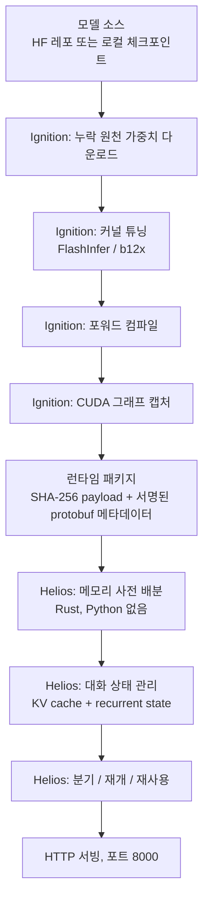

*데이터센터가 아닌, 책상 위에서도 조용히 서빙하는 엔진을 형상화했습니다.*

## 왜 읽어야 하나

DGX Spark나 RTX PRO 6000 Blackwell 같은 신형 로컬 하드웨어에서 LLM을 돌리려는 ML 엔지니어, 그리고 "vLLM 밖의 서빙 엔진"이 어디까지 왔는지 파악하려는 플랫폼 운영자를 위해 씁니다. 결론부터 말하면, Flare의 가치는 서빙 엔진으로서의 경쟁력이 아니라 두 가지 개념에 있습니다. 모델 준비를 **서명된 런타임 패키지**로 앞당기는 것, 그리고 그 패키지를 **Python 없는 Rust 런타임**으로 서빙하는 것입니다. Flare는 스스로를 프로덕션 서빙의 대체재가 아니라 로컬 에이전트 워크로드를 위한 연구 프로토타입으로 규정합니다.

## 쉽게 말하면

예약 주문 식당을 생각해 보세요. 주방은 Python입니다. 재료를 사러 나가는 일(가중치 다운로드), 손질하는 일(커널 튜닝), 반찬을 미리 다 해 두는 일(포워드 컴파일 + CUDA 그래프 캡처), 배달 용기에 싸서 서명까지 하는 일(런타임 패키지)이 전부 주방 몫입니다. 서빙대는 Rust입니다. 주방 기구도, 즉흥적으로 조리하는 셰프도 없습니다. 미리 해 온 용기만 데워서 내립니다. 그래서 서빙대는 빠르고 작으며, 실수가 없습니다. Flare의 전체 설계는 "주방과 서빙대를 물리적으로 분리하는 것" 하나에서 나옵니다.

## 개요

NVIDIA의 AI 팀은 발표 없이 Flare를 GitHub에 올렸습니다. 공식 블로그도, 언론 공지도 없습니다. NVIDIA 개발자 포럼의 첫 포스트가 2026년 10월 21일 새벽, "NVIDIA-AI가 로컬 인퍼런스 서버를 조용히 올려놨다"는 내용이었을 정도입니다. 공개 직후 별은 한 자릿수였고 확인 시점에는 578개까지 늘었습니다. 레포지토리는 NVIDIA/flare-local-inference, 라이선스는 Apache-2.0입니다.

NVIDIA staff가 같은 포럼에서 "이건 아직 연구 프로토타입이니, 기대치를 그에 맞게 잡으라"고 답했는데, 이 답변이 이번 공개의 성격을 가장 잘 보여 줍니다. 공식 벤치마크도, 제품 로드맵도 없습니다. 대신 README에는 두 줄이 있습니다.

> "Flare is not, and will never, be a replacement for production inference engines like vLLM."
>
> "This is a research prototype, and is made available via open-source to enable technical collaboration and collect early feedback."

README는 "대체재가 아니다"와 "연구 프로토타입이다"를 함께 밝히고 있습니다. 경쟁을 내세우는 대신 자기 위치를 먼저 선언한 점이 눈에 띕니다.

## Flare는 무엇인가: 주방과 서빙대의 분리

Flare의 정의를 README에서 가져오면, "NVIDIA SM120/SM121 GPU를 위한, 긴 대화와 코딩 에이전트, 반복되는 도구 호출에 맞춘 로컬 인퍼런스 서버"입니다. 구조는 2단입니다.

**Ignition(주방, Python)**: PyTorch + Transformers + FlashInfer(b12x 커널) 환경에서 네 가지 일을 거칩니다. 누락된 원천 가중치를 내려받은 뒤, 커널을 튜닝하고 포워드를 컴파일한 뒤, CUDA 그래프를 캡처합니다. 산출물은 **런타임 패키지** 하나입니다.

**Helios(서빙대, Rust)**: 그 패키지를 받아 HTTP 서빙을 합니다. 서빙 경로에 Python이 없습니다. Dockerfile을 보면 이 구분이 물리적입니다. 빌드 스테이지는 rust:1.94.1-slim-trixie이고 런타임 스테이지는 debian:trixie-slim입니다. build-essential, cmake, nasm, protobuf-compiler, 멀티호스트 RDMA를 위한 libibverbs만 얹습니다. 서빙 이미지 안에는 Python 자체가 없고, EXPOSE는 8000 포트 하나, ENTRYPOINT는 /usr/local/bin/flare 바이너리 하나입니다.



왜 이렇게 나누는가. 준비 단계는 연구적이라 Python 생태계가 맞습니다. FlashInfer 포크를 특정 리비전으로 고정하는 것, 커널을 하드웨어마다 튜닝하는 것, 실패 시 디버깅하는 것까지 전부 준비 단계 몫이기 때문입니다. 서빙 단계는 운영적이라, 최소 footprint가 답입니다. Rust 런타임은 메모리를 서빙 전에 미리 배분해 두고, GC 스윕도, 서빙 중 즉흥 컴파일도 없습니다. CUDA 그래프는 이미 주방에서 캡처해 왔으니까요.

## 런타임 패키지: 서명까지 하는 배달 용기

Ignition의 산출물인 런타임 패키지는 단순 아카이브가 아닙니다. payload는 SHA-256 해시로 묶이고 메타데이터는 서명된 protobuf입니다. 실행 쪽에는 --publisher-keys와 --trust-store가 있습니다. 용기 뒤에 누가 서명했는지, 그 서명을 내가 믿을지까지 서빙 계약의 일부로 넣은 것입니다.

이는 서빙에서 보기 드문 방식입니다. 지금 컨테이너 서빙의 신뢰 경계는 "레지스트리에서 내린 이미지 digest"까지입니다. Flare는 그 안에 한 계층을 더 넣었습니다. 이미지가 같아도, 그 안에 들어온 모델 패키지가 준비된 이후 바뀌지 않았는지 검사하는 계층입니다. 메모리 배분, 커널 버전, CUDA 그래프까지 패키지 안에 묶이는 한, "같은 패키지 = 같은 서빙"이라는 등식이 서명 덕분에 강제됩니다.

컨테이너로 모델을 서빙해 본 팀이라면 익숙한 문제입니다. 같은 모델 이미지를 다시 빌드하면 커널 버전이나 컴파일 설정이 달라지고, 수치도 달라집니다. 런타임 패키지가 고정하는 것은 바로 그 부분입니다. 서명이 그 고정을 감사 가능한 형태로 만듭니다.

## 지원 모델과 하드웨어

README의 하드웨어 표기는 SM120/SM121입니다. 포럼 기준으로는 RTX PRO 6000 Blackwell과 DGX Spark, README 표현으로는 "워크스테이션과 DGX Spark 같은 컴팩트 시스템"입니다. 소비자용 RTX 50시리즈의 공식 지원 여부는 문서 어디에도 없습니다. [미확인]

모델은 "레시피"라는 단위로 제공됩니다. 확인된 목록입니다.

| 레시피 | 포맷 특징 |
|---|---|
| Nemotron 3.5 Bolt 74B-A9B (24GB) | C-RADIO 인코더, LiLiCorr 드래프트, FP8 KV |
| Qwen3.8-27B-NVFP4 | NVFP4 MLP, FP8 어텐션 투영, BF16 선택자 키 |
| Qwen3.8 Flash | MTP 최대 5 드래프트, FP8 KV, 비전 |
| DeepSeek V4.1 Flash | MXFP4 전문가 스케일, Engram 테이블, DSpark |
| DeepSeek V4 Flash | CSF lossless, 비전 인코더, DSpark |
| MiMo V2.6 Pro MOPD | MXFP4 전문가, block-FP8 dense, DFlash |
| Step-5 Preview NVFP4 | NVFP4 라우팅 전문가, W4A4/W4A16, MXFP8 gate/up |
| Kimi K3 | MXFP4 전문가, CSF, FP32 KDA 상태 |

눈에 띄는 것은 세 가지입니다. 첫째, 전부 FP4/FP8 계열 저정밀 서빙 레시피라는 것. 둘째, Qwen3.8-27B-NVFP4가 들어 있다는 것. 셋째, EXL3는 지원하지 않는다는 것. 세 가지 모두 확인된 범위입니다.

## 설치와 실행: 문서의 실제 명령

레포 docs에서 가져온 실제 명령을 정리하면 이렇습니다.

```bash
# 주방(Python) 준비
uv sync --locked --extra prepare --extra test

# Ignition: 모델 준비 → 런타임 패키지
.venv/bin/ignition export qwen3.8-27b --gpus 0 --output /packages/qwen3.8-27b.safetensors

# 서빙대(Rust) 빌드
cargo build --release --manifest-path flare/Cargo.toml

# Helios: 패키지 서빙
./target/release/flare run /packages/qwen3.8-27b.safetensors --gpus 0 --port 8001
```

컨테이너로 갈 경우의 명령입니다.

```bash
docker build -t flare:local .
docker run --rm --name flare \
  --gpus 'device=0,capabilities=compute' \
  --ulimit memlock=-1:-1 \
  --stop-timeout 60 \
  -p 127.0.0.1:8000:8000 \
  --mount type=bind,src=/absolute/path/to/packages,dst=/models,readonly \
  flare:local run /models/model.safetensors \
  --publisher-keys /models/publisher.json \
  --trust-store /models/trust.toml \
  --gpus 0 --host 0.0.0.0 --port 8000
```

모델도 flare download ORG/MODEL --revision gb202 --cache-dir /cache로 끌어올 수 있습니다. 문서에는 --mtp-draft-tokens, --kv-cache-limit, --memory-limit, --embedding-table-storage ram 같은 플래그가 나열되어 있고 TP는 --gpus 0,1로 두 랭크를 지정하는 형태까지 테스트되어 있습니다.

## 우리가 돌릴 수 있는 것과 없는 것: 16GB 산술

ThakiCloud의 dev 클러스터 aio5070은 RTX 5070 Ti 16GB 2노드입니다. SM120이므로 아키텍처 범위 안입니다. 그런데 메모리 계산이 맞지 않습니다.

가장 작은 레시피인 Qwen3.8-27B-NVFP4를 기준으로 계산합니다. 27B 파라미터의 NVFP4(4비트 가중치 + 스케일)는 대략 14GB [추정]. 여기에 FP8 KV cache, 활성 텐서, CUDA 그래프 버퍼를 더하면 16GB 한계를 넘어갑니다. 나머지 레시피는 24GB class부터 시작합니다. 즉, 우리가 가진 16GB 카드에서는 Flare의 어떤 레시피도 서빙할 여유가 없습니다.

그래서 재현은 시도하지 않았습니다. 실행해 보고 실패해서가 아니라, 계산상 돌릴 수 없기 때문입니다. 이 구분은 중요합니다. Flare의 대상 하드웨어는 128GB 유니파이드 메모리의 DGX Spark, 혹은 RTX PRO 6000 class입니다. 여기서 "로컬"은 가정용 16GB 카드가 아니라, 데스크톱에 데이터센터급 메모리를 두는 것을 전제로 합니다.

## ThakiCloud 제품 적용 시사점

ai-platform 렌즈로 보면, Flare는 "콜드스타트"와 "재현성" 문제에 대한 또 다른 접근입니다. ThakiCloud의 ai-platform은 다양한 고객 환경에서 모델을 서빙하고 서빙 비용에서 경쟁력을 확보합니다. vLLM 경로에서 콜드스타트의 정체가 Python 컴파일이었다면(이전 블로그 참조), Flare는 그 문제를 다른 방식으로 피합니다. 서빙 경로에 Python 자체가 없으니까요. 준비를 서명된 패키지로 앞당긴 것도 같은 방향입니다. 패키지가 준비되면 서빙 시작은 파일을 열어 데우는 수준으로 줄어드는 구조입니다.

Qwen3.8-27B-NVFP4 레시피는 특히 가깝습니다. ThakiCloud의 B200 상주 엔드포인트 marm이 쓰는 모델군이 Qwen3.8-27B NVFP4 계열입니다. "같은 모델을 데이터센터에선 Kueue 잡으로, 로컬에선 Flare로" 돌린다면, NVFP4 서빙을 하드웨어별로 비교할 수 있는 데이터를 얻을 수 있습니다. Flare가 vLLM의 대체재가 아니라고 스스로 밝혔더라도, 저정밀 서빙 레시피를 표준화한다는 점에서는 같은 방향입니다.

Paxis 렌즈로 보면, Flare가 겨냥한 워크로드(긴 대화, 코딩 에이전트, 반복 도구 호출)가 Paxis의 로컬 에이전트 실행과 정확히 겹습니다. Paxis는 ThakiCloud의 Agent-Native Cloud로, 에이전트 실행의 경제성을 스킬·도구·정책·감사 로그를 일급 리소스로 다루는 구조에서 만듭니다. 그 구조를 "datacenter class 메모리가 있는 데스크톱"에서 돌릴 수 있다면, 에이전트 워크로드의 한 구간이 클라우드 의존에서 벗어납니다. 대화 상태의 분기/재개/재사용 설계는, 에이전트가 실패한 도구 호출을 되돌리고 다른 분기로 다시 시도하는 Paxis의 실행 모델과 같은 문제의식입니다.

## 한계 및 반론

첫째, 연구 프로토타입입니다. NVIDIA staff가 스스로 "기대치를 맞춰 달라"고 한 프로젝트입니다. 프로덕션 SLA, 보안 인증, 장기 지원 중 어느 것도 제공되지 않습니다.

둘째, 공식 벤치마크가 없습니다. 공개된 수치는 NullBurn의 "2× DGX Spark에서 GLM-5.3-Flash" 사례와 포럼의 커뮤니티 게시물뿐입니다. "NVIDIA가 Flare가 빠르다고 했다"는 문장은 작성할 수 없습니다.

셋째, 레시피가 8개입니다. "지원 모델"의 범위가 좁고 EXL3 같은 기존 로컬 서빙 포맷을 받지 않습니다. 로컬 LLM 사용자의 기존 파이프라인과 바로 겹치지 않습니다.

넷째, 소비자 카드 지원이 불확실합니다. SM120/SM121이라는 아키텍처 표기와, 마케팅이 RTX PRO 6000과 DGX Spark에 한정되는 것 사이의 간극은, 50시리즈 사용자는 공식 지원 여부가 불분명하다고 읽을 수 있습니다. [미확인]

다섯째, "출시"라는 표현 자체를 다시 봐야 합니다. 발표 없는 GitHub 공개를 "released"라고 부른 트윗이 이 사건의 시작이었습니다. 조용히 공개된 것을 출시로 읽으면 프로토타입의 성격을 실제보다 높여 보게 됩니다.

## 정리

Flare를 "새로운 서빙 엔진"으로 읽으면 실망하기 쉽습니다. 프로토타입이고 레시피는 8개이며 공식 벤치마크도 없습니다. 주목할 것은 두 개념입니다.

첫째는 **서명된 런타임 패키지**입니다. 모델 준비를 서빙 전에 끝낸 뒤, 그 산출물에 서명을 두어 "같은 패키지 = 같은 서빙"을 강제합니다. 둘째는 **Python 없는 Rust 서빙 경로**입니다. 서빙 중에 컴파일이나 튜닝을 하지 않는 구조입니다.

로컬 하드웨어에 LLM을 올리는 팀이라면, DGX Spark와 RTX PRO 6000 Blackwell이 그 목록에 있다면, 이 레포를 워치리스트에 넣어둘 가치가 있습니다. 16GB 카드를 쓰는 팀이라면 위의 메모리 계산으로 로컬 서빙의 다음 단계가 어느 메모리 규모를 전제로 하는지 확인할 수 있습니다.

## 출처

- GitHub: NVIDIA/flare-local-inference (Apache-2.0): https://github.com/NVIDIA/flare-local-inference
- NVIDIA 개발자 포럼: Flare, NVIDIA's new inference server in Rust: https://forums.developer.nvidia.com/t/flare-nvidias-new-inference-server-in-rust/386436
- MiaAI_lab 트윗: https://x.com/MiaAI_lab/status/2112812782508794105
- NullBurn 커뮤니티 사례 (2× DGX Spark): https://x.com/NullBurn/status/2112961766456221990
