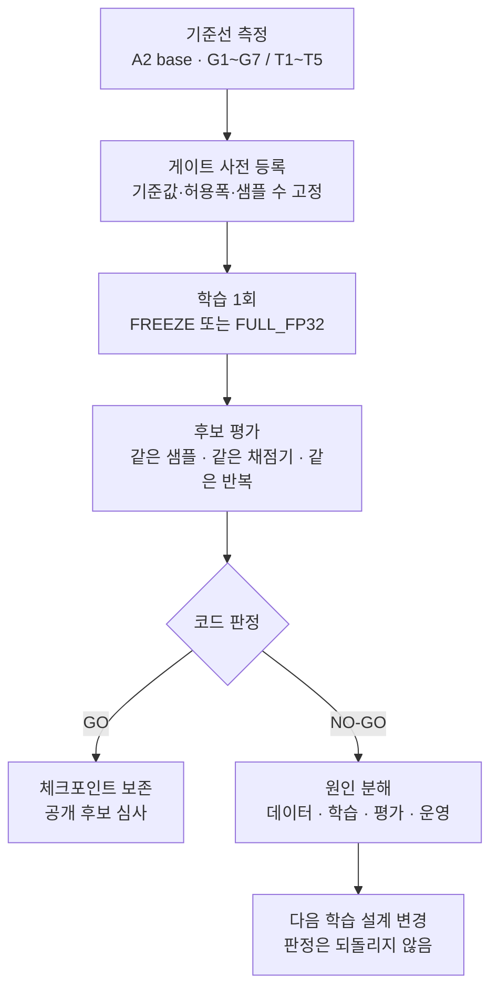

자체 음성 모델을 만든다고 하면 보통 "얼마나 좋아졌나"를 먼저 묻습니다. 저희는 그 질문을 뒤로 미루고 "무엇을 통과해야 출시인가"를 먼저 코드로 적었습니다. 이 합격 조건을 이 글에서는 게이트라고 부릅니다. ASR 쪽은 일반 한국어 오류율, 도메인 용어 오류율, 숫자 정확도, 무음 환각, 영어 유지, 누출, 지연의 일곱 게이트(G1~G7)이고 TTS 쪽은 내용 정확도, 화자 일관성, 자연성, 폭주·무음, 실시간 계수의 다섯 게이트(T1~T5)입니다. 학습을 돌리기 전에 기준선을 재고 후보는 같은 샘플·같은 채점기로만 비교하고 통과하지 못하면 판정을 뒤집지 않기로 했습니다.

그 결과가 이번 주의 성적표입니다. 판정 9건 중 7건이 NO-GO였습니다. 숫자만 보면 실패입니다. 그래도 사전 등록 게이트에서 가장 쓸모 있었던 결과는 떨어진 이유를 나눠 본 것이었습니다. 문제가 데이터에 있는지, 학습 레시피에 있는지, 평가 계약에 있는지, 운영에 있는지가 한 건씩 갈라졌고 그 구분이 다음 학습의 설계를 바꿨습니다. 이 글은 그 교훈을 자체 ASR·TTS를 만들려는 팀이 바로 가져다 쓸 수 있는 형태로 정리합니다.

*학습보다 게이트를 먼저 세웠습니다. 통과 건수보다 떨어진 이유를 가려낸 것이 더 큰 수확이었습니다.*

## 게이트를 먼저 코드로 등록하는 이유

음성 파인튜닝은 결과가 그럴듯하게 보이기 쉬운 영역입니다. 샘플 몇 개를 들어 보면 좋아진 것 같고 한 벤치마크의 CER이 떨어지면 성공으로 읽고 싶어집니다. 저희가 게이트를 먼저 등록한 이유는 그 유혹을 코드로 막기 위해서입니다. 게이트는 학습 전에 등록하고 기준선 모델을 같은 평가 도구로 먼저 재고 후보가 나오면 같은 샘플 수와 반복 횟수로만 비교합니다. 판정은 스크립트가 냅니다. 사람은 그 결과를 해석합니다.

이 구조에서 중요한 것은 두 가지입니다. 첫째, NO-GO를 사후에 PASS로 바꾸지 않습니다. 평가셋에서 불리한 샘플을 빼거나 문턱을 낮추는 식으로 판정을 되돌리면 게이트는 그 순간부터 장식이 됩니다. 둘째, 그렇다고 게이트가 틀릴 수 없다는 뜻은 아닙니다. 다음 버전에서는 문턱을 새 버전으로 다시 등록할 수 있습니다. 과거 판정은 보존하고 새 기준은 학습 전에 선언합니다. 이 둘을 구분하면 게이트가 엄격하면서도 배울 수 있는 장치가 됩니다.

## 가장 큰 교훈은 라벨 표기였습니다

첫 한국어 ASR 후보는 [Qwen3-ASR-1.7B](https://huggingface.co/Qwen/Qwen3-ASR-1.7B)를 Zeroth 낭독 코퍼스와 도메인 데이터로 한 에포크 미세조정한 것이었습니다. 일반 한국어 CER은 3.83%에서 2.36%로 내려갔습니다. 무음과 저음량 잡음 60건에 대한 환각은 기준선이 60건 전부 "그렇죠" 같은 상투구를 뱉던 것이 0건으로 사라졌고 이것이 전·후처리가 아니라 모델 자체의 변화라는 것도 같은 추론 경로로 확인했습니다. 같은 클러스터에서 잰 지연은 28% 줄었습니다. 여기까지는 성공으로 읽힙니다.

그런데 [FLEURS](https://huggingface.co/datasets/google/fleurs) 낭독 평가에서 CER이 5.52%에서 7.45%로 올라 G1 게이트에 걸렸습니다. 원인은 라벨 표기였습니다. Zeroth 라벨은 숫자를 한글로 풀어 쓰고 구두점이 없습니다. 모델은 그 표기를 충실히 배웠고 아라비아 숫자와 구두점으로 쓰인 FLEURS 평가셋에서는 글자 수준 오류가 늘어났습니다. 숫자 평가셋에서도 절반가량의 오류가 "일만 육천 원"과 "16000원"처럼 같은 말을 다르게 적는 표기 차이였습니다.

이 진단은 학습 전에 10분짜리 점검으로 잡을 수 있었습니다. 학습 라벨 100개와 평가 라벨 100개를 나란히 놓고 숫자 표기, 구두점, 영문 토큰의 비율을 비교하면 바로 보이는 차이였습니다. 저희는 두 번의 학습을 돌린 뒤에야 이걸 확인했고 그래서 지금은 그 점검을 제출 경로에 코드로 넣었습니다. 학습 라벨과 평가 라벨의 표기 분포가 일정 폭 이상 벌어졌는데 어떤 표기를 목표로 하는지 선언한 정책 파일이 없으면 제출이 막힙니다.

해법 쪽도 조심스럽게 정했습니다. 모든 숫자를 아라비아 숫자로 바꾸는 식의 일괄 치환은 하지 않습니다. "삼성", "삼 분", "3분", "Qwen3"는 문맥마다 규칙이 다르고 뜻을 바꾸는 치환은 라벨을 망칩니다. 대신 기준선 모델이 학습 오디오를 전사한 결과를 옆에 두고 숫자 읽기를 맞추면 글자가 완전히 같아지는 발화에서만 라벨을 기준선의 표기형으로 바꿉니다. 원 전사, 정규화 전사, 정규화 규칙 버전을 행마다 따로 보존해서 언제든 되돌릴 수 있게 했습니다.

## 오디오 인코더를 얼리면 억양은 배우지 못합니다

두 번째 후보는 같은 데이터로 오디오 인코더까지 포함해 전체를 fp32로 학습한 것입니다. 일반 CER 게이트는 여전히 통과하지 못했지만, 기업 도메인 전문용어 오류율은 5.69%에서 3.04%로 47% 줄었고 숫자 평가에서 그럴듯하게 틀린 숫자는 26건에서 5건으로 내려갔습니다. 라벨 표기 문제가 그대로인 상태에서도 인코더를 학습한 쪽이 용어와 숫자를 더 잘 들었습니다.

방언 트랙에서는 이 차이가 더 선명했습니다. 다섯 권역에서 권역당 10시간씩 파일럿 데이터를 만들고 오디오 인코더를 얼린 레시피와 전체를 학습한 레시피를 변경하지 않고 고정해 둔 같은 평가셋으로 비교했습니다. 얼린 쪽은 제주 CER이 9.0% 상대 개선에 그쳤고 경상은 2.9%였습니다. 전체를 학습한 쪽은 제주 14.5%, 경상 10.8%, 전라 8.6%였습니다. 억양이 다른 음성을 알아듣게 하려면 소리를 듣는 층을 함께 움직여야 한다는 결론입니다.

다만 두 후보 모두 사전 등록한 권역 CER 15% 개선 문턱에는 미치지 못해 NO-GO입니다. 제주의 14.5%가 문턱에 거의 닿았다는 점이 아쉽지만, 여기서 문턱을 낮추지는 않았습니다. 대신 다음 투자를 데이터로 돌렸습니다. 권역당 10시간은 파일럿 분량이고 권역당 50시간과 화자 다양성을 확보한 뒤에 본학습을 한 번 돌리는 것이 다음 단계입니다. 10시간으로 15%를 못 넘긴 것이 레시피 탓인지 데이터 양 탓인지는 지금 데이터로는 가릴 수 없고 그 둘을 가리는 가장 싼 방법이 데이터를 늘리는 것이기 때문입니다.

ASR 세 후보의 게이트 결과를 한 표로 두면 이렇습니다.

| 지표 | 기준선 | 인코더 동결 | 전체 fp32 |
|---|---|---|---|
| Zeroth CER | 3.83% | 2.36% | 3.22% |
| FLEURS CER | 5.52% | 7.45% | 8.71% |
| 도메인 용어 오류율 | 5.69% | 5.20% | 3.04% |
| 숫자 정답률 | 25.8% | 25.0% | 30.8% |
| 그럴듯한 오답 수 | 26 | 29 | 5 |
| 무음 환각 | 60/60 | 0/60 | 0/60 |

두 후보 모두 NO-GO지만, 표를 열별로 읽으면 다음 학습이 어디로 가야 하는지가 보입니다. 라벨 표기를 맞추고 fp32 경로를 유지하는 것이 세 번째 후보의 레시피입니다.

## 브랜드 음성은 2시간이면 충분했고, 30분은 부족했습니다

TTS 쪽은 [VoxCPM2](https://huggingface.co/openbmb/VoxCPM2)에 LoRA를 붙여 단일 화자 브랜드 음성을 만드는 실험이었습니다. 기준선은 베이스 모델에 같은 화자의 참조 클립을 넣는 zero-shot 복제이고 후보는 그 화자의 낭독으로 학습한 LoRA입니다. 기준선과 후보가 같은 참조 클립과 같은 100문장을 쓰도록 평가 도구가 강제합니다.

30분 분량으로 학습한 첫 후보는 떨어졌습니다. 화자 코사인 유사도가 기준선과 후보 모두 0.969로 같았습니다. 참조 복제만으로 화자 유사도가 거의 채워져 LoRA가 더할 여지가 없었다는 뜻입니다. 그 상태에서 30분 LoRA는 내용 정확도를 깎고 자연성을 낮추고 100문장 중 12문장에서 생성이 끝나지 않고 상한까지 달리는 폭주를 만들었습니다. 그 분량은 기준선을 넘기에 부족했습니다.

2시간 분량으로 학습한 두 후보는 통과했습니다. 랭크 32, 알파 32, 학습률 1e-4, 유효 배치 16, 2 에포크의 같은 레시피로 표준어 전문 성우 여성 1명과 남성 1명을 각각 학습했습니다. 화자 코사인은 0.9405에서 0.9464로, 0.9584에서 0.9673으로 올랐고 [UTMOS](https://arxiv.org/abs/2204.02152) 자연성은 0.20과 0.35 올랐으며, 폭주와 무음 출력은 0건이었습니다. 세 번째 성우는 화자 코사인이 0.002 낮아져 떨어졌는데, 이 차이는 단일 측정의 잡음 안에 있습니다. 그래도 판정은 등록한 대로 두었습니다.

실시간 계수 게이트에서는 측정 도구 쪽 교훈이 하나 나왔습니다. LoRA를 붙인 모델 객체로 재면 추론이 25% 느려져 T5에 걸립니다. 가중치를 베이스에 병합해도 같은 객체에서는 속도가 그대로였고 병합 가중치를 LoRA 설정 없이 만든 보통 베이스 객체에 올려야 기준선과 같은 속도가 나왔습니다. 느린 원인은 LoRA 설정으로 만든 모델 객체의 추론 경로에 있었습니다. 어댑터 연산 자체는 무관했습니다. 서빙 조건은 병합 가중치이므로 T5는 병합 상태에서 재는 것으로 확정했고 그 사실을 게이트 정의에 적어 두었습니다.

여기서 다음 버전 게이트에 반영할 교훈이 하나 더 있습니다. 같은 기준선 모델을 두 번 재면 내용 정확도 지표가 3포인트 안에서 흔들렸습니다. 그런데 화자 유사도는 0.002 차이로 판정이 갈렸습니다. 지표마다 분포와 변동성이 다르므로 같은 오차 범위를 일괄 적용할 수는 없고 지표별로 반복 측정해서 허용 폭을 정하고 같은 샘플의 짝 비교를 쓰는 것이 맞습니다. 이번 판정은 등록한 대로 둡니다. 다음 게이트는 그 허용 폭을 함께 등록할 겁니다.

## 운영 사고는 실험 내용과 무관하게 시간을 잃게 합니다

학습 데이터 4만 발화를 기준선 모델로 전사하는 5시간짜리 잡이 있었습니다. 소요 시간을 300분으로 선언했고 300분에 타임아웃이 걸렸고 산출물은 0건이었습니다. 두 가지가 겹쳤습니다. 전사 결과를 세트가 끝날 때 한 번에 쓰는 구조라 중간 결과가 없었고 발화 수에 발화당 측정 지연을 곱하면 5시간이 안 된다는 것이 바로 나오는데 그 산술을 하지 않았습니다.

고친 것은 셋입니다. 전사 결과는 발화마다 바로 파일에 쓰고 잡이 어떤 이유로 끝나든 만든 만큼 저장소에 남게 했습니다. 재시작하면 이미 끝난 발화는 건너뜁니다. 그리고 제출 전에 예상 소요 시간을 발화 수와 측정 지연으로 계산해 타임아웃과 비교하고 한 시간이 넘는 잡은 중간 저장과 재시작 방법을 스펙에 선언하지 않으면 제출이 거부되게 했습니다. 바로 다음 전사 잡이 다시 타임아웃에 걸렸지만, 이번에는 1만 1천 발화가 보존됐고 남은 분량만 이어서 돌렸습니다. 같은 종류의 사고가 전손에서 지연으로 바뀌었습니다.

학습 후 손실 곡선을 보는 게이트에서도 비슷한 일이 있었습니다. 첫 손실이 8을 넘으면 발산으로 보던 절대 문턱이 fp32 학습과 방언 학습에서 두 번 오탐을 냈습니다. 첫 손실의 절대값은 정밀도와 라벨 길이에 따라 8에서 21까지 정상 범위였습니다. 봐야 할 것은 내려가는 폭과 검증 손실의 방향이었습니다. 게이트를 상대 기준으로 바꾸고 경계값 테스트를 붙였습니다. 운영 결함은 테스트로 재발을 막는 것이 맞습니다.

## ThakiCloud가 이 결과를 어디에 쓰는가

이 실험은 Paxis 음성 에이전트와 BizPilot 음성 응대에 들어갈 자체 ASR·TTS를 위한 것입니다. 기업 업무 명령에는 제품명, 영숫자 코드, 금액, 날짜가 섞여 있고 일반 벤치마크가 좋아도 "B200 8장 중 2장"을 틀리면 에이전트가 틀린 일을 합니다. 그래서 게이트에 도메인 용어 오류율과 숫자 정답률을 따로 두었고 무음 환각 게이트는 전화 응대처럼 침묵이 자주 들어오는 서비스에서 모델이 없는 말을 만들지 않게 하려는 것입니다.

학습과 평가는 모두 사내 GPU 클러스터의 큐 잡으로 돌렸고 체크포인트와 측정 원장은 사내 저장소에 남습니다. Metis 서빙 쪽에는 병합 가중치가 기준선과 같은 속도로 돈다는 사실이 바로 쓰이고, Maxis 학습 쪽에는 이번에 코드로 박은 사전 점검이 다음 학습의 기본값이 됩니다. 라벨 표기 대조, 소요 시간 산술, 중간 저장 선언은 다른 파인튜닝 잡의 제출 경로에도 같은 형태로 들어갑니다.

## 모델 공개는 법무 판단 뒤에 합니다

학습 데이터로 쓴 공공 음성 데이터의 약관은 학습한 모델의 배포를 허용합니다. 원본 음성과 전사, 그것을 단순 가공한 파일은 외부로 나갈 수 없고 이 글에도 싣지 않았습니다. 그런데 브랜드 음성 두 후보는 특정 성우 한 사람의 음색을 그대로 재현하는 가중치입니다. 데이터 이용 허락과 "그 사람의 목소리를 재현하는 모델을 제3자가 내려받아 쓰게 하는 것"에 대한 동의는 범위가 다른 문제입니다. 서울중앙지방법원 2025카합20687 결정은 음성합성 학습 데이터 제공 계약만으로 동일·유사한 음성을 제공하는 것까지 허락한 것으로 볼 수 없다고 판단했습니다. 그래서 학습된 모델 가중치의 공개는 법무 판단 뒤에 진행합니다.

공개 브랜드 음성은 다른 길로 갑니다. 실존 화자를 재현하지 않는 합성 음성을 Voice Design으로 설계한 뒤 같은 LoRA 레시피와 같은 T1~T5 게이트로 판정하는 경로입니다. 이번에 통과한 레시피는 그대로 쓰고 재현 대상만 바꿉니다. 자체 음성 모델을 준비하는 팀이라면 데이터 약관을 확인하는 단계에서 화자 동의의 범위까지 같이 확인해 두는 것이 뒤에 시간을 아끼는 길입니다.

## 다음 학습 하나

이번 주 결론은 세 줄입니다. 라벨 표기를 맞춘 뒤 오디오 인코더를 포함한 fp32 레시피로 한국어 ASR을 한 번 더 학습합니다. 방언은 권역당 50시간과 화자 다양성을 확보할 때까지 GPU를 쓰지 않습니다. 브랜드 음성은 통과한 두 모델을 사내에서 쓰고 공개용은 합성 음성으로 다시 만듭니다. 게이트 통과 건수는 여전히 2건입니다. 다음 학습에서 무엇을 고쳐야 하는지는 게이트 결과에 남아 있습니다.

## 출처

- ASR 기준선·후보 모델: [Qwen3-ASR-1.7B](https://huggingface.co/Qwen/Qwen3-ASR-1.7B)
- TTS 기준선·후보 모델: [VoxCPM2](https://huggingface.co/openbmb/VoxCPM2)
- 낭독 평가셋: [FLEURS](https://huggingface.co/datasets/google/fleurs)
- 자연성 지표: [UTMOS (arXiv:2204.02152)](https://arxiv.org/abs/2204.02152)
