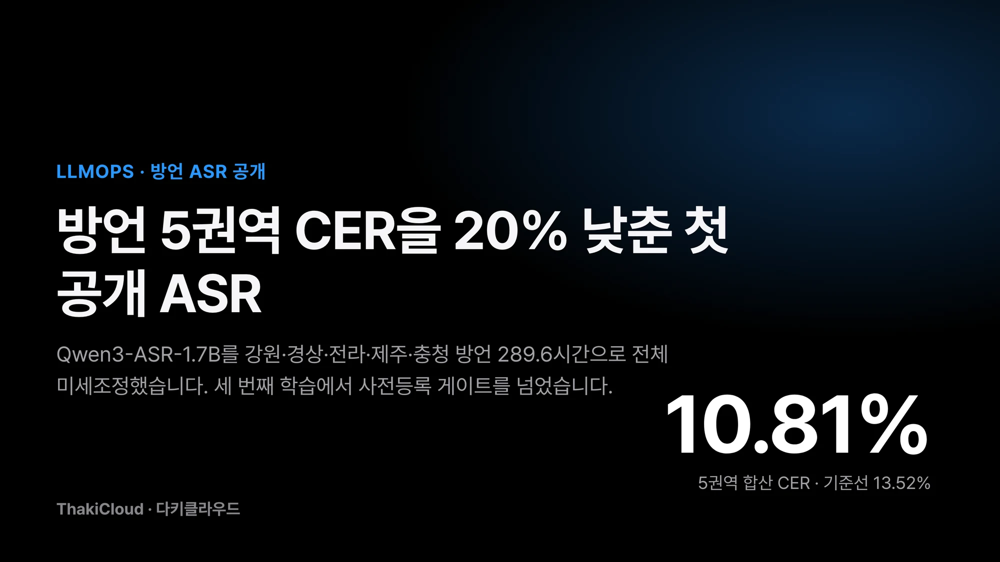
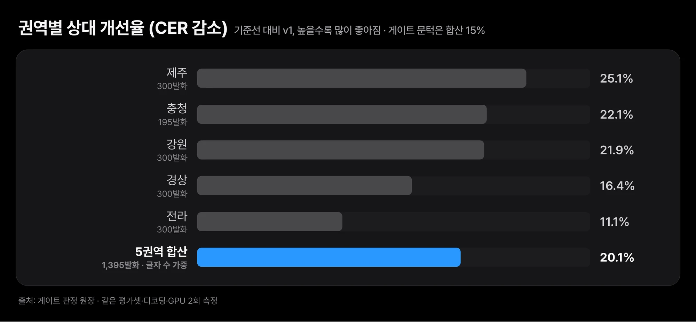
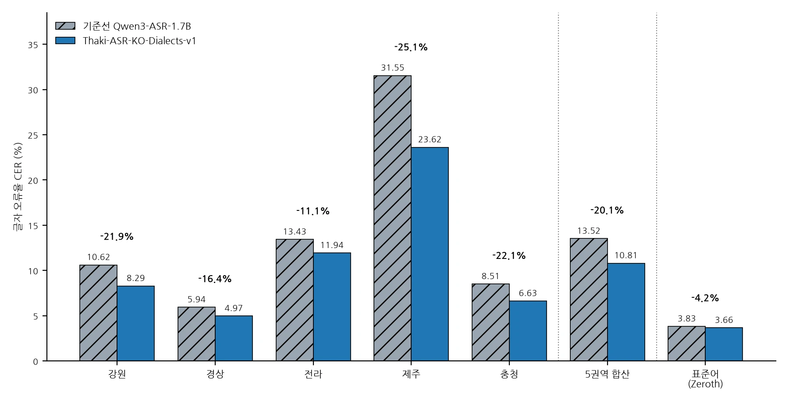
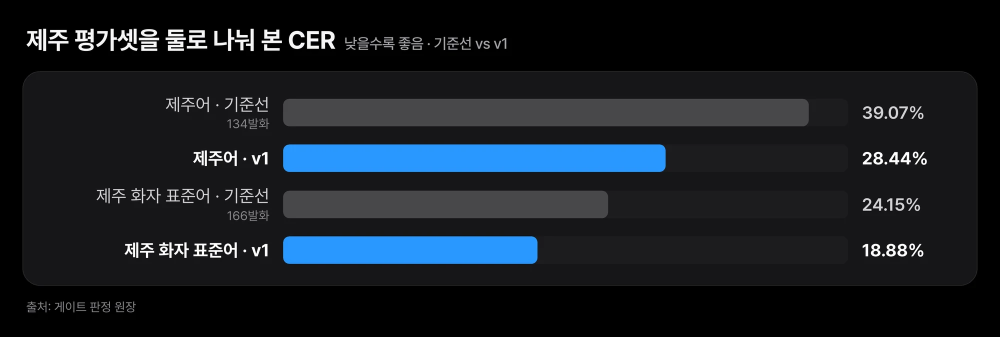
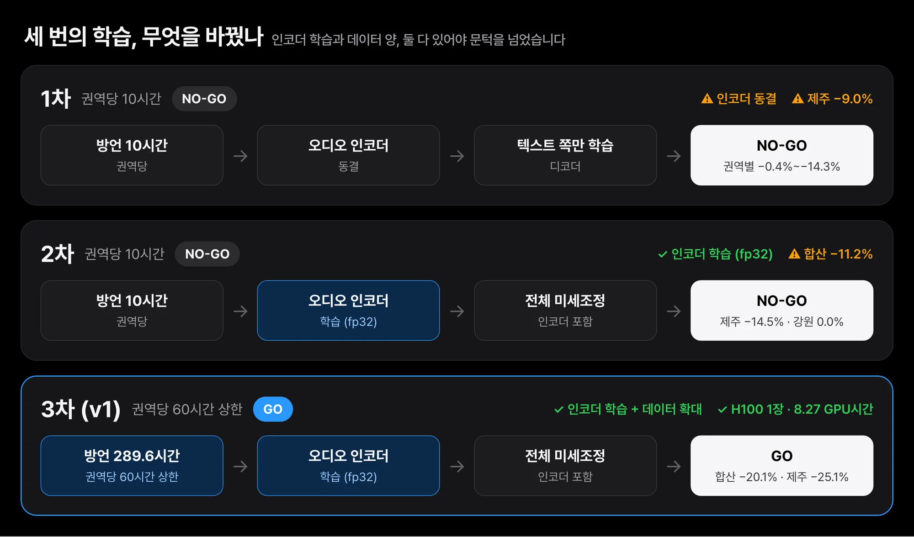
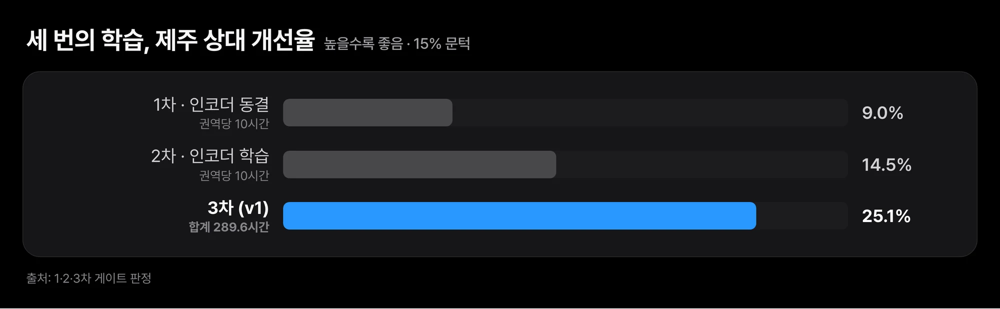
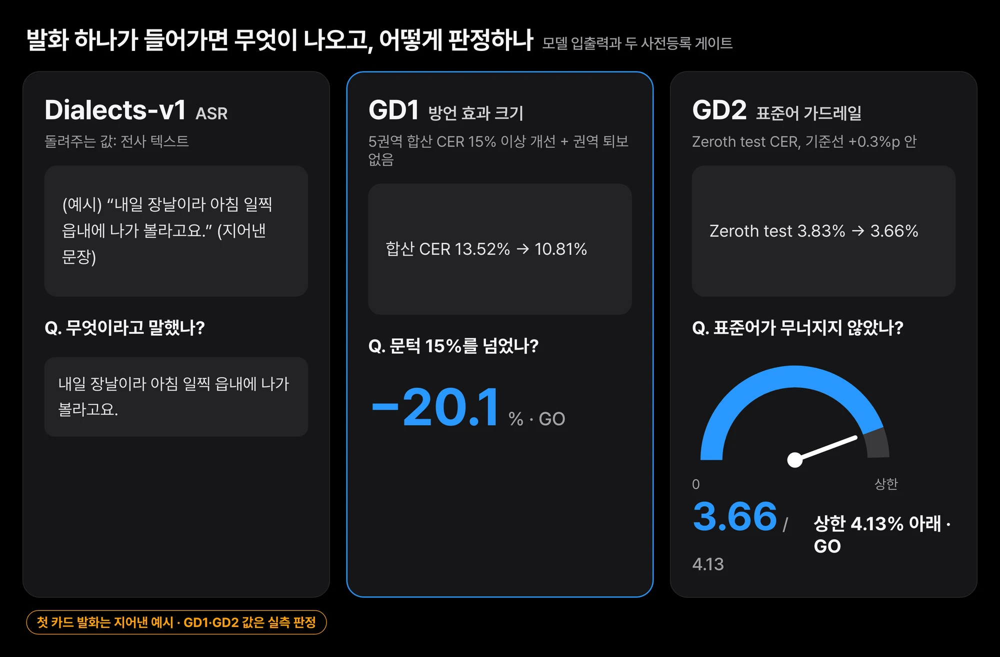

전화 응대에는 표준어만 들어오지 않습니다. 제주 억양으로 말한 발화를 ASR(음성인식)이 틀리게 받아 적으면, 그 뒤의 에이전트는 틀린 일을 합니다. 그래서 ThakiCloud의 첫 공개 음성인식 모델은 방언부터 겨냥했습니다.

[Thaki-ASR-KO-Dialects-v1](https://huggingface.co/ThakiCloud/Thaki-ASR-KO-Dialects-v1)을 Hugging Face에 올렸습니다. [Qwen3-ASR-1.7B](https://huggingface.co/Qwen/Qwen3-ASR-1.7B)를 강원, 경상, 전라, 제주, 충청 다섯 권역의 방언 음성 289.6시간으로 전체 미세조정한 모델입니다. 학습 전에 봉인해 둔 방언 평가셋에서 글자 오류율(CER, 참조 글자 중 틀리게 받아 적은 비율)이 13.52%에서 10.81%로 내려갔고 다섯 권역이 모두 좋아졌습니다.

가장 어려운 제주어는 39.07%에서 28.44%로 내려갔습니다. 표준어 낭독(Zeroth-Korean)은 3.83%에서 3.66%로 그대로입니다. 가중치는 Apache-2.0이고 `Qwen/Qwen3-ASR-1.7B` 자리에 그대로 바꿔 끼울 수 있습니다. 이 결과는 세 번째 학습에서야 나왔습니다. 아래에서 권역별 수치, 앞의 두 번이 떨어진 이유, 판정을 지킨 게이트, 아직 모르는 것을 차례로 보여 드립니다.

## 다섯 권역이 모두 좋아졌고, 제주가 가장 크게 움직였습니다

아래 수치는 기준선 모델과 공개 모델을 같은 평가셋, 같은 디코딩, 같은 GPU에서 2회씩 직접 잰 값입니다. greedy 디코딩이라 두 반복의 출력이 글자 단위로 같았고 그래서 편차는 적지 않았습니다. 지난 글에서 10시간짜리 파일럿으로 넘지 못했던 15% 문턱을 이번에는 넘었습니다.

*다섯 권역 모두 좋아졌고 합산 상대 변화는 −20.1%입니다. 전라는 −11.1%로 단독이었다면 15%를 넘지 못했을 유일한 권역입니다.*

*게이트 판정 원장에서 읽어 그린 값입니다. 제주가 가장 크게, 전라가 가장 작게 좋아졌습니다.*

| 권역 | 발화 수 | 기준선 CER | v1 CER | 상대 변화 |
|---|---|---|---|---|
| 강원 | 300 | 10.62% | 8.29% | −21.9% |
| 경상 | 300 | 5.94% | 4.97% | −16.4% |
| 전라 | 300 | 13.43% | 11.94% | −11.1% |
| 제주 | 300 | 31.55% | 23.62% | −25.1% |
| 충청 | 195 | 8.51% | 6.63% | −22.1% |
| 5권역 합산 | 1,395 | 13.52% | 10.81% | −20.1% |
| 표준어 Zeroth test | 200 | 3.83% | 3.66% | 가드레일 통과 |

합산 CER은 다섯 권역에서 틀린 글자(치환, 삭제, 삽입)를 전부 더해 전체 참조 글자 수 25,332자로 나눈 값입니다. 권역이 발화 수가 아니라 참조 글자 수로 가중되므로 권역별 CER을 발화 수로 평균 낸 값(14.42%에서 11.43%)과는 다릅니다. 게이트는 합산값으로 판정했고 모델 카드에는 두 값을 모두 적었습니다.

### 제주를 둘로 나누면 제주어 쪽이 더 좋아졌습니다

제주 평가셋은 전사에 방언형 표현이 들어간 발화와 그렇지 않은 발화로 나눠서도 봤습니다.

*방언형 표현이 들어간 제주어 발화 134건은 39.07%에서 28.44%로, 제주 화자의 표준어 발화 166건은 24.15%에서 18.88%로 내려갔습니다. 크게 나아졌지만 아직 높습니다.*

제주어 쪽이 더 많이 좋아졌습니다. 다른 권역의 방언형 분할은 27건에서 63건으로 작아서 방향만 읽어야 하고 게이트 기준으로도 쓰지 않았습니다.

## 인코더 학습과 데이터 양, 둘 다 있어야 문턱을 넘었습니다

같은 베이스 모델로 방언 학습을 세 번 돌렸습니다. 처음 두 번은 권역당 10시간 파일럿 데이터였고 둘 다 NO-GO였습니다.

*1차와 2차의 차이는 오디오 인코더 학습, 2차와 3차의 차이는 데이터 양입니다. 둘 중 하나만으로는 15% 문턱을 넘지 못했습니다.*

| 시도 | 학습 데이터 | 오디오 인코더 | 제주 상대 변화 | 합산 상대 변화 | 판정 |
|---|---|---|---|---|---|
| 1차 | 권역당 10시간 | 동결 | −9.0% | 권역별 −0.4%에서 −14.3% | NO-GO |
| 2차 | 권역당 10시간 | 학습 (fp32) | −14.5% | −11.2% | NO-GO |
| 3차 (v1) | 권역당 60시간 상한, 합계 289.6시간 | 학습 (fp32) | −25.1% | −20.1% | GO |

1차는 오디오 인코더(소리를 듣고 특징으로 바꾸는 앞단)를 얼리고 텍스트 쪽만 학습한 레시피였습니다. 제주가 9% 좋아진 것이 최대였고 전라는 거의 움직이지 않았습니다. 억양이 다른 소리를 알아듣게 하려면 소리를 듣는 층이 함께 움직여야 한다는 결론이 여기서 나왔습니다.

2차는 같은 10시간 데이터로 인코더까지 전체를 학습했습니다. 제주가 14.5%까지 올라 문턱 바로 아래에 닿았지만 합산은 11.2%에 그쳤고 강원은 0.0%로 움직이지 않았습니다. 3차는 권역당 상한을 60시간으로 올려 합계 289.6시간을 넣었고 H100 한 장에서 8.27 GPU시간이 들었습니다.

*제주 상대 변화는 1차 −9.0%, 2차 −14.5%로 문턱 바로 아래에 멈췄고, 데이터를 289.6시간으로 늘린 3차에서 −25.1%가 됐습니다.*

1차와 2차의 차이가 인코더 학습의 효과이고 2차와 3차의 차이가 데이터 양의 효과입니다. 데이터 양과 오디오 인코더 갱신, 둘 중 하나만으로는 문턱을 넘지 못했습니다.

## 합격 조건은 학습 전에 코드로 적어 두었습니다

사전등록 게이트는 출시 합격 조건을 학습 전에 코드로 적어 둔 것이고, 판정은 사람이 아니라 스크립트가 냅니다.

*첫 카드의 발화는 지어낸 예시 문장이고 학습 데이터가 아닙니다. 둘째와 셋째 카드의 값은 본문의 실측 게이트 판정입니다.*

GD1은 5권역 합산 CER이 기준선보다 15% 이상 내려가면서 발화 150건 이상인 어떤 권역도 기준선보다 나빠지지 않을 것입니다. GD2는 Zeroth test CER이 기준선 +0.3%p 안에 머물 것입니다. 이번에는 GD1이 −20.1%로 통과했고 GD2는 3.66%로 상한 4.13% 아래였습니다.

### 게이트를 합산 기준으로 바꾼 이유

처음 두 번의 판정에 쓴 규칙은 전 권역 각각 15% 개선이었습니다. 그런데 2차에서 강원처럼 세트가 작고 녹음 세션이 적은 권역 한 곳이 전체 판정을 결정했습니다. 그래서 세 번째 학습을 제출하기 전에 새 규칙을 등록했습니다. 효과 크기는 합산으로 묻고 권역별로는 퇴보 없음만 묻습니다.

이전 두 판정은 옛 규칙 그대로 보존했습니다. 새 규칙이 이전 실패 두 건을 그대로 NO-GO로 재현하는지 자체 검사를 통과시킨 뒤에 학습을 돌렸고, 문턱은 학습이 끝난 뒤에 손대지 않았습니다.

전라는 11.1% 개선으로 단독이었다면 15%를 넘지 못한 유일한 권역입니다. 등록된 규칙은 합산과 퇴보 없음을 묻고 v1은 이 규칙을 충족합니다. 모델 카드에도 같은 문장으로 적어 두었습니다.

## 가중치만 공개했고, 아직 모르는 조건이 많습니다

저장소에는 가중치와 토크나이저, 프로세서 설정만 있습니다. 학습에 쓴 AI Hub 한국어 방언 발화 데이터는 음성, 전사, 메타데이터 어느 것도 넣지 않았습니다. AI Hub 약관이 학습한 모델의 배포는 허용하지만 데이터 재배포는 금지하기 때문입니다. 출처 표기는 카드에 요구 형식대로 적었습니다. Zeroth-Korean은 CC BY 4.0입니다.

| 조건 | 이번 공개에서 |
|---|---|
| 5권역 방언, 깨끗한 단일 채널 녹음 | ✅ 봉인 평가셋에서 측정, 합산 10.81% |
| 표준어 낭독 | ✅ Zeroth test 3.66%, 가드레일 통과 |
| 남성, 어린이, 고령 화자 | ⚠️ 여성 화자가 권역별 78%에서 89%, 충청 평가셋은 전부 여성 |
| 잡음, 원거리 마이크, 전화 음질, 겹치는 발화 | ⚠️ 재지 않음 |
| 한국어 이외 언어 | ⚠️ 재지 않음, 베이스 모델 권장 |
| 서비스 환경 | ⚠️ 연구 게이트 통과일 뿐 검증 전 |

학습과 평가 모두 여성 화자가 권역별 78%에서 89%를 차지하고 20대 화자 비중이 높습니다. 충청 평가셋은 전부 여성입니다. 남성, 어린이, 고령 화자의 정확도는 모르는 값으로 보셔야 합니다.

깨끗한 단일 채널 녹음만 썼고 잡음, 원거리 마이크, 전화 음질, 겹치는 발화는 재지 않았습니다. 다국어도 재지 않았습니다. 같은 베이스를 한국어만으로 미세조정한 다른 실행에서 일본어 CER이 거의 두 배가 된 적이 있으므로 한국어 이외 음성에는 베이스 모델을 쓰시기 바랍니다.

전라 개선폭은 작고 전라 방언형 분할은 27건이라 발화 하나가 CER 3.7%p에 해당합니다. 제주는 23.6%, 제주어는 28.4%로 여전히 높습니다. 크게 나아진 것이지 풀린 것이 아닙니다. 이 공개는 연구 게이트를 통과했다는 뜻이고 서비스 환경을 검증했다는 뜻이 아닙니다.

## Paxis 음성 에이전트에 들어갈 첫 자체 ASR 체크포인트입니다

이 모델은 Paxis 음성 에이전트와 BizPilot 음성 응대에 들어갈 자체 ASR의 첫 공개 체크포인트입니다. 전화 응대와 현장 음성 명령에는 표준어만 들어오지 않습니다. 방언 억양이 섞인 발화를 틀리면 에이전트가 틀린 일을 합니다.

학습과 평가는 사내 GPU 클러스터의 큐 잡으로 돌렸고, 체크포인트는 200스텝마다 해시 검증과 함께 오브젝트 스토리지에 남겨 중단돼도 이어서 돌릴 수 있게 했습니다. 구조와 파라미터 수가 베이스와 같아서 Metis 서빙에는 베이스 모델과 같은 설정으로 올라갑니다. 평가 실행에서 3초에서 8초 발화의 중위 지연은 0.39초에서 0.61초였습니다.

## 끝으로

방언 ASR은 추가 튜닝을 돌리지 않습니다. 남은 요인은 화자 다양성과 잡음 환경 데이터인데 다음 데이터를 확보한 뒤의 일이고 이번 체크포인트는 여기서 봉인합니다.

음성 트랙의 다음 공개 모델은 TTS입니다. 지난 글에서 통과한 브랜드 음성 LoRA 레시피를 실존 성우가 아니라 VoxCPM2 Voice Design으로 설계한 합성 음성에 적용해 같은 게이트로 판정할 계획입니다. 실존 성우를 학습한 가중치는 권리 확인 전까지 공개하지 않습니다.

지금 해 볼 수 있는 실험은 간단합니다. 쓰고 계신 `Qwen/Qwen3-ASR-1.7B` 자리에 이 모델을 넣고, 갖고 계신 지역 억양 녹음 몇 개로 두 모델의 CER을 나란히 재 보시기 바랍니다.

## 출처

- 공개 모델: [ThakiCloud/Thaki-ASR-KO-Dialects-v1](https://huggingface.co/ThakiCloud/Thaki-ASR-KO-Dialects-v1)
- 베이스 모델: [Qwen/Qwen3-ASR-1.7B](https://huggingface.co/Qwen/Qwen3-ASR-1.7B), [Qwen3-ASR Technical Report (arXiv:2601.21337)](https://arxiv.org/abs/2601.21337)
- 표준어 가드레일 데이터: [Bingsu/zeroth-korean](https://huggingface.co/datasets/Bingsu/zeroth-korean) (CC BY 4.0)
- 직전 글: [음성 모델 파인튜닝, 9번 중 7번 떨어지고 배운 것](/tech-blog/ko/llmops/speech-finetuning-pre-registered-gates/)
