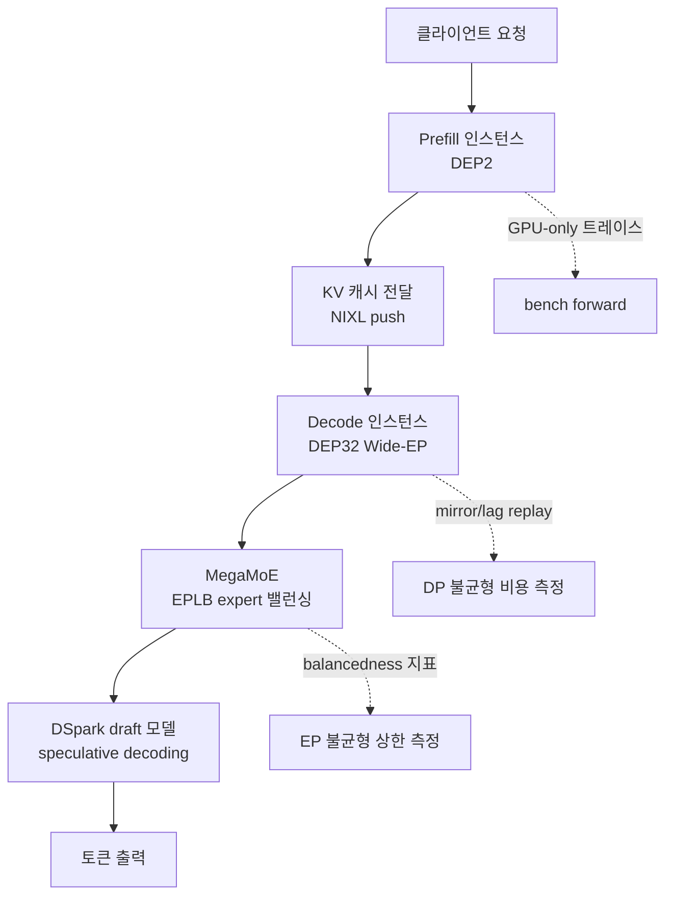

## 왜 읽어야 하나

vLLM으로 추론을 서빙하거나 서빙을 준비하는 엔지니어, 그리고 어떤 vLLM 릴리스를 트랙해야 하는지 결정해야 하는 플랫폼 팀을 위한 글입니다. 결론부터 말하면, vLLM이 DeepSeek의 자체 엔진 DeepInfer를 decode 6% 이내에서 따라잡았다는 뉴스보다 중요한 것이 두 가지 있습니다. 하나는 이들이 숫자를 믿을 수 있게 만든 측정 방법, 즉 mirror/lag replay와 balancedness 지표이고, 다른 하나는 이 최적화 대부분이 10월 25일 기준 어떤 안정 릴리스에도 들어가지 않은 main 지점의 PR이라는 사실입니다. vLLM 서빙 스택의 업그레이드 타이밍을 잡아야 한다면 이 두 가지를 아는 것이 결과 숫자 자체를 아는 것보다 실용적입니다.

*일반 목적 엔진의 곡선이 모델 특화 엔진의 곡선을 따라 붙는 순간을 형상화했습니다.*

## 개요

10월 23일, vLLM 팀(이번 작업의 주도권은 Inferact에 있습니다)이 "Serving DeepSeek-V4.1-Flash at Scale"을 게시했습니다. NVIDIA GB300 NVL72 랙 하나에서 P/D disaggregation과 Wide-EP를 조합해 DeepSeek-V4.1-Flash를 서빙한 결과, SemiAnalysis AgentX 워크로드에서 GPU당 954K tokens/s, 사용자당 P90 196 tokens/s를 기록했고, 이는 첫 번째 글의 단일 노드 결과보다 7.9배이며 DeepSeek의 오프피크 가격 기준 GPU당 1시간에 38.96달러입니다. 같은 글에서 vLLM의 decode 처리량은 DeepInfer 공개 곡선에 batch size 8에서 256까지 6% 이내였고, 단일 사용자를 위한 전용 decode 경로는 4개 B300에서 P90 826 tokens/s에 도달했습니다.

이번 주 전략 분석(요새가 메워졌다)에서 우리는 이 뉴스의 시장 쪽을 다뤘습니다. 모델 공급사의 인하우스 엔진과 오픈 프레임워크의 격차가 좁혀진다는 점, 서빙 스택 비교가 분기별 이벤트에서 릴리스 단위 반복 작업으로 바뀐다는 점이었습니다. 이번 글은 그 뒤의 기술 부분을 파고들고, 여기에 하나를 덧붙입니다. 이 최적화들이 실제로 어떤 vLLM 버전부터 손에 들어오는지, 그리고 지금 우리 서빙 스택 기준선과 비교하면 어디쯤 있는지를 GitHub 릴리스와 PR 기록을 실제로 조회해 확인한 결과입니다.

## 이 기술은 무엇인가: 일반 엔진이 모델 특화 엔진을 맞추다

DeepInfer는 DeepSeek가 이번 주에 공개한 DeepSeek-V4.1-Flash 전용 추론 엔진입니다. 글이 강조하는 것은 DeepInfer가 원래 vLLM 위에서 만들어졌다는 점입니다. 양쪽이 같은 계보를 공유하면서 vLLM은 DeepSeek가 오픈소스로 내놓은 커널, MegaAttn, MegaMoE, Mega-mHC을 통합하고 나머지 스택을 그 위에 최적화해 왔습니다. 그래서 "vLLM이 DeepInfer를 맞춘다"는 것은 외부 프레임워크가 남의 엔진을 모방했다는 의미가 아니라, 한 스택에서 태어난 두 엔진이 다시 만나 평결을 본 그림에 가깝습니다.

비교 설정을 정확히 짚어야 합니다. decode 비교는 DeepSeek의 decode 설정(컨텍스트 131K, nextn=3)에서 vLLM(GB200)과 DeepInfer의 공개 수치를 batch size 8에서 256까지 맞췄을 때 6% 이내라는 것입니다. prefill은 상황이 다릅니다. DeepInfer의 공개 곡선은 EP4DP4에 32개의 중복 expert, 140-token bounded replay를 쓰는 설정이고 하드웨어도 표에 적혀 있지 않습니다. vLLM 측 실험은 DEP2, 중복 expert 없이, 128-token replay로 돌렸기 때문에 두 곡선의 차이를 엔진 간 속도 차이로 읽지 말라고 글이 스스로 선언합니다. 보여 주는 것은 vLLM의 prefill이 DeepSeek의 엔진이 공개한 범위에서 그 추세를 따른다는 사실입니다.

그림의 실선은 서빙 흐름이고 점선은 측정 계층입니다. 이 글에서 반복되는 구조가 정확히 이것입니다. 서빙 최적화와 측정 최적화가 같은 노력으로 함께 설계되었다는 점, 숫자가 나오기 전에 측정 방법부터 정했다는 점입니다.

## DeepSeek-V4.1-Flash가 다르게 서빙되는 이유

최적화 전략은 모델의 구조에서 나옵니다. vLLM 팀은 튜닝 전에 먼저 모델의 특성을 계량했습니다. 네 가지가 핵심입니다.

첫째, 전역 KV 캐시 footprint가 토큰당 890바이트에 불과합니다. cross-layer KV 공유와 FP4 압축 덕입니다. 둘째, attention가 가벼운 구조입니다. 2, 8, 14층은 2배 압축으로 full-context indexing을 하고, bounded replay 덕분에 20층은 전체 토큰의 KV만 쓰고 indexing과 attention은 마지막 128개만 돌리며, 21에서 39층은 그 토큰만 처리합니다. 셋째, decode는 긴 컨텍스트에서도 MoE로 막힙니다. 128K 컨텍스트, rank당 64 요청 조건에서 MoE가 target step의 62%를 차지하고 attention과 indexer가 합쳐 13%입니다. 넷째, decode step 시간은 컨텍스트 길이에 거의 의존하지 않습니다. DEP32, rank당 16 요청, 1개 토큰에 DSpark draft 5개 토큰 조건에서 GB300의 target forward 시간은 64K에서 8.86ms, 128K에서 8.93ms, 855K에서 9.53ms입니다. 컨텍스트가 6.7배 커져도 지연은 0.6ms, 7% 증가에 그칩니다.

이 네 가지가 나머지 최적화를 결정합니다. prefill은 작은 DEP 사이즈가 좋아 KV 캐시가 HBM에 여유 있게 들어 batch size가 KV 용량에 막히지 않고, decode는 MegaMoE가 weight read로 막히므로 Wide-EP가 이 지배 비용을 직접 깎고, DP 로드 밸런싱은 요청 수 기준 최소 부하 정도로 단순화됩니다.

## 측정 방법: 숫자를 믿기 전에

이 글에서 가장 우리가 가져가야 할 부분은 측정 방법입니다. 세 가지 도구가 있습니다.

첫째, `vllm bench forward`(PR #61339)가 실제 execute_model 경로로 정확한 prefill이나 decode 배치의 model-forward 시간을 DP와 EP rank를 가로질러 측정합니다. GPU 시간만 잴 수 있어서 깨끗한 트레이스가 됩니다. 그 위에 DecodeBenchConnector가 engine 단위 end-to-end decode 성능을 측정하고, 둘의 차이가 예상 밖의 오버헤드를 드러냅니다.

둘째, DP 불균형 비용을 분리하는 mirror/lag replay입니다. 에이전트 트레이스는 실행마다 달라져 불균형을 고립하기 어렵습니다. 그래서 모든 DP rank에 동일한 요청을 재전송합니다. mirror run에서는 모든 rank가 동시에 요청을 받고, lag run에서는 r번째 rank가 5초 r배만큼 늦게 받습니다. 같은 총 작업량인데 단계가 어긋난 것이므로, 두 실행의 차이가 바로 DP 불균형의 비용입니다. 결과: prefix caching을 끄고 잰 lag replay에서 DEP2는 5.9% 손실(138.7K에서 130.5K tokens/s), DEP4는 13.6% 손실(267.6K에서 231.1K)이었습니다. concurrency 256의 AgentX prefill-only run에서는 DEP4가 DEP2의 per-GPU 처리량보다 83%에 머물렀고(64.4K 대 53.3K), 그 원인이 이 DP 불균형으로 지목됩니다. 그래서 prefill 기본값은 DEP2입니다.

셋째, EP 불균형의 상한을 정의하는 balancedness입니다. 각 MoE 계층에서 rank 평균 부하를 최대 rank 부하로 나눈 값을 step별로, EPLB 윈도우 전체로 평균합니다. 균형 잡힌 기준선은 같은 decode 배치를 토큰을 균일 무작위로 라우팅했을 때이고, 이 기준선조차 표본 노이즈가 있습니다. DEP32, GPU당 72 요청에서 균일 라우팅이 target(top-6) 0.96, draft(top-3) 0.94의 balancedness에 그친다는 점을 명시합니다. 실제 라우팅과 균일 라우팅의 차이가 expert 밸런싱이 회복할 수 있는 최대치이고, EPLB 실험은 그 중 실제로 몇 %를 회복하는지 보여 줍니다. EPLB는 3,000스텝마다 이전 1,000스텝의 부하 기준으로 expert를 재배열하는데, balancedness를 target 0.35에서 0.94, draft 0.21에서 0.89로 끌어올려 균일 라우팅과의 격차를 각각 약 97%, 93% 회복했습니다.

## 실제 실험 결과

vLLM 팀의 결과 중 이 글의 논거가 되는 수치를 정리합니다. prefill은 숨겨진 트레이스 뒤의 세 개 병목이었습니다. SWA bounded replay를 20층까지 확장(PR #59894, 32K 신규 토큰 기준 19.9%, 4K에서 10.1%에서 64K에서 23.1%까지 증가), Engram 공유 host 테이블의 GPU 페이지를 64KB에서 2MB로 옮겨 TLB 미스를 줄임(PR #62359, 2.8%), prefill indexer에 DeepSelect top-k 적용(PR #62240, 15.6%). 128K 캐시 hit 위에서의 합계는 4K에서 64K 신규 토큰에 걸쳐 35.6에서 43.9%이고, 64K에서 처리량은 71.2K에서 102.5K tokens/s/GPU로 늘었습니다.

decode는 Wide-EP 확장에서 diminishing return이 시작 지점을 찾는 일입니다. 64 요청/GPU, 128K 컨텍스트에서 DEP4에서 DEP32로 갈 때 target MegaMoE 시간은 13.4ms에서 6.0ms로 빠지지만 나머지 작업은 10ms 선에서 머물러 per-GPU 이득이 점진적으로 줄고, DEP32에서는 draft의 통신 오버헤드가 더 넓은 병렬성의 이득을 상쇄하기 시작합니다. CPU 오버헤드는 랙 스케일 decode에서 지배 변수가 됩니다. 최적화하지 않은 DEP32는 GPU 실행이 1.1ms 더 빠운데도 DEP16보다 느렸고(스텝당 17.57ms 대 13.84ms), 원인을 하나씩 찾아낸 결과가 다음 표입니다.

| 원인 | 수정 | 효과 (측정 설정) |
|---|---|---|
| KV read가 decode 워커 스레드에서 동기 발송 | NIXL push + UCX scatter-gather, packed KV 행을 하나의 NIXL region으로 (#61121) | 141K에서 440K tokens/s/GPU, P90 약 40에서 159 (GB300, 8P1D, c3,072) |
| Gloo all-reduce가 rank 수에 선형으로 성장 | recursive-doubling CPU all-reduce (#61767) | DP sync 10.8에서 1.5ms/step, step 16.10에서 13.15ms (DEP32) |
| admission 버스트, 1스텝에 최대 140 요청 | 스텝당 신규 KV 로드 4개 제한 opt-in (#61725) | 460K에서 516K tokens/s/GPU, P90 109에서 153 (GB300, 7P1D, c4,800) |
| admission 작업이 prompt 길이와 함께 성장 | prompt를 int32 버퍼 하나로, SWA null block 스킵, chunked copy (#59908 등) | 855K prompt 기준 admission당 CPU 38.8에서 6.0ms |

여기까지가 vLLM 팀의 숫자입니다. 이제 우리가 실제로 확인한 부분을 덧붙입니다.

### 우리가 확인한 것: 이 최적화들은 어떤 릴리스에 들어있나

블로그에는 "vLLM"이라고만 적혀 있고 버전이 없습니다. 어떤 빌드에서 이 결과가 나온 것인지, 그리고 stable 릴리스를 따라가는 우리가 손에 넣을 수 있는 것은 무엇인지를 확인하기 위해 10월 25일 기준 vLLM GitHub 릴리스 목록과 해당 PR들의 merge 상태를 조회했습니다. 결과가 run-2 로그(outputs/blog-impl/vllm-deepinfer-parity/run-2.log)와 release_map.json에 보존되어 있습니다.

먼저 릴리스 타임라인입니다. v0.32.0은 10월 18일, v0.31.0은 10월 5일, v0.30.0은 9월 22일, v0.29.0은 9월 9일에 나왔습니다. 블로그 게시(10월 23일) 직전의 stable 릴리스는 v0.32.0입니다.

그다음 PR의 merge 상태입니다. 16개 핵심 PR 중 v0.32.0 시점(10월 18일) 전후로 merge된 것은 measurement 도구인 `vllm bench forward`(#61339, 10월 14일), 20층 SWA replay(#59894, 10월 9일), recursive-doubling CPU all-reduce(#61767, 10월 15일), admission prompt copy kernel(#61724, 10월 15일), 전용 decode 커널 1호(#61868, 10월 21일)입니다. merge되지 않고 main에 있는 PR은 NVLink symm_mem 기반 EPLB(#62009), NIXL push UCX scatter-gather(#61121), admission cap(#61725), DeepSelect prefill indexer(#62240), Engram 2MB 페이지(#62359), 이질적 target/draft EPLB(#61395), prompt int32 버퍼(#59908), SWA null block 스킵(#62702), 전용 decode 커널 2호(#61869), 그리고 recursive-doubling의 기반(#60267)입니다. 그중 #62698(admission CPU 수정)은 10월 25일, 이 글을 쓰는 날 merge됐습니다.

*출처: release_map.json (2026-10-25 조회). 점은 merge 날짜의 PR, 표식은 10월 25일 기준 아직 open인 PR입니다.*

결론은 명확합니다. v0.32.0에는 측정 도구와 CPU 오버헤드 수정의 일부가 들어 있고, NVL72 랙 결과의 핵심(NIXL push, symm_mem EPLB, admission cap, 전용 decode 경로)은 v0.32.0 이후의 main에 있습니다. 블로그의 숫자를 그대로 재현하려면 stable 릴리스를 넘어서 main 빌드가 필요합니다. 그리고 우리의 기준선은 어디쯤이냐면, 10월 20일 서빙 원장의 기준이 vLLM v0.29.0입니다. 최신 stable(v0.32.0)보다 3개 릴리스, 그리고 이번 글의 핵심 최적화들보다 그 이상 멀리 있다는 뜻입니다. 릴리스가 2주 주기로 나오는 점을 고려하면 v0.29.0 기준은 6주 전의 스택입니다.

## ThakiCloud 제품 적용 시사점

ThakiCloud의 ai-platform은 K8s 위에 멀티테넌트 AI/ML 서빙 인프라를 운용합니다. 이번 글에서 우리가 실제로 취하는 행동은 두 가지입니다.

첫째, 측정 방법의 이식입니다. 우리는 P/D disaggregation 벤치마크를 이미 돌리는 팀입니다(vllm-pd-disagg-benchmark). mirror/lag replay가 주는 것은 DP 불균형의 비용을 단일 숫자로 분리하는 방법이고, balancedness가 주는 것은 EP 밸런싱이 "최대 얼마를 회복할 수 있는지"의 상한선을 먼저 정의해 놓고 그 중 얼마를 실제로 회복했는지를 재는 방법입니다. 이 두 가지는 하드웨어에 의존하지 않습니다. NVL72를 떠나 B200 노드나 H200 클러스터에서도, rank 수만 있으면 mirror/lag를 돌릴 수 있고 MoE 모델을 서빙하면 balancedness를 재릴 수 있습니다. 특히 lag run의 설계(rank r을 5초 r배만큼 늦게)는 부하 테스트 도구 하나 없이 스케줄러 타이밍만 조작하면 되므로 도입 비용이 낮습니다.

둘째, 릴리스 트랙킹의 기준을 바꾸는 것입니다. "vLLM 최신 stable을 따라간다"는 정책은 이번 주부터 한계를 드러냅니다. 추론 성능의 큰 변화는 stable 릴리스 사이클(약 2주)보다 빠른 main에서, 그리고 특정 모델의 특정 하드웨어 랙에서 먼저 일어납니다. 우리 서빙 스택의 엔진 버전 정책에는 "주요 벤치마크 블로그의 PR 목록을 release map으로 검증한다"는 단계가 필요해졌고, 이 글의 release_map.json이 그 템플릿입니다.

## 한계 및 반론

이 결과의 적용 범위를 좁히는 요인들을 먼저 짚습니다.

첫째, 하드웨어 특정성입니다. 랙 스케일 숫자(954K tokens/s/GPU, $38.96/GPU-hour)는 GB300 NVL72의 결과입니다. NVLink 도메인이 랙 전체인 환경의 결과가 B200 bare metal이나 H200 passthrough VM으로 그대로 이식되지 않습니다. decode 6% 이내 비교는 GB200에서 잰 것이지만, 이 역시 랙 내부 상호 연결과 동일한 전제 아래에서만 해석할 수 있습니다.

둘째, 모델 특정성입니다. Engram host 테이블, MegaMoE, DSpark draft, SWA bounded replay는 DeepSeek-V4.1-Flash 특화 구성입니다. 이 네 가지에 직접 의존하는 PR이 인용된 16개 중 대다수입니다. 하드웨어 독립적으로 이식되는 것은 측정 방법과 CPU 오버헤드 수정(Gloo all-reduce 대체, admission cap, NIXL push) 쪽입니다.

셋째, 비교 대상의 성격입니다. DeepInfer는 오프라인 엔진입니다. 멀티테넌트, 온라인 SLA를 쫓는 서빙과 같은 장에 서 있는 비교 대상은 아닙니다. vLLM이 DeepInfer를 "맞췄다"는 것은 오프라인 벤치마크 곡선에서 맞췄다는 뜻이고, 온라인 운영에서의 이점은 P/D disaggregation과 Wide-EP가 주는 것이지 DeepInfer 대체가 주는 것이 아닙니다.

넷째, 미검증 수치와 재현 가능성입니다. prefill 비교는 DeepInfer의 README 차트에서 값을 읽은 것이고, 이 글에서도 "엔진 간 속도 차이가 아니다"라고 명시합니다. 핵심 최적화 16개 PR 중 10개가 main의 미merge 상태이므로, stable 버전으로 재현하려는 시도는 실패합니다. 이 글의 PR merge 상태는 10월 25일 시점 스냅샷이며, 2주 주기의 릴리스를 감안하면 다음 stable에 이 PR들이 얼마나 들어가는지가 11월 초의 검증 지점입니다.

## 정리

vLLM이 DeepInfer를 따라잡았다는 뉴스의 기술적 함의는 세 층으로 나뉩니다. 첫 층은 결과: 모델 특화 엔진과 일반 목적 엔진의 decode 격차가 6% 이내로 좁혀졌고, 일반 목적 엔진은 오히려 랙 스케일 서빙으로 앞서 나갔습니다. 두 번째 층은 방법: 그 격차를 믿을 수 있게 만든 mirror/lag replay와 balancedness는 하드웨어 독립적으로 이식 가능한 측정 기술입니다. 세 번째 층은 운영: 이 최적화들은 stable 릴리스를 앞선 main의 PR에 모여 있으므로, 서빙 엔진 버전 정책은 릴리스 번호를 넘어 PR 포함 상태로 검증해야 하는 시대가 되었습니다.

여기에 읽는 사람의 다음 행동으로 정리합니다. vLLM 서빙을 운용한다면, 지금 돌리는 버전에서 `vllm bench forward`가 되는지부터 확인하세요. 되려면 측정 계층을 먼저 세우고 mirror/lag와 balancedness를 워크로드에 적용하는 비용이 가장 낮습니다. 그리고 이 글의 release_map.json처럼, 벤치마크에 인용된 PR들의 merge 상태를 릴리스와 대조하는 습관을 만들면 "다음 주에 무엇이 stable에 들어오는가"를 추적하게 됩니다. 일반 엔진이 특화 엔진을 맞추는 시대에, 승부는 엔진 선택에서 측정과 트랙킹의 주기로 이동했습니다.

## 출처

- vLLM Blog, [Serving DeepSeek-V4.1-Flash at Scale: vLLM Matches DeepInfer and Scales to GB300 NVL72](https://vllm.ai/blog/2026-10-23-deepseek-v41-flash-pd-wide-ep) (2026-10-23)
- vLLM GitHub 릴리스 및 PR 기록 (2026-10-25 조회, outputs/blog-impl/vllm-deepinfer-parity/release_map.json)
- 다키클라우드 서빙 원장 (2026-10-20 vnext, vLLM v0.29.0 기준)
