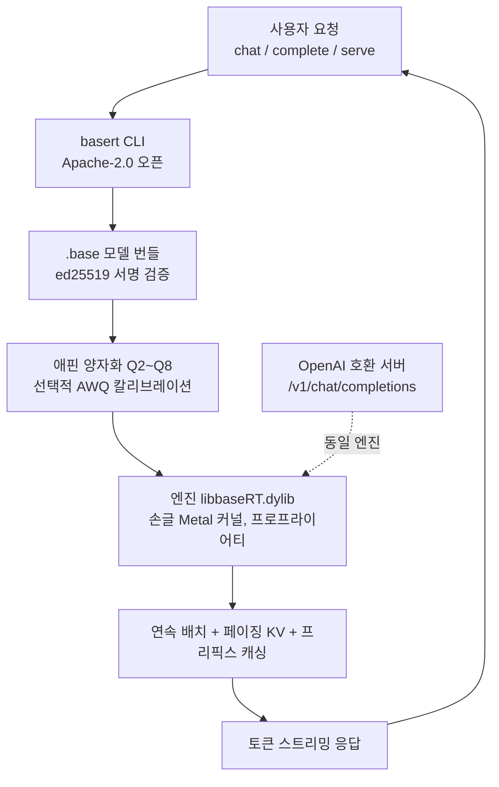

## 왜 읽어야 하나

로컬에 LLM을 돌리는 개발자, 혹은 엣지와 온프렘 환경에서 추론 엔진을 고르는 분이라면 BaseRT라는 이름을 최근 본 적이 있을 겁니다. Apple Silicon에서 llama.cpp보다 몇 배 빠르게 돌린다는 신규 런타임이기 때문입니다.

결론을 먼저 말씀드립니다. BaseRT의 손글 Metal 커널과 서명된 양자화 번들은 로컬 추론의 속도를 실제로 끌어올립니다. 다만 이 글에서 다루는 빠른 숫자 대부분은 벤더가 발표한 것이지, 제삼자의 독립 재현이 아닙니다. 그리고 CLI와 모델 포맷 명세는 오픈이지만, 그 속도를 내는 엔진 바이너리는 프로프라이어티입니다. 로컬 추론의 선택 기준이 "얼마나 빠른가"에서 "그 속도를 누가 소유하는가"로 한 칸 넓어졌다는 것, 이것이 이 글의 핵심입니다.

## 개요

BaseRT는 Base Compute의 로컬 LLM 추론 런타임입니다. 레포지토리는 2026년 6월 26일 생성되었고 10월 27일 v0.4.2가 배포되어 패키지 리지스트리 설치와 CUDA 13 지원, 배치 디코딩 속도 향상을 더했습니다. 같은 달 28일, 한 게시자가 "Qwen3.5 9B로 llama.cpp보다 4배 빠르다"는 트윗을 올리면서 다시 화제가 되었습니다. 실제로는 7월 20일경 Hacker News에서 "llama.cpp보다 6.4배, MLX보다 3.9배 빠르다"는 제목으로 이미 한차례 돌았습니다.

Apple Silicon에서 로컬 LLM을 돌리는 방식은 그동안 두 갈래였습니다. 하나는 llama.cpp의 GGUF 포맷, 다른 하나는 Apple이 직접 내는 MLX입니다. BaseRT는 이 두 갈래 사이에 손글 Metal 커널이라는 세 번째 경로를 냅니다. 핵심 차이점은 포맷입니다. BaseRT는 자체의 `.base` 포맷을 쓰며 이 포맷이 어떤 구조를 갖는지부터 살펴봅니다.

## 쉽게 말하면

차를 하나 생각해 보십시오. llama.cpp은 어느 차에나 끼우는 일반 엔진입니다. 연료인 GGUF도 개방 표준이라 어디서나 구해 끼웁니다. BaseRT는 이 특정 차, Apple Silicon의 Metal 환경을 위해 손으로 깎은 경주용 엔진입니다. 이 차에서는 확실히 빠릅니다. 다만 엔진이 밀봉되어 있고, 연료도 제조사가 서명을 찍어 담은 캔, 곧 `.base` 포맷 외에는 받지 않습니다.

이 비유는 이 글 전체를 관통합니다. 속도의 원천이 되는 엔진과, 그 엔진이 먹는 모델 포맷이 한 제조사에 묶여 있다는 것. 오픈인 부분은 CLI와 포맷 명세이고, 밀봉된 부분은 성능을 내는 바이너리입니다. 아래에서 그 경계가 어디에 그어지는지 구체적으로 봅니다.

## BaseRT는 무엇인가

BaseRT의 구조를 한 줄로 압축하면, 오픈 CLI가 서명된 양자화 번들을 밀봉된 엔진에 넘겨주는 런타임입니다. 각 구성 요소를 짚어보면 다음과 같습니다.

먼저 `basert` CLI입니다. 레포지토리에 오픈소스로 공개되어 있으며 Apache-2.0 라이선스입니다. 모델 pull, 변환, 챗, 원샷 완성, 벤치마크, 서버 시작을 이 CLI가 담당합니다.

다음은 `.base` 포맷입니다. BaseRT가 모델을 담는 자체 포맷으로, "애핀 양자화 Q2에서 Q8"을 기본으로 하고 선택적으로 AWQ 칼리브레이션을 거칩니다. 그리고 ed25519 서명을 붙인 번들 형태로 배포됩니다. 서명이 붙는다는 것은 모델 번들이 어디서 왔는지, 변조되지 않았는지를 검증할 수 있다는 뜻입니다. GGUF가 서명 없이 떠도는 것과 대비되는 지점입니다.

그리고 성능의 원천, 엔진 바이너리 `libbaseRT.dylib`입니다. 레포지토리는 이 엔진을 "손글 GPU 커널로 가속된다"고 설명하지만, 바이너리 자체는 프로프라이어티로 "자체 라이선스"를 따라 배포됩니다. 즉, 빠른 속도를 만드는 코드는 오픈이 아닙니다.

백엔드는 두 개입니다. Apple Silicon(M1 이상, macOS 14 이상)은 Metal, NVIDIA GB10(DGX Spark)와 Linux arm64는 CUDA입니다. 특히 CUDA 백엔드가 일반 x86 서버가 아니라 GB10, 곧 ARM 기반 디바이스에 한정된다는 점은 로컬과 엣지 전용 런타임임을 보여줍니다.

서빙 기능은 프로덕션 스택을 답습합니다. OpenAI 호환 서버, 연속 배치 처리, 페이징 KV, 프리픽스 캐싱, 레이트 리미팅을 지원합니다. 이 항목들은 vLLM 같은 프로덕션 서빙 스택에서 이미 검증된 기술입니다. 로컬 런타임이 이 기능을 따라잡고 있다는 것이 BaseRT의 또 다른 읽힙니다.



*BaseRT의 요청 처리 흐름입니다. 오픈인 CLI와 서명된 포맷이, 성능을 내는 밀봉된 엔진으로 이어지는 지점이 핵심입니다.*

## 설치 및 통합

설치는 단일 커맨드입니다. 벤더 도메인의 설치 스크립트를 셸에 파이프합니다.

```bash
curl -LsSf https://basecompute.co/install.sh | sh
```

이 명령이 `libbaseRT.dylib`와 `basert` CLI, `basert-*` 런타임 도구를 `~/.basert`에 놓고 PATH에 등록합니다. brew나 pip 경로가 없습니다. 수동 설치 시에는 GitHub 릴리스에서 `basert-engine-macos-arm64` 아카이브를 받아 빌드합니다.

모델은 pull로 가져옵니다. Base Compute가 미리 변환한 `.base`가 있고 HuggingFace 모델을 직접 변환하는 경로도 있습니다.

```bash
basert pull basecompute/Qwen3-0.6B   # Metal Q4, 약 430MB
basert pull Qwen/Qwen3-4B            # HuggingFace에서 변환 후 pull
basert convert <src>                  # 로컬 모델을 .base로 변환
```

pull의 기본 타깃은 `base-q4`이며, `--target`, `--revision`, `--force`, `--dry-run` 플래그로 조절합니다.

사용은 세 가지입니다. 챗, 원샷 완성, 벤치마크.

```bash
basert chat basecompute/Qwen3-0.6B
basert complete basecompute/Qwen3-0.6B --prompt "..." --max-tokens 256
basert bench basecompute/Qwen3-0.6B -p 512 -n 128 -r 3
```

`bench`가 `-p`(프리필 토큰 수), `-n`(생성할 디코드 토큰 수), `-r`(반복 횟수, 평균화)를 받으며, 프리필과 디코드를 각각 tok/s로 보고합니다. 서브 명령은 `--help`로 확인합니다.

서버는 OpenAI 호환 엔드포인트를 엽니다.

```bash
basert serve basecompute/Qwen3-0.6B --api-key "$(uuidgen)" --port 8080
# http://127.0.0.1:8080/v1/chat/completions
```

여기서 한 가지를 짚어야 합니다. `curl | sh`로 프로프라이어티 바이너리를 벤더 도메인에서 받아 실행하는 것은 공급망 관점에서 의식적으로 선택해야 할 지점입니다. 오픈 CLI와 포맷 명세는 레포에서 확인할 수 있지만, 성능을 내는 엔진은 바이너리 그대로입니다.

## 실제 실험 결과: 재현과 벤치마크

솔직하게 말씀드립니다. 재현 시도 중 실패였습니다. 이 글을 작성한 환경은 무인 헤드리스 세션으로, 셸의 outbound 네트워크 호출과 패키지 설치가 승인 게이트로 막혀 있어 BaseRT 설치, 모델 pull, 벤치마크를 직접 실행하지 못했습니다. 따라서 아래 수치는 모두 벤더와 게시자가 발표한 것, 곧 소스 표기입니다. ThakiCloud의 로컬 측정치가 아닙니다.

벤더 페이지의 M5 Pro 기준 표기를 정리하면 다음과 같습니다.

| 모델 | 포맷 | 지표 | BaseRT | llama.cpp | 벤더 표기 배율 |
|---|---|---|---|---|---|
| Gemma 4 E2B | Q8, pp2048 | 프리필 (tok/s) | 16,264 | 2,547 | 약 6.4배 |
| Qwen3 0.6B | Q4 | 디코드 (tok/s) | 531 | 표기 없음 | (M5 Pro) |

벤더는 "프리필에서 llama.cpp 대비 최대 6.4배, MLX 대비 최대 3.9배. 디코드는 최대 1.33배"라고 밝힙니다. 여기서 주목할 점은 6.4배가 프리필, 즉 프롬프트 처리 단계의 숫자라는 것입니다. 대화형 챗처럼 디코드가 비중 큰 워크로드에서는 배율이 1.33배 수준으로 줄어듭니다. "4배 빠르다"는 트윗의 수치는 게시자 자신의 표기로, 벤더 페이지의 특정 수치와 직접 대응하지 않습니다.

v0.4.0 릴리스 노트는 "Qwen 3.5/3.6 MoE 속도 향상"을 밝히며 트윗이 언급한 Qwen3.5 지원이 이 시점에 반영되었음을 뒷받침합니다.

결론적으로, BaseRT가 빠르게 동작한다는 방향성은 여러 출처가 일치합니다. 다만 구체적인 배율은 하드웨어(M5 Pro)와 모델(Gemma 4 E2B, Qwen3 0.6B), 지표(프리필 대 디코드)에 따라 크게 달라지며, 이 글에서 인용하는 수치는 전부 벤더와 게시자의 표기라는 점을 분명히 합니다.

## ThakiCloud 제품 적용 시사점

ThakiCloud의 ai-platform은 K8s 위에서 멀티테넌트 모델 서빙을 운용합니다. BaseRT가 가리키는 방향은 이 서빙 스택의 엣지 확장이 어디로 가는지를 보여줍니다.

첫째, 로컬과 엣지 추론의 단위가 소비자 하드웨어로 내려오고 있습니다. Apple Silicon 한 대로 수천 tok/s급 프리필을 낸다면, 서빙의 단위 경제는 데이터센터 GPU 대비 다른 곡선을 그립니다. 온프렘과 소버린 AI가 요구하는 "데이터가 시설 밖으로 나가지 않는" 환경에서, 성능이 충분한 로컬 엔진은 실용적 옵션이 됩니다.

둘째, BaseRT가 연속 배치, 페이징 KV, 프리픽스 캐싱을 지원하는 것은 로컬 런타임이 프로덕션 서빙의 기능을 따라잡고 있음을 보여줍니다. ai-platform이 vLLM 스택에서 이 기능들을 운영한다면, 로컬 엔진과의 기능 격차는 줄어듭니다. 기능 차가 아닌 라이선스 차가 로컬 대 프로덕션의 경계를 만듭니다.

셋째, 그리고 이것이 가장 중요합니다. 오픈 CLI와 포맷 명세, 프로프라이어티 엔진이라는 분할은 소버린 관점에서 평가해야 할 지점입니다. 포맷은 서명되어 변조를 검증할 수 있지만, 성능을 내는 코드는 밀봉되어 있습니다. "내가 서빙하는 모델과 그 실행 경로"를 완전히 감사할 수 있는가의 질문에, BaseRT는 절반의 답을 줍니다. ThakiCloud가 온프렘과 self-hosting을 강조하는 이유와 같은 선상에서, 로컬 엔진의 소유 경계는 도입 판단에 들어갈 항목입니다.

Paxis 관점에서도 한 줄 닿습니다. 에이전트 워크로드를 엣지와 소비자 하드웨어에서 돌릴 때, 실행 경제성을 좌우하는 것이 바로 이런 로컬 추론 엔진의 토큰당 비용과 소유 경계입니다.

## 한계 및 반론

여섯 가지로 정리합니다.

첫째, 엔진이 프로프라이어티입니다. llama.cpp이 전체를 오픈으로 둔 것과 달리, BaseRT는 성능의 원천을 밀봉합니다. 감사성과 수정 가능성에서 열위에 있습니다.

둘째, 벤치마크가 벤더 단일 출처입니다. M5 Pro 기준이고, 독립 재현이 없습니다. 6.4배는 프리필 특정 조건의 숫자이며, 디코드는 1.33배입니다. "빠르다"를 일반화할 때 이 지표 차이를 잃으면 안 됩니다.

셋째, `.base` 포맷이 자체 포맷입니다. 서명된 점은 신뢰에 유리하지만, 모델이 BaseRT 툴체인에 묶이는 점은 포맷 잠금으로 읽힙니다. `basert convert`가 있다 해도, GGUF처럼 표준 연료처럼 쓰이지는 않습니다.

넷째, CUDA 백엔드가 NVIDIA GB10(ARM)에 한정됩니다. 일반 x86 데이터센터 GPU에서는 쓸 수 없어, 로컬과 특정 엣지 디바이스 전용입니다.

다섯째, `curl | sh`로 프로프라이어티 바이너리를 받는 설치 방식은 공급망 검토가 필요합니다.

여섯째, 런타임에 outbound 네트워크가 필요한지, telemetry가 있는지에 대한 문서가 확인되지 않았습니다. 로컬 엔진이라 하여 외부 호출이 없음을 전제해서는 안 됩니다.

## 정리

서론에서 세운 결론을 회수합니다. BaseRT는 손글 Metal 커널과 서명된 양자화 번들로 Apple Silicon 로컬 추론의 속도를 끌어올립니다. 다만 빠른 수치는 벤더 표기이고 속도를 내는 엔진은 프로프라이어티입니다.

로컬 추론을 고르는 분께 다음 행동으로 제안합니다. 벤더의 배율을 그대로 인용하지 마시고, 자신의 하드웨어와 워크로드의 프리필 대 디코딩 비중, 그리고 감사 가능한 부분(오픈 CLI와 포맷)과 밀봉된 부분(프로프라이어티 엔진)의 경계가 허용 범위인지 확인하신 뒤 도입을 판단하십시오. 속도는 이제 벤더가 증명하는 숫자가 아니라, 자기 머신에서 재현하는 숫자가 되어야 합니다.

한 줄로. 속도가 상품화되는 시점, 그 속도를 만드는 엔진의 소유 경계가 로컬 추론의 새 선택 기준입니다.

## 출처

- Base Compute, [baseRT 레포지토리](https://github.com/basecompute/baseRT) (Apache-2.0 CLI, 프로프라이어티 엔진, v0.4.2 2026-10-27)
- Base Compute, [baseRT 공식 페이지](https://www.basecompute.co/getbasert) (M5 Pro 벤치마크 표기)
- HuggingFace, [basecompute/Qwen3-0.6B 모델 카드](https://huggingface.co/basecompute/Qwen3-0.6B) (.base 포맷, Q4 430MB)
- Hacker News, [baseRT 논의](https://news.ycombinator.com/item?id=48973357) (2026-07-20)
- 게시자 트윗: [@_avichawla](https://x.com/_avichawla) "Qwen3.5 9B, llama.cpp보다 4배 빠르다" (2026-10-28, 소스 표기)
