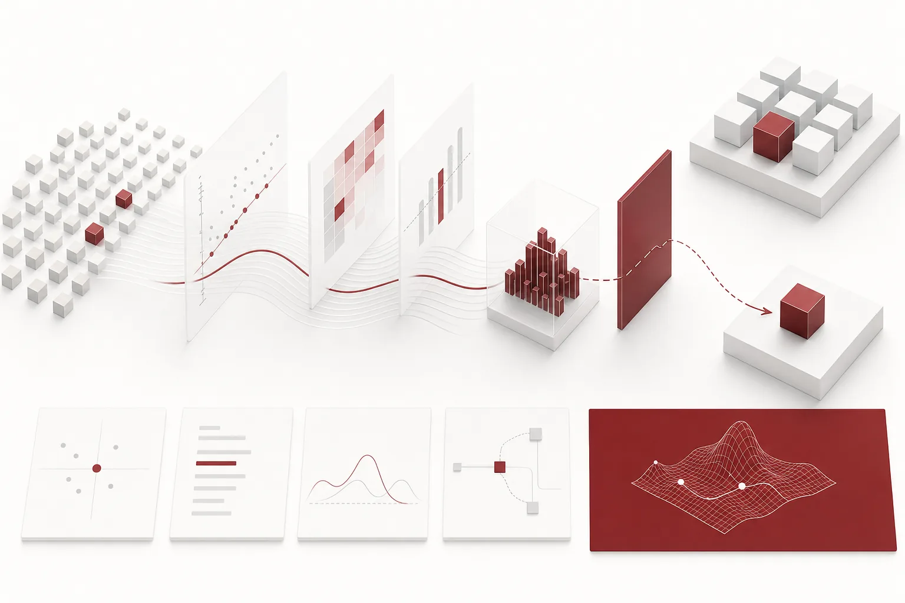
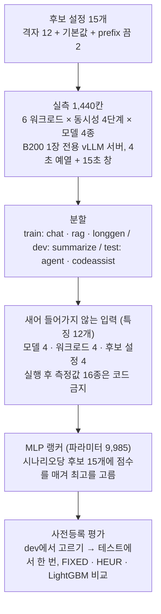

*글의 핵심 개념을 형상화했습니다.*

## 핵심 요약

[Thaki-MemoryPolicy-vLLM-Ranker](https://huggingface.co/ThakiCloud/Thaki-MemoryPolicy-vLLM-Ranker)는 파라미터가 약 1만 개인 랭커입니다. 모델 구조와 워크로드 사양만 보고, 서버를 띄우기 전에 vLLM 서빙 설정 15개 중 하나를 고릅니다. CPU에서 한 번 추천하는 데 0.15ms 정도 걸립니다.

결론부터 적습니다. **처음 보는 워크로드에서 vLLM 기본 설정보다 낫다는 근거는 나오지 않았습니다.** 테스트 16개 시나리오에서 SLO 위반율은 랭커와 기본 설정 모두 0.25였고, 처리량 차이는 +19.0 tok/s(95% CI −82.8~+119.9)로 0을 포함했습니다. 꼬리 지연은 오히려 나빴습니다. 시나리오별 p95 TTFT의 95백분위수가 기본 설정은 10.78초, 랭커는 12.99초였습니다. 사전등록한 공개 기준 6개는 모두 통과했지만, 기준 자체가 "기본값보다 나쁘지 않을 것"이었으므로 이 통과는 동등을 뜻합니다.

그래도 정리할 이유는 있습니다. 모델 선택용 dev 분할에서는 기본 설정의 SLO 위반율 0.5625를 0.375로 낮추고 최적 설정 대비 처리량 손실을 0.6%까지 줄였습니다. 이 차이가 처음 보는 워크로드로는 옮겨 가지 않았습니다. 또 첫 버전은 정답이 입력으로 새어 들어간 사실을 발견해 통째로 폐기했습니다. 이 글은 그 두 가지를 중심으로 씁니다.

## 왜 만들었나

vLLM 서버를 띄울 때는 `--max-num-seqs`, `--max-num-batched-tokens`, `--gpu-memory-utilization`, prefix caching 여부를 정해야 합니다. 같은 모델이라도 프롬프트 길이, 출력 길이, 동시 요청 수에 따라 맞는 값이 달라집니다. 잘못 고르면 처리량이 떨어지거나 첫 토큰 지연(TTFT)이 SLO를 넘습니다.

보통은 사람이 경험으로 고르거나, 후보를 하나씩 띄워 재 봅니다. 대형 LLM에게 물어보는 방법도 있습니다. 저희가 던진 질문은 단순했습니다. **이 결정에 대형 LLM이 필요할까요? 실측 데이터로 학습한 1만 파라미터짜리 랭커로 얼마나 좋은 결정을 내릴 수 있을까요?**

## 문제 설정: 15개 설정과 1,440칸 실측

### 후보 설정 15개

| 구분 | 설정 |
|---|---|
| 기본값 | `max-num-seqs` 256, `max-num-batched-tokens` 8192, `gpu-memory-utilization` 0.90, prefix caching 켬 |
| 격자 12개 | `max-num-seqs` {32, 128, 512} × `max-num-batched-tokens` {2048, 8192} × `gpu-memory-utilization` {0.45, 0.85}, prefix caching 켬 |
| prefix 끔 2개 | 기본값에서 prefix caching만 끈 것, 128/2048/0.85에서 끈 것 |

### 워크로드와 측정 방식

| 워크로드 | 프롬프트 → 출력 토큰 | 공유 prefix 비율 | 분할 |
|---|---|---|---|
| chat | 512 → 256 | 0 | train |
| rag | 6000 → 128 | 0.7 | train |
| longgen | 256 → 1024 | 0 | train |
| summarize | 12000 → 256 | 0.1 | dev |
| agent | 3000 → 256 | 0.9 | test |
| codeassist | 1500 → 512 | 0.5 | test |

동시 요청 수는 4, 16, 64, 256 네 단계입니다. 모델은 Qwen3-0.6B, 1.7B, 4B, 8B를 썼습니다. 15개 설정 × 6개 워크로드 × 4개 동시성 × 4개 모델로 1,440칸이 나오고, 빠진 칸과 중복은 없었습니다.

측정은 Kueue 잡 안에서 B200 1장에 전용 vLLM 0.28 서버를 띄워서 했습니다. 설정마다 서버를 다시 시작하고, 닫힌 루프로 요청을 넣으면서 4초 예열 뒤 15초 창에서 쟀습니다. 프롬프트는 공유 prefix가 고정된 무작위 토큰 ID이고, 요청마다 정해진 출력 길이를 끝까지 생성합니다(`min_tokens = max_tokens`, EOS 무시). 운영 트래픽, 사용자 프롬프트, 공유 서빙 엔드포인트는 쓰지 않았습니다.

SLO는 p95 TTFT 3초 이하, p95 TPOT 60ms 이하, 오류율 1% 이하, 서버 기동 성공으로 정했습니다. "실패"는 서버가 뜨지 않았거나 측정 창 안에 끝난 요청이 0건인 경우입니다.

## 첫 버전은 정답을 보고 있었다

첫 버전(v1)의 입력 특징 17개 중 9개는 같은 시나리오에서 **기본 설정을 실제로 돌린 뒤** 잰 값이었습니다. KV 캐시 사용률, 대기열 길이, prefix 적중률, TTFT·TPOT, 처리량, 그리고 그 설정이 SLO를 지켰는지 여부까지 들어 있었습니다. 운영자가 "지금 설정에서 보이는 지표를 보고 바꾼다"는 상황을 흉내 낸 설계였습니다.

문제는 기본 설정이 15개 후보 중 하나라는 점이었습니다. 랭커는 후보 하나의 실행 결과와 SLO 정답을 입력으로 받고 있었습니다. 비교 대상인 "기본 설정 정책"의 결과가 그대로 입력에 들어 있었던 셈입니다. 이 사실을 확인하고 v1의 성능 수치는 모두 무효로 처리했습니다. v1이 쓴 테스트(8B·0.6B의 agent·codeassist)도 이미 한 번 본 데이터라 이후 어디에도 쓰지 않았습니다.

다시 만든 버전에서는 **설정을 고르기 전에 알 수 있는 값만** 입력으로 씁니다.

| 종류 | 특징 |
|---|---|
| 모델 (4개) | 가중치 크기(GB), 레이어 수, hidden 크기, 토큰당 KV 바이트 |
| 워크로드 (4개) | 프롬프트 길이, 출력 예산(`max_new_tokens`), 워크로드 설계상의 공유 prefix 비율, log2(동시 요청 수) |
| 후보 설정 (4개) | log2(`max-num-seqs`), log2(`max-num-batched-tokens`), `gpu-memory-utilization`, prefix caching 여부 |

실행 후에 재는 값 16종(KV·대기열·prefix 적중률·TTFT·TPOT·처리량·SLO 여부·선점·오류율 등)은 코드에 금지 목록으로 박아 두었습니다. 측정값은 라벨과 평가에만 씁니다. 학습 코드는 한 가지를 더 검사합니다. 한 시나리오의 후보 15개가 모두 같은 상태 벡터를 가져야 합니다. 상태가 어느 후보의 실행에도 의존하지 않는다는 뜻입니다. 이 검사가 실패하면 학습도 테스트도 하지 않고 종료합니다. 96개 시나리오 모두 통과했습니다.

## 모델과 비교 정책

랭커는 12 → 128 → 64 → 1 구조의 MLP입니다. 파라미터는 9,985개입니다. 시나리오마다 후보 15개에 점수를 매기고, 가장 높은 것을 고릅니다. 학습 목표는 ListNet 손실입니다. 후보의 효용은 SLO를 지켰으면 "처리량 ÷ 그 시나리오의 최고 처리량", 못 지켰으면 −1입니다. 온도 0.1, AdamW, 400 에폭, 시드 0으로 학습했고, 학습 잡은 CPU에서 0.29분 걸렸습니다. 정규화 통계는 train에서만 계산했습니다.

비교 대상은 셋입니다.

- **기본 설정(FIXED)**: 항상 기본값을 씁니다.
- **휴리스틱(HEUR)**: `gpu-memory-utilization` 0.85, `max-num-seqs`는 동시 요청 수에 가장 가까운 격자값, 프롬프트가 2048 이상이면 `max-num-batched-tokens` 8192, 아니면 2048, prefix caching 켬.
- **LightGBM**: SLO 통과 확률 분류기와 처리량 회귀기를 따로 학습해, 통과 확률 0.5 이상인 후보 중 예측 처리량이 가장 큰 것을 고릅니다.

MLP와 LightGBM 중 하나를 dev에서 (SLO 위반율, regret) 순으로 고르고, 고른 정책만 테스트에서 한 번 평가한다고 사전등록했습니다. regret은 "SLO를 지킨 후보 중 최고 처리량" 대비 고른 설정의 처리량이 얼마나 모자란지를 비율로 잰 값입니다.

## dev 결과: 최적 설정에 가까웠다

dev는 summarize 워크로드(12000 → 256 토큰) 16개 시나리오입니다. 모델 선택에 쓴 분할이라 선택 편향이 들어 있습니다.

| 정책 | SLO 위반율 | 실패율 | goodput (tok/s) | 최적 대비 regret |
|---|---:|---:|---:|---:|
| 기본 설정 | 0.5625 | 0.375 | 593 | 0.194 |
| 휴리스틱 | 0.500 | 0.125 | 682 | 0.024 |
| LightGBM | 0.375 | 0.000 | 1,049 | 0.0091 |
| **MLP 랭커** | **0.375** | **0.000** | **1,054** | **0.0063** |

goodput은 SLO를 지킨 시나리오의 처리량만 세고, 못 지킨 시나리오는 0으로 둔 평균입니다. 기본 설정은 16개 중 6개 시나리오에서 실패했습니다. 랭커는 실패가 없었고, 최적 설정 대비 처리량 손실이 평균 0.6% 수준이었습니다. 위반율이 같아서 regret이 낮은 MLP를 골랐습니다.

## 테스트 결과: 기본 설정과 동등

테스트는 학습에 쓰지 않은 워크로드 두 개(agent, codeassist)에서 Qwen3-1.7B와 4B, 동시 요청 4단계로 만든 16개 시나리오입니다. 한 번만 돌렸습니다. 이 두 모델은 학습 데이터에도 있었으므로, 이 테스트는 "아는 모델의 처음 보는 워크로드"에 대한 일반화를 잰 것입니다. 처음 보는 모델에 대한 평가가 아닙니다.

| 정책 | SLO 위반율 | 실패율 | 평균 처리량 (tok/s) | goodput (tok/s) | 처리량 비 (둘 다 SLO 통과) | p95 TTFT (시나리오별 p95의 95백분위) |
|---|---:|---:|---:|---:|---:|---:|
| 기본 설정 | 0.250 | 0 | 9,483 | 5,343 | 1.000 | 10.78초 |
| 휴리스틱 | 0.250 | 0 | 8,172 | 4,090 | 0.765 | 13.11초 |
| LightGBM (미선택) | 0.1875 | 0 | 8,580 | 5,811 | 0.977 | 10.43초 |
| **MLP 랭커** | **0.250** | **0** | **9,502** | **5,369** | **1.005** | **12.99초** |

기본 설정과의 짝 비교는 시나리오 단위 bootstrap(B=2000)으로 했습니다.

| 지표 | 관측 Δ | 95% CI |
|---|---:|---|
| SLO 위반율 | 0.0 | [0, 0] |
| 처리량 (tok/s) | +19.0 | [−82.8, +119.9] |
| goodput (tok/s) | +26.0 | [−17.0, +77.7] |

위반율 CI가 [0, 0]이라는 것은 두 정책이 정확히 같은 시나리오에서 SLO를 어겼다는 뜻입니다. 위반을 줄였다는 증거가 아닙니다. 처리량과 goodput의 CI도 0을 포함합니다. 지표별로 정리하면 이렇습니다.

- **처리량**: 기본 설정과 구분되지 않습니다.
- **지연**: 꼬리 TTFT는 나빠졌습니다(10.78초 → 12.99초). 공개 기준에는 없던 항목입니다. p95 TPOT은 두 정책 모두 7ms 수준이었습니다.
- **메모리**: `gpu-memory-utilization`은 고르는 대상인 설정값일 뿐입니다. 정책별 메모리 사용량이나 KV 캐시 사용률은 평가 지표로 집계하지 않았으므로 이 글에도 수치를 싣지 않습니다.
- **선택 정확도**: "최적 설정을 몇 번 맞혔나"는 따로 재지 않았습니다. 가장 가까운 지표인 regret은 dev에서만 보고합니다. 테스트에서는 SLO를 어긴 설정의 처리량도 세기 때문에 regret이 음수가 될 수 있어서입니다.

휴리스틱은 테스트에서 기본 설정보다 처리량이 1,311 tok/s 낮았고, 95% CI [−2,408, −417]이 0을 포함하지 않았습니다. 사람이 쓴 그럴듯한 규칙이 기본값보다 확실히 나빴던 것입니다. LightGBM은 위반율과 goodput이 더 좋아 보였지만 dev에서 뽑히지 않았습니다. 테스트를 보고 바꾸면 사후 선택이 되므로 공개 모델은 MLP 그대로 두었습니다.

## dev의 개선은 왜 테스트로 이어지지 않았나

확인한 사실과 추정을 나눠 적습니다.

확인한 사실은 두 가지입니다. dev(12000 토큰 프롬프트)에서 기본 설정은 16개 시나리오 중 6개에서 실패했습니다. 서버가 뜨지 않았거나 측정 창 안에 끝난 요청이 하나도 없었다는 뜻입니다. 테스트 워크로드에서는 기본 설정의 실패가 0이었습니다. 개선할 여지 자체가 dev보다 훨씬 작았습니다.

추정은 이렇습니다. 테스트의 agent 워크로드는 공유 prefix 비율이 0.9로, train에서 본 가장 높은 값(0.7)보다 큽니다. 입력 공간의 바깥이라 랭커의 점수가 덜 믿을 만했을 수 있습니다. 이 가설은 따로 검증하지 않았습니다.

## 배운 것

1. **정책 입력은 "선택 전에 알 수 있는가"로 검사해야 합니다.** 운영 현실을 흉내 낸다는 이유로 넣은 텔레메트리가 사실은 정답이었습니다. 이제는 금지 목록과 "후보 간 상태 동일" 검사를 코드가 강제합니다.
2. **기본값은 생각보다 강한 기준선입니다.** 짧은 프롬프트와 중간 길이 워크로드에서는 vLLM 기본 설정이 이미 거의 최선이었고, 사람이 쓴 휴리스틱은 오히려 확실히 나빴습니다.
3. **"나쁘지 않을 것" 게이트는 개선을 말해 주지 않습니다.** 6개 게이트를 모두 통과했지만, 위반율 CI [0, 0]처럼 자명하게 통과한 항목도 있었습니다. 카드에도 "동등"으로 적었습니다.
4. **평균에 없는 비용을 따로 봐야 합니다.** 평균 처리량은 같았지만 꼬리 TTFT는 2초 넘게 나빠졌습니다.
5. **이 결정에는 대형 LLM이 필요하지 않을 수 있습니다.** 다만 이번 결과가 보여 준 것은 "1만 파라미터로도 기본값만큼은 고른다"까지입니다. 기본값보다 낫게 고르려면 더 다양한 워크로드와 실트래픽 측정이 먼저 필요합니다.

## ThakiCloud 제품 관점

이 랭커는 어떤 ThakiCloud 제품에도 통합되지 않았습니다. Metis 서빙 정책으로 채택하는 결정도 보류 상태입니다. 아래는 가능성이지 구현되거나 측정된 기능이 아닙니다.

- **Metis(추론·서빙)**: 서빙 엔드포인트를 만들 때 모델 구조와 예상 워크로드로 설정 후보를 미리 좁히는 출발점이 될 수 있습니다. 쓰려면 실트래픽 기준의 재측정과 온라인 비교가 먼저 있어야 합니다.
- **Maxis(학습·파인튜닝·소형화)**: 서빙할 모델의 크기와 KV 구조가 설정 선택에 어떻게 영향을 주는지 같은 데이터로 볼 수 있습니다. 양자화 모델은 이번 측정 범위 밖입니다.
- **Paxis(에이전트·업무 자동화)**: 에이전트 워크로드는 공유 prefix가 크고 동시 요청이 몰립니다. 이번 테스트의 agent 시나리오가 그 형태를 흉내 냈지만, 합성 데이터라 실제 에이전트 트래픽을 대표한다고 말할 수 없습니다.

## 한계

- 테스트에서 기본 설정보다 나아졌다는 근거가 없습니다. 개선이 확인된 튜너가 아니라 동등 수준의 출발점으로만 써야 합니다.
- 꼬리 TTFT가 기본 설정보다 나쁩니다(12.99초 대 10.78초).
- 범위는 B200 1장, vLLM 0.28, Qwen3 dense 0.6B~8B, BF16 가중치, 동시 요청 4~256, 위 15개 설정입니다. 다른 GPU, 엔진 버전, 양자화 모델, MoE, 텐서 병렬은 범위 밖입니다.
- 워크로드가 합성이고 출력 길이와 prefix 비율이 고정입니다. 실제 트래픽의 길이 분포와 요청 몰림은 반영하지 않았습니다.
- 테스트가 16개 시나리오뿐이라 신뢰구간이 넓습니다. 테스트 모델은 학습에도 있었으므로 처음 보는 모델에서는 검증하지 않았습니다.
- 각 후보를 새 서버에서 따로 쟀습니다. 운영 중인 서버의 설정을 바꾸는 상황은 시험하지 않았습니다.

## 마치며

1만 파라미터 랭커로 vLLM 설정을 고르는 실험은 "기본값만큼은 고른다"에서 멈췄습니다. dev의 큰 개선은 처음 보는 워크로드로 옮겨 가지 않았고, 꼬리 지연은 오히려 나빠졌습니다. 가중치와 입력 규약, 집계 평가 결과는 [모델 카드](https://huggingface.co/ThakiCloud/Thaki-MemoryPolicy-vLLM-Ranker)에 함께 공개했습니다. 정답이 입력으로 새는 실수와 "나쁘지 않을 것" 게이트의 함정을 다른 팀이 반복하지 않는 데 도움이 되면 좋겠습니다.

## 참고 자료

- 모델: [ThakiCloud/Thaki-MemoryPolicy-vLLM-Ranker](https://huggingface.co/ThakiCloud/Thaki-MemoryPolicy-vLLM-Ranker) (Apache-2.0, research preview)
- 서빙 엔진: [vLLM](https://github.com/vllm-project/vllm)
- 측정 모델: [Qwen3](https://huggingface.co/Qwen) 0.6B·1.7B·4B·8B (가중치는 재배포하지 않음)
- 학습 목표: Cao et al., "Learning to Rank: From Pairwise Approach to Listwise Approach" (ListNet, ICML 2007)
