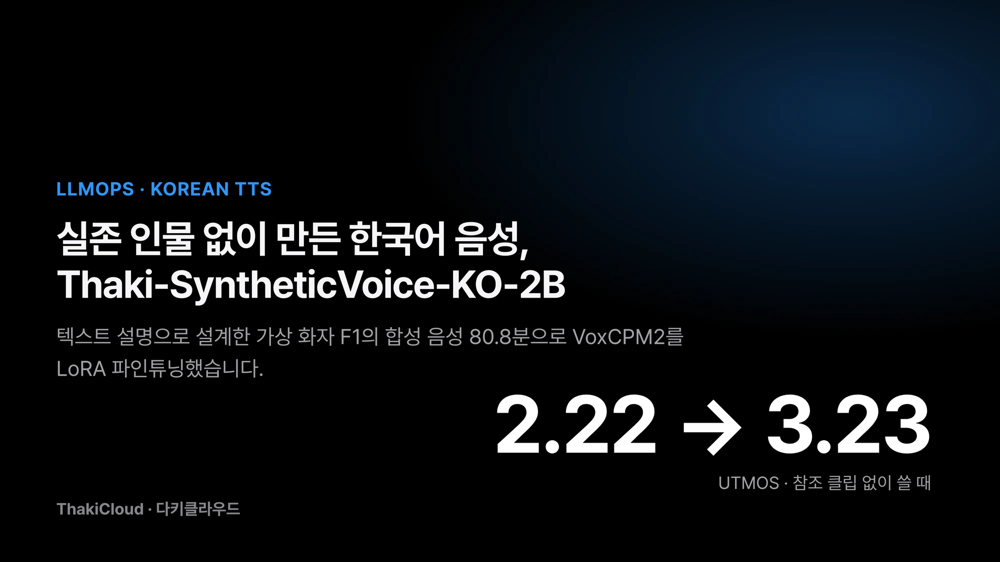
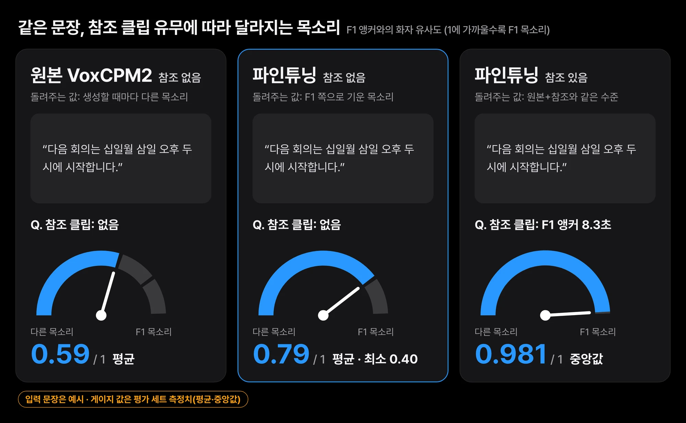
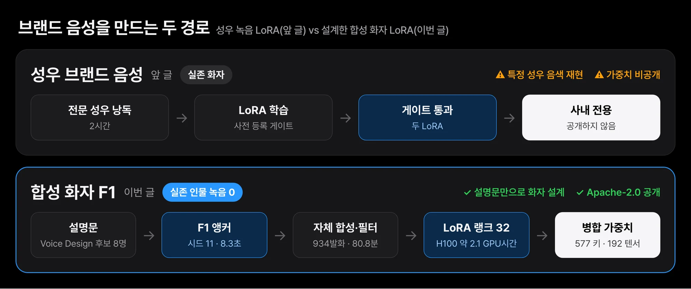
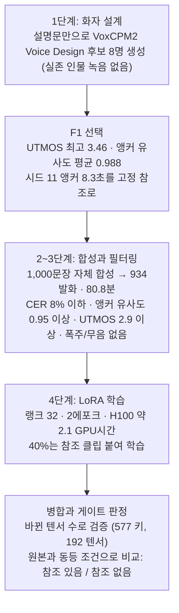
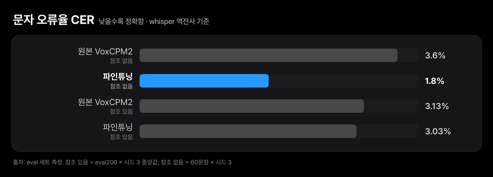
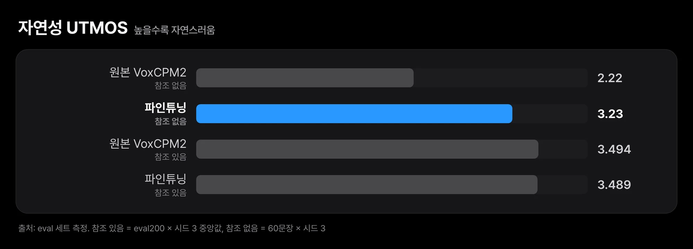
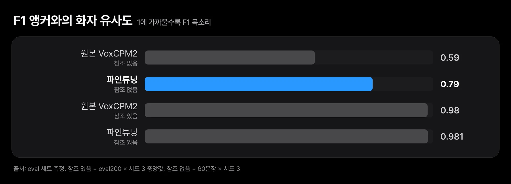

회사 안내 음성이나 AI 비서 목소리를 하나 정하려고 하면 보통 성우를 섭외해 녹음합니다. 그 녹음으로 음성 모델을 학습하면 품질은 나오지만, 특정 성우 한 사람의 음색을 재현하는 가중치를 밖으로 공개하기는 어렵습니다. 공개 TTS 모델에 참조 클립을 매번 넘기는 방법도 있지만, 참조 없이 부르면 생성할 때마다 다른 목소리가 나옵니다.

[Thaki-SyntheticVoice-KO-2B-v0.1](https://huggingface.co/ThakiCloud/Thaki-SyntheticVoice-KO-2B-v0.1)은 이 문제를 실존 인물 없이 풀어 본 결과입니다. [VoxCPM2](https://huggingface.co/openbmb/VoxCPM2)(2B, Apache-2.0)를 가상 화자 F1 한 명에 맞춰 LoRA로 파인튜닝하고 원본 가중치에 병합했습니다. LoRA는 원본 가중치는 그대로 두고 작은 보정 행렬만 학습하는 파인튜닝 방식입니다. F1은 "차분하고 낮은 목소리의 30대 한국 여성, 기업용 비서 말투"라는 설명문만으로 VoxCPM2 Voice Design이 만든 목소리이고, 어느 단계에서도 실존 인물의 녹음을 참조로 쓰지 않았습니다.

참조 클립 없이 쓸 때 자연성 점수 UTMOS가 2.22에서 3.23으로 올랐습니다. 이 글에서는 결과가 조건에 따라 어떻게 갈렸는지, 화자를 어떻게 설계하고 학습 데이터를 걸렀는지, 공개 전에 무엇을 확인했는지를 차례로 다룹니다.

## 참조 클립을 줄 때는 원본과 같고, 뺄 때만 나아졌습니다

*참조 없이 쓰면 원본은 매번 다른 목소리를 고르고(0.59), 파인튜닝 모델은 F1 쪽으로 끌려갑니다(0.79). 참조 클립을 주면 둘 다 0.98 수준입니다. 입력 문장은 예시이고 게이지 값은 평가 세트 측정치입니다.*

여기서 참조 클립은 "이 목소리로 읽어 달라"며 함께 넘기는 짧은 음성 파일입니다. 지표는 세 가지를 씁니다. 문자 오류율(CER)은 합성 음성을 다시 받아써서 원문과 몇 글자가 다른지 잰 값이고, UTMOS는 사람의 자연성 평가를 흉내 내도록 학습된 자동 채점기 점수입니다. 화자 유사도는 두 음성의 화자 임베딩이 얼마나 가까운지를 코사인으로 잰 값입니다.

- **참조 클립을 함께 줄 때**: 원본 VoxCPM2에 같은 클립을 준 것과 동등했습니다. 문자 오류율(CER) 3.13% 대 3.03%, 화자 유사도 0.980 대 0.981, 자연성(UTMOS) 3.494 대 3.489입니다. 우위는 없습니다.
- **참조 클립 없이 쓸 때**: 원본보다 분명히 나아졌습니다. UTMOS 2.22→3.23, CER 3.6%→1.8%, F1 앵커와의 화자 유사도 평균 0.59→0.79입니다. 다만 최솟값은 0.40이라, 일부 발화는 여전히 다른 목소리로 나옵니다.
- 학습 데이터가 원본 모델 자신의 출력이라 이 작업은 자기 증류입니다. 자기 증류는 모델이 만든 출력으로 그 모델을 다시 학습하는 방식입니다. 원본이 못 내는 소리를 새로 가르칠 수는 없고, 한 목소리 쪽으로 기울일 수만 있습니다.
- 전 과정은 H100 한 장에서 약 2.1 GPU시간이 들었습니다. 모든 수치는 합성 음성과 자동 지표로 잰 값이고, 외부 청취자 평가는 하지 않았습니다.

## 성우 녹음 대신 설명문으로 화자를 설계했습니다

*앞 글의 성우 LoRA는 게이트를 통과했지만 한 사람의 음색을 재현해 공개할 수 없었습니다. 이번에는 설명문으로 만든 화자의 합성 음성만으로 같은 레시피를 돌려 가중치를 공개했습니다.*

10월 23일 글 [음성 모델 파인튜닝, 9번 중 7번 떨어지고 배운 것](/tech-blog/ko/llmops/speech-finetuning-pre-registered-gates/)에서 저희는 전문 성우 낭독 2시간으로 학습한 브랜드 음성 LoRA 두 개가 사전 등록 게이트를 통과했다고 썼습니다. 그 글의 결론 중 하나는 그 가중치를 공개하지 않는다는 것이었습니다. 특정 성우 한 사람의 음색을 재현하는 모델을 제3자가 내려받아 쓰게 하는 일은 데이터 이용 허락과 범위가 다른 문제이기 때문입니다.

대신 그 글 끝에 다른 경로를 적었습니다. 실존 화자를 재현하지 않는 합성 음성을 설계하고, 통과한 레시피와 게이트를 그대로 적용하는 경로입니다. 이 글은 그 경로를 실제로 끝까지 간 기록입니다. 앞 글이 게이트 설계와 성우 데이터 실험을 다뤘다면, 이 글은 화자를 어떻게 만들었는지, 학습 데이터를 어떻게 걸렀는지, 원본 모델과 비교해 무엇이 달라졌는지를 다룹니다.

## 다섯 단계로 만들었고, 모든 단계에 거름망을 두었습니다

화자 설계부터 공개 판정까지의 흐름은 아래와 같습니다. 단계마다 다음 단계로 넘어갈 조건을 미리 정해 두었습니다.

### 1단계: 텍스트 설명으로 화자 8명을 만들고 하나를 골랐습니다

VoxCPM2의 Voice Design은 참조 음성 없이 성별·연령대·음높이·말투·속도를 적은 설명문으로 목소리를 만듭니다. 여성 4명, 남성 4명의 설명문을 쓰고 각 후보마다 8.3초 남짓한 고정 앵커 문장 하나와 시험 문장 10개를 합성했습니다. 설명문에 연예인·성우·캐릭터 이름은 넣지 않았습니다.

후보는 세 지표로 비교했습니다. 자연성은 UTMOS, 화자 일관성은 WavLM 화자 임베딩으로 잰 앵커와의 코사인 유사도, 내용 정확도는 whisper-large-v3-turbo로 다시 받아쓴 CER입니다. F1을 고른 근거는 UTMOS가 8명 중 가장 높았고(3.46), 앵커와의 유사도도 평균 0.988, 최소 0.976으로 가장 안정적이었기 때문입니다. CER은 7.3%로 다른 후보 두 명(4.6%, 5.6%)보다 높았지만 문장별로 확인한 뒤 용도("기업용 AI 비서")에 맞는 쪽을 택했습니다.

같은 설명문이라도 시드가 바뀌면 목소리가 달라집니다. 그래서 시드 11로 만든 8.3초 앵커 파일 하나(sha256 `cb73d996…dfbad`)를 이후 모든 합성과 평가의 고정 참조로 정했습니다. 이 클립은 공개 저장소의 `reference/anchor_F1_16k.wav`와 같은 파일입니다.

### 2단계: 대본 1,200문장과 겹치지 않는 평가 세트

대본은 직접 쓴 템플릿으로 1,200문장을 만들었습니다. 일반 문장, 기업·기술 문장, 숫자·금액·날짜, 영숫자·제품명, 긴 문장, 고객 응대, 발음이 까다로운 문장으로 범주를 나눴고 문장마다 화면 표기형과 읽기형을 함께 두었습니다. 학습·검증·평가 분할은 템플릿 단위로 나눠 같은 템플릿이 두 분할에 들어가지 않게 했습니다. 평가 세트 200문장(eval200)은 학습 분할과 분리됐는지 누출 검사를 통과한 뒤에 썼습니다. 외부 데이터와 LLM 생성 문장은 쓰지 않았습니다.

### 3단계: 합성하고 거르기, 그리고 채점기를 먼저 고친 일

원본 VoxCPM2에 F1 앵커를 참조로 주고 학습 분할 1,000문장을 합성했습니다(cfg 2.0, 10 스텝). 합성한 발화는 네 조건을 모두 통과해야 학습에 넣었습니다. whisper 역전사 CER 8% 이하, 앵커와의 화자 유사도 0.95 이상, UTMOS 2.9 이상, 폭주·무음 없음입니다.

먼저 206문장으로 파일럿을 돌렸는데 거부된 30건 중 22건은 TTS 잘못이 아니었습니다. whisper가 "십일월 삼일"을 "11월 3일"로, "Metis"를 "매티스"로 받아쓰면서 CER이 올라간 경우였습니다. 음성은 맞게 읽었는데 채점기가 표기 차이를 오류로 센 것입니다.

받아쓴 결과의 아라비아 숫자를 한국어 읽기 규칙으로 펼치고 라틴 토큰 쌍을 비교에서 빼는 숫자 인식 CER을 넣자 채택률이 90%(185/206)로 올랐습니다. 남은 거부는 실제 음차·단위 읽기 차이와 발화 오류 한두 건이었습니다. 컷오프는 파일럿 분포의 하위 10% 지점(화자 유사도 0.975, UTMOS 3.13)보다 여유를 두고 정했습니다. 분포에서 크게 벗어난 발화만 걸러내려는 의도였습니다.

본 생성은 목표가 120분이었지만 1,000문장 풀을 다 쓰고 934발화, 80.8분에서 멈췄습니다. 거부 66건 중 64건이 CER 때문이었고, 범주별로는 영숫자 문장이 125건 중 38건 거부로 가장 많았습니다. 분량을 채우려고 기준을 낮추지는 않았습니다. 학습 888발화, 검증 46발화로 나눴습니다.

### 4단계: LoRA 학습과 병합

레시피는 앞 글에서 성우 데이터로 통과한 것을 바꾸지 않았습니다. 랭크 32, 알파 32, 학습률 1e-4, 배치 4 × 그래디언트 누적 4, 2 에포크(112 스텝)입니다. 학습 행의 40%에는 같은 화자의 참조 클립을 붙였고 나머지는 참조 없이 학습했습니다. 검증 손실은 0.689에서 0.586으로 내려갔습니다.

이 손실 감소를 개선으로 읽지 않았습니다. 학습 음성이 VoxCPM2 자신의 출력이므로 손실이 내려간다는 것은 모델이 자기 분포를 다시 맞췄다는 뜻에 가깝습니다. 그래서 출시 판정은 손실이 아니라 다음 절의 원본 대비 비교로만 했습니다.

학습한 LoRA는 원본 가중치에 병합해(`W += B·A·α/r`, 192개 모듈) 체크포인트 하나로 공개했습니다. 병합 단계에서 작은 사고가 하나 있었습니다. 학습 체크포인트의 키 이름에 `torch.compile`이 붙인 `_orig_mod.` 같은 접두어가 섞여 있어, 첫 병합 시도에서는 577개 키 중 342개만 짝이 맞았습니다. 병합 스크립트에 "값이 바뀐 텐서 수가 LoRA 모듈 수와 정확히 같아야 한다"는 검사를 넣어 두었기 때문에 이 반쪽 병합본은 공개 전에 걸렸습니다. 두 번째 시도도 같았고, 세 번째 시도는 인코더 키를 되찾았지만 DiT 쪽 123개 키가 여전히 빠져 있었습니다. 접두어를 정규화한 네 번째 시도에서 577/577 키가 맞고 값이 바뀐 텐서가 정확히 192개가 됐습니다.

이 검사가 반쪽 병합본의 공개를 막았습니다. 실제로 반쪽 병합본으로 만든 청취용 샘플 하나에서 내용이 바뀌어 읽히는 현상이 보였고, 정상 병합본에서는 재현되지 않았습니다. 병합 결과를 "로드됐다"로 확인하지 않고 바뀐 텐서 수로 확인한 것이 이번에 가장 쓸모 있었던 점검이었습니다.

## 참조를 주면 원본과 비열등, 우위는 없습니다

평가는 학습에 쓰지 않은 eval200 200문장을 시드 0·1·2로 세 번 돌렸습니다. 두 팔 모두 같은 F1 앵커를 참조로 주고, 같은 H100·bf16·디코딩 설정(cfg 2.0, 10 스텝)과 같은 채점기를 썼습니다. 표의 값은 세 시드의 중앙값입니다. 품질 지표(T1~T4)는 병합 전 LoRA 상태로 쟀고, 병합본은 실시간 계수(T5)와 공개 전 스모크로 따로 확인했습니다.

| 지표 | VoxCPM2 원본 + 참조 | 파인튜닝 + 참조 | 게이트 |
|---|---|---|---|
| CER (T1) | 3.13% | 3.03% | 원본 이하 → 통과 |
| 화자 유사도 (T2) | 0.980 | 0.981 | 원본 이상 → 시드 3개 중 2개 통과 |
| UTMOS (T3) | 3.494 | 3.489 | 원본 −1% 이상 → 통과 |
| 폭주 / 무음 (T4) | 0 / 0 | 0 / 0 | 통과 |
| 실시간 계수, 병합본 (T5, 60문장) | 0.1348 | 0.1465 | 원본 ×1.1 이하 → 통과 |

*참조 없이 쓸 때 CER이 3.6%에서 1.8%로 절반이 됐습니다. 참조를 주면 3.13% 대 3.03%로 차이가 없습니다.*

판정은 비열등입니다. 참조 클립을 이미 넘기는 사용자라면 원본 VoxCPM2로 같은 품질을 얻습니다. 화자 유사도 차이 0.0002는 앞 글에서 확인한 측정 잡음보다 작아서 우위로 읽지 않습니다. 실시간 계수는 병합하지 않은 LoRA 객체로 재면 0.176으로 22% 느렸고, 병합 가중치를 보통 모델 객체에 올리면 원본의 1.087배로 게이트 안에 들어왔습니다. 이 현상의 원인은 앞 글에서 성우 LoRA로 이미 확인한 것과 같습니다.

## 참조 없이 쓰면 발음과 자연성이 좋아졌지만 화자 고정은 부분적입니다

참조 없이 쓰면 결과가 달라졌습니다. 범주별로 균형을 맞춘 60문장을 시드 3개로 생성해, 원본과 파인튜닝 모델 모두 참조 없이 비교했습니다. 이 비교도 병합 전 LoRA 상태에서 했습니다.

| 지표 | VoxCPM2 원본, 참조 없음 | 파인튜닝, 참조 없음 |
|---|---|---|
| CER | 3.6% | 1.8% |
| UTMOS | 2.22 | 3.23 |
| F1 앵커와의 유사도, 평균 | 0.59 | 0.79 |
| F1 앵커와의 유사도, 최소 | 0.21 | 0.40 |
| 발화 사이 화자 유사도 | 0.65 | 0.74 |
| 같은 문장·다른 시드 유사도 | 0.70 | 0.81 |

*참조 없이 쓸 때 UTMOS가 2.22에서 3.23으로 올랐습니다. 참조를 주면 원본과 파인튜닝이 3.494 대 3.489로 같습니다.*

*참조 없는 화자 고정은 0.59에서 0.79로 좋아졌지만 참조를 줄 때의 0.98에는 못 미칩니다.*

원본은 참조가 없으면 생성할 때마다 다른 목소리를 고릅니다. 파인튜닝 모델은 F1 쪽으로 강하게 끌려가고 발음과 자연성도 좋아졌습니다. 그래도 참조를 줄 때의 앵커 유사도가 0.98이라는 점과 비교하면 0.79는 거리가 있고, 최솟값 0.40은 어떤 발화는 분명히 다른 목소리로 들린다는 뜻입니다. 공개 후 익명으로 내려받아 돌린 스모크에서도 참조 없는 고정 5문장의 앵커 유사도가 0.95, 0.55, 0.55, 0.71, 0.91로 흩어졌습니다. 참조 없는 화자 고정은 부분적으로만 달성했습니다.

## 공개 전에 다섯 가지 조건을 확인했습니다

공개 조건은 다섯 가지로 미리 정했고 모두 확인한 뒤 공개했습니다.

- **숫자·영문 30건 청취**: 자동 검사로는 29/30이 CER 8% 이하였고, 넘은 1건은 whisper가 "ThakiCloud"를 한국어 음차로 받아쓴 표기 차이였습니다. 사내 검토자가 30건을 직접 듣고 30건 모두 통과로 판정했습니다. 외부 청취자 평가는 아닙니다.
- **병합본 스모크**: 비공개 스테이징 상태에서 참조 있는 CER 중앙값 0.0, 앵커 유사도 0.986을 확인했습니다.
- **익명 다운로드 스모크**: 공개 전환 뒤 토큰 없이 저장소를 내려받아 로드·재생을 확인했습니다(참조 있는 CER 중앙값 0.0, 화자 유사도 0.985).
- **카드의 한계 기재**: "참조가 있으면 원본과 동등, 참조가 없으면 완전 고정 아님"을 영문·한국어 카드 첫 화면과 한계 절에 적었습니다.
- **권리 검토**: 아래 절에 정리했습니다.

공개 뒤 카드에 한 가지를 더했습니다. 모델은 숫자를 한국어 읽기형으로 적어야 제대로 읽습니다. 이 제약을 줄이려고 "v1.5.5" 같은 버전 문자열을 읽기형으로 펼치는 전처리 코드(`text_normalization/`)를 저장소에 함께 올렸습니다. 대본 1,200문장 중 이 전처리로 바뀌는 문장은 34개였고, 가중치는 바꾸지 않았습니다(`model.safetensors` sha256 `3272b74c…f389`). 이 전처리를 모델 재학습으로 해결하는 v0.2는 사전 등록한 기준(표기형과 읽기형의 CER 차이 2.0%p 이상)에 못 미쳐(0.47%p) 학습하지 않았습니다.

## 권리: 사실과 열린 질문을 나눠 적었습니다

과정에 대한 사실은 다음과 같습니다. 화자는 설명문으로 만든 가상 화자이고 실존 인물의 녹음을 참조로 쓰지 않았습니다. AI Hub 데이터와 성우 녹음은 쓰지 않았고, 대본은 자체 템플릿입니다. 원본 VoxCPM2는 Apache-2.0이며 병합 가중치도 Apache-2.0으로 공개하고 LICENSE·NOTICE를 함께 올렸습니다. 학습 음성 934발화는 공개하지 않았고, 재현에 필요한 8.3초 합성 참조 클립만 포함했습니다.

생성 음성의 권리에 대해서는 VoxCPM 관리자가 2026년 10월 12일 [#407](https://github.com/OpenBMB/VoxCPM/issues/407)·[#409](https://github.com/OpenBMB/VoxCPM/issues/409) 이슈에서 Voice Design 출력을 저장·재사용·게시·상업 이용할 수 있다는 입장을 밝혔습니다. 관련 법과 제3자 권리를 전제로 했고, 법률 자문이 아니라고 명시했습니다. 그 답변에는 생성 음성으로 다시 학습하는 경우, 즉 이 모델을 만든 방식에 대한 언급이 없습니다. 그래서 이 부분은 열린 질문으로 원장과 카드에 남겼습니다. "합성 화자이니 권리 문제가 없다"는 말은 카드와 이 글 어디에도 쓰지 않습니다. 과정이 깨끗하다는 것과 법적 위험이 없다는 것은 다른 주장입니다.

## 이번 작업에서 남은 네 가지 교훈

- **참조 복제가 강한 모델에서 단일 화자 LoRA의 가치는 참조 없는 모드에 있습니다.** 참조를 줄 때는 원본이 이미 화자 유사도 0.98을 냈고 LoRA가 더할 여지가 없었습니다. 앞 글의 30분 성우 LoRA에서 본 현상과 같은 구조입니다.
- **자기 증류의 손실 곡선은 판정 근거가 아닙니다.** 판정은 원본과 같은 조건의 짝 비교로만 했습니다.
- **필터를 만들기 전에 채점기를 먼저 확인해야 합니다.** 파일럿 거부의 3분의 2 이상이 채점기의 숫자 표기 문제였습니다. 그대로 두었다면 숫자 문장이 학습 데이터에서 체계적으로 빠졌을 겁니다.
- **병합은 바뀐 텐서 수로 검증합니다.** 로드 성공은 반쪽 병합을 잡지 못했습니다.

## Paxis 음성 런타임에는 가중치가 아니라 앵커 클립이 들어갔습니다

이 작업의 학습·평가는 사내 GPU 큐의 H100 한 장 잡으로 돌렸고 체크포인트와 측정 원장은 사내 저장소에 남았습니다. 합성 화자 설계 → 필터링 → LoRA → 병합 → 게이트 판정으로 이어진 흐름은 Maxis에서 다루는 학습·파인튜닝 경로와 같은 모양이고, 병합 가중치를 원본과 같은 속도로 서빙할 수 있다는 측정은 Metis 서빙 쪽에 쓸 수 있는 사실입니다. 다만 이 모델 자체를 Maxis나 Metis의 기능으로 통합하지는 않았습니다.

제품 쪽에서 실제로 쓰인 것은 가중치가 아니라 F1 앵커 클립입니다. Paxis 음성 에이전트용 사내 음성 런타임은 10월 27일 서빙 스모크에서 F1 앵커를 기본 음성의 참조 클립으로 썼습니다. 이때 모델은 파인튜닝 가중치가 아니라 원본 VoxCPM2였습니다. 참조를 주면 원본과 동등하다는 이번 측정과 맞는 선택입니다. 이 경로도 아직 사내 검증 단계이고, 고객에게 나간 기능은 아닙니다.

## 쓰기 전에 알아둘 여섯 가지

- 모든 평가는 한국어, 깨끗한 합성 조건, 여성 화자 한 명, 감정·속도 제어 없음에서 했습니다.
- CER은 whisper 역전사 기반이고, UTMOS22는 한국어에 맞춰 보정된 지표가 아닙니다. 외부 청취자 평가는 없습니다. 합성 데이터로 얻은 결과는 실제 서비스 환경으로 일반화된다는 증거가 아닙니다.
- 참조 없는 모드의 화자 고정은 부분적입니다(앵커 유사도 최소 0.40).
- 숫자는 한국어 읽기형으로 적어야 합니다. 전처리 코드는 버전 문자열만 처리합니다.
- 실시간 계수는 H100에서 잰 값입니다.
- 생성 음성으로 다시 학습하는 것에 대한 권리 판단은 열려 있습니다.

## 끝으로

이 모델이 원본 VoxCPM2보다 좋은 TTS인 것은 아닙니다. 참조 클립을 주면 같고, 참조 없이 쓸 때 한 목소리 쪽으로 더 일관되고 더 자연스럽게 나옵니다. 저희가 이번에 확인한 것은 실존 인물 없이도 공개 가능한 브랜드 음성을 만들 수 있는 절차가 있다는 점이고, 그 절차가 남긴 숙제는 참조 없는 화자 고정입니다.

오늘 바로 해 볼 수 있는 실험은 간단합니다. 저장소의 `reference/anchor_F1_16k.wav`를 참조로 넣었을 때와 뺐을 때를 같은 문장 몇 개로 비교해 들어 보세요. 숫자가 들어간 문장은 읽기형으로 적거나 `text_normalization/` 전처리를 먼저 거치는 편이 좋습니다.

## 참고 자료

- 모델: [ThakiCloud/Thaki-SyntheticVoice-KO-2B-v0.1](https://huggingface.co/ThakiCloud/Thaki-SyntheticVoice-KO-2B-v0.1)
- 원본 모델: [openbmb/VoxCPM2](https://huggingface.co/openbmb/VoxCPM2)
- 앞선 글: [음성 모델 파인튜닝, 9번 중 7번 떨어지고 배운 것](/tech-blog/ko/llmops/speech-finetuning-pre-registered-gates/)
- 생성 음성 권리에 대한 VoxCPM 관리자 답변: [OpenBMB/VoxCPM #407](https://github.com/OpenBMB/VoxCPM/issues/407), [#409](https://github.com/OpenBMB/VoxCPM/issues/409)
- UTMOS: [arXiv:2204.02152](https://arxiv.org/abs/2204.02152)
