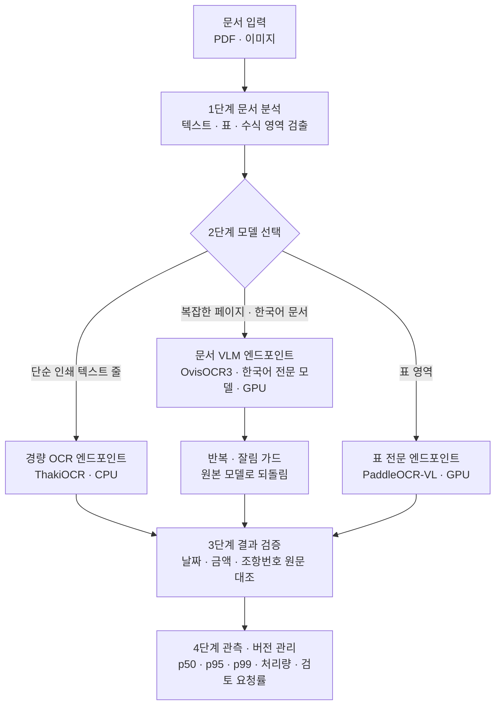

회사에서 처리하는 문서는 생김새가 제각각입니다. 인쇄된 글자 한 줄짜리 영역이 있고 여러 단으로 짜인 계약서가 있고 표와 수식이 섞인 보고서도 있습니다. 그런데 모든 영역을 같은 대규모 비전언어모델(VLM)로 읽으면 쉬운 영역에도 어려운 영역과 비슷한 추론 비용을 냅니다.

이 글은 문서 AI를 운영하는 엔지니어를 위한 글입니다. ThakiCloud가 경량 OCR 모델과 문서 VLM을 함께 연구하며 얻은 측정값을 바탕으로, Metis에서 두 종류의 모델을 나눠 서빙하는 계층형 구조를 제안합니다. 여기서 설명하는 Metis 배치는 제안 아키텍처이며 운영 환경에 적용을 마친 구성이 아닙니다.

## 쉽게 말하면

병원의 접수 창구와 전문의 진료를 떠올리면 됩니다. 간단한 서류 확인은 접수 창구에서 바로 끝내고 복잡한 증상만 전문의에게 보냅니다. 모든 환자를 전문의에게 보내면 대기열이 길어지고 비용도 커집니다.

다만 접수 창구가 서류를 잘못 읽으면 문제가 생깁니다. 그래서 누가 어떤 서류를 맡을지 정하는 규칙과, 결과를 다시 확인하는 단계가 함께 필요합니다.

## 213만 파라미터로 텍스트 한 줄을 읽는다

ThakiOCR A는 213만 파라미터의 CTC 기반 줄 단위 인식 모델입니다. 폭 512픽셀로 맞춘 줄 이미지 한 장을 데이터센터 서버 CPU 4스레드에서 읽는 데 중앙값 5.61ms가 걸렸습니다. 893만 파라미터인 후속 모델 G2M은 같은 방식으로 줄당 중앙값 13.3ms였습니다.

이 숫자는 PDF 한 페이지 전체의 처리 시간이 아닙니다. 줄 단위 모델은 앞단에서 텍스트 영역을 찾아 잘라 준 이미지만 읽습니다. 실제 서비스의 지연에는 페이지 렌더링, 영역 검출, 문자 인식, 표 복원, 검증이 모두 들어갑니다. 노트북이나 휴대폰 CPU에서는 아직 측정하지 않았습니다.

## 복잡한 페이지는 전문 모델로 넘긴다

ThakiDocTrust 연구에서는 범용 문서 VLM인 OvisOCR3, 이를 한국어 문서로 파인튜닝한 전문 모델, 표에 강한 PaddleOCR-VL을 역할별로 나눠 실험했습니다.

학습에 쓰지 않은 시리즈로 만든 한국어 문서 평가 세트(304쪽, 8개 시리즈)에서, 한국어 페이지를 전문 모델로 보내는 경로는 단어 micro F1을 0.750에서 0.842로, 글자 오류율을 0.145에서 0.086으로 개선했습니다. 한국어 페이지를 골라 내는 라우팅 재현율은 0.967이었고 GPU 비용은 원본 경로의 1.82배였습니다.

전문 모델 단독으로는 출력이 같은 문장을 반복하거나 중간에 잘리는 경우가 남아 있었습니다. 그래서 반복과 잘림을 감지하면 원본 모델 결과로 되돌리는 가드를 붙였고 이 가드 없이 서빙하면 안 된다는 조건을 달았습니다. 이 경로도 출시 판정은 NO_RELEASE입니다.

경량 모델끼리의 라우팅도 시험했습니다. 이미지 통계 11개만 보고 줄 이미지를 두 경량 모델 중 하나로 보내는 규칙은 실문서 오류율을 크게 줄였지만 한국어 합성 데이터의 숫자 정확도가 사전에 정한 한도보다 1.23%p 떨어져 NO_GO로 판정했습니다. 평균 오류율이 좋아져도 숫자처럼 중요한 항목이 나빠지면 채택하지 않았습니다.

## 빠른 모델이 금융 문서에 맞지 않을 수 있는 이유

외부 모델인 Xiaomi-OCR-0도 같은 조건으로 진단했습니다. 0.8B 크기로 B200 한 장에서 초당 약 9쪽을 처리할 만큼 빨랐습니다.

그러나 원화 기호 ₩가 들어간 합성 금융 문서에서는 108개 가운데 하나도 원래 기호로 남기지 못했습니다. 기호를 W로 바꾸거나, 엔화 기호 ￥로 바꾸거나, 전혀 다른 한자로 바꿨습니다. 같은 세트에서 OvisOCR3 원본은 108개를 모두 보존했습니다. 일부 문서에서는 원문에 없는 숫자를 만들어 내는 현상도 있었습니다.

그래서 이 모델은 ₩가 들어간 문서에는 쓰지 않고 한국어 라우팅에도 넣지 않기로 판정했습니다. 처리 속도와, 결과를 믿고 업무에 쓸 수 있는지는 서로 다른 질문입니다.

## Metis에 제안하는 서빙 구성

Metis는 학습한 모델을 배포하고 추론 엔드포인트를 관리하는 ThakiCloud의 서빙 플랫폼입니다. ThakiOCR 계열과 문서 VLM을 Metis에서 함께 운영한다면 다음과 같은 4단계 구조를 생각할 수 있습니다.

1단계는 문서 분석입니다. PDF나 이미지에서 텍스트, 표, 수식 영역을 찾습니다. 이때 머리말이나 쪽번호를 임의로 지우지 않고 원본 영역을 모두 남깁니다. 레이아웃 조립 결과만 텍스트 경로로 쓰면 숫자 영역이 빠질 수 있다는 점을 Xiaomi-OCR-0 진단에서 확인했기 때문에, 원문 텍스트와 조립된 문서 표현을 별도 출력으로 둡니다.

2단계는 모델 선택입니다. 단순한 인쇄 텍스트 줄은 CPU에서 도는 경량 ThakiOCR 엔드포인트로, 복잡한 한국어 페이지는 GPU의 문서 VLM 엔드포인트로, 표 영역은 PaddleOCR-VL로 보냅니다. CPU 경량 모델과 GPU VLM을 한 서비스로 묶는 실제 배치 방식은 운영 환경에 맞춰 따로 검증해야 합니다.

3단계는 결과 검증입니다. OCR 원문과 문서 표현용 텍스트를 나누고 날짜, 금액, 조항번호처럼 중요한 문자열이 빠지거나 바뀌지 않았는지 확인합니다. 이 단계는 [Paxis 검증 워크플로 글](/tech-blog/ko/agentops/thakiocr-paxis-verify-before-commit/)에서 자세히 다룹니다.

4단계는 관측과 버전 관리입니다. 모델별 p50, p95, p99 지연과 처리량, GPU 사용량, 사람 검토 요청률을 함께 기록합니다. 인식 정확도가 올라도 사람이 검토해야 하는 문서가 늘었다면 제품 효율은 나아졌다고 보기 어렵기 때문입니다.

## 모델 교체는 비교와 게이트를 거친다

ThakiOCR A, G2M, A2는 같은 계열 안에서 데이터와 학습 방식을 바꿔 성능을 개선한 사례입니다. 새 모델을 서비스에 올릴 때는 기존 모델과 같은 문서로 비교하고 미리 정한 기준을 넘을 때만 새 버전으로 바꿔야 합니다.

기준을 넘지 못한 모델도 연구 모델로는 계속 발전시킬 수 있습니다. 반대로 평균 지표가 좋아도 중요한 금융 문자를 잘못 만들어 내는 모델은 해당 업무 경로에 배포하지 않습니다. 이번 연구에서 내린 NO_GO와 NO_RELEASE 판정이 모두 이런 기준에서 나왔습니다.

## 정리

Metis의 역할은 OCR 모델을 하나 더 띄우는 데 있지 않습니다. 성격이 다른 모델들을 검증 가능한 추론 서비스로 운영하고 어떤 문서를 어떤 모델이 처리했는지, 그 선택의 비용과 품질이 어땠는지를 관측할 수 있게 하는 데 있습니다.

문서마다 다른 모델을 쓸 수 있고 그 선택의 비용과 품질을 측정할 수 있어야 합니다. 계층형 문서 AI는 이 두 조건에서 시작합니다. 경량 모델을 어떻게 학습했는지는 [Maxis 관점의 학습 글](/tech-blog/ko/research/thakiocr-maxis-same-size-fewer-errors/)에 정리했습니다.

## 참고

- 공개 모델: [ThakiOCR-KOEN-V1-Dense (A)](https://huggingface.co/ThakiCloud/ThakiOCR-KOEN-V1-Dense), [ThakiOCR-KOEN-G2M-Preview](https://huggingface.co/ThakiCloud/ThakiOCR-KOEN-G2M-Preview)
- 이 글의 Metis 계층형 배치는 제안 아키텍처입니다. 모델별 추론과 일부 다중 모델 서비스 검증은 수행했지만 금융 문서 처리 경로의 프로덕션 승격은 승인되지 않았습니다.
- 외부 OCR 모델을 직접 설치해 본 기록은 [PaddleOCR-VL 글](/tech-blog/ko/research/paddleocr-vl-09b-multilingual-document-parsing/)에 있습니다.
