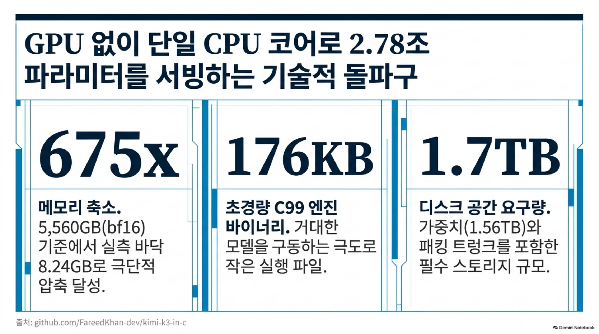
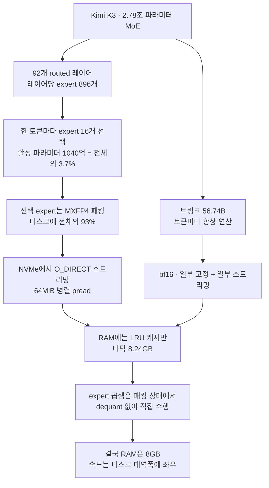
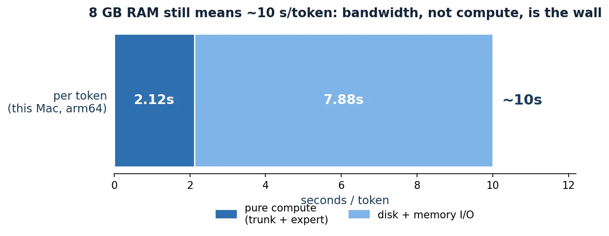
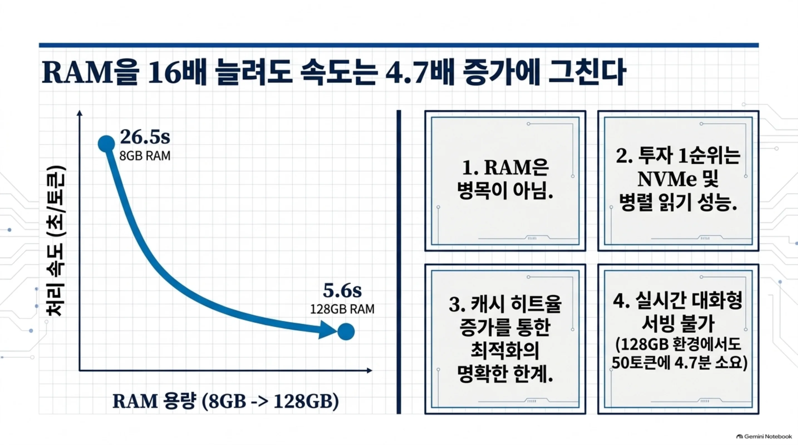
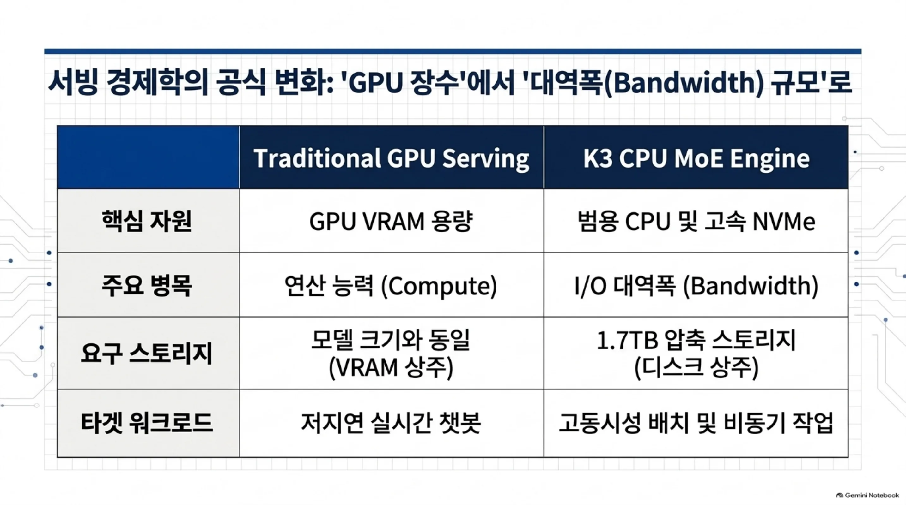
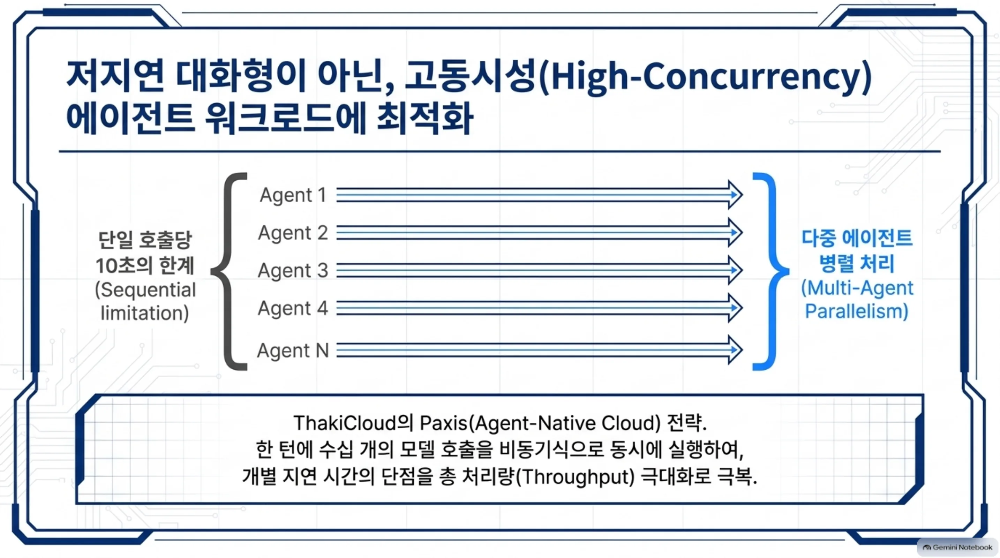

*거대한 모델이 필요한 부분만 골라 좁은 통로를 지나 소형 램에 도달하는 개념을 추상화했습니다.*

## 왜 읽어야 하나

LLM 서빙 비용을 책임지는 엔지니어입니다. 온프렘·소버린 환경에서 GPU를 수십 장 확보하기 어려운 팀도 대상입니다. 결론부터 말합니다. Kimi K3(2.78조 파라미터 MoE)는 GPU 없이 CPU 한 코어로 **돌긴 합니다**. 다만 램 8GB에서 토큰당 약 27초라 대화용 서빙은 아닙니다. 그리고 진짜 병목은 **저장소 대역폭**입니다. 이 글은 그 사실을 C99 엔진을 실제로 빌드하고 weightless 테스트와 kernel 벤치를 돌린 수치로 확인했습니다. 끝까지 읽으면 "왜 램이 줄어도 속도는 안 줄까"라는 질문에 답이 서고 ThakiCloud가 보는 서빙 경제학에서 이 기법의 의미가 보입니다.

## 개요

"8GB 램으로 2.78조 파라미터"라는 문장은 처음엔 속임수처럼 보입니다. 그런데 뒤를 받쳐 주는 구조가 있습니다. Kimi K3는 mixture of experts, 즉 MoE 모델입니다. 전체 파라미터 2.78조 중 한 토큰을 처리할 때 실제로 쓰는 활성 파라미터는 1040억, 약 3.7%입니다. 나머지 96.3%는 그 토큰에는 쓰이지 않고 디스크에 대기합니다. 이 엔진은 쓰지 않는 expert를 램에 올리지 않고 디스크에 두어 필요할 때만 읽어 옵니다. 그래서 램은 8.24GB까지 내려갑니다.

프로젝트는 [kimi-k3-in-c](https://github.com/FareedKhan-dev/kimi-k3-in-c)입니다. 공개 저장소, Apache-2.0, C99로 쓰였고 이 글 쓰는 시점에 스타 9,600개가 넘어 있습니다. 엔진 바이너리는 176KB입니다. 체크포인트(모델 가중치)는 1.56TB, 96개 샤드로 나뉩니다. "엔진은 작은데 가중치는 크다"는 것이 이 프로젝트의 핵심입니다. 바이럴 문장 속의 "8GB"는 가중치를 어떻게 다루느냐에서 옵니다.


*엔진 바이너리는 176KB로 초경량이고, 메모리는 bf16 대비 675배 줄며, 대신 디스크 1.7TB가 필요합니다.*

ThakiCloud의 관점에서 이 글이 중요한 이유는 하나입니다. Frontier급 모델을 GPU 없이, commodity CPU에서 돌릴 수 있다면 서빙의 비용 구조가 바뀝니다. 이 글은 그 주장이 사실인지, 사실이라면 어디까지인지를 재현으로 가릅니다. 아래 수치 중 저희 Mac에서 직접 재은 것은 "실측"으로, README 저자가 보고한 것은 "저자 실측"으로 구분합니다.

## 이 기술은 무엇인가

핵심은 세 기제입니다. MoE의 expert 선택, MXFP4 패킹, 그리고 NVMe 스트리밍입니다.

첫째, MoE 구조입니다. Kimi K3는 93개 레이어로 이루어져 있고 그중 92개가 routed 레이어입니다. 각 routed 레이어에는 expert 896개가 있고 한 토큰이 오면 그중 16개(공유 expert 2개 포함)만 선택해 연산합니다. 그래서 활성 파라미터는 전체의 3.7%에 불과합니다. 레이어 92개 × expert 896개, 즉 라우티드 expert 82,432개가 디스크에 있고 토큰마다 실제로 읽히는 것은 그 일부에 그칩니다.

둘째, MXFP4 패킹입니다. 선택된 expert 가중치는 4비트로 패킹됩니다. 정확히는 4비트 니블에 32개 요소마다 하나씩 8비트 스케일을 붙이는 방식입니다. 이 패킹 expert는 디스크에 전체 체크포인트의 93%를 차지합니다. 중요한 것은 "experts는 절대 dequantize하지 않는다"는 점입니다. 곱셈이 패킹된 4비트 형태로 직접 수행됩니다. dequantize해서 bf16으로 부풀리는 순간 램이 8배가 되므로, 그 비용을 디스크 대역폭으로 대신 내는 설계입니다.

셋째, NVMe 스트리밍입니다. 토큰을 처리할 때 필요한 16개 expert는 디스크에서 O_DIRECT(페이지 캐시 우회)로, 64MiB 단위로 병렬 pread로 읽어 옵니다. 읽은 expert는 램의 LRU 캐시에 일부만 두고 나머지는 다시 디스크로 돌려 보냅니다. 트렁크(토큰마다 항상 연산하는 56.74B)는 bf16으로 일부만 고정, 나머지는 패킹 트렁크 파일에서 스트리밍합니다.



쉽게 말하면, 책 150만 권(2.78조 파라미터)을 둔 도서관이라고 상상해 보세요. 질문이 들어오면 16권의 책만(활성 3.7%) 찾아 읽고 나머지는 서고(디스크)에 두어 필요할 때만 가져옵니다. 책장은 작아도(램 8GB) 읽을 책은 16권이어서 됩니다. 다만 서고에서 책장을 넘기는 속도에(대역폭) 답이 달려 있습니다.

## 설치 및 통합

엔진은 체크포인트 없이도 컴파일되고 weightless 테스트가 도닙니다. 아래는 이 글 작성 중 격리 샌드박스에서 실제로 돌린 명령과 결과입니다. 기계는 Apple Silicon(macOS, arm64), 컴파일러는 Apple clang, OpenMP는 Homebrew libomp입니다.

저장소를 클론합니다.

```bash
git clone --depth 1 https://github.com/FareedKhan-dev/kimi-k3-in-c.git
```

빌드하고 weightless 테스트를 실행합니다. `make test`는 CLI 바이너리와 테스트 바이너리를 만들고 체크포인트가 필요 없는 검사(연산·캐시·스트리밍·오라클)를 돌립니다.

```bash
make test
```

빌드된 바이너리의 버전만 확인해 보세요.

```bash
./bin/k3 --version
# k3 1.1.0
```

kernel 벤치를 돌립니다. `make bench`는 실제 Kimi K3 차원에서 kernel만 측정합니다. 가중치는 읽지 않고 연산 성능만 잰 것입니다.

```bash
make bench
```

실행하려면 x86-64는 AVX2 + FMA, arm64는 NEON이 필요합니다. AVX-512는 불필요합니다. 툴체인은 GCC 9 이상 또는 Clang 10 이상, libm, OpenMP입니다. 풀 모델을 실제로 돌리려면 체크포인트 1.56TB와 패킹 트렁크를 합쳐 약 1.7TB의 저장 공간이 필요합니다.

## 실제 실험 결과

이 Mac에서 실제로 확인한 것은 네 가지입니다. 전부 `run-N.log`에서 캡처한 값입니다.

첫째, 빌드가 성공했습니다. `make test`의 반환값은 0이고 바이너리 18개(메인 `k3` 312,752바이트, 테스트 바이너리 17개)가 만들어졌습니다. README에 적힌 Linux 바이너리 179,736바이트와 크기가 다른 것은 플랫폼과 아키텍처(arm64 + NEON) 차이가 반영된 것입니다.

둘째, weightless 테스트가 전부 통과했습니다. 캐시 링, 트렁크 스트리밍(O_DIRECT, 페이지 캐시 우회, 64MiB 병렬 pread), truncated/bad-manifest 거부 케이스까지 PASS입니다.

셋째, full-model 오라클 게이트가 통과했습니다. 주의 깊게 봐야 할 점은, 이 오라클이 쓰는 것이 **작은 합성 픽스처**(hidden 128, 레이어 13, 어휘 256, MLA 4 + KDA 9, expert 8 top2 shared2)라는 것입니다. 실제 2.78조 가중치는 아닙니다. 즉 이 테스트는 "엔진이 참조 구현과 bit-exact으로 일치하는가"를 확인하는 것입니다. 결과: GATE 1(teacher forcing) 32/32, GATE 2(greedy decode) 20/20, GATE 3(incremental, KV cache + KDA state) 20/20 전부 일치했고, 판정은 "ENGINE MATCHES THE REFERENCE EXACTLY"였습니다. 실제 모델 속도는 여기서 확인하지 않았습니다.

넷째, kernel 벤치에서 실측 수치를 얻었습니다.

```
kernel benchmark at REAL Kimi K3 dimensions
built WITH NEON
bf16 matmul  12288 x 7168      1.36 ms     129.9 GFLOP/s
             trunk is 56.74 G params/token -> 0.87 s/token at this rate
MXFP4 matmul 3072 x 3584       0.28 ms      77.8 GFLOP/s
             16 experts x 3 mats x 92 layers -> 1.25 s/token
measured compute budget at the floor is about 10 s/token
```

이 숫자가 이 글의 핵심입니다. 순수 연산(compute)으로는 트렁크 0.87초 + expert 1.25초, 합쳐도 2초 안쪽입니다. 그런데 바닥(램 8GB, 대부분 디스크 스트리밍)에서 실제로는 토큰당 약 10초입니다. 연산이 전체의 20% 남짓이고 나머지 80%는 가중치를 디스크에서 읽어 오는 대역폭에 쓰입니다.


*이 Mac(arm64, NEON)에서 잰 토큰당 시간 분해. 순수 연산(trunk 0.87s + expert 1.25s)은 2.12s에 불과하고, 바닥(램 8GB) 실측은 약 10s. 차이는 가중치 스트리밍 대역폭입니다.*

README의 저자가 보고한 실측 속도(저희 Mac이 아닌 저자 환경)도 함께 적어 둡니다. 램을 늘리면 expert를 더 많이 RAM에 두고 대역폭 부담을 줄일 수 있어 속도가 올라갑니다.

| RAM | 토큰당 지연(저자 실측) |
|---|---|
| 8 GB | 26.5 s |
| 32 GB | 24.2 s |
| 64 GB | 19.8 s |
| 128 GB+ | 5.6 s |

메모리가 8GB에서 128GB로 16배가 되어도 지연은 26.5초에서 5.6초, 약 4.7배 줄어드는 데 그칩니다. 램이 아닌 대역폭이 지배한다는 증거입니다. README의 메모리 래더도 같은 방향입니다. 그대로 bf16으로 상주하면 5,560GB, 출고 체크포인트만 해도 1,560GB, 항상 active인 트렁크만 상주해도 113.49GB, 그리고 실측 바닥이 8.24GB입니다. bf16 대비 675배 축소입니다.


*8GB에서 128GB까지 RAM을 늘려도 지연은 26.5초에서 5.6초로 약 4.7배 줄어드는 데 그칩니다. 병목은 RAM이 아니라 NVMe 대역폭이고, 캐시 히트로 뚫을 수 있는 한계도 명확합니다.*

## ThakiCloud 제품 적용 시사점

ThakiCloud의 Metis(K8s 기반 AI/ML 서빙 플랫폼)는 다양한 고객 환경에서 모델을 서빙합니다. 이 기법이 Metis 서빙 경제학과 온프렘·소버린 배포에서 필요한 이유는 세 가지입니다.

첫째, GPU 제약이 있는 온프렘·소버린 환경입니다. Frontier급 모델을 서빙하려면 보통 GPU 수십 장이 필요합니다. 그러나 이 엔진처럼 "활성 파라미터만 뽑아 쓰고 나머지는 디스크에 둔다"는 방식이라면, GPU 없이도 특정 워크로드를 처리하는 경로가 열립니다. 저지연 대화가 필요 없는 배치나 비동기 작업이라면요. 소버린 AI를 구축하되 GPU 공급에 제약이 있는 고객에게, 이 방식은 하나의 실험적이지만 실재하는 옵션입니다.

둘째, 서빙 비용의 병목 재정의입니다. 이 재현이 보여주는 것은 "RAM을 줄여도 속도가 줄지 않는다"는 것입니다. 병목이 I/O(대역폭)라면, 투자 대상도 바뀝니다. 투자할 곳은 더 빠른 NVMe, 더 큰 병렬 읽기, 더 현명한 expert 배치입니다. Metis의 서빙 경제성 분석에서 "GPU를 몇 장"보다 "대역폭을 얼마"를 물어야 하는 영역이 여기 있습니다.

셋째, MXFP4와 패킹 상태 곱셈은 양자화 방향의 참고점입니다. dequantize하지 않고 패킹 형태로 직접 곱하는 것은 4비트 서빙의 기본입니다. Metis가 low-bit 서빙을 설계할 때, "가장 작은 활성 집합을 어떻게 디스크와 램 사이에서 오가는 구조로 설계할 것인가"가 이 기법의 본질입니다.


*핵심 자원이 GPU VRAM에서 범용 CPU+고속 NVMe로, 주요 병목이 연산에서 I/O 대역폭으로, 타겟 워크로드가 저지연 챗봇에서 고동시성 배치·비동기로 바뀝니다.*

Paxis(Agent-Native Cloud) 렌즈에서도 한 줄입니다. 에이전트가 한 턴에 여러 모델 호출을 병렬로 돌리는 구조라면, 호출 하나당 10초에 동시 수십 개를 굴리면 총 처리량은 실용 범위에 들어올 수 있습니다. 즉 "여럿을 병렬로" 전략에 이 기법이 끼어드는 자리입니다.


*한 턴에 수십 개 모델 호출을 비동기로 동시에 실행하면, 개별 지연 10초의 단점을 총 처리량 극대화로 보완합니다.*

## 한계 및 반론

가장 큰 한계는 속도입니다. 토큰당 10초 이상은 대화형이지 않습니다. "8GB에서 2.78조"는 가능성의 증명이지, 프로덕션 서빙의 제안이 아닙니다. 저자 실측 5.6s/token(128GB)도 50토큰이면 4.7분입니다.

둘째, 저장 공간은 회피할 수 없습니다. 체크포인트 1.56TB, 합쳐 약 1.7TB. 이 전제 없이는 시작할 수 없습니다. "8GB 램"은 "1.7TB 디스크"와 한 쌍입니다.

셋째, 이 재현은 실제 모델 속도를 확인한 것이 아닙니다. 오라클 테스트는 합성 픽스처로 엔진의 정확성만, kernel 벤치는 연산만 잰 것입니다. 2.78조 가중치를 실제로 읽어 오는 end-to-end 속도는 저희 환경에서 재지 못했습니다(1.7TB 저장공간 + NVMe가 필요). 그래서 속도 표는 README 저자 실측을 인용했습니다.

넷째, 4비트 MXFP4는 bf16 대비 품질 손실이 있을 수 있습니다. 이 엔진은 "8GB에서 도느냐"에 초점을 맞춥니다. 품질 허용 평가는 이 글의 범위를 벗어납니다.

## 정리

이 글이 확인한 것은 한 문장입니다. **2.78조 파라미터를 8GB 램에서 돌리는 것은 가능하고, 병목은 RAM이 아니라 저장소 대역폭입니다.**

다음 행동을 권합니다. Frontier급 모델을 온프렘·소버린 환경에서 GPU 없이 처리해야 한다면, 대화형이 아닌 배치·비동기 워크로드부터 이 방식을 검증해 보세요. 투자 우선순위는 더 빠른 NVMe와 더 큰 병렬 읽기입니다. 그리고 "얼마나 작은 램에 올리나"보다 "활성 파라미터 비율을 어떻게 줄이고 그 나머지를 디스크와 어떻게 오가게 할 것인가"를 물어야 합니다. 이 C99 엔진은 그 물음에 대한 실재하는, 빌드되어, 검증된 답안지입니다.
