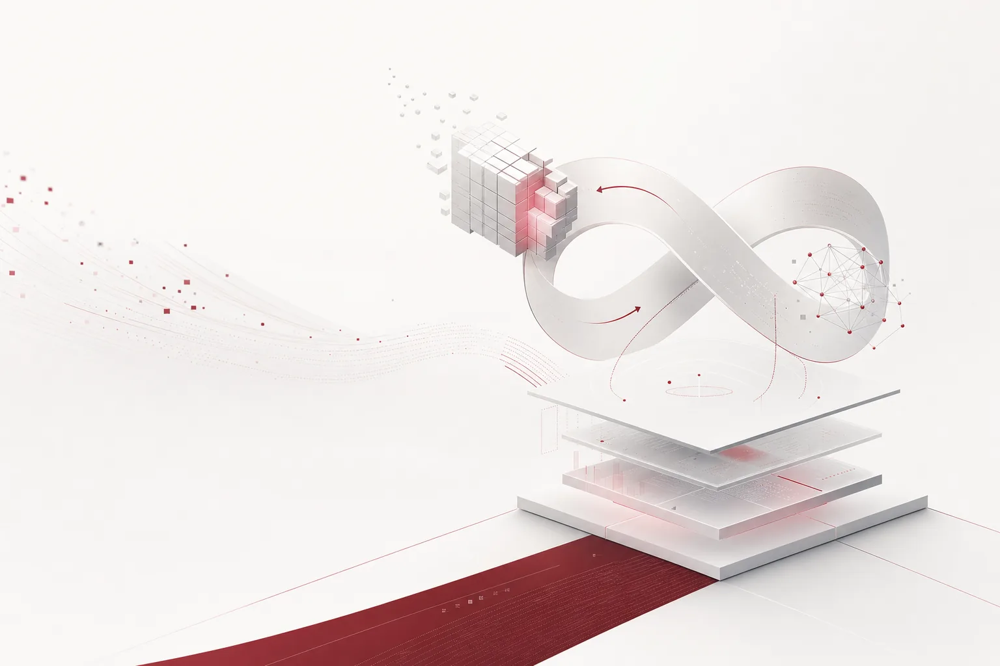

48.1%는 그 자체로 큰 숫자가 아닙니다. Qwen 계열 모델의 수학 점수라면, 순위표 한 줄로 끝날 수치입니다. 오늘의 선명함은 점수를 올린 주체에서 왔습니다. MIT CSAIL 연구진이 프런티어 모델 GPT-6 Astra로 다른 신경망의 가중치를 직접 편집하는 기법을 시연했습니다. Astra가 대상 네트워크의 기본 논리를 진단한 뒤 복구하고, Qwen의 수학 점수는 48.1%까지 올라갔습니다. 다시 학습한 게 아니라 고친 것입니다.

오늘 아침 HuggingNews 다이제스트는 실험실 한 곳의 기법에서 시작해 SEC 공시와 200억 달러의 자금 조달, 금융사의 도구 사용 제한까지 10건을 담고 있습니다. 방향이 제각각인데, 붙이면 한 장면이 됩니다. 모델이 모델을 만들고 고치는 루프가 뉴스 한 페이지에 모인 장면에, 그 루프를 감싸는 비용과 접근권과 주권의 선들이 같은 페이지에 그려진 것입니다.

*글의 핵심 개념을 형상화했습니다.*

## 가중치를 고치는 모델

연구진이 시연한 흐름을 그대로 적으면, Astra가 Qwen 네트워크의 기본 논리를 읽고 그 논리가 깨진 자리를 진단한 뒤 가중치 수준에서 복구합니다. "읽는다"는 말이 여기서는 기술 동작입니다. 대상 네트워크의 내부 논리를 외부에서 판독해야 어디가 문제인지 진단하고 가중치를 고칠 수 있습니다. 기존의 개선 경로는 재학습이었습니다. 데이터와 컴퓨트를 넣고 스테프를 돌려 다음 버전의 모델을 만듭니다. 이번 기법은 그 사이를 건너뜁니다. 이미 가동 중인 모델의 안쪽을 고치는 작업입니다.

이 한 수가 "능력"의 위치를 바꿉니다. 능력이 모델의 고정된 속성이 아니라 읽고 고칠 수 있는 대상이 되는 순간, 프롬프트를 넣으면 답이 나오는 상자라는 전제가 흔들립니다. 모델은 특정 줄을 찾아 고질 수 있는 물질에 가깝습니다. 소프트웨어가 버그 패치를 받는 것처럼, 모델이 논리 패치를 받는 경로가 열린 셈입니다.

가중치를 고칠 수 있다는 것은 버전이라는 개념 자체를 바꿉니다. 코드의 버그 패치가 커밋 이력을 남기듯, 모델의 논리 복구에도 패치 이력이 남습니다. 언제, 어떤 모델의 어떤 논리가, 어떤 도구를 만나서 고쳐졌는지를 따를 수 있어야 합니다. 모델이 소프트웨어처럼 패치를 받는 순간, 버전 관리와 이력 추적이 운영의 기본으로 들어옵니다.

대상으로 삼은 것이 Qwen이라는 점도 놓치기 쉽습니다. Qwen은 오픈모델 계열이고, 이를 고치는 도구는 프런티어 연구실의 모델입니다. 도구가 프런티어 쪽에 있고 대상이 오픈 쪽이라는 차이가 큽니다. 프런티어가 폐쇄 모델을 다듬는 내부 유지보수의 그림이 아닙니다. 오픈 모델의 특정 역량을 외부 도구가 올리는 장면입니다. 고쳐진 역량이 수학이라는 점도 같은 맥락입니다. 수학은 답이 검증 가능한 영역이라, 논리 복구가 실제로 기능 개선으로 이어졌는지를 점수로 확인할 수 있습니다. 48.1% 숫자 자체보다 길이가 중요합니다. 이 경로가 일반화되면, 오픈 모델의 약점과 프런티어 모델의 강점 사이 거리가 재학습이 아니라 패치가 됩니다. 모델의 가격 형식이 거기서 바뀝니다. 모델은 한 번 사고 오래 쓰는 자산이 아닙니다. 고치고 다듬는 대상입니다.

## 닫히려는 루프

오늘의 두 기사가 같은 루프 위에 놓입니다. Sam Altman CEO가 OpenAI의 차기 GPT 시리즈는 나비에-스톡스 방정식을 풀어낸 내부 모델을 기반으로 할 것이라 밝혔습니다. 유체의 움직임을 기술하는 기본 방정식을 내부 모델이 풀어낸 것입니다. 주목할 지점은 차기 제품의 기반이 된 것의 형상입니다. 벤치마크 점수가 아닙니다. 나비에-스톡스 방정식을 풀어낸 연구 결과, 그 모델을 만든 연구 활동입니다. 모델이 연구를 했고, 그 결과가 다음 모델의 기초가 됩니다.

Anthropic의 공시는 같은 루프의 다른 쪽을 짚습니다. SEC 문서 안에 든 회사 내부 전망은 차기 모델이 머지않아 연구 속도를 극적으로 가속시킬 수준에 도달할 수 있다고 적었습니다. 전망을 쓴 주체가 회사 스스로입니다. 그 전망이 담긴 문서가 SEC에 제출하는 공시라는 점, 그 부분이 이 사건의 무게입니다. OpenAI가 내일의 모델을 오늘의 연구로 짓고, Anthropic이 내일의 모델이 연구 자체를 가속할 것이라 적었습니다. 둘은 다른 문장인데 같은 사실을 가리킵니다. 모델이 모델을 만드는 루프가 닫히려는 중입니다. 이 루프의 병목은 예전에는 사람 연구자였습니다. 오늘의 뉴스는 그 병목이 변수가 되는 장면입니다.

기업 쪽에 이 루프가 닿는 방법은 모델 교체 주기의 압축입니다. 연구가 모델의 속도를 결정하는 구조에서 연구의 속도가 다시 모델로 빨려 들어가면, 버전 세대 간 간격이 짧아집니다. 오늘 정한 모델 배정이 다음 분기 예산 회의 때 이미 구세대가 될 수 있다는 뜻입니다. 모델 하나를 골라 오래 쓰는 구조가 모델 여러 개를 계속 고르고 쓰는 구조로 바뀝니다.

## 두 곡선

능력 쪽에도 오늘 숫자가 나왔습니다. Gemini 4 Carbon이 Mercor의 APEX-Agents 리더보드에서 1위로 데뷔했습니다. Pass@1 84.2%, 평균 90.4%입니다. Pass@1은 첫 시도 성공률입니다. 84.2%는 에이전트 작업에서 10개 중 8개 넘게 첫 시도로 완수했다는 뜻입니다. 평가된 모델 가운데 평균 90%를 넘긴 최초라는 문장도 이 모델과 함께 쓰였습니다. 에이전트 벤치마크의 기준선이 80점대였던 흐름이 90을 넘는 선입니다.

같은 날 같은 모델에서 비용 쪽 숫자도 나왔습니다. SemiAnalysis가 전문 업무의 AI 역량을 측정하려고 만든 GDPx 테스트에서, Gemini 4 Carbon은 Opus 5.5보다 4배 낮은 비용을 제공합니다. 효율은 업계 선두에 거의 버금가는 수준이라는 평가입니다. 90%대 점수와 4배 낮은 가격이 같은 모델에 함께 붙습니다. 이 조합은 구매 결정의 언어로 읽힙니다. 둘이 같은 아침 같은 모델에서 나온 것이 중요합니다. "더 강한 모델"이 "더 비싼 모델"로만 번역되던 공식이 오늘 꺾였습니다.

에이전트 워크로드는 하루에 수백 번 모델을 호출하는 구조입니다. 능력과 비용이 동시에 움직이는 날, 어떤 작업에 어떤 모델을 쓰느냐가 운영의 본업이 됩니다. 고를 수 있는 모델의 표도 넓어집니다. Hume이 Audio Decision API를 내놓았습니다. 음성 녹음에서 화자의 감정 상태를 판별하는 도구로, 웃음이나 망설임 같은 미세한 음향 뉘앙스를 식별합니다. 스페셜티 API가 범용 LLM과 함께 서빙 테이블에 앉습니다. 라우팅의 옵션이 늘수록 고르는 층의 가치가 커집니다.

## 긋지는 선들

루프가 닫히려는 동안 선을 긋는 곳도 있습니다. Goldman Sachs가 Claude Code와 GitHub AI 도구의 사용을 엔지니어링 직군으로 제한했습니다. 트레이딩과 뱅킹 부서 인원은 더 이상 특정 AI 어시스턴트 사용 권한이 없습니다. 금융사가 "모두에게 열어두자" 대신 "직군으로 닫자"를 먼저 고른 것입니다. 특정 도구의 사용 권한을 직군 단위로 다시 그린다는 뜻입니다.

SpaceX는 다른 쪽을 고릅니다. Grok Bot 어시스턴트에서 구독자가 자신의 상호작용이 학습에 쓰이도록 동의하면 추가 크레딧을 주는 기능을 테스트하고 있습니다. 사용자 동의 자체가 청구 항목이 되는 구조입니다. 데이터 동의가 크레딧과 연결된 기능 설계로 들어온 사례입니다. OpenAI는 주권 쪽으로 선을 그었습니다. 아부다비와의 파트너십을 새 계약으로 확대했고, 에미리트 국영 기업의 운영에 생성형 AI를 통합했습니다. 대상은 에너지와 투자 부문입니다. 국영 기업 안으로 AI가 들어가면, 어디에서 돌리고 누가 볼 수 있느냐가 자동으로 질문이 됩니다.

세 선을 나란히 놓으면 축이 셋입니다. 직군, 동의, 관할입니다. 누가 쓸지, 무엇을 내줄지, 어디서 돌릴지를 둘러 권한의 세 축에 동시에 선이 그어지는 날입니다.

자본은 이 모든 것을 밑에서 받칩니다. Oracle이 미 증권거래위원회에 100억 달러 규모 보통주 발행을 신청했고, 동시에 100억 달러 무보증 조달을 추진합니다. 200억 달러가 AI 인프라 구축으로 들어갑니다. 선을 긋는 동안 돈은 흐르고, 인프라 쪽은 어느 회사든 운영 속도를 넘어서는 속도로 늘어납니다.

## 서빙 테이블이 답을 가진다

오늘의 뉴스는 한 지점을 향합니다. 모델이 어느 한 회사의 추격 속도보다 빨리 변한다는 점입니다. 가중치는 편집 가능하고, 연구 루프는 닫히려 합니다. 능력의 천장은 90에, 비용의 바닥은 4배에 움직입니다. 접근은 직군으로 제한되고, 동의는 크레딧으로 청구되며, 배포 대상은 국영 기업으로 들어갑니다. 이런 날 기업의 답은 가장 강한 모델을 사서 갖는 데 있지 않습니다. 어떤 모델이 어디에서, 어떤 작업에, 어떤 기록과 함께 도는지, 업무 흐름을 건드리지 않고 바꿀 수 있는 층입니다.

Paxis는 ThakiCloud의 Agent-Native Cloud로, 현재 v1.1 GA입니다. Skills, Tools, Policies, Audit Logs를 일급 리소스로 관리합니다. 자율도는 L0부터 L3까지 정책 게이트로 점검하고, 감사 로그로 기록을 남깁니다. 격리 샌드박스 실행이 에이전트 동작의 경계를 잡고, MCP 커넥터와 스킬 마켓이 도구를 공급합니다. 소버린과 온프레미스 K8s(ai-platform) 배포를 지원하고, CostRouter가 작업별로 최적의 모델을 골라 실행에 배정합니다.

오늘의 뉴스는 그 층에 거의 항목별로 매핑됩니다. Gemini 4 Carbon과 Opus 5.5 사이의 4배 비용 간극은 CostRouter가 바로 잡는 변수입니다. 간극이 클수록 라우팅 하나당 절감이 커집니다. Goldman Sachs의 직군별 접근 제한과 SpaceX의 동의 기반 크레딧은 기업 배포에서 정책 정의를 하고 기록을 남기는 일입니다. Policies와 Audit Logs가 리소스 수준에서 그 일을 합니다. 아부다비 국영 기업의 흐름은 고객의 관할 안에서 실행 환경을 돌릴 수 있어야 합니다. 소버린과 온프레미스 K8s 배포가 그 자리입니다. Anthropic이 전망한 루프의 가속에는, 자율도 단계와 격리 샌드박스 실행이 경계를 작업별로 조여 주는 장치가 됩니다.

모델 쪽의 방향은 연구실이 정하고, 돈 쪽의 방향은 자본시장이 정합니다. 기업이 고를 수 있는 것은 모델을 돌리는 층의 방향입니다. 오늘의 48.1%는 모델이 고칠 수 있는 대상이라는 것을 보여줬습니다. 4배는 모델이 바꿀 수 있는 대상이라는 것을 보여줬습니다. 고르고 돌리고 기록하는 층에 운영의 이점이 생깁니다.

## 참고 자료

이 글은 아래 뉴스를 종합해 작성했습니다.

- HuggingNews, [GPT-6 Astra Edits Neural Weights to Boost Qwen Model's Math Score to 48.1%](https://huggingnews.com/ai/gpt-6-astra-edits-neural-weights-to-boost-qwen-models-math-score-to-481p-4720ace6)
- HuggingNews, [Google's Gemini 4 Carbon Tops Mercor's APEX-Agents Leaderboard With First Mean Score Above 90%](https://huggingnews.com/ai/googles-gemini-4-carbon-tops-mercors-apex-agents-leaderboard-with-first-36f3932d)
- HuggingNews, [Oracle Targets $20B in Fresh Capital to Fund AI Infrastructure Buildout](https://huggingnews.com/ai/oracle-targets-20b-in-fresh-capital-to-fund-ai-infrastructure-buildout-4d1ae76a)
- HuggingNews, [Anthropic Warns Future AI Models May Soon Trigger 'Dramatically Accelerated' Research Pace](https://huggingnews.com/ai/anthropic-warns-future-ai-models-may-soon-trigger-dramatically-accelerated-5873b68a)
- HuggingNews, [SpaceX Ties Grok Bot Usage Resets to Training Data Opt-In](https://huggingnews.com/ai/spacex-ties-grok-bot-usage-resets-to-training-data-opt-in-290f13a9)
- HuggingNews, [OpenAI to Release Next GPT Using Model That Solved Navier-Stokes Equations](https://huggingnews.com/ai/openai-to-release-next-gpt-using-model-that-solved-navier-stokes-equatio-1dde1157)
- HuggingNews, [OpenAI Seals New Pacts to Deploy AI Across UAE Energy and Investment Sectors](https://huggingnews.com/ai/openai-seals-new-pacts-to-deploy-ai-across-uae-energy-and-investment-sec-7a4884aa)
- HuggingNews, [Hume Launches Audio Decision API to Analyze Emotion in Voice Recordings](https://huggingnews.com/ai/hume-launches-audio-decision-api-to-analyze-emotion-in-voice-recordings-4c72d06e)
- HuggingNews, [Google's Gemini 4 Carbon Offers 4x Lower Cost Than Opus 5.5 on New AI Agent Benchmark](https://huggingnews.com/ai/googles-gemini-4-carbon-offers-4x-lower-cost-than-opus-55-on-new-ai-agen-e2a87831)
- HuggingNews, [Goldman Sachs Limits Claude Code and GitHub AI Access to Engineering Staff](https://huggingnews.com/ai/goldman-sachs-limits-claude-code-and-github-ai-access-to-engineering-sta-111818ce)