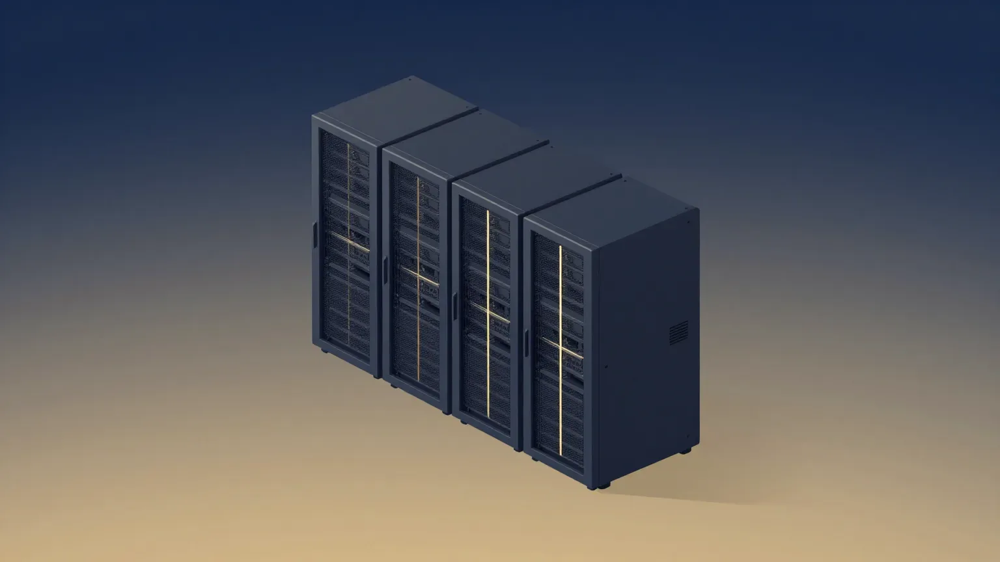
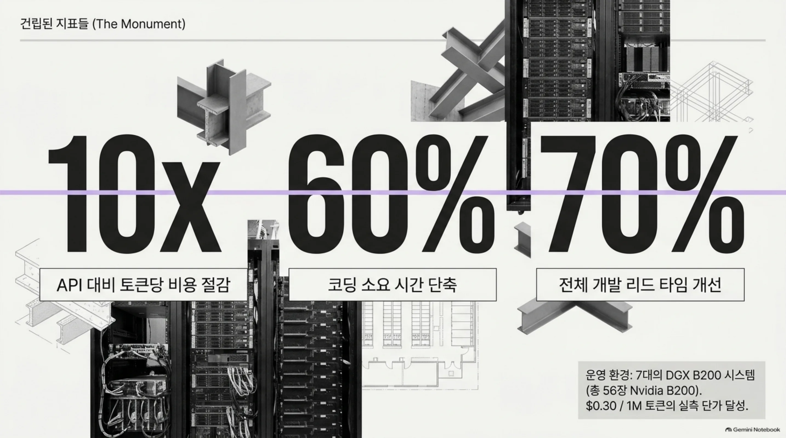
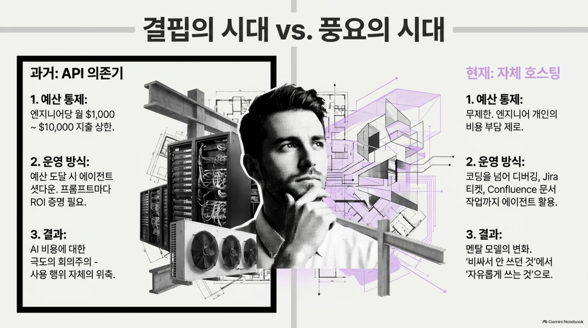
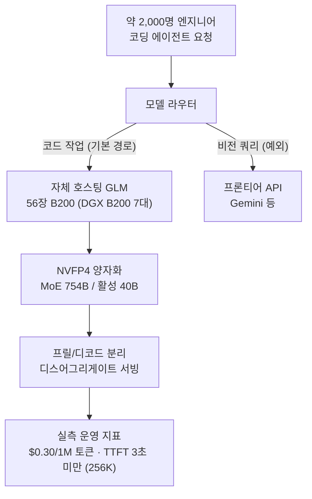
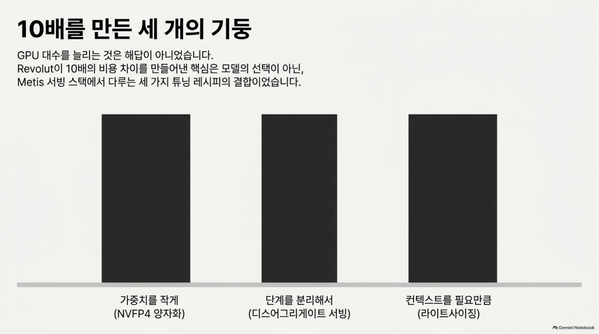
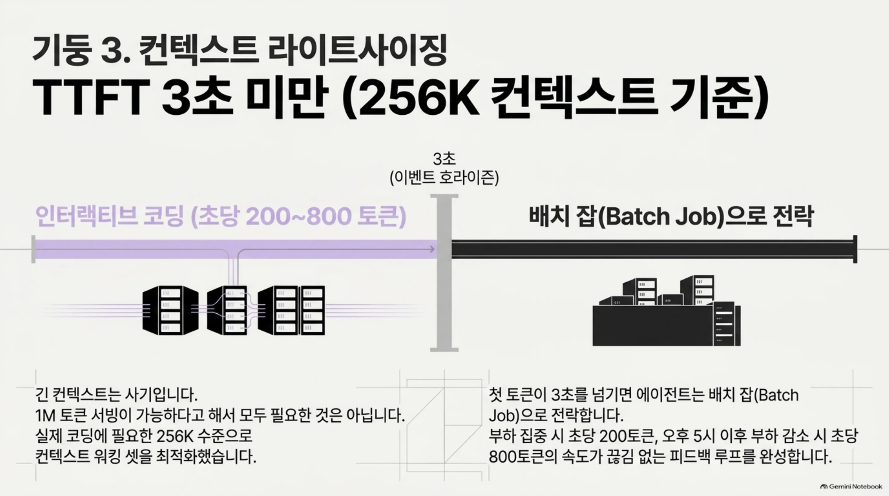
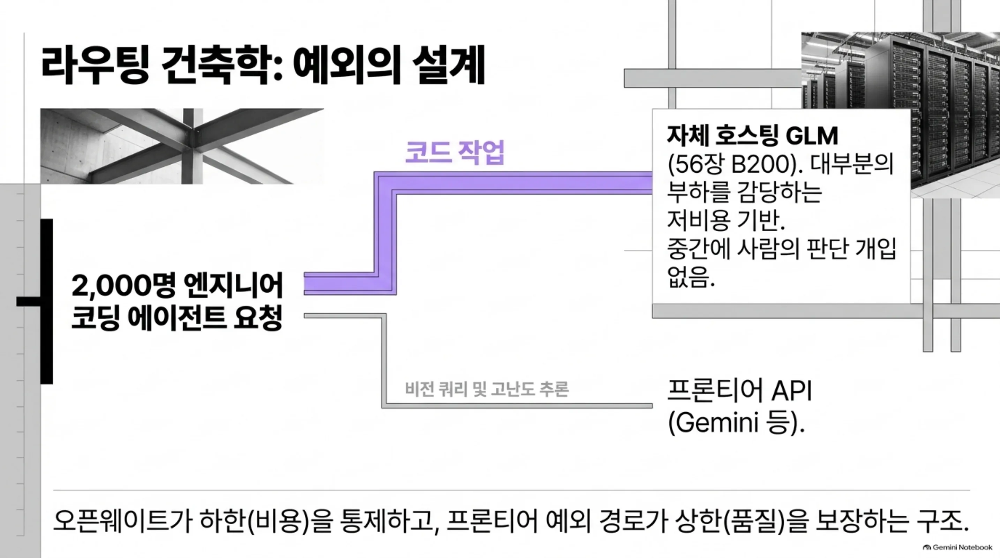
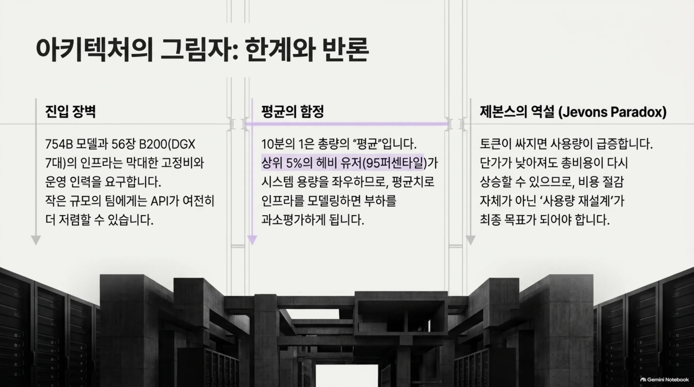

*자체 호스팅 서빙에서 토큰이 한 방향으로 흐르고 청구서가 평탄해지는 개념을 추상화했습니다.*

## 왜 읽어야 하나

코딩 에이전트를 대규모로 돌리는 조직의 인프라팀이라면 지금 두 갈림길에 서 있습니다. 프론티어 API로 계속 갈 것인가, 아니면 오픈웨이트 모델을 자체 호스팅으로 넘어갈 것인가. 이 글은 그 갈림길에서 후자를 1년 실제로 걸은 사례, Revolut의 숫자를 보고 그 숫자를 만든 메커니즘을 분해합니다. 결론을 먼저 드리면, 10배 비용 차이를 만든 것은 모델 선택이 아니라 세 가지 튜닝 레시피, 즉 NVFP4 양자화와 프릴/디코드 분리와 컨텍스트 라이트사이징이었고 그 세 가지는 전부 우리가 Metis 서빙 스택에서 다룰 때 쓰는 레버입니다.

## 개요

Revolut의 운영·인프라를 이끄는 David Abitbol이 10월 13일 AI Engineer New York에서 발표한 내용을 The Register가 11월 3일 보도했습니다. 핵심 사실은 이렇습니다. 약 2,000명 엔지니어의 기본 코딩 모델이 자체 호스팅 GLM이었고 그 비용은 OpenAI Codex와 Anthropic 클로드 코드의 10분의 1 수준이었습니다. Abitbol은 코딩 시간 60% 개선, 리드 타임 70% 개선이라는 내부 수치를 함께 제시했습니다.

*1년 만에 세운 숫자들. API 대비 토큰 비용 10분의 1, 코딩 시간 60% 절감, 리드 타임 70% 개선. 7대의 DGX B200(총 56장) 위에서 $0.30/1M 토큰 실측 단가가 달성됐습니다.*

타임라인을 보면 선택이 순서대로 바뀌어 있습니다. 2025년 초에는 Gemini, 2026년 초에는 클로드 코드가 기본 경로였습니다. 그 뒤 GLM-5.1을 자체 호스팅으로 들였고 현재는 GLM-5.3이 56장의 Nvidia B200, 즉 8GPU DGX B200 시스템 7대 위에서 도는 기본 모델입니다. GLM은 Zhipu, 국제 브랜드로는 Z.ai가 만든 MoE 모델로, 5.1은 총 파라미터 754B 가운데 토큰마다 40B만 활성화하는 구조입니다.

보도가 짚는 시점감도 중요합니다. Abitbol은 이 전환을 '모델 이야기'가 아니라 'shipping 이야기'로 정리했습니다. 프레임은 조직의 shipping 속도와 비용입니다. 모델이 무엇을 할 수 있느냐는 질문이 아닙니다. 2026년 들어 코딩 에이전트의 비용은 인프라 예산의 1차 항목이 됐고 이 발표가 화제가 된 배경에도 그 시점이 있습니다.

## 어떤 일이 벌어졌나

첫 상업적 도입은 예산 제한부터 시작됐습니다. Abitbol의 회고를 따르면 초기에는 엔지니어당 월 1,000달러에서 10,000달러 사이의 지출 상한을 걸었고 ROI는 '그저 그런 수준'이었습니다. 토큰이 비쌌으니까 쓰려는 행위 자체를 줄이던 시기입니다. Abitbol은 회고에서 "AI 비용에 대해 매우 회의적이었습니다"라고 했고 이 회의가 이후 모든 설계의 출발점입니다.

상한은 운영적으로 무엇이었을까. 팀마다 에이전트 지출 예산을 협상하고 예산에 닿으면 사용이 셧다운되는 형태입니다. 'ROI가 그저 그런 수준'이라는 회고는, 돈은 들었지만 산출이 그 값을 증명하지 못하던 시기였음을 보여줍니다.

자체 호스팅이 기본값이 됐다는 것은 운영적으로 무엇을 바꾸는가. 엔지니어가 에이전트에 돈을 쓰지 않아도 되는 것입니다. 작업마다 예산을 요청하지 않고 프롬프트마다 기대 수익을 설명하지 않아도 됩니다. '쓸 수 있는 것'이 '자유롭게 쓰는 것'이 된 순간입니다. 청구서의 변화보다 이 멘탈 모델의 변화가 크다는 것이 회고의 핵심입니다.

자체 호스팅이 기본값이 된 뒤 풍경이 바뀌었습니다. 청구서가 평탄해졌고 토큰을 세어 쓰지 않아도 되니까 사용 범위가 넓어졌습니다. 코딩만이 아니라 디버깅, Jira 티켓, Confluence 문서 작업까지 에이전트로 넘어갔습니다. Abitbol은 "무제한 토큰이 있으면 자유롭게 그렇게 할 수 있다"고 말했습니다.

정리하면 두 단계로 압축됩니다. 첫 단계는 '비싸서 안 쓰던 것'을 '싸게 쓰는 것'으로 바꾸는 비용 전환이고 두 번째 단계는 '싸게 쓴 토큰이 새 용도를 만드는' 사용 확대입니다. 대부분의 조직은 첫 단계에서 끝내지만, 10분의 1이라는 숫자가 실제로 의미 있는 것은 두 번째 단계까지 온 조직에서만 성립합니다.

*두 시대의 대비. 과거 결핍의 시대에는 엔지니어당 월 $1,000~10,000 상한에 프롬프트마다 ROI를 증명해야 했고, 현재 풍요의 시대에는 비용 부담이 사라져 코딩을 넘어 디버깅, Jira 티켓, 문서 작업까지 에이전트가 들어갑니다.*

서빙 구성은 아래 도표와 같습니다.

## 10배를 만든 세 가지

Abitbol이 발표한 수치 중 주목할 것은 절감 비율 자체보다, 그 원인을 어디에 돌렸는가입니다. 그는 성능 점프의 대부분을 튜닝 세 가지에 돌렸습니다. GPU 수 확장은 주범이 아니었습니다.

*10배를 만든 세 개의 기둥. NVFP4 양자화로 가중치를 작게, 디스어그리게이트 서빙으로 단계를 분리해서, 라이트사이징으로 컨텍스트를 필요만큼.*

첫째, NVFP4 양자화입니다. 754B MoE의 가중치는 원본 정밀도로 380GB의 GPU 메모리가 필요합니다. 저정밀 양자화가 이 부피를 줄여야 56장 B200에 2,000명 사용자의 컨텍스트를 한꺼번에 얹을 수 있습니다. 사용자의 컨텍스트 점유는 정밀도에 따라 6GB에서 26GB 범위로 바뀝니다.

MoE 구조가 여기서 서빙 경제학의 핵심입니다. 총 파라미터는 성능을 정합니다. 추론 비용을 정하는 쪽은 활성 파라미터입니다. GLM 5.1의 총 754B가 성능을 담고 토큰마다 40B만 활성이라는 설계가 계산량을 정합니다. 아주 큰 모델을 중형 모델에 가까운 서빙 비용으로 다룰 수 있는 구조지만, 가중치 메모리를 서빙 스택이 버텨야 한다는 전제가 붙습니다. 양자화와 컨텍스트 관리가 들어오는 이유가 여기입니다.

둘째, 프릴/디코드 분리입니다. 입력 컨텍스트를 처리하는 프릴 단계와 토큰을 계속 내보내는 디코드 단계는 자원 특성이 달라서, 섞어 돌리면 긴 컨텍스트 사용자가 짧은 세션의 응답 속도를 끌어내립니다. 두 단계를 분리한 디스어그리게이트 서빙이 인터랙티브 체감을 지탱합니다.

셋째, 컨텍스트 라이트사이징입니다. Abitbol은 "긴 컨텍스트는 사기"라고 말했다는 식으로 정리됩니다. 1M 토큰을 서빙할 수 있다고 해서 256K가 필요하다는 뜻은 아니라며 실제로 필요한 것은 256K 수준이라고 했습니다. 실측 목표는 256K 컨텍스트에서 첫 토큰까지 3초 미만, 인터랙티브 속도는 초당 200토큰입니다. 오후 5시 이후 사용자가 줄어드는 시간대에는 초당 800토큰에 가까웠다는 회고도 있습니다.

왜 첫 토큰 시간이 문제인가. 인터랙티브 코딩에서 피드백 루프는 키스โตร크에서 완성 건의까지입니다. 첫 토큰이 3초를 넘으면 에이전트는 배치 잡이 됩니다. 초당 200토큰의 스트리밍은 그 사이에서 답변이 이어지는 체감을 만듭니다. 오후 5시 이후 초당 800토큰에 가까웠다는 회고는, 부하가 줄면 같은 하드웨어가 체감을 몇 배로 바꾸는지를 보여줍니다.

*세 번째 기둥, 컨텍스트 라이트사이징. 256K 컨텍스트 기준 첫 토큰 3초 미만, 부하 집중 시 초당 200~800 토큰. 3초를 넘으면 에이전트는 인터랙티브가 아니라 배치 잡이 됩니다.*

$0.30이라는 수치의 단위도 정리해 두면 좋습니다. Abitbol이 발표한 GLM-5.1 호스팅의 1M 토큰당 가격이며, 보도의 표현으로는 OpenAI Codex와 Anthropic 클로드 코드의 10분의 1 수준입니다. 중요한 것은 이 단가가 실현 가격이라는 점입니다. 2,000명을 56장으로 실제로 돌린 뒤 나오는 숫자로, 운영 비용이 포함된 값입니다. 자기 보고의 $0.30과 10분의 1이라는 비율, 이 두 수치를 각 조직의 1인당 지출과 대조하는 것이 이 사례를 읽는 실용적 방법입니다.

세 가지를 한 문장으로 묶으면, '가중치를 작게, 단계를 분리해서, 컨텍스트를 필요만큼'입니다. 이 세 레버는 전부 서빙 스택의 영역입니다.

세 레버는 독립적이지도 않습니다. 양자화가 가중치 메모리를 낮추면 1GPU당 얹을 수 있는 컨텍스트 예산이 넓어지고 프릴/디코드 분리가 긴 컨텍스트 사용자의 체감을 보호하면 전체 세션 밀도를 올릴 수 있고 컨텍스트 라이트사이징이 워킹 셋을 줄이면 앞의 두 효과가 실제 사용자로 퍼집니다. 하나를 당기면 2배의 개선이 나올 수 있지만, 셋을 모두 잡아야 10배의 서사가 됩니다.

## 정책, 예외의 설계

모델 선택은 전부가 아닙니다. Revolut의 현재 정책은 "GLM은 정상 경로, 프론티어는 예외"입니다. GLM이 GPT나 클로드를 완전히 대체한 것은 아니고 모델 라우터가 비전 쿼리는 Gemini 계열로, 코드는 GLM으로 보냅니다. 예외 통로를 열어 둔 것이 이 설계의 핵심입니다. 오픈웨이트 기본값이 대부분의 일을 짊어지고, 품질의 상한은 예외 경로에 맡겨져 있습니다.

*라우팅의 구조. 코드 작업은 자체 호스팅 GLM 기본 경로로, 비전 쿼리와 고난도 추론은 프론티어 API 예외 경로로. 중간에 사람의 판단 개입이 없습니다. 오픈웨이트가 하한(비용)을 통제하고 프론티어 예외가 상한(품질)을 보장합니다.*

예외는 라우팅 규칙으로 작동합니다. 중간에 사람의 판단이 없습니다. 사용자가 비전 작업에 진입할 때 비싼 모델을 쓰고 있다는 인지가 필요 없고 코드 작업은 기본 경로에 그대로 남습니다. 예외 통로를 사람 판단에 맡기면 기본값이 다시 예산 협상의 대상이 되고 규칙으로 두면 기본값이 지출 없이 확장됩니다.

예외에 들어가는 작업은 대개 두 종류입니다. 프론티어 모델에서만 잘하는 높은 난이도의 추론, 그리고 기본 경로가 다루지 않는 모달리티입니다. Abitbol의 발표에는 예외의 정확한 비율이 없지만, '전부 GLM'이 아니라 '기본 GLM, 예외 프론티어'라는 구분이 이 정책의 실제 형태입니다.

보안 관점의 발언도 인상적입니다. 중국산 오픈웨이트의 프라이버시 우려에 대해 Abitbol이 짚은 더 큰 위험은 '중국을 거치는 API'였습니다. 가중지를 온프렘이나 지역 클라우드 리소스로 돌리면 걱정할 것이 없다는 입장입니다. 모델의 국적보다 데이터의 이동 경로를 먼저 보는 관점입니다.

'온프렘 또는 지역 클라우드 리소스'라는 표현도 눈여겨볼 만합니다. 자체 호스팅이 한 곳의 데이터센터라는 뜻은 아니고 데이터 주권 제약을 받는 지역 안팎에서 배포할 수 있는 옵션이라는 뜻입니다. 데이터가 특정 국경을 넘지 못하게 정해져 있는 조직에는 API 전용 아키텍처에서 얻을 수 없는 선택지입니다.

## ThakiCloud 제품 적용 시사점

이 사례가 우리에게 특히 가깝게 느껴지는 이유는 세 가지 튜닝 레시피가 Metis의 서빙 스택에서 일급 항목이기 때문입니다. NVFP4 양자화는 자체 양자화 레시피로 다루는 영역이고 프릴/디코드 분리는 vLLM 기반 디스어그리게이트 서빙의 표준 과제입니다. 컨텍스트 라이트사이징은 서빙 디폴트 조율의 문제입니다. Revolut의 56장 B200 구성과 우리의 클러스터 규모는 다르지만, 레버의 순서와 방향은 동일합니다. 가중지 부피, 단계 분리, 컨텍스트 크기의 세 축을 잡아야 10분의 1이 10분의 1으로 남습니다.

Paxis 렌즈로 보면 '프론티어는 예외' 라우팅이 에이전트 경제학의 핵심 장면입니다. 토큰이 10분의 1이 된 순간, 쓰지 않던 용처에 에이전트가 들어갑니다. 디버깅, 티켓 정리, 문서 작업. 에이전트 자동화의 총 비용은 단위 토큰 가격과 사용량의 곱이므로, 가격만 낮춰도 사용량이 채워져 총비가 평탄해지는 구조입니다. Paxis가 에이전트 실행의 제어 평면이라면, Revolut 사례가 증명하는 것은 실행 비용 구조의 하한을 오픈웨이트 서빙이 다시 그었다는 것입니다. 저비용 기본 경로에 예외 통로를 두는 설계가 에이전트 경제성을 만듭니다.

온프렘 관점도 한 줄입니다. 데이터가 밖으로 가지 않는 서빙은 보안 요건이 강한 조직에서 예외가 아닙니다. 기본값입니다. Revolut이 '중국을 거치는 API'를 더 큰 위험으로 본 이유도 همین 방향입니다.

실무적으로 이 레시피가 Metis에서 어떻게 닿는지 한 번 더 확인해 보면, NVFP4 양자화는 모델마다 정확도를 재측정해 고르는 반복 레시피이고 프릴/디코드 분리는 두 단계에 클러스터를 어떻게 나누고 대기열을 어떻게 붙일지의 스케줄링 문제입니다. Revolut의 사례가 주는 확인은 이 레시피가 2,000명 엔지니어라는 규모까지 유효하다는 것입니다. 규모가 달라지더라도 레버의 순서는 유지됩니다.

## 한계 및 반론

먼저, 모든 수치는 발표자 자기 보고입니다. 60% 코딩 시간 개선, 70% 리드 타임 개선, $0.30/1M 토큰은 Abitbol의 발표 내용이지 독립 검증된 실측이 아닙니다. 특히 $0.30/1M은 GLM-5.1 호스팅 비용이고 현재 기본 모델 GLM-5.3의 토큰 단가와는 다를 수 있습니다.

다음으로, 진입 장벽이 큽니다. 754B MoE의 가중지만 380GB이고 56장 B200은 8GPU 시스템 7대입니다. 자체 호스팅의 10분의 1은 이 규모를 견딜 수 있는 조직의 이야기이고 작은 팀에는 API 단가가 오히려 싸게 남을 수 있습니다. GPU 고정비와 엔지니어링 운영 비용을 토큰 단가와 환산해 비교해야 합니다.

품질 상한도 인정하고 있습니다. "프론티어는 예외"라는 정책 자체가, 기본 경로가 모든 코드를 다루지 못함을 전제로 합니다. 예외 비율이 어느 수준인지, 예외에 들어간 작업의 난이도 분포는 발표에 없습니다.

보안 관점도 한 쪽의 해석입니다. 오픈웨이트의 국적과 서빙 경로를 분리해 보는 Abitbol의 입장은 합리적이지만, '중국의 API'가 위험하다는 전제에는 다른 평가가 가능합니다. 데이터 경로를 내부로 가져온다고 모델 공급망 리스크가 사라지는 것은 아닙니다.

다음은 우리의 분석입니다. 2,000명 엔지니어와 56장 B200은 총량의 평균입니다. 에이전트 사용은 사람마다 균등하지 않고 활발한 사용자의 토큰 소비는 평균의 여러 배가 됩니다. 분포가 기울어 있으면 '10분의 1'은 청구서의 평균이지 모든 사용자의 숫자가 아닙니다. 자체 호스팅을 고려하는 조직은 95퍼센타일 사용자로 용량을 모델링하기를 권합니다. 평균 사용자는 부하를 과소평가합니다.

마지막으로, Jevons 역설의 그림자입니다. 토큰이 싸지면 사용량이 늘고 사용량이 늘면 총비가 다시 올라갑니다. '청구서가 평탄하다'는 발표 시점의 표현이고 1년 뒤의 청구서가 같은 형태일지는 이 사례 하나로 결론 내릴 수 없습니다.

*이 아키텍처의 세 가지 한계. 754B 가중지와 56장 B200을 요구하는 진입 장벽, 총량 평균인 10분의 1 뒤의 95퍼센타일 헤비 유저, 그리고 토큰이 싸지면 사용량이 급증하는 Jevons 역설입니다.*

## 정리

Revolut 사례에서 가져갈 것은 세 개입니다. 첫째, 10배 비용 차이는 모델 선택의 결과가 아니라 서빙 튜닝의 결과입니다. NVFP4 양자화, 프릴/디코드 분리, 컨텍스트 라이트사이징. 이 세 레버가 안 잡힌 상태의 자체 호스팅은 10분의 1이 아니라 GPU 장부일 뿐입니다. 둘째, 기본 경로를 오픈웨이트로 깔고 프론티어를 예외로 두는 라우팅이 품질 상한을 지키면서 가격 하한을 낮추는 설계입니다. 예외 통로를 없애는 순간 기본값이 상한이 됩니다. 셋째, 토큰이 싸지면 사용처가 생깁니다. 비용 절감이 아니라 사용량 재설계를 목적으로 두어야, 10분의 1이 10분의 1로 남습니다.

코딩 에이전트를 조직 규모로 돌린다면, 다음 결정은 '어떤 모델을 쓸까'가 아니라 '어디서 서빙할까'여야 합니다. 이 사례는 후자에 대한 1년의 답안지입니다.

*질문이 바뀝니다. 10x 비용 절감은 모델이 아니라 서빙 인프라가 만들어낸 1년의 증명이고, 다음 결정은 어디서 어떻게 서빙할 것인가입니다.*

## 참고

- The Register (2026-11-03): [British fintech Revolut slashes AI coding costs 10x by cutting out Claude and going self-hosted](https://www.theregister.com/ai-and-ml/2026-11-03/british-fintech-revolut-slashes-ai-coding-costs-10x-by-cutting-out-claude-and-going-self-hosted/5307345)
- 발표: David Abitbol (Revolut), AI Engineer New York (2026-10-13)
- 원 트윗: [RT @guilleflorvs](https://x.com/hjguyhan/status/2117630980412579951)
