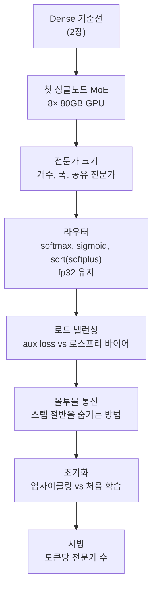

*라우터가 토큰을 전문가로 분배하는 구조를 병원의 전문의 체계로 추상화한 이미지입니다.*

## 왜 읽어야 하나

Dense 모델을 학습해 왔고 이제 MoE 학습으로 넘어갈 준비를 하는 ML 엔지니어, 인프라 엔지니어를 위한 글입니다. MoE 탐색에 GPU 시간을 얼마나 쓰는지 결정해야 하는 팀이 대상입니다. 결론을 먼저 드립니다. 지금 최상위 오픈 모델 20개 중 18개가 MoE 구조인데, 잘 학습하기 위한 노하우는 소수의 팀 머릿속에 남아 있었습니다. Hugging Face가 수십만 GPU 시간의 실험을 무료 핸드북으로 풀었습니다. 이 핸드북의 핵심 가치는 결론 목록이 아니라, 플래그를 하나씩 바꾸며 로그와 숫자로 검증하는 디버깅 방법론을 보여주는 데 있습니다. 그 방법론은 어떤 GPU 클러스터에서든 그대로 빌릴 수 있습니다. 대규모 비용에 들어가기 전에 어떤 실험을 어떤 순서로 돌릴지 정하고 싶은 팀이라면, 이 핸드북이 바로 그 순서를 제시합니다.

## 쉽게 말하면

MoE, Mixture of Experts는 하나의 모델 안에 여러 소규모 전문가를 두고 토큰마다 일부만 활성화하는 구조입니다. 쉬운 비유는 병원의 전문의 체계입니다. Dense 모델은 한 명의 내과 의사가 모든 환자를 혼자 진료합니다. MoE 모델은 분수대 간호사, 즉 라우터가 환자, 즉 토큰마다 적절한 전문의, 즉 전문가를 배정합니다. 핸드북이 답하는 질문들은 이 비유 위에서 자연스럽습니다. 전문의는 몇 명 두어야 하고 전문은 얼마나 좁아야 하는가. 어떤 배정 방식이 좋은가. 한 전문의만 과부하되고 나머지는 놀고 있는 것을 어떻게 막는가. 전문과 전문을 오가는 전원 진료, 즉 올투올 통신의 걸음 시간을 어떻게 줄이는가. 핸드북은 이 질문에 전부 실제 실험 숫자로 답하고, 숫자만 아니라 그 숫자를 읽는 방법까지 보여 줍니다.

## 개요

핸드북은 11월 5일 Hugging Face Space "The Ultimate MoE Training Handbook"로 공개됐습니다. 부제는 "A hands-on guide to training Mixture-of-Experts models"입니다. 집필자는 Hugging Face 리서치 엔지니어 Nouamane Tazi로, Megatron-LM 스케일링 작업을 오래해 온 인물입니다. 공동 창업자 Thomas Wolf는 "18 of the 20 best open models today are Mixture-of-Experts. Dense is basically over."라는 트윗으로 홍보했습니다.

이 공개가 의미 있는 이유는 노하우가 없었던 데 있습니다. MoE 구조 자체는 새롭지 않지만, MoE를 잘 학습하기 위한 판단 기준은 공식 문서에 흩어져 있었을 뿐이었습니다. Megatron-LM의 MoE README는 각 플래그가 무엇을 하는지 설명하지만, 그 플래그를 바꿨을 때 loss 곡선이나 로드 밸런싱 숫자가 어떻게 움직이는지는 말해 주지 않습니다. 공식 문서가 없는 틈을 Hugging Face가 자기 실험으로 메운 것이 이번 핸드북입니다.

규모가 상당합니다. 보도에 따르면 핸드북은 약 7만 단어, 인터랙티브 도형 55개, 실행 가능한 코드를 담고 있습니다. 뒷받침하는 실험은 수십만 GPU 시간이었습니다. 수치는 출처마다 다릅니다. Wolf의 홍보 자료는 약 80만 GPU 시간, Tazi 본인의 자료는 약 50만 GPU 시간으로 나타나고 원문은 직접 확인하지 못했으므로 둘 다 적어 둡니다. 핸드북은 NVIDIA의 Megatron-LM 프레임워크를 중심으로 구성하고, 숫자들은 Alps GH200 같은 Hugging Face 클러스터에서 실제로 돌린 실행의 결과입니다. 핸드북이 스스로 내는 경고, "이 숫자들은 다른 클러스터로 그대로 옮겨 쓰지 마라"가 이 글을 읽기 전에 먼저 기억할 문장입니다.

MoE가 최상위권에 이렇게 세게 박힌 데에는 구조적 이유가 있습니다. MoE는 총 파라미터를 크게 두면서 토큰당 활성화 파라미터를 작게 유지합니다. 용량은 크게 늘리되 토큰당 계산량은 비율대로 늘리지 않는 것입니다. 오픈 모델을 서빙하는 팀에 이건 품질의 선택이 아니라 비용 구조의 선택입니다. 그래서 이 비용 구조를 쓰는 학습의 노하우가 모델 아키텍처의 선택 자체만큼이나 중요해졌습니다.

## 이 핸드북은 무엇인가

핸드북은 첫 MoE 학습부터 운영까지 순서대로 읽히도록 짜여 있습니다. 2장은 활주로입니다. 하드웨어 점검, 이미지 빌드, 토크나이징, dense 기준선, 그리고 첫 싱글노드 MoE까지 차례를 잡습니다. 첫 MoE 레시피는 80GB급 GPU 8장을 쓰는데, 싱글노드 하나로 넘을 수 있는 선입니다. "첫 MoE 학습"의 진입장벽을 의식적으로 낮춘 설계입니다.

3장 본체는 핵심 질문 7개를 답합니다. 전문가 크기, 즉 전문가를 몇 개 두고 각 전문가를 얼마나 넓게 할지와 공유 전문가를 둘 것인지. 라우터 설계, 즉 softmax와 sigmoid와 sqrt(softplus) 중 무엇을 고를지와 왜 fp32로 유지해야 하는지. 로드 밸런싱, 즉 관행적인 aux loss와 DeepSeek식 로스프리 바이어 방식의 비교. 올투올 통신, 즉 왜 스텝마다 절반이 전문가 사이 통신에 쓰이는지와 그것을 어떻게 숨기는가. 초기화, 즉 기존 dense 체크포인트를 업사이클링할지 처음부터 학습할지. 서빙, 즉 학습 때보다 토큰당 전문가를 적게 쓰고 서빙할 수 있는지. 그리고 추천 플래그 블록, 즉 어디부터 시작해야 하는 설정입니다.

나머지 분량은 서빙과 배포 쪽입니다. 서빙 단계에서 전문가를 페이지 단위로 움직이는 expert paging 같은 주제가 있지만, 커뮤니티 리뷰는 본체가 train loop에 치우치고 배포 쪽은 얇다고 지적합니다.

도형이 인터랙티브인 점도 Space 형식의 장점으로 짚어 둘 만합니다. 정적인 블로그 그림이 아니라, 플래그를 바꿨을 때 로드 밸런싱 숫자가 어떻게 움직이는지 직접 눌러 보며 확인할 수 있는 형태로 55개가 들어 있습니다. "결론만 읽었다"는 상태로 남지 않고, 실험을 따라 갈 수 있게 만든 설계입니다.

*2장에서 3장으로 이어지는 핸드북 학습 경로입니다. 각 단계를 한 플래그씩 바꿔가며 로그로 검증하는 순서입니다.*

## 어떻게 읽고 어떻게 시작할까

읽는 순서가 중요합니다. 핸드북은 다 읽고 나서 학습하라는 책이 아니라, 학습하면서 플래그를 로그에 대조하라는 방법론입니다.

첫 단계는 2장의 dense 기준선을 자기 클러스터에서 돌리는 것입니다. dense 기준선이 없으면 MoE의 숫자에 비교점이 없습니다. 같은 데이터, 같은 토큰 예산, 같은 하드웨어에서 dense가 어디까지 가는지를 먼저 알아야, MoE 전환으로 얻는 이득이 실제로 얼마인지를 말할 수 있습니다. 비교점이 없는 MoE 실험은 "loss가 내린다"는 사실만 남고 내린 정도에 대한 판단은 남지 않습니다.

두 번째는 첫 싱글노드 MoE입니다. 이 단계에서 추리는 성능이 아니라 환경의 정합성입니다. 하드웨어 점검, 이미지, 토크나이저, loss 곡선이 정상인지 확인합니다. 이 단계에서 전문가별 사용률이 한쪽으로 쏠리거나 올투올 통신 비율이 예상과 크게 다른 값이 나온다면, 그건 모델 설계 문제가 아니라 환경 문제일 가능성이 높습니다. 먼저 환경을 고치고 3장으로 넘어가야 합니다.

세 번째는 3장의 질문을 하나씩 이동하는 것입니다. 플래그를 하나씩만 바꾸고, 바꾼 뒤 로그와 숫자로 무엇이 달라졌는지 읽습니다. 여러 플래그를 동시에 바꾸면 어떤 변수가 결과를 만들었는지 알 수 없게 되고, 실험은 판단이 아닌 추측이 됩니다. 추천 플래그 블록은 출발점이고, 거기서부터 하나씩 ablating하는 구조입니다.

## 핵심 발견

아래 숫자들은 핸드북 집필진이 Hugging Face 클러스터에서 돌린 실험 결과입니다. 핸드북 자체의 경고대로 다른 클러스터로 그대로 옮겨 쓰이지 않습니다. 그래서 "결론"이 아니라 "검증된 질문"으로 읽어야 합니다.

**전문가 크기.** 가장 반복되는 문장은 "총 파라미터와 활성화 파라미터를 고정하면, 더 세밀한 전문가 구성이 어느 때까지는 도움이 된다"는 것입니다. 전문가를 많이 나누고 각 전문가를 좁게 만드는 것이 이득인 구간이 있지만 그 이득은 한도에 부딪힙니다. 한 ablation에서는 loss가 128개 전문가까지 계속 떨어지고 그 이후로는 이득이 멈췄습니다. 사례는 128개 전문가, 각 전문가 폭은 모델 폭의 4분의 1, top-8 라우팅입니다. 공개된 시스템들을 보면 대다수가 128~384개 전문가와 top-4~top-8 라우팅을 씁니다. MoE 모델을 설계할 첫 좌표로 삼기 좋은 구간입니다.

공유 전문가(shared expert)를 둘 것인지도 3장이 다루는 지점입니다. 라우터가 매 토큰마다 골라 쓰는 전문가 외에, 모든 토큰이 항상 거쳐 가는 공동 전문가를 따로 두는 방식입니다. 토큰이 고르게 분산되지 않는 구간에서 공유 전문가가 기본 역량을 지탱하는 역할이 되는데, 핸드북은 전문가 크기와 함께 이 여부를 설계 변수로 둡니다.

**라우터.** 핸드북은 softmax, sigmoid, sqrt(softplus) 세 라우터 활성화 함수를 비교하고, 라우터를 fp32로 유지하는 것을 강조합니다. 라우팅 결정은 아주 작은 수치 차이에 의해 갈리는데, 저정밀로 계산하면 어느 전문가를 고르는 분포가 조용히 벌어집니다. 그러면 로드 밸런싱 숫자도 흔들립니다. 학습 속도를 올리다 보면 놓치기 쉬운 설정입니다.

**로드 밸런싱.** 관행적인 aux loss, 즉 편중을 벌하는 보조 손실과 DeepSeek식 로스프리 바이어, 즉 추가 손실항 없이 전문가 점수 bias를 조정하는 방식의 비교입니다. 두 방식은 전문가별 사용률에 다른 영향을 주며, 핸드북은 실제 로드 수치로 판단할 결정 사항으로 다룹니다. 보도에 따르면 독자들이 특히 좋게 본 부분은 추천 그 자체가 아니라 두 방식을 오래 돌렸을 때 나오는 load-balance TFLOP/s 차이 같은 실수치 예시였습니다. 로드 밸런싱은 어떤 방식이 좋았는지가 숫자를 보지 않으면 답할 수 없는 영역이므로, 예시의 형태도 그래서 나온 것입니다.

**통신.** 올투올, 즉 토큰을 GPU 간에 전문가로 이동시키는 통신이 스텝당 절반쯤을 차지합니다. 그것을 계산으로 어떻게 숨기는지가 3장의 주제 중 하나입니다. 클러스터 토폴로지, 네트워크 속도, 전문가 병행도(expert parallelism)가 만나는 지점이어서 클러스터 의존성이 가장 강한 장입니다.

**25배 슬로다운.** 가장 기억에 남는 단편입니다. 로그에 에러가 하나도 없는데 실행이 25배 느려지는 사례를, 핸드북은 코너 케이스가 아니라 실제로 벌어지는 디버깅 문제로 다루습니다. MoE 학습의 실패 형태는 "크래시"가 아니라 "느려짐"인 경우가 많다는 점입니다. GPU 큐의 비용 관리와 직결됩니다.

**업사이클링과 서빙.** 기존 dense 체크포인트를 업사이클링할지 처음부터 학습할지는 학습 전략의 큰 갈림길이며, 핸드북은 두 경로 모두를 다룹니다. 업사이클링 경로는 dense 모델이 이미 가진 일반 역량을 이어서 받아 새 전문가와 라우팅에 학습 예산을 집중하는 방식입니다. 처음부터 학습하는 경로는 구조를 처음부터 깔끔하게 설계할 수 있지만, 일반 역량 학습 비용을 다시 치릅니다. 어느 쪽이 맞는지의 답은 이미 쓸 dense 체크포인트가 있는지라는 현실에 따라 달라지며, 학습 예산의 구조를 바꾸는 결정입니다. 서빙 쪽은 학습 때보다 토큰당 전문가를 적게 써도 되는지가 주제인데, 이게 성립하면 MoE의 총 파라미터는 용량이고 활성화 파라미터만 비용이 되어 둘을 따로 조절할 수 있습니다. 서빙 예산에 가장 직접 닿는 지점입니다.

## ThakiCloud 제품 적용 시사점

다키클라우드의 ai-platform은 Kueue가 관리하는 GPU 큐 위에서 학습을 돌리고, 클러스터로 B200과 H200과 GH200을 쓰고 있습니다. 핸드북의 클러스터 의존성 경고는 우리가 그대로 받는 경고입니다. Alps GH200의 숫자는 우리 B200 큐에서 무슨 일이 벌어질지를 말해 주지 않습니다. 그래서 정당한 활용은 설정 복사가 아니라, dense 기준선에서 첫 MoE, 그리고 플래그 ablation의 순서를 같은 잡 계약으로 우리 클러스터에서 다시 돌리는 것입니다. 핸드북의 추천 플래그 블록은 그 실험 원장의 시작점이 됩니다.

25배 슬로다운 장은 GPU 비용 관리와 직접 연결됩니다. 크래시 없이 느려지는 잡은 큐 슬롯을 차지한 채 GPU 시간을 태우는데, 이것이 학습 플랫폼의 비용 낭비 항목 중 큰 쪽에 속합니다. 에러 없이 느려지는 패턴을 로그 신호로 잡는 것, 즉 스텝당 시간과 올투올 비율의 갑작스러운 변화를 모니터링하는 항목이 필요합니다. 큐 관점에서는 더 구체적인 대응이 가능합니다. 스텝당 시간이 기준선 대비 일정 배 이상 늘어난 잡에 대해 경고만 내는 것이 아니라, 실험 원장에 그 구간을 기록해두면 뒤늦은 원인 규증이 아니라 당시의 로그 세트로 바로 추적할 수 있습니다.

플랫폼 쪽에도 이 레시피를 흡수하는 구체적 형태가 있습니다. dense 기준선, 첫 MoE, 플래그 ablation의 세 단계는 각각 소요시간과 산출물 경로가 선언된 GPU 큐 잡으로 대응합니다. 핸드북의 추천 플래그 블록을 첫 잡의 기본 스펙으로 두고, 각 ablation을 변수 하나만 다른 변종 스펙으로 내는 것이 이 방법론을 실험 원장에 실은 구현입니다. 그렇게 되면 25배 슬로다운 경고는 페이지의 문장이 아니라 모니터링 규칙이 되고, ablation 결과의 비교는 흩어진 로그가 아니라 같은 계약의 산출물 사이에서 이루어집니다.

Paxis에도 접점이 있습니다. Paxis의 자율 에이전트가 실험을 돌릴 때, 플래그를 하나씩만 바꾸고 바꾼 뒤의 숫자를 읽는 핸드북의 방법론은 에이전트가 감사할 수 있는 실행 프로토콜의 형태를 갖습니다. 한 변수, 한 실험, 한 로그 세트. 에이전트 실행 기록이 갖춰야 할 형태와 같은 모양입니다.

## 한계 및 반론

한계는 분명합니다. 첫째, 숫자가 특정 클러스터, Alps GH200 등에서 나와 핸드북 스스로가 옮겨 쓰지 말라고 경고합니다. 둘째, 실험 규모가 Hugging Face의 자기 보고입니다. 80만 GPU 시간과 50만 GPU 시간의 불일치는 그대로 남아 있고, 독립적인 제3자 검증은 없습니다. 셋째, "Dense is basically over"라는 Wolf의 프레이밍은 커뮤니티에서부터 반론을 받았습니다. 기초 연구의 출발점으로는 dense decoder 모델이 여전히 좋다는 의견도 만만하지 않습니다. 핸드북 자체가 MoE를 잘 학습하는 가이드이지, dense의 사망 선고는 아닙니다. 넷째, 서빙과 배포 쪽의 내용이 train loop보다 얇습니다. 주된 질문이 추론 비용의 경제성이라면, 이 핸드북은 답의 일부일 뿐입니다.

## 정리

MoE 학습을 시작하는 팀에게는 읽는 순서가 있습니다. dense 기준선, 첫 싱글노드 MoE, 추천 플래그 블록. 수십만 GPU 시간의 숫자는 결론으로 읽지 말고 질문으로 읽어야 합니다. "우리 클러스터에서는 어떤 일이 벌어질까"라는 질문이 전부입니다. 그리고 그 질문은 dense 기준선부터 단계적으로 답하면 되는 구조로, 핸드북의 첫 경로가 정확히 그 순서를 따릅니다. 그리고 GPU 비용 관리가 주된 관심이라면 25배 슬로다운 장을 먼저 읽으세요. 크래시하지 않고 느려지는 것이 MoE 학습의 대표 실패 형태이며, 모니터링에 먼저 넣어야 할 항목입니다.

## 출처

- [The Ultimate MoE Training Handbook (Hugging Face Space)](https://huggingface.co/spaces/huggingface/moe-blogpost)
- [Thomas Wolf의 원문 포스트 (X)](https://x.com/Thom_Wolf/status/2118432475730882627)
- [daily.dev 보도](https://daily.dev/posts/hugging-face-releases-a-free-moe-training-handbook-after-800k-gpu-hours-of-experiments-bkvgav0yz)
- [NVIDIA Megatron-LM MoE README](https://github.com/NVIDIA/Megatron-LM/blob/main/megatron/core/transformer/moe/README.md)
