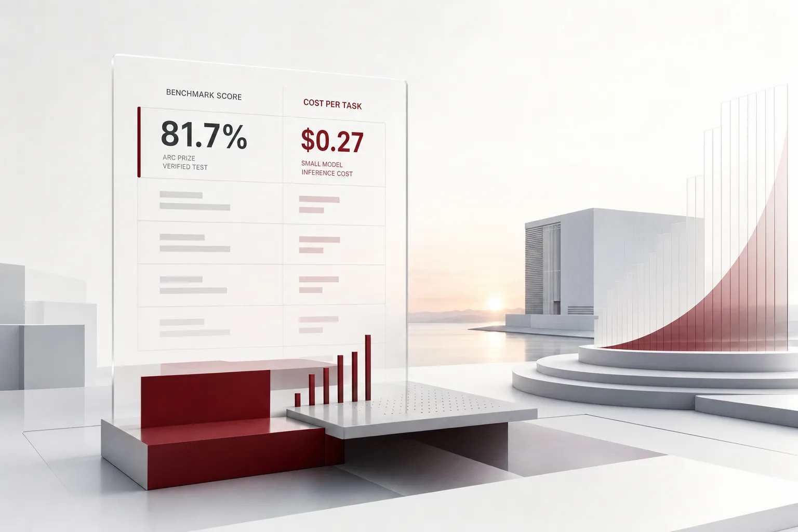

오늘 하루에 하나만 기억해야 할 숫자가 있다면 27센트. ARC Prize의 검증 테스트에서 소형 오픈웨이트 모델이 추론 벤치마크 ARC-AGI-2를 과업 한 번 수행하는 데 들이는 비용이 0.27달러였는데, 점수는 81.7퍼센트로 오픈웨이트 모델 중 최고. 벤치마크 점수 옆에, 과업당 가격이라는 열이 처음처럼 선명하게 생겼습니다.

오늘 HuggingNews 다이제스트는 "검증"과 "가격"이라는 두 단어가 함께 자주 나오는 드문 날. 눈금의 한 끝에서 구글은 2.7기가와트 전력 계획을 세웠다. 다른 끝에서, 어느 소형 모델은 추론 과업당 27센트의 가격표를 붙였다. 이 눈금의 양 끝이 이야기하는 것은 같다. AI 업계가 모든 것에 가격표를 달기 시작했고 기업은 그 가격표에서 어떤 위치에 서느냐가 곧 전략이 되는 국면에 들어섰다. 그 아침, 인프라는 기가와트로 거래됐고 지능은 센트로 거래됐다. 지금 에이전트를 돌리고 있는 기업이라면, 오늘 다이제스트에서 가져갈 한 가지는 명확하다. AI 비용의 회계 단위가 과업으로 넘어왔다.

*글의 핵심 개념을 형상화했습니다.*

## 81.7% 옆에 생긴 가격 열

모델은 Thinking Machines Lab의 Inkling 2 Small. ARC Prize의 검증 테스트에서 ARC-AGI-2는 81.7%, ARC-AGI-1은 96.5%를 기록했습니다. 여기서 눈길이 가지는 곳은 점수 옆의 비용. ARC-AGI-2는 과업당 0.27달러, ARC-AGI-1은 과업당 0.08달러. ARC-AGI-2에서 오픈웨이트 모델 가운데 최고 점수.

이전까지 벤치마크 결과는 점수 한 열. 점수만 보고 모델을 고르거나, 가격만 보고 인프라를 샀습니다. 이번엔 점수 옆에 가격 열이 생겼습니다. 이 변화가 뜻하는 바가 무엇인가. 지능은 과업 단위로 가격이 매겨지는 항목이 됐다는 것입니다. 그리고 추론 과업 하나를 처리하는 단위 가격이 30센트 안쪽, 쉬운 과업은 10센트 아래까지 내려왔습니다.

가격 열이 생기면 그 열은 곧 길어지기 때문. 소형 모델은 단위 가격으로 경쟁하고 점수는 함께 올라갑니다. 기업의 비교 기준도 변합니다. "우리 워크플로에서 이 단계는 과업당 몇 센트에 처리되는가"가 모델 선택의 질문이 되는 순간입니다. 같은 추론 품질을 과업당 8센트에 사는 경로와 상위 모델에 사는 경로가 나란히 보이기 시작하면, 예산이 나뉘는 단위가 모델에서 단계로 이동합니다.

한 가지 더 주목할 것은 이 모델의 정체. 오픈웨이트. 모델의 weights를 내려받아 자체 서버에서 돌릴 수 있는 형태라면, 이야기는 달라진다. 27센트의 의미는 숫자 자체에만 머물지 않는다는 뜻입니다. 그 뒤에 오픈웨이트가 서 있다는 사실이 왜 그런가. weights를 확보할 수 있으면, 그 27센트를 실행할 위치는 선택이 된다. 빌려 쓰는 엔드포인트든, 자사 서버든. 후자라면 27센트는 자사의 전력 명세로 내려오는 비용이 됩니다. 다음에 나오는 오늘의 인프라 뉴스들은 전부 이 "자체 서버"의 가능성을 배경으로 움직입니다.

## 눈금의 다른 끝: 기가와트와 조달러

눈금의 다른 끝에 있는 것은 전력 단위로, 조 단위로 움직이는 자본. 구글은 와이오밍 주에 첫 데이터센터 허브를 짓고 있습니다. 프로젝트 이름은 Tembo. 라라미 카운티 716에이커 부지에 170억 달러를 들이고 전력 용량은 2.7기가와트로 계획됩니다. 2.7기가와트는 작은 도시 하나가 쓰는 전력 규모에 닿아 있는 숫자.

앤트로픽은 감사절 전에 나스닥(티커 ANT) 상장을 추진 중입니다. 조달 목표는 800억에서 1000억 달러, 평가액은 1조 2500억에서 1조 7500억 달러 사이로 제시됩니다. 조달 규모만 최대 1000억 달러인 IPO. 오픈AI는 프리머니 밸류에이션 1조 2500억 달러 수준으로 자금을 모으는 라운드를 진행 중이고 지역사회 반대 여론이 커지는 가운데서도 데이터센터 확장 계획을 유지하고 있습니다.

1조 2500억 달러라는 숫자를 두 회사가 공유합니다. 앤트로픽 IPO 평가액의 하단이자, 오픈AI의 프리머니 밸류에이션. AI 연구소가 조달러짜리 자산으로 정가 매겨지는 국면에서, 이 숫자의 의미는 단순합니다. 상위 모델의 실행 비용 구조는 앞으로도 이 자본 규모를 전제로 움직인다는 것입니다.

이 목록에서 주목할 행은 마이크로소프트의 것입니다. 방향이 반대로 가기 때문입니다. 오라클로부터 임차한 AI 클라우드 컴퓨팅 용량 중 일부 구간의 연장을 하지 않기로 결정했고 임차 규모를 줄이고 있습니다. 50억 달러 규모의 자본지출 격차 이후엔 소형 데이터센터 개발자와의 파트너십 전략 자체를 개정했습니다. 여러 고위험 딜을 포기하고 더 엄격한 파트너 관리 절차를 도입했습니다. 가장 큰 매수자가 더 이상 필요 없는 항목부터 지우기 시작했다는 것입니다. GPU 용량을 사고파는 시장에서, 매수 쪽도 이제 행을 읽는다는 뜻입니다.

50억 달러 자본지출 격차는 조금 더 들여다볼 가치가 있습니다. 계획된 지출과 실제로 확보된 용량이 어긋났고 매수자의 반응은 '더 확인하기'였습니다. 용량 시장의 신뢰 기준이 계약에서 검증으로 이동하고 있다는 뜻입니다. 기업의 실행 환경에도 바로 통합니다. 에이전트 실행 인프라를 외부에 맡길 때, 상대의 품질 기준이 곧 내 서비스의 신뢰도가 됩니다.

메타는 입지 문제를 다른 방식으로 풀고 있습니다. 지역 유권자의 연이은 반대 이후 자사의 대통령이 직접 AI 인프라를 수용할 국제 부지 탐색에 착수했다고 밝혔습니다. 인프라의 입지도 가격표에 올랐고 그 가격표에는 투표 결과가 변수로 들어갔습니다.

## 오늘의 키워드는 "검증"

27센트를 내놓은 ARC Prize 테스트는 본래 "검증" 테스트. 재현 가능한 절차로 확인된 결과. 같은 아침, Axiom은 Lean 프로그래밍 언어로 Weil 추측 I에서 IV까지 증명의 형식화를 공개했고 이 증명은 컴퓨터로 검증 가능한 형태이며 Stacks 라이브러리 검증에 쓰입니다. AI가 만든 수학 증명이 기계로 다시 확인되는 구조. Physical Superintelligence는 앤트로픽의 미출시 모델을 사용해 양자복잡성 분야의 오랜 미해결 문제인 Aaronson-Ambainis 추측의 증명을 찾아냈습니다. 지능의 용도가 추론 과업에서 지식 생산으로 확장되는 장면. 동시에 단일 미출시 모델에 모든 것을 의지했다는 점은, 실행 경로가 한 갈래였다는 뜻이기도 합니다.

여기서 주목할 대목은 유명 문제를 풀었다는 사실이 아닙니다. 증명이 기계로 다시 확인 가능한 형태로 공개됐다는 점. 이 형식이 곧 산출물의 표준이 될 수 있다는 시범입니다.

검증은 산출물에만 머물지 않습니다. 50억 달러 격차 이후의 마이크로소프트 파트너 관리 강화는 인프라에 대한 검증. 용량을 빌리는 쪽이 빌려준 쪽의 품질을 감사하기 시작했다는 뜻입니다. 그리고 앤트로픽이 내부 AI 개발 속도 평가를 진행하던 중 METR 리스크 평가 담당자에게 취업 제안을 하며 생긴 이해충돌 사안이 공개된 일은, 검증의 과정 자체를 검증하기 시작했다는 신호입니다. 평가관을 채용하려 한 평가기관이라는 그림은, 기업 AI를 바라보는 눈이 얼마나 무거워졌는지를 보여 줍니다.

신뢰의 기준이 주장에서 다시 확인할 수 있는 기록으로 이동하고 있습니다. "동작했습니다"가 아니라, "동작한 내역이 여기 있고, 기계로 다시 확인할 수 있다"가 되는 방향입니다.

ARC Prize 검증, Axiom의 Lean 형식화, Physical Superintelligence의 증명 탐색, 세 가지에 공통점이 있습니다. 산출물 자체가 다시 확인 가능해진다는 점. 기업 수용 과정에도 같은 틀이 들어옵니다. AI 산출물이 재확인할 수 있는 기록을 남기면, 수용은 모델 공급사의 주장에 의존하지 않아도 됩니다.

## 기업의 위치가 달라지는 세 줄

비용. 과업당 단위 가격이 확정되면 에이전트 워크플로의 비용은 단계별 단위 가격의 합으로 읽히기 시작합니다. 간단한 단계는 8센트에서 27센트짜리 소형 오픈 모델에 맡기고 어려운 추론에만 상위 모델을 씁니다. 가격표가 길어질수록, 단계마다 모델을 고르는 손이 중요해집니다. 워크플로 전체를 단계별로 가격표 위에 올려야 하는 일이, 이제 예산 관리가 됩니다. 그동안 한 덩어리로만 잡히던 "AI 비용"이 항목으로 쪼개지는 것입니다. 항목이 되면 하나하나 최적화할 수 있습니다.

공급. 마이크로소프트의 임차 축소는 용량 공급이 더 이상 당연하다는 보장으로 성립하지 않는다는 뜻. 장기 전용 계약에 묶여 있으면, 줄일 때조차 비용이 듭니다. 지역 유권자의 반대와 메타의 해외 부지 탐색은 인프라의 입지 자체가 흐르고 있다는 뜻입니다. 단일 벤더, 단일 지역에 묶인 실행선은 이 변동성의 정면에서 노출되어 버린다. 탄력적으로 늘리고 줄일 수 있는 구조가, 이번엔 안정성의 문제가 됩니다. 공급 쪽이 기가와트를 쏟아붓는 바로 그 순간, 수요 쪽이 행을 지우기 시작했습니다. 오늘 다이제스트가 보여주는 장면.

신뢰. 오늘의 "검증" 키워드는 AI 산출물의 수용 기준이 바뀐다는 것을 보여 주는 것이다. 앞으로 기업이 받는 것은 "동작했다"는 문장이 아니라, "동작했다는 것을 확인하게 해 주는 기록"입니다. 로그가 없으면 산출물도 없는 셈입니다.

## Paxis 렌즈

오늘의 세 통증, 비용과 공급과 신뢰는 에이전트 실행 환경에서 같은 모양을 합니다. ThakiCloud의 Paxis는 Agent-Native Cloud이며, 정식 제품(v1.1 GA)입니다. Skills, Tools, Policies, Audit Logs가 전부 일급 리소스. 에이전트 실행을 거버넌스하는 네 가지가 옵션이 아니라 플랫폼의 원형 구조로 들어와 있는 것입니다.

작업별 모델 선택(CostRouter)은 오늘의 가격표를 워크플로의 단계마다 붙이는 역할. 루틴 단계는 소형 오픈 모델로 가고, 필요한 단계만 상위 모델로 갑니다. 27센트짜리 추론은 워크플로의 한 단계로 들어옵니다. 소버린 및 온프레미스 Kubernetes 배포(ai-platform)는 공급선의 대안입니다. 오픈웨이트 모델을 내부에서 서빙해야 하고 데이터가 국경을 넘을 수 없는 환경에서는, 용량이 자사 자산이 됩니다. 메타의 국제 부지 탐색이 가리키는 주권 문제는, 이 배포 형태가 답입니다.

정책 게이트와 감사 로그는 "검증" 키워드의 기업 버전. 에이전트 산출물의 수용 기준이 다시 확인할 수 있는 기록이 되며, L0에서 L3까지 자율도를 단계로 거버넌스하고 격리된 샌드박스에서 실행하므로 그 기록의 신뢰도가 유지됩니다. METR 사안처럼 평가 중간에 이해충돌이 생긴다 해도, 접근과 실행 이력이 남아 있으면 확인이 가능한 셈입니다. MCP 커넥터와 스킬 마켓은 스킬 공급선도 여러 갈래로 여는 부분입니다.

가까운 시일의 기업 AI 예산은 두 열로 나뉘는 흐름인가. 기가와트와 조달러로 재는 자본지출 열, 센트로 재는 운영 열. 전자는 업계의 이야기. 후자는 기업이 직접 읽어야 할 열입니다. 후자 열의 크기를 정하는 것은 더 이상 모델을 고르는 일이 아니라, 어떤 단계에 어떤 모델을 붙이는 일입니다.

## 참고 자료

이 글은 아래 뉴스를 종합해 작성했습니다.

- HuggingNews, [Anthropic Presses Ahead With Pre-Thanksgiving IPO to Raise Up to $100B at $1.25T to $1.75T Valuation](https://huggingnews.com/ai/anthropic-presses-ahead-with-pre-thanksgiving-ipo-to-raise-up-to-100b-at-1f735eb3)
- HuggingNews, [Microsoft Scales Back Rented AI Cloud Computing Capacity From Oracle](https://huggingnews.com/ai/microsoft-scales-back-rented-ai-cloud-computing-capacity-from-oracle-9b1ec0eb)
- HuggingNews, [Anthropic Offered Job to METR Auditor During AI Speedup Review](https://huggingnews.com/ai/anthropic-offered-job-to-metr-auditor-during-ai-speedup-review-cb62ba12)
- HuggingNews, [Thinking Machines' Inkling 2 Small Tops Open Weight Models on ARC-AGI-2 With 81.7% Score](https://huggingnews.com/ai/thinking-machines-inkling-2-small-tops-open-weight-models-on-arc-agi-2-w-c46f8750)
- HuggingNews, [Microsoft Tightens Oversight of AI Data Center Partners Following $5B Capex Gap](https://huggingnews.com/ai/microsoft-tightens-oversight-of-ai-data-center-partners-following-5b-cap-56da82cb)
- HuggingNews, [Midterm Election Pushback Won't Slow OpenAI's Data Center Expansion](https://huggingnews.com/ai/midterm-election-pushback-wont-slow-openais-data-center-expansion-01b03d75)
- HuggingNews, [Meta Eyes International Expansion for AI Data Centers Following Wave of Local Voter Rejections](https://huggingnews.com/ai/meta-eyes-international-expansion-for-ai-data-centers-following-wave-of-84226a18)
- HuggingNews, [Google Plans 2.7 GW Power Capacity for New $17B Wyoming AI Campus](https://huggingnews.com/ai/google-plans-27-gw-power-capacity-for-new-17b-wyoming-ai-campus-0171e9b7)
- HuggingNews, [Physical Superintelligence Solves Aaronson-Ambainis Quantum Computing Conjecture](https://huggingnews.com/ai/physical-superintelligence-solves-aaronson-ambainis-quantum-computing-co-122d6033)
- HuggingNews, [Axiom Releases Computer-Verified Proof of Weil Conjectures to Validate Stacks Library](https://huggingnews.com/ai/update-axiom-releases-computer-verified-proof-of-weil-conjectures-to-val-bfdd43e4)