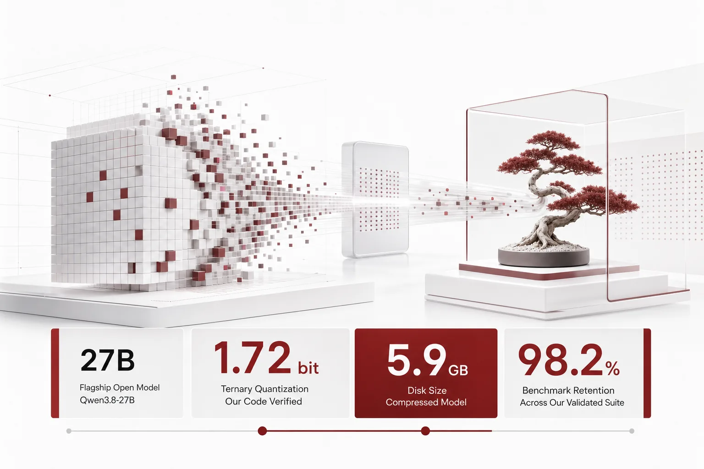
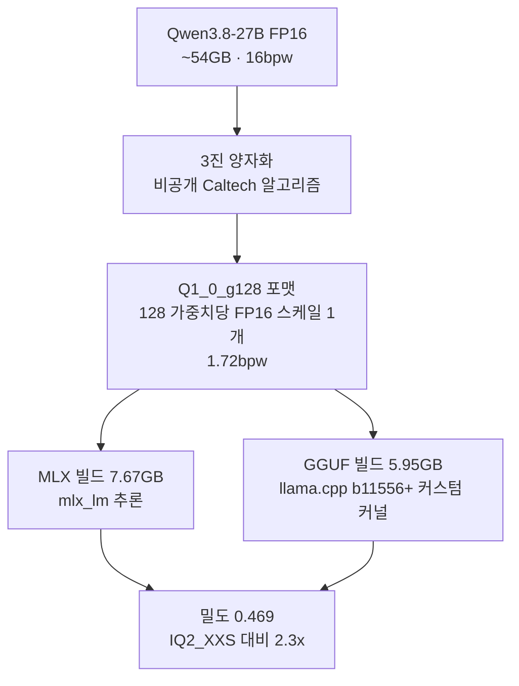
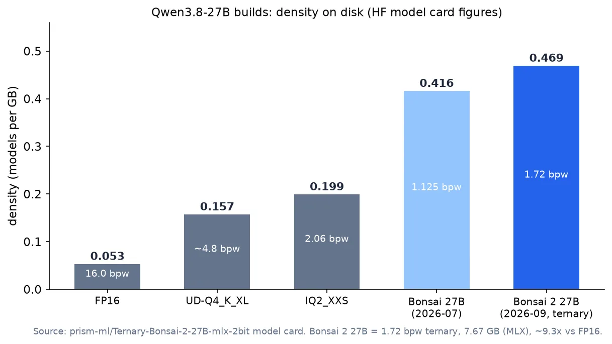

*글의 핵심 개념을 형상화했습니다.*

## 왜 읽어야 하나

27B급 오픈 모델을 서빙하는 노드의 메모리 한계에서 "어떤 비트폭 빌드를 고를지"를 결정해야 하는 인프라, 플랫폼 엔지니어를 대상으로 씁니다. 결론부터 말하면, 1.72비트 3진 양자화로 5.9GB에 들어오는 Qwen3.8-27B 빌드가 실재하고, 모델카드는 14개 사고 모드 벤치마크에서 FP16 대비 98.2%의 성능 유지를 주장합니다. 그리고 이 주장을 그대로 받아들이기 전에 확인해야 하는 것이 있습니다. 그 격차의 원천은 저장 포맷이 아니라 공개되지 않은 양자화 알고리즘이라는 사실, 우리는 7월에 1.7B 버전의 공개 가중치로 직접 확인했습니다.


## 쉽게 말하면

54kg짜리 덤벨 세트를 6kg 케이스로 압축한다고 상상해 보세요. 무게는 9분의 1이 되지만, 들어올릴 수 있는 무게(성능)는 98%가 남습니다. 단, 압축 기술은 공개되어 있지 않습니다. 포맷만 보고 직접 담으면 덤벨이 산산이 부서져(붕괴) 아예 못 들게 됩니다. 이 글의 주인공은 그 "깨지 않게 담는 기술"을 가진 사람의 27B 버전이고, 우리에게는 1.7B 버전에서 케이스가 진짜인지 직접 뜯어 본 기록이 있습니다.

## 개요

PrismML이 2026년 9월 공개한 Ternary Bonsai 2 27B는 Qwen3.8-27B를 베이스로 한 3진(ternary, 가중치마다 −1, 0, +1 중 하나) 양자화 모델입니다. 하이브리드 어텐션 인과 언어모델이며, 비전 타워 0.92GB가 포함되는 멀티모달 구성입니다. 모델카드의 핵심 수치는 다음과 같습니다.

| 항목 | 수치 (모델카드 실측) |
|---|---|
| 가중치 비트폭 | 1.72 bpw (MLX 저장 2.25) |
| 디스크 크기 | LM 7.67GB + 비전 0.92GB = 8.60GB (GGUF PTQ1_0은 5.95GB) |
| FP16 대비 | ~54GB → ~9.3x (이상치 기준) |
| 성능 유지 | FP16 지능의 98.2% (14개 사고 모드 평균 86.32 → 84.78) |
| 밀도 | 0.469 models/GB (IQ2_XXS 0.199의 2.3배, FP16 0.053의 약 9배) |
| 포맷 | MLX (Safetensors), GGUF (PTQ1_0 / PQ2_0 / Q2_0) |
| 라이선스 | Apache-2.0 |

14개 사고 모드는 MMLU-Redux, MuSR, GSM8K, MATH-500, AIME25, AIME26, HumanEval+, MBPP+, LiveCodeBench, IFEval, IFBench, BFCL v3, MMMU-Pro, OCR Bench v2로, 추론과 코딩과 지시를 따르고(IFEval, IFBench) 도구를 부르고(BFCL v3) 보는 것(MMMU-Pro, OCR)까지 섞여 있습니다. 98.2%는 이 집합의 평균이라, 어떤 영역에서 특히 유지가 잘 되고 나쁜지는 카드에 없습니다.



## 이 기술은 무엇인가

저장 포맷은 단순합니다. Q1_0_g128은 128개 가중치가 하나의 FP16 스케일을 공유하는 구조로, 3진이면 (128 × 1.5 + 16) ÷ 128 = 1.71875, 반올림해 1.72bpw입니다. 2진(이진)은 같은 구조에서 (128 × 1 + 16) ÷ 128 = 1.125bpw입니다.

이 비트 계산을 우리 코드(7월의 재현 하네스 selftest)로 오늘 다시 돌렸고, 3진 g128 구조가 1.71bpw, 단순 재구성 시 9.36x 압축을 냅니다. 모델카드의 1.72bpw와 ~9.3x와 일치합니다.

3진이 2진보다 0.59bpw를 더 쓰면서도 존재 이유가 있습니다. 가중치 값이 −1, +1뿐인 2진과 달리 0이 허용되면, 작은 값의 가중치를 0으로 두는 "희소성"을 구조에 넣을 수 있고, 이는 재구성 오류를 직접 낮춥니다. 같은 selftest에서 단순 재구성의 상대 오류는 2진이 0.6004, 3진이 0.4348로, 3진이 약 28% 낮았습니다. 7월의 1.7B 검증에서는 naive 2진이 601,600x, naive 3진이 731,792x로 둘 다 붕괴했고, 비트를 늘려도 naive 배정에서는 붕괴를 막지 못했습니다. 즉 0.59bpw는 "값의 표현"이 아니라 "어디에 0을 놓을 것인가"를 위한 공간이고, 그 배치가 무손실을 결정합니다. 그 배치 알고리즘이 비공개 IP입니다. 즉 "5.9GB"라는 크기는 포맷만으로 설명되는 부분이 있고, 그 부분은 재확인했습니다.

설명되지 않는 부분이 더 큽니다. 가중치를 어떻게 −1, 0, +1에 배정하고 스케일을 최적화해 재학습 없이 이 붕괴 지점을 건너뛰는가, 그 알고리즘은 공개되어 있지 않습니다. 8B 버전 논문의 §3이 "proprietary Caltech intellectual property ... rigorous mathematics rather than ad hoc heuristics"라고 명시합니다. 공개된 것은 포맷과 추론 커널(PrismML-Eng의 llama.cpp/mlx 포크)과 벤치마크뿐입니다.

실행은 포맷별로 둘 중 하나입니다. MLX 빌드는 표준 mlx_lm으로 로드해 추론합니다.

```python
from mlx_lm import load, generate
model, tokenizer = load("prism-ml/Ternary-Bonsai-2-27B-mlx-2bit")
prompt = tokenizer.apply_chat_template(
    [{"role": "user", "content": "Qwen3.8-27B의 하이브리드 어텐션 구조를 설명해줘"}],
    add_generation_prompt=True)
text = generate(model, tokenizer, prompt=prompt, verbose=True)
```

GGUF 빌드는 PTQ1_0(5.95GB)이 PrismML 포크 커널을, Q2_0(7.63GB)이 stock llama.cpp b11556+를 요구합니다. 5.95GB 밀도와 7.63GB 표준 호환성 사이에는 1.7GB의 선택지가 있습니다.

## 우리가 검증한 기록 (2026-07, 1.7B)

7월, 같은 계열의 1.7B 버전 공개 시점에 ThakiCloud가 독립 검증한 기록이 있습니다. Qwen3-1.7B를 같은 고정 발판에서 재현했고, 결론은 "공개된 모델은 진짜, 공개된 포맷만으로는 재현 불가"였습니다.

| 변형 | bpw | PPL (고정 발판) | FP16 대비 |
|---|---|---|---|
| Qwen3-1.7B FP16 | 16 | 2.027 | 1.00x |
| PrismML 1-bit Bonsai (공개 가중치) | 1.125 | 1.971 | ~0.97x (무손실) |
| QuIP (회전+GPTQ, 순수 공개 스택) | 1.125 | 4.213 | 2.1x |
| QuIP + salient 3% | 1.571 | 2.24 | 1.1x |
| naive binary (공개 포맷 그대로) | 1.125 | 2,109,839 | 601,600x (붕괴) |
| naive ternary g128 (공개 포맷 그대로) | 1.71 | 2,688,795 | 731,792x (붕괴) |



이 표가 주는 시사는 세 가지입니다. 첫째, 공개 가중치를 표준 transformers로 로드하면 FP16과 거의 같은 퍼플렉서티를 냅니다. 1.125bpw에서 "무손실"은 자기 보고가 아니라 재측정 가능한 사실로 확인됐습니다. 둘째, 공개 포맷만 따라 naive하게 양자화하면 10^5~10^6배 붕괴합니다. 포맷은 붕괴를 막지 못합니다. 셋째, 공개 스택(GPTQ 오차보상, QuIP 회전, salient-weight 처리)으로 가까워지지만, escape hatch 없이 순수 저비트에서 무손실에 서는 지점은 여전히 비공개 영역입니다.

회복 아크 자체도 기록으로 남깁니다. naive 붕괴(~10^6x)에서 GPTQ 오차보상으로 10^5x대로 내려오고, incoherence 회전(QuIP)이 순수 저비트에서 2.1x까지 접근하며, 상위 salient 가중치 3%만 FP16으로 남기면 1.1x입니다. 1.7B에서 이 공개 스택은 "실용권"에 접근하지만, PrismML은 3% escape hatch 없이 1.125bpw 순수에서 무손실에 서 있었습니다. 27B로 크기가 커지면 회전 효과는 모델 규모와 함께 scaling한다는 7월의 관찰(0.6B에서는 1277x였던 비정상성이 1.7B에서 2.1x로 줄었다)이 favorable 방향을 가리키지만, 그것이 27B에서 성립하는지는 27B 재측정 전에는 알 수 없습니다.

PPL은 짧은 고정 발판의 거친 신호입니다. "동작하는 것과 붕괴하는 것"을 구분하는 것은 보여주지만, 카테고리별 유지율(98.2%)을 증명하는 것은 아닙니다. 27B의 98.2%를 독립 재현하려면 커스텀 커널이 필요한 밀도 빌드를 서빙하고 전체 벤치마크를 돌리는 단계가 남습니다.

## ThakiCloud 제품 적용 시사점

같은 베이스 모델을 서빙 중인 플랫폼으로서 이 수치는 비교 대상이 아니라 선택지 하나입니다. 우리 프로덕션에는 Qwen3.8-27B의 NVFP4 4비트 빌드가 서빙되어 있는데, 4비트 클래스는 비트 계산상 16bpw의 약 1/3.5 크기(약 15GB [비트 계산 추정])이고, 1.72bpw 3진은 그 절반 이하(이상치 5.8GB, MLX 저장 7.67GB)입니다. 같은 모델을 두 빌드로 서빙할 수 있다면, 노드 하나에 들어가는 모델 개수가 두 배로 늘어납니다.

이것이 의미하는 것은 용량 계획의 단위 변화입니다. "이 모델의 가중치가 메모리에 들어가는가"에서 "이 노드에 같은 지능을 몇 개 올리는가"로 물음이 바뀝니다. 온프렘, 소버린 환경처럼 노드 수가 고정된 고객에게 27B급 지능의 밀도는 서빙 단가와 직결되고, 5.9GB라는 크기는 소비자급 단일 GPU나 통일 메모리 환경으로 서빙 반경을 넓힙니다. 다만 밀도를 올리는 대가는 두 가지입니다. 하나는 비공개 커널 의존(PTQ1_0은 PrismML 포크의 llama.cpp이 필요하고, Q2_0은 b11556+), 다른 하나는 98.2%라는 평균 뒤에 개별 벤치마크의 격차가 숨어 있을 수 있다는 검증 부담입니다.

에이전트 관점에서도 한 줄 닿습니다. 서빙 비용이 모델 개수 밀도로 낮아지면, 같은 예산으로 더 많은 에이전트 실행을 돌릴 수 있고, 이는 Paxis의 실행 경제성에서 서빙 레이어가 기여하는 몫입니다.

## 한계 및 반론

첫째, 98.2%는 14개 사고 모드의 평균입니다. 카드는 개별 벤치마크의 유지율을 주지 않아, 가장 어려운 추론 항목에서 유지가 약한 영역이 있는지 이 글로는 판단할 수 없습니다. 둘째, 방법의 비공개를 잊으면 안 됩니다. 이 모델은 "저비트 양자화를 잘하는 공개 포맷"이 아니라 "공개된 포맷에 봉인된 알고리즘이 담긴 가중치"입니다. 서드파티가 재현할 수 있는 것은 비트 계수와 공개 가중치의 동작 검증뿐이고, 27B도 1.7B와 같은 구조의 독립 검증을 거친 뒤 채택하는 것이 순서입니다. 셋째, 커널 의존입니다. 표준 런타임으로 5.95GB 밀도를 쓰려면 PrismML 포크를 따라야 하고, 포크의 유지보수 리듬이 서빙 리스크에 합류합니다. 넷째, 베이스 모델의 실력을 압축의 공적으로 돌리면 안 됩니다. Qwen3.8-27B 자체가 에이전트, 코딩 영역에서 강한 오픈 모델이라, 98.2% 유지의 절반은 "베이스가 좋았다"에서 옵니다.

## 정리

노드 메모리가 6GB급이고 27B급 지능이 필요하다는 조건이 성립하면, 1.72bpw 3진은 이제 논외에서 선택지로 들어온 것입니다. 4비트 NVFP4급을 감당할 메모리가 남아 있다면 품질 여유가 넓으므로 밀도로 치는 것보다 4비트를 고르는 쪽이 검증 부담이 적습니다. 결정 순서는 항상 같습니다. 포맷의 비트 계산을 독립 확인하고, 공개 가중치를 표준 런타임에서 재측정하고, 이후에 전체 벤치마크로 카테고리별 유지를 확인하는 것. 98.2%라는 숫자를 믿기 전에 이 세 단계가 "그 수치가 자기 보고가 아님을" 확인해 줍니다.

## 출처

- Hugging Face 모델카드: prism-ml/Ternary-Bonsai-2-27B-mlx-2bit (2026-11-08 fact-check)
- PrismML: Bonsai 2 27B 공개 (prismml.com/news/bonsai-2-27b, 2026-09-17)
- GGUF 빌드: prism-ml/Ternary-Bonsai-27B-gguf (PTQ1_0 / PQ2_0 / Q2_0)
- ThakiCloud 독립 검증 기록: outputs/bonsai-repro/REPORT.md (2026-07-16, Qwen3-1.7B)
- 비트 계산 selftest: outputs/blog-impl/ternary-bonsai-27b/selftest.log (2026-11-08)
