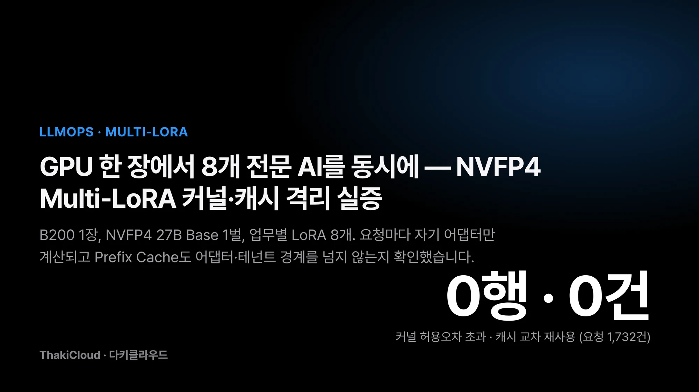
*B200 NVFP4 Multi-LoRA 커널·캐시 격리 실증 (커널 2026-11-14, Prefix Cache 2026-11-16)*

보안 관제 센터에 보안 판정 모델을 하나 들였다고 해 보겠습니다. 다음 분기에는 탐지 근거를 문서로 쓰는 모델이 필요해지고 그다음에는 RAG 답변이 근거 문서를 벗어나는지 걸러 주는 모델이 필요해집니다. 업무마다 27B 모델을 하나씩 따로 띄우면 GPU 수가 전문 AI 수를 그대로 따라갑니다. MSSP, 보안 SI, 사내 Private AI를 운영하는 팀이 지금 겪는 비용 구조가 이렇습니다.

다키클라우드는 이 구조를 바꾸는 방법 하나를 B200 한 장에서 시험했습니다. NVFP4로 양자화한 Qwen3.8-27B Base 하나에 업무별 LoRA 어댑터 8개를 재학습, 병합, 재양자화 없이 그대로 붙여 Base까지 9개 논리 모델을 한 vLLM 엔진으로 서빙했습니다. 운영자가 가장 먼저 묻는 질문은 "요청이 한 배치에 섞이면 어댑터도 섞이지 않느냐"입니다. 실제 NVFP4 27B 서버에서 모든 LoRA 선형 모듈과 모든 토큰 행을 디스크의 어댑터 가중치로 다시 계산해 대조했고 허용오차를 넘은 행은 0개였습니다. 이어서 앞선 요청의 KV 캐시를 재사용하는 Prefix Cache가 어댑터나 테넌트 경계를 넘어 재사용되지 않는지도 1,732건 요청으로 확인했습니다.

이 글에서는 구성과 메모리 산술, 커널과 캐시 격리를 확인한 방법, 1차 실행이 실패 판정을 받은 경위, 그리고 이 결과가 아직 말하지 못하는 것을 차례로 정리합니다. 미리 말씀드리면 제품 안정성과 업무 품질은 이번 검증으로 확인하지 못했습니다. 보안 판정용 제품은 출시 승인 상태가 아닙니다.

## 전문 AI가 늘 때마다 GPU가 늘어나는 구조

전문 AI를 늘리는 가장 단순한 방법은 업무마다 미세조정한 모델을 독립 서버로 하나씩 띄우는 것입니다. 이 방식은 이해하기 쉽고 장애 범위도 분명합니다. 대신 Base 가중치를 모델 수만큼 GPU 메모리에 올려야 하고 요청을 받아 둘 KV 캐시(이전 토큰의 계산 결과를 저장해 두는 메모리)도 서버마다 따로 잡힙니다. 한 업무에 요청이 몰려도 다른 서버의 남는 메모리를 빌려 쓰지 못합니다.

LoRA(Low-Rank Adaptation)는 Base 가중치는 고정해 두고 작은 저랭크 행렬 두 개만 학습해 업무 능력을 더하는 미세조정 방식입니다. 어댑터는 Base보다 훨씬 작기 때문에, Base 한 벌을 공유하고 요청마다 다른 어댑터를 적용하면 전문 AI가 늘어도 메모리는 어댑터 크기만큼만 늘어납니다. 이 개념 자체는 새롭지 않습니다. 아래에서 다룰 S-LoRA와 Punica가 이미 제시했습니다. 우리가 확인하려 한 것은 27B 규모, NVFP4 양자화 Base, B200, 직접 학습한 업무용 어댑터라는 조합에서 이 방식이 실제로 맞게 동작하느냐였습니다.

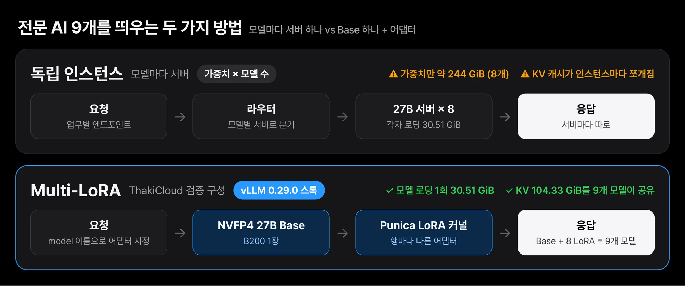
*독립 인스턴스는 가중치를 모델 수만큼 올리고 KV 캐시도 인스턴스마다 나눕니다. Multi-LoRA는 Base 1벌 위에서 요청마다 다른 어댑터를 같은 배치로 계산합니다.*

<!-- nlm-visual -->
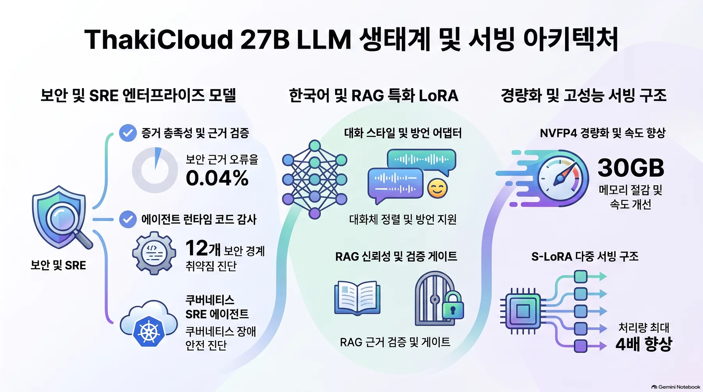
*NotebookLM이 소스를 종합해 생성한 인포그래픽입니다.*

## Base 하나에 업무용 어댑터 여덟 개를 붙였습니다

Base는 원본 Qwen3.8-27B를 NVFP4로 양자화한 [ThakiCloud/Qwen3.8-27B-NVFP4-GPTQ-txt](https://huggingface.co/ThakiCloud/Qwen3.8-27B-NVFP4-GPTQ-txt)입니다. NVFP4는 NVIDIA Blackwell 세대가 지원하는 4비트 부동소수점 형식입니다. 어댑터 8개는 모두 BF16 Base에서 학습했고 양자화된 Base에 맞춰 다시 학습하거나 Base에 병합하거나 다시 양자화하지 않았습니다. 학습한 어댑터 파일을 그대로 붙였습니다.

| 서빙 이름 | 업무 | 공개 레포 |
|---|---|---|
| secproof | 보안 증명 생성 | [ThakiCloud/Thaki-SecProof-27B-V1](https://huggingface.co/ThakiCloud/Thaki-SecProof-27B-V1) |
| secdecision | 보안 판정 | [ThakiCloud/Thaki-SecDecision-27B-V2](https://huggingface.co/ThakiCloud/Thaki-SecDecision-27B-V2) (LoRA 부분) |
| factguard | 사실 검증 | [ThakiCloud/FactGuard-27B-LoRA](https://huggingface.co/ThakiCloud/FactGuard-27B-LoRA) (v0.3-sft) |
| raggate | RAG 게이트 | [ThakiCloud/RAG-Gate-27B-LoRA](https://huggingface.co/ThakiCloud/RAG-Gate-27B-LoRA) |
| ops | 운영 에이전트 | [ThakiCloud/Thaki-Ops-27B-v0.1-alpha](https://huggingface.co/ThakiCloud/Thaki-Ops-27B-v0.1-alpha) |
| hw | RTL, 하드웨어 | [ThakiCloud/Thaki-HW-27B-v0.1-lora](https://huggingface.co/ThakiCloud/Thaki-HW-27B-v0.1-lora) |
| satoori | 한국어 방언 | [ThakiCloud/Qwen3.8-27B-Satoori-KO-LoRA](https://huggingface.co/ThakiCloud/Qwen3.8-27B-Satoori-KO-LoRA) |
| humanko | Human-KO SFT | [ThakiCloud/Qwen3.8-27B-Human-KO-LoRA](https://huggingface.co/ThakiCloud/Qwen3.8-27B-Human-KO-LoRA) |

서빙 엔진은 패치하지 않은 vLLM 0.29.0입니다. LoRA 관련 설정은 아래 네 가지가 전부이고 최대 길이는 32K로 두었습니다. 어댑터 경로는 실제 배포 경로 대신 자리표시자로 적었습니다.

```bash
vllm serve ThakiCloud/Qwen3.8-27B-NVFP4-GPTQ-txt \
  --enable-lora \
  --max-loras 8 \
  --max-lora-rank 16 \
  --max-num-seqs 48 \
  --max-model-len 32768 \
  --lora-modules secproof=<경로> secdecision=<경로> factguard=<경로> raggate=<경로> \
                 ops=<경로> hw=<경로> satoori=<경로> humanko=<경로>
```

클라이언트는 OpenAI 호환 API의 `model` 필드에 `secproof`나 `raggate` 같은 서빙 이름을 넣어 어댑터를 고릅니다. Base를 부르면 어댑터 없이 계산합니다. 다키클라우드가 쓰는 엔드포인트에는 DFlash2 투기적 디코딩이 붙어 있지만, 이번 검증에서는 끄고 돌렸습니다. 격리 문제와 디코딩 가속 문제를 한 실험에 섞지 않기 위해서입니다.

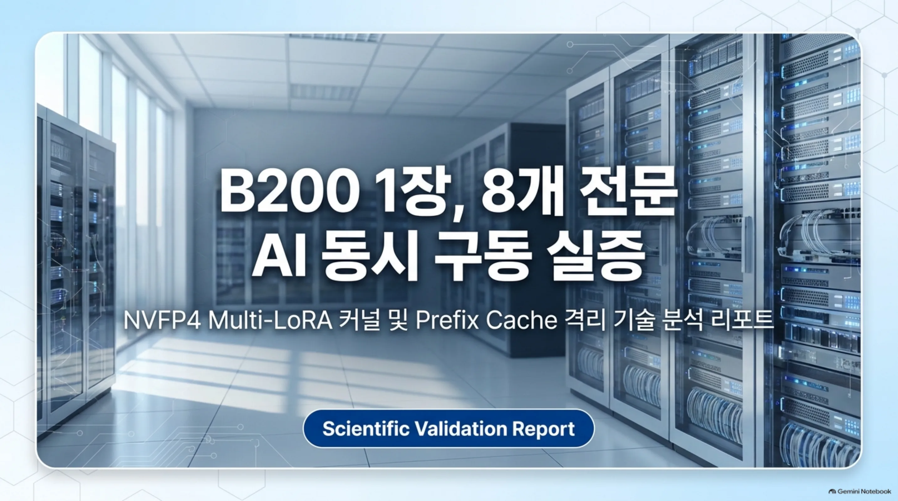

## 독립 인스턴스 8개는 B200 한 장에 들어가지 않습니다

이번 실행 로그에서 NVFP4 27B 체크포인트는 28.05 GiB였고 모델 로딩에는 30.51 GiB가 들었습니다. 그 뒤 KV 캐시로 쓸 수 있는 공간이 104.33 GiB 남았습니다. B200의 HBM은 183,359 MiB, 약 179 GiB입니다.

같은 모델을 업무별 독립 인스턴스 8개로 띄운다고 단순 계산하면 가중치만 약 244 GiB입니다. B200 한 장에 들어가지 않으므로 최소 2장이 필요합니다. KV 캐시도 인스턴스마다 쪼개집니다. Multi-LoRA 구성에서는 Base 한 벌과 작은 어댑터만 올라갑니다. 남은 KV 캐시 104 GiB는 9개 모델이 함께 씁니다.

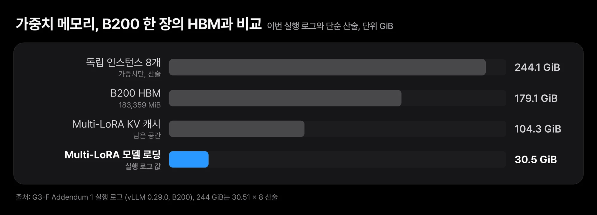
*독립 인스턴스 8개는 가중치만으로 B200 한 장(약 179 GiB)을 넘습니다. Multi-LoRA는 모델 로딩 30.51 GiB 뒤에 KV 캐시 104.33 GiB가 남았습니다. 비용 실측이 아니라 메모리 산술입니다.*

이 숫자는 메모리 산술입니다. 처리량, 응답 시간, 전력, 요청당 비용을 잰 것이 아니므로 "GPU 몇 장이 몇 장으로 줄었다"거나 "비용이 몇 퍼센트 줄었다"고 말할 근거는 아직 없습니다. 비용 비교는 고객의 GPU 단가, 요청량, 동시성, SLA를 입력받아 계산하는 모델로만 다룹니다. 그 결과도 실측이 아닌 추정으로 표시합니다.

## 요청이 섞여도 어댑터가 섞이지 않는지 커널 단위로 확인했습니다

Multi-LoRA에서 운영자가 걱정하는 실패는 두 가지입니다. 하나는 요청 A의 토큰에 요청 B의 어댑터가 적용되는 경우입니다. 다른 하나는 어댑터를 쓰지 않아야 할 Base 요청에 LoRA 값이 새어 들어가는 경우입니다. 응답 텍스트만 비교해서는 이런 실패를 확실히 잡기 어렵습니다. 어댑터가 비슷하게 답하면 틀린 계산도 그럴듯한 문장으로 나오기 때문입니다.

그래서 검증 G3-F Addendum 1(2026-11-14)은 vLLM이 LoRA 계산에 쓰는 Punica 커널의 출력을 직접 봤습니다. Punica 커널은 Triton으로 작성된 `lora_shrink`와 `lora_expand` 두 단계로, 배치 안의 행마다 그 행이 속한 요청의 어댑터를 골라 계산합니다. 판정은 `FAST_KERNEL_ISOLATION_PASS`이고 제한된 표본에서 커널 격리가 성립했다는 뜻입니다.

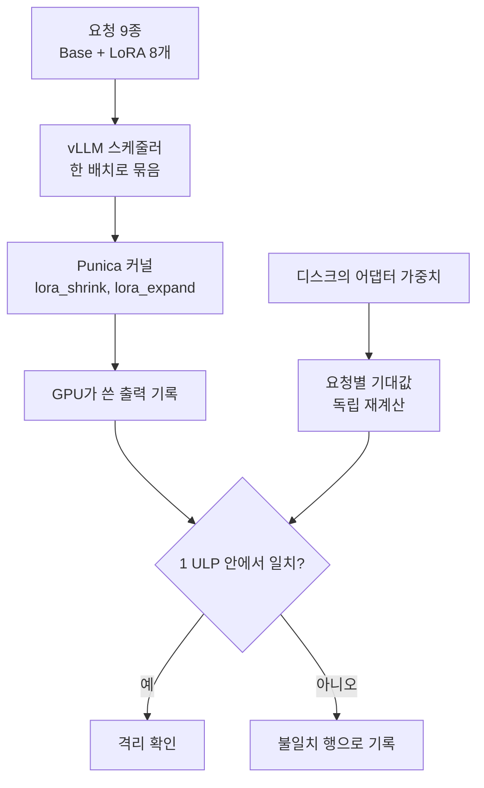

먼저 P0 단계에서는 모델 없이 합성 텐서로 커널만 시험했습니다. 4096에서 4096으로 가는 선형층, rank 16, 768행, 시드 3개 조건에서 Base와 LoRA 2개를 섞은 배치, Base와 LoRA 8개를 섞은 배치를 합쳐 6건을 돌렸고 전부 통과했습니다. 허용오차를 넘은 값은 0개, Base 행이 바뀐 경우도 0건이었습니다. 커널 버퍼를 전혀 쓰지 않고 처음부터 다시 계산한 독립 대조에서도 비율이 0.47~0.79로 합격선 1.0 이하였습니다. 검사 자체가 결함을 잡는지 보려고 일부러 두 가지 결함을 넣었습니다. rot은 한 요청의 어댑터 가중치를 다른 어댑터 것으로 바꿔치기한 경우이고 leak은 Base 행에 LoRA 값을 흘려 넣은 경우입니다. 두 결함 모두 모든 시드에서 검출됐습니다.

P1 단계에서는 실제 NVFP4 27B 서버를 띄웠습니다. 모든 LoRA 선형 모듈과 모든 토큰 행에서 GPU 커널이 쓴 값을, 그 요청의 어댑터 가중치(디스크에 저장된 내용과 대조한 값)로 계산한 기대값과 비교했습니다. 허용오차는 1 ULP입니다. ULP는 부동소수점 수에서 마지막 자리 한 칸의 크기를 뜻하므로, 1 ULP 차이는 반올림 순서 정도로도 생길 수 있는 가장 작은 차이입니다.

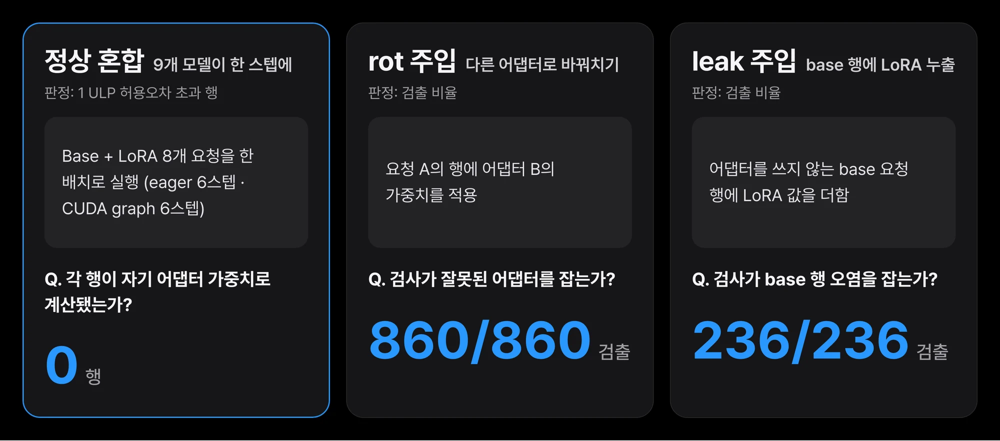
*실제 NVFP4 27B 서버에서 잰 세 가지 판정. 정상 혼합 배치에서는 틀린 행이 없었고 일부러 넣은 결함은 모두 잡혔습니다.*

결과는 이렇습니다. 허용오차를 넘은 행은 0개, Base 행이 수정된 경우도 0건이었습니다. 라우팅한 어댑터와 응답에 찍힌 모델이 어긋난 경우도 0건이었습니다. Base를 포함한 9개 모델에서 두 개를 고르는 72개 순서쌍(9×8)을 모두 구별했고 쌍마다 최소 145행이 근거가 됐습니다. 9개 모델이 한 GPU 스텝에 모두 들어간 경우가 eager 계측 서버에서 6스텝, CUDA graph 서버에서 6스텝 있었습니다. CUDA graph 서버에서는 커널에 넘기는 메타 버퍼(어떤 행이 어떤 어댑터를 쓰는지 적은 표)가 370스텝 전부 실제 요청 매핑과 일치했습니다. 같은 서버에 rot과 leak 결함을 주입하자 각각 860/860, 236/236으로 전부 검출됐습니다.

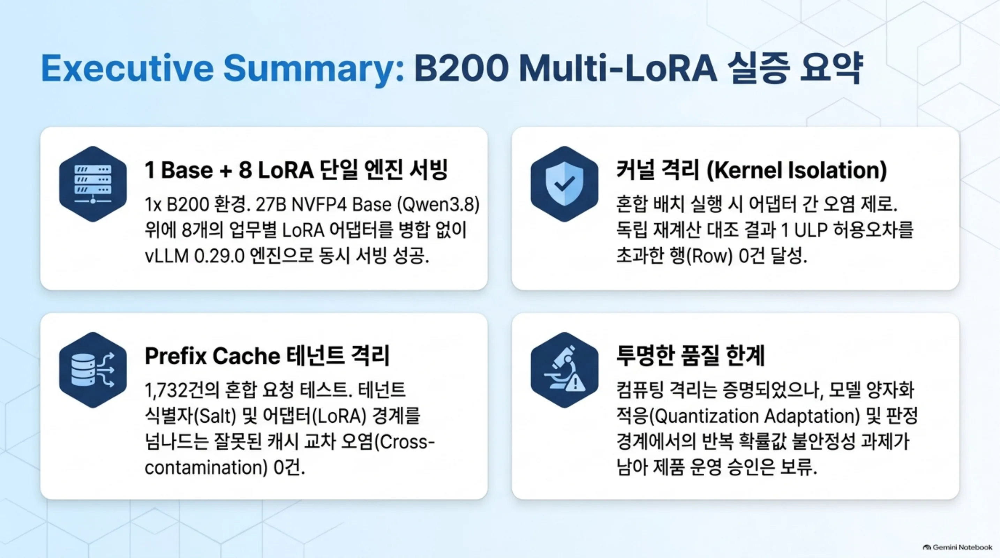

## 1 ULP 차이와 잘못된 어댑터를 구별하기까지

이 판정은 한 번에 나오지 않았습니다. 하루 전 1차 실행의 판정은 `NOT_ISOLATED_ULP_DRIFT`였습니다. 혼합 실행 2,792행 중 2행에서 1 ULP 이내의 차이(지표값 0.0104)가 나왔는데, 비교할 기준선이 735행뿐이어서 허용선이 바닥값 0.001로 잡혀 있었습니다. 작은 차이 두 건이 허용선을 넘었고 규칙대로 실패로 판정됐습니다.

2차에서는 기준선을 48,589행으로 키웠습니다. 그러자 모델 하나만 도는 실행에서도 같은 종류의 차이가 11행(2.3×10⁻⁴) 나왔습니다. 혼합 실행에서만 생기는 현상이 아니었다는 뜻입니다. 혼합 쪽 비율(7.2×10⁻⁴)은 기준선의 약 3배지만 2건뿐이라, 기준선 비율만으로도 2건 이상 나올 확률이 약 13%입니다. 이 차이가 혼합 때문이라는 증거도 아니고 혼합 영향이 전혀 없다는 증명도 아닙니다.

NVFP4 독립 기준선은 모델 하나만 도는 스텝 81개, LoRA 48,589행으로 만들었습니다. 1 ULP를 넘은 값은 0개였고 비트가 다른 원소 비율의 최댓값은 0.010417이었습니다. 사전에 등록해 둔 규칙(관측 최댓값의 4배)에 따라 허용선은 0.0417이 됐습니다. BF16 쪽에서 관측한 값을 끌어다 허용선을 정하지 않았습니다.

1차 판정은 지우지 않고 기록에 그대로 남겼습니다. 기준선을 키운 목적은 PASS를 만드는 것이 아니라, 1 ULP 수준의 수치 차이와 잘못된 LoRA 적용을 구별하는 것이었습니다. 같은 검사가 rot 주입 860건을 전부 잡았다는 점이, 이 검사가 잘못된 어댑터 적용을 1 ULP 수준의 수치 차이와 구별해 낸다는 근거입니다.

실제 GPU 시간은 21.6분, B200 기준 약 0.36 GPU-h였습니다. 같은 질문을 BF16 전체 평가로 답하려 했을 때는 6.3시간이 걸렸지만, 그때와 이번은 검증 범위가 달라서 같은 조건의 비교로 읽으면 안 됩니다.

## Prefix Cache도 어댑터와 테넌트 경계를 넘지 않았습니다

커널 계산이 섞이지 않아도 다른 경로로 섞일 수 있습니다. vLLM의 Prefix Cache는 앞부분이 같은 프롬프트의 KV 캐시를 다음 요청에 재사용해 계산을 줄입니다. 그런데 같은 시스템 프롬프트를 쓰는 두 요청이 서로 다른 어댑터나 서로 다른 고객의 것이라면, 이 재사용은 계산 오류이자 정보 경계 위반이 됩니다. LoRA를 적용한 KV 값은 어댑터마다 다르기 때문입니다.

검증 R7-C1(2026-11-16)은 이 경로만 따로 봤습니다. 엔진은 vLLM 0.33.0rc1이고, 앞의 커널 검증에 쓴 0.29.0과 버전이 다릅니다. 요청은 모두 1,732건입니다. 항목 2개로 돌린 사전 점검(GATE) 16건과 항목 44개 × 모델 9개로 돌린 본 측정(FULL) 1,716건을 합한 수입니다.

- 재사용이 나와야 하는 요청은 886건(GATE 6 + FULL 880)입니다. 같은 어댑터와 같은 캐시 네임스페이스(같은 테넌트 salt 또는 둘 다 salt 없음)로 같은 앞부분을 다시 보낸 경우이고, 886건 모두 캐시를 재사용했습니다. 재사용한 토큰은 최소 3,328개로 프롬프트의 97.9%였습니다. 캐시가 실제로 켜져 있었다는 확인입니다.
- 재사용이 나오면 안 되는 요청 846건(GATE 10 + FULL 836)은 한 건도 재사용하지 않았습니다. 그중 FULL 792건은 요청 직전에 같은 앞부분이 다른 어댑터나 다른 salt의 캐시로 이미 올라가 있었습니다. 잘못 재사용될 기회가 실제로 있던 셈입니다.
- 어댑터가 다른 경우(Cross-LoRA)와 테넌트 salt가 다른 경우(Cross-Salt)의 잘못된 재사용은 0건입니다. 한 테넌트가 캐시를 채운 직후 다른 테넌트 salt로 같은 앞부분을 보낸 기회가 44번 있었습니다. salt가 있는 요청 뒤에 salt 없는 요청이 같은 앞부분을 보낸 기회도 396번 있었습니다. 어느 쪽도 재사용으로 이어지지 않았습니다.

판정은 `R7C1_PASS`입니다. 원 판정 코드와 따로 짠 재계산 스크립트로 다시 집계해도 같은 결과가 나왔습니다. 첫 시도는 인프라 문제로 측정이 끝나지 않아 `INCOMPLETE_INFRA`로 기록돼 있습니다. 해석에는 두 가지 조건이 붙습니다. salt를 주지 않은 요청끼리는 같은 어댑터 안에서 캐시가 재사용됩니다. 이것은 엔진의 정상 동작이며 테넌트 격리 근거가 아닙니다. 테넌트를 나누려면 요청마다 salt를 넣어야 합니다. 또 vLLM의 캐시 키에는 어댑터의 이름과 경로가 들어가고 가중치 내용은 들어가지 않습니다. 같은 이름과 경로로 다른 가중치를 다시 올리는 경우는 이번 시험 범위 밖입니다. 운영에서는 어댑터를 바꿀 때 이름이나 경로를 바꾸는 규칙이 필요합니다. 이 결과는 vLLM의 캐시 salt가 캐시 재사용 경계를 나눈다는 실증이지, 멀티테넌트 보안 전체를 인증한 것은 아닙니다.

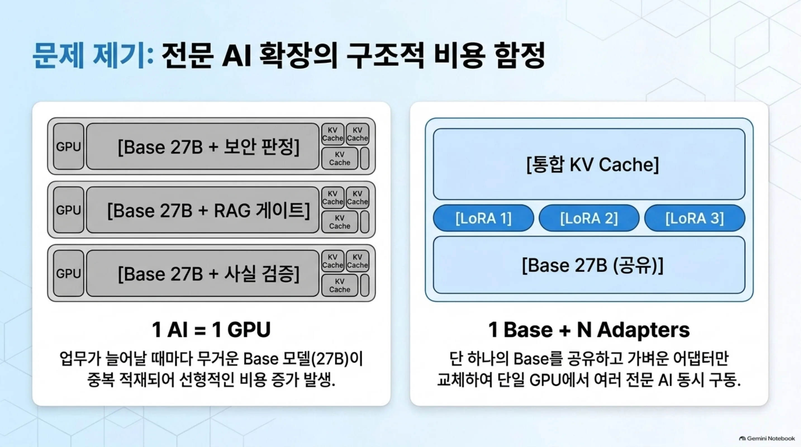

## 어댑터 품질은 따로 판정합니다

커널 격리가 성립했다는 것은 각 요청이 자기 어댑터로 계산된다는 뜻이지, 그 어댑터가 NVFP4 Base 위에서 원래 품질을 낸다는 뜻이 아닙니다. 어댑터는 BF16 Base에서 학습했기 때문에, 양자화된 Base에 그대로 붙였을 때의 품질은 어댑터마다 따로 봐야 합니다. 원장에 기록된 판정을 그대로 옮기면 다음과 같습니다.

| 어댑터 | NVFP4 Base에 그대로 붙였을 때의 판정 |
|---|---|
| SecProof | QUANT_ADAPTATION_NOT_NEEDED (재학습 없이 사용 가능으로 판정) |
| RAGGate | QUANT_ADAPTATION_NEEDED (양자화 Base에 맞춘 적응 필요) |
| FactGuard | QUANT_ADAPTATION_NEEDED (양자화 Base에 맞춘 적응 필요) |
| Satoori | 미결정 |
| SecDecision | 참고 보고만 |
| Ops, HW, Human-KO | 이 판정의 대상 아님 |

즉 여덟 개를 한 엔진에 올리는 것은 동작하지만, 여덟 개 모두가 NVFP4 위에서 바로 쓸 수 있는 품질이라는 뜻은 아닙니다.

업무 평가(E1, 2026-11-16)에서도 결과가 갈렸습니다. SecProof는 327건 전부를 맞혔고 DFlash2 가속을 켰을 때도 성능이 떨어지지 않았습니다. RAGGate(정확도 0.9367)와 FactGuard(0.9167)는 DFlash2를 켜고 끈 두 조건의 정확도가 같았지만, 켠 쪽에서만 심각한 오판이 각각 한 건씩 새로 나왔습니다. 추가 분석에서는 같은 뒤집힘이 DFlash2를 끈 상태에서도 나왔습니다. 다른 요청 없이 같은 요청 하나를 캐시 없이 반복해 보내도 상위 후보 토큰의 확률값이 매번 조금씩 달랐습니다. 판정 경계에 가까운 문항에서는 이 정도 차이로도 답이 바뀝니다.

이 반복 불안정의 원인은 확정하지 못했습니다. 원인을 좁히려던 진단 실험은 두 번 모두 계측 단계에서 실패했습니다. 확인한 것은 LoRA 연산 경로가 특정 커널(split-K 원자적 누산)로 실행된다는 사실까지입니다. 그 커널이 실행됐다는 사실이 불안정의 원인이라는 증명은 아닙니다. 진단은 원인 미확정 상태로 종료했습니다. 그래서 보안 판정처럼 같은 입력에 같은 답이 필요한 업무에 이 구성을 제품으로 쓰는 것은 승인하지 않았습니다. 다시 진행한다면 여덟 개를 한꺼번에 올리지 않고 업무별 품질 기준을 통과한 어댑터부터 하나씩 넣을 계획입니다.

## 이 결과가 말하지 않는 것

이번 검증은 커널 격리와 Prefix Cache 격리를 좁게 확인했습니다. 다음 항목은 이 결과로 주장할 수 없습니다.

- 각 어댑터의 업무 품질. SecProof를 뺀 어댑터는 양자화 적응이 필요하거나 아직 판정이 없습니다.
- 반복 판단 안정성. 같은 요청에도 확률값이 조금씩 달라 경계 문항의 답이 바뀌는 현상이 남아 있고 원인을 확정하지 못했습니다.
- 장시간 운영 안정성. 커널 검증 표본은 평가 프롬프트 9개와 혼합 4라운드로 제한적입니다.
- CUDA Graph 재생 중의 커널 출력. CUDA Graph 서버에서는 메타 버퍼가 맞는지만 봤습니다. 행 단위 출력 차이는 CUDA Graph를 끈 계측 서버에서만 직접 쟀습니다.
- DFlash2 투기적 디코딩과 결합한 제품 동작. 통합 시험에서 어댑터별 동작을 구별해 확인하지 못해 제품 적용은 보류 상태입니다.
- 처리량, 응답 시간, 전력, 요청당 비용. 측정하지 않았고 비용 측정 실험도 보류 상태입니다. 비용 절감률을 잰 실측은 없습니다.
- 고객 간 데이터 접근 통제. 커널과 캐시 격리는 계산과 캐시가 섞이지 않는다는 뜻이지, 테넌트별 데이터 격리, 인증, 로그 분리를 보장하지 않습니다. 이 부분은 플랫폼 계층에서 따로 설계하고 검증해야 합니다.
- 운영 승인. 이 결과는 운영 투입 결정이 아닙니다.

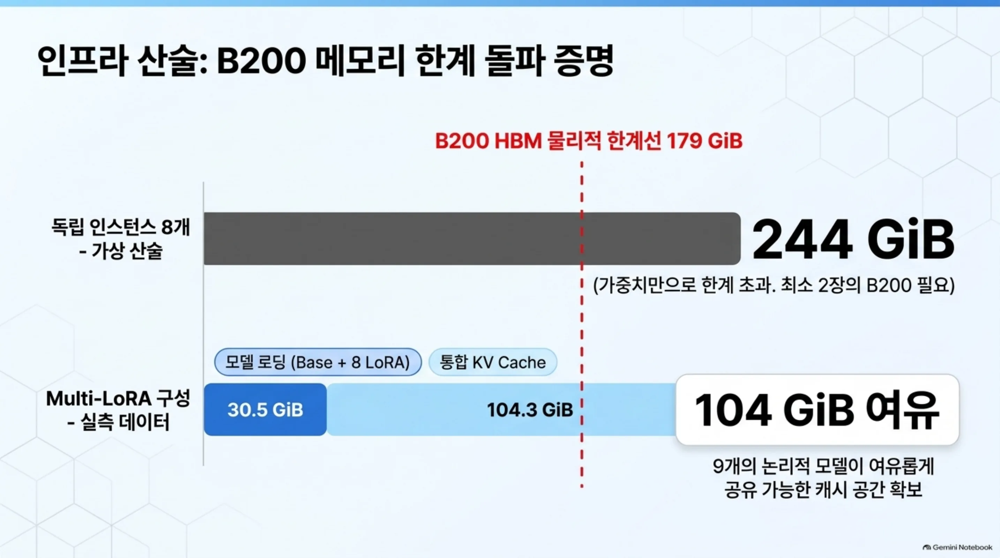

## S-LoRA와 Punica가 연 길 위에서 확인한 것

여러 LoRA 어댑터가 Base를 공유해 메모리와 배칭 효율을 높인다는 아이디어는 선행 연구가 먼저 제시했습니다. [S-LoRA(Sheng 외, 2023)](https://arxiv.org/abs/2311.03285)는 어댑터를 메인 메모리에 두고 실행 중인 요청이 쓰는 어댑터만 GPU로 가져오는 통합 메모리 풀과 전용 커널로, 한 대의 머신에서 수천 개의 어댑터를 서빙하는 방법을 보였습니다. [Punica(Chen 외, 2023)](https://arxiv.org/abs/2310.18547)는 서로 다른 LoRA를 쓰는 요청을 한 배치로 묶어 계산하는 SGMV(Segmented Gather Matrix-Vector Multiplication) 커널을 제안했고 GPU에는 Base 한 벌만 두면 된다는 점을 보였습니다.

다키클라우드가 더한 것은 새 알고리즘이 아니라 실측입니다. 27B 규모, NVFP4 양자화 Base, B200, 직접 학습한 업무 어댑터 8개라는 실제 조합에서, 응답 텍스트가 아니라 커널 출력을 행 단위로 대조해 격리를 확인했습니다. Prefix Cache가 어댑터와 테넌트 경계를 넘지 않는지도 따로 확인했습니다. 그리고 실패한 판정과 그 경위, 어댑터별 품질과 반복 안정성의 한계까지 함께 공개했습니다.

## Private AI 운영 관점에서 달라지는 것

MSSP나 보안 SI가 고객사 안에 Private AI를 구축할 때, 전문 AI 하나를 추가하는 일은 지금까지 GPU 서버 증설과 같은 뜻이었습니다. Base를 공유하는 Multi-LoRA가 커널과 캐시 수준에서 섞이지 않는다면, 새 업무는 어댑터 하나를 학습해 기존 엔진에 등록하는 일로 바뀔 수 있습니다. 다키클라우드의 ai-platform은 Kubernetes 위에서 GPU 작업과 vLLM 서빙을 운영하는 플랫폼이고 그 위에서 도는 Paxis는 에이전트의 행동을 정책 게이트와 감사 로그로 통과시키는 제어 평면입니다. 보안 판정, 사실 검증, RAG 게이트 같은 전문 모델을 한 엔진에 모아 그 게이트 자리에 두려면, 먼저 모델끼리 계산 단계에서 간섭하지 않아야 합니다. 이번 검증은 그 전제에 대한 첫 근거입니다. 다만 그 자리에 실제로 두려면 업무별 품질 기준과 반복 판단 안정성을 먼저 통과해야 하고, 이번 결과는 그 단계에 도달하지 못했습니다.

## 끝으로

NVFP4 27B Base 하나에 직접 학습한 LoRA 8개를 재학습 없이 붙여 B200 한 장에서 9개 모델로 서빙했습니다. 서로 다른 어댑터 요청이 한 배치에 섞여도 각 행이 자기 어댑터로만 계산됐고 허용오차 초과는 0행이었습니다. 일부러 넣은 결함도 전부 잡혔습니다. Prefix Cache도 어댑터와 테넌트 salt 경계를 넘어 재사용되지 않았습니다.

검증하지 못한 것도 분명합니다. 표본이 작습니다. 어댑터 대부분의 업무 품질과 반복 판단 안정성은 통과하지 못했거나 판정이 없습니다. 처리량과 비용은 재지 않았습니다. 그래서 이 구성은 보안 판정용 제품으로 승인되지 않았고 DFlash2 결합도 보류 상태입니다. 커널 격리 통과를 업무 품질 통과로 읽지 않으셨으면 합니다.

비슷한 구성을 검토하고 있다면 응답 텍스트 비교에서 멈추지 말고 결함 주입 검사와 캐시 경계 검사를 먼저 붙여 보시길 권합니다. 검사가 rot과 leak을 잡지 못한다면, 통과 판정도 믿을 수 없습니다.

**여러 전문 AI를 각각의 GPU에 배포하고 계신가요?** 다키클라우드는 하나의 Base 모델과 업무별 LoRA를 공유하는 AI 서빙 아키텍처를 설계하고 있습니다. 지금 운영 중인 구조를 놓고 GPU 메모리 요구량과 예상 비용을 함께 검토해 드릴 수 있습니다. 예상 비용은 추정치이며, 워크로드에 따라 공유 구성이 더 비싸게 나오는 경우도 그대로 보여 드립니다.

[무료 GPU 비용 진단 신청하기]({{ "/ko/gpu-cost-assessment/" | relative_url }}?utm_source=techblog&utm_medium=post_cta&utm_campaign=multilora_cost_assessment&utm_content=b200_nvfp4_multilora)

<!-- nlm-visual -->
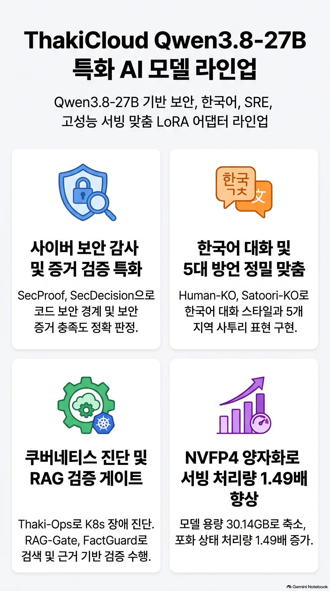
*NotebookLM이 소스를 종합해 생성한 인포그래픽입니다.*
