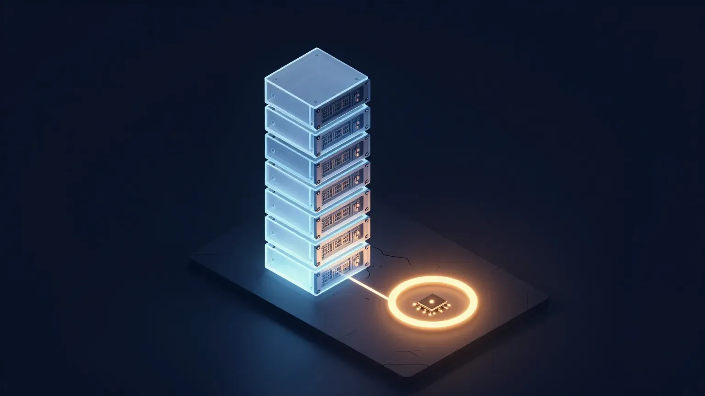
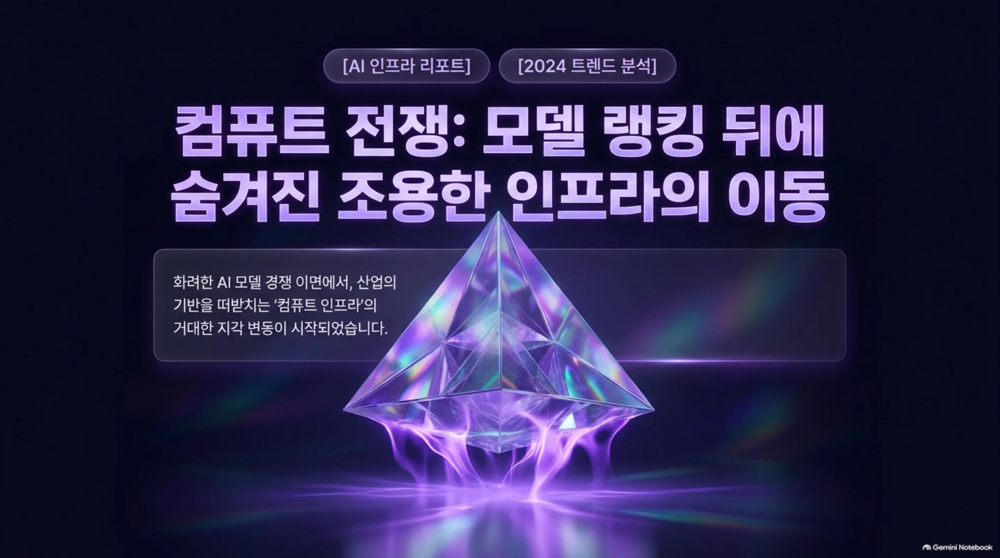
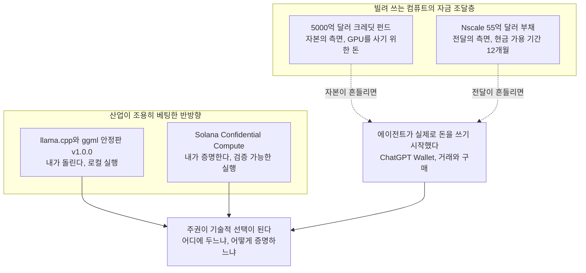
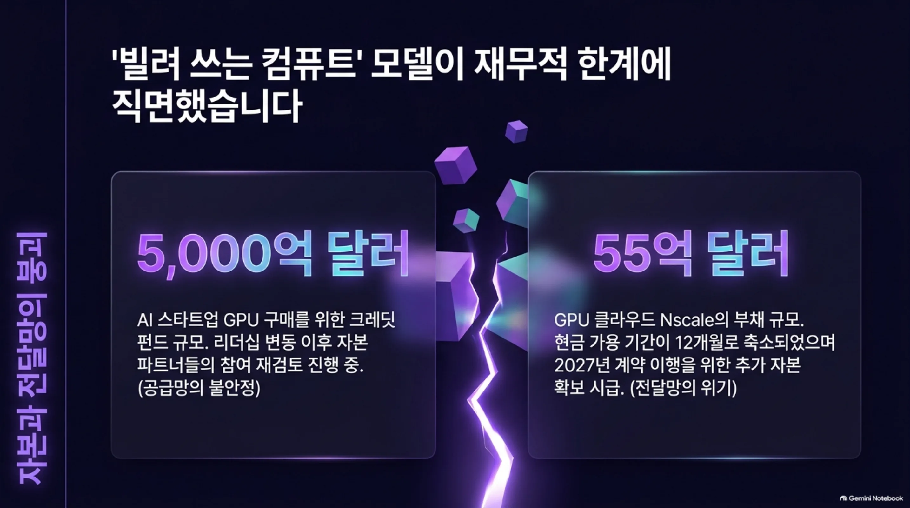
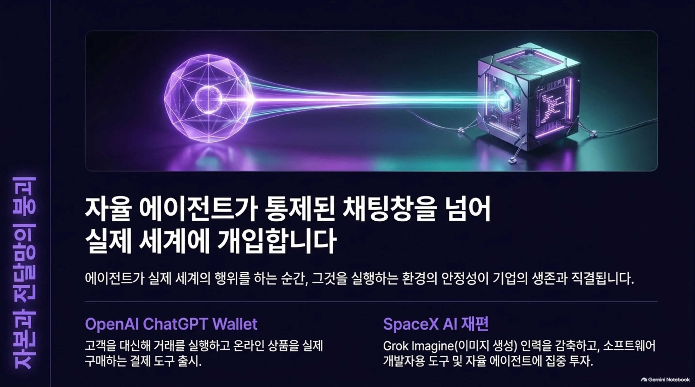
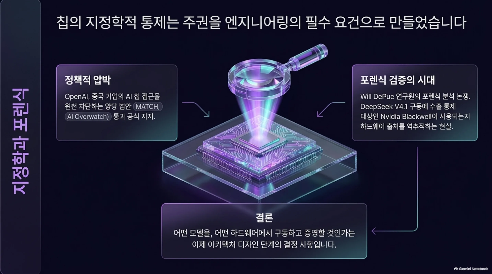

모델 랭킹이나 칩 지정학이 아니라, 훨씬 조용한 층을 보고 있다면 오늘 아침 AI 뉴스는 꽤 다른 이야기를 합니다. 오늘 진짜로 움직인 스토리는, GPU를 계속 돌게 하는 돈에 관한 것이었습니다.

결론부터 말하겠습니다. 오늘의 화두는 더 이상 "어떤 모델이 강한가"가 아니라, "누가 컴퓨트를 계속 돌릴 수 있는가, 그리고 그 컴퓨트를 믿을 수 있는가"인 셈입니다. 오늘 HuggingNews 다이제스트에는 익숙한 기사들이 많이 섞여 있었습니다. 하지만 읽어야 할 신호는 조용한 층에 있었습니다. 돈에 관한 두 기사, 그리고 자기 경계 안에서 AI를 돌리겠다는 두 기사. 이 네 개를 붙이면, 꽤 선명한 하나의 풍경이 보입니다. 특히 컴퓨트를 빌려 쓰며 에이전트를 돌리는 운영자에게는, 오늘의 신호가 더 직접적으로 와닿습니다.

*글의 핵심 개념을 형상화했습니다.*

## 한 장에 놓인 두 숫자

컴퓨트 공급망에서 오늘 아침, 함께 놓기엔 어색한 두 숫자가 눈에 띱니다. 하나는 5000억 달러입니다. AI 스타트업의 GPU 구매를 위한 크레딧 펀드의 규모이고, 돈을 대는 파트너들이 Nvidia 측 리더십 변동 이후에 참여 여부를 재검토하고 있습니다. 다른 하나는 55억 달러입니다. GPU 클라우드 Nscale의 부채 규모이며 현금 가용 기간은 12개월로 줄었습니다. Nscale은 2027년 계약 이행, 그중 데이터센터 캠퍼스 구축을 위해 추가 자본이 필요하다고 경고했습니다.

겉으로는 하나는 금융 기사이고 다른 하나는 기업 재무 기사입니다. 하지만 두 개가 가리키는 층은 같습니다. GPU를 계속 돌게 하는 돈, 그것입니다.

이걸 좀 더 펼치겠습니다. AI 산업의 컴퓨트는 몇 년 동안 대개 "빌려서 쓰는" 구조로 운영됐습니다. 누군가가 거대한 자본을 들여 GPU를 대량으로 사고 데이터센터를 세우고, 그걸 스타트업과 기업에게 임대합니다. 5000억 달러 크레딧 펀드는 그 구조의 맨 위에 있습니다. GPU를 사기 위한 돈, 즉 공급 자체를 조달하는 자금입니다. Nscale은 그 GPU를 실제로 부채를 지고 전달하는 사업자입니다.

문제는 이 두 곳이 지금 동시에 흔들린다는 점입니다. GPU를 사기 위한 돈이 주춤하면, 새로 들어오는 컴퓨트의 흐름이 줄어듭니다. 컴퓨트를 전달해야 하는 사업자의 현금이 12개월이면, 고객이 당연하게 여겨온 "빌려 쓰는 컴퓨트"의 안정성에 물음이 생깁니다. 즉, 컴퓨트를 빌리는 것은 더 이상 안정적인 기본값이 아닙니다. 이것이 오늘의 신호입니다.

이 두 숫자가 독립적인 사건이 아니라는 점에 주목할 가치가 있습니다. 하나는 GPU를 공급하는 "자본의 측면"이고, 다른 하나는 그것을 전달하는 "전달의 측면"입니다. 자본의 측면이 흔들리면, 전달의 측면의 부채 부담이 드러납니다. 두 숫자가 말해주는 것은 결국 같은 것입니다. 몇 년 동안 기본값이었던 "빌려 쓰는 컴퓨트" 모델이, 이제는 스스로의 자금과 자체의 지급 능력을 방어해야 하는 지점에 도달했다는 것이지요.

## 산업이 조용히 베팅한 반방향

그 신호의 반대편에는 조용한 반항이 있습니다. 11월 13일, ggml과 llama.cpp의 개발진이 안정판 v1.0.0을 내놓았습니다. 로컬에서 AI를 실행하는 도구들의 기술적 기반을 하나로 통합하는 업데이트입니다. 로컬 추론의 기준 프레임워크가 1.0이라는 숫자에 닿았다는 것은, 산발적으로 흩어져 있던 실행 도구가 하나의 신뢰 가능한 기반으로 수렴하고 있다는 뜻입니다. 같은 날 Solana는 Solana Confidential Compute라는 오픈소스 도구 묶음을 공개했습니다. 하드웨어 기반 검증과 온체인 인증을 활용해 개발자가 프라이빗 AI 애플리케이션을 만들 수 있게 하는 시스템입니다.

두 회사는 다르고 겉보기엔 방향도 다릅니다. 하지만 밑바닥 로직은 하나입니다. 자기 경계 안에서, 자기 하드웨어 위에, 그리고 검증 가능한 방식으로 AI를 돌린다는 것입니다. 로컬 추론이 취미로 여겨지고 프라이버시가 부가 옵션이던 시절은 지났습니다. 로컬 기반의 안정화와 기밀 컴퓨팅의 확산은, 빌리고 빌려준 GPU의 리스크에 산업이 조용히 깔아 놓은 헤지입니다.

바로 앞 장과 이어 보겠습니다. 빌려 쓰는 컴퓨트의 자금 조달층이 흔들리면, "내가 돌리고 내가 검증한다"의 가치가 올라갑니다. llama.cpp는 "모델을 어디서 돌리느냐"에 대한 답이고, Solana Confidential Compute는 "그 실행이 안전한 것을 어떻게 증명하느냐"에 대한 답입니다. 두 가지는 주권의 두 면을 동시에 채워 넣습니다.

지도 한 장으로 다시 말하면, 흔들리는 자금 조달층(자본의 측면, 전달의 측면)과 조용한 헤지(로컬 실행, 기밀 실행)가 에이전트의 실제 지출이라는 층에서 만나, 주권을 기술적 선택으로 만듭니다.

이것이 왜 중요한가요. 이 기술들이 더 이상 실험 단계가 아니기 때문입니다. llama.cpp가 1.0에 도달한 것은 로컬 실행 기반이 이제 하위 도구들이 의존해도 되는 단계에 들어갔다는 뜻입니다. 그리고 Solana의 기밀 컴퓨트는 누구나 감사할 수 있는 오픈소스입니다. "내가 돌리고 내가 증명한다"가 "될 수 있는가"의 영역에서 "할 것인가"의 영역으로 이동한 것입니다. 이것이 변화의 본질인 것입니다.

## 주권이 기술적 선택이 된 이유

오늘의 칩 관련 뉴스가 이 그림을 완성합니다. OpenAI는 의회 사무실에 중국 기업의 AI 칩 접근을 차단하는 양당 법안의 통과를 지지한다는 입장을 전달했습니다. 명시된 법안은 MATCH 법안과 AI Overwatch 법안입니다. 한편 연구자 Will DePue는 6개 중국 AI 모델을 수출통제 대상 Nvidia Blackwell GPU와 연결하는 포렌식 연구에 대한 의문을 반박하며, DeepSeek V4.1의 사용 칩은 여전히 불확실하다고 밝혔습니다.

의미를 펼쳐 보겠습니다. 칩이 지정학적으로 관리되고 모델 뒤의 칩이 포렌식적 증명이 필요한 문답이 될 때, "컴퓨트가 어디에 있는지, 그리고 그것을 검증할 수 있는지는" 더 이상 IT의 세부 사항이 아닙니다. 아키텍처의 결정이 되기 때문입니다. 과거 주권은 정책 문서나 경영진의 발언 속에 머물던 문장이었습니다. 하지만 지금은 디자인 단계에서 결정해야 하는 질문이 됐습니다. 어떤 모델을, 어떤 하드웨어 위에서, 어디에, 그리고 그것을 어떻게 증명할 것인가.

한 연구자가 어떤 모델이 어떤 칩 위에서 돌았는지 증명하기 위해 포렌식 논문을 내야 하는 현실은, 컴퓨트의 출처가 이제 산업 신뢰의 중심으로 들어왔다는 것입니다. 오늘의 구조적 변화는, 주권이 정책 문서에서 엔지니어링의 안으로 내려오고 있기 때문입니다.

## 에이전트가 실제로 돈을 쓰기 시작했다

한 층 더 보겠습니다. 오늘의 에이전트는 더 이상 답하는 채팅봇이 아닙니다. OpenAI는 dots AI 에이전트가 고객 대신 거래를 실행하고 상품을 구매할 수 있게 하는 결제 도구 ChatGPT Wallet을 출시했습니다. SpaceX도 AI 부서를 자율 에이전트와 소프트웨어 개발자용 도구에 재배치하고, 이 과정에서 Grok Imagine 인력을 감축해 Grok 봇과 코딩 도구의 우선순위를 높였습니다.

여기서 중요한 것은 "에이전트가 좋아졌다"가 아닙니다. 에이전트가 실제 세계의 행위를 하도록 됐다는 것입니다. 돈을 쓰고 코드를 씁니다. 에이전트가 실제 세계의 행위를 하는 순간, 그것을 실행하는 환경이 중요해집니다. 승인 범위, 실행 격리, 사후 로그. 이 질문들이 더 이상 선택이 아니게 됩니다.

그리고 여기서 한 걸음 더 가면, 오늘의 주제와 붙습니다. 에이전트를 돌리는 컴퓨트 자체가 빌려 쓰고 그 빌려 쓴 컴퓨트가 흔들린다면, "에이전트가 행하는" 리스크 위에 인프라 리스크가 겹칩니다. 이 두 리스크는 독립적이지 않습니다. 곱해집니다.

## 다음에 볼 것

그럼 다음에는 무엇을 봐야 할까요. 첫 번째는 Nscale의 경고가 구체적인 자금 조달 움직임으로 이어지는지입니다. 2027년 계약에 필요한 추가 자본이 실제로 들어오면, GPU 클라우드의 지급 능력 이야기는 달라지는 것입니다. 두 번째는 5000억 달러 크레딧 펀드의 파트너들이 실제로 발을 빼는지입니다. 그럴 경우, 새로 들어오는 GPU의 흐름이 느려지고 "나만의 컴퓨트"의 가치는 올라가는 셈입니다. 세 번째는 llama.cpp 1.0과 기밀 컴퓨팅이 개발자 도구를 넘어 기업 환경의 기본 옵션으로 이동하는지입니다. 그렇게 되면 주권은 "대안"에서 "기본값"으로 이동을 완성하게 됩니다. 네 번째는, 주권을 이유로 온프렘으로 옮기는 기업이 모델 서빙의 운영 부담을 어떻게 감당하느냐입니다. 칩의 출처와 실행의 안전을 증명해야 하는 세상이 되면, 그 증명 비용도 인프라의 일부가 되는 것입니다. 오늘의 네 기사는, 그렇게 읽으면 모두 이 질문에 향하고 있습니다. 다만 한 가지를 덧붙이자면, 이 네 신호는 서로를 확인시켜 주는 관계인 셈입니다. 하나가 움직이면 나머지를 읽게 되고 나머지가 움직이면 하나가 더 선명해집니다. 오늘 아침의 풍경은 그래서 단편이 아니라, 하나의 방향을 가리키는 것입니다.

## 이 모든 것을 한데 묶는 렌즈

그러면 ThakiCloud의 Paxis는 이 풍경의 어디에 서 있겠습니까. 오늘의 뉴스가 결국 드러낸 것은, 산업이 스스로 풀어야 할 통증입니다. 오픈모델 온프렘 서빙, GPU 스케줄링, 에이전트 안전 실행, 주권, 비용. Paxis는 바로 이 통증에 답하러 나온 에이전트 네이티브 클라우드입니다. 정식 제품 v1.1 GA이며 Skills, Tools, Policies, Audit Logs를 일급 리소스로 다루기도 합니다.

이 스토리의 핵심은 주권이라는 뜻입니다. Paxis는 소버린과 온프렘 Kubernetes(ai-platform) 위에서 돌아가기 때문에, 남의 자금으로 조달된 GPU 클라우드에 의존할 필요가 없습니다. 자기 경계, 자기 하드웨어, 자기 검증. llama.cpp과 Solana가 "내가 돌리고" "내가 증명한다"라고 말했던 두 신호는, 여기서는 이념이 아니라 제품의 형식입니다.

비용은 바로 오늘의 숫자가 가리키는 통증입니다. CostRouter가 작업별로 적합한 모델을 골라 비용을 눌러 줍니다. 5000억 달러와 55억 달러가 말한 "컴퓨트의 돈" 문제에서, 사용자는 더 이상 남의 자금 곡선에 발목 잡히지 않습니다. 격리 샌드박스 실행과 정책 게이트, 그리고 감사 로그는 "에이전트의 행동을 믿어야 하나"를 기도가 아니라 관리할 수 있는 문제로 바꿉니다. L0에서 L3까지의 자율도 거버넌스는 승인 범위를 단계별로 정해 줍니다. MCP 커넥터와 스킬 마켓은 오늘 기사들이 암시하는 멀티모델, 멀티툴 현실에 맞춰져 있습니다.

그리고 이 모든 것을 "에이전트 네이티브"라는 한 단어로 묶는 이유는 분명합니다. 컴퓨트의 주권과 비용, 그리고 에이전트 실행의 안전은 이제 따로 놀 수 없는 세 문제가 됐기 때문입니다. 결국 오늘 뉴스가 말하는 것은 하나입니다. 모델 전쟁은 시끄럽지만 컴퓨트 전쟁은 조용합니다. 그리고 그 조용한 전쟁은, GPU를 어디에 두느냐, 그것을 어떻게 검증하느냐로 벌어집니다. 산업은 이미 조용히 자기 경계 안으로 이동하고 있습니다. 남은 질문은 하나입니다. 그 경계의 안쪽에 서는 것이겠지요, 빌리는 쪽에 서는 것이겠습니까.

## 참고 자료

이 글은 아래 뉴스를 종합해 작성했습니다.

- HuggingNews, [Researcher Will DePue Defends Nvidia Blackwell Forensics, Says DeepSeek V4.1 Chip Remains Unknown](https://huggingnews.com/ai/researcher-will-depue-defends-nvidia-blackwell-forensics-says-deepseek-v-054458da)
- HuggingNews, [OpenAI Urges Passage of Bipartisan Bills to Block China's Access to AI Chips](https://huggingnews.com/ai/update-openai-urges-passage-of-bipartisan-bills-to-block-chinas-access-t-4501bfb4)
- HuggingNews, [Lenders Consider Withdrawal From Nvidia's $500B AI Credit Project After Leadership Change](https://huggingnews.com/ai/lenders-consider-withdrawal-from-nvidias-500b-ai-credit-project-after-le-cd11d248)
- HuggingNews, [OpenAI Launches ChatGPT Wallet to Enable AI Agent Online Purchases](https://huggingnews.com/ai/openai-launches-chatgpt-wallet-to-enable-ai-agent-online-purchases-37c975a7)
- HuggingNews, [Llama.cpp Launches Stable v1.0.0 Version of Local AI Framework](https://huggingnews.com/ai/llamacpp-launches-stable-v100-version-of-local-ai-framework-a2b20147)
- HuggingNews, [SpaceX Cuts Grok Imagine AI Staff to Prioritize Grok Bot and Coding Tools](https://huggingnews.com/ai/spacex-cuts-grok-imagine-ai-staff-to-prioritize-grok-bot-and-coding-tool-0c07ba7c)
- HuggingNews, [Nscale's Debt Hits $5.5B and Cash Runway Falls to 12 Months](https://huggingnews.com/ai/nscales-debt-hits-55b-and-cash-runway-falls-to-12-months-feb012c6)
- HuggingNews, [Solana Debuts Confidential Compute Tools for Private AI Development](https://huggingnews.com/ai/solana-launches-tools-for-private-ai-with-onchain-hardware-verification-4ec62009)
