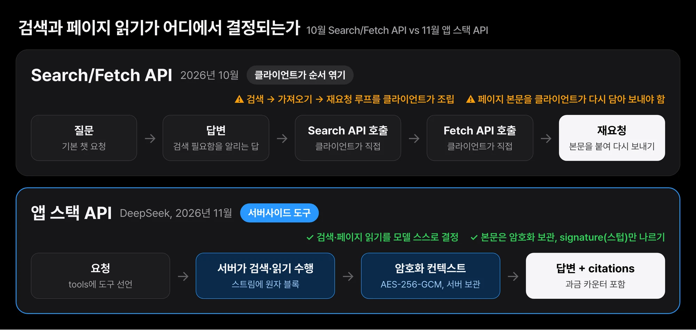
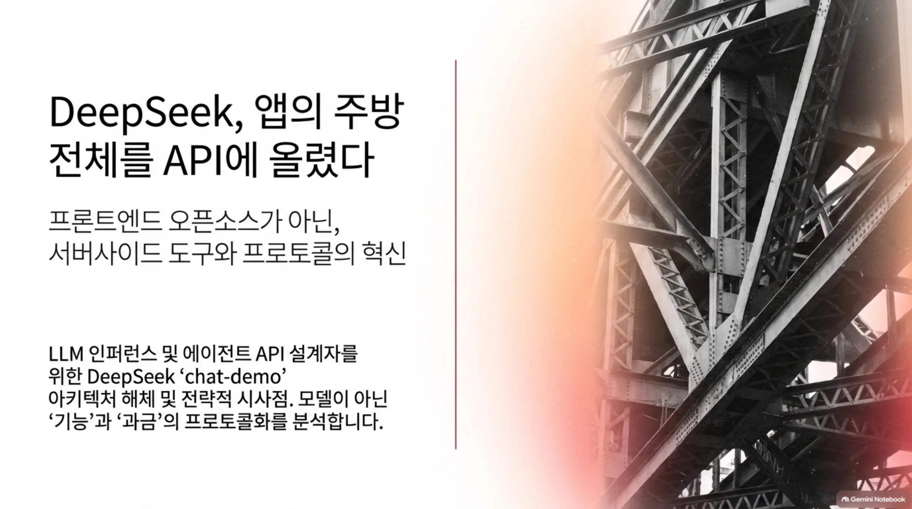
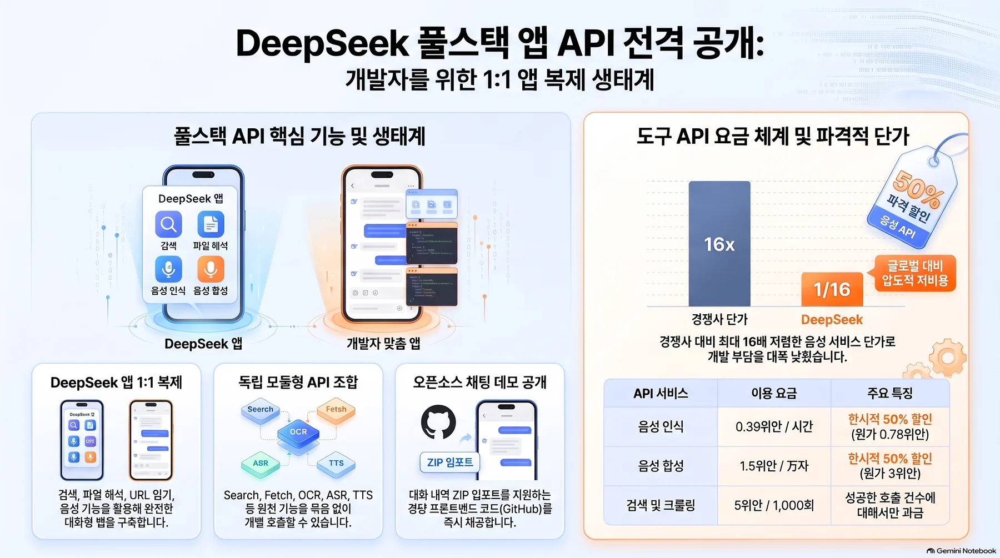
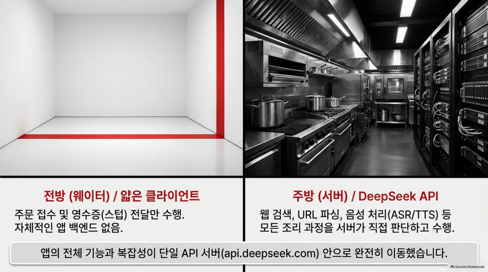
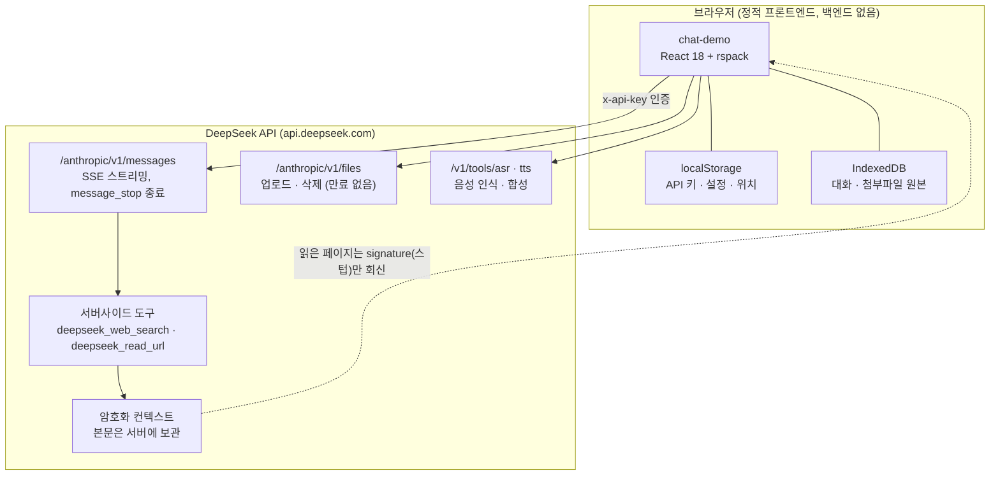
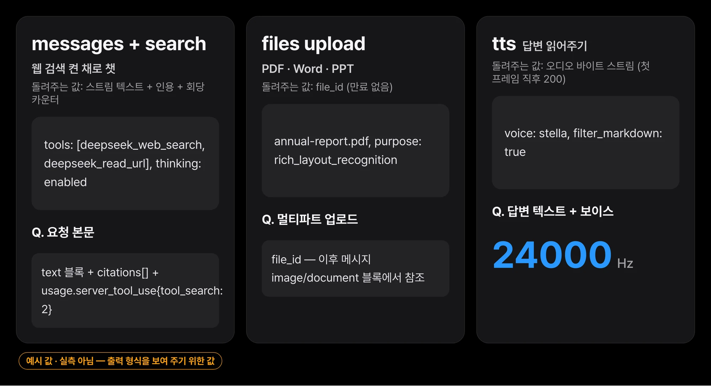
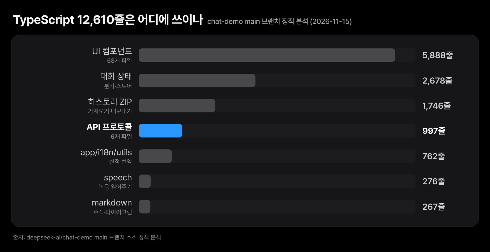
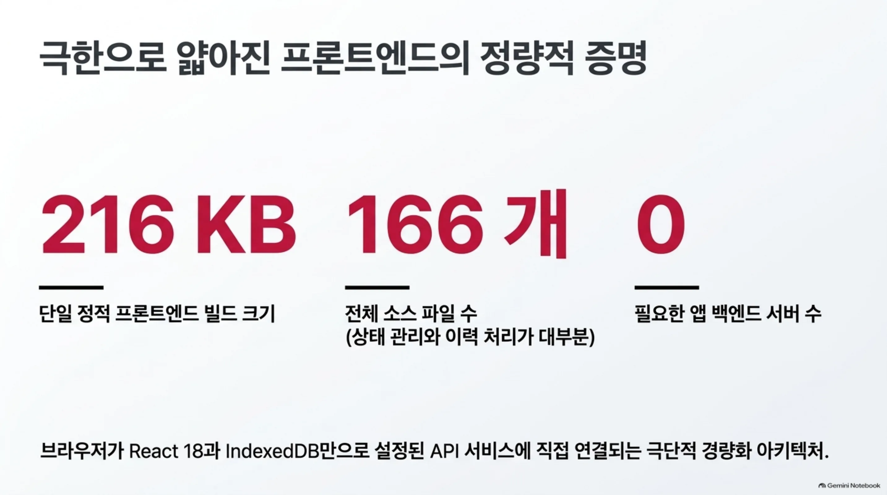
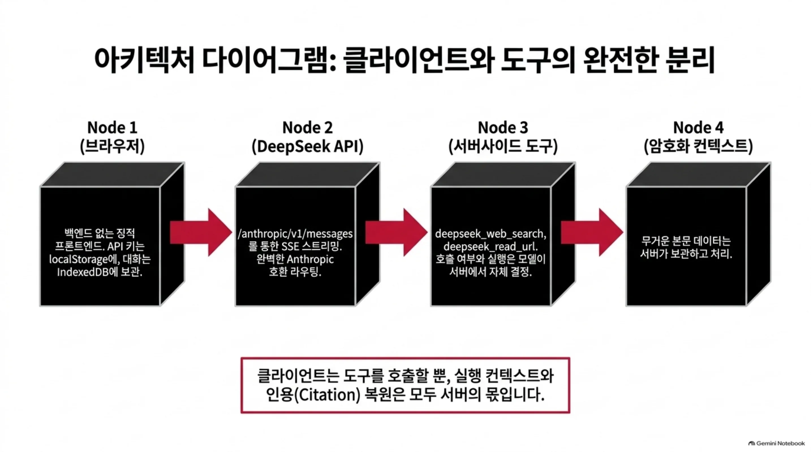
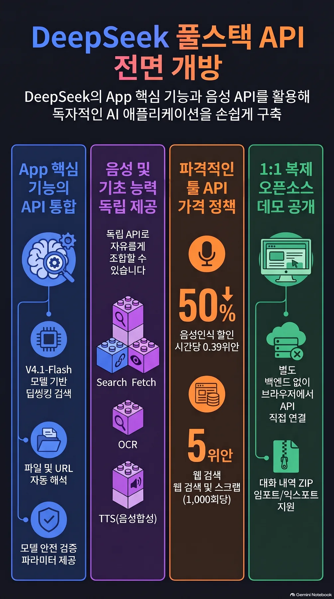

LLM 인퍼런스 플랫폼을 운영하거나 에이전트 앱의 API 설계를 맡은 사람이라면, 이번 DeepSeek 공개에서 무엇을 봐야 하는지 결정하기 위해 이 글을 읽으면 됩니다. 11월 13~14일 DeepSeek가 공개한 것은 새 모델이 아니라 API의 '메뉴판'이었습니다. 이 글은 새 기능의 프로토콜이 어떤 구조로 동작하는지와, 과금을 지켜봐야 할 지점이 어디인지 보여줍니다.

결론부터 말합니다. 이번 공개의 본질은 오픈소스 프론트엔드가 아니라, 서버사이드 도구와 회당 과금, 암호화 컨텍스트를 프로토콜과 함께 드러낸 것입니다. DeepSeek 앱의 전체 경험이 Anthropic 호환 Messages API 하나에 얹혀 있고, 클라이언트는 166개 파일·216KB짜리 정적 프론트엔드에 불과합니다. 저는 chat-demo 소스를 실제로 받아 읽었습니다. 아래에서 프로토콜이 어떻게 동작하는지, 그리고 이 구조가 ThakiCloud의 Metis와 Paxis에 어떤 시사점을 주는지를 설명합니다.


*앱의 기능 전체가 API 서버 안으로 이동한 이번 공개를 형상화했습니다.*

## 모델 회사가 앱 플랫폼이 되는 순간

11월 13일 밤 DeepSeek은 공식 발표로 앱의 핵심 기능을 API로 열었습니다. 대상은 웹 검색, 딥 검색, 파일 파싱, URL 읽기, 음성입니다. IT지아가 13일 밤, 큐비타이가 14일에 보도했고, 14일에는 DeepSeek 공식 X 계정에서 "앱 전체 경험이 이제 API로"라는 발표가 나갔습니다.

기능 하나하나가 독립 인터페이스입니다. 검색, 페이지 가져오기(Fetch), OCR, 음성 인식(ASR), 음성 합성(TTS)을 각각 부를 수 있고, 자유롭게 조합합니다. 큐비타이에 따르면 검색은 1회당 단가의 예시로 1,000회당 5위안이 제시됐습니다. 공식 문서 페이지에는 아직 회당 단가표가 없습니다.


*10월 방식에서는 클라이언트가 검색·가져오기·재요청 순서를 직접 엮었습니다. 11월 방식에서는 요청에 도구를 선언하면 서버가 모델 스스로 결정하고, 읽은 페이지는 암호화해서 서버에 보관합니다.*

모델 측면에서는 언론 보도가 V4.1-Flash를 지목합니다. 이 모델이 Messages, Responses, ChatCompletions 세 가지 API 스타일에서 새 확장 기능을 지원한다는 내용입니다. 한편 chat-demo 소스 안에 적힌 모델 ID는 `deepseek-flash`(기본값)와 `deepseek-v4-pro` 두 개입니다. 둘은 충돌이 아니라 층이 다릅니다. 언론이 말하는 것은 버전이고, 소스가 말하는 것은 요청에서 쓰는 식별자입니다.



생태계 문맥도 함께 봅니다. 같은 날 DeepSeek의 깃허브 조직을 보면 `deepseek-harness`가 상단 고정 레포입니다. "Everything is a Plugin"을 슬로건으로 내건 에이전트 하니스로, 작성 시점 별 281k를 기록합니다. 인퍼런스 프레임워크 `DeepInfer`(별 26k)와 파일 파싱을 담당하는 `dsh-libreoffice-kit`도 같은 계열입니다. DeepSeekHarness 리더 Cui Tianyi는 APPSO 보도에서 "다음 슈퍼앱은 모두를 위한 하나의 슈퍼앱일 필요가 없다. 이제 누구나 자기 슈퍼앱을 만들 수 있다"고 말했습니다.

<!-- nlm-visual -->

*NotebookLM이 소스를 종합해 생성한 인포그래픽입니다.*

## 쉽게 말하면

DeepSeek 앱을 풀서비스 레스토랑으로 보겠습니다. 지금까지는 이 집에서만 먹을 수 있었고, 메뉴와 조리법 모두 주방 안에 있었습니다. 11월 13일 발표는 주방의 업무 흐름을 서비스로 열었다는 뜻입니다. 웨이터가 주문을 받으면, 주방이 직접 메뉴를 검색하고(웹 검색), 레시피집을 넘겨보고(URL 읽기), 재료를 손질하고(파일 파싱), 요리 소개를 읽어줍니다(TTS). 음성 주문도 주방에서 접수합니다(ASR).

chat-demo는 '웨이터만 있는 전방'입니다. 주방이 없어요. 프론트엔드는 주문을 받아 전달하는 일만 하고, 모든 조리는 DeepSeek API가 합니다. 그래서 216KB짜리 단일 파일로 충분합니다. 영수증(컨텍스트)도 특별합니다. 본문을 암호화해 주방(서버)에 두되, 웨이터에게는 스텁(사인)만 줍니다. 다음 주문 때 스텁이 돌아오면 주방이 대조해 레시피를 다시 펼칩니다.



이 비유를 끝까지 씁니다. 아래 아키텍처와 프로토콜을 읽는 동안, 어떤 일이 주방에서 일어나고 어떤 일이 전방에서 일어나는지 구분하면 됩니다.

## 주문대가는 얇다, 백엔드가 없는 브라우저

chat-demo의 README 첫 문장은 이렇습니다. "A static chat demo powered by the DeepSeek API. No application backend is required: the browser connects directly to the configured API service." 정적 데모이고, 앱 백엔드가 필요 없으며, 브라우저가 설정된 API 서비스에 직접 연결됩니다.

기술 스택은 가볍습니다. React 18.3, rspack 2.0, zustand 4.4 상태 관리, idb 8.0으로 IndexedDB에 대화와 첨부파일을 둡니다. 수학은 KaTeX, 다이어그램은 Mermaid, 하이라이트는 Prism. 타입스크립트는 7.0.2를 쓰고, 린터와 포맷터는 oxlint·oxfmt입니다. Node.js 22.12 이상과 pnpm이 필요합니다.

아키텍처를 도표로 보면, 클라이언트와 API 사이에는 서버사이드 도구가 한 층 끼어 있습니다.



세 가지 설계가 눈에 띱니다. 첫째, API 오리진은 빌드 시 설정합니다. `rspack.config.ts`의 `createConfig({ apiOrigin, devServer })`로 바꾸면 되고, 기본값은 `https://api.deepseek.com`입니다. 즉, 어떤 Anthropic 호환 서비스든 가리킬 수 있는 구조입니다. 둘째, 파일은 `files-api-2025-04-14` 베타 헤더와 함께 업로드되고, 만료 기간이 없습니다. 셋째, 배포된 라이브 데모(`deepseek-ai.github.io/chat-demo/`)가 실제로 떠 있습니다. 작성 시점에 HTTP 200으로 확인했습니다.

## 검색·페이지 읽기·파일, 전부 서버사이드 도구

이번 공개의 핵심은 요청 본문에 들어가는 도구 선언입니다. Messages API 요청의 `tools` 배열에 `deepseek_web_search`(웹 검색과 '생각하면서 검색'을 켭니다)와 `deepseek_read_url`(이번 턴 사용자 메시지의 링크를 읽습니다)를 넣으면, 서버가 검색과 페이지 읽기를 모델 스스로 결정해 수행합니다.


*chat-demo가 실제로 보내는 세 가지 호출의 요청·응답 형태. 형태는 소스 types.ts에서 그대로 가져왔고, 입력 예시는 지어 넣은 것입니다.*

소스의 타입 정의를 보면, 검색 도구가 실제로 하는 일은 5가지로 나뉩니다. `search`(일반 웹 검색), `deep_search`(딥 검색), `read_link`(페이지 읽기), `image_search`(이미지 검색), `deep_image_search`(딥 이미지 검색)입니다. 딥 씽킹(thinking) 모드를 켜면, 모델이 추론 도중에 검색을 하고 페이지를 읽습니다. 도구 호출 블록은 스트림 안에서 원자적으로 내려옵니다.

인용은 서버가 복원합니다. 모델이 텍스트 안에 쓴 인용 표시를 서버가 실제 소스(제목, URL, 인용된 텍스트)와 짝지어 텍스트 블록에 `citations` 배열로 붙여 줍니다. 같은 블록 안에서는 URL 기준으로 중복을 제거합니다. 클라이언트는 이 블록을 그대로 렌더링합니다.

컨텍스트 처리가 가장 정교한 부분입니다. 검색 결과의 본문은 AES-256-GCM으로 암호화한 Base64(`encrypted_content`)로 내려오며, 클라이언트는 복호화할 수 없습니다. 클라이언트가 보여주는 것은 `snippet`(요약)뿐입니다. 페이지를 읽을 때(`read_link`)는 `signature`라는 스텁이 결과 블록에 들어 있고, 다음 요청에서 클라이언트가 이 시그니처를 원본 그대로 회신하면, 서버가 복호화해 그 페이지를 해당 턴의 질문 끝에 다시 붙입니다.

요약하면, 대화 컨텍스트의 '무거운 부분'은 서버가 보관하고 클라이언트는 스텁만 나릅니다. 이는 토큰 절감이기도 하고, 신뢰 경계이기도 합니다. 클라이언트는 서버가 무엇을 봤는지 검증할 수 없습니다.

과금은 토큰과 분리됩니다. 응답의 `usage.server_tool_use`에 `web_search_requests`(모든 시도, 실패 포함)와 `tool_search`(성공해서 비어 있지 않은 결과, 이것이 과금 기준), `tool_fetch`(과금 기준 페이지 읽기), `tool_image_search`(과금 기준 이미지 검색)가 올라옵니다. 시도 수와 과금 수를 별도 필드로 구분한 이 지점은, 과금 가능 계량(unit)을 프로토콜 레벨에서 정의했다는 뜻입니다.

확장 기능과 함께 오는 필드도 있습니다. `safety_check`는 `low`/`high`를 받으며, `high`면 입력과 출력에 기본 리스크 검토가 들어가고, 사용량에 `safety_tokens`가 별도로 표시됩니다. `title`을 켜면 `message_delta`에 세션 제목이 내려오고, `latest_reminder`라는 역할은 서버가 사용자 메시지 앞에 넣는 컨텍스트 스냅샷(위치 같은 설정)을 담는 용도로 쓰입니다.

파일 파싱은 업로드 때 목적을 정합니다. PDF·Word·PPT는 `rich_layout_recognition`(서버가 레이아웃을 해석), 텍스트·코드·표·e-book은 `user_data`(해석 없이 저장)입니다. 주의할 것은, 검색이 켜진 확장 모드에서는 `document` 블록을 지원하지 않는다는 점입니다. 400이 돌아옵니다. 확장 모드에서는 이미지(`image` 블록)만 파일로 넣을 수 있습니다.

호환층이 얼마나 깊은지도 확인했습니다. 공식 API 문서에 따르면, Claude 모델 이름 별칭도 받아들입니다. `claude-opus*`는 `deepseek-v4-pro`로, 그 밖의 `claude*`는 `deepseek-flash`로 매핑됩니다. Claude SDK 앱은 `base_url`만 `https://api.deepseek.com/anthropic`으로 바꾸면 DeepSeek 위에서 도는 구조입니다.

## 내 머신에서 돌리기, 생각보다 쉽다

설치는 README가 안내하는 그대로입니다.

```bash
git clone https://github.com/deepseek-ai/chat-demo.git
cd chat-demo
pnpm install
pnpm dev
```

Node.js 22.12 이상과 pnpm만 있으면 됩니다. `pnpm dev`는 `http://localhost:8090`에서 개발 서버를 올립니다. 첫 챗 전에는 Settings에서 API 키를 넣어야 합니다. 키는 브라우저 localStorage의 `chat-demo:api-key`에 들어갑니다.

정적 배포는 `pnpm build`로 `dist/`를 만듭니다. 레포지토리는 v0.1.0과 v0.1.1 두 릴리스(11월 13일)에 정적 아카이브 3개씩을 담고 있고, 이 아카이브를 받아 `index.html`을 더블클릭하면 빌드 없이도 local에서 돌립니다. 다만 file:// 페이지의 스토리지 지원과 API 서비스 쪽 CORS 허용이 필요합니다.

앱의 대화 이력을 옮기는 기능도 있습니다. Settings에서 내보낸 ZIP은 `export_format_version: 3` 형식이고, manifest가 첫 항목인 구조입니다. chat-demo가 이 ZIP을 가져오면, IndexedDB 단일 트랜잭션으로 전체 대화를 교체합니다. 메시지 트리(`id`/`parent_id`), 분기(`current_message_id`), 검색 단계, 읽은 페이지의 시그니처까지 함께 들어옵니다. 이것이 바로 "앱을 1:1 재현한다"는 주장의 구체적 메커니즘입니다. API 키와 앱 설정, 비이미지 첨부 원본은 ZIP에 포함되지 않습니다.

음성도 소스에서 확인했습니다. ASR은 `POST /v1/tools/asr`로 WAV(모노 16bit PCM) 또는 Ogg Opus를 올리면 120초·8MiB 이내에서 전체 텍스트를 한 번에 돌려받습니다. TTS는 `POST /v1/tools/tts`로, 첫 프레임을 산출한 즉시 200을 반환하고 바이너리 PCM 스트림(24kHz 모노 16bit)을 내보냅니다. 보이스는 `stella`(기본)와 `tide` 두 개이고, `filter_markdown: true`가 들어가면 서버가 코드 블록·표·인용·긴 수식을 걸러낸 뒤 읽어줍니다.

## 숫자로 잴 것: 166개 파일, 216KB

이 글의 실험은 소스를 받아 정적 분석을 한 것입니다. 이 환경에서는 npm 레지스트리에 접근할 수 없어 `pnpm install`과 `pnpm build`는 실행하지 못했습니다. 아래 수치는 원본 소스 파일의 정적 분석으로, 재현하지 못한 부분은 재현하지 못했다고 밝힙니다.

| 항목 | 측정값 |
|---|---|
| 총 파일 수 | 166개 (그 외 디렉터리 22개) |
| TypeScript/TSX | 118개 파일, 14,610줄 |
| CSS | 36개 파일, 4,634줄 |
| main 브랜치 tarball | 221,735 bytes (약 216.5KB) |
| 라이브 데모 | HTTP 200 (deepseek-ai.github.io/chat-demo) |
| 별(작성 시점) | 약 2k, 포크 329, MIT |


*API 프로토콜층 자체는 997줄뿐입니다. 대화 상태와 히스토리 ZIP 처리에 4,424줄이 들어가며, 기능이 얇아 보이는 데모의 두꺼운 부분이 어디인지 보여줍니다.*



API 표면은 소스에서 직접 읽은 것입니다. 엔드포인트는 다섯 개. `/anthropic/v1/messages`(SSE), `/anthropic/v1/files`(POST·DELETE), `/v1/tools/asr`, `/v1/tools/tts`, 그리고 키 검증용 `GET /models`(무료)입니다. 인증은 `x-api-key` 헤더이며, `Authorization: Bearer`도 됩니다. 파일 관련 요청에는 `anthropic-beta: files-api-2025-04-14` 헤더가 필요합니다.

구조적으로 눈에 띄는 것은 `src/services`의 나뉨입니다. `api/`(요청·SSE·프로토콜 타입), `chat/`(대화·분기·스토리지), `chat/history/`(ZIP 가져오기·내보내기, 8개 모듈), `speech/`(녹음·읽어주기), `markdown/`(파싱·하이라이트·수식·다이어그램)입니다. 1만 4천 줄 TypeScript의 상당 부분이 history와 chat 상태 관리에 쓰여 있습니다. 기능이 얇아 보이지만, 컨텍스트와 이력의 처리가 두꺼운 이유입니다.

## ThakiCloud 제품에 주는 시사점

이 공개는 ThakiCloud의 두 제품, Metis와 Paxis 모두를 향해 메시지를 던집니다.

**Metis(인퍼런스 플랫폼) 관점.** 첫째, '모델 + 기능' API에 과금 층을 두는 패턴을 공개했습니다. 토큰 과금 위에 `usage.server_tool_use`로 도구 회당 과금을 얹고, 시도와 성공(과금 대상)을 별도 필드로 구분한 것은, 인퍼런스 플랫폼이 '기능 단위'로 돈을 받을 수 있는 프로토콜 설계를 보여줍니다. ThakiCloud가 K8s GPU 위에서 모델을 서빙하고 Kueue로 큐를 관리하는 지금, 토큰 단가 외에 검색·파싱·음성 같은 도구의 회당 단위를 계량에 넣을 지점이 생긴 셈입니다.

둘째, 호환층의 깊이가 곧 마이그레이션 비용입니다. Claude 모델 이름 별칭을 받아 `base_url`만 바꾸면 Claude SDK 앱이 DeepSeek 위에서 돌아게 됩니다. 멀티 벤더를 서빙하는 플랫폼에서 이 정도 호환은, 기존 클라이언트 코드를 거의 건드리지 않고 모델을 교체할 수 있다는 뜻입니다. Metis가 여러 모델 공급처의 요청을 하나의 서비스 표면으로 받는 구조라면, 이번 발표는 '호환 표면을 얼마나 깊게 파느냐'가 경쟁력임을 다시 확인시켜 줍니다.

**Paxis(에이전트 네이티브 클라우드) 관점.** DeepSeek 앱의 경험(딥 씽킹 + 검색 + 페이지 읽기 + 파일 + 음성)은 결국 도구 프로토콜로 전달되는 에이전트 루프입니다. 281k 별의 `deepseek-harness`가 "Everything is a Plugin"을 내건 것은, Paxis가 Skill·Tool·Policy를 일급 리소스로 다루는 주장과 같은 방향입니다. `latest_reminder`(서버가 컨텍스트에 스냅샷을 삽입)는 정책층이 대화에 직접 개입하는 예리고, `safety_check: high`와 refusal 시 콘텐츠 폐기 규정은 정책 게이트와 감사 로그가 프로토콜 안에 들어와야 함을 보여줍니다.

실용적인 한 줄은 이것입니다. Paxis의 에이전트 작업이 검색·페이지 읽기·파일 파싱을 '직접 만들어야 할 것'에서 '과금되는 API 단위'로 소비할 수 있게 되면, 에이전트 루프의 한 턴 단가가 바뀝니다. 저비용 서빙(Metis)이 에이전트 경제성(Paxis)을 만드는 구조가, 이번 공개로 한 가지 더 증언이 됐습니다.

## 데모는 데모다, 넘지 말아야 할 선

솔직하게 짚어야 할 선이 있습니다.

첫째, 백엔드가 없다는 것은 API 키가 브라우저 localStorage에 있다는 뜻입니다. 개인용·데모용으로는 정확히 맞고, 멀티유저 프로덕션 패턴으로는 아닙니다. 키 노출과 CORS는 이 구조의 본질적 제약입니다.

둘째, 검색이 켜진 확장 모드에서는 `document` 블록을 지원하지 않습니다(400). 웹 검색과 문서 파일 파싱을 같은 요청에서 쓰는 시나리오는 이 구조에서는 불가합니다.

셋째, 과거 턴의 딥 씽킹 블록은 요청에 다시 넣지 않습니다. 토큰은 아끼지만, 긴 다중 턴 추론에서 컨텍스트가 설계적으로 압축됩니다. 이 트레이드오프를 읽는 쪽이 알아야 할 부분입니다.

넷째, 암호화 컨텍스트는 신뢰 경계를 서버에 둡니다. 클라이언트는 시그니처를 나르지만, 서버가 무엇을 복호화해 붙였는지 검증할 수 없습니다.

다섯째, UI 언어는 중국어와 영어뿐입니다. 한국어 UI는 제공되지 않습니다.

마지막으로, 과금 필드를 지켜야 합니다. `web_search_requests`는 실패도 세고, 실제 과금은 `tool_search`입니다. 도구를 쓰는 앱이라면 이 둘의 차이를 모니터링하지 않으면 비용이 안 보입니다.

## 끝으로

DeepSeek가 공개한 것은 프론트엔드가 아니라 주방의 업무 흐름입니다. 앱이 'API + 얇은 클라이언트'로 분해될 수 있다는 것, 그리고 그 분해의 표면에 도구·과금·암호화 컨텍스트가 프로토콜로 적힌다는 것이 이번 사건의 실체입니다.



플랫폼을 운영한다면, 모델이 아니라 도구 목록(`tools`)과 과금 필드(`usage.server_tool_use`)를 볼 테이블에 올려두시길 권합니다. 개발자라면, 10분 안에 참고 구현을 자기 머신에서 돌리고, 자기 앱의 이력을 ZIP으로 옮겨 어떤 컨텍스트가 서버에 남는지 확인할 수 있습니다. 주방의 레시피가 공개된 지금, 어떤 레스토랑을 열지는 각자의 문제입니다.

<!-- nlm-visual -->

*NotebookLM이 소스를 종합해 생성한 인포그래픽입니다.*


## 출처

- [deepseek-ai/chat-demo (GitHub)](https://github.com/deepseek-ai/chat-demo)
- [DeepSeek API 문서, Messages API](https://api-docs.deepseek.com/zh-cn/api/create-message)
- [chat-demo 라이브 데모](https://deepseek-ai.github.io/chat-demo/)
- [큐비타이(QbitAI) 보도](https://www.qbitai.com/2026/11/510003.html)
- [IT지아(IT之家) 보도](https://www.ithome.com/1/026/960.htm)
- [APPSO(wechat) 보도, agihunt 경유](https://agihunt.info/en/p/1a1d74b6025ad2df72cc8333f95)
