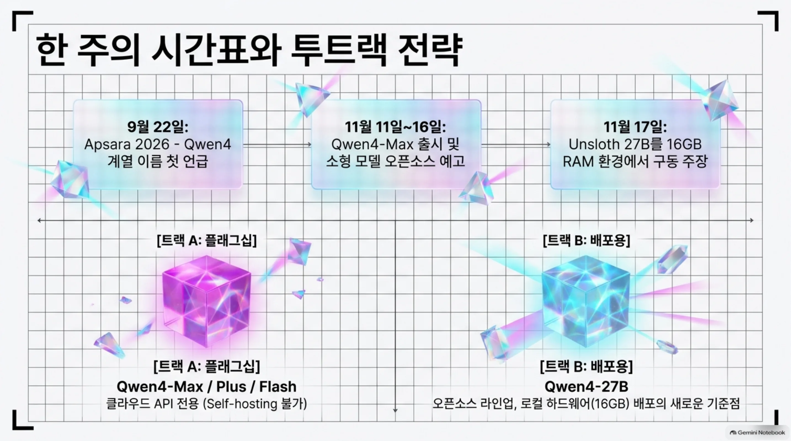
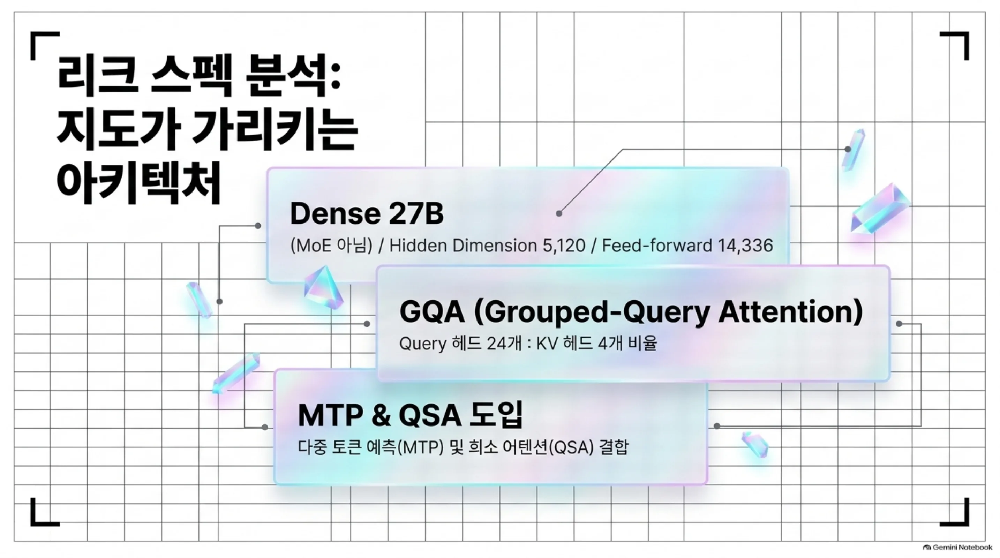
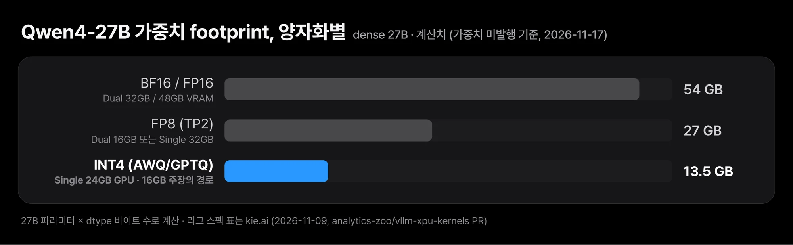
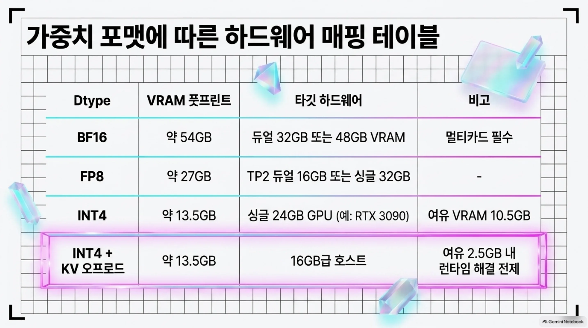
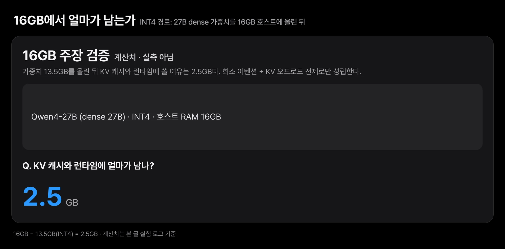
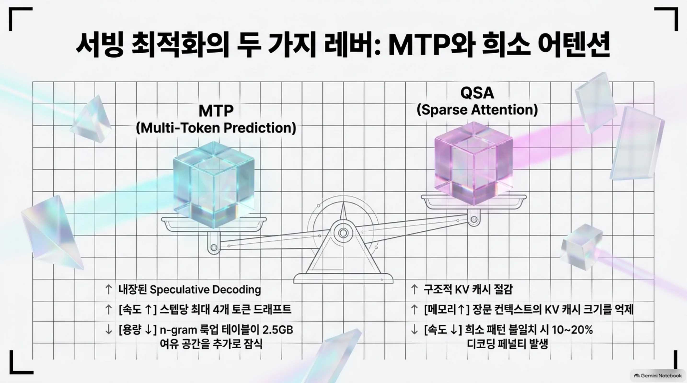
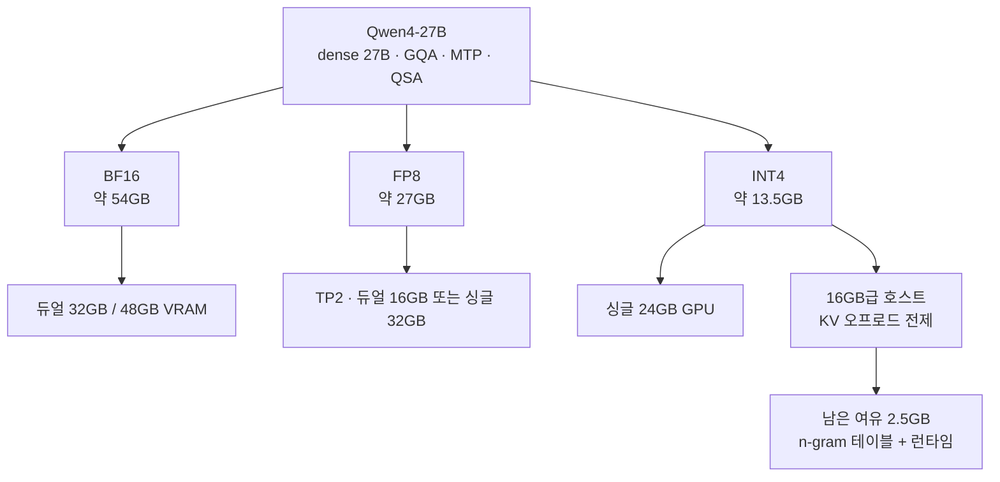
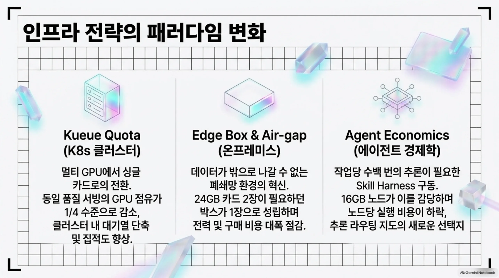

GPU 스펙이나 서빙 전략을 온프레미스·에지 환경에서 골라야 하는 인프라 엔지니어라면, 이 글은 Qwen4-27B 가중치가 떨어졌을 때 무엇을 준비해야 하는지 판단하는 데 씁니다. 11월 16일 API 전용으로 나온 Qwen4-Max, 더 작은 모델들의 오픈소스 예고 그리고 17일 Unsloth의 "16GB RAM 환경에서 돌린다"는 한 줄. 세 가지가 한 주 안에 겹쳤습니다.

16GB라는 숫자에 시선이 쏠린 이유는, 지금까지 27B급이 싱글카드에서 건드리기 어려웠던 크기이기 때문입니다. 이전 세대 Qwen3.8-27B는 BF16으로 약 54GB라 가중치만 올리려면 카드가 두 장이었습니다. 그 급을 16GB급 기계에 들어가게 하려면 무언가가 바뀌어야 하고 그 무언가는 이미 리크된 커널 풀 리퀘트 형태로 드러나 있었습니다.

결론부터 말합니다. 27B를 16GB에 넣는다는 것은 마법이 아니라 INT4 양자화와 KV 캐시를 줄이는 희소 어텐션의 결정론적 결과입니다. 바뀌는 것은 모델 능력이 아니라 배포 대상입니다. 이 글은 리크 스펙을 정리하고 메모리 산술을 다시 하며 서빙 전략에 어떤 의미가 되는지 씁니다.

## Max와 27B 사이, 한 주의 시간표

9월 22일, Apsara 2026에서 알리바바 클라우드 CTO 리우다헝은 Qwen4 계열의 이름을 언급했습니다. 27B, Max, Plus, Flash. 당시에는 스펙도 라이선스도 날짜도 없었습니다. 그 다음에 일어난 일은 한 주 안에 밀려들었습니다.

11월 11일 Max가 사전 공개되고 16일에 출시됐습니다. Max는 API 전용입니다. 가중치가 없으니 self-hosting은 없고 Qwen의 클라우드로만 들어가는 구조입니다. 그리고 출시 안내에 한 줄이 있었습니다. Qwen4 계열의 더 작은 모델들은 오픈소스로 나온다는 내용입니다. 플래그십은 API로, 작은 모델은 오픈소스로. 이 분리가 이번 주 논의의 중심입니다.

17일은 Unsloth의 게시물이었습니다. 작은 모델들이 곧 나온다고 하고 Qwen4-27B는 16GB RAM 환경에서 돌린다고 했습니다. 오픈소스 예고를 처음부터 받던 모델, 27B. 그리고 노트북이나 Apple Silicon 기계에서 떠올릴 수 있는 숫자, 16GB. 두 가지를 합치면 "27B급이 내 기계에 들어온다"는 문장이 되고 그 문장이 서빙을 하는 사람들의 표정을 바꿉니다.

계열 구조를 보면 27B의 위치가 선명해집니다. Max와 Plus와 Flash는 API 라인이고 27B가 오픈소스 라인입니다. 플래그십은 클라우드에 두고 배포 가능한 모델을 27B급에서 찾게 하는 구조입니다. 이전 세대에도 같은 형태가 있었고 그때 27B가 self-hosting의 기준점이 된 적이 있습니다. Qwen4-27B는 그 기준점을 더 작은 하드웨어로 내리겠다는 발표에 가깝습니다.

*9월 Apsara 예고, 11월 11~16일 Max 출시와 오픈소스 라인업 예고, 17일 Unsloth의 16GB 주장. 플래그십은 API 전용이고, 배포용 오픈소스 라인에 27B급이 들어가는 구조입니다.*

## 리크 스펙은 지도이지 영토가 아니다

출시 전에 스펙을 알게 된 경로는 커널 풀 리퀘트였습니다. 대상은 analytics-zoo/vllm-xpu-kernels의 PR 22, Intel의 XPU 가속 스택에 들어가는 커널입니다. kie.ai가 11월 9일에 분석을 발표했고 이 글의 스펙 숫자는 그 분석을 기반으로 합니다. 단, 공식 가중치가 아니고 벤치마크도 검증되지 않았습니다. 공사 도면에서 읽은 지도에 가깝습니다.

지도가 말하는 내용은 이렇습니다. Qwen4-27B는 dense 27B로, Mixture of Experts가 아닙니다. hidden dimension이 5,120이고 feed-forward 크기가 14,336입니다. 어텐션은 query 헤드 24개 대 key-value 헤드 4개입니다. GQA 구조입니다.

여기에 두 가지가 붙습니다. 하나는 MTP, Multi-Token Prediction으로, 한 스텝에 토큰을 4개까지 드래프트합니다. 다른 하나는 QSA Sparse Attention으로, n-gram 룩업 테이블과 짝을 이룹니다. 이 두 기능이 메모리 산술을 결정합니다. MTP는 생성을 빠르게 하지만 룩업 테이블이 용량 비용을 더합니다. 희소 어텐션은 장문 컨텍스트에서 가장 자원을 쓰는 KV 캐시를 줄입니다. kie.ai는 희소 어텐션 쪽에 10~20퍼센트 decode 페널티를 점쳤습니다. 속도 쪽과 메모리 쪽이 서로 값을 치르는 구조입니다.

한 가지 더. 5,120을 24로 나누면 213.3입니다. head dimension은 정수여야 합니다. 리크가 틀렸다고 단정할 수는 없지만, 숫자를 그대로 쓸 때가 아니라 확인된 범위에서만 읽어야 한다는 신호입니다. 그래서 이 글은 토큰당 KV 캐시 크기를 계산하지 않습니다. 리크는 리크대로 두고 파라미터 수만 산술 입력으로 씁니다.

*Dense 27B(MoE 아님), hidden 5,120, feed-forward 14,336, GQA Q24:KV4. 이 골격 위에 MTP와 QSA가 붙습니다.*

## 16GB의 산술

가중치 footprint부터 합니다. 270억 파라미터를 가중치당 바이트 수로 곱하는 것이므로 결정론적입니다. BF16이면 54GB, FP8이면 27GB, INT4이면 13.5GB입니다. 리크 표와도 일치합니다. 변수는 어느 경로를 고르느냐뿐입니다.

*같은 27B라도 dtype이 바뀌면 footprint가 4배로 벌어집니다. 16GB 주장은 가장 작은 막대, INT4 쪽에서 시작됩니다.*

리크 표는 각 경로를 하드웨어에 맵핑합니다. BF16은 듀얼 32GB나 48GB VRAM. FP8은 TP2로 듀얼 16GB나 싱글 32GB. INT4는 싱글 24GB GPU, 예로 RTX 3090. INT4에 KV를 RAM으로 올리는 변형은 24GB GPU에 64GB 호스트 RAM. 즉, Unsloth가 한 16GB라는 숫자는 이 표 안에는 없습니다. 표의 하한은 24GB GPU입니다.

*BF16은 듀얼 32/48GB VRAM, FP8은 TP2 듀얼 16GB 또는 싱글 32GB, INT4는 싱글 24GB로 맵핑됩니다. KV를 호스트 RAM으로 오프로드하는 변형은 24GB GPU + 64GB RAM입니다.*

*16GB는 가중치만으로도 13.5GB를 쓰므로, 남은 2.5GB로 KV와 런타임을 해결해야 하는 구조입니다.*

그럼 16GB는 어디에서 나온 숫자인가. yottalabs의 16일 기사가 맥락을 줍니다. Qwen3.8-27B 계보에서 4bit 가중치는 약 16GB이고 n-gram 테이블 때문에 용량이 더 커질 수 있다는 메모가 붙어 있습니다. 여기서 해석이 둘로 갈라집니다. 첫 번째 읽기는 "가중치 footprint가 16GB"입니다. 4bit 가중치 13.5GB에 MTP의 n-gram 테이블을 더하면 16GB에 육박하고 이것이 기계 전체가 아니라 가중치 쪽의 숫자라면, Unsloth의 "16GB RAM setup"은 그 가중치를 올릴 수 있는 최소 기계에 대한 약어일 수 있습니다.

두 번째 읽기는 "16GB 기계 전체"입니다. 이 읽기로 가면 산술이 성립하려면 조건이 붙습니다. 16GB에서 13.5GB를 빼면 2.5GB입니다. KV 캐시와 런타임이 그 2.5GB로 전부 해결되어야 하는 구조입니다. 24GB 카드라면 10.5GB가 남습니다. 2.5GB와 10.5GB는 전혀 다른 이야기입니다. "16GB setup"이라는 한 줄은 INT4가 전제이고 KV 캐시가 극단적으로 작아야 하며 오프로드가 병행되어야 하는 조건부 문장입니다.

두 읽기를 나란히 보면 메시지는 하나로 모입니다. 16GB는 "여유 있게 들어간다"가 아니라 "계산이 맞는 가장 작은 숫자"입니다. 산술과 리크된 기능이 이 지점에서 만납니다. 희소 어텐션과 KV 오프로드가 있으면 좋은 기능이 아니라, 16GB가 성립하는 조건입니다.

16GB급 기계가 무엇인지도 짚어둡니다. Apple Silicon의 통합 메모리 16GB, 16GB 램의 워크스테이션, 그리고 GPU 16GB를 하나 붙인 엣지 박스. 세 기계는 메모리 크기만 같지, 가용 VRAM과 오프로드 폭은 다릅니다. 통합 메모리에서는 GPU와 OS가 16GB를 나누고 엣지 박스에서는 가중치를 RAM에 두고 KV만 GPU에 올리는 오프로드가 성립합니다. 리크 표의 FP8 듀얼 16GB 경로도 같은 맥락입니다. 27GB를 16GB 카드 두 장으로 나누는 것은 이미 "16GB 카드"를 전제로 하는 레시피였습니다. INT4가 새로 여는 것은, 그 카드 한 장으로 27B급을 가져오는 길입니다.

## MTP와 희소 어텐션이 서빙에 의미하는 것

서빙 레시피가 바뀌는 지점입니다. 지금까지 27B급을 싱글카드로 가져오는 수단은 양자화 하나에 크게 의존했습니다. INT4로 가면 quality tradeoff를 감내해야 했고 그것이 레시피의 전부였습니다. 양자화 depth를 늘리면 footprint는 줄지만, 그 대가는 매번 quality로 돌아왔습니다.

Qwen4-27B는 두 번째 레버를 아키텍처 레벨에서 가져옵니다. MTP는 모델 안에 내장된 speculative decoding입니다. 스텝당 4개 드래프트, acceptance가 좋으면 한 번에 5개 토큰을 얻는 속도에 가깝습니다. 원리가 단순합니다. 짧은 n-gram 패턴은 다음 토큰을 예측하기 좋은 힌트이고 모델이 그 예측을 verify하는 비용을 치르되, 맞으면 4개를 한 번에 가져갑니다. 대가는 n-gram 테이블 용량입니다. 16GB 산술에서 그 용량은 2.5GB를 더 깎는 비용입니다.

QSA는 KV 캐시를 줄입니다. GQA의 KV 4헤드가 이미 KV를 작게 만들어 둔 위에, 희소 어텐션이 다시 한 번 접근 범위를 좁힙니다. 장문 컨텍스트에서 KV는 가중치 다음으로 큰 소비처인데, 이 레버가 그 소비를 architecture 수준에서 줄입니다. 대신 kie.ai가 점친 10~20퍼센트 decode 페널티가 붙습니다. 희소 패턴이 안 맞는 토큰에서는 dense보다 느려지는 대가입니다.

*MTP는 내장 speculative decoding으로 스텝당 최대 4개 토큰을 드래프트하고, 대가는 2.5GB의 n-gram 룩업 테이블입니다. QSA는 장문 컨텍스트의 KV 캐시를 구조적으로 줄이고, 대가는 10~20퍼센트 디코딩 페널티입니다.*

리크 표의 마지막 변형도 여기서 이해해야 합니다. INT4 더 RAM KV 캐시, 24GB GPU에 64GB 호스트 RAM. 가중치는 GPU에 두고 KV는 호스트 메모리로 보내는 오프로드 경로입니다. vLLM 쪽에서도 CPU offload는 알려진 기술입니다. 다만 KV 접근이 PCIe를 타게 되어 latency에 영향이 있고 64GB 호스트 RAM이라는 조건이 16GB급 이야기와는 다른 이야기라는 점에 유의해야 합니다. 24GB GPU를 전제로 한 레시피입니다.

두 레버를 합친 효과는 서빙 엔지니어에게 익숙한 형태로 나타납니다. runtime에서 붙이던 speculative decoding을 모델 안으로 가져오고 serving config에서 조절하던 KV를 architecture에서 줄였습니다. 레시피가 모델에 내장되는 방향으로 한 걸음 온 것입니다. 이것이 16GB 숫자를 만든 진짜 힘입니다.

*동일한 27B 가중치가 dtype 과 KV 전략에 따라 다른 하드웨어로 떨어집니다. 16GB 경로는 INT4와 오프로드가 동시에 전제인 마지막 경로입니다.*

서빙 관점의 함의는, dtype 선택이 더 이상 유일한 축이 아니라는 것입니다. 같은 INT4 가중치여도 희소 어텐션 설정과 KV 오프로드 여부, MTP acceptance rate에 따라 footprint와 속도가 달라집니다. 레시피가 환경별로 설정되어야 한다는 뜻입니다. BF16 멀티카드, FP8 듀얼, INT4 싱글, INT4 더 오프로드. 네 경로가 모두 27B급 서빙이 됩니다.

## 서빙 전략에 닿는 시사점

Metis가 K8s GPU 큐 위에서 모델을 서빙하는 구조에서, 이것은 quota 표의 변화입니다. 27B급은 지금까지 BF16 멀티 GPU, 아니면 FP8 두 카드로 잡던 급입니다. Qwen4-27B가 싱글카드 INT4 레시피를 입증하면, 같은 quality급 서빙에 쓰는 GPU 점유가 1/4, 1/8로 떨어지는 길이 열립니다. Kueue quota 계획에 싱글카드 한 줄이 생기는 것입니다. admit 되는 잡의 footprint가 작아지면, 같은 물리 자원 위에 더 많은 서빙이 올라가고 그 만큼 대기열도 짧아집니다.

더 중요한 쪽은 온프레미스와 에지입니다. 27B급이 16GB RAM에 들어간다는 것은, 그 모델을 노트북과 워크스테이션, 데이터센터 안의 한 상자에 올릴 수 있다는 뜻입니다. sovereignty와 low cost, 다키클라우드가 두 축으로 삼는 것이 고객 기기로 뻗어가는 길이 됩니다. 데이터가 밖으로 나가지 않는 환경에서 27B급을 돌린다는 것은, 그 환경 자체가 서빙 노드가 된다는 것입니다.

구체적으로 하나만 잡아봅니다. 에어갭 환경의 박스에 24GB 카드를 두 장 꽂는 것과, 한 장에 INT4로 올리는 것은 구매 비용이 다르고 전력도 다릅니다. 27B급이 싱글카드로 성립하면 그 박스의 사양표가 바뀝니다. 품질 tradeoff가 허용되는 워크로드에는 두 장이던 GPU가 한 장으로 줄고 줄어든 자리가 대기 중인 다른 서빙을 받아들이는 여유가 됩니다. 가중치가 떨어지면 먼저 볼 것은 벤치마크가 아니라, n-gram 테이블을 포함한 실제 footprint입니다. 13.5GB와 16GB의 차이가 성립 여부가 되기 때문입니다.

Paxis 쪽은 에이전트 실행의 경제학이 바뀝니다. skill harness는 한 작업당 수백 번의 추론을 만듭니다. 27B급 추론은 그동안 GPU 서버로 가야 하는 일이었습니다. 16GB급 노드가 그 급을 감당하면, 에이전트 실행의 노드당 비용이 낮아지고 추론을 어디에 둘지의 지도에 새로운 선이 생깁니다. 지금 옮기자고 하는 것이 아닙니다. 어느 급의 모델이 어디에서 도는가라는 판단 표에 한 행이 더 생긴다는 것입니다.

*Kueue quota의 멀티 GPU 점유가 싱글카드로 전환되고, 온프레미스 박스의 카드 수가 줄며, 16GB급 노드가 에이전트 추론의 노드당 비용을 담당하는 세 갈래입니다.*

## 숫자가 말하지 않는 것

한계를 정리합니다. 첫째, 아무것도 측정되지 않았습니다. 가중치도 벤치마크도 없으며 스펙은 리크된 커널 PR이고 숫자는 세 번째 기사들입니다. head geometry가 나뉘지 않는다는 점을 위에서 보았습니다. 16GB라는 주장 자체가 Unsloth의 게시물에 있고 Qwen 쪽 원본 확인은 이 시점에서는 불가능합니다.

둘째, 16GB는 24GB가 아닙니다. 산술은 2.5GB의 여유로 성립합니다. 희소 어텐션에 10~20퍼센트 decode 페널티가 있고 MTP 테이블이 용량을 더합니다. 둘이 실제로 붙는 순간 "들어간다"가 "겁니다"로 뒤집힐 수 있습니다. 그리고 MTP의 acceptance rate는 워크로드에 따라 달라집니다. 드래프트가 자주 맞지 않으면 speculative decoding은 overhead가 됩니다.

셋째, 타이밍입니다. 오픈소스 예고는 Max 출시 때 나왔지만 27B의 날짜는 없습니다. 이전 세대는 플래그십 이후 한 두 주 뒤에 27B 가중치가 나왔습니다 [추정]. 그리고 Qwen4-27B가 Qwen3.8-27B 계보와 같은 quality급이라는 것도 아직 모르는 것입니다. architecture가 바뀌었고 어텐션이 바뀌었고 학습 데이터는 알 수 없습니다. dense에서 MoE로 바뀌지 않은 것은 희소식이지만, 그것만으로 quality를 말하지는 않습니다.

## 끝으로

27B를 16GB에 넣는다는 것은 모델 발표가 아니라 레시피 발표입니다. INT4, GQA, 희소 어텐션, MTP. 각각은 이미 알려진 도구입니다. 주장이 되는 것은 이 조합이 27B급을 싱글카드 이야기로 만든다는 것입니다.

가중치가 나오기 전까지는, 이 주장을 믿어야 할 숫자가 아니라 준비해야 할 스펙으로 읽는 것이 옳습니다. 준비할 것은 세 가지입니다. INT4와 KV 오프로드 서빙 레시피, quota 표의 싱글카드 한 줄, n-gram 테이블까지 포함한 실제 footprint 측정 스크립트.

그날 체크리스트도 미리 적어둡니다. safetensors의 실제 바이트 수, n-gram 테이블이 별도 파일로 오는지, INT4 서빙 시 실측 footprint, QSA on/off decode latency 비교, MTP acceptance rate. 이 다섯 숫자가 리크의 지도를 영토로 바꿉니다. Qwen4-27B가 떨어지는 날, 리크의 산술에서 실물의 산술로 넘어가면 됩니다. 그때 서빙 전략의 진짜 논의가 시작됩니다.

출처:
- [kie.ai, Qwen4-27B Architecture Analysis (2026-11-09)](https://kie.ai/blog/qwen4-27b-architecture-analysis)
- [yottalabs, Qwen 4 27B release date, specs, hardware (2026-11-16)](https://www.yottalabs.ai/post/qwen-4-27b-release-date-specs-hardware-what-is-known-2026)
- Unsloth X 게시물 (2026-11-17, 본 큐 RT 경유, 원문 확인 불가라 주장만 인용)
