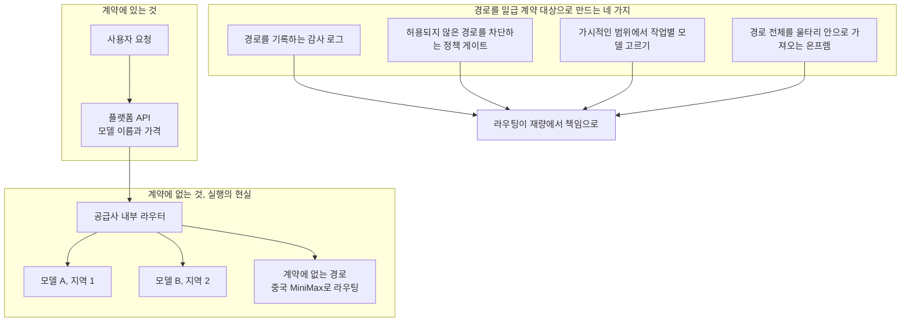

*글의 핵심 개념을 형상화했습니다.*

## 모델을 고른 건 당신, 경로는 고르지 않았다

모델은 당신이 고른 것 같습니다. 그러나 프롬프트가 지나간 경로는 당신이 고르지 않은 셈입니다. 이번 주, 그 보이지 않는 길이 계약 위반이 되었습니다.

OpenRouter 공동창업자 Alex Atallah는 여러 AI 추론 공급사가 사용자 프롬프트를 중국의 MiniMax로 직접 라우팅했다고 말했습니다. 조건은 '사용자가 그 모델을 요청했다'가 아니었습니다. 사용자가 해당 모델에 실제로 접근했는지와 무관하게 라우팅이 일어난 겁니다. OpenRouter는 이 프롬프트 라우팅이 DPA, 즉 데이터 처리 계약을 위반한 것이라고 주장합니다.

조금 풀어볼 필요가 있습니다. DPA는 공급자가 사용자에게 내미는 약속입니다. '당신의 데이터는 이런 경로에서만, 이런 목적으로만 처리된다'는 뜻입니다. 그런데 추론 레이어의 기술적 현실은 다릅니다. 공급사는 요청을 받아 내부적으로 원하는 대로 여러 모델과 백엔드로 돌립니다. 계약의 대상(데이터 흐름)과 기술의 대상(라우팅)이 별개의 것이며, 이번 사건은 그 간극에 생긴 균열입니다.

왜 공급사가 비공개 라우팅을 할 유인인지, 그 내부 구조는 여기서 단정하지 않겠습니다. 다만 분명한 것은, 라우팅이 공급사의 이윤 구조에 걸려 있으면 감사 없이는 멈추지 않는다는 것입니다. 사용자 계약에는 없고 기술 실행에는 있는 경로가 존재하는 한, 그 경로의 존재 자체를 입증할 책임은 계약상 아무에게도 부여되지 않습니다.

실무적으로 검수법은 단순합니다. AI 서비스를 계약할 때 세 가지 질문을 하십시오. 첫째, 프롬프트는 어느 모델에, 어느 지역으로 도달합니까. 둘째, 그걸 어떻게 아십니까. 셋째, 계약에 없는 경로가 발견되면 책임이 누구입니까. 첫 질문에는 흔히 모델 이름으로 답을 듣습니다. 두 번째 질문이 진짜 답이 있는 곳입니다. 세 번째 질문이 계약이 있는 곳입니다.

OpenRouter는 그 라우팅 자유를 파는 마켓플레이스 그 자체입니다. 공급사 쪽에서 DPA 위반을 공개적으로 주장했다는 사실 자체가 강한 신호입니다. 공급사가 경로를 조용히 유지했다면, 마켓플레이스 쪽에도 눈감아줄 이력이었습니다. 그들이 앞장서 나왔다는 것은, 경로 문제가 더 이상 '업계 관행'이라는 이름 아래 묻히지 않는다는 뜻입니다.

## 중개 레이어가 커진 이유

라우팅 레이어를 나쁘다고만 말하기는 어렵습니다. 라우터와 마켓플레이스가 있는 이유는 모델 시장이 어느 한 회사가 다 감당하기에는 너무 커졌기 때문입니다. 이제는 수십 개 모델을 가격과 성능으로 비교하며 신용카드 바꾸듯 바꾸는 게 일상입니다. 그 자유는 진짜이고 그 가치는 진짜입니다.

문제는 중개 레이어가 커질수록 계약과 실행 사이의 거리도 커진다는 것입니다. 과거에는 데이터 주권이 '호스팅 위치'의 문제였습니다. 서버가 어디에 있느냐. 이제는 '라우팅 경로'의 문제입니다. 같은 요청이 같은 가격에, 같은 이름으로 들어와도 뒤에서는 모델이 바뀌고 지역이 바뀌고 처리자가 바뀝니다. 사용자는 프런트만 보고 프런트 뒤의 경로는 공급사의 재량에 맡아 있습니다. '모델을 고르는 자유'와 '경로를 고르는 자유'는 다른 자유입니다.

비교할 대조 사례가 이번 주에 하나 있습니다. 테슬라는 엔드투엔드 주행 네트워크의 업데이트인 FSD v15 배포를 시작했습니다. 안전 임계 상황 처리가 25배 개선되었다는 주장도 함께 나왔습니다. FSD에는 한 가지 특이점이 있습니다. 센서 입력에서 차량 액추에이션까지, 경로의 모든 것이 자체 스택 안에 있다는 것입니다. 그 경로에 제3자 모델이 끼지 않고 라우팅도 없습니다. 그래서 '25배'라는 주장이 한 목소리로 나올 수 있습니다. 경로의 모든 것을 말하는 쪽이 테슬라이기 때문입니다. 라우터 위에 지은 API 서비스와 대조하면 차이가 바로 그것입니다. 경로를 답하는 쪽과 경로를 만든 쪽이 달라지는 순간, 책임의 주소가 모호해집니다.

## 기관은 경로 하나에 연 120만 달러를 냅니다

반대로, University of California는 OpenAI에 연간 120만 달러를 냅니다. 범위는 10개 캠퍼스, 대상은 학생과 교수, 직원입니다. 구조가 주목할 지점입니다. 공립 기관이 공급자와 계약이 명확한 형태로 폐쇄형 상용 AI를 사는 것입니다. 누가 서비스를 제공하는지, 데이터가 어디로 가는지, 누구에게 책임이 돌아가는지를 아는 상태로 계약합니다.

그리고 이 계약은 연간입니다. 경로가 바뀔 수도 있다는 것을 알면서도, 매년 이 공급사, 이 경로로 가겠다고 다시 선택하는 것입니다. 가시성에 대한 지불은 반복되는 선택입니다.

같은 논리를 거꾸로 써도 쓸 만합니다. 데이터가 귀할수록 경로를 명확하게 원하게 됩니다. 대학의 연구 데이터, 학생 기록, 내부 문서는 '이 경로에서만'이라는 말을 하고 싶은 데이터입니다. 연 120만 달러 계약은 경로 가시성에 지불한 대가라고 할 수 있습니다. 문제는 라우터를 거치는 개인과 중소기업은 그 가시성을 살 수 없다는 점입니다. 공급사 내부 라우팅은 그들에게 블랙박스이며 '경로'라는 계약 대상은 애초에 존재하지 않습니다.

## 현지 대안이 드디어 현실이 된 주

이번 주 가장 흥미로운 일은 '데이터를 내보내지 않는 대안'이 이상론에서 계산으로 넘어왔다는 것입니다.

Thinking Machines의 신모델 Inkling 2 Mini가 Hugging Face 트렌딩 1위에 올랐습니다. Qwen3.8 27B와 맞먹는 성능을 비용의 1/6에 낸다는 평가입니다. 그리고 더 중요한 일은 Unsloth의 양자화 GGUF 버전이 바로 뒤 2위에 이어 있다는 사실입니다. 로컬에서 모델을 돌리기 위한 형식인 GGUF가 함께 언급됩니다. 이번 주 가장 뜨거운 모델과 그 모델의 로컬 버전이 함께 트렌딩했다는 이야기입니다.

두 신호를 곱해서 읽어야 합니다. 비용의 1/6에 경쟁하는 소형 모델이 존재하는 순간, '왜 데이터를 바깥으로 보내는가'라는 질문에는 '그게 유일하기 때문'이라는 답이 더 이상 성립하지 않습니다. 추론 워크로드의 일정 규모 이상에서는 온프렘이나 소버린 배포가 경제적으로 성립하기 시작합니다. 예전에 데이터를 내보냈던 이유는 현지 대안이 비쌌기 때문입니다. 이제 비용 곡선이 움직였습니다. 주권의 가격이 내려가면 '할 것인가 말 것인가'의 질문은 거버넌스의 문제가 됩니다.

DPA 사태와 Inkling의 트렌딩은 같은 동전의 앞뒤입니다. 사태는 '데이터를 내보내는 값'을 드러냈고, 모델은 '내보내지 않는 값'을 보여줍니다. 대안의 값이 1/6으로 내려온 순간, 데이터를 밖으로 보낼 것인가의 질문은 아깝기 때문에 답하게 됩니다.

## 에이전트가 돈을 쓰기 시작했습니다

데이터 경로가 더 이상 이론적인 문제가 아닌 이유는, 에이전트가 이미 돈을 쓰기 시작했기 때문입니다. Stripe 데이터에 따르면 AI 에이전트를 통한 지출은 지난 한 달 사이 2배로 늘었습니다. 그리고 에이전트 상거래에서 최대 카테고리가 된 것은 여행입니다. 소프트웨어도 아니고 디지털 재화도 아닌, 실세계의 서비스입니다.

여행이 1위가 된 것은 우연이 아닙니다. 여행은 단가가 높고 행위가 반복되는 도메인입니다. 한 번의 여행에는 여러 예약, 여러 결제, 여러 변경이 들어 있고 항공권, 호텔, 음식점, 현지 교통은 각각 별도의 결제와 데이터를 가집니다. 에이전트가 반복해서 손대는 영역일수록, 각 접촉에 기록이 있어야 합니다. 일회성의 문서 생성과는 차원이 다릅니다. 항공권을 예약하는 것은 계약에 가깝습니다.

에이전트가 사용자를 대신해 예약하고 결제하고 변경하면, 사용자의 신원 정보와 결제 정보와 위치 정보는 사용자가 본 적 없는 경로를 지나갑니다. 앞의 라우팅 사건이 챗 프롬프트에서 일어났다면, 실제 결제를 수행하는 에이전트에서 같은 일이 일어나면 어떻게 되겠습니까. 계약 대상이 '데이터'를 넘어 '행위'로 넘어가는 순간입니다.

결제는 법적으로 의미가 있는 행위입니다. 사용자가 승인한 범위 안에서만 돈이 움직여야 하고, 어떤 에이전트가 어떤 결제를 어떤 경로로 처리했는지 기록이 남아야 합니다. 지출이 한 달 만에 두 배가 된 만큼, 위임 권한의 범위와 감사 추적도 함께 두 배가 되어야 합니다.

업계의 방향도 같은 이야기를 합니다. Arena의 갱신된 Alignment Index, 에이전트가 사용자 의도를 얼마나 충실히 따르는지 측정하는 벤치마크에서 OpenAI가 상위 7석을 모두 차지했습니다. 의도 충실도가 점수로 측정 가능해진다는 것은, '에이전트가 말한 대로 움직였다'는 것을 검증할 수 있다는 뜻입니다. 그러나 그 검증은 모델의 출력에서 끝나는 셈입니다. 데이터가 어디로 갔는지는 닿지 않습니다. 의도 충실도와 경로 가시성은 별개의 거버넌스 대상이며, DPA 사태는 후자가 훨씬 더 약한 지점임을 보여줍니다.

## 계약의 대상이 모델에서 경로로 이동 중

이번 주 신호를 하나로 모으면, 세 가지 사건입니다. 라우팅 사태, 기관의 연간 계약, 소형 모델의 급격한 비용 하락. 셋 다 같은 한 점을 가리키고 있습니다. AI의 신뢰 단위가 '모델'에서 '경로'로 이동하고 있는 것입니다.

모델은 바뀔 수 있습니다. 가격은 변하고 벤치마크는 변하고 가장 강한 모델의 순위는 변합니다. 경로는 다릅니다. 경로는 정해지면 기록 없이 바꿀 수 없는 대상인 셈. 프롬프트가 어디를 지나고 에이전트의 행위가 어디를 지나고 그것을 증명할 수 있는가. 이 질문들이 곧 조달과 컴플라이언스 검토의 표준 항목이 됩니다. DPA가 SaaS의 표준 항목이었던 것처럼, '라우팅 명세서'가 AI의 표준 항목이 되고 있습니다.

그 내용은 복잡하지 않습니다. 요청이 도달하는 모델 ID, 처리 지역, 개입하는 처리자 목록, 보유 기간. 이것만입니다. 지금 이 정보는 운영사 내부 문서 어딘가에 놓여 있습니다. 계약 부속물로 만들겠다는 순간, 라우팅은 '재량'에서 '책임'으로 바뀝니다.

답은 라우팅 레이어를 불신하는 것이 아닙니다. 답은 경로를 일급의 계약 대상으로 만드는 것입니다. 경로가 어디로 가는지 기록하는 감사 로그, 계약상 허용되지 않은 경로를 차단하는 정책 게이트, 가시적인 범위 안에서 작업별 모델을 고르는 라우팅, 필요하면 경로 전체를 울타리 안으로 가져오는 소버린 온프렘 배포. 이 네 가지를 갖춘 구조라면, 라우팅의 자유와 컴플라이언스의 확실성은 더 이상 적수가 아닙니다. 주권의 가격이 이번 주에 드디어 맞는 만큼, 마지막 선택지는 현실이 되었습니다.

경로의 구조를 한 장으로 다시 말합니다. 위쪽에는 플랫폼 API와 모델 이름만 있는 계약이 있고, 그 아래에는 공급사 내부 라우터와 계약에 없는 경로가 있는 실행이 있습니다. 감사 로그와 정책 게이트, 작업별 라우팅, 온프렘 배포 네 가지를 갖추면 그 숨은 경로가 계약의 대상이 됩니다.

ThakiCloud의 Agent-Native Cloud, Paxis가 설계된 역할은 바로 이것입니다. Skills, Tools, Policies, Audit Logs라는 일급 리소스와 자율도(L0~L3) 거버넌스, 정책 게이트와 감사 로그, 격리 샌드박스 실행, MCP 커넥터와 스킬 마켓, CostRouter를 통한 작업별 모델 선택. 이것들은 모두 '경로'를 보이고 다스리려는 부품입니다. 다만 더 중요한 것은, 이제 업계가 먼저 이 질문을 하고 있다는 사실입니다. 어떤 모델 서비스를 쓰든, 하나만 물어봐 주십시오.

당신의 프롬프트는 어느 경로를 지나고 있습니까. 그리고 그것을 증명할 수 있습니까.

## 참고 자료

이 글은 아래 뉴스를 종합해 작성했습니다.

- HuggingNews, [Thinking Machines' Inkling 2 Mini Matches Qwen3.8 27B at One Sixth the Cost, Tops Hugging Face](https://huggingnews.com/ai/thinking-machines-inkling-2-mini-matches-qwen38-27b-at-one-sixth-the-cos-96c2e140)
- HuggingNews, [OpenRouter Says AI Providers Violated DPAs by Routing Prompts to MiniMax](https://huggingnews.com/ai/openrouter-says-ai-providers-violated-dpas-by-routing-prompts-to-minimax-cdc0a820)
- HuggingNews, [Tesla FSD v15 Rollout Claims 25x Improvement in Safety Critical Cases](https://huggingnews.com/ai/tesla-fsd-v15-rollout-claims-25x-improvement-in-safety-critical-cases-693c67f8)
- HuggingNews, [OpenAI Sweeps Top 7 Spots in Arena's Updated Alignment Index](https://huggingnews.com/ai/update-openai-sweeps-top-7-spots-in-arenas-updated-alignment-index-909335ab)
- HuggingNews, [University of California to Pay OpenAI $1.2M a Year for AI Tools Across 10 Campuses](https://huggingnews.com/ai/university-of-california-to-pay-openai-12m-a-year-for-ai-tools-across-10-ee2d61fd)
- HuggingNews, [AI Agent Spending Doubled in Last Month as Travel Becomes Top Category](https://huggingnews.com/ai/ai-agent-spending-doubled-in-last-month-as-travel-becomes-top-category-8b0cbc0e)