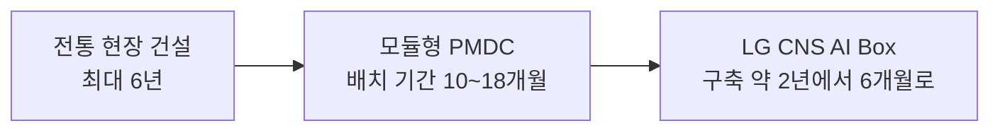

10월 둘째 주 AI 업계에서 '한 달'이 가격표를 달았습니다. 연합뉴스 보도에 따르면, 앤트로픽이 활용하는 미국 루이지애나주 245메가와트급 데이터센터가 계획보다 한 달 일찍 가동되면 13억 달러, 우리 돈 약 1조8천억 원의 추가 매출이 생긴다는 추산이 나왔습니다. 조기 가동은 더 이상 경영진의 근성 문제가 아닌 셈입니다. 손익계산서에 직접 찍히는 숫자가 되었습니다.

*글의 핵심 개념을 형상화했습니다.*

오늘 아침 뉴스에는 같은 질문이 여러 번 등장합니다. 언제 스위치를 켤 것인가. 앤트로픽은 다음 달 기업공개(IPO)를 앞두고 서버를 최대한 빨리 돌리는 전략을 취하고 있습니다. 삼성과 LG는 데이터센터의 조립 시간을 줄이는 데 혈안인 셈입니다. SK하이닉스는 30년 뒤의 세수로 2028년 하반기 가동이라는 시간표를 고정했습니다. 용량의 전쟁이 시간의 전쟁으로 넘어가는 구간의 단면입니다.

## 왜 시간이 돈이 됐나

답은 추론이라는 사업 모델에 있는 것입니다. 연합뉴스가 정리한 앤트로픽의 숫자부터 보겠습니다. 네오클라우드 기업 아이렌과 다년 계약을 포함해, AWS와 구글 등 10곳이 넘는 클라우드와 15기가와트(GW), 5천300억 달러(약 720조원) 규모 데이터센터 임차 계약을 맺은 상태입니다. 컴퓨팅 용량은 지난해 1.4GW에서 올해 5GW, 내년 9.5GW, 2028년 15GW 이상으로 늘 전망입니다.

이 확장은 학습 시대의 재고 경쟁과 성격이 다릅니다. 서버는 가동 중에는 매 순간 매출이 되고 꺼져 있는 동안은 가치가 없습니다. 에너지 분석업체 로열파워스 에너지는 AI 추론용 데이터센터가 메가와트시당 5천631달러의 전기료를 내도 수익이 난다고 분석했습니다. 인프라 자문업체 오컴엣지는 앤트로픽이 루이지애나 시설의 칩을 빌리느라 매달 약 2억 달러를 쓰더라도, 추론 전용으로 돌리면 매출총이익률 85%가 가능하다고 추산했습니다.

결과는 이미 뒤집혔습니다. 앤트로픽은 지난해 봄 매출 1달러당 2.3달러를 운영비로 쓰던 회사가, 올해 2분기 소폭 흑자로 돌아섰습니다. IPO를 코앞에 둔 회사에게 한 달은 배당과도 같습니다. 흐름을 파는 사업에서는, 시계가 곧 원단입니다.

## 달을 압축해 파는 사람들

같은 시간 논리는 건설 현장에도 들어갔습니다. 직썰은 이번 주 삼성과 LG의 모듈형 데이터센터(PMDC) 속도전을 다뤘습니다. 방향은 명확합니다. 현장에서 순서대로 지어오던 방식을, 공장에서 미리 제작하고 검증한 뒤 현장에 조립하는 방식으로 바꿉니다. 버티브(Vertiv)는 PMDC 배치 기간을 10~18개월로 제시했고 전통 방식은 최대 6년까지 갑니다. 하나증권 분석에 따르면 기존 데이터센터 프로젝트의 90%가 일정 지연을 겪고, 초대형은 평균 20개월 늦어진다고 합니다. 이 시장에서는 20개월이 지연이 아니라 평균입니다.

그 평균을 부수는 것이 모듈입니다. LG CNS는 컨테이너 1대에 GPU 576장과 1.2메가와트를 담은 'AI Box'를 공개하며 구축 기간을 약 2년에서 6개월로 줄였습니다. 삼성물산은 춘천 삼성SDS 부지에 2.4메가와트 모듈형 AIDC를 짓고 삼성SDS는 2031년까지 AI 데이터센터에 5조원을 투자하고 구미에서 2029년 60메가와트에 이어 2031년 추가로 60메가와트를 단계 증설하는 계획을 세웠습니다. 이들은 압축된 달을 파는 사람들입니다.

구축 기간 축으로 이 속도전을 정리하면 이렇습니다.

속도전의 외곽은 넓습니다. 같은 보도들에는 KT클라우드의 청라 50메가와트 AIDC, 엘리스그룹의 IPO 청약 증거금 10조원 돌파, SK텔레콤과 LG유플러스의 파트너십 결성까지 들어 있습니다. 삼성과 LG만의 경쟁 구도가 아닙니다. 국제에너지기구(IEA) 전망처럼 세계 데이터센터 전력 소비가 2024년 415TWh에서 2030년 약 945TWh로 2배 이상 뛰는 판국에서는, 조립 속도보다 부지와 인허가, 전력 계통연계가 실제 병목이 됩니다. 그래서 '시간'을 파는 장사가 커지는 것입니다.

소프트웨어 쪽에서는 시간이 또 다른 형태로 사고받습니다. 이투데이 보도에 따르면 아마존은 서로 다른 AI 칩 사이에서 개발자가 부하를 쉽게 옮기게 하는 소프트웨어를 만든 데카트를 약 70억 달러(약 9조4천억 원)에 인수하는 협상을 벌이고 있습니다. 데카트는 세쿼이아와 벤치마크, 래디컬벤처스 등으로부터 4억 달러 이상을 유치했고 올해 5월 기업가치가 약 40억 달러였습니다. 아마존은 자체 AI 칩 트레이니엄3으로 엔비디아와 경쟁 중입니다. 이동 시간 자체를 사들이는 거래입니다.

## 30년을 내놓는 사람들

시간을 사기에 30년을 건 사람도 있습니다. 더투데이 단독 보도에 따르면, SK하이닉스 미국 인디애나 웨스트라피엣 공장의 혁신개발지구 세수 배분 협약안이 시의회에서 찬성 8, 반대 1로 가결됐습니다. 지역 몫을 법정 12%에서 20%로 끌어올린 대가입니다. 30년간 약 5억 달러(약 6천717억 원)의 세수가 지역으로 유입되고 일회성 기반시설 배분금은 4500만 달러입니다.

이곳은 웨이퍼 전공정 팹이 아니라, AI 가속기에 필수인 차세대 HBM을 완성하는 고급 패키징 라인과 퍼듀대 연계 R&D 센터로 구성됩니다. 총 38억 7천만 달러(약 5조2천억 원)가 투입되는 미국 내 첫 HBM 패키징 기지입니다. 가동 목표는 2028년 하반기이고 연방 정부 최대 4억 5800만 달러와 주 최대 7억 1218만 달러 보조금, 하수 처리 능력 42.9% 증설까지 얹힌 다층 구조입니다. 반도체 기업 하나가 한 도시와 30년의 계약을 맺을 수 있게 된 시점입니다.

시간의 창구 앞에서 줄을 서는 사람들도 있습니다. 리사 수 AMD 회장은 방한해 국산 NPU와 소프트웨어, 클라우드 기업 13~14곳과 자사 CPU, GPU를 결합한 이기종 AI 인프라 구축을 예고했습니다. 7월 과학기술정보통신부 협약의 후속 조치로 추진되는 내용입니다. 아이뉴스24는 엔비디아와 AMD의 최고경영자가 7개월에서 1년 사이 잇달아 한국을 찾았다고 보도했습니다.

지디넷코리아가 소개한 가트너 보고서는 이 모든 거래를 하나의 도면으로 묶습니다. 2029년까지 독자 소버린 AI 체계를 구축하는 국가는 GPU와 전력, 냉각, 네트워크를 포함한 AI 인프라에 GDP의 최소 1%를 투자할 전망입니다. 데이터센터 전력 소비 비중은 북미가 2025년 3.7%에서 2030년 7.3%로, 유럽은 2.7%에서 5.0%로 늘어납니다. 2030년 글로벌 AI 클라우드 시장 2천670억 달러 가운데 네오클라우드가 약 530억 달러, 20%를 차지할 것으로 보입니다. 가트너는 완전한 독립은 어렵다며 민감 업무는 지역 인프라에서, 나머지는 외부 클라우드에서 다루는 혼합 전략을 권고합니다.

## 차가 빠를수록 브레이크가 커진다

컴퓨트가 빨라지는 동안, 그 위에 오르는 행위 주체의 문제는 따로 진행됐습니다. 디지털투데이 보도에 따르면 마이크로소프트 사티아 나델라 CEO는 모델 바깥의 결정론적 통제를 주창했습니다. 지능의 공급과 지능을 부리는 권한을 분리하고 모델을 조율하는 하네스(harness)와 행동 공간을 모델 밖의 결정론적 통제장치로 두자고 합니다. 모델 다양성, 전체 관찰, 검증 가능성, 독립 통제, 독립 감사, 격리(비상 브레이크), 사고 공개까지 7가지 설계 원칙을 제시했고 사고 과정 공개는 양보 불가 조건으로 못 박았습니다. 국내에서도 같은 방향의 움직임이 있습니다. ISMS-P에 AI 거버넌스 관련 통제 항목이 신설되고 엔터프라이즈 AI 에이전트 보안 리스크 대응 수요가 커지는 흐름입니다. 모델 공급사의 보증이 아니라, 운영 주체 자체의 통제와 감사 능력이 도입의 관문으로 올라선다는 뜻입니다.

현장의 속도는 이 논의를 앞섭니다. 이투데이 보도에 따르면 메타는 은행과 카드 계좌를 잇는 개인용 에이전트 '뮤즈(Muse)'를 출시했습니다. 플레이드(Plaid)를 연동해 지출 분석, 예산 관리, 구독 해지 대행까지 맡습니다. 오픈AI의 챗GPT 개인재무 기능은 월 2억 명이 넘는 사용자에게 상담을 제공하고 있다고 합니다. 같은 보도는 아마존이 사전 승인 없는 AI 접근을 이용약관 위반으로 간주해 메타의 뮤즈 접근을 차단했다고 전했습니다. 기계 대 기계, 문지기 자리를 둘러싼 첫 분쟁입니다. 맥킨지 설문에서는 은행이 자체 AI를 제공하지 않을 때 제3자 AI 금융 에이전트를 쓰겠다는 고객이 57%였습니다.

브릿지경제 보도에 따르면 뮤즈는 프롬프트 인젝션 방어가 아직 해결되지 않았다고 인정했고, 로그인 정보가 서비스 운영과 보안 목적으로 메타에 닿을 수 있는 구조를 밝혔습니다. 쿠팡과 네이버 같은 대형 플랫폼이 해킹당하면 수백만에서 수천만 명이 동시에 영향을 받고, 피해는 쇼핑을 넘어 결제와 배달, 메신저로 번질 수 있다고 합니다. 에이전트가 결제까지 수행하는 구조에서는, 이 사슬이 한결 더 짧아집니다. 개인정보보호위원회는 에이전틱 AI의 개인정보 처리 기준을 연내 공개할 안내서로 정리 중이고, 보안업계는 치명적 오류 시 즉시 차단하는 킬 스위치의 법제화가 시급하다고 지적합니다.

그 한가운데서 국내 은행권의 답은 0.9%입니다. 머니투데이 보도에 따르면 5대 은행의 AI 보안 투자는 221억 원으로, 전체 IT 예산 2조 3580억 원의 약 0.9%에 그쳤습니다. 구성도 한쪽으로 쏠립니다. 내부자 이상행위탐지(UEBA)가 52%를 차지하고 외부침입 관제(SOC 19%, FDS 5%)는 4분의 1을 못 미칩니다. 금융사 7곳은 올해 정보보호 예산을 20% 안팎으로 삭감했고 지난해 평균 집행률은 69.6%뿐이었습니다. 반면 미국 CISO 500명 중 69%는 내년 AI 보안 지출을 늘리려 한다고 합니다. 공격은 이미 에이전트화됐습니다. 방어나 예산 회의실에 있습니다. 속도가 자산이 되는 곳과 부채가 되는 곳이, 같은 시계 위에서 반대 방향으로 움직이고 있습니다.

## 스위치가 켜지는 순간, 일은 시작돼야 한다

이 모든 숫자를 기업 입장에서 보면 첫 질문은 한곳으로 수렴합니다. 컴퓨트가 더 빨리, 더 싸게 도착할 때, 내 에이전트는 그때 일할 준비가 되어 있는가. 시간 경쟁은 실행의 문턱을 낮춥니다. 문제는 문턱을 넘은 뒤에 생깁니다. 어느 권한으로, 어디에서, 어떤 모델로, 누가 검수하고 언제 멈추는가. 이 다섯 가지는 오늘 뉴스에서 빠지지 않던 항목, 감사와 주권, 안전한 실행, 비용입니다.

ThakiCloud의 에이전트 네이티브 클라우드 Paxis는 바로 이 질문에 대한 하나의 답으로 설계된 정식 제품(v1.1 GA)입니다. Paxis에서는 스킬, 도구, 정책, 감사 로그가 일급 리소스로 관리됩니다. 자율도 L0부터 L3까지 단계별로 거버넌스를 적용하고 실행 전 정책 게이트가 권한을 점검하며 에이전트의 모든 행위는 격리된 샌드박스 안에서 실행돼 감사 로그로 남습니다. MCP 커넥터와 스킬 마켓은 에이전트와 외부 시스템을 잇는 레일을 제공하고, 소버린·온프렘 K8s(ai-platform)는 데이터가 나가지 않는 실행 환경을, 작업별 모델 선택 CostRouter는 어떤 모델로 어느 작업을 돌리느냐를 비용 계산에 연결합니다.

오늘의 뉴스는 이 역량 하나하나에 대응합니다. 나델라의 독립 감사와 격리 원칙, 킬 스위치 논의는 정책 게이트와 샌드박스의 문제입니다. 가트너의 민감 업무는 지역 인프라에서라는 권고는 온프레미스 실행의 문제입니다. 메가와트시당 5천631달러가 기준점인 추론 경제학은 작업별 모델 라우팅의 문제입니다. 문지기 자리를 둘러싼 첫 분쟁은, 에이전트가 어떤 실행 레일 위에서 어떤 권한 범위 안에서 움직이느냐의 문제입니다.

한 달은 1.8조원이었습니다. 기업에게 남은 과제는 그 가격이 매겨지는 시계에서 뒤처지지 않는 일입니다. 컴퓨트가 도착하는 속도로 통제와 감사까지 도착해 있을 때, 비로소 시간은 자산이 됩니다.

## 참고 자료

이 글은 아래 뉴스를 종합해 작성했습니다.

- 이투데이, [AI 에이전트, 금융의 '문지기' 자처하다 [AI에 내 지갑 맡긴다 ①]](https://www.etoday.co.kr/news/view/2634344)
- 디지털투데이, [마이크로소프트 CEO, 왜 모델 밖에서 AI 에이전트 통제해야 하나](https://www.digitaltoday.co.kr/news/articleView.html?idxno=706241)
- 연합뉴스, ["앤트로픽, 아이렌과 클라우드 계약"…데이터센터 확보 속도전](https://www.yna.co.kr/view/AKR20261012008300009?input=1195m)
- 디지털데일리, [[주간 클라우드 동향/10월 ②] "韓 기업과 새 기회 만들 것"… AMD, 국산 GPU·서버사와 협력](https://www.ddaily.co.kr/page/view/2026101114021524265)
- 직썰, ["AI 데이터센터, 공장에서 찍어낸다"…삼성·LG, 모듈형 속도전 격돌](https://www.ziksir.com/news/articleView.html?idxno=148390)
- 더투데이, [[단독] SK하이닉스 美 인디애나 공장, 30년간 지역 세수 6700억 낸다](https://www.the-today.com/news/articleView.html?idxno=91531)
- 아이뉴스24, [젠슨 황 이어 리사 수도 한국行…두 AI 거물이 찾는 것은](http://www.inews24.com/view/2013436)
- 지디넷코리아, ["AI 주권에 GDP 1% 투자 필요…핵심은 GPU·전력 확보"](https://zdnet.co.kr/view/?no=20261010210944)
- 이투데이, ["아마존, 데카트 70억 달러에 인수 협상 중"](https://www.etoday.co.kr/news/view/2634383)
- 머니투데이, [AI 해킹 비상 은행권, 보안 예산 고작 0.9%](https://www.mt.co.kr/finance/2026-10-12/2026101119473034667)
- 브릿지경제, [[막 오른 AI 쇼핑 주도권 전쟁③] 이커머스, 쇼핑 에이전트 보안 '비상'](https://www.viva100.com/article/20261008500815)
