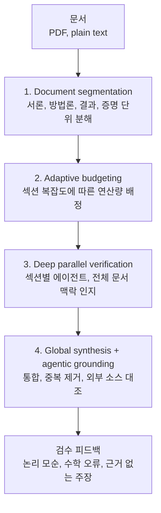

## 왜 읽어야 하나

ML 논문을 제출하거나 기술 문서를 검토하는 분을 위한 글입니다. 판단은 하나, 제출 전에 AI 리뷰 단계를 도입할 것인지 여부입니다. Google Research가 2026년 10월 14일 Deep Review를 출시했는데, 이는 논문과 디자인 문서, 복잡한 제안서를 스트레스 테스트하는 에이전틱 시스템입니다. STOC 2026, ICML 2026, NeurIPS 2026, ICLR 2027 네 회의에서 16,000개 이상 원고에 제출 전 피드백을 제공한 이력이 있고, 이제 누구나 주간 2회 무료 리뷰를 받을 수 있습니다. 제출 전 검토가 연구 문화의 관행이 아니라 표준 인프라로 변하고 있다는 신호입니다.

## 쉽게 말하면

공장 검수소를 생각해 보십시오. 제품, 여기서는 원고,이 먼저 부품, 즉 섹션으로 분해됩니다. 부품을 다룬 작업자가 각 부위의 난이도에 따라 검수량을 배정받는데, 증명 같은 치밀한 부위는 더 오래 봅니다. 각 부품은 개별 검수대에 올라 병렬로 검수를 받고, 마지막으로 총괄 검수장이 발견 사항을 합치고 중복을 빼며, 외부 기준, 여기서는 웹 검색으로 찾은 소스,와 대조합니다. Deep Review는 원고에 이 검수소를 돌리는 시스템이며, 잡아야 할 결함은 분해해서만 드러나는 것, 즉 논리적 모순, 수학 오류, 근거 없는 주장입니다.

## 개요

Deep Review는 2026년 10월 14일 [Google Research 공식 블로그](https://research.google/blog/analyzing-technical-documents-with-deep-review/)에 공개되었습니다. 복잡한 문서에 엄밀한 피드백과 기술 검증을 제공하도록 설계된 에이전틱 AI 시스템이라는 것이 공식 설명입니다. 내부에서 옵트인으로 운영되어 온 Paper Assistant Tool, PAT,의 발전형이며, 이번 출시로 서비스가 모든 사용자에게 열렸습니다.

대상 문서는 넓습니다. 초기 입력은 PDF와 plain text이고, 다중 파일 입력은 곧 지원 예정이라고 합니다. Google Docs와 프레젠테이션 파일로 확장 중이며, 과학 논문 외에 디자인 문서, 슬라이드 덱, 법적 계약, 금융 자료가 사용 사례로 나옵니다.

## Deep Review가 무엇인가: 4단계 파이프라인

Deep Review의 핵심은 에이전트 4단 구조입니다.

첫 단계, Document segmentation이 문서를 서론, 방법론, 실험 결과, 증명 같은 단위로 분해합니다. 두 단계, Adaptive budgeting이 섹션별 복잡도에 따라 연산량을 배정합니다. 증명처럼 치밀한 섹션에 더 많은 thinking time이 돌아갑니다. 세 단계, Deep parallel verification에서 개별 에이전트가 섹션별로 병렬 검증에 들어갑니다. 각 에이전트는 자기 섹션뿐 아니라 전체 문서 맥락도 인지한 채 봅니다. 네 단계, Global synthesis and agentic grounding에서 최종 에이전트가 발견 사항을 통합하고 중복을 제거하며, 웹 검색으로 외부 소스에 맞춰 주장을 검증합니다.

문서를 요약하는 도구와 구별되는 지점은 검증이 목적이라는 것입니다. 논리적 모순과 수학 오류, 소스로 지지되지 않는 주장을 찾아내는 것이 일이고, 마지막 단계에서 실제로 웹 검색을 돌려 외부 근거와 대조합니다. 문서 내부 일관성에서 끝나지 않는 구조입니다.

## 파일럿 성과와 시장 맥락

출시 전, 이 서비스는 PAT 이름으로 네 컨퍼런스의 옵트인 저자들에게 제출 전 피드백을 제공했습니다. STOC 2026, ICML 2026, NeurIPS 2026, ICLR 2027, 규모는 16,000개 이상 원고입니다.

블로그는 제출 성장도 함께 언급합니다. AI 관련 세 컨퍼런스의 제출 수는 74,000개를 넘었는데, 2025년 45,000, 2024년 32,000, 2023년 23,000에서 늘어난 값입니다.제출이 늘면 검토자가 원고 하나에 쓸 수 있는 시간이 줄고, 제출 전 결함 탐지의 가치는 저자에게 커집니다. 연구자 입장에서 계산은 단순합니다. 최상위 컨퍼런스에 제출하면 수명의 인간 검토자가 원고를 보는데, 한 명당 쓸 수 있는 시간이 한계가 있습니다. 자동 검증이 수학 오류와 논리 모순을 제출 전에 잡아내는 것이라면, 데스크 리젝트의 비용에 비해서 낮은 비용의 투자입니다. 16,000개 이상의 저자가 옵트인으로 참여했다는 사실은 이 계산이 이미 작동한다는 증거입니다. 논문의 양과 자동화된 제출 전 점검의 확산은 서로를 강화하는 방향입니다.

## 어떻게 쓰나

모든 사용자가 서비스를 쓸 수 있고, 주간 2회의 무료 문서 리뷰가 주어집니다. 그 이상을 쓰거나 프로그램으로 접근하려면 Gemini API 키로 Deep Review API를 이용합니다. 제출한 파일은 사용자 표시를 위해 1년간 보관된다고 하며, 문서 보유 기간이 민감한 팀은 이 사용 조건을 확인해 두어야 합니다.

가장 이득이 큰 문서는 증명이 짙고 인용이 많은 논문입니다. 섹션이 càng 어려울수록 연산량이 많이 배정되는 적응적 예산 구조가 정확히 이 유형을 선호합니다. 반대로 창의적인 글이나 가벼운 기술 블로그 포스트는 이득이 제한적입니다. 주간 2회라는 예산이 있다면, 제출이 임박한 문서에 쓰는 것이 순리입니다.

## ThakiCloud 제품 적용 시사점

### Paxis (Agent-Native Cloud)

Deep Review의 4단계는 그대로 Paxis가 돌리는 DAG입니다. 분할, 예산 배정, 병렬 검증, 종합의 순서에 의존성이 있고, 병렬 검증 단계는 fan-out 형태입니다. 같은 구조로 문서 검증 에이전트를 Paxis 위에 올리면, 검증 결과와 그 근거, 어떤 섹션을, 어떤 에이전트가, 어떤 외부 소스로 대조했는지를 감사 로그로 남길 수 있습니다. 리뷰가 일회성 산출물이 아니라 플랫폼의 일급 리소스가 되는 형태입니다.

사내 논문 리뷰 파이프라인, paper-review과 feynman-peer-review 계열은 현재 전체를 관통해서 읽는 단일 에이전트 구조에 가깝습니다. Deep Review와 차이는 섹션별 병렬 검증과 외부 grounding입니다. 사내 리뷰 에이전트에 이 두 가지를 이식하면, 속도뿐 아니라 품질 면에서 기대할 수 있습니다. 에이전트마다 가장 치밀한 섹션에 집중할 수 있어, 수학 오류 같은 미세 결함의 탐지율이 올라갈 여지가 있습니다.

4단계를 실행 그래프로 보면 병렬 검증은 fan-out이고 병목은 마지막 종합 단계입니다. 섹션별 발견을 하나의 피드백으로 합치고 외부 소스와 대조하는 작업이 병렬 부분보다 느리면, 전체 지연은 종합 에이전트가 결정합니다. Paxis의 DAG 실행에서도 같은 운영 원리가 작동합니다. 종합 단계에 충분한 예산을 배정하는 것이 병렬 에이전트 구조의 지연을 줄이는 방법입니다.

### ai-platform (Metis 서빙)

서빙 측면 시사점은 크지 않습니다. Deep Review는 관리형 서비스이고 오픈 웨이트 버전이 없어, 직접 추론 비용 계산을 할 수 없습니다. 다만 동시 에이전트가 많고 각자가 전체 문서 컨텍스트를 유지하는 워크로드 형태는, 서빙 플랫폼에서 멀티테넌트 컨텍스트 관리와 비용 배정이 중요해지는 전형적인 케이스입니다.

## 한계 및 반론

첫째, 폐쇄형 서비스입니다. 오픈 웨이트 공개나 self-hosting 옵션이 없고, 검증 품질은 Google의 모델에 전적으로 의존합니다. 데이터 주권이 요구되는 고객에게는 문서가 외부 서비스로 올라가고 1년간 보관된다는 점이 가장 큰 걸림돌입니다.

둘째, 초기 포맷이 PDF와 plain text뿐입니다. 다중 파일 입력은 예정이고, 디자인 문서와 프레젠테이션의 지원 범위도 확장 중이라는 표현입니다. 문서는 여러 파일과 링크에 흩어져 있는 팀에게는 전체를 한 번에 담을 수 있는 시점까지 기다려야 합니다.

셋째, 논문 수용에 미친 효과가 공개되지 않았습니다. 16,000개 이상 원고에 피드백을 제공했다는 사실은 알고 있지만, 그 사전 점검이 결함을 실제로 찾아냈고 제출 결과에 반영되었는지는 공지에서 확인되지 않습니다. 측정 가능해지기 전까지는, 존재하는 검수소라는 정도로 받아들이는 것이 정확합니다.

## 정리

Deep Review는 분해하고, 검수량을 배정하고, 병렬로 검수하고, 외부와 대조한다는 에이전틱 구조를 제출 전 리뷰에 올렸습니다. 네 메이저 컨퍼런스의 16,000개 이상 원고에서 이미 운영되었고, 이제 누구나 주간 2회 무료로 받을 수 있다는 사실은 제출 전 리뷰가 표준 인프라가 되고 있다는 뜻입니다. 독자에게는 가장 즉각적인 행동이 하나 있습니다. 곧 제출할 원고를 이번 주 무료 2회로 돌려 보는 것입니다. 저희에게는 사내 리뷰 에이전트를 섹션별 병렬 검증과 외부 grounding으로 재설계할 때의 참고 설계입니다.

## 참고 자료

- Google Research, [Analyzing technical documents with Deep Review](https://research.google/blog/analyzing-technical-documents-with-deep-review/)
- Google 공식 X 계정(NewsFromGoogle)의 Deep Review 출시 공지
