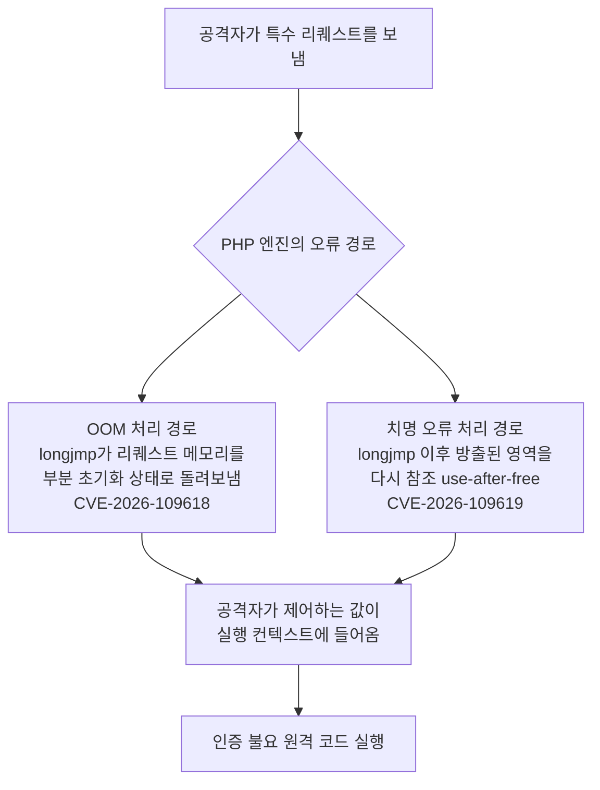
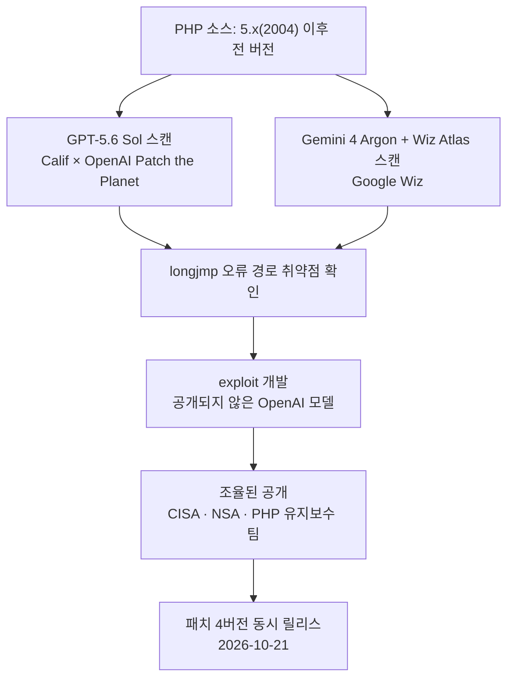

*PHP2Shell이 수면 위에 올린 것은 두 개의 CVE에 불과합니다. OpenAI는 이미 손에 쥔 것이 더 있고, 앞으로 급증할 것이라고 말합니다.*

## 왜 읽어야 하나

PHP 스택을 운영 중인 보안·운영 엔지니어, 그리고 "LLM의 보안 역량이 이제 어디까지 왔나"를 판단의 근거로 삼아야 하는 플랫폼 엔지니어를 위해 씁니다. 한 줄로 결론을 앞당기면, LLM은 이제 "알고 있는 버그 패턴을 찾아주는 도구"가 아니라 "사람이 22년 동안 놓아둔 기습 취약점을 실제로 팠다"는 첫 실증 사례를 냈고, 그 대상이 바로 인터넷의 약 70%를 지탱하는 PHP였습니다. 운영자라면 패치 여부를 오늘 확인해야 하고, 플랫폼 엔지니어라면 "AI로 코드를 읽는 행위"를 공격과 방어 양쪽에 놓고 다시 계산해야 합니다.

## 쉽게 말하면

2004년에 지은 오래된 아파트의 배관이라고 상상해 보세요. 주 물줄기는 22년째 매일 수백만 번 열리고 닫히며, 그 때문에 누구보다 잘 정비되어 있습니다. 반면 화재 때에나 열릴 비상수밸브는 한 번도 열려 본 적 없어 내부가 녹슨 채로 방치되어 왔습니다. 사람이 배관을 점검할 때는 주 물줄기를 봅니다. LLM은 다릅니다. "이 밸브는 22년째 한 번도 열려 본 적 없다"는 사실 자체가 의심의 대상이 되어, 비상경로를 한 개인 한 개인 전부 열어 봅니다. PHP2Shell은 그렇게 열린 비상수밸브, 즉 longjmp로 돌아가는 오류 경로에서 터진 것입니다.

## 개요

2026년 10월 21일, PHP 유지보수 팀이 8.2.35, 8.3.36, 8.4.27, 8.5.12 네 버전을 동시에 내놓았습니다. CISA가 긴급 권고에 넣은 두 취약점, CVE-2026-109618과 CVE-2026-109619의 패치였습니다. 두 CVE 모두 longjmp라는 C 언어의 비정상 제어전환 함수가 지나는 오류 경로를 타면서, 인증 없이 원격 코드 실행(RCE)에 이르는 경로가 됩니다. CVSS v4.0 기준으로 둘 다 9.2, 즉 Critical입니다.

사건의 핵심은 패치 자체보다 발견의 경로입니다. 보안 기업 Calif가 OpenAI의 Patch the Planet 이니셔티브에 참여해 GPT-5.6 Sol로 이 취약점을 초기 발견했고, exploit 개발은 공개되지 않은 다른 OpenAI 모델로 진행됐습니다. 그와 별개로 Google의 보안 자회사 Wiz도 Gemini 4 Argon과 Wiz Atlas로 같은 취약점을 독립적으로 찾아냈습니다. 두 조직, 두 모델이 같은 구멍을 뚫은 셈입니다. 이 수렴 자체가 이번 사건의 가장 주목할 만한 부분입니다.

발견된 구멍의 나이는 22년입니다. PHP 5.x가 2004년에 나온 이래 줄곧 존재해 왔습니다. 영향 범위는 "5 이후 전부"라고 보면 되고, EOL인 5.4부터 8.1까지는 패치가 없으므로 마이그레이션으로 넘어가야 합니다. 인터넷의 약 70%가 PHP로 동작한다는 통계를 감안하면, WordPress와 Drupal을 쓰는 조직부터 영향권에 들어 있습니다.

## PHP2Shell은 무엇인가

이름은 네덜란드 NCSC가 붙인 것입니다. "PHP to Shell", PHP로 쉘을 얻는다는 뜻이지요. 메커니즘은 두 CVE를 하나의 뿌리로 봅니다. PHP의 엔진이 치명적인 상황에 빠지면 longjmp를 호출해 이전 컨텍스트로 "돌아 갑니다". 정상적인 C 코어에서는 드물지만, longjmp가 지나가는 경로상에서 할당이 끝나지 않은 상태, 즉 메모리의 일부만 초기화된 상태로 컨트롤이 돌아오면 그 나머지 영역은 공격자가 제어할 수 있는 값으로 채워져 있습니다.

CVE-2026-109618은 OOM, 즉 메모리 부족 처리 경로에서 발생합니다. 리퀘스트 메모리가 부분 초기화된 상태로 longjmp를 통해 돌아옵니다. CVE-2026-109619는 치명 오류 처리 경로에서 잡힙니다. longjmp 이후 이미 방출된 영역을 다시 참조하는 use-after-free입니다. 둘 다 외부에서 요청 하나로 진입할 수 있으며, 인증은 필요 없습니다.

22년간 안 터진 이유는 단순합니다. 이 경로는 메모리가 진짜 빠지는 순간, 진짜 치명 오류가 나는 순간에나 열립니다. 부하 테스트로도 잘 안 열리고, 코드 리뷰로도 잘 안 보입니다. "드물게 가는 경로"는 사람의 점검 시야 밖에서 가장 오래 살기 때문입니다.

## 두 회사가 각각 팠다: Patch the Planet

OpenAI가 2026년 6월 22일에 내놓은 Patch the Planet은 Trail of Bits와 공동 구축한 오픈소스 보안 프로그램입니다. HackerOne과 Calif가 파트너로 들어가 있고, 대상 오픈소스 프로젝트는 30개 이상으로 잡힙니다. 상위 프로그램 Daybreak 아래에서 도는 구조가 됩니다. GPT-5.6 Sol은 이 프로그램의 첫 "실전"에서 PHP를 골랐습니다.

솔직히 말하면, "GPT-5.6 Sol이 PHP를 팠다"는 문장은 반만 맞습니다. 초기 발견은 GPT-5.6 Sol이 했지만, exploit 개발, 즉 "그 구멍으로 실제로 코드를 실행해 보이자"는 단계는 공개되지 않은 다른 모델이 했습니다. OpenAI는 이 구분이 중요하다고 말합니다. 발견(discovery)과 검증(verification)은 별개의 능력이고, 검증까지 간 것이야말로 "실제 취약점"으로 세우는 기준이라는 것입니다.

그리고 Wiz가 같은 구멍을 독립적으로 발견했습니다. Gemini 4 Argon에 Wiz의 코드 분석 도구 Wiz Atlas를 붙인 조합입니다. 두 회사, 두 모델 아키텍처가 같은 longjmp 경로에 다시 닿았습니다. "모델이 우연히 맞췄다"는 해석은 여기에서 힘이 빠집니다. PHP longjmp 오류 경로는 "충분히 큰 LLM + 코드베이스를 끝까지 읽는 인내"라면 도달 가능한 지점이라는 뜻이기 때문입니다.

GPT-5.6은 7월 9일에 GA 된 계열로, Sol(플래그십)·Terra(균형형)·Luna(고속 저가형) 세 단계로 나뉩니다. Greg Brockman이 "PHP가 내 첫 프로그래밍 언어였다"고 한 것은 우연이 아닙니다. OpenAI가 이 사건의 얼굴로 Sol을 내세운 데에는, "우리 플래그십이 할 수 있다"는 메시지가 들어 있습니다.

## 악용 상황과 패치

공개 시점 기준, OpenAI는 "exploit in the wild 보고가 없다"고 밝혔습니다. 그러나 발표 직후 악용 시도 보도가 나왔습니다. AWS는 공개 패치 4일 전인 10월 17일부터 악용 시도를 관측했다고, Datadog 보안랩 인용으로 전해집니다. watchTowr는 10월 21일에 honeypot 경유 시도를 보고했고, 싱가포르 CSA는 10월 22일에 광범위한 시도와 다수의 PoC 출현까지 전했습니다. CISA KEV 등재는 10월 21~22일 시점에서 확인되지 않았습니다. [미확인]

패치는 네 버전입니다.

| 지원 | 패치 버전 | 상태 |
|---|---|---|
| PHP 8.2 | 8.2.35 | 2026-10-21 릴리스 |
| PHP 8.3 | 8.3.36 | 2026-10-21 릴리스 |
| PHP 8.4 | 8.4.27 | 2026-10-21 릴리스 |
| PHP 8.5 | 8.5.12 | 2026-10-21 릴리스 |
| PHP 5.4~8.1 (EOL) | 없음 | 마이그레이션 필수 |

NSA의 권고는 더 단호합니다. 패치할 수 없는 환경이면 오프라인으로 가라는 것입니다. 클라우드 PHP 서비스는 대부분 빠르게 패치를 반영했지만, 온프레미스나 컨테이너 이미지 내장 PHP는 직접 확인해야 합니다.

확인 순서는 단순합니다. 먼저 진입점마다 `php -v`를 실행해 버전을 기록합니다. 웹 서버 전방에 로드밸런서가 있으면 노드 수만큼 반복해야 하고, CLI로 도는 크론 잡이나 워크커는 별도 진입점이므로 여기서 빠지기 쉽습니다. 그 다음 컨테이너 이미지를 확인합니다. 기본 이미지를 `php:8.2` 태그로 고정해 두었다면, 8.2.35 이상의 digest가 실제로 반영됐는지 이미지를 다시 빌드하거나 pull한 뒤 확인해야 합니다. 태그는 가변이므로, "8.2"라고 적혀 있다고 패치가 된 것은 아닙니다. EOL 버전이라면 패치 대안이 없어 마이그레이션 일정이 필요합니다. WordPress와 Drupal 플러그인 호환성 테스트를 포함한 마이그레이션은 보통 일주일이 아니라 수 주 단위로 잡아야 합니다.

## "빙산의 일각"이라는 말의 무게

OpenAI는 이 PHP 구멍을 "tip of the iceberg", 빙산의 일각이라고 스스로 불렀습니다. 이미 발견한 중대 취약점이 "여러 개" 있고, 향후 수개월 내 유사한 발견이 "급증"할 것이라고까지 했습니다. 구체적인 개수는 어디에도 없습니다. [미확인]

이 말이 중요한 이유는 수치가 아니라 방향입니다. 지금까지 "LLM이 취약점을 찾았다"는 발표는 대개 연구실 조건, 인위적으로 만든 bug, 특정 함수 family 안에서 나온 것이었습니다. PHP2Shell은 다릅니다. 22년간 실전에 나갔던, 수백만 사이트에서 매일 돌고 있는, 사람이 한 번도 안 열던 경로에서 나온 것입니다. "LLM이 코드베이스를 끝까지 읽는 능력"이 이제 공격 무기로 실전 검증됐습니다.

방어 측 관점에서 같은 말은 다른 결을 냅니다. 30개 프로젝트에 그치지 않고, 우리 운영 중인 전체 스택에 LLM을 돌린다면 무엇이 나올까요. "드물게 가는 경로", "한 번도 테스트 안 된 에러 핸들링", "EOL 의존성의 longjmp"이 그 목록입니다.

## ThakiCloud 제품 적용 시사점

ai-platform 렌즈로 보면, 이번 사건은 "고객 환경의 PHP 스택 패치 상태"를 확인하는 워크플로의 가치를 끌어올립니다. 온프레미스·소버린 환경에서 컨테이너 이미지 내장 PHP는 직접 관리해야 하고, `php -v` 한 줄의 출력을 CI/운영 대시보드에 붙이는 일이 이제 선택이 아니라 최소 방어선입니다. ThakiCloud의 ai-platform은 다양한 고객 환경에서 모델을 서빙하듯, "고객 환경의 패치 상태"를 확인하는 것도 같은 운영 맥락이 됩니다.

Paxis 렌즈로 보면, 이번 사건은 "LLM 코드 감사" 워크로드의 경제학이 바뀌는 순간입니다. Paxis는 ThakiCloud의 Agent-Native Cloud로, 스킬·도구·정책·감사 로그를 일급 리소스로 다룹니다. "30개 오픈소스 프로젝트를 LLM으로 스캔하고, 조율된 공개 일정을 관리하고, exploit 개발을 다른 모델로 분리한다"는 Patch the Planet의 구조는, Paxis의 DAG 멀티에이전트 + 정책 게이트 + 감사 로그와 정확히 같은 모양입니다. 공격과 방어 양쪽에 LLM을 쓰는 시기에, "그 사용이 감사 가능하고 정책 게이트를 통과하는가"가 운영의 기준이 됩니다.

## 한계 및 반론

첫째, "GPT-5.6 Sol이 발견했다"는 문장의 정확성입니다. 초기 발견과 exploit 개발은 다른 모델이 했고, exploit 개발에 쓴 모델은 공개되지 않았습니다. "Sol의 능력"으로 일반화하면 안 됩니다. OpenAI가 의도적으로 "발견"과 "검증"의 공로를 한 모델에 몰고 있다는 지적도 나옵니다.

둘째, PHP longjmp 경로는 특수한 경우입니다. "드물게 가는 경로 + 오래된 언어 + 메모리 관리가 수동인 C 코어"라는 조건이 겹쳐야 LLM이 사람보다 유리한 위치를 점합니다. Rust나 Go 같은 현대 언어, 자동 메모리 관리가 되는 스택에서는 같은 이득이 있는지 아직 실증이 없습니다.

셋째, "급증"의 방향성입니다. LLM이 공격에 유리하다면 방어에도 유리합니다. 문제는 속도의 비대칭입니다. 공격 측 LLM은 "드문 경로"를 열면 되고, 방어 측 LLM은 "전부"를 열어야 합니다. 22년치 부채를 LLM이 하루에 팠다면, LLM이 하루에 막을 수 있는가. PHP2Shell의 패치는 사람이 했습니다. LLM이 패치를 "검증"한 것일 뿐입니다.

넷째, 70%라는 통계의 출처입니다. "인터넷의 약 70%가 PHP 기반"이라는 수치는 보안 매체가 반복 인용하지만, 원천 지표의 연도가 오래됐습니다. [추정]

## 정리

PHP를 돌린다면, 오늘 `php -v`를 보고, 8.2.35 이상인지, 아니면 EOL 버전인지 확인해야 합니다. EOL이면 마이그레이션 일정을 세웁니다. 패치할 수 없으면 NSA처럼 오프라인을 검토합니다.

플랫폼 엔지니어라면, "LLM이 코드를 끝까지 읽을 수 있다"는 전제로 두 가지 질문을 다시 계산해야 합니다. 우리 스택의 드문 경로는 어디인가, 그리고 그 경로를 LLM으로 스캔하는 워크플로를 Paxis처럼 정책 게이트와 감사 로그를 두어서 돌릴 수 있는가. OpenAI가 빙산의 일각이라고 한 것은, 이제 공격과 방어 양쪽에서 LLM을 쓰는 시대의 시작을 뜻합니다. 22년 숨어 있던 구멍이 LLM에 의해 열렸고, 그 열림의 속도는 앞으로 빨라질 것입니다.

## 출처

- OpenAI: Coordinated Disclosure of Critical Vulnerabilities: https://openai.com/index/coordinated-disclosure-of-critical-vulnerabilities/
- TechCrunch: PHP Armageddon. OpenAI, Google's Wiz find ancient holes, panicking the internet: https://techcrunch.com/2026-10-21/php-armageddon-openai-googles-wiz-find-ancient-holes-panicking-the-internet/
- The Verge: GPT-5.6 Sol was used to identify critical PHP flaw: https://www.theverge.com/tech/1015481/gpt-5-6-sol-was-used-to-identify-critical-php-flaw
- NCSC-NL: php2shell: https://github.com/NCSC-NL/php2shell
- Wikipedia: PHP2Shell: https://en.wikipedia.org/wiki/PHP2Shell
- GPT-5.6 Sol 모델 문서: https://developers.openai.com/api/docs/models/gpt-5-6-sol
- Andrew Curran 트윗: https://x.com/AndrewCurran_/status/2112913197774807491
