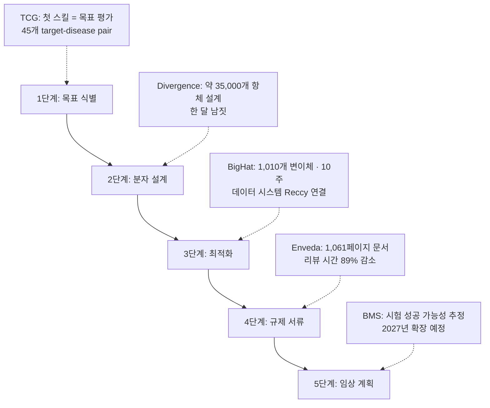

*DNA 이중나선을 따라 관통하는 빛의 경로. 닫힌 루프의 각 단계를 잇는 에이전트의 이동을 추상적으로 형상화했습니다.*

## 왜 읽어야 하나

에이전트 플랫폼을 만드는 개발자, 규제 산업에 AI 에이전트를 도입하는 결정을 앞둔 팀이라면 이 글을 "에이전트를 닫힌 프로세스의 어느 단계까지 신뢰할 수 있는가"라는 질문을 위해 읽으면 됩니다. 결론부터 말합니다. Anthropic이 10월 27일 공개한 약 개발 파트너십 초기 실적은 frontier 모델의 에이전트 활용이 코드 작성과 검색 보조를 넘어 실험 설계·문서 리뷰·임상 계획 추정 같은 닫힌 루프 업무까지 들어가고 있음을 숫자로 보여 줍니다. 다만 모든 수치는 임상 전 단계이고, 발표 자체가 "Claude는 더 개선되어야 한다"고 전제합니다.

## 개요

트윗은 10월 27일(UTC) @AnthropicAI 계정으로 나갔고, 본문은 [early progress on accelerating drug development with Claude](https://www.anthropic.com/research/early-progress-drug-development)라는 연구 블로그 포스트입니다(Team Science, 2026-10-27 게시). 포스트의 핵심 사실 네 가지를 먼저 정리합니다.

- Anthropic 과학자들은 새 약을 개발 중인 **6개 조직**과 deep research 파트너십을 진행했습니다. BigHat Biosciences, Bristol Myers Squibb(BMS), Divergence Labs, Enveda, Generate Biomedicines, The Column Group(TCG).
- 독자적으로도 약 발견 활동을 시작했고, 그 과정에서 **Mithril Medicine이라는 1인 회사를 인수**했습니다.
- 약 개발은 단일 문제가 아니라 "목표(target) 식별부터 분자 설계, 제조 최적화, 규제 서류, 임상 설계·운영까지" 병목이 분산된 프로세스라고 전제합니다. 그래서 실제 약 프로그램에 깊숙이 들어가는 전략을 택했습니다.
- 이 작업의 목적을 세 가지로 명시합니다. 모델의 강점·한계를 더 넓은 과제 집합에서 이해해 모델 개선 우선순위를 정하는 것, 더 많은 생물의학 기업에게 Claude 도입 사례를 제공하는 것, 그리고 일부 프로그램이 식품 알레르기·희귀 아동 질환·암 등에서 실제 유효한 약으로 이어지기를 기대하는 것입니다.

## 사례별 실측

포스트의 Chapter 01은 파트너별 사례 연구입니다. 발표된 수치를 그대로 옮깁니다.

**Generate Biomedicines, 모달리티 공학.** CAR-T 세포 요법을 고형종에까지 확장하려는 작업에서, 치료의 유전 지시어 일부를 단축해 추가 지시어 공간을 만들려고 했습니다. 과학자 6명이 Claude Code로 새 설계를 제안받았고, 그 중 하나가 표준 버전보다 약 70% 짧았습니다. 실험실에서 이 설계는 면역 세포가 약 10배 많은 수용체를 만들었고, 종양 세포를 더 효율적으로 제거했으며, 면역 세포가 더 오래 활성을 유지했습니다.

**Divergence Labs, hit 생성.** 식품 알레르기 치료는 IgE 분자가 면역 세포에서 분리되는 방식을 노립니다. Claude가 목표를 상세 설계 계획으로 변환한 뒤, 한 달 남짓의 시간에 대략 **35,000개 항체 설계**를 자율적으로 생성했습니다. 초기 테스트에서 IgE에 결합하는 설계 3개와 IgE를 떼어내는 설계 20개를 찾았고, 이 중 3개가 표준 약물보다 더 강하게 IgE를 분리했습니다.

**BigHat Biosciences, lead 최적화.** AI와 자동화 실험실을 결합해 두 개의 후보 분자(항체 단편)의 결합력·안정성·응집 특성을 개선했습니다. Claude는 BigHat의 실험 데이터 시스템 **Reccy**에 연결돼 분자 변경을 제안했고, 실험실에서 약 10주에 걸쳐 1,010개 변이체를 합성·테스트했습니다. 진행 중, 표준 열안정성·응집 지표가 오해를 줄 수 있다는 의심이 생기자 Claude와 Anthropic 연구원이 원 데이터를 다시 분석해 다른 지표와 프로토콜 변경을 제안했고, 주요 예측은 성립했습니다. 결과적으로 최우수 버전은 원래보다 10배 이상 강하게 결합했고, 암 표적 후보는 18°C 더 높은 온도에서 용액에 머물렀으며, 체내 잔류 후보는 100배 이상 느리게 응집했습니다.

**Enveda, 제조 문서·규제 서류.** Enveda의 제조 화학자들은 시간의 최대 75%를 서류에 썼습니다. 제조 문서 전체를 Claude에 연결한 시스템에서, 1,061페이지 문서 테스트로 Claude는 인간 리뷰어가 발견한 문제 11건을 모두 잡았고, 그중 7건은 인간이 놓친 것이었습니다. 인간 리뷰 시간은 89% 줄어 25시간 이상에서 3시간 미만으로 내려갔습니다. Claude는 두 가지 규제 문서의 초안도 작성했고, 그 중 하나는 수작업이면 약 3개월이 걸리는 문서에 4시간이 걸렸습니다.

**The Column Group, 회사 창설.** TCG는 Claude를 써서 소규모 팀으로는 비정상적으로 많은 약 프로그램을 굴리는 새 회사 **Pleiades**를 세우고 있습니다. Pleiades의 첫 Claude 스킬은 "약 목표가 추구할 가치가 있는가"를 평가하는 것이며, 45개의 target-disease pair로 평가받았습니다.

**Bristol Myers Squibb, 임상 계획.** BMS는 초기 단계 약의 임상 시험 계획을 Claude로 평가하고, 시험 성공 가능성을 추정하는 데 쓰고 있습니다. 2027년에 이 작업을 확장할 계획입니다. BMS 조기 임상 개발 담당 SVP Michael Pourdehnad는 "단일 프롬프트에서 Claude가 며칠이 걸릴 초기 분석을 만들어 주었고, 고감도 데이터의 보안을 유지한 채로 했다"고 포스트에 인용됐습니다.

*약 개발 5단계에 Claude가 실제로 들어간 지점. 각 사례의 수치는 Anthropic 발표 원문 기준입니다.*

독자 프로그램은 Mithril Medicine 인수로 이어집니다. Mithril은 Cody Tranbarger의 1인 회사로, 희귀 아동 근육 영양실조증 두 형태의 치료를 개발 중이었으며, Claude로 11개 외부 실험실의 계약·물류·실험을 조율하고 운영의 많은 부분을 위임했다고 합니다. 그 결과 하나의 후보 치료제는 아이디어에서 쥐 실험의 유망한 결과까지 18개월 미만이 걸렸고, Anthropic은 후보가 유지된다면 2028년 하반기부터 인간 임상 개시가 가능할 것으로 기대한다고 밝혔습니다.

## 서비스 확장

Chapter 02는 연구 그 자체보다 배포 구조에 가깝습니다. **Claude Science**라는 연구자용 AI 워크벤치를 출시했고, 생물의학 연구자에게 Claude 크레딧을 제공합니다. **Life Sciences Verification Program**은 신뢰할 수 있는 조직이 안전장치(safeguards)의 완화 버전으로 가장 강력한 모델을 쓰게 하는 프로그램이며, 오용 방지 안전장치가 정당한 생물학 연구를 늦추는 문제를 해소하려는 것입니다. guest investigator 공개 모집도 시작했습니다.

## ThakiCloud 제품 적용 시사점

Paxis 관점에서 이 발표는 세 가지 신호를 줍니다.

첫째, **닫힌 루프의 단계별 침투**입니다. "에이전트가 약을 발견한다"는 헤드라인 아래 실제 사례는 훨씬 단계적입니다. 문서 리뷰(Enveda), 변이체 제안(BigHat), 성공 가능성 추정(BMS). 에이전트 플랫폼이 규제 산업에 들어갈 때, 처음 닿는 지점은 개방형 생성이 아니라 검증 가능한 단계 업무입니다. Paxis가 도메인 에이전트를 설계할 때에도, 단계별 책임 범위(무엇을 제안하고, 무엇을 실행하고, 무엇이 사람 승인을 타나)를 먼저 정의하는 것이 이 발표가 보여주는 순서와 같습니다.

둘째, **데이터 시스템 연결이 품질의 전제**입니다. BigHat 사례의 핵심은 Claude가 Reccy에 연결된다는 점이고, BMS 사례의 핵심은 고감도 독점 데이터 위에서 동작한다는 점입니다. "모델이 똑똑하다"보다 "어떤 데이터에, 어떤 권한으로 닿는가"가 결과를 결정합니다. Paxis의 MCP 커넥터와 정책 게이트+감사로그가 다루는 문제가 정확히 이 지점입니다.

셋째, **도메인 첫 스킬의 모양**입니다. Pleiades의 첫 Claude 스킬은 "목표가 추구할 가치가 있는가"를 평가하는 분류 스킬입니다. 거대한 생성이 아니라, 도메인 진입의 첫 스킬은 판정/평가 스킬에서 시작된다는 증거입니다. 스킬 팩을 설계할 때 첫 스킬의 위치를 정하는 실마리입니다.

## 한계 및 반론

수치의 무게에 비례해 경계도 필요합니다. 모든 사례는 임상 전(preclinical) 단계입니다. 포스트 스스로 "still at an early stage"를 명시하고, 35,000개 설계 중 초기 테스트를 통과한 것은 23개(결합 3+분리 20), 그 중 "표준보다 강하게"는 3개입니다. BigHat의 "10배 결합"은 후보 분자 수준의 실험실 수치이고, Mithril의 18개월은 약 개발의 빠른 축이며 인간 임상까지 2028년 "as soon as"입니다. 파트너가 자기 사례를 발표문에 담는 구조이기도 하고, 규제 허가는 이 숫자 어디에서도 시작되지 않습니다. "에이전트가 약 개발을 가속한다"는 주장은 지금 시점에서는 "문서·제안·평가 단계의 작업 시간을 줄였다"로 좁혀야 정확합니다.

## 정리

frontier 모델의 에이전트 활용 지형이 바뀌고 있습니다. 검색 보조에서 실험 설계 제안, 문서 리뷰, 임상 계획 추정, 그리고 1인 회사의 운영 위임까지. Anthropic이 여섯 파트너의 초기 실적으로 보여 준 것은 "도메인 전체를 에이전트가 대체한다"가 아니라, **검증 가능한 단계 업무부터 순서대로 들어간다**는 사실입니다. 에이전트 플랫폼을 만드는 팀에게 시사하는 바는 명확합니다. 다음 전장은 도메인이며, 진입 순서는 데이터 시스템 연결, 첫 판정 스킬, 단계별 책임 범위 정의입니다. Mithril의 "18개월"과 Enveda의 "89%"는 마케팅 숫자가 아니라, 에이전트가 프로세스 안에서 어떤 위치를 이미 차지했는가의 증거입니다.

---

*출처: [Anthropic, Early progress on accelerating drug development with Claude (2026-10-27)](https://www.anthropic.com/research/early-progress-drug-development) · [@AnthropicAI 트윗(2026-10-27)](https://x.com/AnthropicAI/status/2115178675050307942)*
