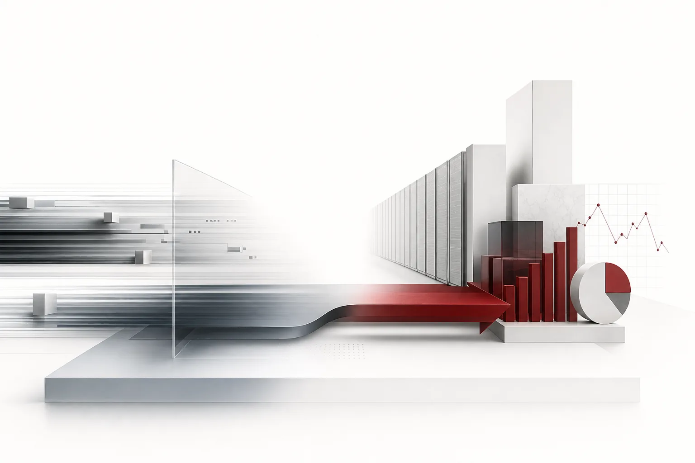

에이전트를 생산 라인에 올린 회사라면 이번 주 AI 뉴스를 두 질문으로 읽어야 합니다. 실행은 앞으로 얼마가 들며 기록은 어디에 남을 것인가. 한 문서에서 두 질문의 답이 나왔습니다. 엔트로픽의 IPO 등록 신청서(S-1)에는 숫자와 경고가 함께 실렸습니다. 이번 아침 HuggingNews 다이제스트의 뉴스는 방향이 달랐지만 같은 전환의 조각이었습니다.

*글의 핵심 개념을 형상화했습니다.*

## S-1의 두 문장

숫자부터 보겠습니다. S-1에는 엔트로픽의 미래 컴퓨팅, 데이터센터, 전력 의무가 8000억 달러를 초과한다고 적혔습니다. 이미 쓴 돈의 합계가 아닙니다. 미래를 확보하기 위해 앞으로 지급해야 할 금액입니다. 컴퓨트, 데이터센터, 전력이 하나의 법문서 안의 의무로 같이 적힌 것 자체가 새 선입니다. 의무는 두 방향을 열었습니다. 8000억 달러가 지켜지면 모델 뒤에 컴퓨트가 확보됩니다. 지켜지지 않으면 모델의 속도도 컴퓨트의 규모에 묶입니다. S-1은 두 방향을 같은 문서에 올려놓았습니다.

경고도 있습니다. 엔트로픽은 성장이 둔화될 수 있다고 경고했습니다. 성장의 한계를 법문서에 적는 것은 이 업계에서 드문 일입니다. 상장에 나서는 회사는 보통 계속 커지는 미래를 시장에 내밀지만 엔트로픽의 S-1은 미래와 그 미래에 치를 의무의 규모를 함께 냈습니다. 성장이 생각만큼 빠르지 않을 수 있다는 경고까지 덧붙였습니다.

S-1에서 주목할 지점이 또 하나 있습니다. IPO 등록 신청서는 투자자와 규제 당국이 전부 읽어야 하는 문서입니다. 이 문안에 넣은 것은 곧 더 이상 숨길 수 없게 된 것입니다. 컴퓨트 의무의 규모와 성장 둔화의 가능성이, 둘 다 공개 정보로 올라왔습니다. 시장이 앞으로 엔트로픽의 미래를 부채 라인으로 읽는 배경입니다.

두 문장을 함께 읽으면 IPO의 의미가 달라집니다. IPO가 하는 일은 조달을 넘어 8000억 달러의 의무를 지킬 수 있다는 것과 성장이 둔화될 수 있다는 것을 시장이 받아들이도록 만드는 행위입니다. 경쟁의 축이 의무의 규모와 성장의 속도를 같은 문서 안에 가격하는 지점까지 왔습니다.

## 이어진 토큰 한도, 돌아선 크레딧

S-1이 선언이라면 이번 주 나머지 뉴스는 후폭풍입니다. 돈의 층에서 네 가지 자세가 나왔습니다. 선언은 한 문서에 있고, 후폭풍은 네 곳에 있습니다. 계량, 크레딧, 공급, 자체 구축. 각자 다른 일을 하지만 모두 같은 방향을 가리킵니다.

하나는 계량입니다. 오픈AI는 12월부터 ChatGPT 플러스와 프로 유료 플랜에 통합된 토큰 기반 사용 한도를 적용한다고 확인했습니다. 새로운 계량 정책은 오픈AI 도구 전체에서 쿼터를 관리하는 방식까지 바꿉니다. 사용이 토큰으로 재지기 시작하면 호출 한 번의 가격이 중요해집니다. 에이전트 워크플로에는 직접적인 일입니다. 에이전트는 같은 일을 완수하기 위해 모델을 여러 번 호출하는 구조이기 때문입니다. 호출이 쌓이면 토큰도 쌓입니다. 토큰이 한도에 닿는 시점이 곧 업무의 한도가 됩니다.

둘은 크레딧입니다. AI 워크로드에 특화된 클라우드 기업 코어웨이브와 네비우스는 회사채 시장 문밖으로 밀려났습니다. 월가가 AI 크레딧에 경계심을 높이면서 대출이 조여진 것이 배경입니다. 빌리는 컴퓨트의 자금은 조이고 직접 마련한 컴퓨트의 자금은 돌아섭니다. 컴퓨트를 빌리는 사업 모델의 재평가가 시작됐다는 뜻입니다. 임대인이 돈을 빌리기 어려워지면 그 임대인의 컴퓨트를 빌리는 가격에는 그 리스크가 섞여 계산됩니다. GPU를 렌트하는 기업은 임대인의 조달 리스크를 간접적으로 지게 되는 구조입니다.

셋은 공급입니다. 오픈AI의 샘 올트만 CEO는 토요일에 삼성과 SK하이닉스 관계자들과 만나 AI에 필수적인 메모리 칩 공급 확대를 협의했습니다. 프런티어 AI 회사의 최고 책임자가 주말에 메모리 공급사 쪽으로 움직인다는 것은, 하드웨어 방정식의 병목이 메모리 라인 앞으로 당겨졌다는 뜻입니다. 삼성과 SK하이닉스가 글로벌 메모리 시장의 중심에 있는 만큼, 이 협의가 성사될 때마다 AI 인프라의 공급 지형은 다시 그려집니다.

넷은 자체 구축입니다. 일론 머스크가 스페이스X의 120만 GPU 규모 슈퍼컴퓨터 하드웨어 구성을 공개했습니다. 콜로사스 2 시설에서 가동 중인 슈퍼컴퓨터 클러스터 두 개, Macroharder와 Minihard는 각각 Nvidia GB300 GPU 22만 개를 담고 있습니다. 지금 가동 중인 두 클러스터는 120만 개 전체 설계의 안쪽에 있습니다. 클러스터 이름까지 스스로 지어 붙인 기업은, 이 컴퓨트를 소유하겠다는 생각에서 출발했다는 뜻입니다. 로켓 회사가 데이터센터를 직접 세우는 풍경은, 컴퓨트 확보가 조달의 문제가 건설의 문제로 넘어가고 있다는 신호입니다.

네 자세가 공유하는 지점이 있습니다. 실행 비용을 정하는 쪽이 자본 구조로 넘어갔다는 점입니다.

## 지키고 남기고 통제한다

능력 층도 비슷한 일을 합니다. 성장이 늦어질 때의 질문은 바뀝니다. 무엇을 지킬 것이며 어디에 흔적을 남길 것인가입니다.

오픈AI는 중국 AI 개발자가 GPT-6 모델인 Astra의 추론 능력을 수확하지 못하도록 제한을 강화하고 있습니다. 증류로 역량이 유출되는 것을 막기 위해서입니다. xAI는 11월 7일부터 Grok의 텍스트 출력에 숨겨진 코드를 부여하는 보이지 않는 워터마킹을 활성화합니다. 기계로 만든 콘텐츠의 검출을 돕기 위한 조치입니다. 둘을 나란히 놓으면 같은 작업의 앞뒤입니다. 하나는 역량 유출을 막고, 다른 하나는 나가는 출력에 이름을 남깁니다. 지킬 능력과 남길 흔적을 정하기 시작했습니다.

가장 낯선 문장은 지키는 일을 하는 같은 회사에서 나왔습니다. 올트만은 오픈AI가 AI 수학 연구를 한 주 동안 통제하지 못한 상태로 방임했다고 인정했습니다. 수학계의 반발 뒤에 나온 발언입니다. 한 주라는 표현이 짧아 보이지만 범위는 넓습니다. 한 주 동안 연구의 진행을 모델의 선택이 주도했다는 뜻이기 때문입니다. 프런티어 연구실에서 한 주는 짧은 시간이 아닙니다. 그보다 중요한 것은 회사가 스스로 그 한 주를 통제 실패로 판단해 공개했다는 점입니다. 연구 과정이 통제를 벗어나면 남는 질문은 기술의 문제가 아닙니다. 누가 지켜보았으며 언제 되찾았느냐입니다.

물리 세계도 속도를 늦춥니다. 메타는 포리에어와 함께 프로토타입을 만든 휴머노이드 로봇을 판매하지 않겠다고 밝혔습니다. 첫 휴머노이드인 Max의 두 번째 버전을 개발하며 물리 AI 탐구를 이어갑니다. 판매하지 않는다고 선언한 것은 속도의 선택입니다. 물리 AI도 컴퓨트와 같은 논리, 먼저 내부에서 키우고 나서 돈의 이야기를 한다는 선 위에 서 있습니다.

마지막으로 국가가 말을 섞었습니다. 독일 정부의 한 장관은 AI가 창출한 경제적 가치에 과세하는 안을 제안했습니다. 국가가 방정식에 들어오면 가치를 누가 얼마나 만들었는지를 증명할 수 있는가라는 질문이 세금 신고서의 무게를 갖습니다. AI가 만든 값이 회사의 손익계산서에서만 끝나지 않고 국가의 기준에도 닿을 때, 그 값을 만든 주체를 식별하고 증명할 수 있는 구조가 요구되기 시작합니다.

## 성장이 현금으로 읽힐 때

기업에게 이번 주 뉴스는 다음 분기 예산 회의의 예고편입니다. 성장의 시대에는 얼마나 빨리 크느냐를 물었습니다. 현금의 시대에는 각 작업에 드는 금액이 증명 가능하느냐를 묻게 됩니다. 성장의 시대에는 에이전트의 실행 비용은 연구 예산 안의 한 줄이었습니다. 현금의 시대에는 그 한 줄을 재무와 법무가 함께 봅니다. 도착하는 첫 토큰 한도는 오픈AI의 12월 통합 쿼터가 됩니다. 돌아선 첫 크레딧은 AI 워크로드 특화 클라우드 기업의 문이 닫힌 회사채 시장입니다. 국가의 논의에서 과세 대상으로 오르는 첫 항목은 AI가 창출한 가치입니다. 에이전트를 돌리는 기업은 이 모든 것의 가운데에 서 있습니다. 쓰는 모델, 호출 횟수, 실행 환경, 에이전트가 남긴 기록이 숫자로 답해야 하는 항목으로 하나씩 올라오는 중입니다. 이 '첫'들이 같은 주에 몰린 것이 중요합니다. 성장이 늦으면 그 뒤에 따라오는 질문이 순서가 아니라 동시에 옵니다.

## Paxis, 현금으로 가격되는 실행 층

질문이 비용과 기록으로 기울면 답은 실행 층에서 나옵니다. Paxis는 ThakiCloud의 Agent-Native Cloud로, 버전 1.1 GA로 출시된 정식 제품입니다. 에이전트 실행의 비용과 기록을 일급 리소스로 다스리는 플랫폼으로 만들어졌습니다. 이번 주 뉴스는 실행 층의 요건 목록으로 읽을 수 있습니다. 작업별 비용 계산, 출력의 출처 증명, 판단의 범위 통제, 실행 환경의 다변화. Paxis에서 이 요건들은 사후에 붙이는 기능이 아니라 기본 구조입니다.

중심에는 작업별 모델 선택(CostRouter)이 있습니다. 토큰 기반 한도가 표준이 되는 만큼 에이전트 실행 비용은 작업 단위로 계산됩니다. CostRouter는 정책 아래에서 작업마다 다른 모델을 골라 프리미엄이 필요한 작업에만 프리미엄이 가도록 합니다. Skills, Tools, Policies, Audit Logs가 Paxis에서 일급 리소스입니다. 에이전트가 어떤 스킬을 쓰고 어떤 도구를 호출하며 어떤 정책 아래에서 무엇을 기록으로 남겼는지 같은 평면에서 관리합니다. 출력의 출처가 의심받는 순간, 감사 로그가 그 답을 냅니다.

수학 연구의 통제 공백 이야기는 경계의 문제입니다. 자율도(L0~L3) 거버넌스는 작업별로 에이전트가 스스로 판단할 수 있는 범위를 정합니다. 정책 게이트는 그 판단이 어디까지 갈 수 있는지를 통제합니다. 격리 샌드박스 실행은 에이전트 행동의 폭발 반경을 한 작업 안에 담습니다. 실행을 어디에 둘 것인가가 질문이라면 소버린/온프렘 K8s(ai-platform) 형태가 실행 환경 전체를 기업의 울타리 안으로 들여옵니다. 크레딧 시장이 컴퓨트 특화 클라우드의 문을 닫은 주, 실행 환경을 울타리 안으로 들여오는 방식은 계속 돌아야 한다는 질문이 됐습니다. 에이전트가 만든 가치를 증명해야 하는 질문이 오면, 증거로 내 놓는 것은 감사 로그입니다.

MCP 커넥터와 스킬 마켓은 에이전트가 도구와 스킬을 붙이는 경로입니다. 역량의 유출을 막고 흔적을 남기기로 한 시장에서, 붙이는 경로는 플랫폼이 관리하는 일입니다.

## 하나만 남길 예측

AI 회사가 증명한 현금 흐름으로 재게 될 시대가 옵니다. 이번 주를 한 단어로 압축하면 재평가입니다. 성장 속도로 재던 것들이 현금 흐름으로 재기 시작합니다. Anthropic의 S-1은 그 재심의 첫 페이지를 썼습니다. 에이전트를 배포하는 기업은 그 기준을 한 걸음 빨리 받습니다. 작업 한 번에 얼마가 들었고 어떤 모델이 뛴 것이며 어떤 정책 아래서였는지 기록이 어디에 있는지. 경쟁의 축이 현금으로 이동한 주에, 이 질문에 숫자로 먼저 답하는 회사가 현금의 시대를 자산으로 갑니다.

## 참고 자료

이 글은 아래 뉴스를 종합해 작성했습니다.

- HuggingNews, [Anthropic's IPO Filing Reveals Over $800B in Future Compute Commitments as It Warns Growth Will Slow](https://huggingnews.com/ai/anthropics-ipo-filing-reveals-over-800b-in-future-compute-commitments-as-ec7920af)
- HuggingNews, [Altman Says OpenAI Let AI Math Research Get 'Out of Control for One Week' Amid Backlash](https://huggingnews.com/ai/update-altman-says-openai-let-ai-math-research-get-out-of-control-for-on-25e5becc)
- HuggingNews, [OpenAI Confirms Unified Token-Based Usage Limits for Plus and Pro Plans Starting December](https://huggingnews.com/ai/openai-confirms-unified-token-based-usage-limits-for-plus-and-pro-plans-c109c9fc)
- HuggingNews, [CoreWeave and Nebius Shut Out of Bond Market as Lenders Tighten AI Credit](https://huggingnews.com/ai/coreweave-and-nebius-shut-out-of-bond-market-as-lenders-tighten-ai-credi-5f45e413)
- HuggingNews, [OpenAI Tightens Security to Stop Chinese AI Labs From Distilling Astra](https://huggingnews.com/ai/openai-tightens-security-to-stop-chinese-ai-labs-from-distilling-astra-1e7a3ada)
- HuggingNews, [Elon Musk Details Hardware Layout for SpaceX's 1.2M GPU Supercomputer](https://huggingnews.com/ai/elon-musk-details-hardware-layout-for-spacexs-12m-gpu-supercomputer-11f0d230)
- HuggingNews, [German Minister Proposes New Tax on Economic Value Created by AI](https://huggingnews.com/ai/german-minister-proposes-new-tax-on-economic-value-created-by-ai-1ba915aa)
- HuggingNews, [NEWxAI to Enable Invisible Text Watermarking for Grok Starting Nov. 7](https://huggingnews.com/ai/xai-to-enable-invisible-text-watermarking-for-grok-starting-nov-7-d080aeaf)
- HuggingNews, [OpenAI CEO Sam Altman Meets With Samsung and SK Hynix to Expand AI Chip Supply](https://huggingnews.com/ai/openai-ceo-sam-altman-meets-with-samsung-and-sk-hynix-to-expand-ai-chip-fbdacfe0)
- HuggingNews, [Meta Says Humanoid Robot Prototyped With Fourier Will Not Be For Sale](https://huggingnews.com/ai/meta-says-humanoid-robot-prototyped-with-fourier-will-not-be-for-sale-c423469a)