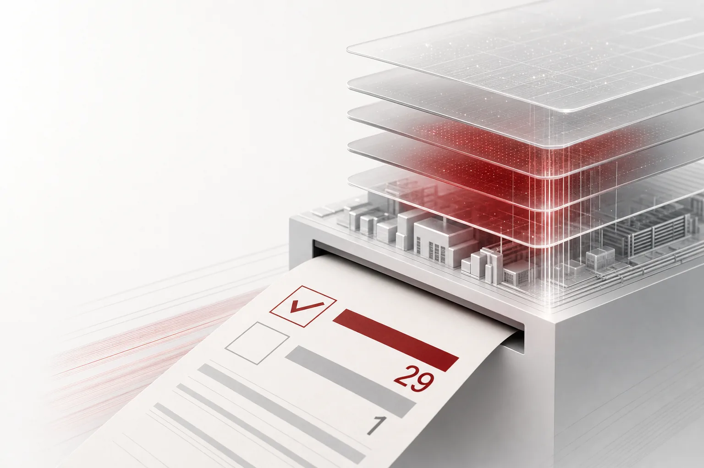

오늘의 AI 뉴스에서 무게중심이 '모델'에서 '터'로 이동하고 있습니다. 미국 지방의 투표에서 데이터센터 제한안이 29 대 1로 앞서고 메타는 한 소도시의 투표 한 장에 10억 달러 오하이오 투자를 재검토 중입니다. 오늘의 뉴스는 두 진영으로 갈립니다. AI를 앞당기는 쪽과, 늦추려는 쪽입니다. 두 진영의 뉴스는 같은 사건의 정반대 끝에서 바라본 모습입니다. 가장 신선한 신호는 두 진영의 속도 차이입니다. 빠른 쪽은 매일 커지고 느린 쪽은 이번 주에야 움직이기 시작했습니다. 서둘러 짚어야 할 것은 하나입니다. 지금 AI 업계의 병목은 더 안전한 자리입니다. 모델은 계속 새로 나오고, 자리는 계속 좁아집니다. 오늘 뉴스의 절반은 이 한 문장 안에 들어 있습니다.

*글의 핵심 개념을 형상화했습니다.*

## 10억 달러를 무효로 만든 소도시의 투표

화요일, 오하이오 피쿼 소도시가 투표장에 섰습니다. 물음은 그 동네에 데이터센터 확장을 허용할 것인가였습니다. 주민들은 거부를 선택했습니다. 약 10억 달러 투자를 계획한 메타는 투표 결과를 놓고 해당 시설의 추진 여부를 재검토하기로 했습니다. 고립된 사례가 아닙니다. 미국 여러 주에서 보고된 지방 데이터센터 규제 안건의 초기 집계에서, 첫 30건 중 29건이 제한 쪽으로 기울었습니다. 지방 유권자는 AI 인프라 확장에 강한 반대를 표명하고 있습니다. 29 대 1이라는 격차는 초기 집계 기준이지만 방향은 오판하기 어렵습니다.

그동안 AI 역량은 자본과 칩으로 결정되었습니다. 돈을 더 모으고 GPU를 더 사는 쪽이 토큰을 더 얻었습니다. 그런데 여기에 '동의'라는 변수가 추가되었습니다. 데이터센터는 모델 레이어 전체를 받치는 물리적 기반입니다. 소도시 하나가 데이터센터 하나를 막을 수 있다면, 컴퓨팅 계획은 지방자치 차원의 문제를 안게 됩니다. 동네가 반대하는 이유는 단순합니다. 거대한 시설이 들어서는 자리는 전기, 물, 도로의 부담을 함께 떠안게 되는데, 그 대가는 지역에서 먼저 체감됩니다. AI 붐의 수익은 글로벌 기업의 몫이었지만 부담은 동네의 몫이었습니다. 투표로 드러난 반대가 이 비대칭에 대한 반응이라면, 동네 투표가 기업의 컴퓨팅 계획을 바로 흔드는 변수가 된 셈입니다. 그 변수를 빨리 읽는 쪽이 먼저 설계하게 됩니다. 메타의 재검토는 바로 그 읽기의 첫 사례입니다. 투표가 끝난 화요일, 10억 달러가 '판단 보류' 상태로 들어갔습니다. 앞으로 다른 소도시의 투표 결과마다, 비슷한 규모의 투자들이 같은 위치에 놓일 가능성이 높습니다. 데이터센터 입지는 이제 '여기가 비싼가'의 문제에서 '여기가 허용되는가'의 문제로 넘어선 것입니다.

## CAPEX 정점론과 허가 중단, 같은 주에 도착한 두 개의 문

시트린 리서치는 수요일에 AI 인프라 자본지출의 정점을 진단했습니다. 테마 모델북을 전면 개편했고 위험 전망까지 함께 바꿨습니다. 개편의 범위가 '전면'이라는 점이 중요합니다. 모델북 전체를 다시 짰다는 뜻입니다. 같은 주, 차기 텍사스 주지사는 신규 인허가를 대상으로 한 중단을 언급했습니다. 하나는 애널리스트의 포트폴리오 단위 진단이고 다른 하나는 한 주지사의 규제 신호입니다. 모양은 다르지만 방향은 같습니다. AI 붐을 받쳐 온 물리적 레이어가 한계에 부딪히기 시작했다는 뜻입니다.

별도로 보면 각각 단일 사건입니다. 함께 읽으면 구조가 됩니다. CAPEX 정점론은 자금 쪽의 문이 닫히기 시작한다는 말이고 인허가 중단은 규제 쪽의 문이 닫히기 시작한다는 말입니다. 두 개의 문이 동시에 움직이면, 컴퓨팅의 가격과 데이터센터의 위치가 한꺼번에 변수가 됩니다. 그 위에서 실행 환경을 짓는 운영자에게는, '다음 GPU는 어디에 앉을 것인가'라는 전제를 다시 검토해야 할 시점이라는 신호입니다. 정점론이 맞든 틀리든, 시장이 정점을 '언급'한 순간, 투자 판단은 리스크 관리 문제로 넘어갑니다. 같은 하드웨어에 같은 돈을 쓰더라도, 들어서는 자리에 따라 가치가 달라지는 구간입니다.

## 규제보다 먼저 흔들린 공급계약

규제가 오기도 전에, 계약이 먼저 흔들렸습니다. 오라클이 텐센트에 고급 클라우드 인프라를 공급하기로 한 장기 계약을 해지했습니다. 계약 규모는 약 70억 달러였습니다. 해지로 텐센트는 10만 개 AI 칩에 대한 접근을 잃게 되었습니다. 수년째 안정해 보였던 공급망이, 해지 순간 컴퓨팅 자체를 변수로 만들었습니다.

규제는 느린 변수입니다. 투표와 인허가는 연 단위의 시계로 움직입니다. 계약은 빠른 변수입니다. 한 건으로 사라집니다. 오늘의 뉴스 테이블에는 둘 다 올라 있습니다. 둘이 공유하는 지점은 하나입니다. 컴퓨팅이 보장된다는 전제가 조용히 풀리고 있다는 것입니다. 공급업체의 한 결정이 지운 10만 개 칩은, 지방 투표의 29 대 1과 같은 종류의 사건입니다. 하나는 계약으로, 다른 하나는 투표로 오지만 서비스를 운영하는 쪽에 떨어지는 결과는 같습니다. 실행 환경의 전제가, 내가 상상한 형태로는 더 이상 존재하지 않게 되는 것입니다. 70억 달러가 사라진 것은 돈만의 문제가 아닙니다. 칩 접근은 수년 단위 계획의 기반입니다. 기반이 바뀌면, 그 위에 세운 설계도 다시 검토해야 합니다. 계약 파기는 구조의 일부입니다. 공급과 수요가 이렇게 얽혀 있는 시장에서는, 한쪽의 단일 결정이 타측의 전체 로드맵을 흔들 수 있습니다. 규제 리스크와 계약 리스크가 같은 주에 테이블 위에 올랐다는 것, 그것이 오늘의 뉴스입니다.

## 정반대로 움직이는 모델 레이어

이번 주 대조는 여기 있습니다. 문샷AI가 Kimi K3.1 Pro의 오픈 가중치를 공개했습니다. 2.8조 파라미터 모델을 희소 Mixture-of-Experts 구조로 다루는 구성입니다. 희소 MoE는 전체 파라미터를 한 번에 사용하지 않는 아키텍처지만, 서빙 인프라 관점에서는 expert가 차지할 자원을 여전히 요구합니다. 이 스케일에서 가중치가 열리고 있다는 것 자체가 선언에 가깝습니다. 미국 쪽도 다르지 않습니다. 리커시브AI는 65B 오픈모델 '리플(Ripple)'을 내놓으면서, 미국 오픈웨이트 AI를 위한 신규 코딩 벤치마크를 함께 제시했습니다. 에이전틱 코딩 작업에서 미국 기반 AI의 최상위 성과 랭킹을 목표로 하는 포석입니다.

땅이 투표장에 들어가는 동안, 모델 가중치는 개방으로 빠져나옵니다. 오늘의 역설입니다. 가장 빠른 레이어는 커지기만 하고 가장 느린 레이어는 판정판에 앉기 시작했습니다. 이 역설의 함의는 작지 않습니다. 오픈웨이트 모델이 클수록, '누가 호스팅할 수 있는가'라는 질문이 커집니다. 가중치를 공개하는 순간, 모델은 데이터센터 입주의 것이 됩니다. 그 데이터센터가 들어갈 자리가 투표로 막히고 인허가로 멈추고 계약으로 흔들리면, 가중치 공개의 가치는 실행 환경에서 결정됩니다. 오픈모델의 성장은 클라우드의 독점을 허문다기보다, '어디에 둘 것인가'의 책임을 더 넓게 분산시킵니다. 모델 레이어의 가속은, 물리적 레이어의 감속을 더 선명하게 만듭니다.

## AI를 돌리는 사람에게 온 새로운 설계 질문

'어떤 모델을 쓸 것인가, 어떤 GPU를 쓸 것인가'라는 질문이, '어디에서 돌릴 것인가, 어떤 보장으로 돌릴 것인가'로 바뀌고 있습니다. 한 소도시의 데이터센터 금지, 한 주의 인허가 중단, 70억 달러 계약 파기. 이 하나하나가 다음 분기 운영의 변수가 될 수 있습니다.

그런데 소프트웨어 전선은 멈추지 않습니다. 투게더AI는 TKCC라는 추론 최적화 도구를 출시했습니다. AI 에이전트를 써서 사용자 행동에 따라 프로덕션 트래픽에 맞는 모델 배포를 자동으로 튜닝하는 구조입니다. 연속적인 추론 최적화를 자동화하는 것이 목적입니다. 이 툴이 등장하는 이유도 같은 방향입니다. 트래픽이 변하면 배포도 변해야 하고 그 변경을 에이전트가 담당하기 시작합니다. 오픈AI는 화요일, Git 기반 개발도구 스타트업 피에르 컴퓨터 인수를 위한 확정 계약을 체결했다고 확인했습니다. 코덱스를 소프트웨어 인프라 영역으로 확장하기 위한 움직임입니다. 소프트웨어는 더 빨리, 더 깊게 업무 코어로 들어오고 있습니다. TKCC와 피에르 컴퓨터 인수의 공통점은, 둘 다 에이전트를 프로덕션에 한 걸음 더 가까이 데려온다는 것입니다. 사람 손이 가던 추론 튜닝은 이제 에이전트가 하고 코드 관리까지 에이전트 워크플로에 흡수되고 있습니다. 에이전트가 프로덕션을 차지할수록, '에이전트가 실행되는 자리'는 일급 질문이 됩니다.

그러면 물리적 레이어의 변동성은 완충 없이 실행 환경에 그대로 전달됩니다. 추론을 돌리는 최적화 에이전트든, 개발도구로 들어가는 코딩 에이전트든, 모두 어디론가 서 있어야 합니다. 기업이 고민해야 할 것은 '실행 환경을 어떤 보장으로 지을까'로 넘어가는 중입니다.

## 실행의 자리를 설계부터 하는 곳: Paxis

그런 세상에서, 기업이 에이전트를 맡길 실행 환경이 갖추어야 할 조건은 더 분명해지고 있습니다. ThakiCloud의 Agent-Native Cloud Paxis는 이 질문을 설계 문제로 다룹니다. Paxis는 v1.1 GA를 마친 정식 제품입니다. Skills, Tools, Policies, Audit Logs가 일급 리소스로 관리되고 에이전트 자율도는 L0에서 L3까지 정책 게이트와 감사 로그로 거버넌스 됩니다.

오늘의 통증 매핑은 꽤 직접적입니다. 데이터센터 금지와 인허가 중단을 거치며 특정 리전의 가용성이 불확실해지면, 소버린 온프레미스 K8s(ai-platform)과 멀티리전 실행 환경 설계는 필수 조건으로 올라섭니다. 한 곳에 거는 베팅이 줄어야 하는 이유가 여기 있습니다. Kimi K3.1 Pro, Ripple 같은 오픈모델과 상용 API 사이에서 가용 풀이 흔들리면, CostRouter의 작업별 모델 선택이 실행 비용을 낮추면서 서비스 연속성을 지킵니다. 앤트로픽 사례도 같은 맥락입니다. 클로드 코드의 IP 필터가 독창적인 게임 프로젝트까지 차단하자, 규칙을 완화하는 업데이트가 뒤따랐습니다. 정책은 계속 조정하는 것이므로, 그 조정 이력은 감사로 남을 수 있어야 합니다. Paxis는 Policies와 Audit Logs를 일급 리소스로 다뤄서 이 부분을 구조 안에 넣고 에이전트는 격리 샌드박스 안에서 실행되며, 외부 시스템과의 접점은 MCP 커넥터와 스킬 마켓을 통해 열립니다. 오늘 뉴스가 보여주는 통증은 결국, Paxis가 처음부터 리소스로 다뤄 온 문제들과 정확히 겹칩니다.

물리적 레이어가 변수가 된 세상에서, 실행 환경의 질문은 '더 많은 보장'입니다. 투표용지가 AI의 최대 변수가 된 날입니다. 가장 느린 레이어가 가장 빠른 레이어를 판정한다면, 이기는 실행 환경은 실행의 자리를 설계 문제로 먼저 보는 쪽입니다. 그리고 실행 환경의 설계는, 오늘 당장 우리가 선택할 수 있는 문제입니다.

## 참고 자료

이 글은 아래 뉴스를 종합해 작성했습니다.

- HuggingNews, [Citrini Calls Peak in AI Infrastructure Capex as Incoming Texas Governor Says Pause Targets New Permits](https://huggingnews.com/ai/citrini-calls-peak-in-ai-infrastructure-capex-as-incoming-texas-governor-5b8d57db)
- HuggingNews, [Meta Reviews $1B Ohio Investment After Local Voters Approve Data Center Bans](https://huggingnews.com/ai/update-meta-reviews-1b-ohio-investment-after-local-voters-approve-data-c-9c644fe5)
- HuggingNews, [RicursiveAI Launches 65B Ripple Model With New Coding Benchmarks for U.S. Open-Weight AI](https://huggingnews.com/ai/ricursiveai-launches-65b-ripple-model-with-new-coding-benchmarks-for-us-56ffa3d8)
- HuggingNews, [Moonshot AI Releases Weights for 2.8 Trillion-Parameter Kimi K3.1 Pro Model](https://huggingnews.com/ai/moonshot-ai-releases-weights-for-28-trillion-parameter-kimi-k31-pro-mode-fde7d503)
- HuggingNews, [Data Center Restrictions Lead 29 to 1 in Initial US Local Ballot Counts](https://huggingnews.com/ai/data-center-restrictions-lead-29-to-1-in-initial-us-local-ballot-counts-f5a1c1ec)
- HuggingNews, [Tencent Loses Access to 100,000 AI Chips After Oracle Scraps $7B Agreement](https://huggingnews.com/ai/tencent-loses-access-to-100000-ai-chips-after-oracle-scraps-7b-agreement-2d96e145)
- HuggingNews, [OpenAI Confirms Acquisition of Pierre Computer to Expand Codex Into Software Infrastructure](https://huggingnews.com/ai/openai-confirms-acquisition-of-pierre-computer-to-expand-codex-into-soft-d6768bee)
- HuggingNews, [Anthropic Loosens Claude Code Rules After IP Filter Blocks Original Game Projects](https://huggingnews.com/ai/anthropic-loosens-claude-code-rules-after-ip-filter-blocks-original-game-5c9789ce)
- HuggingNews, [Together AI Launches New Tool to Automate Continuous AI Inference Optimization](https://huggingnews.com/ai/together-ai-launches-new-tool-to-automate-continuous-ai-inference-optimi-814a5428)