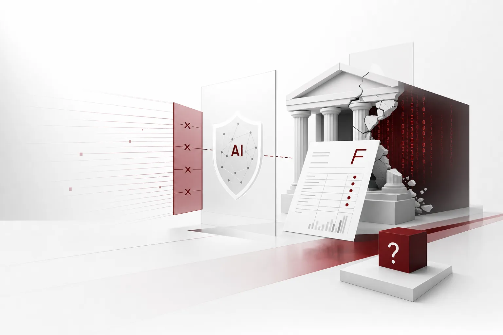

망분리는 13년 된 규칙. 2013년 대규모 사이버 공격을 계기로 금융회사들은 내부망과 외부망을 나누었고 그 벽이 조용히 13년을 돌았다. 2026년, 금융위원회는 개혁의 대상으로 그 벽 자체를 정했다. 용매는 AI인 셈. 그리고 부산물은 시험이다.

*글의 핵심 개념을 형상화했습니다.*

## 처방전: 'AI 공격은 AI로 막는다'

배경이 숫자 산인 셈. 올해 9월 30일부터 11월 3일까지, 금융회사 37곳에서 40건의 침해사고가 접수되고 약 47만3천건의 정보가 유출됐다. 여기에 가상자산사업자 핫월렛, 전자금융업체 예치금 등 회사 관리자금 약 10억 원이 탈취되기도 했다. 고객 직접 피해는 아직 확인되지 않았지만 금융위가 10월 14일 보안 체크리스트 점검을 마쳤는데도 신고가 11월 3일까지 이어졌다는 사실은 모든 것을 말해준다. 전자금융, 가상자산, 증권, 보험, 은행. 사실상 전 업권이 한 달 사이 동시에 적중했다는 점, 전문 보안인력과 투자 여력이 부족한 중소형사와 신생 업체의 구조적 취약점이 드러났다는 점이 함께 붙는 셈이다. 모바일과 비대면, 클라우드, AI 기반 업무 처리가 확대되는 동안 외부 시스템과 연결되는 경로가 급증했고 그 틈으로 공격이 들어온 셈이다.

금융위는 이에 약 580개 금융회사 대상 보안 전수점검을 착수했고 중대 관리 부실이 확인되면 CEO를 포함한 경영진의 책임을 묻겠다고 밝혔다. 함께 바뀌는 것은 보안 정책의 방향 자체. AI 기반 이상 징후 실시간 탐지와 대응, 망분리 규제 개선 TF, '피싱지수' 시범도입, 보이스피싱 무과실책임 법제화. 방화벽과 망분리를 축으로 한 전통 방어 체계로는 AI를 악용한 고도화된 해킹 수법에 대응이 어려워졌다는 것이 당국의 판단이다. 기조는 한 줄로 요약된다. AI 공격은 AI로 막는다는 것이다.

## 시험: 2091명의 성적표

처방에는 숨은 전제가 있다. 망분리 예외는 보안용 AI와 SaaS에 대해서만 열린다. AI로 방어하려면, 먼저 그 자격을 갖추어야 한다는 뜻이다. 13년간 금융 보안의 정답이었던 그 규칙이, 이제는 AI를 들여놓는 데 가장 높은 문턱이 된 셈이다. 금융위는 긴급 완화 2차 대상 금융회사 13곳을 선정해 통보했다. 이번 라운드부터 카카오페이, 토스페이 같은 전자금융업자가 처음 포함됐고 보험과 증권, 카드사도 예외 대열에 들어섰다.

그런데 한 은행은 제외됐다. 국민은행은 5대 은행 중 유일하게 1차, 2차 모두에서 빠졌다. 원인은 명확했다. 9월 말, 직원용 모바일 업무 지원 시스템이 해킹당하며 고객 2091명의 정보가 유출된 이력이 시험 답안으로 돌아온 것이다. 업계에서는 이 구조를 보안 신뢰 등급화라고 부른다. 해킹 이력이 규제 자격과 묶이는 이중 구조에서, 더 안전하게 되려는 은행일수록 과거가 더 중요해진다. AI 방어에 가장 급했던 은행이, 동료들이 도구를 손에 넣는 사이 줄을 서야 했다. 금융위는 이달 중 망분리 규제 전면 해제 TF를 가동하고 내년 1분기까지 규제 해제 세부 방안과 AI 기반 신 보안체계 구축 방안을 마련할 계획이다. 벽을 걷어내는 일정은 이미 잡힌 것이다.

## 다른 은행: 우리은행 직원이 만든 관문

성적표를 반환받은 은행이 있는가 하면, AI를 심사대 위로 올린 은행도 있다. 해외송금 업무는 그동안 직원이 외국어로 작성된 증빙서류를 직접 확인하고 외국환거래 규정과 대조한 뒤 지급사유코드를 수작업으로 고르는 반복적이면서 인력이 집중되는 과정이었다. 환율 변동과 수출입 기업 송금 수요가 겹치는 시기에, 시중은행들은 컴플라이언스 정확도와 내부통제를 동시에 강화해야 하는 부담을 안고 있다. 우리은행은 여기에 AI 기반 심사 지원 시스템 '외환 AI 스마트 컴플라이언스'를 도입해 11월 5일부터 무역과 서비스 대금 송금에 우선 적용했다. 시스템은 OCR로 송장, 계약서 같은 증빙서류에서 문자를 추출하고 LLM이 문서 내용과 송금 목적을 분석해 지급사유코드를 자동 추천한다. 추출한 송금정보는 전산에 자동으로 입력된다. 은행은 AI 검증과 운영 방법론에 대한 특허 출원까지 마쳤다.

흥미로운 것은 검증 방식이다. 파일럿 이후 약 2개월간 기존 방식과 병행 운영해 안전성을 확인한 뒤 전면 적용에 들어간다. AI가 추천하고 사람이 확인한다. 이후 심사 가능 서류 범위 확대와 비대면 예약 고객의 사전 심사 결과 안내도 예정돼 있다. 규제가 가장 엄격한 내부통제 영역에서 상용 시중은행이 문서 심사 워크플로에 LLM을 놓았다는 것은, 파일럿이 아니라 생산 단계라는 신호다. 가장 보수적인 산업에서 한발 앞서 나간 은행은 조용히 자기만의 관문을 설치했다.

## 벽의 단위가 바뀐다

같은 답을 기술 산업도 쌓고 있다. 엔비디아는 AI 에이전트의 권한과 실행 범위를 관리하는 보안 런타임 OpenShell을 박스에 적용했다. 박스 아키텍처는 자연어로 업무 절차를 설명하면 자동화 워크플로를 만들어 주는 도구로, 4분기에 기업 고객 대상 시험 운영을 시작한다. 박스는 네모트론 기반 컨텍스트 검색에서 검색 정확도 20% 개선, 응답 속도 4배 향상, 토큰 소비 90% 절감을 발표했으며 오픈웨이트 모델군 도입으로 고객의 모델 선택 자유도까지 넓혔다. 생성형 AI 도입 이후 기업들이 요구하는 것은 검색 정확도, 데이터 보안, 운영 비용 절감 중 하나를 고르는 문제가 아니라 셋을 동시에 만족하는 문제다. 콘텐츠 관리 플랫폼과 반도체, 모델 공급업체의 결합이 기업 AI 에이전트의 표준 인프라 레이어로 읽히는 이유다.

한국 기업인 웹케시는 경리 영역에서 같은 길을 걷는다. 12월 출시하는 '경리나라 MCP'는 챗GPT, 클로드 같은 생성형 AI에서 기업 데이터를 직접 조회하고 분석하게 한다. 과거에는 SaaS 데이터를 AI에 쓰려면 엑셀 내보내기 후 수동 입력이라는 별도 작업이 필요했는데, 이제 벽 자체가 무너진다. 관리자가 자금, 매출, 매입, 기초정보 네 영역을 골라 데이터 접근 범위를 제어하고 연동 해제 시 연결은 즉시 종료된다. MCP가 오픈AI와 앤스로픽을 중심으로 연결 표준으로 확산된 지 불과 1년여 만의 일이다. 정식 출시 전에는 고객사 10곳을 체험단으로 모집해 1년간 MCP 활용과 경리나라 평생 무료 이용을 제공하는 계획도 내놓았다. 2027년에는 경리 특화 AI 에이전트 '경리365(가칭)'까지 내놓는다는 구상이다.

신호는 하드웨어 바닥까지 내려간다. 엔비디아의 에이전트 전용 CPU 베라는 올림푸스 코어 88개, 최대 1.2TB/s 메모리 대역폭을 갖추고 GPU 추론 사이 코드 실행, 도구 호출, 데이터 처리를 맡는다. 100MW 데이터센터를 기준으로 최고 x86 CPU 대비 와트당 AI 에이전트 처리량이 1.6배라는 것이 엔비디아의 주장이다. 다만 엔비디아, 딥인프라, AMD 등 각 벤치마크는 지연시간, 동시 에이전트 수, 컨테이너 처리량 등 서로 다른 기준을 쓴다. 어떤 기준으로 잴 것인가가 수치 자체보다 중요한 시대가 온 것이다.

기업이 받아들이는 투자의 규모도 함께 커진다. 최태원 SK그룹 회장은 서울대 사회과학대 강연에서 반도체, 피지컬 AI, AI 데이터센터 '3대 메가프로젝트'에 2천100조원이 필요하다고 밝혔다. 같은 자리에서 AI 발전의 지속 가능성을 최대 관심사로 꼽으며 거시경제가 이 규모의 투자를 견디지 못할 수 있고 오픈AI, 앤스로픽 같은 프론티어 기업의 자본 버퍼는 부족하다고 우려했다. SK텔레콤은 엔비디아 DSX 풀스택 기반 2GW급 AI 팩토리를 짓고 HBM4 탑재 베라 루빈을 도입하며, SK는 15GW AI 데이터센터에 약 1000조원 투자를 공언해 놓은 상태다. HYAICO 코퍼레이션으로 최대 100억 달러, 약 13조4천280억 원의 글로벌 AI 투자도 확정됐다. 정책 쪽도 같은 화두를 돌린다. 국가AI전략위는 6일 제3차 전체회의에서 '대한민국 인공지능 입법 프레임워크(안)'을 심의하고, 국방 소버린 AI와 범정부 데이터 파이프라인까지 안건에 올렸다. 2월에 확정된 AI 행동계획에는 99개 실행과제와 326개 정책 권고사항이 담겨 있었고, 이번 회의는 핵심과제 TF 구성으로 실행 궤도에 오르는 자리다.

방향은 수렴한다. 벽, 즉 네트워크는 더 이상 보안의 단위가 아니다. 단위는 에이전트의 권한, 범위, 감사로 이동하고 있다. 금융위의 'AI 기반 신 보안체계'와 산업의 '에이전트 보안 런타임'은 같은 곳을 가리킨다.

## '쓸 수 있는가'에서 '증명할 수 있는가'

그래서 기업의 앞에 놓인 질문이 바뀐다. AI를 도입할 수 있느냐가 아니라, '어떻게 쓰셨습니까'라는 물음에 온전히 답할 수 있느냐다. 누가, 어떤 정책 아래, 어떤 범위에서, 어떤 감사 기록을 남기며 어떤 자율도로, 어디에서, 얼마의 비용으로 움직였느냐. 우리은행이 2개월간 돌린 병행 운영, 웹케시가 설계한 4개 영역 접근 통제는 모두 그 답안의 사내 버전이다. GW급 데이터센터와 1000조원대 투자가 약속된 흐름이라면, 기업 내망에 상당한 규모의 에이전트가 들어오는 일은 더 이상 예외가 아니다. 보안 이력이 등급이 되는 시대에, 시험은 더 이상 규제사항이 아니라 제품 요건이라는 뜻이다.

## Paxis 렌즈: 답을 실행층에 넣기

여기가 ThakiCloud의 에이전트 네이티브 클라우드 Paxis가 시험대에 오르는 자리다. Paxis(v1.1 GA)는 시험이 묻는 네 가지 요소를 일급 리소스로 다루는 것이다. Skills, Tools, Policies, Audit Logs. 에이전트가 무엇을 할 수 있는지, 어떤 도구를 부를 수 있는지, 어떤 정책 아래에서 움직이는지는 실행 전에 정의되고 모든 행동은 감사 로그에 남는다. 자율도 L0부터 L3까지의 거버넌스와 정책 게이트, 격리 샌드박스 실행은 'AI가 추천하고 사람이 확인한다'는 구조를 제도화해 준다. 자율도를 얼마나 올리느냐는 모델의 능력이 아니라 조직의 판단이며 정책 게이트는 그 판단이 바뀌는 순간까지 실행을 지탱하는 장치다. 우리은행의 현재 병행 운영은 낮은 자율도 상태 그 자체고 신뢰가 쌓이면 그 단계를 단계별로 끌어올리는 것이 Paxis의 사다리다.

오늘 뉴스가 드러난 통증으로 매핑하면 깔끔하다. 감사라는 질문 앞에 기록이 이미 존재하므로 당황이 아니라 조회가 된다. 은행의 보안 감사 증거는 이제 내부 문서가 아니라 규제 자격과 직결된다. 평소에는 드러나지 않다가 사고나 점검이 찾아왔을 때만 급하게 만들던 장부가, 매일 쌓이는 자산이 되어야 하는 이유다. 망분리, 폐쇄망이라는 환경이 AI 도입의 장애가 되지 않으려면 에이전트 실행환경을 벽 안쪽에 세울 수 있어야 하고, Paxis는 소버린과 온프레미스 K8s 실행으로 그 자리를 제공한다. 경리나라 MCP, 박스식의 도구 연결은 개별 정성이 아니라 MCP 커넥터와 스킬 마켓으로 하나의 정책 계층에 꽂힌다. 비용은 작업별 모델 선택, CostRouter가 안전 예산과 AI 비용의 제로섬을 막아준다.

처방의 역설은 결국 신호다. 2026년의 경쟁은 AI를 더 빨리 쓴 쪽의 것이 아니라, 감사에 더 먼저 온전히 답할 수 있는 쪽의 것이다. 보안이 등급이 되는 시대의 해자는 벽이 아니라 장부다. 시험을 실행의 부산물로 만드는 이에게, 보안 성적표는 더 이상 장애가 아니다.

## 참고 자료

이 글은 아래 뉴스를 종합해 작성했습니다.

- 토큰포스트, [와트당 에이전트 1.6배…엔비디아, 베라 CPU 성능 주장](https://www.tokenpost.kr/news/ai/433654)
- 제민일보, [엔비디아, 박스와 AI 동맹 강화… 기업 업무 자동화 시장 정조준](https://www.jemin.com/news/articleView.html?idxno=846312)
- 비건뉴스, [웹케시, 경리나라 MCP 12월 출시…AI서 기업 데이터 조회](https://www.vegannews.co.kr/news/article.html?no=401067)
- 한국금융경제신문, [우리은행, 해외송금 심사에 AI 도입](https://www.kfenews.co.kr/news/articleView.html?idxno=667621)
- 지디넷코리아, [국가AI전략위, 하정우 체제 첫 전체회의…AI 행동계획 '실행 궤도' 올릴...](https://zdnet.co.kr/view/?no=20261105173923)
- 연합인포맥스, [최태원 "메가프로젝트 2천100조 투자, 베팅 안하고 쫓아갈 방법 없어"(종...](https://news.einfomax.co.kr/news/articleView.html?idxno=4443309)
- CEO스코어데일리, [최태원, SK 글로벌 AI 투자 직접 챙긴다…13조 실탄, ‘HYAICO 코퍼레이션...](https://www.ceoscoredaily.com/page/view/2026110511054249561)
- 지이코노미, [[금융권 보안 비상] 한 달 새 금융사 37곳 뚫렸다…정보 47만건 유출·10...](https://www.geconomy.co.kr/news/article.html?no=325335)
- 아시아경제, [[단독]국민은행, 해킹 사고에 '망분리 예외' 또 탈락…농협銀, 카카오·...](https://view.asiae.co.kr/article/2026110607380691848)

