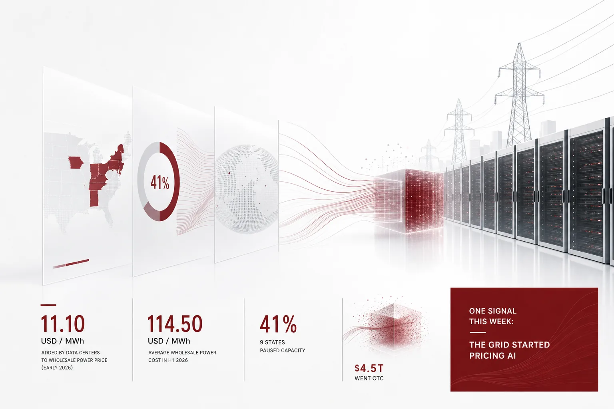

AI 서비스 예산을 맡고 있다면, 이번 주에 먼저 둥근 표시를 할 곳은 전력망의 청구서입니다. PJM의 독립 시장 모니터는 데이터센터 수요가 2026년 초반 도매전력 단가에 MWh당 11.10달러를 추가했다고 추정했습니다. 2026년 상반기 평균 도매전력 비용은 MWh당 114.50달러였습니다. 모니터의 추정 대상인 2026년 상반기는 이미 지나온 기간입니다. 다음 해를 위한 예상이 아니라, 이미 치른 청구서의 값에 해당합니다. 데이터센터가 전력망에 추가한 선은 전체의 10퍼센트가 조금 못 되는 크기입니다. 그 시장에서 전력을 살 때마다 붙는 선입니다. 모니터가 붙인 설명을 보면, 이 선은 수요가 만든 것입니다. 데이터센터가 전력을 더 쓰면서 도매시장 가격이 올랐습니다. 다른 전력 사용자들이 더 비싼 단가를 내기 시작했다는 뜻입니다. 이번 주 뉴스는 그 라인에 대한 업계의 대답입니다. 미국의 주지사들과 AI 기업들, 그리고 해외 정부가 제각기 다른 방향으로 답했습니다.

*글의 핵심 개념을 형상화했습니다.*

## 청구서 위의 11.10달러

모니터의 추정값을 한 줄로 읽으면 다음과 같습니다. 2026년 상반기 PJM 도매전력 단가 114.50달러 가운데, 데이터센터 수요가 11.10달러를 더했습니다. 데이터센터 수요가 없었다면 얼마가 덜 했는지를 계산해 붙인 값입니다. 추가된 선을 빼면 103달러 안쪽이 됩니다. 즉, 상반기 전력 단가의 10퍼센트에 가까운 크기가 데이터센터에서 온 것입니다. 독립 시장 모니터라는 이름도 주목할 지점입니다. 시장이 어떻게 움직였는지를 밖에서 따져보는 모니터가 낸 추정이라는 뜻입니다. 그리고 이 선의 값을 데이터센터 주인만 내지 않습니다. 데이터센터는 연중무휴로 돌아갑니다. 돌아가는 시간이 길수록 라인은 두꺼워집니다. 도매시장 단가에 반영되니, 같은 시장에서 전력을 사는 모든 회사가 일부는 함께 부담합니다. 이 선은 다음 분기면 사라지는 작은 값이 아닙니다. 데이터센터 수요가 그리드에 실리는 한, 도매시장에 계속 남아 있는 값입니다. 전력망의 청구서는 산업 전체 앞으로 적혀 있습니다.

## 9개 주지사가 멈춘 용량의 41퍼센트

첫 번째 대답은 브레이크입니다. 미국의 9개 주지사가 계획 중인 데이터센터 용량의 41퍼센트에 대해 건설 보류를 약속했습니다. 최근 선거 결과로 주 단위 데이터센터 건설 중단이 AI 허브의 빠른 확장을 방해할 수 있다는 우려가 투자계에 퍼지고 있습니다. 브레이크를 밟은 주체는 주라는 정치 단위입니다. 보류 대상에 "계획 중인"이라는 말이 붙은 지점은 구분해 볼 필요가 있습니다. 아직 지어질 예정이던 용량의 41퍼센트입니다. 건설 스케줄이 미뤄지면, 그 스케줄 덕분에 생길 예정이던 신규 추론 용량도 함께 미뤄집니다. 41퍼센트는 건설 스케줄의 상당 부분을 차지합니다. 주목할 것은 보류가 아직 "약속"이라는 단계에 있다는 점입니다. 규제가 존재하기도 전에, 주지사의 공약 수준에서 시장이 움직이기 시작했다는 뜻입니다. 투자계가 두려워하는 것은 바로 AI 허브의 '빠른 확장'입니다. 한 시설의 중단이 아니라, 지역의 확장 스케줄 전체가 흔들리는 것을 우려하는 것입니다. 이 뉴스를 "몇몇 주가 데이터센터를 반대한다"로 읽으면 안 됩니다. 정치 캘린더가 AI 인프라의 속도를 정하기 시작했다는 것입니다. 전력망의 청구서가 비싸질수록 지역은 "왜 우리가 내야 하는가"를 묻습니다. 주지사의 약속은 그 물음에 대한 답입니다.

## OpenAI의 답은 이름 바꾸기

OpenAI의 대답은 가장 경제적이었습니다. OpenAI는 채용 사이트를 업데이트해 자사의 데이터 처리 시설을 "AI compute campuses"로 표기하도록 했습니다. 지역사회와의 마찰을 줄이고 데이터센터에 대한 지역 반발을 완화하려는 의도라고 설명합니다. 채용 사이트라는 매체가 의미를 가집니다. 그 시설에서 일할 사람을 뽑는 페이지에 새 이름이 올라가는 순간, 회사 공식 서술이 바뀝니다. OpenAI가 다스리고 싶어 하는 반발은 시설 자체를 향한 것이면서 시설이 지역에 남기는 부담을 향한 것이기도 합니다. 데이터센터는 소음과 전력 소비를 떠올리게 하는 단어이고 캠퍼스는 가볍음을 떠올리게 합니다. 명칭은 개입 비용이 가장 낮은 선택지입니다. 다만 이름 바꿈은 그리드에 실리는 부하를 바꾸지 못합니다. 모니터가 계산한 11.10달러 라인은 캠퍼스로 부름을 받아도 그대로 계산됩니다. 명칭 변경은 마찰을 줄이는 행위이고 청구서 자체는 줄지 않는 행위에 가깝습니다. OpenAI는 이번 주에 전자를 택했습니다.

## 4조 5천억 달러, 장부를 벗어난 자리

세 번째 대답은 부채의 자리를 옮기는 것입니다. 상위 AI 기업 7곳이 회계상 자산과 부채로 잡히지 않는 인프라 지출, 즉 회계 외면(off-balance-sheet) 지출에 4조 5천억 달러를 약속했습니다. 약속이라는 말의 무게도 주목할 만합니다. 이미 치른 금액이 아니라, 앞으로 쓰기로 한 지출에 대한 공약입니다. 새로운 분석은 이 기업들의 인프라 지출 대부분이 회계 외면 구조에 편중되어 있음을 짚었습니다. AI 확장을 추진하는 기술 기업의 신용 위험이 높아졌다고 경고합니다. 회계 외면 구조의 핵심은, 지출을 하는 주체가 회사 장부 밖으로 나온다는 데 있습니다. 건설은 계속하되, 장부에 남기지 않는 것입니다. 이 구조는 확장의 비용을 투자자가 원래 보는 재무제표 밖으로 이동시킵니다. 분석이 걱정하는 지점이 정확히 여기에 있습니다. 비용이 눈에 보이는 자리에서 벗어날수록, "그 비용을 결국 누가 갚느냐"는 물음이 커집니다. 이번 주 숫자들을 나란히 놓으면 배경이 보입니다. 주지사가 멈춘 용량과, 모니터가 계산한 전력 단가, 그리고 4조 5천억 달러 약속이 같은 시간대에 움직였습니다. 전력망의 청구서와 부채 구조는 같은 방향으로 갑니다. 두 경우 모두, 확장의 비용이 나중에 정산되는 자리로 옮겨집니다.

## 브레이크를 밟지 않겠다고 말한 나라도 있습니다

그 한가운데, 영국은 브레이크를 밟지 않겠다고 명시했습니다. 영국 성장장관은 미국발 데이터센터 반발 속에서도 AI 야심을 늦추지 않겠다는 뜻을 분명히 했습니다. 영국 정부는 정치적 기류와 무관하게 컴퓨팅 인프라와 AI 역량 확대 계획을 그대로 추진하기로 했습니다. 영국은 미국 반발 국면의 분위기가 영국으로 전이되지 않겠다는 선을 그은 것입니다. 미국은 주 단위 마찰에 걸려 있습니다. 영국은 국가 차원의 계속 진행을 선언했습니다. 마찰의 단위가 다릅니다. 미국에서는 주지사들이, 영국에서는 정부가 그 역할을 합니다. 방향이 달라도 전제는 같습니다. 컴퓨팅 확장은 국가적 의제입니다. 물음은 더 이상 "확장할 것인가"가 아닙니다. "그 비용을 누가, 어디서, 얼마나 빨리 낼 것인가"입니다.

## 청구서를 안 타고 다니는 모델

청구서의 반대편에는 역수가 태어나고 있습니다. Hugging Face 연구팀은 webAI의 TwIL-8B 모델이 AI 에이전트 테스트에서 LFM3-1.7B 모델을 앞섰음을 확인했습니다. 특화된 강화학습으로 추론 모델을 자율 에이전트로 적응시킬 수 있음을 시연한 결과에 해당합니다. 작은 모델이 더 큰 모델을 앞선 지점은 과업과의 궁합에 있습니다. 8B 규모는 기업이 자기 환경에서 돌릴지를 검토할 수 있는 수준의 모델입니다. 모델이 배포되고 비교되는 장의 운영 주체인 Hugging Face가 이 확인을 내놓은 점도 의미가 있습니다. 그 장의 주인이, 그 위에서 에이전트 워크로드의 현실을 업데이트한 것입니다. 동시에 "에이전트를 믿어도 되는지"를 재는 눈금도 바뀌었습니다. 리더보드에 일관성 지표가 추가된 사실 자체가, "어느 정도 능력 있는가"만으로는 더 이상 충분하지 않다는 신호입니다. 연구자 Joel Niklaus가 AI 코딩 하네스 리더보드에 일관성 지표를 추가했습니다. 코딩 에이전트 래퍼가 동일 작업을 연속 3회 수행했을 때 성공하는 빈도를 추적합니다. 갱신된 신뢰성 랭킹의 1위는 Hermes Agent입니다. "세 번 연속 해내었는가"가 눈금이 되었습니다. 공급자 쪽에서도 통제의 단위는 "특정 도구"까지 좁아지고 있습니다. 구글은 K-12 학교 관리자가 학생 계정에서 Gemini와 NotebookLM 같은 특정 AI 도구를 비활성화하되, 검색 서비스 접근은 유지하도록 허용할 계획입니다. 도구 공급자 쪽에서도, 전체를 끄는 방식 대신 '특정 부분만 끄는' 장치를 마련한다는 뜻입니다. AI를 켜고 끄는 입자가 도구 하나 단위로 세분되는 움직임입니다. 거대한 센터의 청구서가 오르면서 작은 모델은 쓸모가 생겼습니다. 일관성은 눈금이 되고 통제는 세분됩니다. 이것이 전력망 청구서에 대한 역수입니다.

## 다음 전력 청구서를 결정할 자리

이번 주에 보인 대답들, 주지사의 브레이크든 OpenAI의 명칭 변경이든 회계 외면의 부채 구조든, 11.10달러 자체를 줄인 것은 없습니다. 청구서가 바뀌는 시점은 "실행의 위치"가 바뀌는 시점입니다. 전력을 어디서 쓰고 시설을 어디에 두느냐는 더 이상 인프라 팀의 문제가 아닙니다. AI 운영 예산의 물음이 되었습니다. 기업에게 이번 주 뉴스는, 전력 단가와 건설 스케줄이 AI 운영 변수가 되는 시대의 예고입니다. 중심, 즉 하이퍼스케일이 비싸지고 그 스케줄이 불확실해질수록, 필요한 AI를 통제할 수 있는 자리에서 돌리는 것의 가치는 올라갑니다. 이번 주 뉴스가 가리키는 지점은 이것입니다. 실행의 위치가 비용의 변수가 되는 순간, 그 위치를 관리하는 플랫폼이 인프라가 됩니다. ThakiCloud의 Agent-Native Cloud인 Paxis(정식 v1.1 GA 릴리스)는 이 기준을 실행 환경에 만든 플랫폼입니다. 소버린, 온프렘 Kubernetes(ai-platform)로 실행을 고객의 데이터센터 안에 두며 일급 리소스는 Skills, Tools, Policies, Audit Logs입니다. 자율도는 L0부터 L3까지 나뉩니다. 각 단계가 정책 게이트를 통과합니다. 감사 로그에 기록이 남습니다. 실행은 격리된 샌드박스에서 일어납니다. 외부 시스템은 MCP 커넥터와 스킬 마켓으로 연결됩니다. CostRouter가 작업 단위로 모델을 선택합니다. 그러면 TwIL-8B급 소형 모델이 실질적 옵션이 되고 "세 번 연속"이라는 눈금은 플랫폼이 측정하고 통제하는 항목이 됩니다. 데이터센터가 전력망에 추가한 11.10달러는 첫 할부입니다. AI 실행이 어디에 앉느냐가 다음 청구서의 모양을 정합니다. 이번 주 기업에게 남은 물음은 "어디서 돌릴 것인가"입니다.

## 참고 자료

이 글은 아래 뉴스를 종합해 작성했습니다.

- HuggingNews, [Google to Let K-12 Schools Block Specific AI Tools Without Losing Search Access](https://huggingnews.com/ai/google-to-let-k-12-schools-block-specific-ai-tools-without-losing-search-5e84bc71)
- HuggingNews, [Nine US Governors Pledge Pauses for 41% of Planned Data Center Capacity](https://huggingnews.com/ai/nine-us-governors-pledge-pauses-for-41percent-of-planned-data-center-cap-29ac15fd)
- HuggingNews, [OpenAI Rebrands Data Centers as 'AI Compute Campuses' to Curb Local Backlash](https://huggingnews.com/ai/openai-rebrands-data-centers-as-ai-compute-campuses-to-curb-local-backla-ee822a69)
- HuggingNews, [Data Center Demand Added $11.10 per MWh to PJM Wholesale Power Costs in Early 2026](https://huggingnews.com/ai/data-center-demand-added-1110-per-mwh-to-pjm-wholesale-power-costs-in-ea-c33f770a)
- HuggingNews, [Hermes Agent Leads Reliability Ranking on Updated AI Coding Harness Leaderboard](https://huggingnews.com/ai/hermes-agent-leads-reliability-ranking-on-updated-ai-coding-harness-lead-9dfa3ba5)
- HuggingNews, [Seven Top AI Companies Pledge $4.5T to Off-Balance-Sheet Infrastructure Spending](https://huggingnews.com/ai/seven-top-ai-companies-pledge-45t-to-off-balance-sheet-infrastructure-sp-08e4ff5b)
- HuggingNews, [Hugging Face Finds webAI's TwIL-8B Model Beats LFM3-1.7B in AI Agent Tests](https://huggingnews.com/ai/update-hugging-face-finds-webais-twil-8b-model-beats-lfm3-17b-in-ai-agen-44549c8f)
- HuggingNews, [UK Growth Minister Rules Out Slowing AI Ambitions Amid US Data Center Backlash](https://huggingnews.com/ai/uk-growth-minister-rules-out-slowing-ai-ambitions-amid-us-data-center-ba-f9d12bd2)